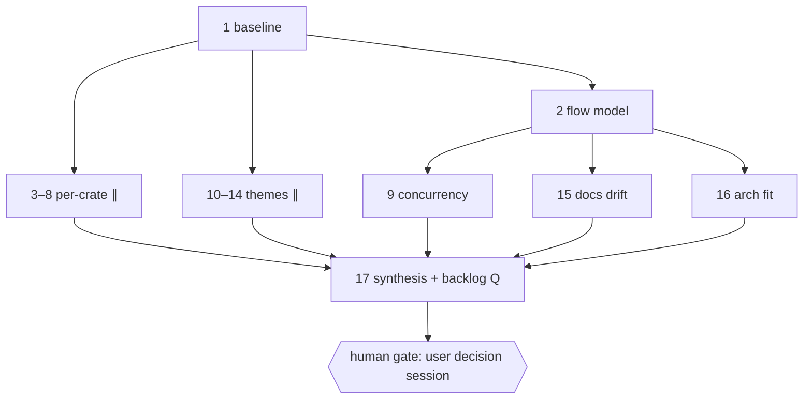

# [Plan] v0.1.0 Quality Audit — Dispatch Plan & Agent Prompts

- **Date**: 2026-10-16
- **Kind**: dispatch plan — three-stage agent prompts (planning →
  execution → review) for the **17 read-only chunks** that execute the
  accepted v0.1.0 architecture & quality audit (origin Phases 0–4).
  Every chunk audits the **`v0.1.0` git tag**, delivers reports under
  `.artifacts/reports/` (chunk 17 also reconciles the improvements
  backlog), and opens a `docs/`-scoped PR. No code in this commit.
- **Origin**: `.artifacts/plans/2026-10-16-v0.1.0-quality-audit-plan.md`
  — **normative**: §2 (audit axes, cited by ID), §3 (findings format &
  severity), §5 (method rules); **scheduling**: §4 (phases), §8
  (acceptance); plus the user's 2026-10-16 chunking instruction (origin
  §9 handoff prompt, adopted verbatim as this plan's requirements).
- **Status**: READY — chunk 1 is dispatchable immediately. Chunks 2–8
  and 10–14 dispatch after chunk 1's PR merges; chunks 9, 15, 16
  additionally after chunk 2's; chunk 17 after all of chunks 1–16 have
  merged. Deliberately **not dispatched here**: the **remediation
  dispatch plan** (origin §4 Phase 4 makes it a separate deliverable,
  produced only after the user accepts the findings in the decision
  session — see §19), any production-code change, the D1–D6 decisions
  themselves, new CI jobs (Bencher stays a backlog item unless promoted
  in the session), and the kiosk on-device validation spike.

## 1. Chunks & ordering

| Chunk | Origin slice | Branch | Covers | Size |
|---|---|---|---|---|
| 1 | §4 Phase 0 (+ §2 J budget table) | `docs/audit-phase0-baseline` | All mechanical metrics on the tag, once: per-crate llvm-cov, mutants survivors (+ optional one-offs), pedantic-clippy inventory, cargo-machete, Sonar duplication/complexity, churn heatmap, wall-time + slowest-20, snapshot inventory, axis-J budget envelope table. The named input of every later chunk. No findings beyond metric anomalies. | M |
| 2 | §4 Phase 1 / axis D | `docs/audit-phase1-flow-model` | Data & control flow diagram derived from `bootstrap.rs` + actor spawn sites; mermaid + edge table; every edge `file:line` @ v0.1.0. Input of chunks 9, 15, 16. | M |
| 3 | §4 Phase 2 / axes E, G, F, I.4, H, B+C | `docs/audit-crate-domain` | Per-crate checklist scoped to `taskboard-domain`. | M |
| 4 | §4 Phase 2 / axes E, G, F, I.4, H, B+C | `docs/audit-crate-state` | Same checklist scoped to `taskboard-state`. | S |
| 5 | §4 Phase 2 / axes E, G, F, I.4, H, B+C | `docs/audit-crate-storage` | Same checklist scoped to `taskboard-storage-sqlite`. | S |
| 6 | §4 Phase 2 / axes E, G, F, I.4, H, B+C | `docs/audit-crate-sync` | Same checklist scoped to `taskboard-sync-nextcloud`. | L |
| 7 | §4 Phase 2 / axes E, G, F, I.4, H, B+C **+ O** (reconciliation, §1.3) | `docs/audit-crate-ui` | Same checklist scoped to `taskboard-ui-slint`, plus axis O (unsafe inventory + machine-checkable boundary proposal). | M |
| 8 | §4 Phase 2 / axes E, G, F, I.4, H, B+C | `docs/audit-crate-app` | Same checklist scoped to `taskboard-app`. | L |
| 9 | §4 Phase 3(a) / axis K **+ I.1–I.3, I.5** (reconciliation, §1.3) | `docs/audit-theme-concurrency` | Concurrency, lifecycle, backpressure; select! cancellation-safety; channel-close semantics; daemon-reachable panics; implicit actor contracts. Needs chunk 2's edge table. | M |
| 10 | §4 Phase 3(b) / axis M | `docs/audit-theme-sync-persistence` | Sync & persistence semantics vs ADRs 0004/0005/0007/0010. | M |
| 11 | §4 Phase 3(c) / axis L | `docs/audit-theme-time-dst` | Time sources, clock seams, DST/timezone correctness of reminders, sync clock-skew. | S |
| 12 | §4 Phase 3(d) / axis N | `docs/audit-theme-security` | Secrets handling, keyring, IPC surface (ADR 0012), output leakage, WebDAV paths. | M |
| 13 | §4 Phase 3(e) / axis J | `docs/audit-theme-perf-budgets` | Bench coverage vs chunk 1's budget table; gap candidates; Bencher graduation recommendation. | M |
| 14 | §4 Phase 3(f) / axes B+C synthesis | `docs/audit-theme-test-quality` | Risk map, mutant triage, determinism sweep, gated-test verification, flaky watchlist, snapshot hygiene, tier layering. Consumes all chunk-1 artifacts. | L |
| 15 | §4 Phase 3(g) / axis P | `docs/audit-theme-docs-drift` | docs/ADR section-by-section diff vs shipped code; ADR 0013 gap; CHANGELOG vs v0.1.0. Needs chunk 2's diagram. | M |
| 16 | §2 A (reconciliation, §1.3) | `docs/audit-theme-arch-fit` | D1–D6 + reminders + multi-board + kiosk/IPC dry-run walkthroughs; friction findings only, no pre-deciding. Needs chunk 2's edge table. | M |
| 17 | §4 Phase 4 / axis Q + synthesis | `docs/audit-phase4-synthesis` | Merge chunks 1–16 into the findings report; reconcile the ~80-entry backlog; prepare the user decision session. Must NOT produce the remediation dispatch plan. | L |

### 1.1 Axis → chunk coverage map

Origin §8 demands every §2 axis maps to coverage with no silent
skips. The origin's §4 phase list leaves **A**, **O**, and **I.1–I.3,
I.5** unscheduled; this plan reconciles them (recorded rationale in
§1.3). Full map — chunk 17 verifies it at synthesis time:

| Axis | Covered by |
|---|---|
| A architecture fit | chunk 16 |
| B test coverage/strength | chunks 3–8 (per-crate structure) + chunk 14 (synthesis) |
| C determinism & hygiene | chunks 3–8 (per-crate) + chunk 14 (synthesis) |
| D flow model | chunk 2 |
| E crate/module factoring | chunks 3–8 (per-crate inventory; split candidates adjudicated in 6 & 8) |
| F data-model fit | chunks 3–8 (crate structs) + chunk 16 (D1–D6 walkthrough) |
| G naming drift | chunks 3–8 |
| H duplication/complexity | chunks 3–8 (using chunk 1's Sonar/coverage inputs) |
| I error-prone designs | I.4 → chunks 3–8; I.1, I.2, I.3, I.5 → chunk 9 |
| J performance budgets | budget table → chunk 1; bench mapping & gaps → chunk 13 |
| K concurrency/lifecycle | chunk 9 |
| L time/clocks/DST | chunk 11 |
| M sync & persistence | chunk 10 |
| N security | chunk 12 |
| O unsafe & boundaries | chunk 7 |
| P docs & ADR drift | chunk 15 |
| Q backlog reconciliation | chunk 17 |

### 1.2 Dependency graph & dispatch mechanics



- **Chunk 1 gates everything** (origin Phase 0 outputs are named
  inputs; nothing re-derives them).
- Chunks 2–8, 10–14 are mutually order-independent after chunk 1
  merges — dispatch serially or in parallel sessions.
- Chunks 9, 15, 16 additionally wait for chunk 2's merged edge table
  (their method reads the channel/contract map; chunks 10–14 do not
  strictly need it but may cite it).
- **Chunk 17 runs last**, after all of chunks 1–16 have merged.
- After chunk 17 merges: **human gate** — the user decision session
  (accept-as-risk vs schedule per P1/P2, §19). The remediation dispatch
  plan is authored in a *separate* session only after that acceptance.

**Dispatch mechanics**: one agent session per prompt, in order
(N.1 → N.2 → N.3 within a chunk); independent chunks may run
concurrently as separate sessions; never two agents share one
worktree. Every chunk works in `../taskboard-WT-<branch>` next to the
project root (AGENTS §8) — **branched off the `v0.1.0` tag, never off
`main`** (convention 1 below). No PR is ever stacked on another chunk's
PR; the rebase dance of AGENTS §8 is therefore not expected (§1.5).

**Shared execution model** (binding for every chunk, adapted from the
house three-stage protocol):

1. **Stage 1 — planning agent**: fetches tags, creates the worktree
   `../taskboard-WT-<branch>` on a new branch off **`v0.1.0`**
   (convention 1), writes the chunk plan at
   `.artifacts/plans/<today>-v0.1.0-audit-<slug>-plan.md` in the house
   `[Plan]` style, resolving every open question with a recorded
   decision, commits it (`docs(plan): v0.1.0 audit — <slug> scope`).
   No investigation beyond orientation reading, no implementation, no
   push. Origin §2/§3/§5 are normative; deviations need a recorded
   reason.
2. **Stage 2 — execution agent**: continues in that worktree
   (recreates it on the branch if missing), executes the audit per the
   approved plan — **read-only against the tag tree** — and writes the
   chunk's report(s) with findings in the origin §3 format
   (conventions 4–5). Keeps the repo diff to exactly the artefacts the
   chunk owns (convention 8); runs the gates that apply to a docs-only
   diff (convention 6). Does **not** push or open a PR. Reports
   deviations.
3. **Stage 3 — review agent**: reviews the entire branch diff versus
   the tag (`git diff v0.1.0...HEAD`) against the chunk's acceptance
   criteria + AGENTS rules **plus the evidence & artefact mandate
   below**, re-runs whatever gates apply, implements fixes for every
   finding on the branch (amend/reword, never duplicate-subject
   fixups). Its last task is shipping: push the branch, open the PR to
   `main` with `gh`, watch `gh pr checks --watch` to completion — any
   failing check is a finding; diagnose, fix, push
   `--force-with-lease`, repeat until green. Reports a verdict. Never
   merges; never touches `main`. (`main` is branch-protected — merges
   happen on GitHub by the user, after the required checks pass.)

**Evidence & artefact mandate** (stage 3, every chunk — the
research/docs variant of the code-quality mandate):

- **Evidence**: every factual claim carries evidence — `file:line` in
  the **v0.1.0 tree** (the worktree *is* the tag tree, so worktree line
  numbers are tag line numbers; verify there, never against `main`),
  a workflow path, or a named chunk-1 baseline metric cited by its
  section anchor. Experiments and metric captures are reproducible
  from the report's method section (commands recorded verbatim).
- **Decision-grade**: every finding has severity, a proposed action,
  and an effort guess (origin §3); a P0/P1 without a proposed action is
  itself a review finding against the report. Recommendations name
  options, trade-offs, and exactly one recommendation where a decision
  is called for.
- **Repo hygiene**: scratch probes, downloaded artifacts, and raw
  metric dumps never land in the repo — evidence is excerpts and
  tables *inside* the report. The PR diff is exactly the chunk's plan +
  report (+ the backlog file for chunk 17 only).
- **Scope discipline**: out-of-scope ideas become **P3 findings in the
  chunk report**, not backlog edits — chunk 17 alone owns the backlog
  (convention 7). No speculative content beyond the chunk's axes.
- **Read-only discipline** (origin §5): zero production-code changes —
  not even "trivial" fixes, lint-config tweaks, or `Cargo.toml`
  touch-ups; a needed fix is a finding with a proposed action, never a
  diff.

### 1.3 Binding conventions (referenced as "conv 1–9" by every prompt)

1. **Tag discipline** — how each chunk references `v0.1.0`. Stage 1 of
   every chunk starts with `git fetch origin --tags --prune` in
   /home/viktoria/src/taskboard, verifies the tag resolves, and creates
   the worktree **off the tag**:
   `git worktree add ../taskboard-WT-<branch> -b <branch> v0.1.0`.
   The worktree tree equals the audited tree; every `file:line`
   evidence refers to it. **Never rebase an audit branch onto `main`**
   to "refresh" it — post-tag divergence of `main` is expected
   (post-tag `main` only accrues audit artefacts) and harmless, because
   every PR adds only new files. Review diffs are always
   `git diff v0.1.0...HEAD`.
2. **Input plumbing** — how later chunks read earlier deliverables
   without checking them out: after `git fetch origin --prune`,
   resolve the input by
   `git ls-tree --name-only origin/main -- .artifacts/reports/ | grep 'v0.1.0-audit-<slug>-report'`,
   then read with `git show origin/main:.artifacts/reports/<file>`.
   Never copy input files into the worktree; never commit them.
3. **Naming** — reports:
   `.artifacts/reports/<today>-v0.1.0-audit-<slug>-report.md` (house
   `[Report]` style; `<today>` is the execution date, so later chunks
   discover files by the `v0.1.0-audit-<slug>-report` glob, conv 2).
   Chunk plans:
   `.artifacts/plans/<today>-v0.1.0-audit-<slug>-plan.md`.
4. **Findings format** (origin §3, normative): every finding is
   recorded as
   `F<chunk>-<NN> · severity P0–P3 · axis <ID> · evidence (file:line @ v0.1.0 | workflow path | baseline §anchor) · proposed action · effort S/M/L`.
   IDs are stable; chunk 17 merges reports without renumbering
   (duplicates merge with both IDs noted). A claim without evidence is
   not a finding; a finding without action+severity is an observation
   and gets P3 (origin §5).
5. **Axis coverage table** — every chunk report ends with a table: each
   assigned axis → verdict (N findings / clean / accepted-risk). This
   is origin §8's no-silent-skips rule applied at chunk scope; chunk 17
   aggregates them into the final coverage proof.
6. **Baseline monopoly** (user requirement 3) — chunk 1 produces, once:
   per-crate coverage (`§cov`), mutants survivor report + one-off
   status (`§mutants`), pedantic-clippy inventory (`§clippy-pedantic`),
   cargo-machete output (`§machete`), Sonar duplication/complexity
   (`§sonar`), churn heatmap (`§churn`), wall-time + slowest-20
   (`§timing`), snapshot inventory (`§snapshots`), budget envelope
   (`§budgets`), tool versions + audited SHA (`§env`). These section
   anchors are fixed. Later chunks **cite** these sections and must not
   re-derive them; running read-only code/tests to answer an axis
   question is allowed — re-collecting a baseline artifact is not
   (exception requires a recorded reason in the chunk plan).
7. **Backlog centralization** — chunks 1–16 never edit
   `.artifacts/taskboard-potential-improvements-backlog.md`; every
   improvement idea is a P3 finding in the chunk report. Chunk 17
   alone reconciles the backlog (axis Q). This overrides the generic
   "out-of-scope ideas go to the backlog" habit for this dispatch —
   16 parallel backlog edits would conflict.
8. **Diff shape** — chunks 1–16: the entire allowed diff is the
   stage-1 plan + the chunk's report file(s). Chunk 17: plan +
   findings report + decision agenda + the reconciled backlog file.
   Nothing else; any other change is a review finding.
9. **Axis reconciliation of origin gaps** — the origin's §4 phase list
   schedules neither axis **A** (architecture-fit walkthroughs) nor
   axis **O** (unsafe & boundary enforcement), nor I.1–I.3/I.5 (only
   I.4 is in the Phase-2 checklist). This plan schedules them: **A →
   chunk 16** (its D1–D6 walkthroughs span crates, ~½–1 day of real
   analysis, so it gets its own cross-cutting chunk rather than hiding
   inside another); **O → chunk 7** (its subject — unsafe in ui-slint
   and the domain-purity ban proposal — lives in that crate);
   **I.1 (select! cancellation-safety), I.2 (channel-close semantics),
   I.3 (daemon-reachable unwrap/expect), I.5 (implicit actor
   contracts) → chunk 9** (they are the same actor-loop/lifecycle
   pass as K). Recorded here so nobody re-derives the mapping; chunk
   17 checks the map in §1.1 as part of origin §8 verification.

### 1.4 Gates

Every PR is `docs/`-scoped (branch `docs/audit-*`, commits
`docs(plan)/docs(report)/docs(backlog)`). The pre-commit fmt/clippy
hooks run on every commit; CI runs the full gate suite on the PR —
the tree is the shipped-green v0.1.0 tag plus artefact files, so any
red check is an environment/formatting finding to diagnose and fix on
the branch (in the artefacts), never a reason to touch production
code. Stage 3 watches `gh pr checks --watch` to green before handing
off.

### 1.5 Rebase-merge hygiene (AGENTS §8)

- **No chunk stacks on another chunk's PR**: every branch is cut from
  the same immutable `v0.1.0` tag and adds disjoint files, so the
  stacked-PR rebase dance is not expected in this dispatch. When
  sibling PRs merge first, a still-open PR stays valid — do not
  "update" it by rebasing onto `main` (conv 1).
- **Commit hygiene**: every commit lands on `main` verbatim via rebase
  merge; each stands alone (correct tree, meaningful
  `<type>(<module>)` subject, no WIP). Fixes during review are
  amended/reworded, never appended as duplicate-subject fixups.
- **The one conflict risk**: chunk 17 edits the backlog file. Its
  stage 1 verifies
  `git diff --quiet v0.1.0 origin/main -- .artifacts/taskboard-potential-improvements-backlog.md`;
  if the backlog moved on `main` after the tag (it should not — conv 7),
  STOP and report instead of improvising a resolution.
- If GitHub nevertheless reports conflicts on any PR, apply the AGENTS
  §8 dance exactly:
  `git fetch origin --prune && git rebase --onto origin/main <merge-base> <branch>`
  then `git push --force-with-lease origin <branch>` — `--force-with-lease`
  mandatory, never plain `--force`.

---

## 2. Chunk 1 — Phase 0: baseline metrics (`docs/audit-phase0-baseline`)

- **Covers**: origin §4 Phase 0, one-time collection on the tag:
  (1) llvm-cov **per crate**; (2) the **latest weekly cargo-mutants
  survivor report** for domain+state (retrieve the CI artifact via
  `gh run list`/`gh run download`; record the run date and audited
  SHA) — plus the **optional, time-boxed one-off runs** for
  storage-sqlite and sync-nextcloud (a full mutants sweep of a 12k-line
  crate can run for days: cap it, and record partial coverage honestly
  rather than not at all); (3) one-off
  `cargo clippy --workspace --all-targets -- -W clippy::pedantic`
  **report-only** inventory (per-crate counts + worst offenders; lint
  configs are NOT touched); (4) `cargo machete` unused-dep scan with
  false-positive triage (macro-only deps etc.); (5) SonarCloud
  duplication + complexity dump (project key + analysis date + whether
  the analyzed SHA equals the tag — via the SonarCloud web UI/API or
  the sonarqube MCP tools if the session has them); (6) git churn
  heatmap (files by commit count across history ≤ v0.1.0);
  (7) suite wall-time + slowest-20 tests (nextest; record the exact
  command); (8) snapshot inventory (the 16 insta snapshots);
  (9) the **axis-J budget envelope table** fixed from origin §1
  hardware + §2 J: RSS ceiling (~≤200 MB), idle CPU ≈ 0, full-frame
  repaint on a 1.5 GHz in-order core with partial-redraw expectation,
  daemon cold start, sync-cycle wall time + poll-idle cost, binary
  size — analytic targets for the device class, **no GPU-dependent
  budgets** (gen3 graphics have no hardware GL on modern Mesa).
  Report sections use the fixed anchors of conv 6 (`§cov` … `§env`).
  **Non-goals**: no findings beyond anomalies the metrics themselves
  reveal (recorded as P3 observations), no percentage targets (origin
  §5), no fixes, no CI changes.
- **Deliverable**:
  `.artifacts/reports/<today>-v0.1.0-audit-baseline-metrics-report.md`.
- **Acceptance**: every conv-6 anchor exists and is reproducible from
  the method section (commands verbatim, tool versions, `git rev-parse
  v0.1.0` recorded in `§env`); mutants staleness/one-off status is
  stated honestly; the budget table cites origin §1 devices; diff =
  plan + report only; gates per §1.4.

**Prompt 1.1 (planning):**

```text
You are the stage-1 PLANNING agent for chunk 1 of the v0.1.0 audit dispatch ("Phase 0: baseline metrics", branch docs/audit-phase0-baseline) in the taskboard repo at /home/viktoria/src/taskboard.

1. Read AGENTS.md, then the audit plan .artifacts/plans/2026-10-16-v0.1.0-quality-audit-plan.md §1 (known facts), §2 J (budgets), §4 Phase 0, §5 (method rules — no percentage targets), and this dispatch plan .artifacts/plans/2026-10-16-v0.1.0-audit-dispatch-plan.md §1 (conventions 1–9 are binding).
2. Survey what already exists so you build on it, not duplicate: CI workflows (llvm-cov/Codecov, the weekly cargo-mutants job and its artifact names, SonarCloud job, benchmark job) and the Criterion bench target — list each with its workflow path.
3. git fetch origin --tags --prune; verify v0.1.0 resolves; create the worktree off the TAG: git worktree add ../taskboard-WT-docs-audit-phase0-baseline -b docs/audit-phase0-baseline v0.1.0. Never branch off main (conv 1).
4. Write the plan at .artifacts/plans/<today>-v0.1.0-audit-baseline-metrics-plan.md (house [Plan] style): the exact command per metric (llvm-cov per crate, mutants artifact retrieval + fallback local run, time-box for the optional storage-sqlite/sync-nextcloud one-offs, pedantic clippy capture, machete, Sonar export route, churn heatmap pipeline, nextest timing + slowest-20 extraction, snapshot enumeration), the fixed report section anchors (conv 6), the budget-table derivation from origin §1 devices, and honest-capture rules (staleness, partial coverage, SHA mismatches are recorded, never smoothed over). Resolve every open question with a recorded decision.
5. Commit as: docs(plan): v0.1.0 audit — baseline metrics scope. Do not collect yet; do not push.

Report: plan path, per-metric approach decisions, time-boxes, risks, estimated wall time.
```

**Prompt 1.2 (execution):**

```text
You are the stage-2 EXECUTION agent for chunk 1 of the v0.1.0 audit dispatch ("Phase 0: baseline metrics").

1. Read AGENTS.md, the audit plan §4 Phase 0/§5, the dispatch plan §1 (conventions binding), and the stage-1 plan (.artifacts/plans/*v0.1.0-audit-baseline-metrics*-plan.md) in the worktree ../taskboard-WT-docs-audit-phase0-baseline (branch docs/audit-phase0-baseline; recreate the worktree on that branch off v0.1.0 if missing).
2. Execute the collection exactly per the plan, entirely against the tag tree. Hard rules: read-only — no lint-config, Cargo.toml, or CI edits; scratch captures stay outside the repo (/tmp) and land only as excerpts/tables in the report; mutants one-offs respect their time-box with partial coverage recorded honestly; §clippy-pedantic is an inventory, not a fix list; the budget table carries no GPU budgets and sets no coverage percentages (origin §5).
3. Write .artifacts/reports/<today>-v0.1.0-audit-baseline-metrics-report.md (house [Report] style, §env…§budgets anchors per conv 6), ending with the axis coverage table (assigned slice: J budget envelope — verdict).
4. Run the gates that apply to a docs-only diff (§1.4); the diff must be exactly plan + report (conv 8).
5. No push, no PR — shipping is stage 3's last task. Never push to or merge main.

Report: per-anchor completion status, staleness/partial-coverage caveats, any deviation from the plan and why.
```

**Prompt 1.3 (review):**

```text
You are the stage-3 REVIEW agent for chunk 1 of the v0.1.0 audit dispatch (branch docs/audit-phase0-baseline).

1. Read AGENTS.md, the audit plan §4 Phase 0/§5, the dispatch plan §1 (the evidence & artefact mandate and conventions 1–8 apply to you), and the stage-1 plan; then review the full branch diff (git diff v0.1.0...HEAD) in ../taskboard-WT-docs-audit-phase0-baseline.
2. Functional focus: every conv-6 anchor is present, reproducible (method section commands verbatim, §env records tool versions + the audited SHA), and honestly caveated (mutants staleness, one-off partial coverage, Sonar SHA vs tag); the budget table cites origin §1 devices and contains no GPU budgets or percentage targets; later chunks could consume each anchor blind, by section slug alone.
3. Evidence & artefact mandate (dispatch §1): apply in full — metric claims trace to recorded commands; no scratch/dump files landed; diff is exactly plan + report; read-only discipline held (zero production-file changes in the diff).
4. Re-run the gates that apply (§1.4). Fix every issue directly on the branch (amend/reword — no duplicate-subject fixups).
5. Last task — ship: push the branch, open the PR to main with gh (docs/-scoped), then gh pr checks --watch; any failing check is a finding — diagnose, fix, push --force-with-lease, repeat until all checks are green. Never merge; never touch main.

Report: verdict, findings (functional + mandate), what you fixed, PR URL, green-checks confirmation.
```

## 3. Chunk 2 — Phase 1: data & control flow model (`docs/audit-phase1-flow-model`)

- **Covers**: origin §4 Phase 1 / §2 axis D. Derive (**not imagine**) the
  diagram from `crates/taskboard-app/src/bootstrap.rs`'s channel graph
  + every actor spawn site: every actor, every channel with type
  (mpsc/broadcast/oneshot) and boundedness + capacity, `ArcSwap`
  read paths (UI rendering thread), the IPC surface, the UI read
  path, shutdown signal routes. Each edge carries `file:line` @
  v0.1.0. Deliver mermaid + an edge table inside the report;
  recommend (as a finding) promoting the diagram into `docs/` as a
  maintained release-anchored artifact — the promotion itself is
  post-audit (chunk 17 schedules it). **Non-goals**: no adjudication
  of naming drift (`StateCommand` vs `EngineCommand` is axis G/P
  material — record the vocabulary as found, chunk 3/4/15 adjudicate);
  no concurrency judgments (chunk 9 consumes this artifact); no code
  changes.
- **Inputs**: baseline report `§env` (audited SHA), `§churn`
  (annotate the diagram's hot seams); conv 2 for plumbing.
- **Deliverable**:
  `.artifacts/reports/<today>-v0.1.0-audit-flow-model-report.md`.
- **Acceptance**: every edge/actor in the diagram greps back to code
  (a reviewer can click every `file:line`); boundedness recorded for
  every channel; mermaid renders; axis coverage table (D) present;
  diff = plan + report; gates per §1.4.

**Prompt 2.1 (planning):**

```text
You are the stage-1 PLANNING agent for chunk 2 of the v0.1.0 audit dispatch ("Phase 1: flow model", branch docs/audit-phase1-flow-model) in the taskboard repo at /home/viktoria/src/taskboard.

Precondition: chunk 1's PR is merged — verify via git fetch origin --prune && git ls-tree --name-only origin/main -- .artifacts/reports/ | grep 'v0.1.0-audit-baseline-metrics-report'; if absent, STOP and report.

1. Read AGENTS.md, the audit plan §2 D (normative for the method) + §4 Phase 1 + §5, the dispatch plan §1 (conventions binding), and docs/architecture.org (the claims your diagram will confirm or contradict — chunk 15 adjudicates drift; you only record reality).
2. Read the baseline report (conv 2: git show origin/main:...) §env and §churn. Then locate the derivation sources on the tag: crates/taskboard-app/src/bootstrap.rs, every actor spawn site, the IPC server, the UI read path.
3. git fetch origin --tags --prune; create the worktree off the TAG: git worktree add ../taskboard-WT-docs-audit-phase1-flow-model -b docs/audit-phase1-flow-model v0.1.0.
4. Write the plan at .artifacts/plans/<today>-v0.1.0-audit-flow-model-plan.md: the derivation procedure (spawn-site enumeration → channel-typing → read-path tracing), the edge-table schema (from → to, primitive, bounded/capacity, direction, file:line), the mermaid structure (subgraphs per actor), how ArcSwap read paths and shutdown routes are represented, and the promotion-recommendation finding shape. Resolve every open question with a recorded decision.
5. Commit as: docs(plan): v0.1.0 audit — flow model scope. Do not derive yet; do not push.

Report: plan path, derivation procedure summary, risks (e.g. channels constructed outside bootstrap), estimated diff size.
```

**Prompt 2.2 (execution):**

```text
You are the stage-2 EXECUTION agent for chunk 2 of the v0.1.0 audit dispatch ("Phase 1: flow model").

1. Read AGENTS.md, the audit plan §2 D/§5, the dispatch plan §1, and the stage-1 plan in the worktree ../taskboard-WT-docs-audit-phase1-flow-model (branch docs/audit-phase1-flow-model; recreate off v0.1.0 if missing).
2. Derive the model exactly per the plan, strictly from code (grep every channel constructor and spawn site; if a channel is constructed outside bootstrap.rs, follow it). Every edge gets file:line in the tag tree. Do not judge designs here — chunk 9 owns concurrency verdicts; record structure, not opinion.
3. Write .artifacts/reports/<today>-v0.1.0-audit-flow-model-report.md (house [Report] style): method, mermaid diagram, edge table, actor inventory, the promotion-to-docs recommendation as a P3 finding (F2-01 reserved for it if clean), axis coverage table (D). Findings (if any structural surprises) use the conv-4 format.
4. Run the gates that apply (§1.4); diff = plan + report only (conv 8).
5. No push, no PR — shipping is stage 3's last task. Never push to or merge main.

Report: actor/edge counts, structural surprises, any deviation and why.
```

**Prompt 2.3 (review):**

```text
You are the stage-3 REVIEW agent for chunk 2 of the v0.1.0 audit dispatch (branch docs/audit-phase1-flow-model).

1. Read AGENTS.md, the audit plan §2 D, the dispatch plan §1 (evidence & artefact mandate + conventions apply to you), and the stage-1 plan; then review the full branch diff (git diff v0.1.0...HEAD) in ../taskboard-WT-docs-audit-phase1-flow-model.
2. Functional focus — spot-check the derivation, not just the prose: pick at least five edges at random plus every broadcast and every unbounded channel, and grep each back to its file:line in the tag tree; an edge that does not resolve, or a channel in bootstrap.rs missing from the table, is a finding. Boundedness must be recorded per edge. The mermaid must render (no syntax errors).
3. Evidence & artefact mandate (dispatch §1): every claim traces to file:line @ v0.1.0 or a baseline §anchor; no design verdicts smuggled in (chunk 9's scope); diff = plan + report only.
4. Re-run the gates that apply (§1.4). Fix every issue directly on the branch (amend/reword).
5. Last task — ship: push the branch, open the PR to main with gh, then gh pr checks --watch; diagnose-fix-push (--force-with-lease) until green. Never merge; never touch main.

Report: verdict, findings, what you fixed, PR URL, green-checks confirmation.
```

## 4. Chunk 3 — Phase 2: `taskboard-domain` audit (`docs/audit-crate-domain`)

- **Covers**: origin §2 axes **E, G, F, I.4, H, B/C** scoped to
  `taskboard-domain` (origin §4 Phase 2 fixed checklist), consuming the
  chunk-1 baseline sections for this crate. Crate-specific material
  from origin §1/§2: the purity rule (AGENTS §2 — zero async/net/UI
  deps; verify manifests at the tag); proptest coverage of pure logic
  (sorting/scheduling) per AGENTS §5; the F-axis merge-policy field
  granularity vs D1 — reason against the actual
  `merge.rs`/`pipeline.rs`/`outbox.rs` vocabulary and the deck
  round-trip report's field families; the domain error taxonomy
  (thiserror discipline, I.4); naming suspects are adjudicated here
  only when domain-internal. **Non-goals**: cross-crate naming
  verdicts (`StateCommand` vs `EngineCommand` spans domain+state —
  chunks 3 & 4 each record local facts, the merged verdict lands in
  chunk 17); no ADR adjudication (chunk 10/15); no backlog edits
  (conv 7).
- **Inputs**: baseline `§cov` (domain row), `§mutants` (domain
  survivors — this crate is in the weekly sweep), `§clippy-pedantic`,
  `§sonar`, `§churn` (domain files), `§snapshots`.
- **Deliverable**:
  `.artifacts/reports/<today>-v0.1.0-audit-crate-domain-report.md`.
- **Acceptance**: every assigned axis has findings or an explicit
  clean/accepted-risk verdict (conv 5); mutants survivors triaged
  against crate risk, not listed raw; purity verified from manifests
  (evidence `file:line`); findings in conv-4 format; diff = plan +
  report; gates per §1.4.

**Prompt 3.1 (planning):**

```text
You are the stage-1 PLANNING agent for chunk 3 of the v0.1.0 audit dispatch ("Phase 2: taskboard-domain audit", branch docs/audit-crate-domain) in the taskboard repo at /home/viktoria/src/taskboard.

Precondition: chunk 1 merged — verify the baseline report exists on origin/main (conv 2); if absent, STOP and report.

1. Read AGENTS.md (§2 crate boundaries and §5 test rules are the yardstick), the audit plan §2 axes E/G/F/I.4/H/B+C (normative, scoped to this crate) + §3 + §5, and the dispatch plan §1 (conventions binding).
2. Read the baseline sections for this crate (conv 2): §cov domain row, §mutants domain survivors, §clippy-pedantic, §sonar, §churn, §snapshots — these are inputs; you must not re-derive them (conv 6).
3. git fetch origin --tags --prune; create the worktree off the TAG: git worktree add ../taskboard-WT-docs-audit-crate-domain -b docs/audit-crate-domain v0.1.0.
4. Write the plan at .artifacts/plans/<today>-v0.1.0-audit-crate-domain-plan.md: the per-axis question checklist for THIS crate (module inventory, pub-item enumeration for G, merge-policy structs for F, error enum map for I.4, Sonar duplication clusters to inspect for H, test-tier map for B/C), which baseline anchors feed which axis, the cross-ref discipline (facts here, cross-crate verdicts deferred to chunk 17), and the report outline. Resolve every open question with a recorded decision.
5. Commit as: docs(plan): v0.1.0 audit — domain crate scope. Do not audit yet; do not push.

Report: plan path, decisions, risks, estimated effort.
```

**Prompt 3.2 (execution):**

```text
You are the stage-2 EXECUTION agent for chunk 3 of the v0.1.0 audit dispatch ("Phase 2: taskboard-domain audit").

1. Read AGENTS.md, the audit plan §2 (E/G/F/I.4/H/B+C)/§3/§5, the dispatch plan §1, and the stage-1 plan in the worktree ../taskboard-WT-docs-audit-crate-domain (branch docs/audit-crate-domain; recreate off v0.1.0 if missing).
2. Execute the audit per the plan, strictly read-only on the tag tree. Verify domain purity from manifests (no async/net/UI deps — AGENTS §2), triage §mutants domain survivors against crate risk (a survivor in merge/conflict logic outranks one in a formatter), reason F against the real merge.rs/pipeline.rs/outbox.rs shapes and the D1 field families from .artifacts/reports/2026-10-14-deck-roundtrip-strategy-report.md, and check proptest presence for pure logic per AGENTS §5. Cite baseline anchors, never re-run them (conv 6).
3. Write .artifacts/reports/<today>-v0.1.0-audit-crate-domain-report.md (house [Report] style): per-axis sections with findings in the conv-4 format (F3-NN IDs), a cross-refs section for span-crates questions (StateCommand vs EngineCommand facts only), and the axis coverage table (conv 5).
4. Run the gates that apply (§1.4); diff = plan + report only (conv 8).
5. No push, no PR — shipping is stage 3's last task. Never push to or merge main.

Report: findings count per axis/severity, surprises, any deviation and why.
```

**Prompt 3.3 (review):**

```text
You are the stage-3 REVIEW agent for chunk 3 of the v0.1.0 audit dispatch (branch docs/audit-crate-domain).

1. Read AGENTS.md, the audit plan §2 (E/G/F/I.4/H/B+C)/§3, the dispatch plan §1 (evidence & artefact mandate + conventions apply to you), and the stage-1 plan; then review the full branch diff (git diff v0.1.0...HEAD) in ../taskboard-WT-docs-audit-crate-domain.
2. Functional focus: spot-check findings against the tag tree (every file:line resolves and says what the finding claims); purity claims verified from manifests, not memory; F-axis reasoning must quote the actual struct/enum shapes (paraphrase drift is a finding); mutants survivors triaged, not pasted; no axis silently skipped (conv 5 table complete); no cross-crate verdicts smuggled in.
3. Evidence & artefact mandate (dispatch §1): apply in full — no re-derived baseline metrics, no backlog edits (conv 7), no production-code changes, diff = plan + report.
4. Re-run the gates that apply (§1.4). Fix every issue directly on the branch (amend/reword).
5. Last task — ship: push the branch, open the PR to main with gh, then gh pr checks --watch; diagnose-fix-push (--force-with-lease) until green. Never merge; never touch main.

Report: verdict, findings, what you fixed, PR URL, green-checks confirmation.
```

## 5. Chunk 4 — Phase 2: `taskboard-state` audit (`docs/audit-crate-state`)

- **Covers**: origin §2 axes **E, G, F, I.4, H, B/C** scoped to
  `taskboard-state`. Crate-specific material: sole ownership of the
  `ArcSwap<AppState>` write side (AGENTS §2/§3 — any other writer is a
  finding); the `EngineCommand` (state/actor.rs) side of the naming
  suspect — record facts, chunk 17 merges the verdict; insta snapshot
  tests — over-broad `AppState` dumps that should be focused
  assertions (C, crate-scoped; the suite-wide sweep is chunk 14's);
  command-processing loop structure; mutants survivors (state is in
  the weekly sweep). **Non-goals**: suite-wide determinism sweep
  (chunk 14), concurrency verdicts (chunk 9), backlog edits (conv 7).
- **Inputs**: baseline `§cov` (state row), `§mutants` (state
  survivors), `§clippy-pedantic`, `§sonar`, `§churn`, `§snapshots`.
- **Deliverable**:
  `.artifacts/reports/<today>-v0.1.0-audit-crate-state-report.md`.
- **Acceptance**: ArcSwap write-ownership verified with evidence;
  snapshot-hygiene verdicts reference actual snapshot files; axis
  coverage table complete; diff = plan + report; gates per §1.4.

**Prompt 4.1 (planning):**

```text
You are the stage-1 PLANNING agent for chunk 4 of the v0.1.0 audit dispatch ("Phase 2: taskboard-state audit", branch docs/audit-crate-state) in the taskboard repo at /home/viktoria/src/taskboard.

Precondition: chunk 1 merged (conv 2 baseline report on origin/main); if absent, STOP and report.

1. Read AGENTS.md (§2/§3 — the state engine's ownership and channel contracts are the yardstick), the audit plan §2 axes E/G/F/I.4/H/B+C + §3 + §5, and the dispatch plan §1 (conventions binding).
2. Read the baseline sections for this crate (conv 2): §cov state row, §mutants state survivors, §clippy-pedantic, §sonar, §churn, §snapshots.
3. git fetch origin --tags --prune; create the worktree off the TAG: git worktree add ../taskboard-WT-docs-audit-crate-state -b docs/audit-crate-state v0.1.0.
4. Write the plan at .artifacts/plans/<today>-v0.1.0-audit-crate-state-plan.md: the per-axis checklist for THIS crate — ArcSwap write-ownership verification procedure, EngineCommand local naming facts (cross-crate verdict deferred to chunk 17), snapshot-hygiene review of the insta snapshots touching AppState dumps, command-loop structure map, error taxonomy (I.4), and the mutants-survivor triage order. Resolve every open question with a recorded decision.
5. Commit as: docs(plan): v0.1.0 audit — state crate scope. Do not audit yet; do not push.

Report: plan path, decisions, risks, estimated effort.
```

**Prompt 4.2 (execution):**

```text
You are the stage-2 EXECUTION agent for chunk 4 of the v0.1.0 audit dispatch ("Phase 2: taskboard-state audit").

1. Read AGENTS.md, the audit plan §2 (E/G/F/I.4/H/B+C)/§3/§5, the dispatch plan §1, and the stage-1 plan in the worktree ../taskboard-WT-docs-audit-crate-state (branch docs/audit-crate-state; recreate off v0.1.0 if missing).
2. Execute the audit per the plan, strictly read-only on the tag tree. Verify ArcSwap write ownership by enumeration (grep every .store/.rcu call site in the workspace — any outside the state actor is a finding); review each insta snapshot for over-breadth; triage §mutants state survivors against crate risk (a survivor in command application outranks one in a helper); cite baseline anchors, never re-run them (conv 6).
3. Write .artifacts/reports/<today>-v0.1.0-audit-crate-state-report.md (house [Report] style): per-axis sections, conv-4 findings (F4-NN), the EngineCommand cross-ref facts, axis coverage table (conv 5).
4. Run the gates that apply (§1.4); diff = plan + report only (conv 8).
5. No push, no PR — shipping is stage 3's last task. Never push to or merge main.

Report: findings count per axis/severity, ArcSwap ownership result, any deviation and why.
```

**Prompt 4.3 (review):**

```text
You are the stage-3 REVIEW agent for chunk 4 of the v0.1.0 audit dispatch (branch docs/audit-crate-state).

1. Read AGENTS.md, the audit plan §2 (E/G/F/I.4/H/B+C)/§3, the dispatch plan §1 (evidence & artefact mandate + conventions apply to you), and the stage-1 plan; then review the full branch diff (git diff v0.1.0...HEAD) in ../taskboard-WT-docs-audit-crate-state.
2. Functional focus: the ArcSwap ownership claim must rest on an exhaustive call-site enumeration, not a sample; snapshot-hygiene verdicts must name the snapshot files; every file:line resolves in the tag tree; no suite-wide determinism claims (chunk 14's scope); axis coverage table complete; no backlog edits, no code changes.
3. Evidence & artefact mandate (dispatch §1): apply in full.
4. Re-run the gates that apply (§1.4). Fix every issue directly on the branch (amend/reword).
5. Last task — ship: push the branch, open the PR to main with gh, then gh pr checks --watch; diagnose-fix-push (--force-with-lease) until green. Never merge; never touch main.

Report: verdict, findings, what you fixed, PR URL, green-checks confirmation.
```

## 6. Chunk 5 — Phase 2: `taskboard-storage-sqlite` audit (`docs/audit-crate-storage`)

- **Covers**: origin §2 axes **E, G, F, I.4, H, B/C** scoped to
  `taskboard-storage-sqlite`. Crate-specific material: the sqlx actor
  contract (commands from the state engine, AGENTS §2); storage
  `sync_metadata` vs validator naming (existing backlog suspect —
  adjudicate the local facts, the backlog entry itself is chunk 17's);
  migration structure (idempotency *vs ADRs* is chunk 10's — record
  the local inventory here); the Criterion persistence-hot-path bench
  exists — do not re-bench (chunk 13 maps bench coverage); this crate
  is **not** in the weekly mutants sweep — if chunk 1's optional
  one-off did not run, reason from the risk map instead and say so.
  **Non-goals**: ADR 0005 adjudication (chunk 10), bench-gap analysis
  (chunk 13), backlog edits (conv 7).
- **Inputs**: baseline `§cov` (storage row), `§mutants` (one-off
  status), `§clippy-pedantic`, `§sonar`, `§churn`.
- **Deliverable**:
  `.artifacts/reports/<today>-v0.1.0-audit-crate-storage-sqlite-report.md`.
- **Acceptance**: migration inventory with evidence; explicit statement
  of mutant-evidence status (one-off ran with scope, or absent with the
  risk-map fallback used); axis coverage table complete; diff = plan +
  report; gates per §1.4.

**Prompt 5.1 (planning):**

```text
You are the stage-1 PLANNING agent for chunk 5 of the v0.1.0 audit dispatch ("Phase 2: taskboard-storage-sqlite audit", branch docs/audit-crate-storage) in the taskboard repo at /home/viktoria/src/taskboard.

Precondition: chunk 1 merged (conv 2 baseline report on origin/main); if absent, STOP and report.

1. Read AGENTS.md, the audit plan §2 axes E/G/F/I.4/H/B+C + §3 + §5, and the dispatch plan §1 (conventions binding).
2. Read the baseline sections for this crate (conv 2): §cov storage row, §mutants (note whether the optional one-off ran — this crate is NOT in the weekly sweep), §clippy-pedantic, §sonar, §churn.
3. git fetch origin --tags --prune; create the worktree off the TAG: git worktree add ../taskboard-WT-docs-audit-crate-storage -b docs/audit-crate-storage v0.1.0.
4. Write the plan at .artifacts/plans/<today>-v0.1.0-audit-crate-storage-sqlite-plan.md: the per-axis checklist for THIS crate — actor-contract inventory, migration/schema inventory (facts only; ADR 0005 adjudication is chunk 10's), sync_metadata naming facts, error taxonomy (I.4, sqlx error wrapping), test-tier map (what is hermetic vs what needs a real sqlite file), and the mutant-evidence fallback: if no one-off ran, define the risk-ranked behaviors to reason about instead. Resolve every open question with a recorded decision.
5. Commit as: docs(plan): v0.1.0 audit — storage crate scope. Do not audit yet; do not push.

Report: plan path, decisions, risks, estimated effort.
```

**Prompt 5.2 (execution):**

```text
You are the stage-2 EXECUTION agent for chunk 5 of the v0.1.0 audit dispatch ("Phase 2: taskboard-storage-sqlite audit").

1. Read AGENTS.md, the audit plan §2 (E/G/F/I.4/H/B+C)/§3/§5, the dispatch plan §1, and the stage-1 plan in the worktree ../taskboard-WT-docs-audit-crate-storage (branch docs/audit-crate-storage; recreate off v0.1.0 if missing).
2. Execute the audit per the plan, strictly read-only on the tag tree. State the mutant-evidence status explicitly in the report (one-off scope or absent); inventory migrations and the actor command surface with file:line evidence; do not re-bench the Criterion hot path (chunk 13 owns bench mapping); cite baseline anchors, never re-run them (conv 6).
3. Write .artifacts/reports/<today>-v0.1.0-audit-crate-storage-sqlite-report.md (house [Report] style): per-axis sections, conv-4 findings (F5-NN), cross-refs to chunks 10/13 for the deferred adjudications, axis coverage table (conv 5).
4. Run the gates that apply (§1.4); diff = plan + report only (conv 8).
5. No push, no PR — shipping is stage 3's last task. Never push to or merge main.

Report: findings count per axis/severity, mutant-evidence status, any deviation and why.
```

**Prompt 5.3 (review):**

```text
You are the stage-3 REVIEW agent for chunk 5 of the v0.1.0 audit dispatch (branch docs/audit-crate-storage).

1. Read AGENTS.md, the audit plan §2 (E/G/F/I.4/H/B+C)/§3, the dispatch plan §1 (evidence & artefact mandate + conventions apply to you), and the stage-1 plan; then review the full branch diff (git diff v0.1.0...HEAD) in ../taskboard-WT-docs-audit-crate-storage.
2. Functional focus: migration inventory completeness (every migration file appears or the gap is explained); mutant-evidence status stated, not glossed; no ADR adjudication or bench-gap analysis smuggled in (chunks 10/13 scope); every file:line resolves; axis coverage table complete.
3. Evidence & artefact mandate (dispatch §1): apply in full — no backlog edits (the sync_metadata entry is chunk 17's), no code changes, diff = plan + report.
4. Re-run the gates that apply (§1.4). Fix every issue directly on the branch (amend/reword).
5. Last task — ship: push the branch, open the PR to main with gh, then gh pr checks --watch; diagnose-fix-push (--force-with-lease) until green. Never merge; never touch main.

Report: verdict, findings, what you fixed, PR URL, green-checks confirmation.
```

## 7. Chunk 6 — Phase 2: `taskboard-sync-nextcloud` audit (`docs/audit-crate-sync`)

- **Covers**: origin §2 axes **E, G, F, I.4, H, B/C** scoped to
  `taskboard-sync-nextcloud` (12k lines — the L-size crate).
  Crate-specific material from origin §2 E: the **Deck client vs
  sync-actor split** inside this crate (two roles) — evaluate the
  extraction candidate with pros/cons and a concrete simplification
  sketch, at minimum; wiremock-based test structure (B/C, what is
  hermetic vs gated); `attachments()` is metadata-listing only
  (origin §1 known fact — verify, don't re-derive the API question);
  conflict-policy *code reading* is local, ADR 0004 adjudication is
  chunk 10's; not in the weekly mutants sweep — one-off status from
  `§mutants` governs (same fallback as chunk 5). **Non-goals**: ADR
  adjudication (chunk 10), security of WebDAV paths (chunk 12 records
  cross-refs only if found incidentally), backlog edits (conv 7).
- **Inputs**: baseline `§cov` (sync row), `§mutants` (one-off status),
  `§clippy-pedantic`, `§sonar` (duplication clusters in a 12k crate
  are prime H material), `§churn`.
- **Deliverable**:
  `.artifacts/reports/<today>-v0.1.0-audit-crate-sync-nextcloud-report.md`.
- **Acceptance**: the Deck-client/sync-actor split verdict is
  decision-grade (options, trade-offs, one recommendation,
  consequences for the kiosk/IPC wave); axis coverage table complete;
  diff = plan + report; gates per §1.4.

**Prompt 6.1 (planning):**

```text
You are the stage-1 PLANNING agent for chunk 6 of the v0.1.0 audit dispatch ("Phase 2: taskboard-sync-nextcloud audit", branch docs/audit-crate-sync) in the taskboard repo at /home/viktoria/src/taskboard.

Precondition: chunk 1 merged (conv 2 baseline report on origin/main); if absent, STOP and report.

1. Read AGENTS.md, the audit plan §2 axes E/G/F/I.4/H/B+C + §3 + §5 (E's named extraction candidates are normative input) and §1 known facts, plus the dispatch plan §1 (conventions binding).
2. Read the baseline sections for this crate (conv 2): §cov sync row, §mutants one-off status, §clippy-pedantic, §sonar (duplication clusters), §churn. Also skim .artifacts/reports/2026-10-14-deck-roundtrip-strategy-report.md for what is already established about the client surface (do not re-derive it).
3. git fetch origin --tags --prune; create the worktree off the TAG: git worktree add ../taskboard-WT-docs-audit-crate-sync -b docs/audit-crate-sync v0.1.0.
4. Write the plan at .artifacts/plans/<today>-v0.1.0-audit-crate-sync-nextcloud-plan.md: the per-axis checklist for THIS crate — the client/actor role inventory and split evaluation protocol (options, trade-offs, one recommendation), module/pub-item enumeration (G), DTO/error conversion seams (I.4/H), wiremock vs gated test map (B/C), mutant-evidence fallback if the one-off didn't run. Resolve every open question with a recorded decision.
5. Commit as: docs(plan): v0.1.0 audit — sync crate scope. Do not audit yet; do not push.

Report: plan path, decisions, risks (12k lines — where you will time-box), estimated effort.
```

**Prompt 6.2 (execution):**

```text
You are the stage-2 EXECUTION agent for chunk 6 of the v0.1.0 audit dispatch ("Phase 2: taskboard-sync-nextcloud audit").

1. Read AGENTS.md, the audit plan §2 (E/G/F/I.4/H/B+C)/§3/§5, the dispatch plan §1, and the stage-1 plan in the worktree ../taskboard-WT-docs-audit-crate-sync (branch docs/audit-crate-sync; recreate off v0.1.0 if missing).
2. Execute the audit per the plan, strictly read-only on the tag tree. The Deck-client vs sync-actor split is the headline question: inventory both roles' modules, their coupling points, and produce the decision-grade evaluation. Verify attachments() is metadata-listing only from code (origin §1 fact). Conflict-policy code is read locally but ADR 0004 adjudication is chunk 10's — cross-ref, don't duplicate. Cite baseline anchors, never re-run them (conv 6).
3. Write .artifacts/reports/<today>-v0.1.0-audit-crate-sync-nextcloud-report.md (house [Report] style): per-axis sections, conv-4 findings (F6-NN), the split recommendation, axis coverage table (conv 5).
4. Run the gates that apply (§1.4); diff = plan + report only (conv 8).
5. No push, no PR — shipping is stage 3's last task. Never push to or merge main.

Report: findings count per axis/severity, the split verdict, any deviation and why.
```

**Prompt 6.3 (review):**

```text
You are the stage-3 REVIEW agent for chunk 6 of the v0.1.0 audit dispatch (branch docs/audit-crate-sync).

1. Read AGENTS.md, the audit plan §2 (E/G/F/I.4/H/B+C)/§3, the dispatch plan §1 (evidence & artefact mandate + conventions apply to you), and the stage-1 plan; then review the full branch diff (git diff v0.1.0...HEAD) in ../taskboard-WT-docs-audit-crate-sync.
2. Functional focus: the split recommendation is decision-grade and argues from an actual coupling inventory (module list + who-imports-whom), not vibes; duplication findings cite §sonar clusters or file:line pairs; no ADR adjudication smuggled in; every file:line resolves; axis coverage table complete; the 12k-line scope was covered without silently skipping modules (module inventory in the report proves it).
3. Evidence & artefact mandate (dispatch §1): apply in full.
4. Re-run the gates that apply (§1.4). Fix every issue directly on the branch (amend/reword).
5. Last task — ship: push the branch, open the PR to main with gh, then gh pr checks --watch; diagnose-fix-push (--force-with-lease) until green. Never merge; never touch main.

Report: verdict, findings, what you fixed, PR URL, green-checks confirmation.
```

## 8. Chunk 7 — Phase 2: `taskboard-ui-slint` audit (`docs/audit-crate-ui`)

- **Covers**: origin §2 axes **E, G, F, I.4, H, B/C** scoped to
  `taskboard-ui-slint`, **plus axis O in full** (conv 9
  reconciliation): inventory every `unsafe` block in the one crate
  without `#![forbid(unsafe_code)]` and judge each warranted (Slint
  required vs avoidable); propose — not implement — CI-enforceable
  boundary checks (e.g. cargo-deny bans keeping `taskboard-domain`
  free of async/net/UI deps) so "domain is pure" stops being a
  convention. Crate-specific material: the dumb-presentation-client
  rule (AGENTS §2 — no IO crates, no business logic, no state
  mutation; violations are findings); AGPL-3.0-only headers;
  `slint::testing`-based tests (B); theme/token seams; the
  software-renderer constraint from origin §1 (renderer choice
  context, performance verdicts are chunk 13's). **Non-goals**:
  performance verdicts (chunk 13), repaint budgets (chunk 1 §budgets
  / chunk 13), backlog edits (conv 7).
- **Inputs**: baseline `§cov` (ui row), `§sonar` (complexity), `§churn`
  (young crate — low churn expected, say so), `§snapshots`.
- **Deliverable**:
  `.artifacts/reports/<today>-v0.1.0-audit-crate-ui-slint-report.md`.
- **Acceptance**: exhaustive unsafe inventory (count + per-block
  verdict + evidence); the boundary-check proposal is concrete enough
  to implement in remediation without re-design; dumb-client rule
  checked with evidence; axis coverage table complete (incl. O); diff
  = plan + report; gates per §1.4.

**Prompt 7.1 (planning):**

```text
You are the stage-1 PLANNING agent for chunk 7 of the v0.1.0 audit dispatch ("Phase 2: taskboard-ui-slint audit + axis O", branch docs/audit-crate-ui) in the taskboard repo at /home/viktoria/src/taskboard.

Precondition: chunk 1 merged (conv 2 baseline report on origin/main); if absent, STOP and report.

1. Read AGENTS.md (§2 ui rules + §6 licensing are the yardstick), the audit plan §2 axes E/G/F/I.4/H/B+C + axis O + §3 + §5, and the dispatch plan §1 (conventions binding; note conv 9: axis O lives in THIS chunk).
2. Read the baseline sections for this crate (conv 2): §cov ui row, §sonar, §churn, §snapshots. Also skim docs/adr/0015-slint-ui-architecture.org (claims to verify locally; docs drift is chunk 15's).
3. git fetch origin --tags --prune; create the worktree off the TAG: git worktree add ../taskboard-WT-docs-audit-crate-ui -b docs/audit-crate-ui v0.1.0.
4. Write the plan at .artifacts/plans/<today>-v0.1.0-audit-crate-ui-slint-plan.md: the per-axis checklist for THIS crate — the unsafe-block census procedure (grep pattern, per-block verdict rubric: Slint-required / avoidable-with-sketch), the machine-checkable boundary proposal shape (what cargo-deny would ban, where the config would live — proposal only), the dumb-client verification (IO-crate dependency scan, state-mutation scan), slint::testing usage map, theme/token structure. Resolve every open question with a recorded decision.
5. Commit as: docs(plan): v0.1.0 audit — ui crate scope. Do not audit yet; do not push.

Report: plan path, decisions, risks, estimated effort.
```

**Prompt 7.2 (execution):**

```text
You are the stage-2 EXECUTION agent for chunk 7 of the v0.1.0 audit dispatch ("Phase 2: taskboard-ui-slint audit + axis O").

1. Read AGENTS.md, the audit plan §2 (E/G/F/I.4/H/B+C/O)/§3/§5, the dispatch plan §1, and the stage-1 plan in the worktree ../taskboard-WT-docs-audit-crate-ui (branch docs/audit-crate-ui; recreate off v0.1.0 if missing).
2. Execute the audit per the plan, strictly read-only on the tag tree. The unsafe census is exhaustive (every unsafe block in the crate gets a verdict with file:line); the boundary-check proposal is written for a remediation agent to implement directly (exact bans, exact config surface) but you implement nothing; verify the dumb-client rule from manifests and code (no IO crates, no business logic, no state mutation); check AGPL headers. Cite baseline anchors, never re-run them (conv 6).
3. Write .artifacts/reports/<today>-v0.1.0-audit-crate-ui-slint-report.md (house [Report] style): per-axis sections including O, conv-4 findings (F7-NN), axis coverage table (conv 5, O included).
4. Run the gates that apply (§1.4); diff = plan + report only (conv 8).
5. No push, no PR — shipping is stage 3's last task. Never push to or merge main.

Report: unsafe count + verdicts summary, dumb-client violations found (if any), any deviation and why.
```

**Prompt 7.3 (review):**

```text
You are the stage-3 REVIEW agent for chunk 7 of the v0.1.0 audit dispatch (branch docs/audit-crate-ui).

1. Read AGENTS.md, the audit plan §2 (E/G/F/I.4/H/B+C/O)/§3, the dispatch plan §1 (evidence & artefact mandate + conventions apply to you), and the stage-1 plan; then review the full branch diff (git diff v0.1.0...HEAD) in ../taskboard-WT-docs-audit-crate-ui.
2. Functional focus: re-run the unsafe census grep yourself — the report's count must match the tree; each verdict names its block; the boundary proposal bans the right things (domain free of async/net/UI deps) without breaking legitimate deps (check what domain actually depends on at the tag); dumb-client claims verified from manifests; no renderer/performance verdicts beyond cross-refs (chunk 13 scope); axis coverage table complete including O.
3. Evidence & artefact mandate (dispatch §1): apply in full — proposal-only (no cargo-deny config edited), no backlog edits, no code changes.
4. Re-run the gates that apply (§1.4). Fix every issue directly on the branch (amend/reword).
5. Last task — ship: push the branch, open the PR to main with gh, then gh pr checks --watch; diagnose-fix-push (--force-with-lease) until green. Never merge; never touch main.

Report: verdict, findings, what you fixed, PR URL, green-checks confirmation.
```

## 9. Chunk 8 — Phase 2: `taskboard-app` audit (`docs/audit-crate-app`)

- **Covers**: origin §2 axes **E, G, F, I.4, H, B/C** scoped to
  `taskboard-app` (14.5k lines — co-largest with domain; origin §1
  calls this a factoring-review signal, now adjudicated here).
  Crate-specific material from origin §2 E: the **IPC extraction
  candidate** (server/client/protocol ~1.5k lines out of app if kiosk
  management grows) — decision-grade evaluation; `completion.rs`
  (1.6k) placement; whether `commands/output.rs` (`--json` shaping)
  leaks presentation into app logic; whether any logic sits in app
  that the "UI is a dumb client" rule forbids; `color-eyre`
  confinement (I.4 — dynamic errors only at the binary top level per
  AGENTS §4); config precedence via figment (defaults → taskboard.toml
  → env); REPL + binary E2E tiers (B/C). **Non-goals**: blocking-call
  concurrency verdicts (chunk 9 — cross-ref), shutdown ordering
  (chunk 9), backlog edits (conv 7).
- **Inputs**: baseline `§cov` (app row), `§clippy-pedantic` (app),
  `§machete` (workspace — app is the aggregator), `§sonar`, `§churn`,
  `§timing` (slowest-20 likely app-dominated).
- **Deliverable**:
  `.artifacts/reports/<today>-v0.1.0-audit-crate-app-report.md`.
- **Acceptance**: each named extraction candidate (IPC, completion.rs,
  commands/output.rs) gets a decision-grade verdict; the co-largest
  factoring signal is adjudicated, not just restated; axis coverage
  table complete; diff = plan + report; gates per §1.4.

**Prompt 8.1 (planning):**

```text
You are the stage-1 PLANNING agent for chunk 8 of the v0.1.0 audit dispatch ("Phase 2: taskboard-app audit", branch docs/audit-crate-app) in the taskboard repo at /home/viktoria/src/taskboard.

Precondition: chunk 1 merged (conv 2 baseline report on origin/main); if absent, STOP and report.

1. Read AGENTS.md (§2 boundaries, §4 stack rules — color-eyre/figment confinement is the yardstick), the audit plan §2 axes E/G/F/I.4/H/B+C + §3 + §5 + §1 known facts (app is co-largest), and the dispatch plan §1 (conventions binding).
2. Read the baseline sections for this crate (conv 2): §cov app row, §clippy-pedantic, §machete, §sonar, §churn, §timing.
3. git fetch origin --tags --prune; create the worktree off the TAG: git worktree add ../taskboard-WT-docs-audit-crate-app -b docs/audit-crate-app v0.1.0.
4. Write the plan at .artifacts/plans/<today>-v0.1.0-audit-crate-app-plan.md: the per-axis checklist for THIS crate — module responsibility inventory (what in 14.5k lines is actually app's job), the named extraction evaluations (IPC ~1.5k lines, completion.rs, commands/output.rs --json shaping), dumb-client violation scan, error-taxonomy map (color-eyre confinement, typed errors below), config precedence review, E2E/REPL test-tier map. Resolve every open question with a recorded decision.
5. Commit as: docs(plan): v0.1.0 audit — app crate scope. Do not audit yet; do not push.

Report: plan path, decisions, risks (14.5k lines — time-boxing), estimated effort.
```

**Prompt 8.2 (execution):**

```text
You are the stage-2 EXECUTION agent for chunk 8 of the v0.1.0 audit dispatch ("Phase 2: taskboard-app audit").

1. Read AGENTS.md, the audit plan §2 (E/G/F/I.4/H/B+C)/§3/§5, the dispatch plan §1, and the stage-1 plan in the worktree ../taskboard-WT-docs-audit-crate-app (branch docs/audit-crate-app; recreate off v0.1.0 if missing).
2. Execute the audit per the plan, strictly read-only on the tag tree. Each extraction candidate gets options/trade-offs/one recommendation/consequences; verify color-eyre confinement and figment precedence from code; scan for logic that the dumb-client rule puts elsewhere (finding, not fix); many app findings will be cross-refs to theme chunks (9/12/13) — record them as cross-refs, don't duplicate adjudication. Cite baseline anchors, never re-run them (conv 6).
3. Write .artifacts/reports/<today>-v0.1.0-audit-crate-app-report.md (house [Report] style): per-axis sections, conv-4 findings (F8-NN), the extraction verdicts up front, axis coverage table (conv 5).
4. Run the gates that apply (§1.4); diff = plan + report only (conv 8).
5. No push, no PR — shipping is stage 3's last task. Never push to or merge main.

Report: findings count per axis/severity, extraction verdicts, any deviation and why.
```

**Prompt 8.3 (review):**

```text
You are the stage-3 REVIEW agent for chunk 8 of the v0.1.0 audit dispatch (branch docs/audit-crate-app).

1. Read AGENTS.md, the audit plan §2 (E/G/F/I.4/H/B+C)/§3, the dispatch plan §1 (evidence & artefact mandate + conventions apply to you), and the stage-1 plan; then review the full branch diff (git diff v0.1.0...HEAD) in ../taskboard-WT-docs-audit-crate-app.
2. Functional focus: extraction verdicts argue from a real module/coupling inventory; the co-largest-crate signal is adjudicated with a verdict (split / don't-split / split-later-with-trigger), not deferred vaguely; color-eyre confinement claims verified by grep; every file:line resolves; module inventory proves the 14.5k lines were covered without silent skips; cross-refs to theme chunks are cross-refs, not duplicated verdicts.
3. Evidence & artefact mandate (dispatch §1): apply in full — no backlog edits, no code changes, diff = plan + report.
4. Re-run the gates that apply (§1.4). Fix every issue directly on the branch (amend/reword).
5. Last task — ship: push the branch, open the PR to main with gh, then gh pr checks --watch; diagnose-fix-push (--force-with-lease) until green. Never merge; never touch main.

Report: verdict, findings, what you fixed, PR URL, green-checks confirmation.
```

## 10. Chunk 9 — Phase 3(a): concurrency, lifecycle & backpressure (`docs/audit-theme-concurrency`)

- **Covers**: origin §2 axis **K** plus **I.1–I.3, I.5** (conv 9
  reconciliation): from chunk 2's edge table, audit every mpsc for
  boundedness and full-channel behavior (what happens when full —
  block, drop, or wedges); broadcast lag handling
  (`RecvError::Lagged`) for long-uptime kiosk listeners;
  graceful-shutdown order (UI → sync flush → outbox durability →
  storage close) vs implementation; any blocking calls (keyring,
  rpassword, std::fs) on runtime threads; **I.1** `select!`
  cancellation-safety in every actor loop; **I.2** channel-close
  semantics on shutdown (who notices, who flushes); **I.3**
  unwrap/expect/panic paths reachable in the daemon (grep + triage);
  **I.5** implicit contracts between actor pairs that hold only by
  convention. **Non-goals**: error-taxonomy layering (I.4, crate
  chunks), time/clock seams (chunk 11), backlog edits (conv 7).
- **Inputs**: chunk 2's edge table (the channel/actor inventory — do
  not re-derive it), baseline `§cov`, `§churn`.
- **Deliverable**:
  `.artifacts/reports/<today>-v0.1.0-audit-theme-concurrency-report.md`.
- **Acceptance**: every channel from the edge table has a
  boundedness+full-behavior verdict (traceable by edge); every actor
  loop has a select!-safety verdict; shutdown order traced, not
  assumed; I.3 is a triaged list, not a raw grep dump; axis coverage
  table complete (K, I.1, I.2, I.3, I.5); diff = plan + report; gates
  per §1.4.

**Prompt 9.1 (planning):**

```text
You are the stage-1 PLANNING agent for chunk 9 of the v0.1.0 audit dispatch ("Phase 3(a): concurrency, lifecycle & backpressure", branch docs/audit-theme-concurrency) in the taskboard repo at /home/viktoria/src/taskboard.

Preconditions: chunks 1 AND 2 merged — verify both reports on origin/main (conv 2: baseline + flow-model globs); if either is absent, STOP and report.

1. Read AGENTS.md (§3 channel primitives are the yardstick), the audit plan §2 K + I.1–I.3/I.5 + §3 + §5, and the dispatch plan §1 (conventions binding; conv 9 assigns I.1/I.2/I.3/I.5 to THIS chunk).
2. Read chunk 2's flow-model report (conv 2) — its edge table is your channel inventory; baseline §cov/§churn for risk context. Do not re-derive the diagram.
3. git fetch origin --tags --prune; create the worktree off the TAG: git worktree add ../taskboard-WT-docs-audit-theme-concurrency -b docs/audit-theme-concurrency v0.1.0.
4. Write the plan at .artifacts/plans/<today>-v0.1.0-audit-theme-concurrency-plan.md: the audit procedure per edge (boundedness → full-channel behavior → close semantics), the select!-safety review rubric per actor loop (what is cancelled mid-.await, is the cancelled branch re-armed), the shutdown-order trace (spawn sites → drop/close propagation → flush points), the blocking-call hunt (keyring/rpassword/std::fs on runtime threads), the unwrap/expect grep + triage rubric (reachable-in-daemon vs test-only), and the implicit-contract extraction method. Resolve every open question with a recorded decision.
5. Commit as: docs(plan): v0.1.0 audit — concurrency theme scope. Do not audit yet; do not push.

Report: plan path, decisions, risks (the hardest axis to judge — cancellation-safety rubric matters), estimated effort.
```

**Prompt 9.2 (execution):**

```text
You are the stage-2 EXECUTION agent for chunk 9 of the v0.1.0 audit dispatch ("Phase 3(a): concurrency, lifecycle & backpressure").

1. Read AGENTS.md, the audit plan §2 K + I.1–I.3/I.5 + §3/§5, the dispatch plan §1, and the stage-1 plan in the worktree ../taskboard-WT-docs-audit-theme-concurrency (branch docs/audit-theme-concurrency; recreate off v0.1.0 if missing). Fetch and read chunk 2's edge table via conv 2.
2. Execute the audit per the plan, strictly read-only on the tag tree. Work edge-by-edge from the flow-model inventory (never re-derive it); every actor loop gets the select!-safety rubric; trace the shutdown path end-to-end and name who notices each channel close; triage every unwrap/expect/panic for daemon-reachability (a raw grep dump is not a finding set); blocking calls get file:line + the thread they run on. Where a judgment needs an experiment, a read-only targeted test run is allowed; no baseline artifact is re-collected (conv 6).
3. Write .artifacts/reports/<today>-v0.1.0-audit-theme-concurrency-report.md (house [Report] style): per-axis sections (K, I.1, I.2, I.3, I.5), conv-4 findings (F9-NN) keyed to edge-table IDs where applicable, axis coverage table (conv 5).
4. Run the gates that apply (§1.4); diff = plan + report only (conv 8).
5. No push, no PR — shipping is stage 3's last task. Never push to or merge main.

Report: findings count per severity, the worst 3 risks in one line each, any deviation and why.
```

**Prompt 9.3 (review):**

```text
You are the stage-3 REVIEW agent for chunk 9 of the v0.1.0 audit dispatch (branch docs/audit-theme-concurrency).

1. Read AGENTS.md, the audit plan §2 K + I.1–I.3/I.5 + §3, the dispatch plan §1 (evidence & artefact mandate + conventions apply to you), the stage-1 plan, and chunk 2's edge table; then review the full branch diff (git diff v0.1.0...HEAD) in ../taskboard-WT-docs-audit-theme-concurrency.
2. Functional focus: coverage proof — every edge in chunk 2's table appears with a boundedness verdict (count them; a missing edge is a finding); every actor loop got the select! rubric; shutdown verdicts name the code path (file:line), not the intention; unwrap triage separates daemon-reachable from test-only; cancellation-safety verdicts explain the specific cancelled-.await hazard or say clean-because.
3. Evidence & artefact mandate (dispatch §1): apply in full — every verdict traces to file:line @ v0.1.0; no backlog edits, no code changes, diff = plan + report.
4. Re-run the gates that apply (§1.4). Fix every issue directly on the branch (amend/reword).
5. Last task — ship: push the branch, open the PR to main with gh, then gh pr checks --watch; diagnose-fix-push (--force-with-lease) until green. Never merge; never touch main.

Report: verdict, findings, what you fixed, PR URL, green-checks confirmation.
```

## 11. Chunk 10 — Phase 3(b): sync & persistence semantics vs ADRs (`docs/audit-theme-sync-persistence`)

- **Covers**: origin §2 axis M: code review of conflict policy vs
  **ADR 0004**; outbox crash-safety / duplicate-create window (the
  existing backlog entry — **verify its severity**; the entry itself
  is edited only by chunk 17); tombstone lifecycle; migration
  idempotency; the standalone↔nextcloud connector switch (**ADR
  0010**) edge cases; ADR 0005 (sqlite persistence) claims vs
  implementation. **Non-goals**: time/skew semantics (chunk 11),
  channel/backpressure behavior (chunk 9), backlog edits (conv 7).
- **Inputs**: baseline `§cov` (sync+storage rows), `§sonar`, `§churn`;
  chunk 2's edge table optional (actor ownership context).
- **Deliverable**:
  `.artifacts/reports/<today>-v0.1.0-audit-theme-sync-persistence-report.md`.
- **Acceptance**: each ADR claim (0004/0005/0007/0010) maps to
  code evidence confirming or contradicting it; the crash windows are
  enumerated with the interleaving that triggers them; the duplicate-
  create backlog entry gets a verified severity; axis coverage table
  complete; diff = plan + report; gates per §1.4.

**Prompt 10.1 (planning):**

```text
You are the stage-1 PLANNING agent for chunk 10 of the v0.1.0 audit dispatch ("Phase 3(b): sync & persistence semantics", branch docs/audit-theme-sync-persistence) in the taskboard repo at /home/viktoria/src/taskboard.

Precondition: chunk 1 merged (conv 2 baseline report on origin/main); if absent, STOP and report.

1. Read AGENTS.md, the audit plan §2 M + §3 + §5, and the dispatch plan §1 (conventions binding). Read the ADRs at the tag: docs/adr/0004-sync-conflict-policy.org, 0005-sqlite-local-persistence.org, 0007-sync-actor-push-first-cycle.org, 0010-standalone-first-optional-sync-connector.org.
2. Read the baseline sections (conv 2): §cov sync+storage rows, §sonar, §churn; the flow-model edge table is optional context.
3. git fetch origin --tags --prune; create the worktree off the TAG: git worktree add ../taskboard-WT-docs-audit-theme-sync-persistence -b docs/audit-theme-sync-persistence v0.1.0.
4. Write the plan at .artifacts/plans/<today>-v0.1.0-audit-theme-sync-persistence-plan.md: the claim-extraction procedure (per ADR: enumerate its normative claims → map each to code → verdict), the crash-window enumeration method (outbox duplicate-create, tombstone loss windows, migration re-run), and the backlog-entry severity verification approach (find "[…]" outbox entry at the tag; judge against code — the backlog file itself is untouched). Resolve every open question with a recorded decision.
5. Commit as: docs(plan): v0.1.0 audit — sync persistence theme scope. Do not audit yet; do not push.

Report: plan path, decisions, risks, estimated effort.
```

**Prompt 10.2 (execution):**

```text
You are the stage-2 EXECUTION agent for chunk 10 of the v0.1.0 audit dispatch ("Phase 3(b): sync & persistence semantics").

1. Read AGENTS.md, the audit plan §2 M + §3/§5, the dispatch plan §1, and the stage-1 plan in the worktree ../taskboard-WT-docs-audit-theme-sync-persistence (branch docs/audit-theme-sync-persistence; recreate off v0.1.0 if missing).
2. Execute the audit per the plan, strictly read-only on the tag tree. Every ADR claim gets code evidence (file:line) with a confirmed/contradicted/partially-implemented verdict; crash windows are stated as concrete interleavings (event order → wrong outcome); the outbox duplicate-create backlog entry's severity is verified, not assumed; migration idempotency is judged by re-running the migration logic mentally against the schema (no DB mutations outside /tmp scratch, and none committed).
3. Write .artifacts/reports/<today>-v0.1.0-audit-theme-sync-persistence-report.md (house [Report] style): per-ADR sections, conv-4 findings (F10-NN), the severity-verification note for chunk 17, axis coverage table (conv 5).
4. Run the gates that apply (§1.4); diff = plan + report only (conv 8).
5. No push, no PR — shipping is stage 3's last task. Never push to or merge main.

Report: findings count per severity, crash windows found, any deviation and why.
```

**Prompt 10.3 (review):**

```text
You are the stage-3 REVIEW agent for chunk 10 of the v0.1.0 audit dispatch (branch docs/audit-theme-sync-persistence).

1. Read AGENTS.md, the audit plan §2 M + §3, the dispatch plan §1 (evidence & artefact mandate + conventions apply to you), the stage-1 plan, and the four ADRs; then review the full branch diff (git diff v0.1.0...HEAD) in ../taskboard-WT-docs-audit-theme-sync-persistence.
2. Functional focus: every ADR claim extracted in the plan appears with a verdict (a silently skipped ADR section is a finding); crash windows name the interleaving and the file:line of each step; contradiction verdicts quote both the ADR text and the code (no paraphrase drift); the backlog file is untouched in the diff.
3. Evidence & artefact mandate (dispatch §1): apply in full.
4. Re-run the gates that apply (§1.4). Fix every issue directly on the branch (amend/reword).
5. Last task — ship: push the branch, open the PR to main with gh, then gh pr checks --watch; diagnose-fix-push (--force-with-lease) until green. Never merge; never touch main.

Report: verdict, findings, what you fixed, PR URL, green-checks confirmation.
```

## 12. Chunk 11 — Phase 3(c): time, clocks & DST (`docs/audit-theme-time-dst`)

- **Covers**: origin §2 axis L: inventory every time source (chrono
  usage, injected clock seams — where `Utc::now()` is called directly
  vs through a seam); verify reminders scheduling survives DST
  transitions and timezone changes; check sync timestamp comparisons
  against the existing clock-skew backlog entry (verify its
  severity; the entry is chunk 17's to edit). **Non-goals**: test-
  determinism sweep of time usage in tests (chunk 14's C sweep —
  here only production paths), backlog edits (conv 7).
- **Inputs**: baseline `§cov`; chunk 2's edge table optional (which
  actors own clocks).
- **Deliverable**:
  `.artifacts/reports/<today>-v0.1.0-audit-theme-time-dst-report.md`.
- **Acceptance**: the time-source inventory is exhaustive (grep-
  verified call-site list, seam vs direct verdict each); DST/timezone
  verdicts reasoned from the actual scheduling code paths (file:line),
  naming the transition scenario considered; clock-skew severity
  verified; axis coverage table complete; diff = plan + report; gates
  per §1.4.

**Prompt 11.1 (planning):**

```text
You are the stage-1 PLANNING agent for chunk 11 of the v0.1.0 audit dispatch ("Phase 3(c): time, clocks & DST", branch docs/audit-theme-time-dst) in the taskboard repo at /home/viktoria/src/taskboard.

Precondition: chunk 1 merged (conv 2 baseline report on origin/main); if absent, STOP and report.

1. Read AGENTS.md, the audit plan §2 L + §3 + §5, and the dispatch plan §1 (conventions binding).
2. Read the baseline §cov (conv 2) for risk context; skim the reminders-related modules at the tag to locate the scheduling code you will audit.
3. git fetch origin --tags --prune; create the worktree off the TAG: git worktree add ../taskboard-WT-docs-audit-theme-time-dst -b docs/audit-theme-time-dst v0.1.0.
4. Write the plan at .artifacts/plans/<today>-v0.1.0-audit-theme-time-dst-plan.md: the time-source census (grep patterns for chrono constructors and now() call sites, the seam-vs-direct rubric), the DST audit scenarios (spring-forward gap, fall-back overlap, timezone change while scheduled, wall-clock vs instant storage), the reminder-scheduling trace, and the clock-skew backlog-entry verification approach. Resolve every open question with a recorded decision.
5. Commit as: docs(plan): v0.1.0 audit — time DST theme scope. Do not audit yet; do not push.

Report: plan path, decisions, risks, estimated effort.
```

**Prompt 11.2 (execution):**

```text
You are the stage-2 EXECUTION agent for chunk 11 of the v0.1.0 audit dispatch ("Phase 3(c): time, clocks & DST").

1. Read AGENTS.md, the audit plan §2 L + §3/§5, the dispatch plan §1, and the stage-1 plan in the worktree ../taskboard-WT-docs-audit-theme-time-dst (branch docs/audit-theme-time-dst; recreate off v0.1.0 if missing).
2. Execute the audit per the plan, strictly read-only on the tag tree. The time-source census is exhaustive with file:line per call site and a seam/direct verdict; each DST scenario is reasoned against the real scheduling code (which representation — wall vs instant — survives the transition); sync timestamp comparisons are checked for skew assumptions. Targeted read-only test runs against scenario logic are allowed; nothing is re-derived from chunk 1 (conv 6).
3. Write .artifacts/reports/<today>-v0.1.0-audit-theme-time-dst-report.md (house [Report] style): the census table, scenario verdicts, conv-4 findings (F11-NN), the clock-skew severity note for chunk 17, axis coverage table (conv 5).
4. Run the gates that apply (§1.4); diff = plan + report only (conv 8).
5. No push, no PR — shipping is stage 3's last task. Never push to or merge main.

Report: census size, per-scenario verdicts, any deviation and why.
```

**Prompt 11.3 (review):**

```text
You are the stage-3 REVIEW agent for chunk 11 of the v0.1.0 audit dispatch (branch docs/audit-theme-time-dst).

1. Read AGENTS.md, the audit plan §2 L + §3, the dispatch plan §1 (evidence & artefact mandate + conventions apply to you), and the stage-1 plan; then review the full branch diff (git diff v0.1.0...HEAD) in ../taskboard-WT-docs-audit-theme-time-dst.
2. Functional focus: re-run the time-source grep yourself — the census must match the tree (a missing now() call site is a finding); DST verdicts name the scenario, the code path, and the representation that breaks or holds; verdicts never rest on chrono's docs alone — the project's usage is what's judged.
3. Evidence & artefact mandate (dispatch §1): apply in full — the backlog file is untouched.
4. Re-run the gates that apply (§1.4). Fix every issue directly on the branch (amend/reword).
5. Last task — ship: push the branch, open the PR to main with gh, then gh pr checks --watch; diagnose-fix-push (--force-with-lease) until green. Never merge; never touch main.

Report: verdict, findings, what you fixed, PR URL, green-checks confirmation.
```

## 13. Chunk 12 — Phase 3(d): security pass (`docs/audit-theme-security`)

- **Covers**: origin §2 axis N: secrets in tracing/log output;
  keyring interaction points; IPC socket permissions & authentication
  model (**ADR 0012**) for kiosk use; `--json`/status output leaking
  sensitive data; WebDAV path construction (encoding/traversal).
  **Non-goals**: dependency/CVE auditing (cargo-deny CI already
  covers it — note gaps as cross-refs only), threat modeling beyond
  the named surfaces, backlog edits (conv 7).
- **Inputs**: baseline `§cov` (sync/app rows), `§churn`.
- **Deliverable**:
  `.artifacts/reports/<today>-v0.1.0-audit-theme-security-report.md`.
- **Acceptance**: each named surface gets a verdict backed by
  `file:line`; the IPC auth-model verdict references ADR 0012's
  claims vs the implementation; log-leak verdicts enumerate the
  sensitive fields considered (credentials, tokens, URLs with
  credentials, board content); axis coverage table complete; diff =
  plan + report; gates per §1.4.

**Prompt 12.1 (planning):**

```text
You are the stage-1 PLANNING agent for chunk 12 of the v0.1.0 audit dispatch ("Phase 3(d): security pass", branch docs/audit-theme-security) in the taskboard repo at /home/viktoria/src/taskboard.

Precondition: chunk 1 merged (conv 2 baseline report on origin/main); if absent, STOP and report.

1. Read AGENTS.md, the audit plan §2 N + §3 + §5, the dispatch plan §1 (conventions binding), and docs/adr/0012-daemon-ipc-local-socket-command-transport.org + 0008-app-bootstrap-config-secrets.org at the tag.
2. Read the baseline §cov/§churn (conv 2). Locate at the tag: the tracing subscriber setup + every error/log path that formats secrets-bearing structs, the keyring call sites, the IPC socket setup, the --json/status shaping, the WebDAV URL builders.
3. git fetch origin --tags --prune; create the worktree off the TAG: git worktree add ../taskboard-WT-docs-audit-theme-security -b docs/audit-theme-security v0.1.0.
4. Write the plan at .artifacts/plans/<today>-v0.1.0-audit-theme-security-plan.md: the sensitive-data inventory (what the app handles: credentials, tokens, task content), the per-surface audit procedure (log/format paths, keyring, IPC perms+auth vs ADR 0012, output shaping, WebDAV path construction incl. encoding of user-controlled segments), and severity calibration for kiosk context (multi-user local socket exposure). Resolve every open question with a recorded decision.
5. Commit as: docs(plan): v0.1.0 audit — security theme scope. Do not audit yet; do not push.

Report: plan path, decisions, risks, estimated effort.
```

**Prompt 12.2 (execution):**

```text
You are the stage-2 EXECUTION agent for chunk 12 of the v0.1.0 audit dispatch ("Phase 3(d): security pass").

1. Read AGENTS.md, the audit plan §2 N + §3/§5, the dispatch plan §1, and the stage-1 plan in the worktree ../taskboard-WT-docs-audit-theme-security (branch docs/audit-theme-security; recreate off v0.1.0 if missing).
2. Execute the audit per the plan, strictly read-only on the tag tree. Enumerate the sensitive-data inventory first, then check each surface against it: tracing spans/events and Display/Debug impls that could format secrets (file:line each), keyring flows (what's stored, what's logged), IPC socket permissions + auth model vs ADR 0012's claims, --json/status field-by-field leak check, WebDAV path construction for user-controlled board/card titles. Severity per origin §3 with the kiosk context weighed.
3. Write .artifacts/reports/<today>-v0.1.0-audit-theme-security-report.md (house [Report] style): per-surface sections, conv-4 findings (F12-NN), axis coverage table (conv 5).
4. Run the gates that apply (§1.4); diff = plan + report only (conv 8).
5. No push, no PR — shipping is stage 3's last task. Never push to or merge main.

Report: findings count per severity, the worst exposure in one line, any deviation and why.
```

**Prompt 12.3 (review):**

```text
You are the stage-3 REVIEW agent for chunk 12 of the v0.1.0 audit dispatch (branch docs/audit-theme-security).

1. Read AGENTS.md, the audit plan §2 N + §3, the dispatch plan §1 (evidence & artefact mandate + conventions apply to you), the stage-1 plan, and ADRs 0008/0012; then review the full branch diff (git diff v0.1.0...HEAD) in ../taskboard-WT-docs-audit-theme-security.
2. Functional focus: the sensitive-data inventory drives the audit (a surface checked against nothing specific is a finding); IPC verdict quotes ADR 0012's actual auth/permission claims vs the code; log-leak verdicts name the exact formatting path (Debug impl, event field) — not "could log things"; WebDAV verdict covers encoding of user-controlled segments, not just concatenation.
3. Evidence & artefact mandate (dispatch §1): apply in full — this is defensive review of first-party code; no exploit code lands, findings carry evidence excerpts only.
4. Re-run the gates that apply (§1.4). Fix every issue directly on the branch (amend/reword).
5. Last task — ship: push the branch, open the PR to main with gh, then gh pr checks --watch; diagnose-fix-push (--force-with-lease) until green. Never merge; never touch main.

Report: verdict, findings, what you fixed, PR URL, green-checks confirmation.
```

## 14. Chunk 13 — Phase 3(e): performance budgets & bench coverage (`docs/audit-theme-perf-budgets`)

- **Covers**: origin §2 axis J: the budget envelope comes **from
  chunk 1's `§budgets` table** (fixed from the origin §1 devices —
  do not re-derive it); map existing benches (Criterion storage
  persistence hot path) against budget-relevant paths; gap
  candidates per origin: engine transition latency, DTO↔domain
  mapping, UI (software-renderer) repaint cost, sync poll cycle;
  decide (recommendation only) whether the Bencher
  continuous-tracking backlog entry graduates into the remediation
  plan — the decision lands in the user session; on-device
  validation stays with the kiosk bring-up spike (out of scope,
  origin §1/§6). **Non-goals**: running new Criterion benches beyond
  what mapping requires (a read-only run of existing benches for
  numbers is allowed; authoring new benches is remediation), budget
  re-derivation, backlog edits (conv 7).
- **Inputs**: baseline `§budgets` (the envelope), `§timing`
  (slowest-20 — suite cost context), `§cov`.
- **Deliverable**:
  `.artifacts/reports/<today>-v0.1.0-audit-theme-perf-budgets-report.md`.
- **Acceptance**: every budget row from `§budgets` maps to
  bench-covered / bench-gap with the gap's proposed measurement
  (what a remediation bench would measure, on which path); the
  Bencher question gets one recommendation with trade-offs; no GPU
  budgets, no percentage targets; axis coverage table complete; diff
  = plan + report; gates per §1.4.

**Prompt 13.1 (planning):**

```text
You are the stage-1 PLANNING agent for chunk 13 of the v0.1.0 audit dispatch ("Phase 3(e): performance budgets & bench coverage", branch docs/audit-theme-perf-budgets) in the taskboard repo at /home/viktoria/src/taskboard.

Precondition: chunk 1 merged (conv 2 baseline report on origin/main); if absent, STOP and report.

1. Read AGENTS.md, the audit plan §2 J + §1 (device envelope — normative context) + §3 + §5 + §6, and the dispatch plan §1 (conventions binding).
2. Read the baseline (conv 2) §budgets (YOUR envelope — consume, don't re-derive), §timing, §cov. Locate at the tag: the Criterion bench target(s) and the budget-relevant code paths (engine transitions, DTO mapping, UI repaint path, sync poll loop).
3. git fetch origin --tags --prune; create the worktree off the TAG: git worktree add ../taskboard-WT-docs-audit-theme-perf-budgets -b docs/audit-theme-perf-budgets v0.1.0.
4. Write the plan at .artifacts/plans/<today>-v0.1.0-audit-theme-perf-budgets-plan.md: the budget→path mapping table (each §budgets row → the code path it constrains → existing bench or gap), the gap-bench sketches (what to measure, how, why it answers the budget), whether a read-only run of the existing Criterion bench is needed for current numbers (time-boxed), and the Bencher graduation evaluation shape. Resolve every open question with a recorded decision.
5. Commit as: docs(plan): v0.1.0 audit — perf budgets theme scope. Do not audit yet; do not push.

Report: plan path, decisions, risks, estimated effort.
```

**Prompt 13.2 (execution):**

```text
You are the stage-2 EXECUTION agent for chunk 13 of the v0.1.0 audit dispatch ("Phase 3(e): performance budgets & bench coverage").

1. Read AGENTS.md, the audit plan §2 J + §5/§6, the dispatch plan §1, and the stage-1 plan in the worktree ../taskboard-WT-docs-audit-theme-perf-budgets (branch docs/audit-theme-perf-budgets; recreate off v0.1.0 if missing).
2. Execute the audit per the plan, strictly read-only on the tag tree. Build the budget→path mapping from §budgets (never re-derive the envelope); for each gap, sketch the bench a remediation agent would add (path, metric, pass criterion expressed against the budget, not a percentage); a time-boxed read-only run of the existing Criterion bench for current numbers is allowed; the Bencher recommendation weighs maintenance cost vs regression-catching value on a 1 GB in-order target. On-device validation is explicitly deferred to the kiosk spike (origin §1) — say so, don't plan it.
3. Write .artifacts/reports/<today>-v0.1.0-audit-theme-perf-budgets-report.md (house [Report] style): the mapping table, gap sketches, conv-4 findings (F13-NN), the Bencher recommendation, axis coverage table (conv 5).
4. Run the gates that apply (§1.4); diff = plan + report only (conv 8).
5. No push, no PR — shipping is stage 3's last task. Never push to or merge main.

Report: coverage vs gap summary, Bencher recommendation, any deviation and why.
```

**Prompt 13.3 (review):**

```text
You are the stage-3 REVIEW agent for chunk 13 of the v0.1.0 audit dispatch (branch docs/audit-theme-perf-budgets).

1. Read AGENTS.md, the audit plan §2 J + §1 + §3, the dispatch plan §1 (evidence & artefact mandate + conventions apply to you), the stage-1 plan, and the baseline §budgets; then review the full branch diff (git diff v0.1.0...HEAD) in ../taskboard-WT-docs-audit-theme-perf-budgets.
2. Functional focus: every §budgets row is mapped (a budget with no path and no gap verdict is a finding); gap sketches name measurable criteria against budget values, not vague "add a bench"; no new benches were authored (that's remediation); the envelope was consumed from §budgets, not re-derived; no percentage targets crept in.
3. Evidence & artefact mandate (dispatch §1): apply in full.
4. Re-run the gates that apply (§1.4). Fix every issue directly on the branch (amend/reword).
5. Last task — ship: push the branch, open the PR to main with gh, then gh pr checks --watch; diagnose-fix-push (--force-with-lease) until green. Never merge; never touch main.

Report: verdict, findings, what you fixed, PR URL, green-checks confirmation.
```

## 15. Chunk 14 — Phase 3(f): test-quality & determinism synthesis (`docs/audit-theme-test-quality`)

- **Covers**: origin §2 axes **B+C synthesis** (origin §4 Phase 3(f);
  the per-crate structure findings of chunks 3–8 are inputs, not
  things to re-derive): build the **risk map** — per crate, the
  behaviors whose breakage would be worst (conflict policy, outbox
  crash-safety, reminder firing, IPC protocol, config precedence) —
  and check each has a test at the right layer per
  `docs/testing_strategy.org`; triage the mutants survivors against
  the risk map (survivors in high-risk areas are findings;
  one-off-run status from `§mutants` governs unswept crates);
  coverage per crate as a **negative signal only** (uncovered risk
  areas), never a percentage target; determinism sweep — `sleep`,
  wall-clock `now()` in non-seam code paths used by tests, unbounded
  channels, network/fs touches in unit tiers; verify each
  **Flaky-Watchlist** entry (three live: actor_wiremock under
  llvm-cov, coverage profraw corruption ×3, repl_history EACCES) is
  fixed or still live; verify the **29 gated tests actually run** in
  `nextcloud-integration.yml` — a gated test no CI job runs is a
  hole, not coverage; suite wall-time + slowest-20 from `§timing`;
  snapshot hygiene per `§snapshots` (over-broad AppState dumps);
  confirm AGENTS §5 layering (no duplicated tests across
  unit/engine/E2E tiers). **Non-goals**: crate-internal test
  structure re-audits (chunks 3–8), writing any test (remediation),
  backlog edits (conv 7).
- **Inputs**: baseline `§cov`, `§mutants`, `§timing`, `§snapshots`,
  `§churn`; crate-chunk reports (3–8) via conv 2.
- **Deliverable**:
  `.artifacts/reports/<today>-v0.1.0-audit-theme-test-quality-report.md`.
- **Acceptance**: the risk map covers the origin-named behaviors plus
  any others argued from crate findings; every risk row has a
  test-at-right-layer verdict; every mutants survivor triaged;
  flaky-watchlist statuses verified with evidence; gated-test
  verification cites workflow paths + job names; axis coverage table
  complete (B, C); diff = plan + report; gates per §1.4.

**Prompt 14.1 (planning):**

```text
You are the stage-1 PLANNING agent for chunk 14 of the v0.1.0 audit dispatch ("Phase 3(f): test-quality & determinism synthesis", branch docs/audit-theme-test-quality) in the taskboard repo at /home/viktoria/src/taskboard.

Preconditions: chunk 1 merged (mandatory), and as many of chunks 3–8 as have merged (their per-crate test-structure findings are inputs — if some are missing, proceed with those available and note it; if chunk 1 is missing, STOP and report).

1. Read AGENTS.md (§5 hard rules are the yardstick), docs/testing_strategy.org at the tag, the audit plan §2 B + C + §3 + §5 (no percentage targets), and the dispatch plan §1 (conventions binding).
2. Read (conv 2) the baseline §cov/§mutants/§timing/§snapshots/§churn and the merged crate reports' test sections (3–8). Locate the Flaky Test Watchlist in the backlog (read-only) and .github/workflows/nextcloud-integration.yml at the tag.
3. git fetch origin --tags --prune; create the worktree off the TAG: git worktree add ../taskboard-WT-docs-audit-theme-test-quality -b docs/audit-theme-test-quality v0.1.0.
4. Write the plan at .artifacts/plans/<today>-v0.1.0-audit-theme-test-quality-plan.md: the risk-map construction method (origin-named worst-breakage behaviors + additions argued from crate findings; per row: behavior → crate → risk → required test tier → existing test or gap), the mutants-triage rubric (high-risk survivor = finding; low-risk survivor = P3), the determinism grep battery (sleep, now() in non-seam paths, unbounded channels, network/fs in unit tiers), the gated-test verification procedure (enumerate the 29 #[ignore]d tests → match each against the workflow jobs that run them), and the layering-duplication check across unit/engine/E2E. Resolve every open question with a recorded decision.
5. Commit as: docs(plan): v0.1.0 audit — test quality theme scope. Do not audit yet; do not push.

Report: plan path, decisions, risks, estimated effort.
```

**Prompt 14.2 (execution):**

```text
You are the stage-2 EXECUTION agent for chunk 14 of the v0.1.0 audit dispatch ("Phase 3(f): test-quality & determinism synthesis").

1. Read AGENTS.md, the audit plan §2 B + C + §3/§5, the dispatch plan §1, and the stage-1 plan in the worktree ../taskboard-WT-docs-audit-theme-test-quality (branch docs/audit-theme-test-quality; recreate off v0.1.0 if missing). Fetch all inputs via conv 2 (baseline anchors + merged crate reports).
2. Execute the synthesis per the plan, strictly read-only on the tag tree. Build the risk map and check every row against real tests (file:line, tier); triage every §mutants survivor through the rubric; run the determinism grep battery and give each hit a verdict (violation / justified-with-reason); verify each flaky-watchlist entry's status with evidence; enumerate the 29 gated tests and match each to the workflow job that executes it (an unmatched test is a finding); consume §timing/§snapshots as given — never re-collect (conv 6).
3. Write .artifacts/reports/<today>-v0.1.0-audit-theme-test-quality-report.md (house [Report] style): the risk map, mutant triage, determinism sweep, watchlist statuses, gated-test matrix, snapshot/layering verdicts, conv-4 findings (F14-NN), axis coverage table (conv 5, B and C).
4. Run the gates that apply (§1.4); diff = plan + report only (conv 8).
5. No push, no PR — shipping is stage 3's last task. Never push to or merge main.

Report: risk-map size, gaps found, gated-test matrix result, any deviation and why.
```

**Prompt 14.3 (review):**

```text
You are the stage-3 REVIEW agent for chunk 14 of the v0.1.0 audit dispatch (branch docs/audit-theme-test-quality).

1. Read AGENTS.md (§5), the audit plan §2 B + C + §3, the dispatch plan §1 (evidence & artefact mandate + conventions apply to you), the stage-1 plan, and the baseline anchors; then review the full branch diff (git diff v0.1.0...HEAD) in ../taskboard-WT-docs-audit-theme-test-quality.
2. Functional focus: the risk map's rows each name an existing test (file:line) or a gap — no "probably covered"; the gated-test matrix accounts for all 29 ignored tests (count them yourself from the tag tree); watchlist statuses cite evidence (commit/report/workflow), not vibes; no percentage targets or coverage ceilings anywhere in the report (origin §5); crate-level findings are consumed from chunks 3–8, not re-audited.
3. Evidence & artefact mandate (dispatch §1): apply in full — no tests written, no backlog edits.
4. Re-run the gates that apply (§1.4). Fix every issue directly on the branch (amend/reword).
5. Last task — ship: push the branch, open the PR to main with gh, then gh pr checks --watch; diagnose-fix-push (--force-with-lease) until green. Never merge; never touch main.

Report: verdict, findings, what you fixed, PR URL, green-checks confirmation.
```

## 16. Chunk 15 — Phase 3(g): docs & ADR drift (`docs/audit-theme-docs-drift`)

- **Covers**: origin §2 axis P: section-by-section diff of
  `docs/architecture.org`, `docs/testing_strategy.org`,
  `docs/coding_guidelines.org` claims vs code at the tag (channel
  inventory — check against chunk 2's diagram, not by re-deriving;
  crate roles; test tiers); resolve the **missing ADR 0013**
  (withdrawn or accident — evidence from git history ≤ tag); check
  the CHANGELOG vs actual v0.1.0 contents; check docs/ADR terminology
  vs code terms. **Non-goals**: fixing any drift found (remediation),
  the flow-diagram promotion decision (chunk 17's agenda), backlog
  edits (conv 7).
- **Inputs**: chunk 2's flow-model report (the authoritative channel
  inventory); baseline `§cov` optional context.
- **Deliverable**:
  `.artifacts/reports/<today>-v0.1.0-audit-theme-docs-drift-report.md`.
- **Acceptance**: every section of the three docs gets
  matches-code / drifted (with both sides quoted) / obsolete
  verdict; the ADR 0013 question resolved with git-history evidence;
  CHANGELOG vs release contents checked; axis coverage table
  complete; diff = plan + report; gates per §1.4.

**Prompt 15.1 (planning):**

```text
You are the stage-1 PLANNING agent for chunk 15 of the v0.1.0 audit dispatch ("Phase 3(g): docs & ADR drift", branch docs/audit-theme-docs-drift) in the taskboard repo at /home/viktoria/src/taskboard.

Preconditions: chunks 1 AND 2 merged — verify via conv 2 (baseline + flow-model globs); chunk 2's diagram is your channel-inventory ground truth; if absent, STOP and report.

1. Read AGENTS.md, the audit plan §2 P + §3 + §5 and §1 (the StateCommand/EngineCommand both appearing in architecture.org is named drift material), and the dispatch plan §1 (conventions binding).
2. Read (conv 2) chunk 2's flow-model report. Skim the three docs and the 14 ADRs at the tag (0001–0012, 0014, 0015 — numbering skips 0013; the ADR inventory itself is a fact to verify, not assume).
3. git fetch origin --tags --prune; create the worktree off the TAG: git worktree add ../taskboard-WT-docs-audit-theme-docs-drift -b docs/audit-theme-docs-drift v0.1.0.
4. Write the plan at .artifacts/plans/<today>-v0.1.0-audit-theme-docs-drift-plan.md: the claim-extraction procedure per doc (enumerate normative claims → map to code → verdict), the channel-inventory cross-check against chunk 2's edge table, the ADR-0013 investigation (git log on docs/adr ≤ v0.1.0, plan/report references to a 0013 that never landed), the CHANGELOG-vs-release comparison method (tag contents vs claimed changes), and the terminology check (docs terms vs code terms, incl. StateCommand vs EngineCommand). Resolve every open question with a recorded decision.
5. Commit as: docs(plan): v0.1.0 audit — docs drift theme scope. Do not audit yet; do not push.

Report: plan path, decisions, risks, estimated effort.
```

**Prompt 15.2 (execution):**

```text
You are the stage-2 EXECUTION agent for chunk 15 of the v0.1.0 audit dispatch ("Phase 3(g): docs & ADR drift").

1. Read AGENTS.md, the audit plan §2 P + §3/§5, the dispatch plan §1, and the stage-1 plan in the worktree ../taskboard-WT-docs-audit-theme-docs-drift (branch docs/audit-theme-docs-drift; recreate off v0.1.0 if missing). Fetch chunk 2's report via conv 2.
2. Execute the audit per the plan, strictly read-only on the tag tree. Every doc section's claims get verdicts with both sides quoted on drift (doc text + file:line of the contradicting code); the channel inventory in architecture.org is checked against chunk 2's edge table edge-by-edge; resolve ADR 0013 from git history (git log --all -- 'docs/adr/*0013*' plus references in plans/reports ≤ the tag); compare CHANGELOG against the tag's actual release contents. Fix nothing — drift is findings.
3. Write .artifacts/reports/<today>-v0.1.0-audit-theme-docs-drift-report.md (house [Report] style): per-doc sections, the ADR-0013 resolution, CHANGELOG verdict, conv-4 findings (F15-NN), axis coverage table (conv 5).
4. Run the gates that apply (§1.4); diff = plan + report only (conv 8).
5. No push, no PR — shipping is stage 3's last task. Never push to or merge main.

Report: drift counts per doc, ADR-0013 resolution, any deviation and why.
```

**Prompt 15.3 (review):**

```text
You are the stage-3 REVIEW agent for chunk 15 of the v0.1.0 audit dispatch (branch docs/audit-theme-docs-drift).

1. Read AGENTS.md, the audit plan §2 P + §3, the dispatch plan §1 (evidence & artefact mandate + conventions apply to you), the stage-1 plan, and chunk 2's report; then review the full branch diff (git diff v0.1.0...HEAD) in ../taskboard-WT-docs-audit-theme-docs-drift.
2. Functional focus: drift verdicts quote both sides (doc claim + code file:line) — a one-sided "this is stale" is a finding against the report; the architecture.org channel claims were checked against chunk 2's edge table (spot-check three yourself); ADR-0013 resolution cites history evidence, not conjecture; no docs were edited in the diff (findings only).
3. Evidence & artefact mandate (dispatch §1): apply in full.
4. Re-run the gates that apply (§1.4). Fix every issue directly on the branch (amend/reword).
5. Last task — ship: push the branch, open the PR to main with gh, then gh pr checks --watch; diagnose-fix-push (--force-with-lease) until green. Never merge; never touch main.

Report: verdict, findings, what you fixed, PR URL, green-checks confirmation.
```

## 17. Chunk 16 — architecture fit vs future goals (`docs/audit-theme-arch-fit`)

- **Covers**: origin §2 axis **A** (scheduled here per conv 9 — the
  origin's §4 phase list omits it; origin §8 forbids silent skips):
  for each of **D1–D6 + reminders polish + multi-board +
  kiosk/daemon-IPC**, a short **dry-run walkthrough** — which
  crates/files change, which contracts (Port traits, message enums,
  schema) must move, where the change ripples — recording friction
  points as findings. "Future-proof" means fit against D1–D6 and the
  named near-term waves (origin §1), not abstract optimality.
  **Non-goals**: pre-deciding D1–D6 (origin §6 — friction only, the
  decisions are separate design rounds), re-adjudicating crate
  factoring (chunks 6/8 own the split verdicts — consume them),
  backlog edits (conv 7).
- **Inputs**: chunk 2's edge table (the contract seams), baseline
  `§churn` + `§sonar` (refactor-risk hotspots), the future-directions
  analysis report `.artifacts/reports/2026-10-14-future-directions-analysis-report.md`
  §4 (D1–D6 definitions — at the tag), the deck round-trip report
  (D1 field families), crate reports 3–8 where merged (their F/E
  findings feed the walkthroughs).
- **Deliverable**:
  `.artifacts/reports/<today>-v0.1.0-audit-theme-arch-fit-report.md`.
- **Acceptance**: nine walkthroughs (D1, D2, …, D6, reminders,
  multi-board, kiosk/IPC), each naming the touched crates/files and
  the contracts that must move, with friction findings in conv-4
  format; no decision recommendations on D1–D6 themselves; axis
  coverage table complete (A); diff = plan + report; gates per §1.4.

**Prompt 16.1 (planning):**

```text
You are the stage-1 PLANNING agent for chunk 16 of the v0.1.0 audit dispatch ("architecture fit vs future goals", branch docs/audit-theme-arch-fit) in the taskboard repo at /home/viktoria/src/taskboard.

Preconditions: chunks 1 AND 2 merged (conv 2 verification); if either is absent, STOP and report. Merged crate reports (3–8) are optional inputs — consume those available.

1. Read AGENTS.md, the audit plan §2 A + F (F's crate-level halves live in chunks 3–8; you own the cross-cutting walkthroughs) + §3 + §5 + §6 (no pre-deciding D1–D6), and the dispatch plan §1 (conventions binding; conv 9 schedules axis A here).
2. Read (conv 2) chunk 2's edge table and baseline §churn/§sonar; read .artifacts/reports/2026-10-14-future-directions-analysis-report.md §4 (D1–D6 definitions) and 2026-10-14-deck-roundtrip-strategy-report.md (D1 field families) — these exist at the tag.
3. git fetch origin --tags --prune; create the worktree off the TAG: git worktree add ../taskboard-WT-docs-audit-theme-arch-fit -b docs/audit-theme-arch-fit v0.1.0.
4. Write the plan at .artifacts/plans/<today>-v0.1.0-audit-theme-arch-fit-plan.md: the walkthrough template (change summary → touched crates/files → contracts that must move (traits/enums/schema, file:line each) → ripple assessment → friction findings), the nine walkthrough scopes (D1 field-carrying, D2 multi-board+hierarchy, D3 recurrence, D4 undo, D5 app-data sync substrate, D6 ADHD principles, reminders polish, multi-board wave, kiosk/daemon-IPC), and how crate-report F/E findings are consumed without re-adjudication. Resolve every open question with a recorded decision.
5. Commit as: docs(plan): v0.1.0 audit — arch fit theme scope. Do not audit yet; do not push.

Report: plan path, decisions, risks, estimated effort.
```

**Prompt 16.2 (execution):**

```text
You are the stage-2 EXECUTION agent for chunk 16 of the v0.1.0 audit dispatch ("architecture fit vs future goals").

1. Read AGENTS.md, the audit plan §2 A + §3/§5/§6, the dispatch plan §1, and the stage-1 plan in the worktree ../taskboard-WT-docs-audit-theme-arch-fit (branch docs/audit-theme-arch-fit; recreate off v0.1.0 if missing). Fetch inputs via conv 2.
2. Execute the nine walkthroughs per the plan, strictly read-only on the tag tree. Each walkthrough traces the real seams (Port traits, message enums, schema types — file:line each), names where the change ripples, and records friction as findings; consume chunk 2's edge table for channel/contract movement and crate-report findings where merged. You report friction — you do NOT choose between D1–D6 options or recommend a wave design (origin §6); where a walkthrough would fork on an undecided D-question, record the friction of each branch briefly and move on.
3. Write .artifacts/reports/<today>-v0.1.0-audit-theme-arch-fit-report.md (house [Report] style): nine walkthrough sections from the template, conv-4 findings (F16-NN), axis coverage table (conv 5, A).
4. Run the gates that apply (§1.4); diff = plan + report only (conv 8).
5. No push, no PR — shipping is stage 3's last task. Never push to or merge main.

Report: friction findings count, the 3 worst friction points in one line each, any deviation and why.
```

**Prompt 16.3 (review):**

```text
You are the stage-3 REVIEW agent for chunk 16 of the v0.1.0 audit dispatch (branch docs/audit-theme-arch-fit).

1. Read AGENTS.md, the audit plan §2 A + §3/§6, the dispatch plan §1 (evidence & artefact mandate + conventions apply to you), the stage-1 plan, and the future-directions report §4; then review the full branch diff (git diff v0.1.0...HEAD) in ../taskboard-WT-docs-audit-theme-arch-fit.
2. Functional focus: all nine walkthroughs present and each traces real seams (spot-check five contract file:lines yourself); no D1–D6 decision recommendations smuggled in (friction statements only — a "we should choose D1a" sentence is a finding against the report); crate-split verdicts are consumed from chunks 6/8, not re-argued.
3. Evidence & artefact mandate (dispatch §1): apply in full.
4. Re-run the gates that apply (§1.4). Fix every issue directly on the branch (amend/reword).
5. Last task — ship: push the branch, open the PR to main with gh, then gh pr checks --watch; diagnose-fix-push (--force-with-lease) until green. Never merge; never touch main.

Report: verdict, findings, what you fixed, PR URL, green-checks confirmation.
```

## 18. Chunk 17 — Phase 4: synthesis, backlog reconciliation & decision session (`docs/audit-phase4-synthesis`)

- **Precondition**: chunks 1–16 **all** merged — stage 1 verifies all
  sixteen `v0.1.0-audit-*-report.md` globs resolve on `origin/main`
  (conv 2) and that the backlog is unchanged since the tag
  (`git diff --quiet v0.1.0 origin/main -- .artifacts/taskboard-potential-improvements-backlog.md`;
  if it moved, STOP and report — §1.5).
- **Covers**: origin §4 Phase 4 / axis Q, in three parts:
  (1) **merge** — the findings report
  `.artifacts/reports/<today>-v0.1.0-audit-findings-report.md`:
  severity-sorted (P0 → P3), one line per finding preserving chunk
  IDs (duplicates merged with both IDs noted), evidence links, the
  aggregated axis-coverage table proving every §2 axis A–Q maps to
  ≥1 finding / clean / accepted-risk (origin §8), and every P0/P1
  carrying a proposed action (origin §8);
  (2) **reconcile** (axis Q) — walk all ~80 backlog entries:
  done-and-prunable / still-open / obsolete-at-v0.1.0, attach
  severity, fold audit findings in using the backlog's own entry
  template, verify the outbox duplicate-create and clock-skew
  severities updated per chunks 10/11; after reconciliation zero
  entries are secretly done or obsolete (origin §8);
  (3) **prepare the user decision session** — a decision agenda
  (inside the findings report or its own section): every P1/P2
  (plus P3 review) framed as accept-as-risk vs schedule, with the
  proposed action, effort, and consequence of deferral; pre-filled
  session recommendation rows the user can accept/edit. **Must NOT
  generate the remediation dispatch plan** — that is a separate
  deliverable, authored in a separate session only after the user
  accepts the findings (origin §4 Phase 4; dispatch Status).
  **Non-goals**: new analysis (all findings come from chunks 1–16 —
  a contradiction between chunk reports is resolved by re-reading
  the cited evidence, not by re-auditing), code changes, CI changes.
- **Deliverables**: the findings report (with decision agenda) + the
  reconciled
  `.artifacts/taskboard-potential-improvements-backlog.md`. The PR
  stays open through the user's decision session; the session's
  outcomes (accept/schedule verdicts) are recorded as amendment
  commits on this branch (the connect-flow/wave-0 review-round
  precedent), then the user merges.
- **Acceptance**: findings-line count equals the sum of chunk
  findings minus merged duplicates (reconcilable); axis coverage
  table covers A–Q with no silent skips; every P0/P1 has a proposed
  action; the backlog diff shows every entry classified, folded
  findings in template format, and the three flaky-watchlist entries
  with verified statuses; no remediation-plan content anywhere in
  the diff; diff = plan + findings report + backlog; gates per §1.4.

**Prompt 17.1 (planning):**

```text
You are the stage-1 PLANNING agent for chunk 17 of the v0.1.0 audit dispatch ("Phase 4: synthesis, backlog reconciliation & decision session", branch docs/audit-phase4-synthesis) in the taskboard repo at /home/viktoria/src/taskboard.

Preconditions: chunks 1–16 all merged — verify each report glob (baseline-metrics, flow-model, crate-domain, crate-state, crate-storage-sqlite, crate-sync-nextcloud, crate-ui-slint, crate-app, theme-concurrency, theme-sync-persistence, theme-time-dst, theme-security, theme-perf-budgets, theme-test-quality, theme-docs-drift, theme-arch-fit) resolves via conv 2, and git diff --quiet v0.1.0 origin/main -- .artifacts/taskboard-potential-improvements-backlog.md holds. If any check fails, STOP and report.

1. Read AGENTS.md, the audit plan §2 Q + §3 + §4 Phase 4 + §8 (acceptance) + §5, and the dispatch plan §1 (conventions binding; §1.1 axis map is your coverage checklist).
2. Skim all sixteen chunk reports via conv 2 (you will plan the merge, not pre-merge) and the backlog's entry template.
3. git fetch origin --tags --prune; create the worktree off the TAG: git worktree add ../taskboard-WT-docs-audit-phase4-synthesis -b docs/audit-phase4-synthesis v0.1.0.
4. Write the plan at .artifacts/plans/<today>-v0.1.0-audit-phase4-synthesis-plan.md: the merge procedure (extract findings preserving IDs → dedupe rule: same axis+evidence merges, both IDs noted → severity sort → axis rollup), the contradiction-resolution rule (re-read cited evidence at the tag; never re-audit; unresolvable → both findings kept, flagged for the session), the backlog walk procedure (~80 entries, classification rubric, folding findings via the entry template, severity attachment, the flaky-watchlist and severity-verification updates from chunks 10/11/14), the decision-agenda format (per P1/P2: finding line, accept-as-risk consequence, schedule proposal with effort, session recommendation), and the explicit non-goal: NO remediation dispatch plan content. Resolve every open question with a recorded decision.
5. Commit as: docs(plan): v0.1.0 audit — phase4 synthesis scope. Do not execute yet; do not push.

Report: plan path, chunk-report availability matrix, decisions, risks, estimated effort.
```

**Prompt 17.2 (execution):**

```text
You are the stage-2 EXECUTION agent for chunk 17 of the v0.1.0 audit dispatch ("Phase 4: synthesis, backlog reconciliation & decision session").

1. Read AGENTS.md, the audit plan §2 Q + §3 + §4 Phase 4 + §8, the dispatch plan §1, and the stage-1 plan in the worktree ../taskboard-WT-docs-audit-phase4-synthesis (branch docs/audit-phase4-synthesis; recreate off v0.1.0 if missing). Read all sixteen chunk reports via conv 2 in full.
2. Execute per the plan: (a) merge all findings into .artifacts/reports/<today>-v0.1.0-audit-findings-report.md — severity-sorted one-liners with stable IDs and evidence links, the A–Q axis coverage rollup (every axis: findings/clean/accepted-risk — no silent skips), every P0/P1 with a proposed action; (b) reconcile the backlog per the plan (classify every entry, fold findings in the backlog's own template, zero secretly-done/obsolete entries remain, apply the severity verifications from chunks 10/11/14); (c) write the decision agenda (accept-as-risk vs schedule per P1/P2, P3 review list, pre-filled recommendations) — inside the findings report. Resolve contradictions only by re-reading cited evidence at the tag. Do NOT author any remediation dispatch plan or chunk prompts — that is a separate post-acceptance deliverable.
3. Run the gates that apply (§1.4); the diff is exactly: the stage-1 plan, the findings report, the reconciled backlog (conv 8).
4. No push, no PR — shipping is stage 3's last task. Never push to or merge main.

Report: findings totals per severity, backlog classification counts (pruned/open/obsolete/folded), agenda size, any deviation and why.
```

**Prompt 17.3 (review):**

```text
You are the stage-3 REVIEW agent for chunk 17 of the v0.1.0 audit dispatch (branch docs/audit-phase4-synthesis).

1. Read AGENTS.md, the audit plan §2 Q + §3 + §4 Phase 4 + §8, the dispatch plan §1 (evidence & artefact mandate + conventions apply to you), and the stage-1 plan; then review the full branch diff (git diff v0.1.0...HEAD) in ../taskboard-WT-docs-audit-phase4-synthesis.
2. Functional focus — arithmetic and coverage: extract every finding from the sixteen chunk reports (conv 2) and reconcile the count against the merged report (missing IDs and phantom IDs are findings); the A–Q rollup has no silent skips and matches dispatch §1.1's axis map; every P0/P1 carries a proposed action; the backlog walk accounts for every prior entry (spot-check ten classifications against the entry texts); folded findings use the backlog template; flaky-watchlist statuses match chunk 14's evidence; the diff contains NO remediation-plan content, no new analysis beyond the merge, and no code changes.
3. Evidence & artefact mandate (dispatch §1): apply in full.
4. Re-run the gates that apply (§1.4). Fix every issue directly on the branch (amend/reword).
5. Last task — ship: push the branch, open the PR to main with gh (the PR description must state: this PR is the decision session's substrate — it stays open through the user's review rounds; outcomes land as amendment commits before the user merges), then gh pr checks --watch; diagnose-fix-push (--force-with-lease) until green. Never merge; never touch main.

Report: verdict, findings, what you fixed, PR URL, green-checks confirmation.
```

## 19. Completion bookkeeping

- **Backlog ownership**: chunks 1–16 never touch
  `.artifacts/taskboard-potential-improvements-backlog.md` (conv 7);
  chunk 17 alone reconciles it (axis Q) — including folding the
  P3-observations the chunk reports collected, applying the severity
  verifications from chunks 10 (outbox duplicate-create), 11
  (clock-skew), and 14 (flaky watchlist), and deciding the Bencher
  entry's fate per chunk 13's recommendation **in the user session**,
  not unilaterally.
- **Flow-diagram promotion** (chunk 2's recommendation): scheduled as
  a decision-agenda row in chunk 17 — if accepted, it becomes a
  remediation-wave item (docs change against a post-v0.1.0 base).
- **Human gate after chunk 17**: the user decision session works
  through the agenda (accept-as-risk vs schedule per P1/P2, P3
  review); outcomes are recorded as amendment commits on the
  chunk-17 branch; the user merges on GitHub.
- **Deliberately not dispatched here** (so nobody re-derives the
  boundary): the **remediation dispatch plan** (authored in a
  separate session from the accepted findings report, chunking the
  P0/P1 fixes into the three-stage agent protocol per origin §4
  Phase 4); any production-code change, however small (origin §6);
  the D1–D6 decisions (separate design rounds; the audit only
  reported friction); new CI jobs (Bencher etc. stay backlog items
  unless promoted in the session); on-device budget validation (the
  kiosk bring-up spike's own backlog entry).
- **What opens next**: once the user accepts the findings, the
  remediation dispatch round consumes the findings report's P0/P1
  sections and the reconciled backlog — nothing in this dispatch
  remains open after chunk 17 merges and the session records its
  verdicts.
