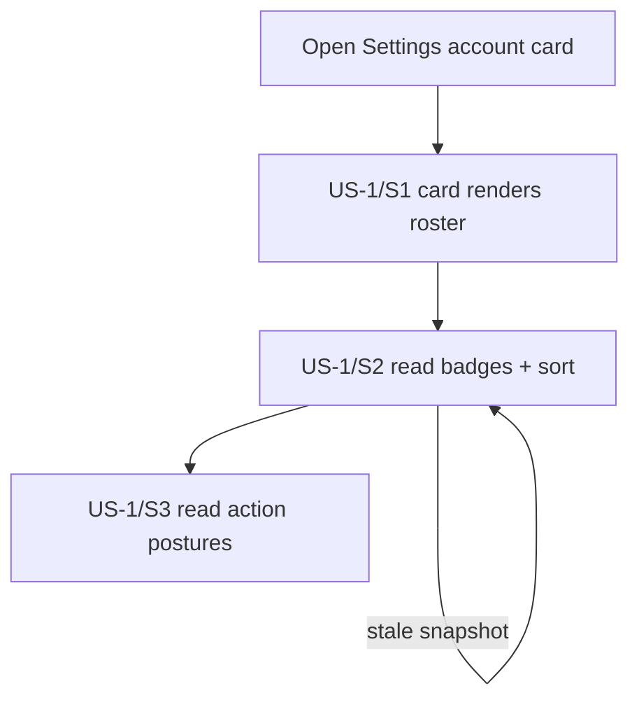
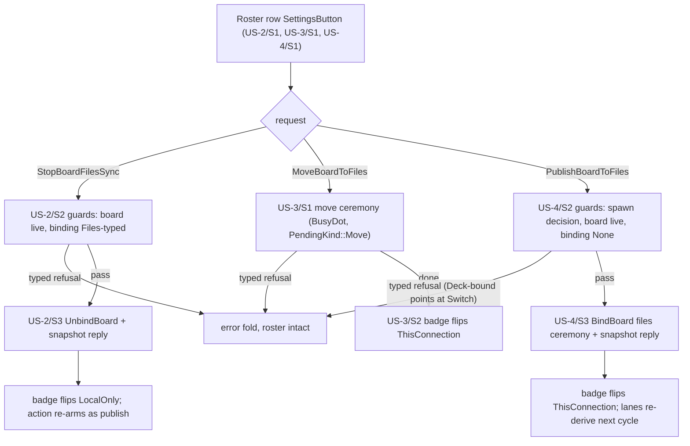

# UX Journey Plan Template

<!--
How to use: copy this file to
`.artifacts/plans/YYYY-MM-DD-<topic>-ux-plan.md`, and fill every
`<...>` placeholder. This guidance comment STAYS in the copy — it
instructs future readers; only the `<...>` placeholders go unfilled.

A UX journey plan is written BEFORE the dispatch plan that chunks the
feature (the dispatch plan's Origin must cite this file). It plans the
user-visible capability: stories, journeys, flows, and the wiring
contract. No implementation decisions beyond the command contract.
Full law: docs/ux_planning.org; trigger rule: AGENTS.md §7.

Sections 2, 4, 6, 7 use fixed table headers AND fixed level-2 heading
titles — scripts/ux-coverage.sh parses them. Do not rename columns or
section headings. Step IDs are greppable tokens; tests embed them in
snake_case (US-1/S2 -> us1_s2). Cells avoid `|`.
-->

# [Plan] UX Journey Plan — The per-account Files board roster (round-7 D-7.3)

- **Date**: 2026-11-13
- **Kind**: UX journey plan — user stories, journeys, flows, wiring
  contract for the Settings Files roster: per-board sync badges,
  per-row actions, and local→Files publish. No implementation
  decisions beyond the command contract.
- **Origin**: the round-7 stage-1 design plan
  `.artifacts/plans/2026-11-13-gui-review-round7-plan.md` §2 D-7.3
  (finding R7-3: the Files section lacks a per-account board roster
  with sync badges and per-row actions), authored under the UX journey
  framework (`.artifacts/plans/2026-11-13-ux-journey-planning-framework-plan.md`
  §4.1 template bar, §6.1 pilot discipline step 1) for the pilot
  dispatch `.artifacts/plans/2026-11-13-ux-journey-pilot-dispatch-plan.md`
  §2 chunk 3. **Blindness baseline: `35e6b0a1`** — every surface
  anchor in this plan was read as `git show 35e6b0a1:<path>`; no ui-r7
  implementation branch, PR, worktree, or post-baseline main content
  was read.
- **Status**: DRAFT — acceptance is the user merging the pilot chunk
  PR; chunk 2 compares after that merge.
- **Surfaces touched**: `ui/views/settings-view.slint`,
  `src/adapter.rs`, `src/requests.rs`, `src/presentation.rs`,
  `taskboard-app/src/ui_requests.rs`, `taskboard-app/src/bootstrap.rs`
  (constants/decision reuse), `settings_status.rs`
- **Platform scope**: desktop / kiosk per the Settings surface's
  existing platform posture — unchanged by this feature; the badge
  and sort folds are kiosk-safe by construction (per story below)

## 1. Scope & goals

The Files section of every Nextcloud account card in Settings becomes
the per-account board roster: every live board renders once per card
with a channel-relative sync badge, deterministically sorted, and one
contextually-labeled action button per row. Three actions close the
round-7 gap: **Stop Sync** (unbind a Files-bound board — new
`UiRequest::StopBoardFilesSync`), **Switch to Sync via this
Connection** (Deck→Files move, reusing `UiRequest::MoveBoardToFiles`
verbatim), and **Sync via this Connection** (local→Files publish —
new `UiRequest::PublishBoardToFiles`, the board reaches the account's
Files without ever touching Deck). The `FilesMovePicker` dropdown, its
copy global, and the `move_choices` table **retire** — the roster is
the picker.

Taxonomy (channel-relative, design-fixed): `FilesBoardBadge {
ThisConnection, LocalOnly, OtherConnection }` with the tone map
success/neutral/info onto the existing `Badge` widget and the verbatim
labels "Synced via this Connection" / "No Sync · Local Only" /
"Synced via other Connection". Within an account card, "this
Connection" = that card's files lane, live only while the card is the
resolved anchor and `[files_sync] enabled` holds. Snapshot widening:
`BoardInfo.bound_channel: Option<BoardChannel>` (`enum BoardChannel {
Deck, Files }`), filled app-side in `current_connections` from
`binding.board.as_deck()/as_files()` — structural detection per
D-BF4, never a name match. Per-account sort fold: ThisConnection →
LocalOnly → OtherConnection; within a group by (title, id) for
determinism. No engine/domain/state/storage changes. The single-lane
posture (#723) stands: non-anchor cards render the full roster with
the actions disabled (the Files row's existing restart caption
explains why); archived boards render flagged archived.

**Authority note (census precedent)**: the round-6 recorded ruling
"adoption is automatic, disconnect is a non-goal"
(`settings-view.slint:1065-1069` baseline) is explicitly **overturned**
by the round-7 plan §2 D-7.3 (that plan is the overturning authority).
The census diff that records the overturn is chunk 2's; this plan
carries the authority note here.

**Non-goals** (each with a home):

- No multi-account files lanes — non-anchor accounts get disabled
  actions with honest captions, not lanes; true multi-lane is #723's
  scope. Home: #723; ruling R-3 below.
- No `boards publish --to-files` CLI verb in this slice — deliberate
  GUI-first slice (the user scenario is the GUI roster); the asymmetry
  is filed. Home: #764; ruling R-2 below.
- No remote subtree GC on unbind — "Stop Sync" leaves the remote
  `boards/<uuid>/` subtree in place; fold-first discovery defers
  adoption for unbound boards so nothing re-adopts it, but the bytes
  linger until the DELETE-verb GC exists. Home: #755 (design
  question), #718 (GC verb); ruling R-4 below.
- No Deck→Deck board moves — a Deck-bound board on another connector
  reads "Synced via other Connection" truthfully. Home: #756; ruling
  R-5 below.
- No new `Tone` variants, no theme changes. Home: round-7 plan §4.

### Validation assertion (pilot §6.1 step 1)

Evaluated against pre-round-7 `main` @ `35e6b0a1`:

- `board.unbind_files`, `board.move_to_files`, and
  `board.publish_to_files` read blank/unruled in Settings: the Files
  card emits **title-only rows with no actions**, duplicated under
  every Nextcloud account card (`adapter.rs:4867-4883` baseline,
  inside the per-card block); the no-action posture is the round-6
  recorded ruling this round explicitly overturns
  (`settings-view.slint:1065-1069` baseline comment: "adoption is
  automatic, disconnect is a non-goal").
- `BoardInfo` carries no channel tag (`requests.rs:65-70` baseline:
  `bound_connector: Option<String>` only) — the badge taxonomy has no
  data source.
- `PublishBoard` targets Deck only (`requests.rs:412-416` baseline)
  and `MoveBoardToFiles` refuses non-Deck-bound boards
  (`ui_requests.rs:1520-1528` baseline) — the only local→Files path
  is Deck-first-then-move (the user's exact complaint).
- Closing sentence: **R7-3 is an unruled absence the framework,
  applied at planning time, flags before any implementation exists.**

## 2. Capability × surface matrix

<!-- Rows: every verb on every entity this feature touches — CREATE VERBS
ENUMERATED BY DEFAULT. Cells: D display, E edit, C create, X remove +
story ID. "—" = deliberately absent; every "—" on a core verb needs a
ruling below. Platform-qualify where kiosk differs: "E (desktop)".
Header row is a parser contract — do not rename or reorder columns. -->

Letter convention (recorded): bind verbs are `E` on the board's
binding, unbind is `X` of the binding; the binding is named in the
cell text to avoid implying board removal.

| Capability | Board | TaskDetail | Today | Review | Settings | Capture | CLI |
|---|---|---|---|---|---|---|---|
| board.roster_display | | | | | D (US-1) | | |
| board.unbind_files (Stop Sync) | — (R-1) | — (R-1) | — (R-1) | — (R-1) | X (binding only) (US-2) | — (R-1) | X (pre-existing, `boards unbind`) |
| board.move_to_files (Switch to Sync via this Connection) | — (R-1) | — (R-1) | — (R-1) | — (R-1) | E (binding) (US-3) | — (R-1) | E (pre-existing, `boards move --to-files`) |
| board.publish_to_files (Sync via this Connection) | — (R-1) | — (R-1) | — (R-1) | — (R-1) | E (binding) (US-4) | — (R-1) | — (R-2) |

Baseline state at `35e6b0a1`:

- All three binding verbs read blank in Settings (anchors in §1's
  validation assertion); `boards unbind` and `boards move
  --to-files` exist on the CLI; `boards publish --to-files` does not
  (ruled R-2, #764).
- `board.roster_display` does not exist: Files rows are title-only
  and duplicated per account card.

**Rulings** (every deliberate absence):

| ID | Ruling | Reason | Home |
|---|---|---|---|
| R-1 | binding actions live only in the Settings account roster | the roster row is the affordance (one action per row, contextually labeled); per-account context is the action's precondition (anchor card, lane on), which only Settings provides | this plan §1; round-7 plan §2 D-7.3 |
| R-2 | no `boards publish --to-files` CLI verb in this slice | deliberate GUI-first slice (the user scenario is the GUI roster); the asymmetry is filed | #764 |
| R-3 | non-anchor accounts show disabled actions with honest captions, not lanes | the single-lane posture (#723) stands; true multi-lane is #723's scope | #723 |
| R-4 | "Stop Sync" unbind leaves the remote boards subtree in place | fold-first discovery defers adoption for unbound boards so nothing re-adopts it, but the bytes linger until the DELETE-verb GC exists | #755 (design question), #718 (GC verb) |
| R-5 | Deck-to-Deck moves stay out of scope; a Deck-bound board on another connector reads "Synced via other Connection" truthfully | no Deck-to-Deck rebind ceremony exists | #756 |

## 3. User stories

<!-- Connextra: As a <role> I want <capability> so that <benefit>.
Job-story form allowed for situation-triggered behavior: When
<situation> I want to <motivation> so I can <outcome>. Entry points list
EVERY way the journey starts. P1 = must ship in the first slice. -->

### US-1 — Read an account's board roster with sync badges

- **Story**: When I manage an account's Files sync I want to see its
  board roster with per-board sync badges so that I know what is
  mirrored before I act (job-story form; situation-triggered).
- **Platforms**: desktop and kiosk as the Settings surface already
  postures (unchanged by this feature); the badge and sort folds are
  kiosk-safe by construction (pure presentation, D-7.3).
- **Entry points**: opening the Settings view's account card
  (existing navigation); no new affordance starts this journey.
- **Priority**: P1
- **Acceptance**:
  - AC-1: Given an account card with files boards bound, When the
    card renders, Then each live board emits exactly one roster row
    with the badge per its binding channel (taxonomy + tone per §1)
    and the rows sort ThisConnection → LocalOnly → OtherConnection,
    within a group by (title, id) — verified by fold test.
  - AC-2: Given an archived board bound via Files, When the card
    renders, Then the board appears flagged archived (visibility of
    archived boards is the roster's job) — verified by fold test.
  - AC-3: Given a non-anchor card or the lane off, When the card
    renders, Then the action label/enabled flags read honestly
    (disabled, with the restart caption explaining why) — verified by
    fold test.

### US-2 — Stop syncing a board from the roster

- **Story**: As a desktop user I want to stop syncing a board from
  the anchor card's roster so that the board returns to local-only.
- **Platforms**: desktop; kiosk posture: the action rides the
  Settings context's existing gating posture (unchanged by this
  feature); badges unaffected.
- **Entry points**: the row's "Stop Sync" `SettingsButton` (click;
  keyboard: the Settings context walk — Nav next/prev + invoke,
  `presets.rs:232-236` baseline — reaches every enabled tab stop, so
  no new `ActionId` is needed; this is the round-7 §3 ledger's
  keyboard-parity argument for D-7.3 and this plan records it as the
  keyboard entry point).
- **Priority**: P1
- **Acceptance**:
  - AC-1: Given a Files-bound board's row on the anchor card with
    the lane on, When the user presses "Stop Sync", Then
    `UiRequest::StopBoardFilesSync { board, reply }` dispatches, the
    arm guards pass, `StateCommand::UnbindBoard` runs on the engine
    handle, and the reply refreshes the snapshot — verified by seam
    test.
  - AC-2: Given the unbind succeeded, When the card re-renders, Then
    the badge flips to LocalOnly and the row action re-arms as "Sync
    via this Connection" — verified by journey test.
  - AC-3: Given the board is gone or not Files-bound at arm time,
    When the guard evaluates, Then the arm refuses typed (the row
    grammar can't normally offer it; the arm still refuses typed) —
    verified by app-arm test.
  - AC-4: The #755 leftover (remote subtree lingers) is recorded in
    the success response and R-4, not hidden.

### US-3 — Switch a Deck-bound board to this card's Files lane

- **Story**: As a desktop user I want to switch a Deck-bound board to
  this card's Files lane so that the board mirrors through this
  account.
- **Platforms**: desktop; kiosk posture: as US-2.
- **Entry points**: the row's "Switch to Sync via this Connection"
  `SettingsButton` (enabled only on the anchor card with the lane
  on); keyboard = the same Settings walk (as US-2).
- **Priority**: P1
- **Acceptance**:
  - AC-1: Given a Deck-bound board's row on the anchor card, When
    the user presses the switch action, Then
    `UiRequest::MoveBoardToFiles { board, reply }` dispatches
    verbatim (the ceremony, `BusyDot`, `PendingKind::Move`, typed
    error fold all exist) — verified by seam test.
  - AC-2: Given the move succeeded, When the card re-renders, Then
    the badge flips to ThisConnection — verified by journey test.
  - AC-3: Given the board not Deck-bound, the lane off, or the
    outbox still moving, When the ceremony evaluates, Then the typed
    refusal surfaces the error fold; the disabled affordance on
    non-anchor cards is the honest pre-escape (R-3); the retired
    picker cannot be mis-invoked anymore — verified by app-arm test.

### US-4 — Publish a local-only board to this card's Files

- **Story**: As a desktop user I want to publish a local-only board
  to this card's Files so that it reaches the account's Files without
  ever touching Deck.
- **Platforms**: desktop; kiosk posture: as US-2.
- **Entry points**: the row's "Sync via this Connection"
  `SettingsButton`; keyboard = the Settings walk (as US-2).
- **Priority**: P1
- **Acceptance**:
  - AC-1: Given a local-only board's row on the anchor card, When
    the user presses the publish action, Then
    `UiRequest::PublishBoardToFiles { board, reply }` dispatches and
    the arm guards evaluate (`files_sync_spawn_decision` resolvable,
    board live, binding `None`) — verified by seam test.
  - AC-2: Given the guards passed, When the ceremony runs, Then the
    `BindBoard` ceremony against the files connector executes
    (`remote: RemoteBoardId::files(uuid)`, connector =
    `FILES_SYNC_CONNECTOR_NAME`, per `bootstrap.rs:103` baseline) and
    the reply refreshes the snapshot — verified by app-arm test.
  - AC-3: Given the bind succeeded, When the card re-renders, Then
    the badge flips to ThisConnection and the files actor's lanes
    re-derive the board set next cycle (fold-first adoption covers
    pre-existing subtrees, `board_cycle.rs:561` baseline) — verified
    by journey test.
  - AC-4: Given Deck-bound / Files-bound / unresolvable spawn
    decision at guard time, When the guard evaluates, Then the typed
    refusals surface the error fold (Deck-bound → `BindRefused`
    pointing at Switch (US-3); Files-bound → the row would have
    offered Stop (US-2)) — verified by app-arm test.
  - AC-5: Restart-pending enable (config written, actor not yet
    running) succeeds as a state change with the badge flipping on
    bind and the lane catching up next boot — the On/Off toggle
    caption's documented posture, recorded in the success response
    cell, not as a failure — verified by app-arm test.

## 4. Journey specs

<!-- One table per story, under a `### US-<n>` subsection. Every row
needs an escape/failure path — a step without one is a plan defect.
Step IDs are greppable tokens; tests embed them in snake_case
(us1_s2_…). Header row is a parser contract — do not rename or reorder
columns. -->

### US-1 — Read an account's board roster with sync badges

| Step | Surface & affordance | User action | Dispatches | System response | Escape / failure |
|---|---|---|---|---|---|
| US-1/S1 | Settings view, account card navigation | open the Settings view and the account card | — display only | the card renders with its Files roster section | back navigation (existing) |
| US-1/S2 | Settings account card, Files roster rows | read the rows | — display only | badge per board (taxonomy + tone per §1); sort per the fold; archived flagged | a stale snapshot re-renders from the next reply (the standard refresh discipline — recorded, not new machinery) |
| US-1/S3 | Settings account card, roster row action postures | read an action's label + enabled state | — display only | label + enabled computed Rust-side per channel — on the anchor card with the lane on vs elsewhere (disabled with the restart caption elsewhere, R-3) | the disabled affordance itself is the honest pre-escape (accepted no-op); stale snapshots re-render per S2's discipline |

### US-2 — Stop syncing a board from the roster

| Step | Surface & affordance | User action | Dispatches | System response | Escape / failure |
|---|---|---|---|---|---|
| US-2/S1 | Settings account card, roster row "Stop Sync" `SettingsButton` | click the row action (or the Settings-walk invoke) | `UiRequest::StopBoardFilesSync { board, reply }` | the request enters the app arm | typed refusal at guard time surfaces the error fold (board gone / not Files-bound — the row grammar can't normally offer it; the arm still refuses typed); back navigation abandons the in-flight request |
| US-2/S2 | app arm (guards) | — (app-side evaluation, no user action) | guards evaluate: board live, binding Files-typed | anything else → typed refusal | the typed refusal is S1's escape surface; no partial state is mutated before the guards pass |
| US-2/S3 | app arm (effects) + Settings card re-render | — (app-side effects; user observes) | `StateCommand::UnbindBoard` on the engine handle; reply = fresh `ConnectionsSnapshot` | the badge flips to LocalOnly; the row action re-arms as "Sync via this Connection"; the #755 leftover (remote subtree lingers) is recorded honestly in R-4, not hidden | the unbind itself is a state change with engine-side undo arms existing but not verified blind by this plan — cancel-before-dispatch (not pressing the button) is the recorded user-side recovery |

### US-3 — Switch a Deck-bound board to this card's Files lane

| Step | Surface & affordance | User action | Dispatches | System response | Escape / failure |
|---|---|---|---|---|---|
| US-3/S1 | Settings account card, roster row "Switch to Sync via this Connection" `SettingsButton` (enabled only on the anchor card with the lane on) | click the row action (or the Settings-walk invoke) | `UiRequest::MoveBoardToFiles { board, reply }` (verbatim reuse — the ceremony, `BusyDot`, `PendingKind::Move`, typed error fold all exist) | the move ceremony starts; `BusyDot` shows pending | typed refusals (board not Deck-bound / lane off / outbox still moving) surface the error fold; the disabled affordance on non-anchor cards is the honest pre-escape (R-3); the retired picker cannot be mis-invoked anymore |
| US-3/S2 | Settings card re-render after the ceremony completes | — (user observes) | — display only | the badge flips to ThisConnection; the snapshot reply refreshes the card | a typed ceremony error surfaces the error fold with the roster intact (the board's previous binding stands) |

### US-4 — Publish a local-only board to this card's Files

| Step | Surface & affordance | User action | Dispatches | System response | Escape / failure |
|---|---|---|---|---|---|
| US-4/S1 | Settings account card, roster row "Sync via this Connection" `SettingsButton` | click the row action (or the Settings-walk invoke) | `UiRequest::PublishBoardToFiles { board, reply }` | the request enters the app arm | typed refusal at guard time surfaces the error fold; back navigation abandons the in-flight request |
| US-4/S2 | app arm (guards) | — (app-side evaluation, no user action) | guards evaluate: `files_sync_spawn_decision` resolvable, board live, binding `None` | pass → the ceremony arms; fail → typed refusal (Deck-bound → `BindRefused` pointing at Switch (US-3); Files-bound → the row would have offered Stop (US-2); unresolvable spawn decision → typed error fold) | the typed refusals are S1's escape surface; no partial state is mutated before the guards pass |
| US-4/S3 | app arm (ceremony) + Settings card re-render | — (app-side effects; user observes) | the `BindBoard` ceremony against the files connector (`remote: RemoteBoardId::files(uuid)`, connector = `FILES_SYNC_CONNECTOR_NAME`, per `bootstrap.rs:103` baseline); reply = fresh `ConnectionsSnapshot` | the badge flips to ThisConnection; the files actor's lanes re-derive the board set next cycle (fold-first adoption covers pre-existing subtrees); restart-pending enable succeeds as a state change — badge flips on bind, the lane catches up next boot (the On/Off toggle caption's documented posture, recorded in this success cell, not as a failure) | a typed ceremony error surfaces the error fold with the roster intact (the board stays local-only); cancel-before-dispatch is the recorded user-side recovery |

## 5. Interaction flows

<!-- mermaid flowchart per multi-surface journey (entry points as
sources, step IDs on edges); stateDiagram-v2 per overlay/editor/modal.
GitHub renders these — the precedent is docs/flow_model.org. -->

US-1 journey:

US-2 / US-3 / US-4 journeys (roster row action → guards → ceremony →
badge/snapshot feedback, with the typed-refusal branches as explicit
edges):

**No `stateDiagram-v2`** — recorded reason: this solution introduces
no overlay/editor/modal (it *removes* one: the `FilesMovePicker`);
the move ceremony's busy state is the existing pending machinery, not
a new machine. The template's machine law binds overlays/editors/
modals only.

## 6. Wiring inventory

<!-- One row per NEW or CHANGED affordance. Row addressing: ItemAddr
kind for list rows (the UI is id-less; callbacks + action ids + command
variants are the contract, not element ids). A row with — in Commands
must say why in Journey steps (pure navigation/display). Test column:
file::name embedding the step-ID token. Header row is a parser contract — do not rename or reorder columns. -->

| ID | Surface file | Widget | Callback | Adapter seam | ActionId | Commands | Row addressing | Journey steps | Test |
|---|---|---|---|---|---|---|---|---|---|
| W-1 | src/requests.rs + taskboard-app/src (snapshot fill in `current_connections`) | — | — | `BoardInfo.bound_channel` (`BoardChannel`), filled app-side (structural detection per D-BF4) | — | — | ItemAddr kind: ConnectionItem (files-board rows) consume it via the fold | US-1/S2 (snapshot data plumbing — no dispatch; the no-callback/no-action/no-command cells are PC-10's bound absences) | ui_requests.rs::current_connections_fills_bound_channel_structurally |
| W-2 | src/presentation.rs (sibling of `deck_bound_boards`) | — | — | `FilesBoardBadge` enum (bound home: presentation.rs, PC-11) + the per-account sort fold | — | — | ItemAddr kind: ConnectionItem (files-board rows) | US-1/S2–S3 (pure presentation fold — no dispatch; absences bound per PC-10) | presentation.rs::us1_s2_badge_tone_and_sort_fold |
| W-3 | ui/views/settings-view.slint + src/adapter.rs (roster loop replacing `adapter.rs:4867-4883` baseline) | per-row `SettingsButton` joining the walk; rows as `ConnectionItem { kind: files-board }` with badge/action label/enabled computed Rust-side | files-board-action-clicked | adapter roster-push; handler `settings_files_board_action`; seam `on_settings_files_board_action_clicked` (A-6 bound per PC-11) | — | UiRequest::StopBoardFilesSync ; UiRequest::MoveBoardToFiles ; UiRequest::PublishBoardToFiles | ItemAddr kind: ConnectionItem (files-board; every live non-deleted board emits once per Nextcloud account card) | US-1/S2, US-2/S1, US-3/S1, US-4/S1 (no action id: keyboard parity via the Settings walk — the recorded parity argument) | journeys.rs::us2_s1_roster_row_action_dispatches_stop_board_files_sync |
| W-4 | taskboard-app/src/ui_requests.rs (new arm) | — | — | app arm: guards → `StateCommand::UnbindBoard` + snapshot reply | — | UiRequest::StopBoardFilesSync ; StateCommand::UnbindBoard | ItemAddr kind: ConnectionItem (files-board) | US-2/S1–S3 (no slint callback: the arm serves the request — PC-10's bound absence) | ui_requests.rs::us2_s2_stop_sync_guards_refuse_typed |
| W-5 | taskboard-app/src/ui_requests.rs (existing arm, reused from the row button) + picker retirement in ui/views/settings-view.slint | the `FilesMovePicker` component, its copy global, and the `move_choices` table retire | — | existing `MoveBoardToFiles` arm (`requests.rs:425-428` baseline), reused verbatim | — | UiRequest::MoveBoardToFiles | ItemAddr kind: ConnectionItem (files-board) | US-3/S1–S2 (the callback cell is a bound absence, PC-10: the retired picker's callback is removed — the row button rides W-3's seam) | journeys.rs::us3_s1_switch_action_dispatches_move_board_to_files |
| W-6 | taskboard-app/src/ui_requests.rs (new arm) + constants/decision reuse from taskboard-app/src/bootstrap.rs | — | — | app arm: guards → the `BindBoard` files ceremony (per `bootstrap.rs:103` baseline); seam bound per PC-11 | — | UiRequest::PublishBoardToFiles ; StateCommand::BindBoard | ItemAddr kind: ConnectionItem (files-board) | US-4/S1–S3 (no slint callback: the arm serves the request — PC-10's bound absence) | ui_requests.rs::us4_s2_publish_guards_refuse_deck_bound |

## 7. Command-contract delta

<!-- Every new/changed StateCommand, UiRequest, ActionId the journeys
imply — enumerated here BEFORE engine chunks are planned. This section
is the derivation hinge: engine work items exist because a journey step
dispatches them. Header row is a parser contract — do not rename or reorder columns. -->

| Kind | Name | Payload sketch | Journeys |
|---|---|---|---|
| UiRequest | StopBoardFilesSync | new; `{ board, reply }`; app arm guards (board live, binding Files-typed; else typed refusal) then `StateCommand::UnbindBoard`; `reply` = fresh `ConnectionsSnapshot` | US-2 |
| UiRequest | PublishBoardToFiles | new; `{ board, reply }`; app arm guards (spawn decision resolvable, board live, binding `None`) then the `BindBoard` files ceremony; `reply` = fresh `ConnectionsSnapshot` | US-4 |
| UiRequest | MoveBoardToFiles | exists (baseline `requests.rs:425-428`) — reused verbatim from a new affordance, no shape change | US-3 |
| StateCommand | UnbindBoard | exists — now UI-dispatched via the StopBoardFilesSync arm (was CLI-only from the GUI's perspective) | US-2 |
| StateCommand | BindBoard | exists — now UI-dispatched by the publish ceremony's final assign step (connector = `FILES_SYNC_CONNECTOR_NAME`) | US-4 |
| UiRequest | BoardInfo.bound_channel | struct field on the snapshot's `BoardInfo` (the struct lives in `requests.rs` — the gate's Kind-selected grep resolves it there); `Option<BoardChannel>`, `enum BoardChannel { Deck, Files }`, filled app-side structurally | US-1 |

No new `ActionId` in this plan (the Settings-walk parity argument,
recorded per story).

## 8. Verification plan

<!-- Journey-test root defaults to crates/taskboard-ui-slint/tests/; a
plan nominating another crate adds a `Test-root: <path>` line to its
front-matter block above. -->

- **Journey tests** (step-ID-named): `us1_s2` badge/tone + sort fold
  renders per board per card; `us1_s3` action label/enabled posture
  per channel; `us2_s1` row action dispatches
  `StopBoardFilesSync`; `us2_s3` badge flips LocalOnly and the action
  re-arms as publish; `us3_s1` switch action dispatches
  `MoveBoardToFiles`; `us3_s2` badge flips ThisConnection; `us4_s1`
  publish action dispatches `PublishBoardToFiles`; `us4_s3` badge
  flips ThisConnection; escape variants assert the error fold with
  the roster intact.
- **Seam tests**: exact-command assertions for the two new app arms
  (`UnbindBoard` / the `BindBoard` files ceremony + snapshot reply)
  and the reused move arm — one behavior, one test, lowest layer; the
  app-arm tests assert exact commands without embedding step tokens.
- **Fold/presentation tests**: presentation fold tests over a
  synthetic AppState × snapshot matrix (anchor card / non-anchor card
  / lane off: badge, sort, action label, enabled flag — asserted as
  enums/flags, never label text); adapter roster-push tests (one row
  per board per card); `BoardInfo.bound_channel` structural fill.
- **Kiosk gates**: the roster renders (display folds are kiosk-safe
  by construction); row actions ride the Settings surface's existing
  gating posture; no new flyouts, so no new focus choreography.
- **Manual**: badge label wording ("Synced via this Connection" etc.)
  judged at review; the walkthrough protocol covers it.

## 9. Definition of done

- [ ] `scripts/ux-coverage.sh <this file> --gate` exits 0
- [ ] Every P1 story's journey completes end-to-end including escapes
- [ ] Walkthrough protocol executed at stage 3; findings resolved or
  homed
- [ ] All matrix absences carry rulings; census updated
- [ ] Non-goals filed as backlog issues

## Plan corrections (stage-2 bindings, 2026-11-13)

Recorded ruling-style (the comparison plan
`2026-11-13-round7-ux-pilot-comparison-plan.md` §3.1/§7.1 amendment
mechanism; authority: this chunk's stage-2 implementation, which the
dispatch plan charges with binding A-6):

- **PC-10 (normalizes the wiring cells)**: cells meaning "deliberately
  absent" carry the bare `—` token — the coverage gate greps non-absent
  cells literally, so the blind draft's prose-qualified absences ("—
  (no callback: …)") are corrected to `—` with the reason moved into
  the Journey-steps column. This is the gate-acceptance gap the
  comparison plan recorded for phase 3 (its §2 finding, backlog #768),
  applied plan-side (a plan correction, never a script change).
- **PC-11 (binds A-6)**: the per-row action callback is
  `files-board-action-clicked` (the card's `*-clicked(index)` grammar,
  as assumed); the adapter handler is `settings_files_board_action`
  behind the `on_settings_files_board_action_clicked` `install_seam!`
  (replacing the retired `on_settings_move_picked`); the
  `ConnectionItem` additions are `badge-text`, `badge-tone`
  (`SettingsBadgeTone { success, neutral, info }`, exported beside
  `ConnectionItemKind`), `action-label`, `action-enabled`, `archived`;
  the `FilesBoardBadge` home is `src/presentation.rs` as assumed; the
  roster fold is `files_board_roster(state, files_on) -> Vec<FilesBoardRow>`
  (the row carries `title` + `action_enabled` — the D3 sketch's
  fold outputs, homed there so the D6 enabled rule has exactly one
  home). The retired picker's journey/inventory seams are recorded by
  the deletion itself; the W-5 test binds to the surviving row-button
  path.

## Plan assumptions (seam names the design does not fix; the implementation chunk binds them)

- **A-6**: the per-row action callback name (following the card's
  `*-clicked(index)` grammar), the `ConnectionItem` field additions
  (badge text/tone, action label/enabled, archived flag), the
  `FilesBoardBadge` enum's home file, and the adapter handler /
  `install_seam!` names for the two new `UiRequest`s.
