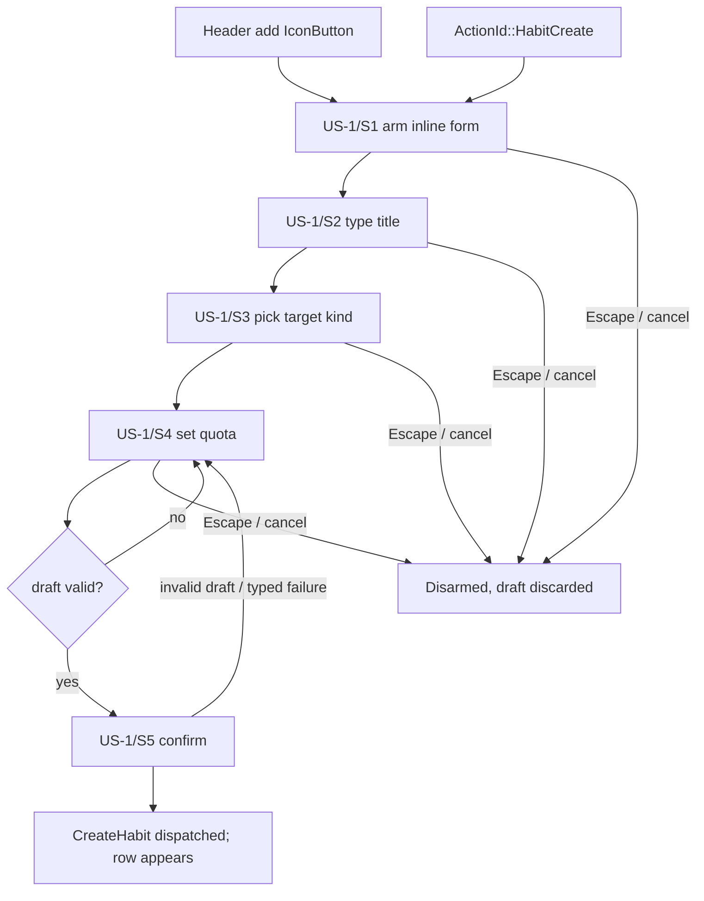
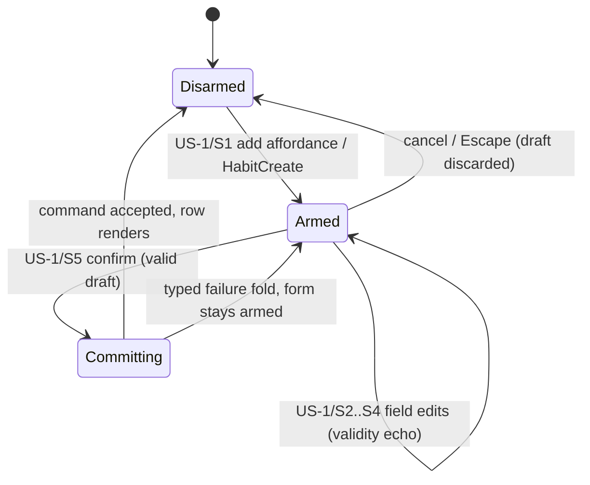

# UX Journey Plan Template

<!--
How to use: copy this file to
`.artifacts/plans/YYYY-MM-DD-<topic>-ux-plan.md`, and fill every
`<...>` placeholder. This guidance comment STAYS in the copy — it
instructs future readers; only the `<...>` placeholders go unfilled.

A UX journey plan is written BEFORE the dispatch plan that chunks the
feature (the dispatch plan's Origin must cite this file). It plans the
user-visible capability: stories, journeys, flows, and the wiring
contract. No implementation decisions beyond the command contract.
Full law: docs/ux_planning.org; trigger rule: AGENTS.md §7.

Sections 2, 4, 6, 7 use fixed table headers AND fixed level-2 heading
titles — scripts/ux-coverage.sh parses them. Do not rename columns or
section headings. Step IDs are greppable tokens; tests embed them in
snake_case (US-1/S2 -> us1_s2). Cells avoid `|`.
-->

# [Plan] UX Journey Plan — Create habits from the Today section (round-7 D-7.2)

- **Date**: 2026-11-13
- **Kind**: UX journey plan — user stories, journeys, flows, wiring
  contract for creating habits from the Today section. No
  implementation decisions beyond the command contract.
- **Origin**: the round-7 stage-1 design plan
  `.artifacts/plans/2026-11-13-gui-review-round7-plan.md` §2 D-7.2
  (finding R7-2: the GUI has no way of creating habits), authored under
  the UX journey framework (`.artifacts/plans/2026-11-13-ux-journey-planning-framework-plan.md`
  §4.1 template bar, §6.1 pilot discipline step 1) for the pilot
  dispatch `.artifacts/plans/2026-11-13-ux-journey-pilot-dispatch-plan.md`
  §2 chunk 1. **Blindness baseline: `35e6b0a1`** — every surface anchor
  in this plan was read as `git show 35e6b0a1:<path>`; no ui-r7
  implementation branch, PR, worktree, or post-baseline main content
  was read.
- **Status**: DRAFT — acceptance is the user merging the pilot chunk PR;
  chunk 2 compares after that merge.
- **Surfaces touched**: `ui/compositions/habits.slint`,
  `ui/views/today-view.slint`, `ui/app-window.slint`, adapter habits
  seam, `src/actions.rs`, `keymap/presets.rs`
- **Platform scope**: desktop (kiosk posture: the affordance does not
  mount — per story below)

## 1. Scope & goals

A desktop user can create a habit tracker from the Today section's
header without leaving the view: an add affordance arms an inline
create form (title, target kind, quota) whose confirm dispatches
`StateCommand::CreateHabit { board, title, target }` with the
section's own board. Before this capability, habit creation was
CLI-only (`taskboard habits add`) while the GUI already displayed and
managed existing trackers (log, reorder, repair, convert) — the
display-without-creation gap class G3.

No engine changes: `CreateHabit` exists (`messages.rs:461-466`
baseline) and carries the target at create (D-H7a: no optional
fields). The board comes from the section itself (rows are already
scoped to one board, `models.rs:742-744` baseline) — no picker.

**Non-goals** (each with a home):

- No habit target editing UI (retargeting included) — the CLI's
  `taskboard habits update` covers it; not requested this round
  (round-7 plan §4). Home: recorded non-goal, round-7 plan §4.
- No habit removal in the GUI — not requested this round; the CLI's
  `taskboard habits rm` covers it; the Today row grammar stays
  log/reorder/repair/convert (round-7 plan §1 R7-2 scope). Home:
  round-7 plan §4.
- No `habit.create` entry points on surfaces other than Today —
  creation context is the tracker list itself; scattering create
  entry points breaks the section-scoped grammar. Home: ruling R-1
  below and round-7 plan §2 D-7.2.

### Validation assertion (pilot §6.1 step 1)

Evaluated against pre-round-7 `main` @ `35e6b0a1`:

- `habit.create`: blank/unruled on every GUI surface. The Today
  section header is a static caption — `habits.slint:63-76` baseline
  renders RoleText "Habits" plus a count with no affordance; the
  action registry has no create verb — `actions.rs:286-305` baseline
  lists HabitLog / HabitMove / HabitRepair / HabitConvertArm /
  HabitConvertToSeries only, all pointer-grade; creation is CLI-only
  — `commands/habits.rs:147` (`HabitsInvocation::Add`).
- `habit.edit`: GUI blank; CLI edit exists (`habits update`).
- `habit.remove`: GUI blank; CLI removal exists (`habits rm`).
- Closing sentence: **R7-2 is an unruled absence the framework,
  applied at planning time, flags before any implementation exists.**

## 2. Capability × surface matrix

<!-- Rows: every verb on every entity this feature touches — CREATE VERBS
ENUMERATED BY DEFAULT. Cells: D display, E edit, C create, X remove +
story ID. "—" = deliberately absent; every "—" on a core verb needs a
ruling below. Platform-qualify where kiosk differs: "E (desktop)".
Header row is a parser contract — do not rename or reorder columns. -->

| Capability | Board | TaskDetail | Today | Review | Settings | Capture | CLI |
|---|---|---|---|---|---|---|---|
| habit.create | — (R-1) | — (R-1) | C (US-1) | — (R-1) | — (R-1) | — (R-1) | C (pre-existing, `habits add`) |
| habit.edit | — (R-2) | — (R-2) | — (R-2) | — (R-2) | — (R-2) | — (R-2) | E (pre-existing, `habits update`) |
| habit.remove | — (R-3) | — (R-3) | — (R-3) | — (R-3) | — (R-3) | — (R-3) | X (pre-existing, `habits rm`) |
| habit.log | | | E (pre-existing, D-P13 grammar) | | | | E (pre-existing) |

Baseline state at `35e6b0a1`:

- `habit.create` reads blank/unruled on every GUI surface (anchors in
  §1's validation assertion); CLI-only via `habits add`.
- `habit.edit` and `habit.remove` read blank on every GUI surface;
  CLI-only via `habits update` / `habits rm`.
- `habit.log` already renders and edits on Today (the +1 / make-up
  row grammar) — untouched by this plan.

**Rulings** (every deliberate absence):

| ID | Ruling | Reason | Home |
|---|---|---|---|
| R-1 | `habit.create` surfaces only in the Today section and the CLI | creation context is the tracker list itself (D-7.2: the board comes from the section, no picker); scattering create entry points breaks the section-scoped grammar | this plan §1; round-7 plan §2 D-7.2 |
| R-2 | no GUI habit editing (target retargeting included) | recorded non-goal: no habit target editing UI beyond create, not requested; the CLI's `habits update` covers | round-7 plan §4 |
| R-3 | no GUI habit removal | not requested this round; the CLI's `habits rm` covers; the Today row grammar stays log/reorder/repair/convert | round-7 plan §1 R7-2 scope; round-7 plan §4 |

## 3. User stories

<!-- Connextra: As a <role> I want <capability> so that <benefit>.
Job-story form allowed for situation-triggered behavior: When
<situation> I want to <motivation> so I can <outcome>. Entry points list
EVERY way the journey starts. P1 = must ship in the first slice. -->

### US-1 — Create a habit from the Today section header

- **Story**: As a desktop user I want to create a habit from the
  Today section's header so that a new tracker starts counting
  without leaving the view.
- **Platforms**: desktop; kiosk posture: the header affordance does
  not mount (D-T16 — the gate empties the ACTION, never the model;
  same `editing-visible` gating as the row actions).
- **Entry points**: the header add `IconButton` (plus icon, "Add
  habit…" — design-named affordance; callback `create-asked()`
  design-named) in `ui/compositions/habits.slint`;
  `ActionId::HabitCreate` ("habit.create"), section-scoped, in the
  `Today` context. Click and key route through the same action id
  (click ≡ key). Free-key-per-preset choices stay implementation
  details (see §6 assumptions).
- **Priority**: P1
- **Acceptance**:
  - AC-1: Given the Today section renders habit rows for its board,
    When the user arms the form and confirms a valid title + target +
    quota, Then `StateCommand::CreateHabit { board: <section board>,
    title, target }` is dispatched and the new row appears in the
    section — verified by journey test.
  - AC-2: Given the form is armed, When the user presses Escape (or
    cancel) at any step, Then the form disarms and the draft is
    discarded with no command dispatched — verified by journey test.
  - AC-3: Given an invalid draft (empty title or quota below 1),
    When the user confirms, Then confirm stays inert and the form
    stays armed — verified by journey test.

## 4. Journey specs

<!-- One table per story, under a `### US-<n>` subsection. Every row
needs an escape/failure path — a step without one is a plan defect.
Step IDs are greppable tokens; tests embed them in snake_case
(us1_s2_…). Header row is a parser contract — do not rename or reorder
columns. -->

### US-1 — Create a habit from the Today section header

| Step | Surface & affordance | User action | Dispatches | System response | Escape / failure |
|---|---|---|---|---|---|
| US-1/S1 | Today section header, add `IconButton` / `ActionId::HabitCreate` | click the plus icon or invoke the action id | `ActionId::HabitCreate` | the inline create form mounts below the header, armed, title field focused | cancel/Escape disarms and discards the draft; stale-arm no-ops follow the one-shot target-field law; no active board renders no rows and the affordance does not mount (accepted no-op posture) |
| US-1/S2 | inline form, title `TippedField` | type the habit title (insert mode; commits on Return per the create-row precedent) | — (form-local edit; no command until confirm) | the draft title echoes in the field | Return-less focus loss discards the field per the house text-flow rule; Escape disarms the whole form |
| US-1/S3 | inline form, target `SegmentedControl` (Per day / Per week / Per month) | pick the target kind | — (form-local edit) | the segmented control shows the picked variant; per-pattern quota semantics arm | Escape/cancel disarms and discards the draft |
| US-1/S4 | inline form, quota numeric field (`NonZeroCount::new`, default 1) | set the quota (zero unrepresentable — validity fold) | — (form-local edit) | an invalid quota keeps the validity fold; confirm stays inert | invalid draft keeps the form armed with the fold (typed refusal stays in-form); Escape/cancel disarms |
| US-1/S5 | inline form, confirm `IconButton` | confirm the draft | `StateCommand::CreateHabit` with `board` = the section's own board, `title`, minted `target` | the command dispatches; the form disarms; the new tracker row appears in the section | invalid draft: confirm inert (S4's fold); command failure surfaces the typed error fold with the form still armed; Escape/cancel discards |

## 5. Interaction flows

<!-- mermaid flowchart per multi-surface journey (entry points as
sources, step IDs on edges); stateDiagram-v2 per overlay/editor/modal.
GitHub renders these — the precedent is docs/flow_model.org. -->

US-1 journey (both entry points converge on the same action):

Inline form state machine (the form is an editor — the template's
machine law binds it; this is a framework-conformance addition, the
round-7 design does not name it a machine):

Kiosk flip mid-flow unmounts the section's actions but the adapter
keeps the armed flag — the convert-strip remount precedent; a stale
arm no-ops per the one-shot target-field law.

## 6. Wiring inventory

<!-- One row per NEW or CHANGED affordance. Row addressing: ItemAddr
kind for list rows (the UI is id-less; callbacks + action ids + command
variants are the contract, not element ids). A row with — in Commands
must say why in Journey steps (pure navigation/display). Test column:
file::name embedding the step-ID token. Header row is a parser contract — do not rename or reorder columns. -->

| ID | Surface file | Widget | Callback | Adapter seam | ActionId | Commands | Row addressing | Journey steps | Test |
|---|---|---|---|---|---|---|---|---|---|
| W-1 | ui/compositions/habits.slint (pass-through via ui/views/today-view.slint and ui/app-window.slint) | header add `IconButton` (plus icon, gated by `editing-visible` per D-T16) | `create-asked` | habits-section adapter seam (name assumed — A-1) | ActionId::HabitCreate | StateCommand::CreateHabit | — (section-scoped: no list row is addressed; the section's own board is the target) | US-1/S1 | journeys.rs::us1_s1_header_affordance_arms_inline_form |
| W-2 | ui/compositions/habits.slint | inline create form: title `TippedField`, target `SegmentedControl`, quota field, confirm/cancel `IconButton`s | internal callbacks assumed (A-2) | habits-section adapter seam (name assumed — A-1) | — (form-local edits ride the armed form, not the action registry) | StateCommand::CreateHabit | — (section-scoped: no list row) | US-1/S2–S5 | journeys.rs::us1_s2 … us1_s5 |

## 7. Command-contract delta

<!-- Every new/changed StateCommand, UiRequest, ActionId the journeys
imply — enumerated here BEFORE engine chunks are planned. This section
is the derivation hinge: engine work items exist because a journey step
dispatches them. Header row is a parser contract — do not rename or reorder columns. -->

| Kind | Name | Payload sketch | Journeys |
|---|---|---|---|
| ActionId | HabitCreate | new; "habit.create"; section-scoped group in the `Today` context; the header button and the keyboard binding route through it | US-1 |
| StateCommand | CreateHabit | exists (`messages.rs:461-466` baseline) — no payload change; usage note: `board` resolved from the section's own board, `target` minted from the form's kind + quota | US-1 |

No `UiRequest` in this plan.

## 8. Verification plan

<!-- Journey-test root defaults to crates/taskboard-ui-slint/tests/; a
plan nominating another crate adds a `Test-root: <path>` line to its
front-matter block above. -->

- **Journey tests** (step-ID-named): `us1_s1` header affordance /
  action id arms the inline form; `us1_s2` title edit echoes and
  commits on Return; `us1_s3` target pick echoes the segmented
  variant; `us1_s4` quota fold (zero unrepresentable, default 1);
  `us1_s5` confirm dispatches the exact `CreateHabit` command with
  the section's board and the minted target, row renders; escape
  paths (`us1_s1`–`us1_s5` cancel/Escape variants) assert disarm +
  discard + no command.
- **Seam tests**: adapter seam test asserting the exact
  `StateCommand::CreateHabit` payload (board resolution + minted
  target) — the `banner_actions_send_exact_commands` shape.
- **Fold/presentation tests**: the `editing-visible` gated mount flag
  (assert the flag, never label text); target minting
  (`NonZeroCount`/target-kind fold assertions as typed outcomes).
- **Kiosk gates**: the header add affordance and the inline form do
  not mount in kiosk mode (`editing-visible` empty — D-T16); the
  tracker rows still render.
- **Manual**: hint/label semantics ("Add habit…", segmented labels)
  judged at review; the walkthrough protocol covers it.

## 9. Definition of done

- [ ] `scripts/ux-coverage.sh <this file> --gate` exits 0
- [ ] Every P1 story's journey completes end-to-end including escapes
- [ ] Walkthrough protocol executed at stage 3; findings resolved or
  homed
- [ ] All matrix absences carry rulings; census updated
- [ ] Non-goals filed as backlog issues

## Plan assumptions (seam names the design does not fix; the implementation chunk binds them)

- **A-1**: the habits-section adapter seam / `install_seam!` site that
  receives `create-asked` (existing habit seams exist; their exact
  names were not read blind beyond the registry block).
- **A-2**: the inline form's internal callback names
  (title/target/quota/confirm/cancel) and the pass-through callback
  names through `today-view.slint` / `app-window.slint` (default:
  propagate `create-asked` unchanged; confirm/cancel follow the
  section's `convert-confirmed/cancelled` grammar).
- **All plans**: the free-key-per-preset choices for `HabitCreate`
  (registry-generated hints pick them up; the totality invariant tests
  stay green per round-7 plan §3).
