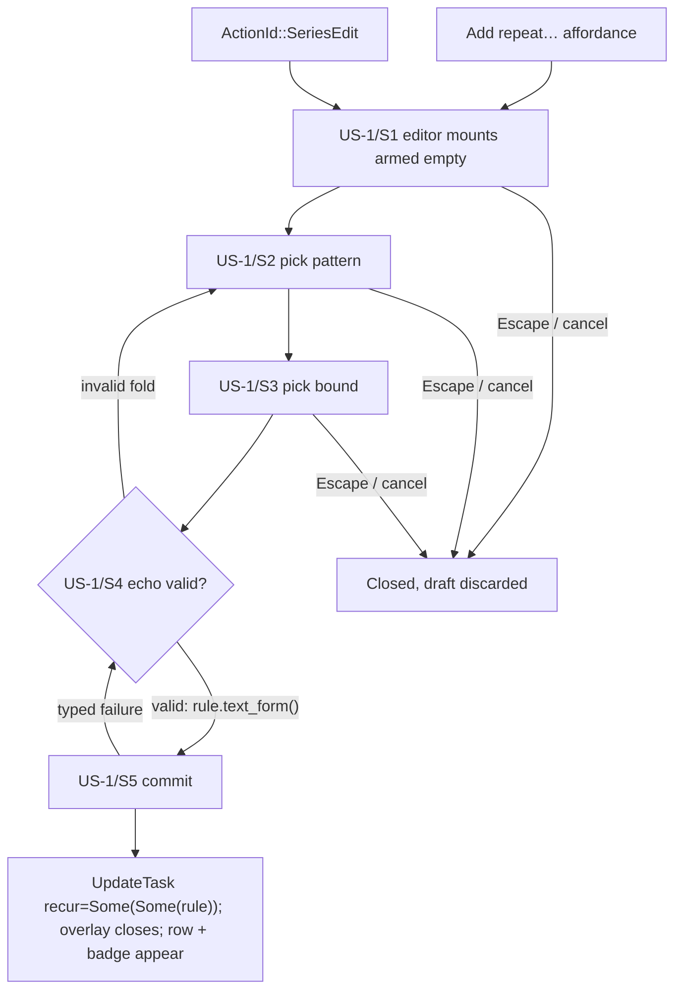
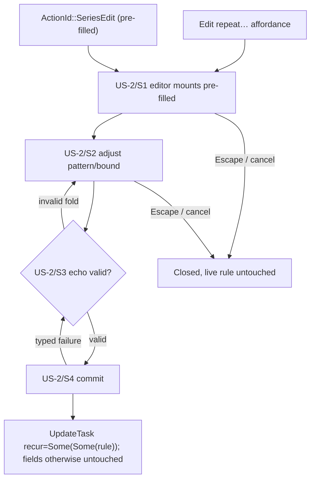
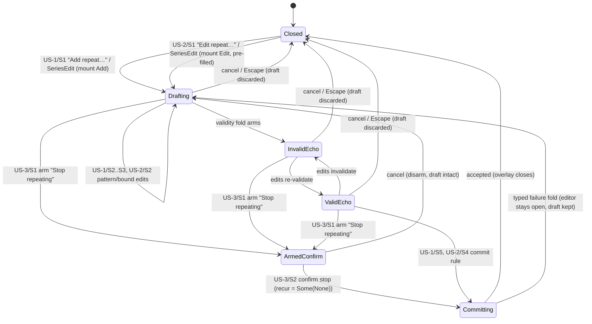

# UX Journey Plan Template

<!--
How to use: copy this file to
`.artifacts/plans/YYYY-MM-DD-<topic>-ux-plan.md`, and fill every
`<...>` placeholder. This guidance comment STAYS in the copy — it
instructs future readers; only the `<...>` placeholders go unfilled.

A UX journey plan is written BEFORE the dispatch plan that chunks the
feature (the dispatch plan's Origin must cite this file). It plans the
user-visible capability: stories, journeys, flows, and the wiring
contract. No implementation decisions beyond the command contract.
Full law: docs/ux_planning.org; trigger rule: AGENTS.md §7.

Sections 2, 4, 6, 7 use fixed table headers AND fixed level-2 heading
titles — scripts/ux-coverage.sh parses them. Do not rename columns or
section headings. Step IDs are greppable tokens; tests embed them in
snake_case (US-1/S2 -> us1_s2). Cells avoid `|`.
-->

# [Plan] UX Journey Plan — Recurrence-rule editor in the task detail view (round-7 D-7.1)

- **Date**: 2026-11-13
- **Kind**: UX journey plan — user stories, journeys, flows, wiring
  contract for setting, editing, and stopping recurrence rules on
  tasks from the GUI. No implementation decisions beyond the command
  contract.
- **Origin**: the round-7 stage-1 design plan
  `.artifacts/plans/2026-11-13-gui-review-round7-plan.md` §2 D-7.1
  (finding R7-1: tasks are missing a GUI setting to create repeated
  tasks), authored under the UX journey framework
  (`.artifacts/plans/2026-11-13-ux-journey-planning-framework-plan.md`
  §4.1 template bar, §6.1 pilot discipline step 1) for the pilot
  dispatch `.artifacts/plans/2026-11-13-ux-journey-pilot-dispatch-plan.md`
  §2 chunk 2. **Blindness baseline: `35e6b0a1`** — every surface
  anchor in this plan was read as `git show 35e6b0a1:<path>`; no ui-r7
  implementation branch, PR, worktree, or post-baseline main content
  was read.
- **Status**: DRAFT — acceptance is the user merging the pilot chunk
  PR; chunk 2 compares after that merge.
- **Surfaces touched**: new `ui/compositions/recur-editor.slint`,
  `ui/views/task-view.slint`, `ui/app-window.slint`, adapter draft
  buffer, `taskboard-domain/src/recur.rs` (pure-function extraction),
  `taskboard-app/src/commands/repeat.rs` (CLI refactored onto the
  extraction), `src/actions.rs`, `keymap/presets.rs`
- **Platform scope**: desktop (kiosk posture: rides the existing
  task-detail editing gate like every other action — per story below)

## 1. Scope & goals

A desktop user can set a recurrence rule on a rule-less task, edit or
replace an existing rule, and stop a series from repeating — all from
the task detail view, without a CLI round-trip. A new editor overlay
(`ui/compositions/recur-editor.slint`, design-named file) mounts on
`ContextId::RecurEditor` (mask semantics per `TrackEntries`: the
form's fields ride `ViInsert`; commit/cancel verbs live in the overlay
context; Escape resolves globally). Commit dispatches
`StateCommand::UpdateTask { changes: TaskChanges { recur: … } }` —
sparse, every other task field untouched. Before this capability the
recur row rendered display + pause/resume/convert only; **no UI site
constructed `TaskChanges { recur: … }`** — setting a rule was
CLI-only (gap class G2: display without control).

Rides with it (same round-7 chunk scope, recorded here per the design):
the pure-function extraction `recur::assemble_rule(&Task, …) ->
Result<RecurRule, InvalidRecur>` into `taskboard-domain` — the CLI's
minting laws (keep `series`/`continued_from` when a rule exists
(D-S4), anchor = `series_reference_date`, weekday/day-of-month
defaults from the anchor, `paused_until` preserved) — and the CLI
`tasks repeat` refactored onto it. One behavior, one implementation,
one test family; the GUI mints through the same function so GUI and
CLI cannot drift. No schema/message changes. The extraction is domain
truth, not a UI seam — it lives in this §1, not §6/§7.

**Non-goals** (each with a home):

- No recurrence scheduling at create — the capture overlay and inline
  create rows stay title-only; the editor is the setting. Home:
  recorded ruling `capture-overlay.slint:2-6` baseline; round-7 plan
  §4; ruling R-1 below.
- No editor mount outside the task detail view — single-surface
  editor posture; other task lists reach it via the task detail. Home:
  ruling R-2 below; round-7 plan §2 D-7.1.
- No pause/resume relocation — the recur row keeps pause/resume/
  convert; the editor only adds set/edit/clear. Home: round-7
  dispatch §1 chunk 2.
- No engine/domain/state/storage schema or message changes — the
  `assemble_rule` extraction is a pure-function move plus the CLI
  refactor onto it. Home: round-7 plan §4.

### Validation assertion (pilot §6.1 step 1)

Evaluated against pre-round-7 `main` @ `35e6b0a1`:

- `task.recur_set`: blank/unruled on every GUI surface. The recur row
  renders display + pause/resume/convert only (`task-view.slint:726-831`
  baseline; callbacks `recur-pause-asked/accepted/cancelled`,
  `recur-resume-clicked`, `recur-convert-asked/confirmed/cancelled`
  at `task-view.slint:163-169`; no edit affordance); **no UI site
  constructs `TaskChanges { recur: … }`** (round-7 plan §1 R7-1,
  verified over every UI `TaskChanges` construction); setting is
  CLI-only (`commands/repeat.rs:306-360` `assemble_rule`).
- `task.recur_clear`: blank/unruled on every GUI surface; the CLI's
  `--off` (`repeat.rs:33,125`) is the only clear path.
- The at-create exclusion is a recorded ruling
  (`capture-overlay.slint:2-6` baseline) — reaffirmed, so `Capture`
  is ruled, not blank.
- Closing sentence: **R7-1 is an unruled absence the framework,
  applied at planning time, flags before any implementation exists.**

## 2. Capability × surface matrix

<!-- Rows: every verb on every entity this feature touches — CREATE VERBS
ENUMERATED BY DEFAULT. Cells: D display, E edit, C create, X remove +
story ID. "—" = deliberately absent; every "—" on a core verb needs a
ruling below. Platform-qualify where kiosk differs: "E (desktop)".
Header row is a parser contract — do not rename or reorder columns. -->

| Capability | Board | TaskDetail | Today | Review | Settings | Capture | CLI |
|---|---|---|---|---|---|---|---|
| task.recur_set | — (R-2) | E (desktop) (US-1, US-2) | — (R-2) | — (R-2) | — (R-2) | — (R-1) | E (pre-existing, `tasks repeat`) |
| task.recur_clear | — (R-2) | E (desktop) (US-3) | — (R-2) | — (R-2) | — (R-2) | — (R-1) | E (pre-existing, `tasks repeat --off`) |
| task.recur_preview | | D (desktop) (US-1, US-2 — inside the editor) | | | | | |
| task.recur_display | D (pre-existing card badge) | D (pre-existing pattern echo) | | | | | |

Baseline state at `35e6b0a1`:

- `task.recur_set` / `task.recur_clear` read blank/unruled on every
  GUI surface (anchors in §1's validation assertion); CLI-only via
  `tasks repeat` / `tasks repeat --off`.
- `task.recur_display` already renders: the Board card badge and the
  TaskDetail pattern echo — untouched by this plan.
- `task.recur_preview` (draft live echo) does not exist anywhere —
  it is introduced editor-scoped by this plan.

**Rulings** (every deliberate absence):

| ID | Ruling | Reason | Home |
|---|---|---|---|
| R-1 | no recurrence scheduling at create — the capture overlay and inline create rows stay title-only | the recorded ruling stands (capture overlay header, `capture-overlay.slint:2-6` baseline); the editor is the setting; round-7 §4 reaffirms | recorded ruling `capture-overlay.slint:2-6`; round-7 plan §4 |
| R-2 | the editor mounts only in the task detail view, where the recur row renders | single-surface editor posture (D-7.1); other task lists reach it via the task detail; no per-surface editor duplication | this plan §1; round-7 plan §2 D-7.1 |

## 3. User stories

<!-- Connextra: As a <role> I want <capability> so that <benefit>.
Job-story form allowed for situation-triggered behavior: When
<situation> I want to <motivation> so I can <outcome>. Entry points list
EVERY way the journey starts. P1 = must ship in the first slice. -->

### US-1 — Set a recurrence rule on a rule-less task

- **Story**: As a desktop user I want to set a recurrence rule on a
  rule-less task from its detail view so that the series starts
  without a CLI round-trip.
- **Platforms**: desktop; kiosk posture: rides the existing
  task-detail editing gate like every other action (the gate empties
  the ACTION, never the model — D-T16); the recur row's display
  (badge/echo) is unaffected.
- **Entry points**: the "Add repeat…" `IconButton`-with-label in the
  task detail view (adjacent to the due/sched rows; walk-ordered,
  hover-tipped per the row's doctrine) and `ActionId::SeriesEdit`
  ("series.edit") in the `TaskDetail` context. Click and key route
  through the same action id. Free keys per preset chosen at
  implementation (see §6 assumptions).
- **Priority**: P1
- **Acceptance**:
  - AC-1: Given a rule-less task open in the detail view, When the
    user opens the editor, drafts a valid rule, and commits, Then
    `StateCommand::UpdateTask` dispatches with
    `TaskChanges { recur: Some(Some(rule)), ..Default::default() }`,
    the overlay closes, and the recur row + card badge appear —
    verified by journey test.
  - AC-2: Given an invalid draft (e.g. weekly with an empty weekday
    set), When the user reads the editor, Then the typed
    `InvalidRecur` fold renders as the hint and commit stays inert —
    verified by fold test.
  - AC-3: Given the editor open with a draft, When the user presses
    Escape or cancel at any step, Then the overlay closes and the
    task's recurrence is untouched — verified by journey test.

### US-2 — Edit or replace an existing recurrence rule

- **Story**: As a desktop user I want to edit or replace an existing
  rule so that a changed routine updates the series without
  detaching it.
- **Platforms**: desktop; kiosk posture: as US-1.
- **Entry points**: the "Edit repeat…" `IconButton`-with-label beside
  the pattern echo in the task detail view; the same
  `ActionId::SeriesEdit` (armed with the existing rule). Click and
  key route through the same action id.
- **Priority**: P1
- **Acceptance**:
  - AC-1: Given a task with a recurrence rule open in the detail
    view, When the user opens the editor, adjusts the draft, and
    commits, Then the same sparse `TaskChanges { recur:
    Some(Some(rule)) }` shape dispatches and every other task field
    is untouched — verified by seam test.
  - AC-2: Given the commit, Then the minted rule preserves the
    existing `series`/`continued_from` and `paused_until` (the
    `assemble_rule` laws) — verified by the domain unit tests +
    proptest (moved with the function from the CLI verb's family).
  - AC-3: Given the editor open on an existing rule, When the user
    cancels, Then the live rule is untouched — verified by journey
    test.

### US-3 — Stop a series from repeating

- **Story**: As a desktop user I want to stop a series from repeating
  so that the head stays as an ordinary task.
- **Platforms**: desktop; kiosk posture: as US-1.
- **Entry points**: the "Stop repeating" control inside the editor
  overlay — an armed-confirm strip (consequence-first caption, the
  convert precedent). Reached after opening the editor via either
  US-1/US-2 entry point; on a rule-less task the strip does not
  render (nothing to stop). Keyboard: the strip's arm/confirm/cancel
  ride the overlay context's in-context verb set on
  `ContextId::RecurEditor` (the design places commit/cancel verbs in
  the overlay context) — the same click ≡ key law as the mount
  affordances (round-7 plan §3); whether the strip warrants its own
  `ActionId` is an implementation choice, recorded as an assumption
  alongside A-3.
- **Priority**: P1
- **Acceptance**:
  - AC-1: Given a recurring task's editor open, When the user arms
    the stop strip and confirms, Then `TaskChanges { recur:
    Some(None) }` dispatches (the detach semantic), the overlay
    closes, badge/row unmount, and the "Add repeat…" posture returns
    — verified by journey test.
  - AC-2: Given the strip armed, When the user cancels, Then the
    editor re-opens in its drafting state with the draft intact and
    nothing dispatched — verified by journey test.
  - AC-3: No undo claim is made: the detach's downstream (stamping,
    sidecar lane, completion spawn) is already live and tested engine
    machinery; cancel-before-commit is the recorded recovery.

## 4. Journey specs

<!-- One table per story, under a `### US-<n>` subsection. Every row
needs an escape/failure path — a step without one is a plan defect.
Step IDs are greppable tokens; tests embed them in snake_case
(us1_s2_…). Header row is a parser contract — do not rename or reorder
columns. -->

### US-1 — Set a recurrence rule on a rule-less task

| Step | Surface & affordance | User action | Dispatches | System response | Escape / failure |
|---|---|---|---|---|---|
| US-1/S1 | Task detail view, "Add repeat…" affordance / `ActionId::SeriesEdit` | click the affordance or invoke the action id | `ActionId::SeriesEdit` | the editor overlay mounts on `ContextId::RecurEditor`, armed empty (rule-less task) | Escape/cancel closes the overlay discarding the draft (global Escape law); a stale arm no-ops per the one-shot target-field law |
| US-1/S2 | editor overlay, pattern `SegmentedControl` Daily/Weekly/Monthly + per-pattern fields | pick the pattern (Daily: every-N-days ≥1; Weekly: interval + seven weekday toggles pre-checked from the anchor; Monthly: day-of-month 1–31 or Nth-weekday pair) | — (editor-local draft edit; no command until commit) | per-pattern fields mount per the overlay machine; the draft buffer updates adapter-side | invalid pattern fields never block editing other fields; the validity fold arms (S4); Escape/cancel discards the draft |
| US-1/S3 | editor overlay, bound `SegmentedControl` Never/Until/Count | pick the bound (Until reuses the due-editor date grammar `YYYY-MM-DD`/`+Nd`; Count is a positive integer) | — (editor-local draft edit) | Until/Count fields mount per the overlay machine; the draft buffer updates | invalid bound values arm the fold (S4); Escape/cancel discards the draft |
| US-1/S4 | editor overlay, live echo caption | read the echo | — display only | a valid draft renders the assembled `rule.text_form()`; an invalid draft renders the typed `InvalidRecur` variant as a hint (presentation-side mapping — tests assert the mapping, never hint text) | the invalid fold keeps commit inert (S5's escape); editing any field re-validates; Escape/cancel discards |
| US-1/S5 | editor overlay, commit control | commit the draft | `StateCommand::UpdateTask` with `changes: TaskChanges { recur: Some(Some(rule)), ..Default::default() }` | the overlay closes; the recur row + card badge appear on the task | typed command failure surfaces the error fold without losing the draft (editor stays open); Escape/cancel discards |

### US-2 — Edit or replace an existing recurrence rule

| Step | Surface & affordance | User action | Dispatches | System response | Escape / failure |
|---|---|---|---|---|---|
| US-2/S1 | Task detail view, "Edit repeat…" affordance beside the pattern echo / `ActionId::SeriesEdit` | click the affordance or invoke the action id | `ActionId::SeriesEdit` | the editor overlay mounts pre-filled from the current rule (pre-fill mapping is an assumption, A-5) | Escape/cancel closes discarding the edits; the live rule is untouched |
| US-2/S2 | editor overlay, pattern + bound fields | adjust pattern/bound (assembly laws: existing `series`/`continued_from` and `paused_until` preserved — the extracted `assemble_rule` semantics) | — (editor-local draft edit) | the draft buffer updates adapter-side; validity echo re-arms | invalid edits arm the fold (S3) without blocking other fields; Escape/cancel discards edits |
| US-2/S3 | editor overlay, live echo caption | read the echo | — display only | valid draft renders `rule.text_form()`; invalid renders the typed `InvalidRecur` fold | the fold keeps commit inert; Escape/cancel discards |
| US-2/S4 | editor overlay, commit control | commit the replacement rule | `StateCommand::UpdateTask` with the same sparse `TaskChanges { recur: Some(Some(rule)) }` shape as US-1/S5 | the overlay closes; the echo/badge update; every other task field untouched | typed failure surfaces the error fold, editor stays open; Escape/cancel discards, live rule untouched |

### US-3 — Stop a series from repeating

| Step | Surface & affordance | User action | Dispatches | System response | Escape / failure |
|---|---|---|---|---|---|
| US-3/S1 | editor overlay, "Stop repeating" armed-confirm strip (consequence-first caption, the convert precedent) | arm the confirm strip | — (arm is editor-local state; no command) | the strip shows its consequence caption and the confirm control | cancel disarms back into the editor with the draft intact (nothing dispatched) |
| US-3/S2 | editor overlay, armed strip's confirm control | confirm the stop | `StateCommand::UpdateTask` with `changes: TaskChanges { recur: Some(None) }` (the detach semantic) | the overlay closes; badge/row unmount; the task is rule-less again ("Add repeat…" posture returns); downstream stamping/sidecar/completion-spawn machinery runs (already live and tested per D-7.1) | cancel-before-commit is the recorded recovery — no undo claim is made; a typed command failure surfaces the error fold with the editor open |

## 5. Interaction flows

<!-- mermaid flowchart per multi-surface journey (entry points as
sources, step IDs on edges); stateDiagram-v2 per overlay/editor/modal.
GitHub renders these — the precedent is docs/flow_model.org. -->

US-1 journey:

US-2 journey:

US-3 lives inside the overlay machine (below): arm the stop strip from
any drafting state, confirm dispatches `Some(None)`.

Overlay state machine (mandatory per the template's machine law):

Kiosk editing gate keeps the machine unmountable mid-flow: the
adapter keeps the armed flag — the convert-strip remount precedent.

## 6. Wiring inventory

<!-- One row per NEW or CHANGED affordance. Row addressing: ItemAddr
kind for list rows (the UI is id-less; callbacks + action ids + command
variants are the contract, not element ids). A row with — in Commands
must say why in Journey steps (pure navigation/display). Test column:
file::name embedding the step-ID token. Header row is a parser contract — do not rename or reorder columns. -->

| ID | Surface file | Widget | Callback | Adapter seam | ActionId | Commands | Row addressing | Journey steps | Test |
|---|---|---|---|---|---|---|---|---|---|
| W-1 | ui/views/task-view.slint (adjacent to the due/sched rows) | "Add repeat…" `IconButton`-with-label (walk-ordered, hover-tipped) | assumed on the existing `recur-pause-asked` grammar (A-3, e.g. a `recur-edit-asked` shape) | adapter draft-buffer seam (due-editor precedent — assumed, A-3) | ActionId::SeriesEdit | StateCommand::UpdateTask | — (task-scoped: the open task's detail view, no list row) | US-1/S1 | journeys.rs::us1_s1_add_repeat_mounts_editor |
| W-2 | ui/views/task-view.slint (beside the pattern echo) | "Edit repeat…" `IconButton`-with-label | assumed on the same grammar (A-3) | adapter draft-buffer seam (A-3) | ActionId::SeriesEdit | StateCommand::UpdateTask | — (task-scoped) | US-2/S1 | journeys.rs::us2_s1_edit_repeat_mounts_prefilled |
| W-3 | ui/compositions/recur-editor.slint (new; design-named) | overlay composition: pattern/bound `SegmentedControl`s, per-pattern fields, live echo caption, commit/cancel | commit/cancel/field callbacks assumed (A-3) | `ContextId::RecurEditor` (design-named value; enum variant name assumed, A-4); adapter draft-buffer globals (A-3) | — (in-context verbs ride the overlay context; Escape resolves globally) | StateCommand::UpdateTask | — (task-scoped) | US-1/S2–S5, US-2/S2–S4 | journeys.rs::us1_s5_commit_dispatches_recur_rule |
| W-4 | ui/compositions/recur-editor.slint (inside the overlay) | armed "Stop repeating" strip (design-named affordance, the convert precedent) | arm/confirm/cancel callbacks assumed (A-3) | adapter draft-buffer seam (A-3) | — (in-context verbs) | StateCommand::UpdateTask | — (task-scoped) | US-3/S1–S2 | journeys.rs::us3_s1_stop_strip_arms |

## 7. Command-contract delta

<!-- Every new/changed StateCommand, UiRequest, ActionId the journeys
imply — enumerated here BEFORE engine chunks are planned. This section
is the derivation hinge: engine work items exist because a journey step
dispatches them. Header row is a parser contract — do not rename or reorder columns. -->

| Kind | Name | Payload sketch | Journeys |
|---|---|---|---|
| ActionId | SeriesEdit | new; "series.edit"; `TaskDetail` context; both mount affordances and the keyboard binding route through it | US-1, US-2, US-3 |
| StateCommand | UpdateTask | exists — usage note: the recur payload pair `Some(Some(rule))` (set/replace) / `Some(None)` (detach); sparse `TaskChanges`, every other field untouched; the rule minted via the extracted `recur::assemble_rule` | US-1, US-2, US-3 |

No `UiRequest` in this plan. (The `recur::assemble_rule` extraction is
domain truth recorded in §1 — not a UI seam, so not a §7 row.)

## 8. Verification plan

<!-- Journey-test root defaults to crates/taskboard-ui-slint/tests/; a
plan nominating another crate adds a `Test-root: <path>` line to its
front-matter block above. -->

- **Journey tests** (step-ID-named): `us1_s1` Add-repeat affordance /
  `SeriesEdit` mounts the empty editor; `us1_s2`/`us1_s3` pattern and
  bound drafts buffer adapter-side; `us1_s5` commit dispatches the
  exact sparse `UpdateTask` and the row + badge render; `us2_s1`
  Edit-repeat mounts pre-filled; `us2_s4` replace commit; `us3_s1`
  stop strip arms (and cancel disarms); `us3_s2` stop confirm
  dispatches `Some(None)` and the posture returns; escape variants of
  each assert discard + no command.
- **Seam tests**: adapter seam test asserting the exact dispatched
  `StateCommand::UpdateTask` payload (the `banner_actions_send_exact_commands`
  shape) for `Some(Some(rule))` and `Some(None)`.
- **Fold/presentation tests**: draft → `rule.text_form()` vs typed
  `InvalidRecur` mapping (assert the enum mapping, never hint text);
  domain `assemble_rule` unit tests + proptest (moved with the
  function, mirroring the CLI verb's existing family) covering the
  minting laws (series/continued_from kept, anchor defaults,
  `paused_until` preserved).
- **Kiosk gates**: the editor overlay and both mount affordances ride
  the task-detail editing gate (absent when the gate empties the
  action — D-T16); the recur row's display (echo/badge) unaffected.
- **Manual**: echo readability and the stop-strip consequence caption
  judged at review; the walkthrough protocol covers it.

## 9. Definition of done

- [ ] `scripts/ux-coverage.sh <this file> --gate` exits 0
- [ ] Every P1 story's journey completes end-to-end including escapes
- [ ] Walkthrough protocol executed at stage 3; findings resolved or
  homed
- [ ] All matrix absences carry rulings; census updated
- [ ] Non-goals filed as backlog issues

## Plan assumptions (seam names the design does not fix; the implementation chunk binds them)

- **A-3**: the task-view mount-affordance callbacks (assumed on the
  existing `recur-pause-asked` grammar, e.g. a `recur-edit-asked`
  shape), the editor composition's commit/cancel/field callbacks, and
  the adapter-side draft-buffer global name (due-editor precedent:
  buffers + facts globals, no transient UI state in Slint).
- **A-4**: the `ContextId` enum variant spelling for `RecurEditor`
  (the design fixes the context's value/meaning; the variant name
  follows the enum's existing convention).
- **A-5**: the pre-fill mapping when editing an existing rule
  (pattern/bound fields extracted from `task.recur`; the assembly
  laws are design-fixed, the field-by-field mapping is
  implementation).
- **All plans**: the free-key-per-preset choices for `SeriesEdit`
  (registry-generated hints pick them up; the preset totality
  invariant tests stay green per round-7 plan §3).
