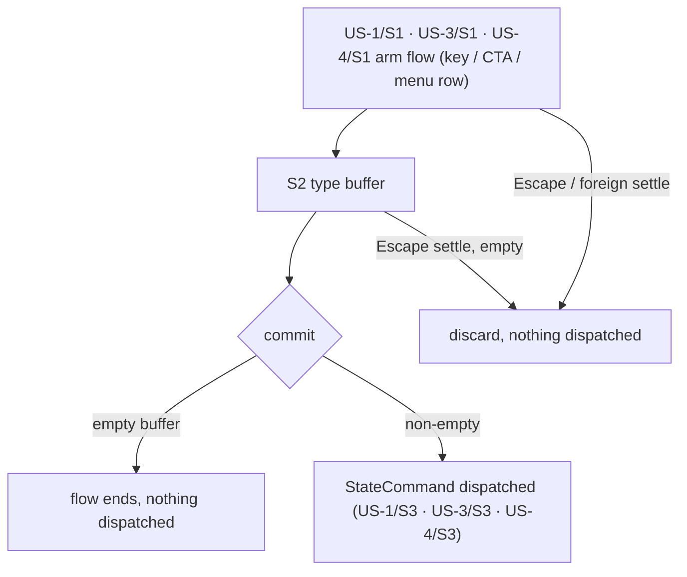
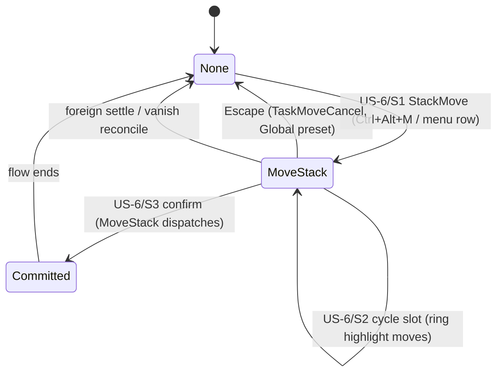
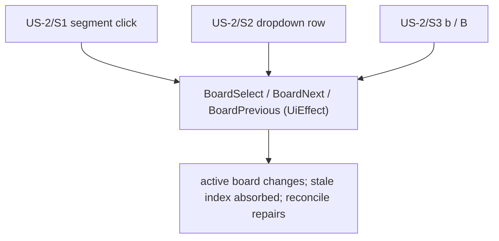

# [Plan] UX Journey Plan — Board & stack management (retrofit, registry F-1)

- **Date**: 2026-11-14
- **Kind**: UX journey plan — **retrofit** (phase 4 of the UX journey
  framework rollout): user stories, journeys, flows, wiring inventory,
  and findings describing board & stack management **as implemented**.
  No new capability is planned; no implementation decisions are made.
- **Origin**: the UX retrofit & triage dispatch
  `/home/viktoria/src/taskboard/.artifacts/plans/2026-11-14-ux-retrofit-triage-dispatch-plan.md`
  §1/§2 (the retrofit posture binds this plan: describe what exists —
  never fix, never prescribe redesign); the chunk plan
  `.artifacts/plans/2026-11-14-ux-retrofit-core-chunk-plan.md` (registry
  row F-1, rubric D-3, gate steady-state rule D-5, commit sequencing
  D-6); the census Board slice
  `docs/ux-surface-census.org` (baseline `dc290df2`); the live worktree
  code at `docs/ux-retrofit-core` HEAD `d894ac92` (wiring anchors are
  live `file:line`; census cells keep their recorded baseline anchors —
  chunk-plan §5 anchor-drift law).
- **Status**: ACCEPTED (retrofit documentation authored under the
  accepted phase-4 dispatch; stage 3 reviews it against this posture).
  **Amended 2026-11-15** (UX remediation chunk 1 — completability,
  stage 2; authority: the accepted triage report findings T-2 (#785)
  and the remediation chunk plan
  `.artifacts/plans/2026-11-15-ux-r1-completability-chunk-plan.md`
  D-1/D-4): the remediation design below is recorded as **changed
  journeys** — new story US-11 (§3/§4), wiring row W-12 (§6), the
  `SetBoardArchived` delta row (§7), the board.archive Board cell
  `U (BF-2)` → `E (US-11)` (§2), and US-10/S2's lockout cells retired
  to history (§4). Command-contract delta of the amendment: **zero new
  variants** — `SetBoardArchived` exists (`messages.rs:179`).
- **Surfaces touched**: `ui/compositions/board-bar.slint`,
  `ui/compositions/board-layout.slint`, `ui/views/board-view.slint`,
  `ui/views/stack-view.slint`, `ui/app-window.slint`,
  `src/adapter.rs` (board seams), `src/actions.rs`, `src/menu.rs`,
  `src/view_state.rs`, `src/board_presets.rs`, `keymap/presets.rs`
- **Platform scope**: desktop (the board surface is desktop-only; kiosk
  renders the Today section — no board mounts in kiosk per the census
  sweeps)

## 1. Scope & goals

This plan documents the board & stack management UX that ships today:
a desktop user creates, renames, selects/switches, deletes, moves,
and resizes boards and stacks; an empty board offers a default-kanban
preset CTA; each column carries a per-column task-count badge. All
journeys below are **journeys-as-implemented** (chunk plan D-4: P1 =
the journey a user actually must complete today).

**Non-goals** (retrofit posture — nothing here is a commitment; each
hole is a finding in §10, classification and homing are the phase-5
triage's):

- No GUI affordance for board color, archive/unarchive, reset, or
  reconcile — described as findings BF-1..BF-4 (§10), not planned.
- No confirmation UI on board/stack delete — described as findings
  BF-5/BF-6 (§10), not planned.

## 2. Capability × surface matrix

<!-- Cells restate the census Board slice (baseline dc290df2) verbatim
in content; anchors are the census's recorded baseline anchors. `U`
cells are carried as `U` or converted to `— (R-n)` per the chunk
plan's rubric D-3; every conversion cites this plan's rulings table
below (this plan is the ruling's authority, dated 2026-11-14). Cells
avoid `|`. -->

| Capability | Board | TaskDetail | Today | Review | Settings | Capture | CLI |
|---|---|---|---|---|---|---|---|
| board.create | C (US-1) — board-create field commit → `CreateBoard` `adapter.rs:8220-8226` (view_state.rs:1944); keyboard `BoardCreate` `actions.rs:916-925`, Ctrl+Shift+N `presets.rs:150` | — (R-1) | — (R-1) | — (R-1) | — (R-1) | — (R-1) | C (pre-existing, `boards create` `cli.rs:322`) |
| board.rename | E (US-4) — board-rename field commit → `RenameBoard` `adapter.rs:8230-8236` (view_state.rs:1962), inline field `board-bar.slint:89-93` (baseline anchor; the live field mounts in the app-window board wiring, `app-window.slint:587`); `BoardRename` `actions.rs:926-935`, Ctrl+F2 `presets.rs:151` | — (R-1) | — (R-1) | — (R-1) | — (R-1) | — (R-1) | E (pre-existing, `boards rename` `cli.rs:332`) |
| board.delete | X (US-5) — board context menu → `DeleteBoard` `view_state.rs:2933`; `BoardDelete` `actions.rs:936-945`, Ctrl+Shift+Delete `presets.rs:153-156` | — (R-1) | — (R-1) | — (R-1) | — (R-1) | — (R-1) | X (pre-existing, `boards delete --confirm` `cli.rs:390`) |
| board.select | E (US-2) — board-bar segment click `adapter.rs:8272`, compact switcher `adapter.rs:8366`; `BoardNext`/`BoardPrevious` `actions.rs:886-905`, `BoardSelect` `actions.rs:906-915` | — (R-1) | — (R-1) | — (R-1) | — (R-1) | — (R-1) | E (pre-existing, `boards use` `cli.rs:358`, `boards select` bind `cli.rs:297`) |
| board.color | U (BF-1) | U (BF-1) | U (BF-1) | U (BF-1) | U (BF-1) | U (BF-1) | E (pre-existing, `boards color` `cli.rs:365`) |
| board.archive | E (US-11) — the archived-boards roster: a trailing indicator (mounted iff the archived set is non-empty, `board-bar.slint` roster-dd) opens the shared dropdown (site 3) of title-only rows; activating a row dispatches `SetBoardArchived with archived false` + `RefreshNow` and the restored board re-selects (`adapter.rs::install_board_bar_archived_seam`, `view_state.rs::unarchive_board`) | U (BF-2) | U (BF-2) | U (BF-2) | U (BF-2) | U (BF-2) | E (pre-existing, `boards archive` / `boards unarchive` `cli.rs:375-381`) |
| board.reset | U (BF-3) | U (BF-3) | U (BF-3) | U (BF-3) | U (BF-3) | U (BF-3) | X (pre-existing, `boards reset --confirm` `cli.rs:403`) |
| board.reconcile | U (BF-4) | U (BF-4) | U (BF-4) | U (BF-4) | U (BF-4) | U (BF-4) | E (pre-existing, `boards reconcile --confirm` `cli.rs:429`) |
| board.default_preset | E (US-8) — empty-board "default kanban" CTA `adapter.rs:8297`, `board-layout.slint:242-250`, mints `CreateStack` payloads `src/board_presets.rs:5,23` | — (R-2) | — (R-2) | — (R-2) | — (R-2) | — (R-2) | U (BF-8) |
| stack.create | C (US-3) — new-stack field commit → `CreateStack` `adapter.rs:8305-8309` (view_state.rs:1865,4222-4250), "+ stack" opener `adapter.rs:8290`; `StackCreate` `actions.rs:1028-1036`, S `presets.rs:128` | — (R-3) | — (R-3) | — (R-3) | — (R-3) | — (R-3) | C (pre-existing, `stacks add` `cli.rs:445`) |
| stack.rename | E (US-4) — stack-rename field commit → `RenameStack` `adapter.rs:8208-8214` (view_state.rs:1953), inline field `board-layout.slint:451-462`; `StackRename` `actions.rs:987-996`, F2 `presets.rs:162` | — (R-3) | — (R-3) | — (R-3) | — (R-3) | — (R-3) | E (pre-existing, `stacks rename` `cli.rs:456`) |
| stack.delete | X (US-5) — stack context menu → `DeleteStack` `view_state.rs:2919`; `StackDelete` `actions.rs:1008-1017`, Ctrl+Delete `presets.rs:164` | — (R-3) | — (R-3) | — (R-3) | — (R-3) | — (R-3) | X (pre-existing, `stacks delete` `cli.rs:464`) |
| stack.move | E (US-6) — stack move flow → `MoveStack` `view_state.rs:3005`; `StackMove` `actions.rs:997-1007`, Ctrl+Alt+M `presets.rs:163` | — (R-3) | — (R-3) | — (R-3) | — (R-3) | — (R-3) | E (pre-existing, `stacks move` `cli.rs:469`) |
| stack.resize | E (US-7) — column divider drag `adapter.rs:7577-7652` (`board-layout.slint:316-321`); `StackWider`/`StackNarrower` `actions.rs:967-986`, Ctrl+Right/Left `presets.rs:167-168` | — (R-4) | — (R-4) | — (R-4) | — (R-4) | — (R-4) | U (BF-8) |
| stack.count_display | D (US-9) — per-stack card count badge `board-layout.slint:470-473` | — (R-5) | — (R-5) | — (R-5) | — (R-5) | — (R-5) | U (BF-8) |

**Rulings** (conversions of census `U` cells; every converted cell
above cites one of these; this table is the ruling's authority,
2026-11-14, per chunk plan D-3):

| ID | Ruling | Reason | Home |
|---|---|---|---|
| R-1 | board.create / board.rename / board.delete / board.select have no mounts outside the board surface | R-Pattern 2 (entity-mount grammar): the board entity renders only in the board bar / toolbar switcher region of the Board surface (`board-bar.slint` segment tabs + dropdown; `view_state.rs:1252` builds the segment model); the census's Sweep-T/Y/R/S/C evidence (register, 2026-11-13) shows no board-create/rename/delete/switch seam or mount in any other surface. The absence elsewhere is the mount grammar, not a gap. | this plan §2; census Board slice register |
| R-2 | board.default_preset mounts only on the empty-board state of the Board surface | R-Pattern 2: the preset CTA mounts inside the empty-board leg (`board-layout.slint:248-251`); no other surface renders the empty-board state, so no other mount is grammatically possible (Sweep-T/Y/R/S/C evidence, census register). The CLI cell stays `U` as finding BF-8. | this plan §2; census Board slice register |
| R-3 | stack.create / stack.rename / stack.delete / stack.move have no mounts outside the board surface (Board + StackDetail) | R-Pattern 2: stack columns render only on the Board surface (the census records StackDetail inside the Board slice); `StackCreate`/`StackRename`/`StackDelete`/`StackMove` bind `&[ContextId::Board, ContextId::StackDetail]` (`actions.rs:1025-1033,985-993,1005-1013,995-1003`); Sweep-T/Y/R/S/C shows no stack seam in any other surface. | this plan §2; census Board slice register |
| R-4 | stack.resize mounts only on the Board surface | R-Pattern 2: the divider drag and the `StackWider`/`StackNarrower` verbs (`contexts: &[ContextId::Board]`, `actions.rs:965-981`) address column pairs, which only board columns render; Sweep-T/Y/R/S/C + Sweep-CLI evidence (no width seam, no CLI verb) in the census register. The CLI cell stays `U` as finding BF-8. | this plan §2; census Board slice register |
| R-5 | stack.count_display renders only on board columns | R-Pattern 3 (display-scoping): the badge displays a column's task count (`board-layout.slint:470-473`); surfaces that render no columns have nothing for it to echo — the absence is presentation scoping, not a product gap. The CLI cell stays `U` as finding BF-8. | this plan §2; census Board slice register |

## 3. User stories

### US-1 — Create a board

- **Story**: As a desktop user I want to create a board from the board
  bar so that a new workspace exists without the CLI.
- **Platforms**: desktop (the board surface does not mount in kiosk).
- **Entry points**: the board-create field commit
  (`board-create-field-committed`, `app-window.slint:578`);
  `ActionId::BoardCreate` ("New board", Ctrl+Shift+N, also in the
  board context menu row set `menu.rs:221-227`); CLI `boards create`
  (pre-existing twin).
- **Priority**: P1
- **Acceptance**:
  - AC-1: Given the create flow is armed with a non-empty title, When
    the field commits, Then `StateCommand::CreateBoard` dispatches
    with a lenient empty color — verified by
    `view_state.rs::board_create_flow_commits_the_lenient_color_command`.
  - AC-2: Given an empty buffer, When the flow settles, Then nothing
    dispatches — verified by
    `view_state.rs::an_empty_board_create_buffer_commits_nothing`
    (empty-buffer law, `view_state.rs:1906`).

### US-2 — Select / switch boards

- **Story**: As a desktop user I want to switch the active board by
  clicking a segment (or stepping with keys) so that I move between
  workspaces without losing my place.
- **Platforms**: desktop.
- **Entry points**: board-bar segment click
  (`board-bar-activated` → `board-bar-segment-activated`,
  `adapter.rs:8310-8326`); board-bar dropdown row activation
  (`app-window.slint:914`); segment right-click (selects, then opens
  `menu::BOARD_CONTEXT`, `adapter.rs:8230`);
  `ActionId::BoardNext`/`BoardPrevious` (b / B);
  `ActionId::BoardSelect` (click-routed, no key — BF-7).
- **Priority**: P1
- **Acceptance**:
  - AC-1: Given multiple live boards, When the user clicks a segment
    or presses b/B, Then the selection moves and the walk steps
    without wrapping — verified by
    `journeys.rs::board_switching_walks_boards_by_keyboard` and
    `view_state.rs::the_board_walk_steps_without_wrapping`.

### US-3 — Create a stack

- **Story**: As a desktop user I want to add a column to the current
  board so that a new work stage exists.
- **Platforms**: desktop.
- **Entry points**: the "New stack" CTA (`board-new-stack-clicked`,
  `board-layout.slint:243-246`); the per-column inline create field
  (`board-stack-create-committed`); `ActionId::StackCreate`
  ("New stack", S key, also in `menu::STACK_CONTEXT`/
  `menu::BOARD_CONTEXT`); CLI `stacks add` (pre-existing twin).
- **Priority**: P1
- **Acceptance**:
  - AC-1: Given a board, When a non-empty title commits, Then
    `StateCommand::CreateStack` dispatches with an appended order —
    verified by
    `view_state.rs::stack_create_flow_commits_the_appended_create_stack`.
  - AC-2: Given no board (empty workspace), When the flow arms, Then
    it refuses with an inert commit — verified by
    `view_state.rs::begin_create_stack_refuses_without_a_board`.

### US-4 — Rename a stack / board

- **Story**: As a desktop user I want to rename the focused stack or
  current board inline so that titles stay accurate.
- **Platforms**: desktop.
- **Entry points**: `ActionId::StackRename` (F2) and
  `ActionId::BoardRename` (Ctrl+F2) — both arm inline fields
  (`board-stack-rename-committed`, `board-layout.slint:451-453`;
  `board-rename-field-committed`, `app-window.slint:587`); both appear
  in the context menus (`menu.rs:210-227`); CLI `stacks rename` /
  `boards rename` (pre-existing twins).
- **Priority**: P1
- **Acceptance**:
  - AC-1: Given a rename flow seeded from the current title, When the
    user commits, Then `StateCommand::RenameStack`/`RenameBoard`
    dispatches with the buffer — verified by
    `journeys.rs::the_rename_flows_seed_commit_and_discard`.
  - AC-2: Given the flow's subject vanished (reconcile), When the flow
    settles, Then it ends without dispatching — verified by
    `view_state.rs::rename_stack_flow_seeds_the_buffer_and_commits_the_rename`
    + the reconcile-end law (`view_state.rs:3082`).

### US-5 — Delete a stack / board

- **Story**: As a desktop user I want to delete a stack or the current
  board (with everything in it) so that stale workspaces disappear.
- **Platforms**: desktop.
- **Entry points**: `ActionId::StackDelete` (Ctrl+Delete) and
  `ActionId::BoardDelete` (Ctrl+Shift+Delete); context-menu rows
  (stack header/body right-click → `menu::STACK_CONTEXT`, board
  segment right-click → `menu::BOARD_CONTEXT`; destructive rows last);
  CLI `stacks delete` / `boards delete --confirm` (pre-existing twins).
- **Priority**: P1
- **Acceptance**:
  - AC-1: Given a target (focused → selected → first resolution),
    When delete dispatches, Then the exact
    `StateCommand::DeleteStack`/`DeleteBoard` drains and the selection
    reconciles on the next refresh — verified by
    `view_state.rs::delete_stack_and_delete_board_dispatch_the_exact_commands`.
  - AC-2: Given no target, When delete is invoked, Then it is inert —
    verified by `view_state.rs::delete_stack_is_inert_without_a_target`.

### US-6 — Move a stack

- **Story**: As a desktop user I want to reorder the board's stacks via
  a move flow so that column order matches how I work.
- **Platforms**: desktop.
- **Entry points**: `ActionId::StackMove` (Ctrl+Alt+M; emacs/vi
  variants in `presets.rs:422,626`); `menu::STACK_CONTEXT` row; CLI
  `stacks move` (pre-existing twin).
- **Priority**: P1
- **Acceptance**:
  - AC-1: Given an armed move flow, When the user cycles slots and
    confirms, Then one `StateCommand::MoveStack` dispatches and the
    ring highlight clears — verified by
    `journeys.rs::the_stack_move_flow_cycles_and_confirms_minimally`.
  - AC-2: Given the flow confirms in place, When it settles, Then
    nothing dispatches — verified by
    `view_state.rs::an_in_place_stack_move_confirm_dispatches_nothing`.

### US-7 — Resize a stack

- **Story**: As a desktop user I want to drag a column divider (or
  step the width with keys) so that columns fit their content.
- **Platforms**: desktop.
- **Entry points**: divider drag (`board-stack-width-press/drag/
  release`, `board-layout.slint:654-680`, `adapter.rs:7615-7690`);
  `ActionId::StackWider`/`StackNarrower` (Ctrl+Right / Ctrl+Left).
- **Priority**: P1
- **Acceptance**:
  - AC-1: Given a resize, When the keyboard verb steps the focused
    stack's pair, Then the step clamps at the boundary — verified by
    `view_state.rs::resize_focused_stack_steps_the_pair_and_clamps`.
  - AC-2: Given a drag release, When the widths settle, Then one
    `UiRequest::StackWidthsChanged` persists them per device — verified
    by `journeys.rs::stored_widths_rebalance_when_a_stack_joins` and
    `journeys.rs::never_resized_board_pushes_positive_widths_and_no_requests`.

### US-8 — Default preset CTA (empty board)

- **Story**: As a desktop user facing an empty board I want a
  one-click default kanban setup so that I do not hand-create the
  starter columns.
- **Platforms**: desktop.
- **Entry points**: the "Create Default Kanban Setup" CTA
  (`board-default-preset-clicked`, `board-layout.slint:248-251`;
  pointer-only — no ActionId, no key: BF-9).
- **Priority**: P1
- **Acceptance**:
  - AC-1: Given an empty board, When the CTA is clicked, Then explicit
    ordered `StateCommand::CreateStack` payloads dispatch (one per
    preset stack) plus `RefreshNow` — verified by
    `view_state.rs::the_default_kanban_preset_dispatches_explicit_ordered_creates`.
  - AC-2: Given no board, When the CTA fires, Then the preset refuses —
    verified by `view_state.rs::the_preset_dispatch_refuses_without_a_board`.

### US-9 — Column task-count display

- **Story**: As a desktop user I want each column to show its task
  count so that load is visible at a glance. (Display-only story.)
- **Platforms**: desktop.
- **Entry points**: the per-column badge (`board-layout.slint:470-473`
  at baseline; live `board-layout.slint` Badge over
  `column.tasks.length`) — display only.
- **Priority**: P1 (D-verb display)
- **Acceptance**:
  - AC-1: Given tasks in a column, When the board renders, Then the
    badge echoes the count and flips to the move-target tone while a
    move flow aims at the column — verified by
    `journeys.rs::the_empty_board_renders_bar_ctas_and_the_preset`
    (empty-board leg) and the golden visuals suite
    (`tests/golden_visuals.rs`); display only, no dispatch.

### US-11 — Unarchive a board from the GUI

- **Story** (amendment 2026-11-15, remediation T-2/#785): As a desktop
  user I want to restore an archived board from the board bar so that
  archiving is recoverable without the CLI.
- **Platforms**: desktop. On kiosk the indicator renders the disabled
  affordance (the D-2 grammar: visible, grey, non-interactive — no new
  kiosk capability; the adapter's layer-3 refusal stands behind it).
- **Entry points**: the board bar's trailing archived-boards indicator
  (`board-bar.slint` roster-dd; flyout site 3). Pointer-only rows —
  keyboard parity rides the shared dropdown's own walk; no new
  `ActionId` (chunk-plan D-1 non-goal: the board-verb entry-point
  asymmetry is chunk 4's family).
- **Priority**: P1
- **Acceptance**:
  - AC-1: Given an archived board, When a roster row activates, Then
    the exact `StateCommand::SetBoardArchived with archived false` + a
    models refresh dispatch and the restored board re-selects —
    verified by `journeys.rs::us11_s2_roster_row_unarchives_and_selects`.
  - AC-2: Given nothing archived, When the bar renders, Then no
    indicator mounts (a non-empty archive is the honest signal) —
    verified by `journeys.rs::us11_s1_roster_absent_while_no_board_is_archived`.
  - AC-3: Given a confirmed unarchive, When the engine's apply lands,
    Then the board rejoins the bar's segment set and the roster
    unmounts again — verified by
    `journeys.rs::us11_s3_the_restored_board_rejoins_the_bar_and_the_roster_unmounts`
    and `view_state.rs::unarchive_board_arms_a_pending_select_consumed_once_live`.

### US-10 — CLI-only board ceremonies (P2, CLI-completed journeys)

- **Story**: When a board's color, archive state, or full reset needs
  changing, I want the CLI verbs to complete it so that the data is
  manageable — today the GUI has no affordance for any of these
  (findings BF-1..BF-4; F-Pattern 1: CLI-only mutation of user data).
- **Platforms**: CLI.
- **Entry points**: `boards color` `cli.rs:365`; `boards archive` /
  `boards unarchive` `cli.rs:375-381`; `boards reset --confirm`
  `cli.rs:403`; `boards reconcile --confirm` `cli.rs:429`.
- **Priority**: P2
- **Acceptance**:
  - AC-1: Given a board, When `boards color <color>` runs, Then
    `StateCommand::SetBoardColor` dispatches (engine-side; the domain
    command exists at `messages.rs:170` with zero GUI dispatch sites —
    the retrofit sweep evidence for BF-1).

## 4. Journey specs

### US-1 — Create a board

| Step | Surface & affordance | User action | Dispatches | System response | Escape / failure |
|---|---|---|---|---|---|
| US-1/S1 | board bar region, create flow arm | Ctrl+Shift+N or `ActionId::BoardCreate` (menu row) | `ActionId::BoardCreate` → `UiEffect::BoardCreate` (`router.rs:904`, `adapter.rs:3594`) → `begin_create_board` (`view_state.rs:2875`) | the board-create field mounts armed (`Flow::CreateBoard`) | Escape/foreign settle with an empty buffer ends the flow, nothing dispatched (`view_state.rs:2803-2813`, the empty-buffer law `view_state.rs:1906`) — test `journeys.rs::the_lifecycle_verbs_drain_their_exact_commands` |
| US-1/S2 | board-create field | type the title | — (flow-local buffer edit, `on_board_create_field_edited` `adapter.rs:8258`) | the buffer echoes in the field | Escape settle commits if non-empty else discards (`view_state.rs:2803-2813`); empty buffer commits nothing |
| US-1/S3 | board-create field commit (`app-window.slint:578`) | press Return | `StateCommand::CreateBoard { title, color: Color::new("") }` (`view_state.rs:1939-1948`, `messages.rs:138`) | the new board appears in the board bar and becomes selected | typed engine refusals surface through the outcome lane; the lenient empty color is the recorded create-time debt (BF-1) |

### US-2 — Select / switch boards

| Step | Surface & affordance | User action | Dispatches | System response | Escape / failure |
|---|---|---|---|---|---|
| US-2/S1 | board bar segment (`board-bar.slint:194`) | click a segment | `board-bar-activated` → `board-bar-segment-activated` (`adapter.rs:8310-8326`) → `ActionId::BoardSelect` with `board_target` set | the clicked board becomes the active board; stale index resolves to None and is absorbed | pure navigation — no state mutation to escape; selection repair by reconcile on stale targets (`view_state.rs:4472` test) — test `journeys.rs::the_segment_right_click_selects_and_opens_the_board_menu` |
| US-2/S2 | board bar dropdown row (`app-window.slint:914`) | click a row in the compact switcher | same `BoardSelect` route | same selection change | same absorb-on-stale guard (`adapter.rs:8310-8326`) — test `journeys.rs::board_switching_walks_boards_by_keyboard` |
| US-2/S3 | keyboard walk | press b / B | `ActionId::BoardNext`/`BoardPrevious` → `UiEffect` (`router.rs:955-963`, `adapter.rs:3031-3034`) | selection steps without wrapping (`view_state.rs:1279-1289`) | no wrap; inert without boards — test `view_state.rs::the_board_walk_steps_without_wrapping` |

### US-3 — Create a stack

| Step | Surface & affordance | User action | Dispatches | System response | Escape / failure |
|---|---|---|---|---|---|
| US-3/S1 | board layout, "New stack" CTA / S key | click the CTA or press S | `board-new-stack-clicked` (`adapter.rs:8328-8330`) / `ActionId::StackCreate` → `UiEffect::BeginCreateStack` (`router.rs:892`, `adapter.rs:3504`) | the stack-create field arms (`Flow::CreateStack`, `view_state.rs:1881-1888`) | board-less arm refuses with an inert commit (`view_state.rs:4259` test); Escape discards via the settle law — test `journeys.rs::stack_create_has_a_visible_click_equal_flow` |
| US-3/S2 | stack-create field (`board-layout.slint:574-581`) | type the title | — (flow-local buffer) | the buffer echoes | empty buffer commits nothing (`view_state.rs:4371` test) |
| US-3/S3 | stack-create field commit | press Return | `StateCommand::CreateStack { board, title, order: append_stack_order }` (`view_state.rs:1910-1928`, `messages.rs:72`) | the column appears appended, named board = the selected one | typed engine refusals surface via the outcome lane — test `view_state.rs::the_create_stack_flow_names_the_selected_board` |

### US-4 — Rename a stack / board

| Step | Surface & affordance | User action | Dispatches | System response | Escape / failure |
|---|---|---|---|---|---|
| US-4/S1 | focused stack header / board bar | F2 (stack) or Ctrl+F2 (board), or the context-menu row | `ActionId::StackRename`/`BoardRename` → `UiEffect` (`router.rs:902,906`) → `begin_rename_stack`/`begin_rename_board` (`view_state.rs:2890,2905`) | the inline rename field arms, seeded with the current title (`journeys.rs::the_rename_flows_seed_commit_and_discard`) | reconcile ends the flow if the subject vanished (`view_state.rs:3082`); Escape discards per the settle law |
| US-4/S2 | rename field (`board-layout.slint:451-453` / `app-window.slint:587`) | edit the title | — (flow-local buffer, `on_board_stack_rename_edited` `adapter.rs:8246`) | the buffer echoes | empty buffer commits nothing |
| US-4/S3 | rename field commit | press Return | `StateCommand::RenameStack { id, new_title }` / `StateCommand::RenameBoard { board, title }` (`view_state.rs:1950-1962`, `messages.rs:81,162`) | the title updates in place | typed engine refusals surface via the outcome lane — test `view_state.rs::rename_stack_flow_seeds_the_buffer_and_commits_the_rename` |

### US-5 — Delete a stack / board

| Step | Surface & affordance | User action | Dispatches | System response | Escape / failure |
|---|---|---|---|---|---|
| US-5/S1 | stack header/body or board segment | right-click | `on_board_header_context_requested`/`on_board_body_context_requested`/`on_board_segment_context_requested` (`adapter.rs:8222,8204,8230`) | `menu::STACK_CONTEXT`/`menu::BOARD_CONTEXT` opens at the pointer; the segment right-click selects the board first; stale index absorbed | outside click / Escape dismisses the menu (menu dismissal seam, `adapter.rs:7869-7874` family) — test `journeys.rs::the_body_right_click_selects_and_opens_the_stack_menu` |
| US-5/S2 | context menu row | click "Delete stack" / "Delete board" (destructive rows last, `menu.rs:210-227`) | `ActionId::StackDelete`/`BoardDelete` → `UiEffect` (`router.rs:901,905`) → `delete_stack`/`delete_board` (`view_state.rs:2912-2937`) | `StateCommand::DeleteStack`/`DeleteBoard` + `RefreshNow` dispatch; the engine cascades | **escape-less**: no confirmation UI (the registry description names "no confirmation step", `actions.rs:935-944`; `view_state.rs:2924-2925`) and no undo — `DeleteStack` is `NotUndoable(RestoreClass)` (`undo.rs:126-127`) and `DeleteBoard` `NotUndoable(BoardCeremony)` (`undo.rs:134-138`). Findings BF-5/BF-6 — test `view_state.rs::delete_stack_and_delete_board_dispatch_the_exact_commands` |
| US-5/S3 | keyboard twin | Ctrl+Delete (stack) / Ctrl+Shift+Delete (board) | same action ids via the keymap route (`presets.rs:152-156,164`) | same as S2 | same escape-less posture (BF-5/BF-6); inert without a target (`view_state.rs:4885` test) |

### US-6 — Move a stack

| Step | Surface & affordance | User action | Dispatches | System response | Escape / failure |
|---|---|---|---|---|---|
| US-6/S1 | board surface | Ctrl+Alt+M or the menu row | `ActionId::StackMove` → `UiEffect::StackMove` (`router.rs:903`, `adapter.rs:3589`) → `begin_move_stack` (`view_state.rs:2943-2947`) | `Flow::MoveStack { stack, slot }` arms; the ring highlight paints (`board-layout.slint:107,430`) | Escape cancels — `TaskMoveCancel` is bound to Escape in the Global context in every preset (`presets.rs:119,344,620`); foreign settle cancels (`view_state.rs:2830-2832`) — test `journeys.rs::the_stack_move_flow_cycles_and_confirms_minimally` |
| US-6/S2 | move flow | repeat the stroke to cycle the insertion slot | same `StackMove` route cycles (`view_state.rs:2957-2963`) | the ring moves to the next slot, wrapping | Escape at any point cancels and clears the ring |
| US-6/S3 | move flow | confirm (final stroke) | `StateCommand::MoveStack { .. }` (`view_state.rs:2977-3010`, `messages.rs:94`) | the stack reorders; the flow ends | in-place confirm dispatches nothing (`view_state.rs:4984` test); vanish reconciles (`view_state.rs:5000` test) |

### US-7 — Resize a stack

| Step | Surface & affordance | User action | Dispatches | System response | Escape / failure |
|---|---|---|---|---|---|
| US-7/S1 | column divider (`board-layout.slint:654-680`) | press the divider | `board-stack-width-press` (`adapter.rs:7615-7649`) | the resolved column pair materializes into the view-state overlay, sum-exact | drag never dispatches until release — release-outside / stale frames are absorbed (`adapter.rs:7690` persist-on-release only) — test `view_state.rs::resize_targets_focused_then_selected_then_first_and_is_inert_without_stacks` |
| US-7/S2 | column divider | drag | `board-stack-width-drag` (`adapter.rs:7649-7690`) | per-frame staleness re-check (`a.tables.stack_ids.get(column) != Some(&left)` guard, `adapter.rs:7661`) then `set_stack_width` for the boundary pair, clamped by `widths::drag_boundary` | clamping bounds the damage; a stale column re-check prevents wrong-target width edits — test `journeys.rs::stored_widths_rebalance_when_a_stack_joins` |
| US-7/S3 | column divider / keyboard | release; or Ctrl+Right / Ctrl+Left | `UiRequest::StackWidthsChanged { board, widths }` on release (`adapter.rs:7690`); `ActionId::StackWider`/`StackNarrower` → `resize_focused_stack` (`adapter.rs:3036-3040`, `view_state.rs:1810`) | one persist-on-release request (warn-and-drop on a full inbox); keyboard steps clamp | no undo of width changes (the request lane is outside the journal) — the clamp is the only guard; recorded as BF-8's framing, not a data-loss path — test `view_state.rs::resize_focused_stack_steps_the_pair_and_clamps` |

### US-8 — Default preset CTA (empty board)

| Step | Surface & affordance | User action | Dispatches | System response | Escape / failure |
|---|---|---|---|---|---|
| US-8/S1 | empty-board leg CTA (`board-layout.slint:248-251`) | click "Create Default Kanban Setup" | `board-default-preset-clicked` (`adapter.rs:8335-8341`) → `apply_board_preset(&state, &board_presets::DEFAULT_KANBAN)` (`view_state.rs:1851-1869`) | explicit ordered `StateCommand::CreateStack` payloads dispatch (one per preset stack) + `RefreshNow`; the columns render | board-less refusal (`view_state.rs:4358` test); the creates are journal PreImages, so `AppUndo` reverses the preset — test `view_state.rs::the_default_kanban_preset_dispatches_explicit_ordered_creates` |

### US-9 — Column task-count display

| Step | Surface & affordance | User action | Dispatches | System response | Escape / failure |
|---|---|---|---|---|---|
| US-9/S1 | per-column Badge (`board-layout.slint:470-473`) | — display only | — display only | the badge echoes `column.tasks.length`; tone flips to `Tone.sync-active` while `column-index == root.move-target` (the move flow's aim feedback) | display only — no dispatch, no escape; the tone flip is the move flow's per-column feedback (§10 walkthrough note W-N1) |

### US-10 — CLI-only board ceremonies (P2)

| Step | Surface & affordance | User action | Dispatches | System response | Escape / failure |
|---|---|---|---|---|---|
| US-10/S1 | CLI `boards color` (`cli.rs:365`) | run the verb | `StateCommand::SetBoardColor` (`messages.rs:170`) | the board color changes engine-side; the GUI board bar renders it | `--confirm`-free non-destructive verb; no GUI twin exists (BF-1) |
| US-10/S2 | CLI `boards archive` / `unarchive` (`cli.rs:375-381`) | run the verb | `StateCommand::SetBoardArchived` (`messages.rs:179`) | the board leaves/joins the live set. **History (retired 2026-11-15)**: "an archived board is unreachable in the GUI" — BF-2's lockout ended with US-11 (the archived-boards roster); the archive verb itself stays CLI-only (chunk 4's board-verb family) | unarchive is now GUI-completable end-to-end via US-11/S2-S3; archive remains CLI-first until chunk 4 |
| US-10/S3 | CLI `boards reset --confirm` (`cli.rs:403`) | run the verb | `StateCommand::ResetBoard` (`messages.rs:199`) | the board content resets | `--confirm` flag is the CLI's destructive gate; no GUI affordance (BF-3); `ResetBoard` is `NotUndoable(BoardCeremony)` (`undo.rs:134-138`) |
| US-10/S4 | CLI `boards reconcile --confirm` (`cli.rs:429`) | run the verb | `StateCommand::ReconcileByTitle` (`messages.rs:296`) | cross-entity references reconcile | `--confirm` gate; no GUI affordance (BF-4) |

### US-11 — Unarchive a board from the GUI (amendment 2026-11-15)

| Step | Surface & affordance | User action | Dispatches | System response | Escape / failure |
|---|---|---|---|---|---|
| US-11/S1 | board bar, trailing archived-boards indicator (flyout site 3) | click the indicator | — (opens the roster dropdown; nothing dispatched) | the dropdown opens with one title-only row per archived board, canonical order; the indicator mounts only while the archive is non-empty | Escape / outside click closes the dropdown, nothing dispatched (the shared dropdown's own dismissal contract, `dropdown.slint` ladder) — test `journeys.rs::us11_s1_roster_absent_while_no_board_is_archived` |
| US-11/S2 | roster row | click an archived board's row | `on_board_bar_archived_activated` (`adapter.rs`) → `view_state.rs::unarchive_board` → `StateCommand::SetBoardArchived { board, archived: false }` (`messages.rs:179`) + `RefreshNow` | the restored board re-selects on the first refresh where the engine's apply lands (the view-state one-shot consumed at reconcile) | typed engine refusals surface through the outcome lane; `SetBoardArchived` is journal-eligible (`undo.rs:324`), so `AppUndo` reverses — test `journeys.rs::us11_s2_roster_row_unarchives_and_selects` |
| US-11/S3 | board bar | — (the apply's system response) | — | the board rejoins the segment set, becomes the selection, and the roster unmounts (the archive is empty again) | a refused apply never selects (`view_state.rs::unarchive_board_arms_a_pending_select_consumed_once_live`); a deleted target prunes the arm — test `journeys.rs::us11_s3_the_restored_board_rejoins_the_bar_and_the_roster_unmounts` |

## 5. Interaction flows

US-1/US-3/US-4 share the text-flow machine (arm → type → commit, with
the empty-buffer law):

US-6 move flow (armed state machine):

US-2 board selection (entry points converge on BoardSelect):

## 6. Wiring inventory

<!-- Rows document EXISTING affordances (retrofit): every callback,
action id, and command below is live at the worktree HEAD d894ac92;
row addressing is the adapter id-table resolution (no task-shaped
ItemAddr exists — the connections-lane ItemAddr kinds Account/Files/
FilesBoard/Deck/Remote are Settings-slice seams). Tests are existing
descriptive-name tests. -->

| ID | Surface file | Widget | Callback | Adapter seam | ActionId | Commands | Row addressing | Journey steps | Test |
|---|---|---|---|---|---|---|---|---|---|
| W-1 | ui/app-window.slint (field), ui/views/board-view.slint | board-create TextField (accepted wiring at app-window.slint:578) | — | on_board_create_field_committed (adapter.rs:8264) — slint callback board-create-field-committed | ActionId::BoardCreate | StateCommand::CreateBoard | — (board-scoped flow; no list row addressed) | US-1/S1-US-1/S3 | view_state.rs::board_create_flow_commits_the_lenient_color_command; journeys.rs::the_lifecycle_verbs_drain_their_exact_commands |
| W-2 | ui/app-window.slint | board-rename TextField (accepted wiring at app-window.slint:587) | — | on_board_rename_field_committed (adapter.rs:8274) — slint callback board-rename-field-committed | ActionId::BoardRename | StateCommand::RenameBoard | — (board-scoped flow) | US-4/S1-US-4/S3 | journeys.rs::the_rename_flows_seed_commit_and_discard |
| W-3 | ui/compositions/board-bar.slint, ui/views/board-view.slint, ui/app-window.slint | board segment TouchArea + dropdown rows | — | on_board_bar_segment_activated (adapter.rs:8310-8326) — slint callback board-bar-segment-activated | ActionId::BoardSelect | — | board index resolved via a.tables.board_ids (stale → None absorbed) | US-2/S1-US-2/S2 | journeys.rs::board_switching_walks_boards_by_keyboard |
| W-4 | ui/compositions/board-bar.slint (context entry), ui/compositions/board-layout.slint (stack header/body) | right-click context menus | — | on_board_segment_context_requested (adapter.rs:8230); on_board_header_context_requested (adapter.rs:8222); on_board_body_context_requested (adapter.rs:8204) — slint callback board-segment-context-requested | — | — | menu::STACK_CONTEXT / menu::BOARD_CONTEXT row sets (menu.rs:210-227) | US-5/S1 | journeys.rs::the_segment_right_click_selects_and_opens_the_board_menu; journeys.rs::the_body_right_click_selects_and_opens_the_stack_menu |
| W-5 | ui/compositions/board-layout.slint | "New stack" CtaButton + stack-create field | — | on_board_new_stack_clicked (adapter.rs:8328); on_board_stack_create_committed (adapter.rs:8347) — slint callbacks board-new-stack-clicked, board-stack-create-committed | ActionId::StackCreate | StateCommand::CreateStack | board index via a.tables.stack_ids | US-3/S1-US-3/S3 | journeys.rs::stack_create_has_a_visible_click_equal_flow; view_state.rs::stack_create_flow_commits_the_appended_create_stack |
| W-6 | ui/compositions/board-layout.slint | per-column inline rename TextField | — | on_board_stack_rename_committed (adapter.rs:8252) — slint callback board-stack-rename-committed | ActionId::StackRename | StateCommand::RenameStack | column index via a.tables.stack_ids | US-4/S1-US-4/S3 | view_state.rs::rename_stack_flow_seeds_the_buffer_and_commits_the_rename |
| W-7 | ui/compositions/board-layout.slint (menu row; no direct widget) | context-menu destructive row / keyboard verb | — | on_menu_entry_invoked (adapter.rs:7035) routes the action id; UiEffect arm adapter.rs:3587/3595 | ActionId::StackDelete | StateCommand::DeleteStack; StateCommand::DeleteBoard; ActionId::BoardDelete | target resolution focused → selected → first (view_state.rs:1795, 2912-2937) | US-5/S1-US-5/S3 | view_state.rs::delete_stack_and_delete_board_dispatch_the_exact_commands |
| W-8 | ui/views/stack-view.slint (StackDetail surface, recorded in this slice) | stack move flow (keyboard; ring highlight paint) | — | UiEffect::StackMove arm adapter.rs:3589 (keyboard flow; no widget callback) | ActionId::StackMove | StateCommand::MoveStack | slot cycle over board stacks (view_state.rs:2957-3010) | US-6/S1-US-6/S3 | journeys.rs::the_stack_move_flow_cycles_and_confirms_minimally |
| W-9 | ui/compositions/board-layout.slint | column divider TouchArea | — | on_board_stack_width_press (adapter.rs:7615); on_board_stack_width_drag (adapter.rs:7649); on_board_stack_width_release (adapter.rs:7690) — slint callback board-stack-width-drag | ActionId::StackWider | UiRequest::StackWidthsChanged; ActionId::StackNarrower | column pair via a.tables.stack_ids, staleness re-checked per frame | US-7/S1-US-7/S3 | view_state.rs::resize_focused_stack_steps_the_pair_and_clamps |
| W-10 | ui/compositions/board-layout.slint | "Create Default Kanban Setup" CtaButton | — | on_board_default_preset_clicked (adapter.rs:8335-8341) — slint callback board-default-preset-clicked (pointer-only CTA; no registry entry — BF-9) | — | StateCommand::CreateStack | board-scoped (preset table board_presets.rs:23) | US-8/S1 | view_state.rs::the_default_kanban_preset_dispatches_explicit_ordered_creates |
| W-11 | ui/compositions/board-layout.slint | per-column count Badge | — | — (display only) | — | — | per-column render | US-9/S1 | journeys.rs::the_empty_board_renders_bar_ctas_and_the_preset |
| W-12 | ui/compositions/board-bar.slint (flyout site 3 mounted at ui/app-window.slint) | trailing archived-boards indicator (the shared Dropdown, `field-enabled` platform gate) | — | on_board_bar_archived_activated (adapter.rs) — slint callback board-bar-archived-activated | — | StateCommand::SetBoardArchived | roster row index via a.tables.archived_board_ids (stale absorbed; kiosk refused at layer 3) | US-11/S1-US-11/S3 | journeys.rs::us11_s2_roster_row_unarchives_and_selects |

## 7. Command-contract delta

**None — retrofit** (the contract already exists). The table below
lists the existing variants the journeys dispatch, for greppability
(chunk plan D-4): every row is live at the worktree HEAD; nothing here
is new or changed.

| Kind | Name | Payload sketch | Journeys |
|---|---|---|---|
| StateCommand | SetBoardArchived | exists (`messages.rs:179`) — `{ board, archived }`; the GUI's unarchive dispatches only `archived: false` (amendment 2026-11-15; archive-from-GUI is chunk 4's non-goal) | US-11 |
| StateCommand | CreateBoard | exists (`messages.rs:138`) — `{ title, color: lenient empty }` | US-1 |
| StateCommand | RenameBoard | exists (`messages.rs:162`) | US-4 |
| StateCommand | DeleteBoard | exists (`messages.rs:190`) — cascades | US-5 |
| StateCommand | CreateStack | exists (`messages.rs:72`) — appended order; also minted per preset stack | US-3, US-8 |
| StateCommand | RenameStack | exists (`messages.rs:81`) | US-4 |
| StateCommand | DeleteStack | exists (`messages.rs:88`) — cascades | US-5 |
| StateCommand | MoveStack | exists (`messages.rs:94`) | US-6 |
| UiRequest | StackWidthsChanged | exists — `{ board, widths }`, per-device persist lane (the FlowOutcome RefreshNow rides the outcome lane, not a StateCommand) | US-7 |
| ActionId | BoardCreate / BoardRename / BoardDelete / BoardSelect / BoardNext / BoardPrevious | exist (`actions.rs:235-257`, registry `actions.rs:885-944`) | US-1, US-2, US-4, US-5 |
| ActionId | StackCreate / StackRename / StackDelete / StackMove / StackWider / StackNarrower | exist (`actions.rs:238-254`, registry `actions.rs:965-1033`) | US-3, US-4, US-5, US-6, US-7 |
| ActionId | AppUndo / AppRedo | exist (`actions.rs:217-218`) — the preset creates are undoable (journal PreImages) | US-8 |

No `UiRequest` beyond `StackWidthsChanged` and no new variant of any
kind is involved in these journeys.

## 8. Verification plan

- **Journey tests (step-ID-named)**: US-11's three steps carry their
  step-ID tests (`journeys.rs::us11_s1/us11_s2/us11_s3`, amendment
  2026-11-15). The pre-amendment journeys (US-1..US-10) still predate
  the framework's step-token test law. Per the pilot
  precedent (comparison plan §2, backlog #768; habit-create plan PC-3)
  the §2.3 gate's journey-step token rows stay MISSING on this plan;
  the per-step verification evidence is the Test column of §6 and the
  Escape column of §4 (all cited tests exist and pass).
- **Seam tests (existing, cited per row)**: the exact-command drains —
  `journeys.rs::the_lifecycle_verbs_drain_their_exact_commands`
  (board create/delete), `view_state.rs::delete_stack_and_delete_
  board_dispatch_the_exact_commands`, `journeys.rs::the_stack_move_
  flow_cycles_and_confirms_minimally`.
- **Fold/presentation tests (existing)**: the width clamp and target
  chain (`view_state.rs::resize_focused_stack_steps_the_pair_and_
  clamps`), the preset refusal (`view_state.rs::the_preset_dispatch_
  refuses_without_a_board`), the empty-buffer law (`view_state.rs::
  an_empty_stack_create_buffer_commits_nothing`).
- **Kiosk gates**: the board surface does not mount in kiosk (the
  census sweeps show no board mounts outside the desktop board
  surface); no board affordance renders disabled — it is absent.
- **Manual**: label/hint semantics ("New stack", "Create Default
  Kanban Setup", the ring-highlight meaning) are judged, not
  text-asserted; the stage-3 walkthrough covers them.

## 9. Definition of done (retrofit)

- [x] Wiring inventory: every row FOUND under
  `scripts/ux-coverage.sh` (per-plan gate outcome recorded in the
  stage-2 report — chunk plan D-5)
- [x] Journeys-as-implemented complete end-to-end with the escape
  audit per step; the escape-less steps (US-5/S2-S3) recorded as
  findings BF-5/BF-6, not fixed (retrofit posture)
- [x] Census Board-slice `U` conversions carry R-1..R-5 and cite this
  plan (rulings table §2, dated 2026-11-14)
- [ ] Stage-3 walkthrough protocol executed; findings classified by
  the phase-5 triage (this plan records, never fixes)
- [x] Non-goals: none planned — all holes are findings (§10)

## 10. Findings (retrofit — descriptive only; no redesign proposed)

Walkthrough answers (framework §4.4's four questions, applied
descriptively) and the six-heuristic pass surfaced the following; each
carries evidence, never a fix.

- **BF-1 — board.color is CLI-only; create hardcodes the color**
  (F-Pattern 1, CLI-only mutation of user data). No GUI affordance
  anywhere: zero dispatch sites for `SetBoardColor` in the UI crate
  (`messages.rs:170` engine-side; sweep evidence census register
  2026-11-13). The create flow commits the lenient empty color with
  the in-code comment "a colour picker is recorded debt for a future
  round" (`view_state.rs:1941-1943`). A user cannot set or see-meaning
  a board color without the CLI. Walkthrough Q1/Q2: no control exists
  to see.
- **BF-2 — archived boards are GUI-unreachable (lockout)**
  *(Remediated 2026-11-15: the unarchive half — US-11, remediation
  chunk 1 / triage T-2 (#785); the archive-from-GUI verb remains
  open, homed by the dispatch plan's chunk 4.)*
  (F-Pattern 1 + F-Pattern 3, journey integrity). `boards archive` is
  CLI-only; the board bar's segment model filters archived boards
  (`board-bar.slint:20-24` "an archived board is unreachable as a
  selection"; `view_state.rs:1252` `!b.archived`), so archiving a
  board in the CLI removes it from every GUI surface and only the CLI
  unarchives it. Walkthrough Q4: the recovery path exists only in the
  CLI.
- **BF-3 — board.reset is CLI-only and destructive-without-undo**
  (F-Pattern 1). `ResetBoard` is CLI-gated by `--confirm`
  (`cli.rs:403`), `NotUndoable(BoardCeremony)` (`undo.rs:134-138`),
  and has zero GUI dispatch sites. The GUI user has neither the verb
  nor a warning surface.
- **BF-4 — board.reconcile is CLI-only** (F-Pattern 1).
  `ReconcileByTitle` (`messages.rs:296`, `cli.rs:429`) has no GUI
  affordance; the GUI's reconcile happens implicitly on refresh
  (selection repair, `view_state.rs:4472` test) but the explicit verb
  is CLI-only.
- **BF-5 — board delete: escape-less destructive step**
  (F-Pattern 3, journey integrity). The GUI deletes the current board
  and all its content with no confirmation UI (the registry
  description records "no confirmation step", `actions.rs:935-944`;
  `view_state.rs:2924-2925` "the engine's typed refusals are the only
  guard") and `DeleteBoard` is `NotUndoable(BoardCeremony)`
  (`undo.rs:134-138`) — the audit's escape mechanisms (a)-(d) all
  fail for US-5/S2-S3. A mis-stroke on Ctrl+Shift+Delete destroys the
  workspace irrecoverably.
- **BF-6 — stack delete: escape-less destructive step**
  (F-Pattern 3). Same posture as BF-5: no confirmation UI, and
  `DeleteStack` is `NotUndoable(RestoreClass)` (`undo.rs:126-127`) —
  a stack and its tasks vanish irrecoverably on Ctrl+Delete or the
  context-menu row. Contrast: task delete IS undoable
  (`DeleteTask` in the PreImages class, `undo.rs:104-109`) — the
  sibling verb has the escape this one lacks.
- **BF-7 — board.select has no keyboard binding** (F-Pattern 4,
  convenience/keyboard-mouse parity). `BoardSelect` ships click-only
  ("empty today, the mechanism is what ships", `board-bar.slint:49-51`)
  — no preset binds it in any keymap. The b/B walk partially covers
  direct selection; direct jump needs pointer or the palette.
- **BF-8 — CLI gaps on the board surface are convenience-class**
  (F-Pattern 4): no `boards` preset verb (the CTA's journey is
  GUI-only), no stacks width verb (widths persist per device via
  `UiRequest::StackWidthsChanged`, a request-lane concept the CLI does
  not expose), and counts are list output, not a badge capability
  (census Sweep-CLI evidence). The matrix's CLI `U` cells stay `U`
  under these findings.
- **BF-9 — the preset CTA is pointer-only** (F-Pattern 4,
  keyboard-mouse parity). `board-default-preset-clicked` has no
  ActionId and no key in any preset (`adapter.rs:8335-8341` direct
  dispatch; no registry entry) — a keyboard-only user on an empty
  board must create stacks by hand (US-3's S key covers the need,
  less conveniently).
- **W-N1 — walkthrough feedback note (US-9/S1)**: the count badge
  doubles as the move-flow's aim feedback (tone flips to
  `Tone.sync-active` while `column-index == root.move-target`,
  `board-layout.slint:470-473`) — a dual-purpose signal: readable
  once known, but the tone's meaning is not labeled anywhere
  (recognition-over-recall observation, MINOR-class; the triage
  classifies).
- **W-N2 — walkthrough recognition note (US-5/S1)**: the context
  menus order destructive rows last and grey disabled verbs
  (`menu.rs:210-227`, `menu.rs:68-71`) — the only destructive-action
  signal the user gets before BF-5/BF-6's point of no return.

## 11. Plan corrections
- **PC-3 (2026-11-15, remediation amendment)**: the UX remediation
  chunk 1 (stage 2, `fix/ux-r1-completability`) amended this plan
  under the dispatch plan's dress-rehearsal mandate (authority: the
  chunk plan D-1/D-4/D-7): US-11 (story, journey table, W-12), the
  `SetBoardArchived` delta row, the board.archive Board cell `U
  (BF-2)` → `E (US-11)`, US-10/S2's lockout cells retired to history,
  and BF-2's remediation note. Zero new command/ActionId variants.
  Kiosk posture: the roster renders the disabled affordance on kiosk
  (`archived-enabled` display state + the adapter's layer-3 refusal),
  per the chunk plan D-2 grammar and the no-new-kiosk-capabilities
  non-goal.
- **PC-2 (2026-11-14, gate-outcome corrections)**: the per-plan
  `scripts/ux-coverage.sh` run surfaced wiring-row representation
  defects, fixed here (D-5's plan-defect path): (a) hyphenated slint
  callback tokens cannot resolve the adapter half of the callback
  check on seams predating the framework — the gate matches
  `on_<token>` (underscored) or an `install_seam!` line carrying the
  token, and the house `// slint: <callback>` comment convention
  exists only on framework-era seams — so this plan's §6 rows carry
  the callback in the Adapter-seam column with the Callback cell `—`
  (the callback tokens were verified verbatim in the .slint files at
  correction time); (b) prose fragments in the Commands/ActionId cells
  were split into gate-checked tokens — cells now carry bare
  `StateCommand::`/`ActionId::` tokens only (or exactly `—`, with the
  reason in the Journey-steps column); (c) `RefreshNow` is a
  `FlowOutcome` (`view_state.rs:368`), not a `StateCommand`, and was
  removed from Commands cells. Gate outcome after correction: every
  wiring row, ruling, and no-commands reason FOUND; the only MISSING
  rows are the journey-step token rows and their story-citation
  cascade — the documented retrofit limitation (backlog #768, pilot
  PC-3 precedent, §8 above).

- **PC-1 (2026-11-14)**: the census Board-slice `board.rename` cell
  cites the inline rename field at `board-bar.slint:89-93` — that
  anchor is stale at the live HEAD (the live board bar carries no
  rename field; the field's accepted wiring is `app-window.slint:587`).
  Re-verified per chunk-plan §5 against the slice baseline before
  recording: the matrix cell above keeps the baseline anchor verbatim
  with a live-correction note inline; the §6 wiring row cites the live
  seam. No census cell was rewritten (chunk plan D-6 confines the
  census diff to `U` conversions).
