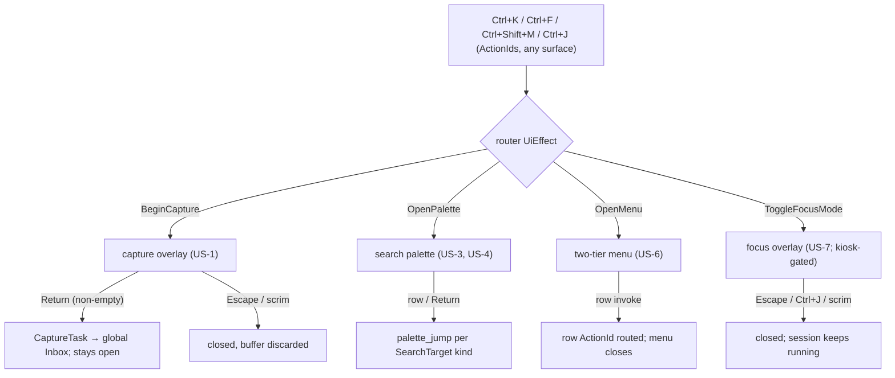
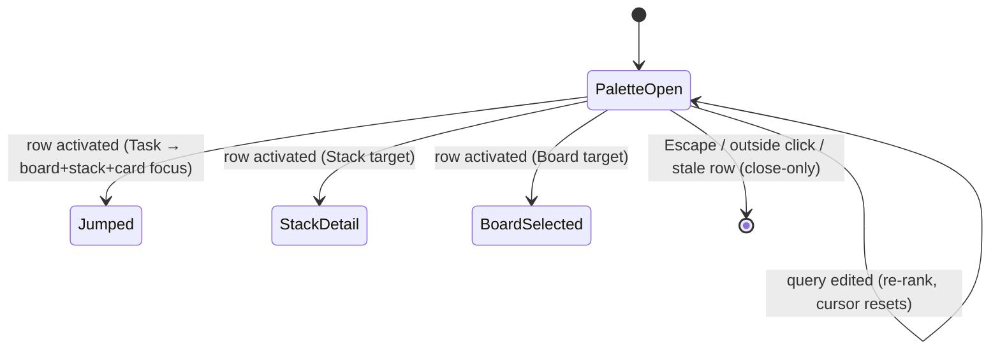

# [Plan] UX Journey Plan — Capture & search (retrofit, registry F-4)

- **Date**: 2026-11-14
- **Kind**: UX journey plan — **retrofit** (phase 4 of the UX journey
  framework rollout): user stories, journeys, flows, wiring inventory,
  and findings describing the capture overlay, the search palette, the
  item walk, the app menu, and focus mode **as implemented**. No new
  capability is planned; no implementation decisions are made.
- **Origin**: the UX retrofit & triage dispatch
  `/home/viktoria/src/taskboard/.artifacts/plans/2026-11-14-ux-retrofit-triage-dispatch-plan.md`
  §1/§2 (the retrofit posture binds this plan); the chunk plan
  `.artifacts/plans/2026-11-14-ux-retrofit-core-chunk-plan.md` (registry
  row F-4 incl. D-2.1's app.* assignments, rubric D-3, gate rule D-5,
  commit sequencing D-6); the census Capture slice plus the three
  `nav.item_walk` rows (Board, Today, Task detail slices; baseline
  `dc290df2`); the live worktree code (wiring anchors live; census
  cells keep their baseline anchors).
- **Status**: ACCEPTED (retrofit documentation under the accepted
  phase-4 dispatch; stage 3 reviews it against this posture).
  **Amended 2026-11-15** (UX remediation chunk 1 — completability,
  stage 2; authority: the accepted triage report findings T-7 (#790),
  CF-W-N4 and the remediation chunk plan
  `.artifacts/plans/2026-11-15-ux-r1-completability-chunk-plan.md`
  D-2/D-4): the kiosk gating posture for `app.focus_toggle` is the
  **visible-gating grammar** — the menu row renders the disabled
  affordance on kiosk (the `entry_states` greying, layer 2) and the
  dispatch no-op stands (layer 3). Command-contract delta of the
  amendment: **zero new variants** (gating is display state).
- **Surfaces touched**: `ui/compositions/capture-overlay.slint`,
  `ui/compositions/search-palette.slint`,
  `ui/compositions/action-menu.slint`,
  `ui/compositions/focus-overlay.slint`, `ui/app-window.slint`,
  `src/adapter.rs` (overlay seams), `src/router.rs`, `src/menu.rs`,
  `src/view_state.rs`, `src/actions.rs`, `src/models.rs` (palette
  push), `crates/taskboard-domain/src/find.rs`, `keymap/presets.rs`
- **Platform scope**: both (the overlays are window-level; the focus
  overlay is kiosk-gated — `adapter.rs:2846-2852` returns no effect in
  kiosk; the app menu renders in compact and extended modes)

## 1. Scope & goals

This plan documents the capture & search UX that ships today: a user
captures a thought from anywhere (Ctrl+K, title-only, into the global
inbox), dismisses the overlay, searches across all boards (Ctrl+F)
with live re-ranking, jumps to a result, walks the focused surface's
items with the nav verbs, opens the two-tier command menu (the
keyboard's way into every action), and toggles the concentration
overlay. The CLI twins (`capture` commits-and-exits; `find` ranks
without jumping) are recorded as findings/notes. All journeys are
**journeys-as-implemented** (chunk plan D-4). The undo/redo verbs ride
in this slice's rows but their journeys are the task-lifecycle plan's
undo story (cross-referenced, not duplicated).

**Non-goals** (retrofit posture — holes are findings in §10; the
phase-5 triage classifies and homes them):

- No interactive CLI capture, no CLI jump (CF-1/CF-2), no CLI menu/
  focus twins (CF-3) — described, not planned.
- Capture stays title-only at create (the standing Task-detail ruling
  R-1 — recurrence is not schedulable here; cited, never re-argued,
  chunk plan D-3 R-Pattern 4).

## 2. Capability × surface matrix

<!-- Rows restate the census Capture slice cells plus the nav.item_walk
rows of the Board/Today/Task detail slices (baseline dc290df2)
verbatim in content; `U` cells are carried as `U` or converted to
`— (R-n)` per the chunk plan's rubric D-3; conversions cite the
rulings table below (this plan is the ruling's authority,
2026-11-14). Cells avoid `|`. -->

| Capability | Board | TaskDetail | Today | Review | Settings | Capture | CLI |
|---|---|---|---|---|---|---|---|
| capture.quick | E (global) (US-1) — `CaptureQuick` "Captures a thought into the global inbox from anywhere" `actions.rs:718-720`, Ctrl+K `presets.rs:78`, opens the overlay `router.rs:927` | E (global) (US-1) — same `CaptureQuick` evidence | E (global) (US-1) — same `CaptureQuick` evidence | E (global) (US-1) — same `CaptureQuick` evidence | E (global) (US-1) — same `CaptureQuick` evidence | E (US-1) — overlay open/typed buffer `adapter.rs:8514-8518` | U (CF-1) |
| capture.commit | E (US-1) — capture lands in the global Inbox `view_state.rs:2014-2033` (baseline cell: "the focused board's Backlog" at `view_state.rs:2024,3657`; the live funnel is `board: None` = the app-global Inbox, see PC-1) | — (R-1) | — (R-1) | — (R-1) | — (R-1) | E (US-1) — overlay accept `adapter.rs:8518-8524` → `CaptureTask` `messages.rs:36` | C (pre-existing, `capture` `cli.rs:105-112` — the commits-and-exits twin, CF-1) |
| capture.dismiss | — (R-2) | — (R-2) | — (R-2) | — (R-2) | — (R-2) | E (US-2) — Escape dismiss `adapter.rs:8524-8530`, hint `capture-overlay.slint:39-43` | U (CF-1) |
| capture.hint_display | — (R-3) | — (R-3) | — (R-3) | — (R-3) | — (R-3) | D — placeholder and return/escape hint `capture-overlay.slint:31,39-43` | U (CF-1) |
| palette.search | E (global) (US-3) — `PaletteSearch` `actions.rs:749-751`, Ctrl+F `presets.rs:79`, open effect `router.rs:1040` | E (global) (US-3) — same `PaletteSearch` evidence | E (global) (US-3) — same `PaletteSearch` evidence | E (global) (US-3) — same `PaletteSearch` evidence | E (global) (US-3) — same `PaletteSearch` evidence | E (US-3) — query re-rank and dismissal `adapter.rs:8507-8530` | E (pre-existing, `find` `cli.rs:89-101`, handler `commands/find.rs` — same engine ranking, two names; CF-2 notes the no-jump twin) |
| palette.jump | — (R-4) | — (R-4) | — (R-4) | — (R-4) | — (R-4) | E (US-4) — `NavShowTask` `actions.rs:789-798` (Palette-only context), row activation `adapter.rs:8536-8542` | U (CF-2) |
| palette.results_display | — (R-5) | — (R-5) | — (R-5) | — (R-5) | — (R-5) | D (US-3) — result rows with kind/context meta `search-palette.slint:13-20,59-67`, selection emphasis `search-palette.slint:63`, overflow caption `search-palette.slint:69-75` | U (CF-2) |
| nav.item_walk | E (US-5) — the `Nav*` ids (Board member bindings `presets.rs:121-124`) | E (US-5) — the same `Nav*` ids (TaskDetail member bindings `presets.rs:179-184`) | E (US-5) — `NavNextItem`/`NavPrevItem`/`NavFirstItem`/`NavLastItem` `actions.rs:846-866` (contexts `VIEW_NAV` `actions.rs:618-623`), Down/Up/Ctrl+Home/Ctrl+End `presets.rs:135-138` | — (R-6) | — (R-6) | — (R-6) | U (CF-2) |
| app.menu | E (global) (US-6) — `AppMenu` `actions.rs:668-670`, `presets.rs:74`; two-tier menu seams `adapter.rs:6997-7015`, opener `adapter.rs:7802`, dismiss `adapter.rs:7831` | E (global) (US-6) — same `AppMenu` evidence | E (global) (US-6) — same `AppMenu` evidence | E (global) (US-6) — same `AppMenu` evidence | E (global) (US-6) — same `AppMenu` evidence | E (global) (US-6) — menu rows generated from the registry `actions.rs:649+` | U (CF-3) |
| app.undo | E — `AppUndo` `actions.rs:678-680`, `presets.rs:72` (→ `Undo` `messages.rs:589`; `RestoreTask` `messages.rs:601` rides the undo path) — the journey is the task-lifecycle plan's undo story | E — same `AppUndo` evidence | E — same `AppUndo` evidence | E — same `AppUndo` evidence | E — same `AppUndo` evidence | E — same `AppUndo` evidence | E (pre-existing, `undo` `cli.rs:1750`) |
| app.redo | E — `AppRedo` `actions.rs:688-690`, `presets.rs:73` (→ `Redo` `messages.rs:592`) — the journey is the task-lifecycle plan's redo story | E — same `AppRedo` evidence | E — same `AppRedo` evidence | E — same `AppRedo` evidence | E — same `AppRedo` evidence | E — same `AppRedo` evidence | E (pre-existing, `redo` `cli.rs:1753`) |
| app.focus_toggle | E (global; kiosk: disabled menu row) (US-7) — `FocusModeToggle` `actions.rs:1286-1288`; the focus overlay (`focus-overlay.slint`) mounts at window level | E (global; kiosk: disabled menu row) (US-7) — same `FocusModeToggle` evidence | E (global; kiosk: disabled menu row) (US-7) — same `FocusModeToggle` evidence | E (global; kiosk: disabled menu row) (US-7) — same `FocusModeToggle` evidence | E (global; kiosk: disabled menu row) (US-7) — same `FocusModeToggle` evidence | E (global; kiosk: disabled menu row) (US-7) — same `FocusModeToggle` evidence | U (CF-3) |

**Rulings** (conversions of census `U` cells; this table is the
ruling's authority, 2026-11-14, per chunk plan D-3):

| ID | Ruling | Reason | Home |
|---|---|---|---|
| R-1 | capture.commit mounts only inside the capture overlay | R-Pattern 2 (entity-mount grammar): the commit affordance is the overlay's accept seam (`capture-overlay.slint` Return → `capture-accepted`, `adapter.rs:8556-8561`), and the overlay itself is a window-level mount openable from every surface (`capture.quick` is `E (global)` in every column; `app-window.slint:1148`). The census's per-surface `U` cells mark the absence of a per-surface commit seam — the commit is the overlay's, recorded in the Capture column by the census's overlay schema (overlays are recorded inside the slice whose view mounts them). | this plan §2; census Capture slice register |
| R-2 | capture.dismiss is overlay-local (Escape and the scrim) | R-Pattern 2: dismissal is the overlay's own Escape/scrim affordance (`adapter.rs:8562-8567`; "Escape rides the action layer", `capture-overlay.slint:6-7`); it exists exactly where the overlay is open, which is any surface. The CLI cell stays `U` as finding CF-1. | this plan §2; census Capture slice register |
| R-3 | capture.hint_display renders only inside the overlay | R-Pattern 3 (display-scoping): the placeholder and return/escape hint are the overlay's own captions (`capture-overlay.slint:31,39-43`); surfaces without the overlay open render nothing for it to echo. The CLI cell stays `U` as finding CF-1. | this plan §2; census Capture slice register |
| R-4 | palette.jump binds the Palette context exclusively | R-Pattern 1: `ActionId::NavShowTask` binds `&[ContextId::Palette]` (`actions.rs:789-810`, "Palette-only availability: the row never renders in a menu") and has no preset binding by recorded decision (round-3 D23 — the trigger IS the palette's Return). The CLI cell stays `U` as finding CF-2. | this plan §2; census Capture slice register |
| R-5 | palette.results_display renders only inside the palette | R-Pattern 3: the result rows, kind/context meta, selection emphasis, and overflow caption render in the palette composition (`search-palette.slint:10-78`); no other surface renders palette rows (Sweep-B/T/Y/R/S). The CLI cell stays `U` as finding CF-2. | this plan §2; census Capture slice register |
| R-6 | nav.item_walk binds the four VIEW_NAV contexts exclusively | R-Pattern 1 (the rubric's own precedent): `NavNextItem`/`NavPrevItem`/`NavFirstItem`/`NavLastItem` bind `VIEW_NAV = [Today, Board, StackDetail, TaskDetail]` (`actions.rs:618-623`, registry `actions.rs:846-883`); Settings carries only the CONTROL_NAV text-field motions (`actions.rs:628-634`). The CLI cell stays `U` as finding CF-2. | this plan §2; the Board/Today/Task-detail slice registers |

## 3. User stories

### US-1 — Quick capture

- **Story**: When a thought arrives mid-work, I want to press Ctrl+K
  from anywhere, type a title, and commit so that the thought is in
  the global inbox without leaving my surface.
- **Platforms**: both (kiosk samples capture too —
  `lib.rs::the_kiosk_capture_never_samples` guards the sampling).
- **Entry points**: `ActionId::CaptureQuick` (Ctrl+K, emacs/vi
  variants; also a menu quick row, menu_rank 20); the overlay's field
  Return; CLI `capture` (the commits-and-exits twin, CF-1).
- **Priority**: P1
- **Acceptance**:
  - AC-1: Given the overlay open with a non-empty buffer, When Return
    commits, Then `StateCommand::CaptureTask { title, board: None }`
    dispatches (the app-global Inbox) and the overlay stays open for
    the next thought (commits-and-continues) — verified by
    `view_state.rs::capture_commits_and_continues_then_closes_on_empty`
    and `lib.rs::the_capture_emits_exactly_the_changed_snapshots`.
  - AC-2: Given an empty buffer, When Return commits, Then the overlay
    closes and nothing dispatches — verified by the same test.
  - AC-3: Given a live flow (edit/move) underneath, When capture
    opens, Then the flow is replaced without being committed
    (`router.rs:49` shape) — verified by
    `journeys.rs::capture_replaces_the_walk_without_committing`.

### US-2 — Dismiss the capture overlay

- **Story**: When I opened capture by accident, I want Escape (or an
  outside click) to close it so that nothing is committed.
- **Platforms**: both.
- **Entry points**: Escape (the action layer; the hint says so);
  the app-window scrim (`capture-dismiss-requested`).
- **Priority**: P1
- **Acceptance**:
  - AC-1: Given the overlay open with a typed buffer, When Escape or
    the scrim fires, Then the buffer is discarded, the flow returns to
    `Flow::None`, and the mode restores — verified by
    `view_state.rs::escape_discards_capture_and_reconcile_leaves_the_
    flow_alone` and `journeys.rs::a_right_press_outside_dismisses_the_
    capture_overlay`.

### US-3 — Search across boards

- **Story**: As a user I want to search all boards from anywhere
  (Ctrl+F) with live re-ranking so that finding anything is one
  gesture.
- **Platforms**: both.
- **Entry points**: `ActionId::PaletteSearch` (Ctrl+F; a menu quick
  row, menu_rank 50); CLI `find` (the rank-only twin, CF-2).
- **Priority**: P1
- **Acceptance**:
  - AC-1: Given a query typed, When it edits, Then the results re-rank
    per keystroke and the cursor resets to the top result (a stale
    mid-list cursor on a fresh ranking is a lie, `adapter.rs:4018-4029`)
    — verified by `journeys.rs::the_palette_searches_and_jumps_across_
    boards` and `view_state.rs::the_palette_opens_insert_closes_and_
    walks_the_cursor`.
  - AC-2: Given more results than rows, When rendered, Then the
    overflow caption counts them (`search-palette.slint:74-78`) —
    verified by the palette row-model presentation tests.

### US-4 — Jump to a search result

- **Story**: As a user I want to activate a palette row (or press its
  Return) so that the app navigates to the found task, stack, or
  board.
- **Platforms**: both.
- **Entry points**: palette row click (`palette-row-activated`,
  `adapter.rs:8574-8590`); the palette's Return
  (`ActionId::NavShowTask` via `menu.invoke`, round-3 D23).
- **Priority**: P1
- **Acceptance**:
  - AC-1: Given a task result row, When activated, Then the jump
    selects the task's board and stack and focuses the card — verified
    by `journeys.rs::a_palette_activation_shows_the_task` and
    `view_state.rs::the_palette_jump_matrix_retargets_per_kind`.
  - AC-2: Given a stale row index (the list shrank), When activated,
    Then the palette closes without dispatching — verified by the
    close-only guard (`adapter.rs:3999-4004`).

### US-5 — Walk the focused surface's items

- **Story**: As a keyboard user I want Down/Up/Ctrl+Home/Ctrl+End to
    walk the focused surface's items in reading order so that I never
    need the mouse to move between cards, rows, or fields.
- **Platforms**: both.
- **Entry points**: `ActionId::NavNextItem`/`NavPrevItem`/
  `NavFirstItem`/`NavLastItem` (Down/Up/Ctrl+Home/Ctrl+End per
  context: Board, Today, StackDetail, TaskDetail member bindings).
- **Priority**: P1
- **Acceptance**:
  - AC-1: Given a board, When the walk steps, Then it is columns-then-
    cards in reading order without wrapping — verified by
    `view_state.rs::reading_order_walk_is_columns_then_cards_without_
    wrap` and `view_state.rs::the_board_walk_steps_without_wrapping`.
  - AC-2: Given the ends, When Ctrl+Home/Ctrl+End jump, Then the focus
    lands on both ends and is idempotent — verified by
    `view_state.rs::jump_focus_lands_on_both_ends_and_is_idempotent_at_
    the_target`.

### US-6 — Open the command menu

- **Story**: As a keyboard user I want a two-tier command menu (the
  keyboard's way into every action) so that verbs without bindings are
  still reachable.
- **Platforms**: both (compact page swap for small windows).
- **Entry points**: `ActionId::AppMenu` (Ctrl+Shift+M; emacs Alt+x;
  vi ":"); the toolbar hamburger (`toolbar-menu-clicked`,
  `adapter.rs:7835-7844` — toggle).
- **Priority**: P1
- **Acceptance**:
  - AC-1: Given the menu open, When a row (or submenu row) is
    invoked, Then it routes the row's action and the menu closes —
    verified by `journeys.rs::a_mouse_row_invocation_routes_and_closes`
    and `journeys.rs::the_two_tier_menu_navigates_levels_in_both_modes`.
  - AC-2: Given the registry, When the root page builds, Then it is
    the curated quick rows + one submenu per group + quit last —
    verified by `menu.rs::root_page_is_curated_quick_rows_parents_quit`
    and `menu.rs::quit_is_last_on_every_root_page`.

### US-7 — Toggle the concentration overlay

- **Story**: When I need to concentrate, I want Ctrl+J to open an
  overlay with the phase countdown, current task, task switcher, and
  quick notes so that the session state is visible at a glance.
- **Platforms**: desktop for the dispatch (kiosk: the stroke no-ops,
  `adapter.rs:2846-2852` — layer 3); the menu row renders on kiosk
  DISABLED (`entry_states` greying — the remediated 2026-11-15
  visible-gating posture, D-2; test
  `journeys.rs::the_kiosk_focus_toggle_row_greys_and_still_no_ops`).
- **Entry points**: `ActionId::FocusModeToggle` (Ctrl+J; Escape and
  Ctrl+J close while the overlay is open, `presets.rs:211-212`); the
  scrim.
- **Priority**: P1
- **Acceptance**:
  - AC-1: Given focus mode configured, When toggled, Then the overlay
    opens with the derived phase and remaining time — verified by
    `presentation.rs::focus_overlay_derives_phase_and_remaining` and
    `presentation.rs::focus_overlay_flags_the_long_break_and_derives_
    its_deadline`.
  - AC-2: Given the overlay open, When Escape/toggle/scrim fires, Then
    it closes and the session keeps running (the overlay is
    presentation only) — verified by the close path
    (`view_state.rs:2066-2076`).

## 4. Journey specs

### US-1 — Quick capture

| Step | Surface & affordance | User action | Dispatches | System response | Escape / failure |
|---|---|---|---|---|---|
| US-1/S1 | any surface | press Ctrl+K (or the menu quick row) | `ActionId::CaptureQuick` → `UiEffect::BeginCapture` (`router.rs:927`) → overlay opens (`adapter.rs:2835`, prop push `adapter.rs:522`) | the window-level capture overlay mounts, title field focused; any live flow is replaced without committing (`router.rs:49`) | the replaced flow settles by rule first; Escape closes (US-2/S1) — test `journeys.rs::capture_replaces_the_walk_without_committing` |
| US-1/S2 | capture overlay field | type the title | — (buffer mirror, `on_capture_text_edited` `adapter.rs:8552-8555`) | the buffer echoes; the hint captions render (US-3 of the overlay's own display row) | empty buffer: Return closes instead of committing — test `view_state.rs::capture_commits_and_continues_then_closes_on_empty` |
| US-1/S3 | capture overlay field | press Return | `capture-accepted` (`adapter.rs:8556-8561`) → `commit_capture` → `StateCommand::CaptureTask { title, board: None }` + `RefreshNow` (`view_state.rs:2014-2033`, `messages.rs:36`) | the thought lands in the app-global Inbox; the overlay stays open (commits-and-continues), Insert mode kept | undo via `AppUndo` (`CaptureTask` is a journal PreImage, `undo.rs:104-109`); the standing ruling R-1 (Task detail slice) keeps create title-only — test `lib.rs::the_capture_emits_exactly_the_changed_snapshots` |

### US-2 — Dismiss the capture overlay

| Step | Surface & affordance | User action | Dispatches | System response | Escape / failure |
|---|---|---|---|---|---|
| US-2/S1 | capture overlay | press Escape (the action layer) or click the scrim | `capture-dismiss-requested` (`adapter.rs:8562-8567`) → `close_capture` (`view_state.rs:2034-2039`) | the buffer is discarded, flow → None, mode restores; nothing dispatches | this step IS the escape — nothing to recover; the discard is total (no draft persistence) — test `view_state.rs::escape_discards_capture_and_reconcile_leaves_the_flow_alone` |

### US-3 — Search across boards

| Step | Surface & affordance | User action | Dispatches | System response | Escape / failure |
|---|---|---|---|---|---|
| US-3/S1 | any surface | press Ctrl+F (or the menu quick row) | `ActionId::PaletteSearch` → `UiEffect::OpenPalette` (`router.rs:1040`, `adapter.rs:2979-2982`) | the window-level palette mounts over all boards' tasks/stacks/boards | a live flow is replaced (same shape as capture); Escape/outside click closes (the dismiss seam, `adapter.rs:8568-8573`) — test `journeys.rs::the_palette_searches_and_jumps_across_boards` |
| US-3/S2 | palette input row | type the query | `palette-query-edited` (`adapter.rs:8545-8548`) → `apply_palette_query` (`adapter.rs:4018-4029`, re-ranks via `models::push_palette` over the domain `find` engine, `find.rs:75`) | results re-rank per keystroke; the cursor resets to the top; the overflow caption counts the rest | a stale row index after re-rank resolves close-only (`adapter.rs:3999-4004`) — test `view_state.rs::the_palette_opens_insert_closes_and_walks_the_cursor` |

### US-4 — Jump to a search result

| Step | Surface & affordance | User action | Dispatches | System response | Escape / failure |
|---|---|---|---|---|---|
| US-4/S1 | palette result row | click the row (or Return = `menu.invoke` → `NavShowTask`) | `palette-row-activated` (`adapter.rs:8574-8590`) → `palette_jump` (`view_state.rs:2585+`): Task → select board/stack + focus card; Stack → StackDetail; Board → select board | the app navigates to the target and pushes the focus scroll hint (round-3 D23 §3.3); the palette closes | stale/shrunk row count → close-only, never panics (`adapter.rs:4002-4004`) — test `journeys.rs::a_palette_activation_shows_the_task` |

### US-5 — Walk the focused surface's items

| Step | Surface & affordance | User action | Dispatches | System response | Escape / failure |
|---|---|---|---|---|---|
| US-5/S1 | Board / Today / StackDetail / TaskDetail | press Down / Up | `ActionId::NavNextItem`/`NavPrevItem` → `UiEffect::FocusNext`/`FocusPrev` (`router.rs:887-888`) → `step_focus` (`view_state.rs:1331`) | the focus/selection advances in reading order (columns-then-cards, no wrap) | inert without items; no wrap at the ends — test `view_state.rs::reading_order_walk_is_columns_then_cards_without_wrap` |
| US-5/S2 | same surfaces | press Ctrl+Home / Ctrl+End | `ActionId::NavFirstItem`/`NavLastItem` → `UiEffect::FocusFirst`/`FocusLast` (`router.rs:907-908`) | the focus jumps to the ends, idempotent at the target | same inert posture — test `view_state.rs::jump_focus_lands_on_both_ends_and_is_idempotent_at_the_target` |

### US-6 — Open the command menu

| Step | Surface & affordance | User action | Dispatches | System response | Escape / failure |
|---|---|---|---|---|---|
| US-6/S1 | any surface | press Ctrl+Shift+M (or click the hamburger) | `ActionId::AppMenu` → `UiEffect::OpenMenu` (`router.rs:564`; the hamburger toggles — close when open, `adapter.rs:7835-7844`) | the two-tier menu mounts at the window level; the root page is quick rows + group submenus + quit (`menu.rs:89-135`); rows carry greyed enablement from the adapter states (`menu.rs:68-71`) | outside click / Escape = full close from any level (`on_menu_dismiss_requested` `adapter.rs:7869-7874`); level-back steps a level (`menu-level-back`, `adapter.rs:7053-7059`) — test `journeys.rs::an_outside_click_dismisses_the_menu` |
| US-6/S2 | menu row / submenu row | click or keyboard-invoke a row | `menu-entry-invoked`/`menu-submenu-entry-invoked` (`adapter.rs:7035-7051`) route the row's ActionId | the row's verb fires and the menu closes; disabled rows absorb the click (greyed, no dispatch) | a disabled row's invocation is absorbed (enablement gate, `adapter.rs:509-510` family) — test `journeys.rs::a_mouse_row_invocation_routes_and_closes` |

### US-7 — Toggle the concentration overlay

| Step | Surface & affordance | User action | Dispatches | System response | Escape / failure |
|---|---|---|---|---|---|
| US-7/S1 | any desktop surface | press Ctrl+J | `ActionId::FocusModeToggle` → `UiEffect::ToggleFocusMode` (`router.rs:849`; kiosk → no effect, `adapter.rs:2846-2852`) | the overlay opens: phase countdown, current task, switcher, quick notes (`focus-overlay.slint`). Kiosk leg (remediated 2026-11-15, D-2): the menu row renders the disabled tone and the stroke stays a no-op — `journeys.rs::the_kiosk_focus_toggle_row_greys_and_still_no_ops` | not configured → the gate holds the overlay closed (dispatch-time gating, `actions.rs:1280-1285`) — test `presentation.rs::focus_overlay_derives_phase_and_remaining` |
| US-7/S2 | focus overlay | use the switcher / notes / stop | `focus-switcher-invoked` starts tracking; `focus-note-accepted` commits the note into the inbox; `focus-stop-clicked` stops the session (`adapter.rs:10050-10068`) | the switcher rows are live-not-done in board order; the note lands like a capture; stop ends the entry | Escape / Ctrl+J / the scrim close the overlay while the session keeps running (`view_state.rs:2066-2076`) — test `presentation.rs::focus_switcher_rows_are_live_not_done_in_board_order_bounded` |

## 5. Interaction flows

The overlay family (all window-level, all replace a live flow):

US-4's jump retargets per kind (the domain `find` engine's
`SearchTarget`):

## 6. Wiring inventory

<!-- Rows document EXISTING affordances; tokens live at the worktree
HEAD; palette rows address the adapter palette table (a.tables.palette
over SearchTarget kinds) — no ItemAddr kinds are involved here. -->

| ID | Surface file | Widget | Callback | Adapter seam | ActionId | Commands | Row addressing | Journey steps | Test |
|---|---|---|---|---|---|---|---|---|---|
| W-1 | ui/compositions/capture-overlay.slint, ui/app-window.slint | capture overlay: title field + hint captions | — | on_capture_text_edited (adapter.rs:8552); on_capture_accepted (adapter.rs:8556); on_capture_dismiss_requested (adapter.rs:8562); open effect adapter.rs:2835 — slint callbacks capture-accepted, capture-dismiss-requested, capture-text-edited | ActionId::CaptureQuick | StateCommand::CaptureTask | — (title-only buffer; no list row addressed) | US-1/S1-US-2/S1 | view_state.rs::capture_commits_and_continues_then_closes_on_empty |
| W-2 | ui/compositions/search-palette.slint, ui/app-window.slint | palette input row + result rows + overflow caption | — | on_palette_query_edited (adapter.rs:8545); on_palette_dismiss_requested (adapter.rs:8568); apply_palette_query (adapter.rs:4018-4029) — slint callback palette-query-edited (UI-side ranking/selection only — the domain find engine runs in-process; see journey steps) | ActionId::PaletteSearch | — | palette rows via a.tables.palette (SearchTarget kinds Task/Stack/Board) | US-3/S1-US-3/S2 | journeys.rs::the_palette_searches_and_jumps_across_boards |
| W-3 | ui/compositions/search-palette.slint, ui/app-window.slint | palette row activation (jump) | — | on_palette_row_activated (adapter.rs:8574-8590); keyboard twin apply_palette_invoke (adapter.rs:3991-4016); palette_jump (view_state.rs:2585+) — slint callback palette-row-activated | ActionId::NavShowTask | — | a.tables.palette index; stale → close-only | US-4/S1 | journeys.rs::a_palette_activation_shows_the_task |
| W-4 | src/router.rs, src/view_state.rs, keymap/presets.rs | nav walk verbs (keyboard-only) | — | effect arms router.rs:887-908; step_focus (view_state.rs:1331); walk machinery (adapter.rs:2074-2385) (keyboard verbs; no widget callbacks — the adapter pushes selection/focus snapshots into models) | ActionId::NavNextItem | — | reading-order walk per VIEW_NAV context | US-5/S1-US-5/S2 | view_state.rs::the_board_walk_steps_without_wrapping |
| W-5 | ui/compositions/action-menu.slint, ui/app-window.slint | two-tier menu (quick rows, submenus, quit) | — | on_menu_entry_invoked (adapter.rs:7035); on_menu_submenu_entry_invoked (adapter.rs:7044); on_menu_level_back (adapter.rs:7053); on_menu_dismiss_requested (adapter.rs:7869); opener on_toolbar_menu_clicked (adapter.rs:7835) — slint callbacks menu-entry-invoked, menu-submenu-entry-invoked, menu-level-back, menu-dismiss-requested, toolbar-menu-clicked | ActionId::AppMenu | — | menu rows are registry-derived entries (menu.rs:89-135); enabled state from the adapter states | US-6/S1-US-6/S2 | journeys.rs::the_two_tier_menu_navigates_levels_in_both_modes |
| W-6 | ui/compositions/focus-overlay.slint, ui/app-window.slint | focus overlay: countdown, switcher, notes, stop | — | on_focus_overlay_close_requested (adapter.rs:10011); on_focus_note_edited (adapter.rs:10019); on_focus_note_accepted (adapter.rs:10028); on_focus_switcher_invoked (adapter.rs:10050); on_focus_stop_clicked (adapter.rs:10067) — slint callbacks focus-stop-clicked, focus-note-accepted, focus-switcher-invoked | ActionId::FocusModeToggle | StateCommand::StartTracking; StateCommand::StopTracking; StateCommand::CaptureTask | switcher rows via the adapter's live-not-done board-order model | US-7/S1-US-7/S2 | presentation.rs::focus_overlay_derives_phase_and_remaining |
| W-7 | ui/compositions/action-menu.slint (undo/redo rows), src/menu.rs | Undo/Redo quick rows (greyed from UndoView) | — | the same generic menu seams (adapter.rs:7035); enablement gate adapter.rs:509-510 | ActionId::AppUndo | StateCommand::Undo; StateCommand::Redo; ActionId::AppRedo | — (global rows; the journeys are the task-lifecycle plan's undo story) | US-6/S2 (as menu rows) | journeys.rs::the_undo_rows_grey_from_the_published_undo_view |

## 7. Command-contract delta

**None — retrofit** (the contract already exists). Existing variants
the journeys dispatch, for greppability:

| Kind | Name | Payload sketch | Journeys |
|---|---|---|---|
| StateCommand | CaptureTask | exists (`messages.rs:36`) — `{ title, board: None }` = the app-global Inbox (the GUI funnel); `Some(board)` is the CLI twin's Backlog path | US-1 |
| StateCommand | StartTracking / StopTracking / CaptureTask | exist — the focus overlay's session and note verbs | US-7 |
| StateCommand | Undo / Redo | exist (`messages.rs:589,592`) — the menu's undo/redo rows (journeys: the task-lifecycle plan) | US-6 (as menu rows) |
| ActionId | CaptureQuick / PaletteSearch / NavShowTask / AppMenu / FocusModeToggle | exist (`actions.rs:216-228,292,718-727,749-758,789-810,1286-1296`) | US-1, US-3, US-4, US-6, US-7 |
| ActionId | NavNextItem / NavPrevItem / NavFirstItem / NavLastItem | exist (`actions.rs:233-259`, registry `actions.rs:846-883`, `VIEW_NAV` `actions.rs:618-623`) | US-5 |
| ActionId | MenuNext / MenuPrevious | exist — the menu/palette/focus cursor rows (`presets.rs:197-205,213-214`) | US-6 |

No `UiRequest` and no new variant of any kind is involved in these
journeys (the overlay lane runs entirely on `StateCommand`/outcome
routing — the census Capture slice's method note).

## 8. Verification plan

- **Journey tests (step-ID-named)**: none exist — the retrofitted
  journeys predate the framework's step-token test law. Per the pilot
  precedent (comparison plan §2, backlog #768; habit-create plan PC-3)
  the §2.3 gate's journey-step token rows stay MISSING on this plan;
  the per-step verification evidence is §6's Test column and §4's
  Escape column (all cited tests exist and pass).
- **Seam tests (existing)**: the capture funnel
  (`lib.rs::the_capture_emits_exactly_the_changed_snapshots`), the
  palette jump matrix (`view_state.rs::the_palette_jump_matrix_
  retargets_per_kind`), the menu row routing
  (`journeys.rs::a_mouse_row_invocation_routes_and_closes`).
- **Fold/presentation tests (existing)**: the palette row model
  (meta/emphasis/overflow), the menu root-page curation tests
  (`menu.rs::root_page_is_curated_quick_rows_parents_quit`), the
  focus-overlay phase derivation.
- **Kiosk gates**: the focus overlay never opens in kiosk
  (`adapter.rs:2846-2852`); capture and palette are keyboard/pointer
  overlays that open on kiosk surfaces too (the kiosk capture guard
  `lib.rs::the_kiosk_capture_never_samples`).
- **Manual**: the hint captions' wording, the menu group labels, and
  the focus overlay's phase naming are judged, not text-asserted; the
  stage-3 walkthrough covers them.

## 9. Definition of done (retrofit)

- [x] Wiring inventory: every row FOUND under `scripts/ux-coverage.sh`
  (per-plan gate outcome recorded in the stage-2 report — D-5)
- [x] Journeys-as-implemented complete end-to-end with the escape
  audit per step (the overlay family's Escape/scrim ladders recorded;
  no fix proposed — retrofit posture)
- [x] Census Capture-slice and nav-row `U` conversions carry R-1..R-6
  and cite this plan (rulings table §2, dated 2026-11-14)
- [ ] Stage-3 walkthrough protocol executed; findings classified by
  the phase-5 triage
- [x] Non-goals: none planned — all holes are findings (§10)

## 10. Findings (retrofit — descriptive only; no redesign proposed)

- **CF-1 — the CLI `capture` twin is commits-and-exits; dismiss and
  hints have no CLI meaning** (F-Pattern evidence note, stage-1
  D-4). `capture` (`cli.rs:105-112`, `commands/capture.rs`) commits
  its arguments (into the global Inbox, or a board's Backlog with
  `--board`) and returns — there is no interactive overlay, so
  `capture.dismiss`/`capture.hint_display` are GUI-only concepts. The
  CLI cells of those rows stay `U`. Evidence note: the census's
  `capture.commit` CLI cell records the commits-and-exits twin.
- **CF-2 — the CLI `find` twin ranks but never jumps** (F-Pattern 4).
  `find` (`cli.rs:89-101`, `commands/find.rs`) shares the palette's
  ranking engine (`taskboard_domain::find`) but prints
  `kind<TAB>id<TAB>title<TAB>context` and exits — no open/jump verb
  exists, so the CLI cannot complete the US-4 journey. The CLI cells
  of `palette.jump`/`palette.results_display`/`nav.item_walk` stay
  `U` under this finding.
- **CF-3 — no CLI twins for the menu or focus mode** (F-Pattern 4).
  `app.menu` is the keyboard's way into every GUI action; the CLI's
  verb families are the counterpart surface, but no `menu`/`focus`
  verbs exist (Sweep-CLI). Vacuous-to-marginal absence; the CLI cells
  stay `U`.
- **W-N1 — walkthrough note (US-1/S3, the capture target)**: the GUI
  funnel always lands `board: None` = the app-global Inbox
  (`view_state.rs:2014-2021` "always the global Inbox, never a focused
  board"); the baseline census cell said "the focused board's
  Backlog" — the live code and its doc comment are the authority
  (PC-1 below). A user wanting a captured thought placed in a board
  must move it later (the board's move journey) or use the CLI twin's
  `--board`.
- **W-N2 — walkthrough note (US-1/S1, the flow replacement)**: opening
  capture or the palette over a live edit/move flow replaces the flow
  without committing it (`router.rs:49`; `adapter.rs:2979`) — the
  underlying flow settles by rule (commit-parseable /
  discard-otherwise), so data-at-risk is bounded, but the replacement
  itself is not announced anywhere in the UI beyond the overlay
  appearing.
- **W-N3 — walkthrough note (US-6/S2, disabled rows absorb)**: menu
  rows grey via the adapter's enablement states and an invocation of
  a disabled row is absorbed silently (`menu.rs:68-71`,
  `adapter.rs:509-510`) — the user gets no feedback beyond the grey,
  a recognition question the walkthrough flags for the triage.
- **W-N4 — walkthrough note (US-7, kiosk gating is silent)**:
  *(Remediated 2026-11-15 — UX remediation chunk 1 / triage T-7
  (#790): the menu row greys on kiosk via `entry_states` (layer 2)
  and the dispatch no-op stands (layer 3) — test
  `journeys.rs::the_kiosk_focus_toggle_row_greys_and_still_no_ops`.)
  History: the focus toggle produced no effect in kiosk
  (`adapter.rs:2846-2852`) and the plan recorded the stroke as
  silent.

## 11. Plan corrections
- **PC-2 (2026-11-14, gate-outcome corrections)**: the per-plan
  `scripts/ux-coverage.sh` run surfaced wiring-row representation
  defects, fixed here (D-5's plan-defect path): (a) hyphenated slint
  callback tokens cannot resolve the adapter half of the callback
  check on seams predating the framework — the gate matches
  `on_<token>` (underscored) or an `install_seam!` line carrying the
  token, and the house `// slint: <callback>` comment convention
  exists only on framework-era seams — so this plan's §6 rows carry
  the callback in the Adapter-seam column with the Callback cell `—`
  (the callback tokens were verified verbatim in the .slint files at
  correction time); (b) prose fragments in the Commands/ActionId cells
  were split into gate-checked tokens — cells now carry bare
  `StateCommand::`/`ActionId::` tokens only (or exactly `—`, with the
  reason in the Journey-steps column); (c) `RefreshNow` is a
  `FlowOutcome` (`view_state.rs:368`), not a `StateCommand`, and was
  removed from Commands cells. Gate outcome after correction: every
  wiring row, ruling, and no-commands reason FOUND; the only MISSING
  rows are the journey-step token rows and their story-citation
  cascade — the documented retrofit limitation (backlog #768, pilot
  PC-3 precedent, §8 above).

- **PC-1 (2026-11-14)**: the census Capture-slice `capture.commit`
  Board cell cites "capture lands in the focused board's Backlog
  `view_state.rs:2024,3657`" — the live funnel is
  `StateCommand::CaptureTask { title, board: None }` (the app-global
  Inbox; `view_state.rs:2014-2033`, doc comment "always the global
  Inbox, never a focused board"). Re-verified per chunk plan §5
  against the slice baseline before recording; the matrix cell above
  keeps the baseline citation with a live-correction note inline and
  the §4/§6 rows cite the live funnel. No census cell was rewritten
  (chunk plan D-6 confines the census diff to `U` conversions).
