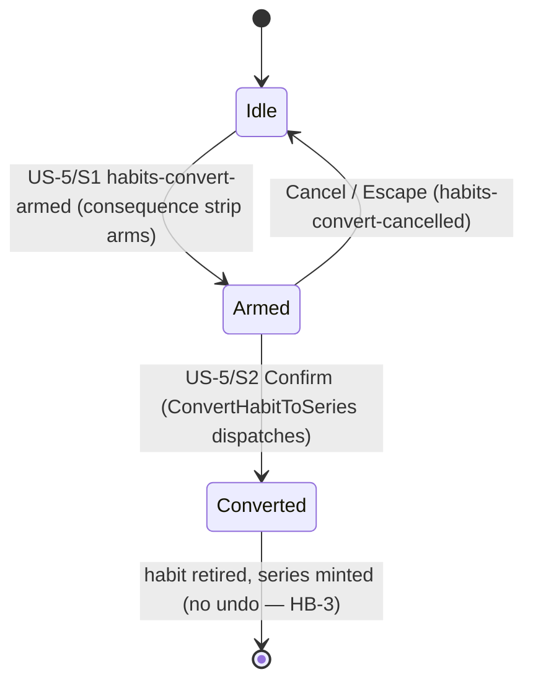
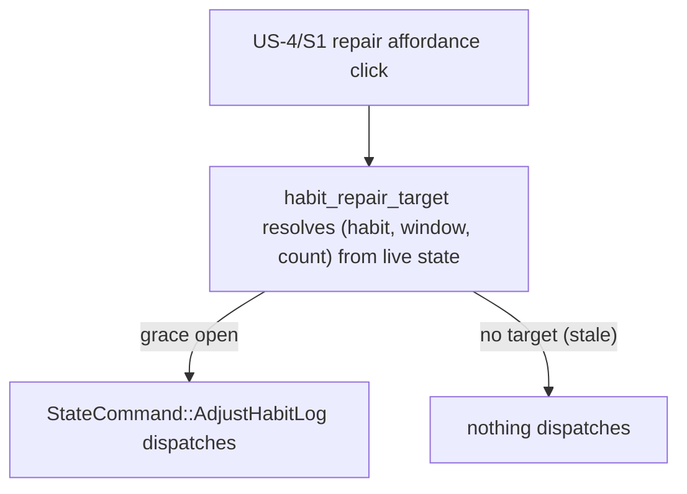

# [Plan] UX Journey Plan — Habit family (retrofit, registry F-5)

- **Date**: 2026-11-14
- **Kind**: UX journey plan — **retrofit** (phase 4 of the UX journey
  framework rollout): user stories, journeys, flows, wiring inventory,
  and findings describing the habit family **as implemented**. No new
  capability is planned; no implementation decisions are made.
- **Origin**: the UX retrofit & triage dispatch
  `/home/viktoria/src/taskboard/.artifacts/plans/2026-11-14-ux-retrofit-triage-dispatch-plan.md`
  §1/§3 (the retrofit posture binds this plan: describe what exists —
  never fix, never prescribe redesign); the stage-1 chunk plan
  `.artifacts/plans/2026-11-14-ux-retrofit-triage-chunk-plan.md` (D-1
  story set + census feed, D-2 rubric application, D-7 gate
  steady-state, D-6 commit sequencing) applying chunk-1's plan
  `.artifacts/plans/2026-11-14-ux-retrofit-core-chunk-plan.md` D-3
  (the ruling rubric — applied mechanically) and D-4 (escape-audit
  method, walkthrough questions); the census Today slice
  `docs/ux-surface-census.org` (baseline `dc290df2`); the pilot habit
  plan `.artifacts/plans/2026-11-13-r7-habit-create-ux-plan.md`
  (habit.create's owner — referenced, not re-walked); the live
  worktree code at `docs/ux-retrofit-triage` HEAD `0b98fe5d` (wiring
  anchors are live `file:line`; census cells keep their recorded
  baseline anchors — chunk-1 plan §5 anchor-drift law).
- **Status**: ACCEPTED (retrofit documentation authored under the
  accepted phase-4 dispatch; stage 3 reviews it against this posture).
  **Amended 2026-11-15** (UX remediation chunk 1 — completability,
  stage 2; authority: the accepted triage report findings T-7 (#790),
  HB-6, D-T16 and the remediation chunk plan
  `.artifacts/plans/2026-11-15-ux-r1-completability-chunk-plan.md`
  D-2/D-4): the kiosk gating posture changes from **do not mount** to
  **render disabled** (the visible-gating grammar) — US-1/US-3–US-5's
  platform notes and the affected steps' system-response columns below
  carry the disabled-tone sentence. Command-contract delta of the
  amendment: **zero new variants** (gating is display state — the
  `editing-enabled` flag, `presentation.rs::habit_editing_enabled`).
- **Surfaces touched**: `ui/views/today-view.slint`,
  `ui/compositions/habits.slint`, `src/adapter.rs` (habits seams),
  `src/actions.rs`, `src/router.rs`, `src/presentation.rs`
- **Platform scope**: desktop for the row actions; the habit rows
  AND their actions render on kiosk — the actions disabled (the
  remediated D-2 posture; supersedes the D-T16 mount gate, finding
  HB-6)

## 1. Scope & goals

This plan documents the habit family UX that ships today: a desktop
user logs a habit from its Today row, reorders rows by drag, adds a
make-up log through the repair affordance, and converts a habit to a
series through an armed confirm strip; every row displays its
progress/streak/quota state. Habit creation is the pilot plan's
(`2026-11-13-r7-habit-create-ux-plan.md` US-1 — referenced, not
re-walked). GUI habit editing and removal are standing seed rulings
R-2/R-3 (no GUI affordance; the CLI covers) — cited under R-Pattern
4, never re-argued. All journeys below are
**journeys-as-implemented** (chunk-2 plan D-1: P1 = the journey a
user actually completes today).

**Non-goals** (retrofit posture — nothing here is a commitment; each
hole is a finding in §10, classification and homing are the phase-5
triage's):

- No GUI habit editing or removal — seed rulings R-2/R-3; the CLI
  journeys are documented as US-6 (P2).
- No CLI convert verb — finding HB-4, not planned.

## 2. Capability × surface matrix

<!-- Cells restate the census Today slice (baseline dc290df2) verbatim
in content; anchors are the census's recorded baseline anchors. `U`
cells are carried as `U` or converted to `— (R-n)` per chunk-1 plan
D-3 (applied mechanically per chunk-2 plan D-2); every conversion
cites this plan's rulings table below (this plan is the ruling's
authority, dated 2026-11-14). habit.create / habit.edit / habit.remove
cite the pilot plan and the seed rulings (R-Pattern 4), not new
rulings. Cells avoid `|`. -->

| Capability | Board | TaskDetail | Today | Review | Settings | Capture | CLI |
|---|---|---|---|---|---|---|---|
| habit.create | — (R-1) | — (R-1) | C (US-1) — affordance `ui/compositions/habits.slint:110-116`, keyboard `ActionId::HabitCreate` `actions.rs:1307-1317`, exact-command test =lib.rs::habit_create_sends_the_exact_command= | — (R-1) | — (R-1) | — (R-1) | C (pre-existing, =habits add=) |
| habit.edit | — (R-2) | — (R-2) | — (R-2) | — (R-2) | — (R-2) | — (R-2) | E (pre-existing, =habits update=) |
| habit.remove | — (R-3) | — (R-3) | — (R-3) | — (R-3) | — (R-3) | — (R-3) | X (pre-existing, =habits rm=) |
| habit.log | — (R-1) | — (R-1) | E (US-1) — row seams `adapter.rs:7453-7467+`, the row's own affordance routes =HabitLog= (`actions.rs:1296-1306`, section-scoped) | — (R-1) | — (R-1) | — (R-1) | E (pre-existing, =habits list= family log twin) |
| habit.reorder | — (R-1) | — (R-1) | E (US-3) — drag reorder `adapter.rs:7467-7496`, routes =HabitMove= `actions.rs:1701` (→ =MoveHabit= `messages.rs:481`) | — (R-1) | — (R-1) | — (R-1) | E (pre-existing, =habits update= --order `cli.rs:1314-1358`) |
| habit.repair | — (R-1) | — (R-1) | E (US-4) — make-up repair affordance `adapter.rs:7094-7116` (live `adapter.rs:7131-7157`); =HabitRepair= `actions.rs:1334` (→ =AdjustHabitLog= `messages.rs:502`) | — (R-1) | — (R-1) | — (R-1) | E (pre-existing, =habits adjust= `cli.rs:1300`) |
| habit.convert_to_series | — (R-1) | — (R-1) | E (US-5) — armed conversion strip `adapter.rs:7122-7154` (live `adapter.rs:7159-7199`); =HabitConvertArm/=HabitConvertToSeries= `actions.rs:1346-1356` (→ =ConvertHabitToSeries= `messages.rs:451`) | — (R-1) | — (R-1) | — (R-1) | U (HB-4) |
| habit.state_display | — (R-1) | — (R-1) | D (US-2) — progress/streak/chip/met row fields `habits.slint:21-30`, streak badge `habits.slint:202`, anchor chip `habits.slint:201`, met restyle `habits.slint:203`, quota error hint `habits.slint:187-191` | — (R-1) | — (R-1) | — (R-1) | D (pre-existing, =habits list= `cli.rs:1282`) |

**Rulings** (conversions of census `U` cells; every converted cell
above cites one of these; this table is the ruling's authority,
2026-11-14, per chunk-1 plan D-3 applied by chunk-2 plan D-2):

| ID | Ruling | Reason | Home |
|---|---|---|---|
| R-1 | habit.log / habit.reorder / habit.repair / habit.convert_to_series / habit.state_display have no mounts outside the Today section | R-Pattern 2 (entity-mount grammar): habit rows render only in the Today section's habit list (`today-view.slint:181-205`, the census register's Sweep-B/T/R/S/C evidence "no habit-row seam outside the Today section") — no other surface renders the habit entity at all, so no other mount is grammatically possible. The habit.convert_to_series CLI cell stays `U` as finding HB-4; the habit.log Today cell cites the live row seams. | this plan §2; census Today slice register |

(The seed rulings R-1/R-2/R-3 of the Today slice — habit.create's
section-scoped grammar, no GUI habit editing, no GUI habit removal —
stand untouched under R-Pattern 4; this plan cites them, never
re-argues them.)

## 3. User stories

### US-1 — Log a habit

- **Story**: As a desktop user I want to log today's habit from its
  Today row so that my streak and quota stay current without opening
  anything else.
- **Platforms**: desktop for the dispatch; the affordance renders on
  kiosk disabled (remediated 2026-11-15: `editing-enabled` false —
  the greyed affordance reads "exists, not for this device"; HB-6
  remediated).
- **Entry points**: the habit row's own affordance — the "+" /
  plus-click seam (`habits-plus-clicked`, `adapter.rs:7491-7505`)
  routes `ActionId::HabitLog` ("Log habit", section-scoped — the
  menu surface is untouched, `actions.rs:1296-1306`); CLI `habits`
  family (pre-existing log twin recorded on the census row).
- **Priority**: P1
- **Acceptance**:
  - AC-1: Given a habit row, When the affordance is invoked, Then
    `StateCommand::LogHabit { habit }` dispatches for the addressed
    row; on kiosk the affordance renders the disabled tone and does
    not dispatch (the layer-3 no-op stands) — verified by
    `router.rs::habit_verbs_route_from_their_row_targets` and
    `journeys.rs::the_kiosk_habit_actions_render_disabled_not_absent`
    (the `HabitLog` arm dispatches the exact `LogHabit` payload,
    `router.rs:1202-1203`).
  - AC-2: Given a stale row index, When the seam fires, Then it
    degrades to a no-op (the stale-index guard, `adapter.rs:7493-7498`).
  - AC-3 (amended 2026-11-15, UX R-2 D-3/D-5, #786 — the mis-click
    class recovers through the new sibling story **US-6** below; the
    recorded no-undo posture of `LogHabit`
    (`NotUndoable(HabitSurface)`, `undo.rs:231-237` — the
    lossy-inversion rationale) is unchanged): the "+" stays one
    click; no confirmation gate (D-P14's frequency/risk
    proportionality).

### US-6 — Undo one habit log (amended 2026-11-15, UX R-2 D-3, #786)

- **Story**: As a desktop user who mis-clicked a habit's "+", I want
  a row decrement affordance so that the surplus log is corrected in
  place without touching the journal class.
- **Platforms**: desktop for the dispatch; the affordance renders on
  kiosk disabled (the `editing-enabled` grammar, chunk 1's).
- **Entry points**: the habit row's own affordance — the "−1" /
  `habits-undo-log-clicked` seam routes the new
  `ActionId::HabitUndoLog` ("Take one habit log back",
  section-scoped — the `HabitLog` R-11 ruling's exact twin,
  `menu_group: None`). No keyboard binding, no menu row.
- **Priority**: P1
- **Acceptance**:
  - AC-1: Given a row whose current window count is n >= 1, When the
    "−1" is invoked, Then the audited valve dispatches the exact
    `StateCommand::AdjustHabitLog { habit, window: <the row's current
    window>, count: n − 1 }` — an exact inverse with no forged facts
    (the pre-row-present reasoning, `undo.rs:277-295`); zero
    journal-class change, zero new `StateCommand` — verified by
    `router.rs::habit_verbs_route_from_their_row_targets` (the
    router owns the arithmetic).
  - AC-2: Given count 0, When the "−1" is invoked, Then the typed
    `NoTarget` holds and nothing dispatches (no negative log
    exists) — same test.
  - AC-3: The decrement is never quota-enforced (D-P14
    symmetrically — the row restyles, the button never greys by
    count); the surplus-logs design survives verbatim.
  - AC-4: On kiosk the affordance renders disabled, not absent —
    verified by `journeys.rs::the_kiosk_habit_undo_affordance_renders_disabled`.
- **Scope guard**: the affordance addresses the row's own current
  window (the same resolution the "+" uses); a mis-click *make-up*
  valve recovers through the repair row's own window (non-goal
  recorded — HB-W-N2's recognition debt, T-41 #824).

### US-2 — Habit state display

- **Story**: As a desktop user I want each habit row to show its
  quota progress, streak, anchor and met state so that I read my
  tracker's health at a glance. (Display-only story.)
- **Platforms**: both (rows render on kiosk — the display half is
  kiosk-complete).
- **Entry points**: the habit row's progress phrase, streak badge,
  anchor chip, met restyle and quota error hint
  (`presentation.rs::habit_progress_phrase`, `habit_rows`; display
  only).
- **Priority**: P1 (D-verb display)
- **Acceptance**:
  - AC-1: Given habit rows, When the section renders, Then the
    progress derives from the domain row and kiosk gates the actions
    only — verified by
    `presentation.rs::habit_rows_derive_progress_from_the_domain_row`
    and `presentation.rs::habit_rows_render_stored_order_and_kiosk_gates_the_actions_only`.

### US-3 — Reorder habits

- **Story**: As a desktop user I want to drag habit rows into the
  order I work them so that the section matches my routine.
- **Platforms**: desktop for the dispatch; the affordance renders on
  kiosk disabled (remediated 2026-11-15, the D-2 grammar).
- **Entry points**: the drag reorder seam
  (`habits-reorder-asked`, `adapter.rs:7505-7543`) routing
  `ActionId::HabitMove` (→ `MoveHabit`, the order clock — undoable,
  `undo.rs:155-156`); CLI `habits update --order` (pre-existing
  twin).
- **Priority**: P1
- **Acceptance**:
  - AC-1: Given a drop into a free interval, When the seam fires,
    Then the midpoint order mints and `StateCommand::MoveHabit`
    dispatches; on kiosk the affordance renders the disabled tone
    (no dispatch) — verified by
    `presentation.rs::habit_drop_order_takes_the_floor_midpoint_of_the_free_interval`,
    the `HabitMove` route (`router.rs:689-695`), and
    `journeys.rs::the_kiosk_habit_actions_render_disabled_not_absent`.

### US-4 — Repair a habit (make-up log)

- **Story**: As a desktop user who missed a day I want the row's
  make-up affordance to add the missed +1 into the previous window
  while its overflow grace is open so that a slip does not kill the
  streak.
- **Platforms**: desktop for the dispatch; the affordance renders on
  kiosk disabled (remediated 2026-11-15, the D-2 grammar).
- **Entry points**: the repair affordance
  (`habits-repair-clicked`, `adapter.rs:7131-7157`) routing
  `ActionId::HabitRepair` ("Add make-up") → `AdjustHabitLog`
  (`router.rs:696-706`); CLI `habits adjust` (pre-existing twin).
- **Priority**: P1
- **Acceptance**:
  - AC-1: Given a previous window inside its grace, When the repair
    affordance fires, Then the exact `(habit, window, count)` payload
    dispatches — verified by
    `presentation.rs:6938` (the doc contract "the exact
    `AdjustHabitLog` payload the button dispatches") and
    `presentation.rs::habit_repair_target`.
  - AC-2: Given the affordance armed against stale state, When no
    repair target exists, Then nothing dispatches (the seam's
    `else return` guard, `adapter.rs:7141-7152`). On kiosk the
    affordance renders the disabled tone (no dispatch) —
    `journeys.rs::the_kiosk_habit_actions_render_disabled_not_absent`.

### US-5 — Convert a habit to a series

- **Story**: As a desktop user whose habit has become schedule-bound
  I want to convert it to a recurring series through an armed confirm
  so that the conversion is deliberate and its history links to the
  new series.
- **Platforms**: desktop for the dispatch; the affordance renders on
  kiosk disabled and the armed strip stays unmountable from the
  disabled trigger (remediated 2026-11-15, the D-2 grammar).
- **Entry points**: the armed conversion strip
  (`habits-convert-armed`, `adapter.rs:7159-7177`; confirm
  `habits-convert-confirmed` `adapter.rs:7178-7191`; cancel
  `habits-convert-cancelled` `adapter.rs:7192-7199`) routing
  `HabitConvertArm` / `HabitConvertToSeries` (→
  `ConvertHabitToSeries` with the quota's default pattern,
  `actions.rs:320-323`). No CLI twin exists (HB-4).
- **Priority**: P1
- **Acceptance**:
  - AC-1: Given an armed conversion, When Confirm is pressed, Then
    `StateCommand::ConvertHabitToSeries` dispatches with the default
    pattern (`router.rs:711-716`); the habit retires, the series
    inherits the history.
  - AC-2: Given an armed conversion, When Cancel fires, Then the arm
    clears and nothing dispatches (`adapter.rs:7192-7199`). On kiosk
    the arm never fires (the disabled trigger; the layer-3 refusal
    stands) — `journeys.rs::the_kiosk_habit_actions_render_disabled_not_absent`.

### US-6 — CLI habit management (P2, CLI journeys)

- **Story**: When a habit's quota/target needs editing or the habit
  itself needs removal, the CLI verbs complete it — the GUI has no
  edit or remove affordance (seed rulings R-2/R-3 stand; this story
  documents the journeys-as-implemented, chunk-2 plan D-1's P2
  pattern).
- **Platforms**: CLI.
- **Entry points**: `habits update` (`cli.rs:1314-1358`, title/
  quota/target/order flags); `habits adjust` (`cli.rs:1300`); `habits
  rm` (pre-existing removal twin).
- **Priority**: P2
- **Acceptance**:
  - AC-1: Given a habit, When `habits update --quota` runs, Then
    `StateCommand::UpdateHabit` dispatches engine-side (zero GUI
    dispatch sites — the sweep evidence for R-2, census Today slice).

## 4. Journey specs

### US-1 — Log a habit

| Step | Surface & affordance | User action | Dispatches | System response | Escape / failure |
|---|---|---|---|---|---|
| US-1/S1 | habit row affordance (`habits.slint` row + plus control) | click the row's "+" | `habits-plus-clicked` (`adapter.rs:7491-7505`) → `ActionId::HabitLog` → `StateCommand::LogHabit { habit }` (`router.rs:685-688`) | the window's count increments; quota/streak re-derive on next render | **no pre-commit gate (the log is the commit)** and `LogHabit` stays `NotUndoable(HabitSurface)` (`undo.rs:231-237`) — the mis-click class recovers through US-6's row "−1" (amended 2026-11-15, UX R-2 D-3; the retired "no recovery" sentence: superseded by that dated pointer). Stale index degrades to a no-op (`adapter.rs:7493-7498`) — test `router.rs::habit_verbs_route_from_their_row_targets` |

### US-2 — Habit state display

| Step | Surface & affordance | User action | Dispatches | System response | Escape / failure |
|---|---|---|---|---|---|
| US-2/S1 | habit row fields (`habits.slint:21-30,187-191,201-203`) | — display only | — display only | progress phrase, streak badge, anchor chip, met restyle, quota error hint render from the domain row | display only — no dispatch, no escape; the quota error hint is the parse-refusal feedback (`presentation.rs::habit_quota_validity_is_total_and_hints_every_refusal`) — test `presentation.rs::habit_rows_derive_progress_from_the_domain_row` |

### US-3 — Reorder habits

| Step | Surface & affordance | User action | Dispatches | System response | Escape / failure |
|---|---|---|---|---|---|
| US-3/S1 | habit rows | drag a row onto a drop slot | `habits-reorder-asked` (`adapter.rs:7505-7543`) resolves the free interval and routes `ActionId::HabitMove` (→ `StateCommand::MoveHabit`, `router.rs:689-695`) | the row reorders in stored `(order, id)` order; the drop order is the floor midpoint of the interval | the drop is computed from the same row source the section renders (stale rows filtered, `adapter.rs:7513-7528`); `MoveHabit` is undoable (PreImages, `undo.rs:155-156`) — test `presentation.rs::habit_drop_order_takes_the_floor_midpoint_of_the_free_interval` |

### US-4 — Repair a habit (make-up log)

| Step | Surface & affordance | User action | Dispatches | System response | Escape / failure |
|---|---|---|---|---|---|
| US-4/S1 | habit row repair affordance | click "Add make-up" | `habits-repair-clicked` (`adapter.rs:7131-7157`) → `ActionId::HabitRepair` → `StateCommand::AdjustHabitLog { habit, window, count }` (`router.rs:696-706`) | the previous window's count gains the make-up while grace is open | the target is computed from live state (`habit_repair_target`); no target → nothing dispatches (`adapter.rs:7141-7152`); `AdjustHabitLog` inverts exactly only when the window already has a row (`undo.rs:199-215`) — an empty-window adjust is `NotUndoable(HabitSurface)` (finding HB-2) — test `presentation.rs::habit_repair_target` |

### US-5 — Convert a habit to a series

| Step | Surface & affordance | User action | Dispatches | System response | Escape / failure |
|---|---|---|---|---|---|
| US-5/S1 | habit row conversion affordance | click convert | `habits-convert-armed` (`adapter.rs:7159-7177`) → `ActionId::HabitConvertArm`; the consequence strip arms with the default pattern | the row shows the armed conversion confirm | Escape/cancel disarms (`habits-convert-cancelled`, `adapter.rs:7192-7199`) — the armed strip is the escape (audit mechanism (d)) |
| US-5/S2 | armed conversion strip | press Confirm | `habits-convert-confirmed` (`adapter.rs:7178-7191`) → `ActionId::HabitConvertToSeries` → `StateCommand::ConvertHabitToSeries` (`router.rs:711-716`) | the habit retires; the series is minted with the quota's default pattern; history links | post-commit undo is `NotUndoable(HabitSurface)` (`undo.rs:251-261` — the seam-addressed composite, #506/D-H7a); the chain stays readable from state. Pre-commit escape exists (the armed strip); post-commit the finding HB-3 records the no-undo posture |

### US-6 — CLI habit management (P2)

| Step | Surface & affordance | User action | Dispatches | System response | Escape / failure |
|---|---|---|---|---|---|
| US-6/S1 | CLI `habits update` (`cli.rs:1314-1358`) | run the verb with flags | `StateCommand::UpdateHabit` (`messages.rs:472`) | the habit's fields change engine-side | no GUI twin exists (seed ruling R-2 stands); `UpdateHabit` without a `continued_from` seam is undoable (`undo.rs:185-197`) |
| US-6/S2 | CLI `habits adjust` (`cli.rs:1300`) | run the verb | `StateCommand::AdjustHabitLog` (`messages.rs:502`) | the window's count adjusts | same undo posture as US-4/S1 |
| US-6/S3 | CLI `habits rm` | run the verb | `StateCommand::DeleteHabit` (`messages.rs`) | the habit tombstones | `DeleteHabit` is `NotUndoable(HabitSurface)` (`undo.rs:246-249`); seed ruling R-3 records the deliberate GUI absence |

## 5. Interaction flows

The log journey is one step; the conversion flow is the armed-strip
state machine:

The repair journey (target computation then dispatch):

## 6. Wiring inventory

<!-- Rows document EXISTING affordances (retrofit): every callback and
command below is live at the worktree HEAD 0b98fe5d. Rows carry the
callback in the Adapter-seam column with the Callback cell `—` (the
chunk-1 plans' PC-2 correction posture: hyphenated slint callback
tokens resolve via install_seam! lines). Cells avoid prose in token
columns. -->

| ID | Surface file | Widget | Callback | Adapter seam | ActionId | Commands | Row addressing | Journey steps | Test |
|---|---|---|---|---|---|---|---|---|---|
| W-1 | ui/compositions/habits.slint (pass-through via ui/views/today-view.slint) | habit row log affordance | — | install_seam! on_habits_plus_clicked (adapter.rs:7491-7505) | ActionId::HabitLog | StateCommand::LogHabit | habit id via a.tables.habits (stale → no-op) | US-1/S1 | router.rs::habit_verbs_route_from_their_row_targets |
| W-1a (UX R-2 D-3, 2026-11-15) | ui/compositions/habits.slint (pass-through via ui/views/today-view.slint) | habit row "−1" affordance | install_seam! on_habits_undo_log_clicked (adapter.rs, `habit_undo_target`) | ActionId::HabitUndoLog | StateCommand::AdjustHabitLog { window: <current>, count: n−1 } | habit id via a.tables.habits (stale → no-op); count 0 → typed NoTarget; never quota-enforced | US-6/S1 | router.rs::habit_verbs_route_from_their_row_targets; journeys.rs::the_kiosk_habit_undo_affordance_renders_disabled |
| W-2 | ui/compositions/habits.slint | habit row progress/streak/chip fields | — | — (display only; presentation.rs::habit_rows) | — | — | per-row render (habit_rows presentation model) | US-2/S1 | presentation.rs::habit_rows_derive_progress_from_the_domain_row |
| W-3 | ui/compositions/habits.slint | habit row drag-reorder | — | install_seam! on_habits_reorder_asked (adapter.rs:7505-7543) | ActionId::HabitMove | StateCommand::MoveHabit | habit id via a.tables.habits; drop slot free-interval brackets | US-3/S1 | presentation.rs::habit_drop_order_takes_the_floor_midpoint_of_the_free_interval |
| W-4 | ui/compositions/habits.slint | habit row make-up affordance | — | install_seam! on_habits_repair_clicked (adapter.rs:7131-7157) | ActionId::HabitRepair | StateCommand::AdjustHabitLog | habit id via a.tables.habits | US-4/S1 | presentation.rs::habit_repair_target |
| W-5 | ui/compositions/habits.slint | habit row armed conversion strip | — | install_seam! on_habits_convert_armed (adapter.rs:7159-7177); install_seam! on_habits_convert_confirmed (adapter.rs:7178-7191); install_seam! on_habits_convert_cancelled (adapter.rs:7192-7199) | ActionId::HabitConvertArm | StateCommand::ConvertHabitToSeries; ActionId::HabitConvertToSeries | habit id via a.tables.habits | US-5/S1-US-5/S2 | router.rs::habit_verbs_route_from_their_row_targets |
| W-6 | crates/taskboard-app/src/cli.rs | `habits update` / `habits adjust` / `habits rm` verbs | — | — (CLI-only; no GUI twin — seed rulings R-2/R-3) | — | StateCommand::UpdateHabit; StateCommand::AdjustHabitLog; StateCommand::DeleteHabit | — (CLI verbs, not UI seams) | US-6/S1-US-6/S3 | — |

## 7. Command-contract delta

**None — retrofit** (the contract already exists). The table lists
the existing variants the journeys dispatch, for greppability
(chunk-2 plan D-1): every row is live at the worktree HEAD; nothing
here is new or changed.

| Kind | Name | Payload sketch | Journeys |
|---|---|---|---|
| StateCommand | LogHabit | exists (`messages.rs:493`) | US-1 |
| StateCommand | MoveHabit | exists (`messages.rs:481`) — the order clock | US-3 |
| StateCommand | AdjustHabitLog | exists (`messages.rs:502`) — the make-up valve | US-4 |
| StateCommand | ConvertHabitToSeries | exists (`messages.rs:451`) — the quota's default pattern | US-5 |
| StateCommand | UpdateHabit | exists (`messages.rs:472`) — CLI-only write path (seed ruling R-2) | US-6 |
| StateCommand | DeleteHabit | exists — CLI-only (seed ruling R-3) | US-6 |
| ActionId | HabitLog / HabitUndoLog / HabitMove / HabitRepair / HabitConvertArm / HabitConvertToSeries | exist (`actions.rs:300-323,1296-1356` + the D-3 `HabitUndoLog`, 2026-11-15) — section-scoped dispatch verbs; zero new `StateCommand`/`UiRequest` (the recovery reuses the audited `AdjustHabitLog`) | US-1, US-3, US-4, US-5, US-6 |

## 8. Verification plan

- **Journey tests (step-ID-named)**: none exist — the retrofitted
  journeys predate the framework's step-token test law. Per the pilot
  precedent (comparison plan §2, backlog #768; chunk-1 plans' PC-2)
  the §2.3 gate's journey-step token rows stay MISSING on this plan;
  the per-step verification evidence is the Test column of §6 and the
  Escape column of §4 (all cited tests exist and pass).
- **Seam tests (existing, cited per row)**: the row-target routing
  (`router.rs::habit_verbs_route_from_their_row_targets`), the
  create-family exactness (pilot plan:
  `lib.rs::habit_create_sends_the_exact_command`).
- **Fold/presentation tests (existing)**: the drop-order midpoint
  (`presentation.rs::habit_drop_order_takes_the_floor_midpoint_of_the_free_interval`),
  the quota validity totality
  (`presentation.rs::habit_quota_validity_is_total_and_hints_every_refusal`),
  the kiosk gate
  (`presentation.rs::habit_rows_render_stored_order_and_kiosk_gates_the_actions_only`).
- **Kiosk gates**: the habit rows render on kiosk AND so do the row
  actions, disabled (remediated 2026-11-15: `editing-enabled` false —
  supersedes the D-T16 mount gate; test
  `journeys.rs::the_kiosk_habit_actions_render_disabled_not_absent`.
  History: the actions were gated (`editing-visible` empty — D-T16;
  the gate emptied the ACTION, never the model). The display half (US-2) is
  kiosk-complete; the control half is desktop-only by gating, and the
  gating is silent — finding HB-6.
- **Manual**: the row affordances' recognition (what "+" means on a
  habit row vs a task card) is judged, not text-asserted; the
  stage-3 walkthrough covers it.

## 9. Definition of done (retrofit)

- [x] Wiring inventory: every row FOUND under
  `scripts/ux-coverage.sh` (per-plan gate outcome recorded in the
  stage-2 report — chunk-2 plan D-7)
- [x] Journeys-as-implemented complete end-to-end with the escape
  audit per step; the escape-less postures (US-1/S1's no-undo log,
  US-5/S2's post-commit) recorded as findings HB-1/HB-3, not fixed
  (retrofit posture)
- [x] Census Today-slice `U` conversions carry R-1 and cite this
  plan (rulings table §2, dated 2026-11-14); the seed rulings
  R-1/R-2/R-3 stand untouched
- [ ] Stage-3 walkthrough protocol executed; findings classified by
  the phase-5 triage (this plan records, never fixes)
- [x] Non-goals: none planned — all holes are findings (§10)

## 10. Findings (retrofit — descriptive only; no redesign proposed)

Walkthrough answers (framework §4.4's four questions, applied
descriptively) and the six-heuristic pass surfaced the following;
each carries evidence, never a fix.

- **HB-1 — the habit log is a single unconfirmed, unundoable
  mutation** (F-Pattern 3, journey integrity; data-at-risk posture).
  The row's "+" commits `LogHabit` on click with no confirmation and
  `LogHabit` is `NotUndoable(HabitSurface)` (`undo.rs:231-237` —
  lossy to invert; no log-row delete action exists). A mis-click +1
  is permanent; the audit's escape mechanisms (a)–(d) all fail for
  US-1/S1. Walkthrough Q4: no recovery. Contrast: the sibling
  `MoveHabit` is undoable (`undo.rs:155-156`) and `CreateHabit` is
  undoable — the family's own grammar is inconsistent about undo
  (consistency-and-standards observation).
- **HB-2 — the make-up valve's undo is conditional and the condition
  is invisible** (F-Pattern 4, with a data-at-risk edge).
  `AdjustHabitLog` inverts exactly only when the window already has a
  log row (`undo.rs:199-215`); an adjust onto an empty window is
  `NotUndoable(HabitSurface)`. The row affordance gives no signal
  which side of the condition a given repair is on. Walkthrough Q3/Q4:
  the feedback and recovery differ per state without being visible.
- **HB-3 — habit→series conversion has no post-commit undo** (F-Pattern
  4, with a structural edge). `ConvertHabitToSeries` is
  `NotUndoable(HabitSurface)` (`undo.rs:251-261`, the seam-addressed
  composite, issue #506 / D-H7a). The pre-commit armed strip (US-5/S1)
  is a genuine escape (audit mechanism (d)), so the journey is not
  escape-less; after commit the only reversal is converting the series
  back (the sibling verb exists on the Task detail side). The armed
  strip is the escape; its post-commit posture is recorded, not fixed.
- **HB-4 — habit.convert_to_series has no CLI verb** (F-Pattern 1
  evidence note; read-only-class absence). The `habits` family
  (`cli.rs:1236-1362`) has no convert verb (census Sweep-CLI evidence,
  register 2026-11-13) — the conversion is GUI-only, the mirror image
  of the edit/remove GUI absences (seed rulings R-2/R-3). The CLI cell
  stays `U` under this finding. The family is GUI-completable
  end-to-end, so no journey depends on the CLI twin (the CLI-absence
  decision rule's MINOR arm applies unless the triage finds a journey
  that needs it).
- **HB-5 — habit.edit/remove GUI absences carry a recorded
  justification** (R-Pattern 4 restated for the triage's ledger). The
  seed rulings R-2/R-3 ("not requested this round; the CLI covers",
  pilot plan §2) are standing authority — the F-Pattern 1 CLI-only
  mutation of user data class applies to edit/remove, but with the
  recorded justification present (the M-b arm's "without a recorded
  justification" condition is not met). Documented here so the triage
  classifies with the authority visible.
- **HB-6 — kiosk gating is silent on the habit actions** (heuristic:
  visibility of system status; the D-T16 posture). *(Remediated
  2026-11-15 — UX remediation chunk 1 / triage T-7 (#790): the actions
  now render the disabled tone on kiosk
  (`presentation.rs::habit_editing_enabled`, `habits.slint`
  `editing-enabled` + the `IconButton` enabled gate; test
  `journeys.rs::the_kiosk_habit_actions_render_disabled_not_absent`).
  History: the rows rendered while the actions were gated
  (`presentation.rs::habit_editing_visible` — the gate emptied the
  ACTION, never the model); no disabled affordance rendered — the
  action simply did not mount.) The display
  half (US-2) is kiosk-complete; the control half is desktop-only,
  and nothing tells the kiosk viewer the controls exist elsewhere.
  (The same posture the task-lifecycle plan's W-N3 and the
  capture-search plan's W-N4 record — the kiosk silent-gating family.)
- **W-N1 — walkthrough note (US-1, feedback)**: the +1's system
  response is the count/streak re-derivation on the next render
  (`presentation.rs::habit_rows_derive_progress_from_the_domain_row`);
  there is no transient "logged" acknowledgement. The state change is
  visible (the badge moves), which is the recognition-over-recall
  positive; the note records the absence of an explicit
  acknowledgement for the triage.
- **W-N2 — walkthrough note (US-4, recognition)**: the make-up
  affordance's consequence (it edits the *previous* window, not the
  current one) is carried by the action description
  (`actions.rs:1334` "Adds the make-up +1 into the previous window
  while its overflow grace is open") but not by the row itself — a
  user reading only the row learns the window targeting from the
  outcome, not the control (recognition-over-recall observation).

## 11. Plan corrections

- None required — the stage-2 `scripts/ux-coverage.sh` run (2026-11-14)
  returned every wiring row (callbacks, action ids, commands), both
  no-commands reasons, and the ruling FOUND (checks: 29, FOUND: 23,
  MISSING: 6). The six MISSING rows are all the documented retrofit
  limitation (chunk-2 plan D-7; backlog #768; the chunk-1 plans' PC-2
  precedent): the journey-step token rows for US-5/S1-S2 and US-6/S1-S3
  (no step-token tests exist for these retrofitted journeys) and their
  story-coverage cascade (`habit.convert_to_series cites US-5`). No
  wiring row is MISSING, so no plan defect and no unmounted step was
  surfaced; the §4/§6 cited tests exist and pass.
