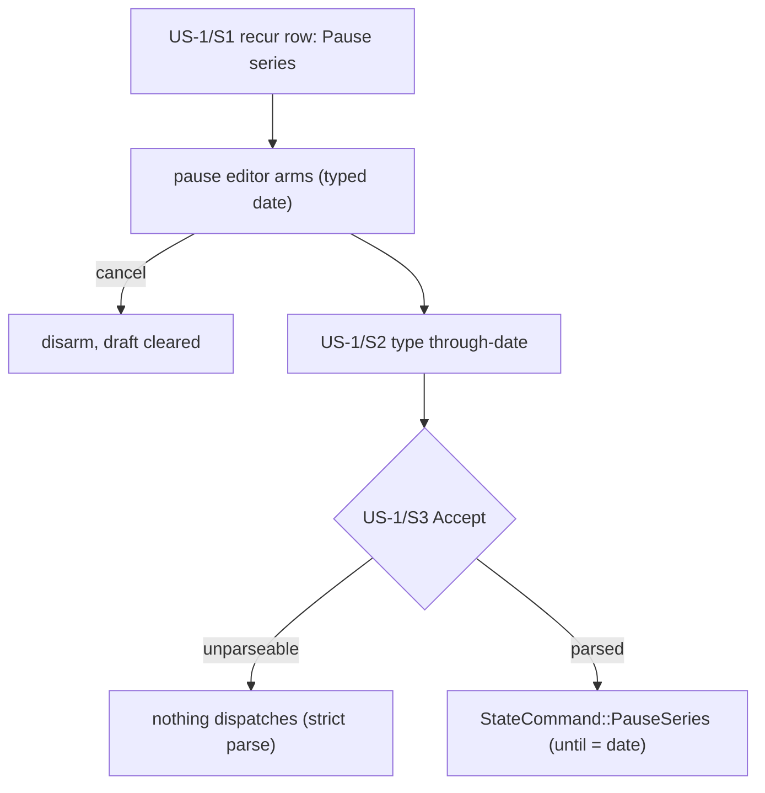
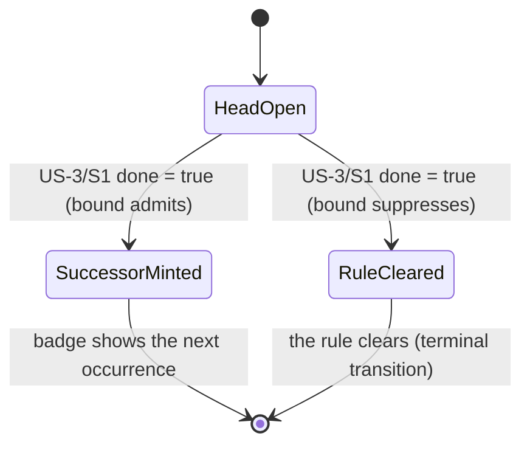

# [Plan] UX Journey Plan — Recurrence family (retrofit, registry F-6)

- **Date**: 2026-11-14
- **Kind**: UX journey plan — **retrofit** (phase 4 of the UX journey
  framework rollout): user stories, journeys, flows, wiring inventory,
  and findings describing the recurrence *management* verbs (pause,
  resume, convert-to-habit) and the completion-spawn display behavior
  **as implemented**. No new capability is planned; no implementation
  decisions are made.
- **Origin**: the UX retrofit & triage dispatch
  `/home/viktoria/src/taskboard/.artifacts/plans/2026-11-14-ux-retrofit-triage-dispatch-plan.md`
  §1/§3 (the retrofit posture binds this plan); the stage-1 chunk plan
  `.artifacts/plans/2026-11-14-ux-retrofit-triage-chunk-plan.md` (D-1
  story set + census feed, D-2 rubric application, D-7 gate
  steady-state, D-6 commit sequencing) applying chunk-1's plan
  `.artifacts/plans/2026-11-14-ux-retrofit-core-chunk-plan.md` D-3
  (the ruling rubric) and D-4 (escape-audit method, walkthrough
  questions); the census Task detail + Today slices
  `docs/ux-surface-census.org` (baseline `dc290df2`); the pilot
  recur-editor plan `.artifacts/plans/2026-11-13-r7-recur-editor-ux-plan.md`
  (task.recur_set/clear/preview's owner — cited, not re-walked); the
  live worktree code at `docs/ux-retrofit-triage` HEAD `0b98fe5d`
  (wiring anchors are live `file:line`; census cells keep their
  recorded baseline anchors — chunk-1 plan §5 anchor-drift law).
- **Status**: ACCEPTED (retrofit documentation authored under the
  accepted phase-4 dispatch; stage 3 reviews it against this posture).
  **Amended 2026-11-15** (UX remediation chunk 1 — completability,
  stage 2; authority: the accepted triage report findings T-7 (#790),
  RC-W-N2 and the remediation chunk plan
  `.artifacts/plans/2026-11-15-ux-r1-completability-chunk-plan.md`
  D-2/D-4): the recur row's kiosk posture changes from
  **desktop-mounted affordances** to **rendered-disabled affordances**
  — the row (pattern echo + paused chip) renders on kiosk with the
  pause/resume/convert buttons greyed. Command-contract delta of the
  amendment: **zero new variants** (gating is display state — the
  `series-edit-enabled` flag, `presentation.rs::series_edit_enabled`).
- **Surfaces touched**: `ui/views/task-view.slint` (the recur row),
  `ui/widgets/task-card.slint` (the recur badge), `src/adapter.rs`
  (recur seams), `src/actions.rs`, `src/router.rs`,
  `src/presentation.rs`; engine-side
  `crates/taskboard-domain/src/command.rs` (the completion spawn)
- **Platform scope**: desktop for the dispatch; the recur row renders
  on kiosk with its actions disabled (the remediated D-2 posture;
  the recur badge renders wherever task cards render)

## 1. Scope & goals

This plan documents the recurrence family's management UX that ships
today: a desktop user pauses a series through a typed pause-through
date, resumes it, and converts a series to a habit through an armed
confirm; a recurring task's completion spawns its successor (or
suppresses at the bound), and every task card renders the series'
next-occurrence badge with its paused chip. Setting and clearing a
recurrence rule is the pilot recur-editor plan's
(`2026-11-13-r7-recur-editor-ux-plan.md` — referenced, not re-walked).
All journeys below are **journeys-as-implemented** (chunk-2 plan D-1:
P1 = the journey a user actually completes today).

**Non-goals** (retrofit posture — nothing here is a commitment; each
hole is a finding in §10, classification and homing are the phase-5
triage's):

- No CLI pause/resume/convert verbs beyond the `tasks repeat`
  pause/resume flags — the convert GUI-only absence is finding RC-3,
  not planned.
- The recur-editor overlay's internal verbs are the pilot plan's;
  this plan's matrix cites its rulings, never re-walks them.

## 2. Capability × surface matrix

<!-- Rows restate the census Task detail slice (baseline dc290df2)
verbatim in content; the pilot's recur_set/clear/preview rows cite the
pilot rulings (R-Pattern 4), never re-argued. `U` cells are carried as
`U` or converted to `— (R-n)` per chunk-1 plan D-3 (applied
mechanically per chunk-2 plan D-2); every conversion cites this
plan's rulings table below (this plan is the ruling's authority, dated
2026-11-14). Borderline cells (recur_pause / recur_convert_to_habit
Board/Review/Settings/Capture) stay `U` as findings RC-1/RC-2 — the
chunk's named trap applied. Cells avoid `|`. -->

| Capability | Board | TaskDetail | Today | Review | Settings | Capture | CLI |
|---|---|---|---|---|---|---|---|
| task.recur_set | — (R-2) | E (desktop) (US-1, US-2) — "Add repeat"/"Edit repeat" affordances `ui/views/task-view.slint:653-659,776-782`, editor `ui/compositions/recur-editor.slint`, commit funnel `router.rs:765-776`, exact-rule test =lib.rs::recur_editor_commits_the_exact_assembled_rule= | — (R-2) | — (R-2) | — (R-2) | — (R-1) | E (pre-existing, =tasks repeat=, now minting via =recur::assemble_rule= `taskboard-domain/src/recur.rs:791`) |
| task.recur_clear | — (R-2) | E (desktop) (US-3) — armed "Stop repeating" strip `recur-editor.slint:274+`, detach =router.rs:777-786=, exactness test =lib.rs::recur_editor_detach_clears_the_rule_and_nothing_else= | — (R-2) | — (R-2) | — (R-2) | — (R-1) | E (pre-existing, =tasks repeat --off=) |
| task.recur_pause | U (RC-1) | E (US-1) — pause-through-date flow `adapter.rs:7166-7182` (live `adapter.rs:7203-7229`), resume `adapter.rs:7188` (live `adapter.rs:7230-7237`); (→ =PauseSeries= `messages.rs:423`); recur-row labels `task-view.slint:788-826` | E — =SeriesPause/=SeriesPauseCommit/=SeriesResume= registry `actions.rs:1366-1386`, reachable from today cards via the recur badge `task-card.slint:22-24` (the badge itself is display-only — the reach is the GLOBAL menu rows, W-N1) | U (RC-1) | U (RC-1) | U (RC-1) | E (pre-existing, =tasks repeat= pause/resume `cli.rs:1746`, flags `cli.rs:821,830`) |
| task.recur_convert_to_habit | U (RC-2) | E (US-2) — convert flow `adapter.rs:7196-7232` (live `adapter.rs:7238-7272`); (→ =ConvertSeriesToHabit= `messages.rs:437`); recur-row convert label `task-view.slint:832` | E — =SeriesConvertArm/=SeriesConvertToHabit= registry `actions.rs:1396-1406` | U (RC-2) | U (RC-2) | U (RC-2) | U (RC-3) |
| task.recur_preview | — (R-2) | D (desktop) (US-1, US-2 — inside the editor) — live echo `recur-editor.slint:54-57` fed by =assemble_recur_draft= | — (R-2) | — (R-2) | — (R-2) | — (R-2) | U (RC-4) |
| task.recur_display | D (pre-existing card badge) | D (pre-existing pattern echo) | D — the same card badge on today rows `today-view.slint:20,376`, `task-card.slint:22-24` | — (R-2) | — (R-2) | — (R-2) | U (RC-4) |

**Rulings** (conversions of census `U` cells; every converted cell
above cites one of these; this table is the ruling's authority,
2026-11-14, per chunk-1 plan D-3 applied by chunk-2 plan D-2):

| ID | Ruling | Reason | Home |
|---|---|---|---|
| R-2 | task.recur_preview mounts only inside the recur editor, which mounts only in the task detail view (Review / Settings / Capture absence) | R-Pattern 4 (standing authority) transferring the pilot recur-editor ruling R-2 ("the editor mounts only in the task detail view, where the recur row renders" — `.artifacts/plans/2026-11-13-r7-recur-editor-ux-plan.md` §2, 2026-11-13): the live echo is an in-editor element (`recur-editor.slint:54-57`), so the editor's scoping rules the preview's. The CLI cell stays `U` as finding RC-4. | this plan §2; census Task detail slice register; pilot plan §2 |
| R-2 (display row) | task.recur_display has no mounts on Review / Settings / Capture | R-Pattern 3 (display-scoping): the recur badge echoes the series' next occurrence on the surfaces that render task cards (Board / TaskDetail / Today); Review and Settings render no task cards and Capture's overlays are task-less — nothing for the display to echo (the census's Sweep-R/S/C evidence, register 2026-11-13). The CLI cell stays `U` as finding RC-4. | this plan §2; census Task detail slice register |

(The pilot rulings R-1 / R-2 for task.recur_set / task.recur_clear —
the editor's single-surface posture and the no-recurrence-at-create
rule — stand untouched under R-Pattern 4; this plan cites them, never
re-argues them.)

## 3. User stories

### US-1 — Pause a series

- **Story**: As a desktop user going on vacation I want to pause a
  recurring series through an inclusive date so that the covered
  members do not exist and the series resumes after it.
- **Platforms**: desktop for the dispatch; the recur row renders on
  kiosk with the pause affordance disabled (remediated 2026-11-15,
  the D-2 grammar; test
  `journeys.rs::the_kiosk_recur_row_renders_with_disabled_actions`).
- **Entry points**: the detail view's recur row ("Pause series" —
  `task-recur-pause-asked`, `adapter.rs:7204-7208`); the two-tier
  menu's Task group (`ActionId::SeriesPause`, GLOBAL, `actions.rs:1366-1375`);
  CLI `tasks repeat` pause flags (pre-existing twin).
- **Priority**: P1
- **Acceptance**:
  - AC-1: Given a series subject, When the pause editor accepts a
    strict `%Y-%m-%d` date, Then `StateCommand::PauseSeries { head,
    until }` dispatches — verified by
    `router.rs` (`SeriesPauseCommit` arm: `Some(head)`, `Some(until)`;
    the trust-boundary parse `adapter.rs:7210-7217`).
  - AC-2: Given an unparseable date draft, When the commit seam
    fires, Then nothing dispatches (the strict-parse `else return`,
    `adapter.rs:7211-7214`).

### US-2 — Resume a series / convert a series to a habit

- **Story**: As a desktop user back from a pause I want to resume the
  series so that its future members exist again; and when a series'
  cadence dissolves into a daily quota I want to convert it to a habit
  through an armed confirm so that the history continues.
- **Platforms**: desktop for the dispatch; the recur row renders on
  kiosk with the resume/convert affordances disabled (remediated
  2026-11-15, the D-2 grammar; the armed confirm strip stays
  unmountable from a disabled trigger).
- **Entry points**: resume — the recur row's resume affordance
  (`task-recur-resume-clicked`, `adapter.rs:7230-7237`) →
  `ActionId::SeriesResume`; conversion — the recur row's convert arm
  (`task-recur-convert-asked`, `adapter.rs:7238-7257`) →
  `ActionId::SeriesConvertArm`, confirm
  (`task-recur-convert-confirmed`, `adapter.rs:7258-7271`) →
  `SeriesConvertToHabit`; both verbs also GLOBAL menu rows
  (`actions.rs:1386-1414`). No CLI convert twin (RC-3).
- **Priority**: P1
- **Acceptance**:
  - AC-1: Given a paused series, When resume fires, Then
    `StateCommand::PauseSeries { head, until: None }` dispatches
    (the resume route, `router.rs` `SeriesResume` arm).
  - AC-2: Given an armed conversion, When Confirm fires, Then
    `StateCommand::ConvertSeriesToHabit` dispatches with the
    pattern's default quota re-derived from the live rule (the
    re-derive guard, `adapter.rs:7258-7269`).

### US-3 — Completion-spawn behavior (as displayed)

- **Story**: When a recurring task completes I want the next
  occurrence to appear (or the rule to clear at its bound) so that the
  series continues without manual re-creation. (Display story over
  engine behavior — what the user sees.)
- **Platforms**: both (the completion happens engine-side; the badge
  renders wherever task cards render).
- **Entry points**: completing the head (the card checkbox, detail
  toggle, today row — the task-lifecycle plan's US-2); the recur badge
  (`presentation.rs::recur_badge`) renders the successor.
- **Priority**: P1 (D-verb display)
- **Acceptance**:
  - AC-1: Given a recurring head, When `SetTaskDone { done: true }`
    runs, Then the completion spawn mints the successor at the first
    live date — or, the bound-suppressed terminal transition, clears
    the rule — verified by
    `command.rs::completing_a_recurring_head_spawns_the_successor`
    (`crates/taskboard-domain/src/command.rs:1136-1159`, the spawn
    plan).
  - AC-2: Given a paused series, When the successor mints, Then the
    live-member law applies (the successor's member is the first not
    covered by `paused_until`, `command.rs:1146-1149`).

### US-4 — Series state display

- **Story**: As a desktop user I want every task card of a series to
  show its next occurrence (with the paused chip while paused) so that
  the series' cadence is visible without opening the detail.
  (Display-only story.)
- **Platforms**: both.
- **Entry points**: the recur badge decoration
  (`task-card.slint:22-24`, `presentation.rs::recur_badge` /
  `recur_badge_label`); the detail view's recur-row labels
  (`task-view.slint:788-826`).
- **Priority**: P1 (D-verb display)
- **Acceptance**:
  - AC-1: Given a recurring task, When the card renders, Then the
    badge derives next/paused/stale from the rule and the calendar
    (`presentation.rs::recur_badge`, `presentation.rs::recur_badge_label`).

### US-5 — CLI series management (P2, CLI journeys)

- **Story**: When a series' pause state needs setting from the CLI,
  the `tasks repeat` pause/resume flags complete it; conversion has
  no CLI twin (finding RC-3 — documented, not planned).
- **Platforms**: CLI.
- **Entry points**: `tasks repeat` pause/resume (`cli.rs:1746`,
  flags `cli.rs:821,830`); `tasks repeat` / `tasks repeat --off`
  (the pilot plan's set/clear twins).
- **Priority**: P2
- **Acceptance**:
  - AC-1: Given a series, When `tasks repeat --pause-until <date>`
    runs, Then `StateCommand::PauseSeries` dispatches engine-side.

## 4. Journey specs

### US-1 — Pause a series

| Step | Surface & affordance | User action | Dispatches | System response | Escape / failure |
|---|---|---|---|---|---|
| US-1/S1 | detail view recur row (`task-view.slint:788-826`) | click "Pause series" | `task-recur-pause-asked` (`adapter.rs:7204-7208`) → `ActionId::SeriesPause` → `UiEffect::SeriesPauseOpen` (`router.rs`) | the pause editor arms (typed date field) | cancel disarms (`task-recur-pause-cancelled`, `adapter.rs:7220-7225`, clears the draft and refreshes) |
| US-1/S2 | pause editor field | type the through-date | — (flow-local draft) | the draft echoes | an unparseable date dispatches nothing (strict `%Y-%m-%d` trust boundary, `adapter.rs:7210-7217` — audit mechanism (c)) |
| US-1/S3 | pause editor commit | press Accept | `task-recur-pause-accepted` → `ActionId::SeriesPauseCommit` → `StateCommand::PauseSeries { head, until: Some(date) }` (`router.rs`; `messages.rs:423`) | the covered members do not exist; the badge shows the paused chip | `PauseSeries` is undoable (PreImages, `undo.rs:121`) — test `router.rs` `SeriesPauseCommit` exactness (the draft rides verbatim) |

### US-2 — Resume / convert a series

| Step | Surface & affordance | User action | Dispatches | System response | Escape / failure |
|---|---|---|---|---|---|
| US-2/S1 | recur row resume affordance | click resume | `task-recur-resume-clicked` (`adapter.rs:7230-7237`) → `ActionId::SeriesResume` → `StateCommand::PauseSeries { head, until: None }` (`router.rs`) | the pause field clears (an expired pause is inert; the clear is badge hygiene, `actions.rs:1386-1395`) | undoable (PreImages, `undo.rs:121`); targetless fires are `NoTarget` (the router's typed no-op) |
| US-2/S2 | recur row convert affordance | click convert | `task-recur-convert-asked` (`adapter.rs:7238-7257`) → `ActionId::SeriesConvertArm`; the confirm arms with the pattern's default quota | the armed confirm strip shows | cancel disarms (`task-recur-convert-cancelled`, `adapter.rs:7272-7278`) — the armed strip is the escape (audit mechanism (d)) |
| US-2/S3 | armed confirm strip | press Confirm | `task-recur-convert-confirmed` (`adapter.rs:7258-7271`) → `ActionId::SeriesConvertToHabit` → `StateCommand::ConvertSeriesToHabit` (`messages.rs:437`) | the series stops repeating; the habit continues the history with the pattern's default quota | post-commit undo is `NotUndoable(HabitSurface)` (`undo.rs:250-261`, the seam-addressed composite family) — finding RC-5 records the posture; pre-commit the armed strip is the escape |

### US-3 — Completion-spawn behavior (as displayed)

| Step | Surface & affordance | User action | Dispatches | System response | Escape / failure |
|---|---|---|---|---|---|
| US-3/S1 | any task-completion affordance (the lifecycle plan's US-2) | complete the recurring head | `StateCommand::SetTaskDone { done: true }` → the completion spawn (`command.rs:1136-1159`) | the successor mints at the first live date (paused-aware, `command.rs:1146-1149`), or the rule clears at the bound (the suppressed terminal transition mutates the same action) | the spawn rides the same undoable action as the completion (the spawn is part of action 1's plan); reopening never spawns and never clears (`command.rs:1133-1135`) — test `command.rs::completing_a_recurring_head_spawns_the_successor` |

### US-4 — Series state display

| Step | Surface & affordance | User action | Dispatches | System response | Escape / failure |
|---|---|---|---|---|---|
| US-4/S1 | recur badge (`task-card.slint:22-24`) / recur-row labels (`task-view.slint:788-826`) | — display only | — display only | next occurrence, paused chip, stale flag render per frame from the published state (`presentation.rs::recur_badge`) | display only — no dispatch, no escape; the badge is a decoration, not a control (W-N1) |

### US-5 — CLI series management (P2)

| Step | Surface & affordance | User action | Dispatches | System response | Escape / failure |
|---|---|---|---|---|---|
| US-5/S1 | CLI `tasks repeat` pause/resume flags (`cli.rs:1746`, `cli.rs:821,830`) | run the verb | `StateCommand::PauseSeries` | the series pauses/resumes engine-side | no GUI twin claim needed — the GUI affordances exist (US-1/US-2); the CLI is the parallel path |

## 5. Interaction flows

The pause flow (arm → type → strict-parse commit):

The completion-spawn decision (engine-side, displayed by the badge):

## 6. Wiring inventory

<!-- Rows document EXISTING affordances (retrofit): every callback and
command below is live at the worktree HEAD 0b98fe5d. Rows carry the
callback in the Adapter-seam column with the Callback cell `—` (the
chunk-1 plans' PC-2 correction posture). -->

| ID | Surface file | Widget | Callback | Adapter seam | ActionId | Commands | Row addressing | Journey steps | Test |
|---|---|---|---|---|---|---|---|---|---|
| W-1 | ui/views/task-view.slint (recur row) | pause editor arm/accept/cancel | — | install_seam! on_task_recur_pause_asked (adapter.rs:7204-7208); install_seam! on_task_recur_pause_accepted (adapter.rs:7209-7219); install_seam! on_task_recur_pause_cancelled (adapter.rs:7220-7225) | ActionId::SeriesPause | StateCommand::PauseSeries; ActionId::SeriesPauseCommit | the viewed subject (`view_state.subject_task()`) | US-1/S1-US-1/S3 | router.rs SeriesPauseCommit exactness (the draft rides verbatim) |
| W-2 | ui/views/task-view.slint (recur row) | resume affordance | — | install_seam! on_task_recur_resume_clicked (adapter.rs:7230-7237) | ActionId::SeriesResume | StateCommand::PauseSeries | the viewed subject | US-2/S1 | router.rs SeriesResume route |
| W-3 | ui/views/task-view.slint (recur row) | armed conversion strip | — | install_seam! on_task_recur_convert_asked (adapter.rs:7238-7257); install_seam! on_task_recur_convert_confirmed (adapter.rs:7258-7271); install_seam! on_task_recur_convert_cancelled (adapter.rs:7272-7278) | ActionId::SeriesConvertArm | StateCommand::ConvertSeriesToHabit; ActionId::SeriesConvertToHabit | the viewed subject | US-2/S2-US-2/S3 | router.rs SeriesConvertToHabit exactness |
| W-4 | ui/widgets/task-card.slint (decorations) / ui/views/task-view.slint | recur badge + recur-row labels | — | — (display only; presentation.rs::recur_badge) | — | — | per-card render | US-4/S1 | presentation.rs::recur_badge_label |
| W-5 | crates/taskboard-domain/src/command.rs | the completion spawn (engine-side; no UI seam) | — | — (engine behavior; the badge displays the result) | — | StateCommand::SetTaskDone | — (engine-internal) | US-3/S1 | command.rs::completing_a_recurring_head_spawns_the_successor |
| W-6 | crates/taskboard-app/src/cli.rs | `tasks repeat` pause/resume flags | — | — (CLI-only parallel path) | — | StateCommand::PauseSeries | — (CLI verbs, not UI seams) | US-5/S1 | — |

## 7. Command-contract delta

**None — retrofit** (the contract already exists). The table lists
the existing variants the journeys dispatch, for greppability
(chunk-2 plan D-1):

| Kind | Name | Payload sketch | Journeys |
|---|---|---|---|
| StateCommand | PauseSeries | exists (`messages.rs:423`) — `until: Some(date)` pauses, `until: None` resumes | US-1, US-2, US-5 |
| StateCommand | ConvertSeriesToHabit | exists (`messages.rs:437`) — the pattern's default quota | US-2 |
| StateCommand | SetTaskDone | exists (`messages.rs:51`) — the completion spawn rides its plan | US-3 |
| ActionId | SeriesPause / SeriesPauseCommit / SeriesResume / SeriesConvertArm / SeriesConvertToHabit | exist (`actions.rs:326-338,1366-1414`) — GLOBAL registry rows | US-1, US-2 |

## 8. Verification plan

- **Journey tests (step-ID-named)**: none exist — the retrofitted
  journeys predate the framework's step-token test law. Per the pilot
  precedent (comparison plan §2, backlog #768; chunk-1 plans' PC-2)
  the §2.3 gate's journey-step token rows stay MISSING on this plan;
  the per-step verification evidence is the Test column of §6 and the
  Escape column of §4.
- **Seam tests (existing, cited per row)**: the exact-draft dispatches
  in the router's verb tests (`router.rs` — `SeriesPauseCommit`
  carries the draft verbatim, the `SeriesConvertToHabit` confirm
  exactness), the engine spawn
  (`command.rs::completing_a_recurring_head_spawns_the_successor`).
- **Fold/presentation tests (existing)**: the badge derivation
  (`presentation.rs::recur_badge` / `recur_badge_label`), the
  pilot's editor exactness tests
  (`lib.rs::recur_editor_commits_the_exact_assembled_rule`,
  `lib.rs::recur_editor_detach_clears_the_rule_and_nothing_else`).
- **Kiosk gates**: the recur row renders on kiosk AND so do its
  affordances, disabled (remediated 2026-11-15: `series-edit-enabled`
  false — supersedes the desktop-mount gate; test
  `journeys.rs::the_kiosk_recur_row_renders_with_disabled_actions`).
  History: the affordances were desktop-mounted and the recur badge
  was the display half's kiosk-visible half (the kiosk silent-gating
  family, W-N2).
- **Manual**: the badge's stale/paused semantics are judged, not
  text-asserted; the stage-3 walkthrough covers them.

## 9. Definition of done (retrofit)

- [x] Wiring inventory: every row FOUND under
  `scripts/ux-coverage.sh` (per-plan gate outcome recorded in the
  stage-2 report — chunk-2 plan D-7)
- [x] Journeys-as-implemented complete end-to-end with the escape
  audit per step; the post-commit no-undo posture (US-2/S3) recorded
  as finding RC-5, not fixed (retrofit posture)
- [x] Census Task-detail-slice `U` conversions (recur_preview GUI
  cells, recur_display GUI cells) cite this plan (rulings table §2,
  dated 2026-11-14); the pilot rulings stand untouched; the
  borderline recur_pause / recur_convert cells stay `U` as findings
  RC-1/RC-2 (the chunk's named-trap rule)
- [ ] Stage-3 walkthrough protocol executed; findings classified by
  the phase-5 triage (this plan records, never fixes)
- [x] Non-goals: none planned — all holes are findings (§10)

## 10. Findings (retrofit — descriptive only; no redesign proposed)

Walkthrough answers (framework §4.4's four questions, applied
descriptively) and the six-heuristic pass surfaced the following;
each carries evidence, never a fix.

- **RC-1 — the pause/resume affordances mount only in the detail
  view's recur row; everywhere else the path is the buried global
  menu** (entry-point asymmetry). The census register records
  "Sweep-B/R/S/C: no pause/resume seam" (Board / Review / Settings /
  Capture cells stay `U` under this finding); the `SeriesPause` /
  `SeriesResume` verbs are GLOBAL registry rows with Task-group menu
  entries (`actions.rs:1366-1386`), so the menu is a universal path —
  but a user on the board sees the series' badge (display-only,
  `task-card.slint:22-24`) with no control on it. Walkthrough Q1: the
  control is not where the series renders. The borderline
  classification is the triage's.
- **RC-2 — the same posture for the series→habit conversion**: the
  convert affordance mounts only in the detail recur row
  (`task-view.slint:832`); Board/Review/Settings/Capture cells stay
  `U`. The conversion has no CLI twin (RC-3), so the detail view is
  the conversion's only surfaced path and the menu the only other
  one.
- **RC-3 — task.recur_convert_to_habit has no CLI verb** (F-Pattern 1
  evidence note). `tasks repeat` (`cli.rs:1746-1755`) has no convert
  verb (census Sweep-CLI evidence, register 2026-11-13). The CLI cell
  stays `U` under this finding. The GUI completes the journey, so no
  journey depends on the twin (the CLI-absence decision rule's MINOR
  arm applies unless the triage finds otherwise).
- **RC-4 — no CLI twins for the recur preview or the recur badge
  display** (F-Pattern 4, vacuous-to-marginal CLI display absences).
  `tasks list` prints no recurrence echo and no preview verb exists
  (census Sweep-CLI evidence). The CLI cells of `task.recur_preview` /
  `task.recur_display` stay `U`.
- **RC-5 — the series→habit conversion has no post-commit undo**
  (F-Pattern 4 with a structural edge). `ConvertSeriesToHabit` is
  `NotUndoable(HabitSurface)` (`undo.rs:250-261`, the seam-addressed
  composite, #506/D-H7a) — the same posture the habit-family plan's
  HB-3 records for the mirror conversion. The pre-commit armed strip
  is the escape; the post-commit reversal is the sibling verb
  (habit→series). Recorded, not fixed.
- **W-N1 — walkthrough note (US-1/S1, the badge-display claim)**: the
  census's Today cell for `task.recur_pause` says "reachable from
  today cards via the recur badge" — the badge itself is a
  display-only decoration (`task-card.slint:22-24`, no click seam in
  the widget); the reach is the GLOBAL menu rows. The cell's
  populated evidence stands as recorded (census cells are immutable
  input); this note records the widget-level fact for the triage's
  classification of RC-1.
- **W-N2 — walkthrough note (US-4, kiosk)**: *(Remediated
  2026-11-15 — UX remediation chunk 1 / triage T-7 (#790): the recur
  row renders on kiosk with its pause/resume/convert buttons greyed
  (`presentation.rs::series_edit_enabled`; test
  `journeys.rs::the_kiosk_recur_row_renders_with_disabled_actions`).
  History: the recur badge rendered on kiosk (task cards render
  there) while the pause/resume/convert controls lived in the detail
  view's desktop-mounted affordances — the kiosk silent-gating
  family.)*
- **W-N3 — walkthrough note (US-1, feedback)**: the pause's system
  response is the badge's paused chip (`presentation.rs::recur_badge`
  carries `paused_until`) — the state change is visible at the card
  level, a recognition-over-recall positive. The covered members'
  non-existence ("vacation pause: the covered members do not exist",
  `actions.rs:1366-1375`) is communicated by the action description,
  not the editor.

## 11. Plan corrections

- None required — the stage-2 `scripts/ux-coverage.sh` run
  (2026-11-14) returned checks: 29, FOUND: 28, MISSING: 1; the one
  MISSING row is the journey-step token row for US-5/S1 (the P2 CLI
  journey's step token, no step-token test exists) — the documented
  retrofit limitation (chunk-2 plan D-7; backlog #768). No wiring row
  MISSING, no plan defect surfaced.
