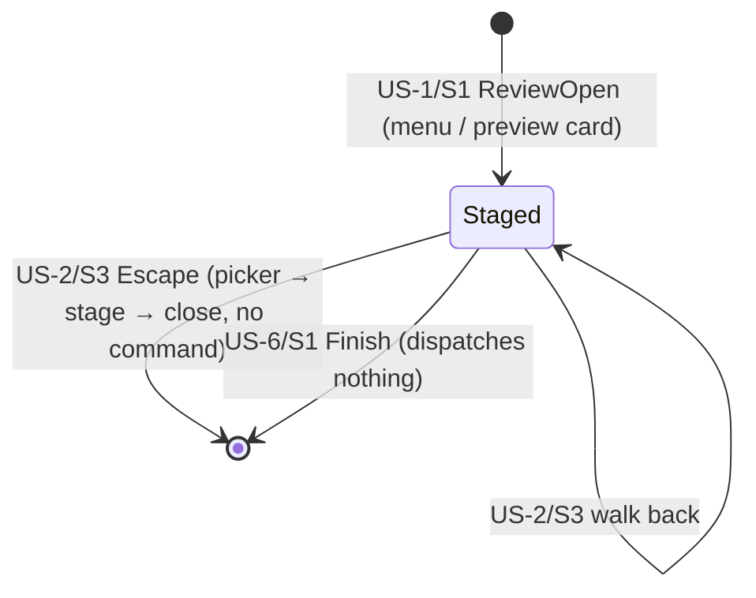
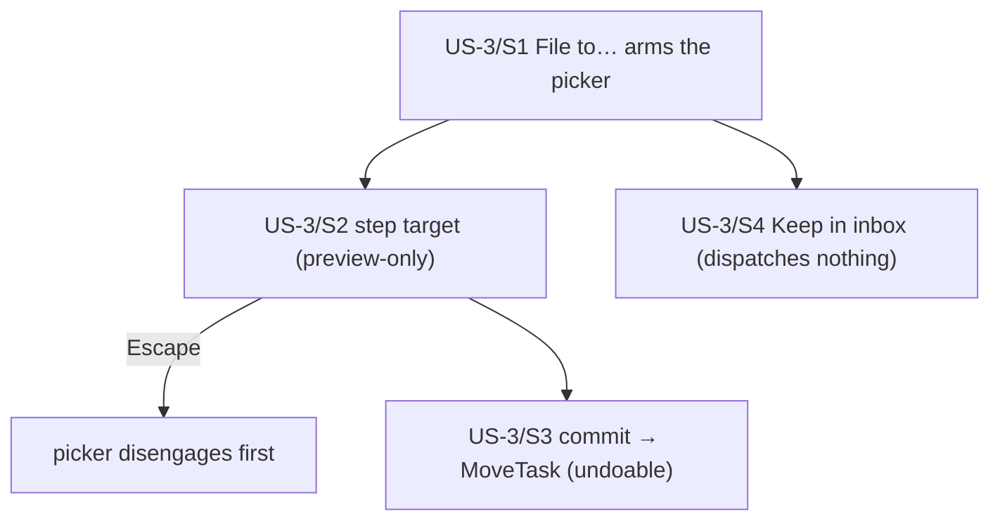

# [Plan] UX Journey Plan — Review walk & reflection (retrofit, registry F-8)

- **Date**: 2026-11-14
- **Kind**: UX journey plan — **retrofit** (phase 4 of the UX journey
  framework rollout): user stories, journeys, flows, wiring inventory,
  and findings describing the review view, the review walk overlay,
  the plan-next-day view, and the reflection family **as implemented**.
  No new capability is planned; no implementation decisions are made.
- **Origin**: the UX retrofit & triage dispatch
  `/home/viktoria/src/taskboard/.artifacts/plans/2026-11-14-ux-retrofit-triage-dispatch-plan.md`
  §1/§3 (the retrofit posture binds this plan); the stage-1 chunk plan
  `.artifacts/plans/2026-11-14-ux-retrofit-triage-chunk-plan.md` (D-1
  story set + census feed, D-2 rubric application, D-7 gate
  steady-state, D-6 commit sequencing) applying chunk-1's plan
  `.artifacts/plans/2026-11-14-ux-retrofit-core-chunk-plan.md` D-3
  (the ruling rubric) and D-4 (escape-audit method, walkthrough
  questions); the census Review slice + the Today `review.walk_preview`
  row `docs/ux-surface-census.org` (baselines `84c04a0b` / `dc290df2`);
  the live worktree code at `docs/ux-retrofit-triage` HEAD `0b98fe5d`
  (wiring anchors are live `file:line`; census cells keep their
  recorded baseline anchors — chunk-1 plan §5 anchor-drift law).
- **Status**: ACCEPTED (retrofit documentation authored under the
  accepted phase-4 dispatch; stage 3 reviews it against this posture).
  **Amended 2026-11-15** (UX remediation chunk 4, stage 2; authority:
  the accepted triage report finding T-21 (#804) and the chunk plan
  `.artifacts/plans/2026-11-15-ux-r4-board-entry-points-chunk-plan.md`
  D-8): US-1's entry points gain the preset key (Standard
  Ctrl+Shift+R, emacs C-c Ctrl+v, vi g w — the ContextId::Global
  rows); RW-3's reachable-not-promoted finding gains its dated
  remediation pointer (the reachable half is now promoted; the menu
  rank and the kiosk `entry_states` greying stand unchanged).
- **Surfaces touched**: `ui/views/review-view.slint`,
  `ui/views/review-walk-overlay.slint`,
  `ui/views/plan-next-day-view.slint`, `ui/app-window.slint` (the
  walk's window-level mount), `src/adapter.rs` (the review/walk/planner
  seams), `src/actions.rs`, `src/router.rs`
- **Platform scope**: desktop (the review/plan surfaces are
  desktop-mounted; `ContextId::Review` itself binds nothing — the
  read-only ledger)

## 1. Scope & goals

This plan documents the review walk & reflection UX that ships today:
a desktop user opens the review (menu-reachable, reachable-not-promoted),
walks the staged overlay (cursor/back/advance with the
stage-then-close Escape preset), triages the inbox (file with target
pick + commit, or keep), carries tasks to tomorrow (fixed or picked
date, or leave as is), records a reflection, or finishes without
recording; the plan-next-day view places tasks into day boxes with
one atomic commit per placement; the review view displays the
effort-calibration ledger and stats, and the reflection ledger. All
journeys below are **journeys-as-implemented** (chunk-2 plan D-1: P1
= the journey a user actually completes today). The flow is
request-free — everything routes through `UiEffect` into engine verbs
(the census's named finding; restated as evidence, not judged here).

**Non-goals** (retrofit posture — nothing here is a commitment; each
hole is a finding in §10, classification and homing are the phase-5
triage's):

- No GUI reflection edit/delete — finding RW-1, not planned.
- No CLI walk/planner verbs — finding RW-2, not planned.

## 2. Capability × surface matrix

<!-- Cells restate the census Review slice (baseline 84c04a0b) plus
the Today walk_preview row (baseline dc290df2) verbatim in content.
`U` cells are carried as `U` or converted to `— (R-n)` per chunk-1
plan D-3 (applied mechanically per chunk-2 plan D-2); every conversion
cites this plan's rulings table below (this plan is the ruling's
authority, dated 2026-11-14). The F-Pattern 1 cells
(reflection.edit/delete) stay `U` as findings RW-1. Cells avoid `|`. -->

| Capability | Board | TaskDetail | Today | Review | Settings | Capture | CLI |
|---|---|---|---|---|---|---|---|
| review.open | E (global) (US-1) — =ReviewOpen= "Review" `actions.rs` (GLOBAL, menu rank 75; preset keys in every preset — Standard Ctrl+Shift+R, emacs C-c Ctrl+v, vi g w — remediated 2026-11-15, T-21/#804; kiosk greys in =entry_states=), routes =UiEffect::OpenReviewWalk= `router.rs:991` | E (global) — same =ReviewOpen= evidence | E — the walk-preview card's activation routes the same =ReviewOpen= `adapter.rs:10147-10151` (display card = review.walk_preview in the Today slice) | E (global) — same =ReviewOpen= evidence | E (global) — same =ReviewOpen= evidence | E (global) — same =ReviewOpen= evidence | U (RW-4) |
| review.walk_cursor | — (R-1) | — (R-1) | — (R-1) | E (US-2) — =ReviewWalkCursorUp/=ReviewWalkCursorDown= "Walk cursor up/down" `actions.rs:1551-1569` (=ContextId::ReviewWalk=), Up/Down presets `presets.rs:306-311`, overlay strip emphasis `review-walk-overlay.slint:47-54`; the walk seams `adapter.rs:10079-10152` | — (R-1) | — (R-1) | U (RW-2) |
| review.walk_back | — (R-1) | — (R-1) | — (R-1) | E (US-2) — =ReviewWalkBack= "Walk back" `actions.rs:1571-1579`, Escape preset `presets.rs:312` (an armed picker disengages first, then stage, then close — never dispatching a command) | — (R-1) | — (R-1) | U (RW-2) |
| review.walk_advance | — (R-1) | — (R-1) | — (R-1) | E (US-2) — =ReviewWalkAdvance= `actions.rs:1581-1589`; =WalkIntent::Advance= `adapter.rs:2146-2153`; advancing out of Carry forward hands off to plan-next-day | — (R-1) | — (R-1) | U (RW-2) |
| review.inbox_file | — (R-1) | — (R-1) | — (R-1) | E (US-3) — =ReviewInboxFile= "File to…" `actions.rs:1591-1599`, arms the File-to picker (overlay `review-walk-overlay.slint:119-126`); =WalkIntent::InboxFile= `adapter.rs:2188-2194` | — (R-1) | — (R-1) | U (RW-2) |
| review.inbox_keep | — (R-1) | — (R-1) | — (R-1) | E (US-3) — =ReviewInboxKeep= "Keep in inbox" `actions.rs:1601-1609` (dispatches nothing); =WalkIntent::InboxKeep= `adapter.rs:2192-2194` | — (R-1) | — (R-1) | U (RW-2) |
| review.file_target | — (R-1) | — (R-1) | — (R-1) | E (US-3) — =ReviewFileTargetPrev/=ReviewFileTargetNext= "Previous/Next file target" `actions.rs:1611-1629`, =WalkIntent::FileTargetPrev/Next= `adapter.rs:2195-2202` | — (R-1) | — (R-1) | U (RW-2) |
| review.file_commit | — (R-1) | — (R-1) | — (R-1) | E (US-3) — =ReviewFileCommit= "Commit file" `actions.rs:1631-1639`; =WalkIntent::FileCommit= → =MoveTask= `adapter.rs:2203-2227` (the ordinary end-of-stack move verb) | — (R-1) | — (R-1) | U (RW-2) |
| review.carry_tomorrow | — (R-1) | — (R-1) | — (R-1) | E (US-4) — =ReviewCarryTomorrow= "Move to tomorrow" `actions.rs:1641-1649`; =WalkIntent::CarryTomorrow= → =UpdateTask= `adapter.rs:2227-2249` (scheduled instant; due dates never touched) | — (R-1) | — (R-1) | U (RW-2) |
| review.carry_pick | — (R-1) | — (R-1) | — (R-1) | E (US-4) — =ReviewCarryPickDate= arms the date field `actions.rs:1651-1659`, =ReviewCarryDateCommit= commits the parsed instant `actions.rs:1671-1679`; =WalkIntent::CarryDateCommit= → =UpdateTask= `adapter.rs:2252-2299` (an unparseable date dispatches nothing) | — (R-1) | — (R-1) | U (RW-2) |
| review.carry_leave | — (R-1) | — (R-1) | — (R-1) | E (US-4) — =ReviewCarryLeave= "Leave as is" `actions.rs:1661-1669` (dispatches nothing); rides =WalkIntent::InboxKeep='s no-op arm `adapter.rs:2192-2194` | — (R-1) | — (R-1) | U (RW-2) |
| reflection.record | — (R-1) | — (R-1) | — (R-1) | E (US-5) — =ReviewRecord= "Record" commits the prompt answers as one reflection entry `actions.rs:1671-1679`; =WalkIntent::Record= → =RecordReflection= `adapter.rs:2300-2339` (an all-blank record commits nothing); prompts editor `review-walk-overlay.slint:127-129` | — (R-1) | — (R-1) | E (pre-existing, =journal add= `cli.rs:1379`) |
| review.finish | — (R-1) | — (R-1) | — (R-1) | E (US-6) — =ReviewFinish= "Finish without recording" `actions.rs:1691-1699` (the equal-prominence exit; dispatches nothing); =WalkIntent::Finish= `adapter.rs:2341-2343` | — (R-1) | — (R-1) | U (RW-2) |
| plan.open | E (global) (US-7) — =ViewPlanNextDay= "Plan next day" `actions.rs:1472-1480` (GLOBAL, menu rank 65), routes =UiEffect::OpenPlanNextDay= `router.rs:968`; the view mounts `app-window.slint:511` | E (global) — same =ViewPlanNextDay= evidence | E (global) — same =ViewPlanNextDay= evidence | E (global) — same =ViewPlanNextDay= evidence | E (global) — same =ViewPlanNextDay= evidence | E (global) — same =ViewPlanNextDay= evidence | U (RW-4) |
| plan.begin_place | — (R-2) | — (R-2) | — (R-2) | E (US-7) — =PlanBeginPlace= "Place task" `actions.rs:1485-1493` (=ContextId::PlanNextDay=), pool-row activation arms the inline form `plan-next-day-view.slint:44-47`, seam `adapter.rs:7993-8011` | — (R-2) | — (R-2) | U (RW-2) |
| plan.commit_place | — (R-2) | — (R-2) | — (R-2) | E (US-7) — =PlanCommitPlace= "Commit placement" `actions.rs:1495-1503` (one atomic scheduled/effort edit, one undo step); commit seam `adapter.rs:8071-8092` → =UpdateTask= | — (R-2) | — (R-2) | U (RW-2) |
| plan.box_earlier | — (R-2) | — (R-2) | — (R-2) | E (US-7) — =PlanBoxEarlier= "Move box earlier" `actions.rs:1505-1513`, box seam `adapter.rs:8012-8025`, callback `plan-next-day-view.slint:46` | — (R-2) | — (R-2) | U (RW-2) |
| plan.box_later | — (R-2) | — (R-2) | — (R-2) | E (US-7) — =PlanBoxLater= "Move box later" `actions.rs:1515-1523`, box seam `adapter.rs:8026-8039` | — (R-2) | — (R-2) | U (RW-2) |
| plan.box_remove | — (R-2) | — (R-2) | — (R-2) | E (US-7) — =PlanRemoveBox= "Remove box" `actions.rs:1525-1533` (clears the scheduled start; the task returns to the pool), seam `adapter.rs:8040-8053` | — (R-2) | — (R-2) | U (RW-2) |
| review.ledger_display | — (R-3) | — (R-3) | — (R-3) | D (US-8) — the effort-calibration reading: two aggregate stat sections over one per-task 30-day ledger, rows carry no activation (`review-view.slint:1-9`, ledger `review-view.slint:458+`, empty-state collapse D-9) | — (R-3) | — (R-3) | U (RW-5) |
| review.stats_display | — (R-3) | — (R-3) | — (R-3) | D (US-8) — the 7-day/30-day window phrases (estimated/actual/gap) `review-view.slint:211,259`, derived `presentation.rs:2293+` (second-granular precision contract) | — (R-3) | — (R-3) | U (RW-5) |
| reflection.ledger_display | — (R-3) | — (R-3) | — (R-3) | D (US-8) — the journal-entries ledger, newest first, read verbatim, read-only (`review-view.slint:352-360`, entries `review-view.slint:381+`) | — (R-3) | — (R-3) | D (pre-existing, =journal list= `cli.rs:1403` / =journal show= `cli.rs:1417`) |
| reflection.edit | U (RW-1) | U (RW-1) | U (RW-1) | U (RW-1) | U (RW-1) | U (RW-1) | E (CLI-only — =journal edit= `cli.rs:1425` → =UpdateReflection= `messages.rs:549`; the UI crate never constructs it — the walk only records) |
| reflection.delete | U (RW-1) | U (RW-1) | U (RW-1) | U (RW-1) | U (RW-1) | U (RW-1) | X (CLI-only — =journal delete= `cli.rs:1455` → =DeleteReflection= `messages.rs:581`; UI-unreachable) |
| review.walk_preview | — (R-3) | — (R-3) | D — review-walk surfacing card `today-view.slint:206-238` (props `today-view.slint:127-131`) | — (R-3) | — (R-3) | — (R-3) | U (RW-5) |

**Rulings** (conversions of census `U` cells; every converted cell
above cites one of these; this table is the ruling's authority,
2026-11-14, per chunk-1 plan D-3 applied by chunk-2 plan D-2):

| ID | Ruling | Reason | Home |
|---|---|---|---|
| R-1 | the review-walk verbs (review.walk_cursor / walk_back / walk_advance / inbox_file / inbox_keep / file_target / file_commit / carry_tomorrow / carry_pick / carry_leave / reflection.record / review.finish) have no mounts outside the walk overlay; reflection.record's editor mounts only in the overlay | R-Pattern 1 (context-scoped binding) for the walk verbs: they bind only `ContextId::ReviewWalk` (`actions.rs:1551-1699`; the census register's per-row binding evidence), so the absence elsewhere is the binding's semantics. reflection.record's prompts editor additionally satisfies R-Pattern 2 (the editor mounts only in the walk overlay — the census register's Sweep-B/T/Y/S/C evidence "no reflection-commit seam outside the walk"). The CLI cells of the walk verbs stay `U` as finding RW-2. | this plan §2; census Review slice register |
| R-2 | the plan-next-day verbs (plan.begin_place / commit_place / box_earlier / box_later / box_remove) have no mounts outside the plan-next-day view | R-Pattern 1: they bind only `ContextId::PlanNextDay` (`actions.rs:1485-1533`; the census register's per-row binding evidence). The CLI cells stay `U` as finding RW-2. | this plan §2; census Review slice register |
| R-3 | the review displays (review.ledger_display / review.stats_display / reflection.ledger_display / review.walk_preview) render only where their data renders (the review view; the walk-preview card only in the today view) | R-Pattern 3 (display-scoping): the ledger/stats echo the effort-calibration data only in the review view; the walk-preview card mounts only in the today view (`today-view.slint:206-238`); surfaces that render no such data have nothing for the displays to echo. The CLI cells of the review ledger/stats/walk-preview stay `U` as finding RW-5. | this plan §2; census Review slice register + the Today slice's walk_preview register |

## 3. User stories

### US-1 — Open the review

- **Story**: As a desktop user I want to open the review from
  anywhere so that the end-of-day triage is reachable without hunting.
- **Platforms**: desktop.
- **Entry points** (amended 2026-11-15, UX R-4 D-8/#804): the preset
  key (Standard Ctrl+Shift+R, emacs C-c Ctrl+v, vi g w — the
  ContextId::Global rows, one stroke from anywhere); the two-tier
  menu (`ActionId::ReviewOpen`, GLOBAL, menu rank 75); the Today
  walk-preview card's activation (`adapter.rs`).
- **Priority**: P1
- **Acceptance**:
  - AC-1: Given the menu or the preview card, When review opens,
    Then `UiEffect::OpenReviewWalk` routes (`router.rs:991`) and the
    walk overlay stages.

### US-2 — Walk the overlay

- **Story**: As a desktop user in the review I want to advance
  through the walk's stages, step the cursor, and step back so that I
  traverse my inbox at my own pace.
- **Platforms**: desktop.
- **Entry points**: the walk overlay's strip
  (`review-walk-overlay.slint:47-54`); Up/Down presets
  (`presets.rs:306-311`); Escape (`presets.rs:312`, the
  stage-then-close preset).
- **Priority**: P1
- **Acceptance**:
  - AC-1: Given the walk overlay, When advance fires, Then
    `WalkIntent::Advance` routes (`adapter.rs:2146-2153`); advancing
    out of Carry forward hands off to plan-next-day.
  - AC-2: Given an armed picker, When Escape fires, Then the picker
    disengages first, then the stage, then the close — never
    dispatching a command (`presets.rs:312`).

### US-3 — Triage the inbox (file / keep)

- **Story**: As a desktop user walking the inbox I want to file an
  item to a picked target (or keep it) so that the inbox drains
  deliberately.
- **Platforms**: desktop.
- **Entry points**: "File to…" (`ActionId::ReviewInboxFile`,
  `actions.rs:1591-1599`); the target pick
  (`ReviewFileTargetPrev/Next`, `actions.rs:1611-1629`); commit
  (`ReviewFileCommit`, `actions.rs:1631-1639`); "Keep in inbox"
  (`ReviewInboxKeep`, dispatches nothing).
- **Priority**: P1
- **Acceptance**:
  - AC-1: Given a filed item, When commit fires, Then
    `WalkIntent::FileCommit` → `StateCommand::MoveTask` (the
    ordinary end-of-stack move verb, `adapter.rs:2203-2227`).
  - AC-2: Given a kept item, When keep fires, Then nothing
    dispatches (the no-op arm, `adapter.rs:2192-2194`).

### US-4 — Carry to tomorrow

- **Story**: As a desktop user walking an overdue item I want to
  carry it to tomorrow (or a picked date, or leave it) so that the
  scheduled day reflects reality without touching due dates.
- **Platforms**: desktop.
- **Entry points**: "Move to tomorrow" (`ReviewCarryTomorrow`,
  `actions.rs:1641-1649`); "pick a date" (`ReviewCarryPickDate` +
  `ReviewCarryDateCommit`, `actions.rs:1651-1679`); "Leave as is"
  (`ReviewCarryLeave`, dispatches nothing).
- **Priority**: P1
- **Acceptance**:
  - AC-1: Given a carried item, When the carry commit fires, Then
    `WalkIntent::CarryTomorrow`/`CarryDateCommit` → `UpdateTask`
    (the scheduled instant; due dates never touched,
    `adapter.rs:2227-2299`).
  - AC-2: Given an unparseable picked date, When commit fires, Then
    nothing dispatches (the typed guard, `adapter.rs:2252-2299`).

### US-5 — Record a reflection

- **Story**: As a desktop user at the review's end I want to answer
  the prompts and commit one reflection entry so that the day's
  context is journaled.
- **Platforms**: desktop.
- **Entry points**: the prompts editor (`review-walk-overlay.slint:127-129`);
  "Record" (`ActionId::ReviewRecord`, `actions.rs:1671-1679`);
  CLI `journal add` (pre-existing twin).
- **Priority**: P1
- **Acceptance**:
  - AC-1: Given prompt answers, When Record fires, Then
    `WalkIntent::Record` → `StateCommand::RecordReflection`
    (`adapter.rs:2300-2339`) commits one entry.
  - AC-2: Given an all-blank record, When Record fires, Then
    nothing commits (the blank guard, `adapter.rs:2300-2339`).

### US-6 — Finish without recording

- **Story**: As a desktop user who walked the review I want an
  equal-prominence exit so that finishing is not a guilt-trip into
  recording.
- **Platforms**: desktop.
- **Entry points**: "Finish without recording" (`ReviewFinish`,
  `actions.rs:1691-1699`).
- **Priority**: P1
- **Acceptance**:
  - AC-1: Given the walk's record stage, When Finish fires, Then
    `WalkIntent::Finish` closes the walk dispatching nothing
    (`adapter.rs:2341-2343`).

### US-7 — Plan next day

- **Story**: As a desktop user I want to place pool tasks into
  tomorrow's boxes (committing one placement at a time, reordering or
  removing boxes) so that tomorrow is shaped tonight.
- **Platforms**: desktop.
- **Entry points**: the menu (`ActionId::ViewPlanNextDay`, GLOBAL,
  menu rank 65); pool-row activation (`PlanBeginPlace`,
  `plan-next-day-view.slint:44-47`); the placement commit
  (`PlanCommitPlace`); the box verbs (`PlanBoxEarlier/Later/RemoveBox`).
- **Priority**: P1
- **Acceptance**:
  - AC-1: Given an armed placement, When commit fires, Then
    `PlanCommitPlace` → `UpdateTask` — one atomic scheduled/effort
    edit, one undo step (`actions.rs:1495-1503`,
    `adapter.rs:8071-8092`; the `FlowOutcome::PlannerHandoff`
    comment, `adapter.rs:2214-2216`).
  - AC-2: Given a placed task, When Remove box fires, Then the
    scheduled start clears and the task returns to the pool
    (`adapter.rs:8040-8053`).

### US-8 — Ledgers & stats display

- **Story**: As a desktop user I want the review view to show the
  effort-calibration ledger and stats and the reflection ledger so
  that calibration and journal context are visible. (Display-only
  story.)
- **Platforms**: desktop.
- **Entry points**: the review view's sections
  (`review-view.slint:1-9,211,259,352-360,458+`; derived
  `presentation.rs:2293+`); the Today walk-preview card
  (`today-view.slint:206-238`).
- **Priority**: P1 (D-verb display)
- **Acceptance**:
  - AC-1: Given history, When the review view renders, Then the
    7-day/30-day window phrases derive (second-granular precision
    contract, `presentation.rs:2293+`); the ledgers render read-only
    (rows carry no activation).

### US-9 — CLI journal family (P2, CLI journeys)

- **Story**: When a reflection needs editing or deletion from the
  CLI, the `journal` verbs complete it — the GUI only records
  (finding RW-1; F-Pattern 1: CLI-only mutation of user data).
- **Platforms**: CLI.
- **Entry points**: `journal add` (`cli.rs:1379`); `journal edit`
  (`cli.rs:1425` → `UpdateReflection` `messages.rs:549`); `journal
  delete` (`cli.rs:1455` → `DeleteReflection` `messages.rs:581`);
  `journal list` / `journal show` (`cli.rs:1403,1417`).
- **Priority**: P2
- **Acceptance**:
  - AC-1: Given a reflection entry, When `journal edit` runs, Then
    `StateCommand::UpdateReflection` dispatches engine-side (zero GUI
    dispatch sites — the sweep evidence for RW-1).

## 4. Journey specs

### US-1 — Open the review

| Step | Surface & affordance | User action | Dispatches | System response | Escape / failure |
|---|---|---|---|---|---|
| US-1/S1 | preset key / two-tier menu / today walk-preview card (entry points amended 2026-11-15, UX R-4 D-8/#804) | press the preset key (Ctrl+Shift+R / C-c Ctrl+v / g w), open the menu and invoke "Review", or click the preview card | `ActionId::ReviewOpen` (`actions.rs`) → `UiEffect::OpenReviewWalk` (`router.rs:991`); the card's activation routes the same | the walk overlay stages over the current view | the walk's Escape preset closes stage-by-stage (`presets.rs`) — the overlay's own escape (audit mechanism (b)) |

### US-2 — Walk the overlay

| Step | Surface & affordance | User action | Dispatches | System response | Escape / failure |
|---|---|---|---|---|---|
| US-2/S1 | walk overlay strip | press Up/Down | `ReviewWalkCursorUp/Down` (`actions.rs:1551-1569`, `presets.rs:306-311`) → the walk seams (`adapter.rs:10079-10152`) | the cursor steps with strip emphasis (`review-walk-overlay.slint:47-54`) | pure navigation — no state mutation to escape |
| US-2/S2 | walk overlay | advance | `ReviewWalkAdvance` (`actions.rs:1581-1589`) → `WalkIntent::Advance` (`adapter.rs:2146-2153`) | the stage advances; Carry forward hands off to plan-next-day | walk back steps the stage back (`ReviewWalkBack`, `actions.rs:1571-1579`) — the in-overlay escape |
| US-2/S3 | walk overlay | Escape | `presets.rs:312` (the stage-then-close preset) | an armed picker disengages, then the stage, then the close — never dispatching a command | the preset *is* the escape; it is command-free by design (audit mechanism (b)) |

### US-3 — Triage the inbox (file / keep)

| Step | Surface & affordance | User action | Dispatches | System response | Escape / failure |
|---|---|---|---|---|---|
| US-3/S1 | walk overlay inbox stage | click "File to…" | `ReviewInboxFile` (`actions.rs:1591-1599`) → `WalkIntent::InboxFile` (`adapter.rs:2188-2194`) | the File-to picker arms (`review-walk-overlay.slint:119-126`) | Escape disengages the picker first (`presets.rs:312`) |
| US-3/S2 | File-to picker | step the target | `ReviewFileTargetPrev/Next` (`actions.rs:1611-1629`) → `WalkIntent::FileTargetPrev/Next` (`adapter.rs:2195-2202`) | the target emphases move | the pick is preview-only until commit — no dispatch to escape |
| US-3/S3 | File-to picker | commit the file | `ReviewFileCommit` (`actions.rs:1631-1639`) → `WalkIntent::FileCommit` → `StateCommand::MoveTask` (`adapter.rs:2203-2227`) | the item moves to the picked stack (the ordinary move verb — undoable, the journal PreImage class) | the move rides the task-move undo class (`undo.rs:104-109`) |
| US-3/S4 | walk overlay inbox stage | click "Keep in inbox" | `ReviewInboxKeep` (`actions.rs:1601-1609`) → `WalkIntent::InboxKeep` (dispatches nothing, `adapter.rs:2192-2194`) | the item stays; the walk advances | nothing dispatched — the keep is the no-op escape |

### US-4 — Carry to tomorrow

| Step | Surface & affordance | User action | Dispatches | System response | Escape / failure |
|---|---|---|---|---|---|
| US-4/S1 | walk overlay carry stage | click "Move to tomorrow" | `ReviewCarryTomorrow` (`actions.rs:1641-1649`) → `WalkIntent::CarryTomorrow` → `StateCommand::UpdateTask` (`adapter.rs:2227-2249`) | the scheduled instant moves to tomorrow (due dates never touched) | the edit rides `UpdateTask`'s undoable PreImage class |
| US-4/S2 | carry stage date field | pick a date and commit | `ReviewCarryPickDate` arms (`actions.rs:1651-1659`); `ReviewCarryDateCommit` commits (`actions.rs:1671-1679`) → `WalkIntent::CarryDateCommit` → `UpdateTask` (`adapter.rs:2252-2299`) | the scheduled instant moves to the picked date | an unparseable date dispatches nothing (the typed guard — audit mechanism (c), `adapter.rs:2252-2299`) |
| US-4/S3 | walk overlay carry stage | click "Leave as is" | `ReviewCarryLeave` (`actions.rs:1661-1669`) → rides `WalkIntent::InboxKeep`'s no-op arm (`adapter.rs:2192-2194`) | nothing changes; the walk advances | nothing dispatched |

### US-5 — Record a reflection

| Step | Surface & affordance | User action | Dispatches | System response | Escape / failure |
|---|---|---|---|---|---|
| US-5/S1 | walk overlay prompts editor (`review-walk-overlay.slint:127-129`) | answer the prompts | — (editor-local text) | the answers buffer | the walk back / finish verbs leave the stage without committing |
| US-5/S2 | walk overlay record stage | click "Record" | `ActionId::ReviewRecord` (`actions.rs:1671-1679`) → `WalkIntent::Record` → `StateCommand::RecordReflection` (`adapter.rs:2300-2339`) | one reflection entry commits | an all-blank record commits nothing (the blank guard — mechanism (c)); the family's undo class is `NotUndoable(ReflectionSurface)` (`undo.rs:238-245` — finding RW-6's evidence) |

### US-6 — Finish without recording

| Step | Surface & affordance | User action | Dispatches | System response | Escape / failure |
|---|---|---|---|---|---|
| US-6/S1 | walk overlay record stage | click "Finish without recording" | `ReviewFinish` (`actions.rs:1691-1699`) → `WalkIntent::Finish` (`adapter.rs:2341-2343`) | the walk closes, nothing recorded | dispatches nothing — the equal-prominence exit is the escape |

### US-7 — Plan next day

| Step | Surface & affordance | User action | Dispatches | System response | Escape / failure |
|---|---|---|---|---|---|
| US-7/S1 | plan-next-day view (`app-window.slint:511`) | open from the menu | `ActionId::ViewPlanNextDay` (`actions.rs:1472-1480`, GLOBAL menu rank 65) → `UiEffect::OpenPlanNextDay` (`router.rs:968`) | the view mounts | the view's exit posture is navigation — no dispatch to escape |
| US-7/S2 | planner pool row | click "Place task" | `PlanBeginPlace` (`actions.rs:1485-1493`) → the seam `adapter.rs:7993-8011` | the inline form arms (`plan-next-day-view.slint:44-47`) | the placement is preview-only until commit |
| US-7/S3 | armed placement form | commit the placement | `PlanCommitPlace` (`actions.rs:1495-1503`) → `adapter.rs:8071-8092` → `StateCommand::UpdateTask` | one atomic scheduled/effort edit, one undo step (`FlowOutcome::PlannerHandoff`, `adapter.rs:2214-2216`) | the commit is a journal PreImage — `AppUndo` reverses one placement |
| US-7/S4 | planner day boxes | step/remove boxes | `PlanBoxEarlier` (`actions.rs:1505-1513`, `adapter.rs:8012-8025`); `PlanBoxLater` (`actions.rs:1515-1523`, `adapter.rs:8026-8039`); `PlanRemoveBox` (`actions.rs:1525-1533`, `adapter.rs:8040-8053`) | the box order moves / the placement clears (the task returns to the pool) | the box moves are display-order steps until the placement commit; Remove box clears the scheduled start (undoable via the placement's PreImage) |

### US-8 — Ledgers & stats display

| Step | Surface & affordance | User action | Dispatches | System response | Escape / failure |
|---|---|---|---|---|---|
| US-8/S1 | review view sections | — display only | — display only | the ledger, stats phrases, and journal ledger render read-only (rows carry no activation) | display only — no dispatch, no escape; the read-only ledger is RW-7's evidence (no row activation anywhere). SUPERSEDED in part by the T-15 remediation (2026-11-15, #798): the journal-ledger rows activate into the inline editor and stage the delete (US-9/S2–S4); the D-B10 read-only ledger ruling's letter stands for the calibration ledger and the walk targets (the ledger is still not a task list) |

### US-9 — CLI journal family (P2)

| Step | Surface & affordance | User action | Dispatches | System response | Escape / failure |
|---|---|---|---|---|---|
| US-9/S1 | CLI `journal edit` / `journal delete` (`cli.rs:1425,1455`) | run the verbs | `StateCommand::UpdateReflection` (`messages.rs:549`) / `StateCommand::DeleteReflection` (`messages.rs:581`) | the entry edits / tombstones engine-side | the GUI twin exists since T-15 (below); the undo class is `NotUndoable(ReflectionSurface)` (`undo.rs:238-245`) — the family's own verbs are the recovery surface, and the T-15 GUI editor IS that surface arriving |
| US-9/S2 | the review view's journal-ledger row ("Edit entry") | click to activate | the activation seam seeds the inline editor from the stored row verbatim (`adapter.rs::on_reflection_row_activated`) | the editor mounts under the ledger clip; the echoes are the stored row | a stale index against an older tables pass is absorbed |
| US-9/S3 | the inline editor's Commit | edit text / set-or-clear mood & energy / toggle flag chips; commit | `UpdateReflection` with the EXACT change mask (text verbatim incl. the legal clear; the ratings as double Options; flags by delta; an all-unchanged commit is the exact empty mask — the accepted no-op) | the ledger re-derives; the editor closes | an invalid rating draft refuses the commit (the flavour renders, nothing dispatches); Cancel discards |
| US-9/S4 | the ledger row's delete affordance + armed strip | arm, then Confirm | arming dispatches nothing; Confirm routes `DeleteReflection` | the row tombstones in place (DR-7 D-J2) and leaves the live ledger | Cancel disarms; the strip names the consequence (the tombstone posture is D-J7 authority — staging is the escape) |

## 5. Interaction flows

The walk's staged overlay (stage-then-close Escape preset):

The inbox triage funnel (file vs keep):

## 6. Wiring inventory

<!-- Rows document EXISTING affordances (retrofit): every callback and
command below is live at the worktree HEAD 0b98fe5d. Rows carry the
callback in the Adapter-seam column with the Callback cell `—` (the
chunk-1 plans' PC-2 correction posture); the walk/planner verbs route
through the UiEffect arms (router.rs:226, the request-free flow). -->

| ID | Surface file | Widget | Callback | Adapter seam | ActionId | Commands | Row addressing | Journey steps | Test |
|---|---|---|---|---|---|---|---|---|---|
| W-1 | ui/app-window.slint (walk mount app-window.slint:1229) / menu | review opener | — | UiEffect::OpenReviewWalk arm (router.rs:991, adapter.rs) | ActionId::ReviewOpen | — | — (flow-level: the walk's target is the inbox set) | US-1/S1 | — |
| W-2 | ui/views/review-walk-overlay.slint | walk strip (cursor/advance/back) | — | the walk seams (adapter.rs:10079-10152); WalkIntent::Advance arm (adapter.rs:2146-2153) | ActionId::ReviewWalkCursorUp | — | the walk stage's cursor | US-2/S1-US-2/S3 | — |
| W-3 | ui/views/review-walk-overlay.slint (picker overlay 119-126) | File-to picker + commit | — | WalkIntent::InboxFile arm (adapter.rs:2188-2194); WalkIntent::FileTargetPrev/Next (adapter.rs:2195-2202); WalkIntent::FileCommit (adapter.rs:2203-2227) | ActionId::ReviewInboxFile | StateCommand::MoveTask | the walk's subject item | US-3/S1-US-3/S4 | — |
| W-4 | ui/views/review-walk-overlay.slint (carry stage) | carry verbs + date commit | — | WalkIntent::CarryTomorrow (adapter.rs:2227-2249); WalkIntent::CarryDateCommit (adapter.rs:2252-2299) | ActionId::ReviewCarryTomorrow | StateCommand::UpdateTask | the walk's subject item | US-4/S1-US-4/S3 | — |
| W-5 | ui/views/review-walk-overlay.slint (prompts editor 127-129) | reflection record | — | WalkIntent::Record arm (adapter.rs:2300-2339) | ActionId::ReviewRecord | StateCommand::RecordReflection | the walk's record stage | US-5/S1-US-5/S2 | — |
| W-6 | ui/views/review-walk-overlay.slint | finish exit | — | WalkIntent::Finish arm (adapter.rs:2341-2343) | ActionId::ReviewFinish | — | — (dispatches nothing) | US-6/S1 | — |
| W-7 | ui/views/plan-next-day-view.slint | planner pool + boxes | — | begin-place seam (adapter.rs:7993-8011); commit seam (adapter.rs:8071-8092); box seams (adapter.rs:8012-8053) | ActionId::PlanBeginPlace | StateCommand::UpdateTask; ActionId::PlanCommitPlace | the planner pool row / day box | US-7/S1-US-7/S4 | — |
| W-8 | ui/views/review-view.slint | ledger/stats/journal display sections | — | — (display only; presentation.rs:2293+) | — | — | per-section render | US-8/S1 | — |
| W-9 | crates/taskboard-app/src/cli.rs | `journal add/edit/delete/list/show` verbs | — | — (CLI verbs; the GUI twin landed with T-15 — the RW-1 sweep evidence retired) | — | StateCommand::RecordReflection; StateCommand::UpdateReflection; StateCommand::DeleteReflection | — (CLI verbs, not UI seams) | US-9/S1 | — |
| W-9a (T-15, 2026-11-15) | ui/views/review-view.slint + adapter.rs | the ledger's inline editor + the armed delete (`ContextId::Review` stays binding-free — pointer parity is the bar) | — | install_seam! on_reflection_row_activated (adapter.rs); install_seam! on_reflection_editor_text_edited; install_seam! on_reflection_editor_mood_edited; install_seam! on_reflection_editor_energy_edited; install_seam! on_reflection_editor_flag_toggled; install_seam! on_reflection_editor_committed; install_seam! on_reflection_editor_cancelled; install_seam! on_reflection_remove_clicked; install_seam! on_reflection_remove_confirmed; install_seam! on_reflection_remove_cancelled — dispatched directly (the labels armed-delete precedent; no new ActionIds); the editor's echoes/validity/chips ride `ReflectionRowModel.active/armed` + `ReflectionFlagChip` | — | StateCommand::UpdateReflection; StateCommand::DeleteReflection | row target via a.tables.reflections (stale → no-op); the exact change mask at commit (an all-unchanged commit is the accepted no-op); the invalid-draft refusal; the armed strip's Cancel | US-9/S2-US-9/S4 | us9_s2_the_ledger_row_activates_into_the_editor; us9_s3_the_editor_commits_the_exact_change_mask; us9_s4_the_staged_delete_confirms_the_tombstone |

## 7. Command-contract delta

**None — retrofit** (the contract already exists). The table lists
the existing variants the journeys dispatch, for greppability
(chunk-2 plan D-1):

| Kind | Name | Payload sketch | Journeys |
|---|---|---|---|
| StateCommand | MoveTask | exists — the walk's file commit (`adapter.rs:2203-2227`) | US-3 |
| StateCommand | UpdateTask | exists (`messages.rs:44`) — the carry commits and the planner placement (`adapter.rs:2227-2299`, `adapter.rs:8071-8092`) | US-4, US-7 |
| StateCommand | RecordReflection | exists (`adapter.rs:2300-2339`) | US-5 |
| StateCommand | UpdateReflection / DeleteReflection | exist (`messages.rs:549,581`) — CLI-only (RW-1) | US-9 |
| ActionId | ReviewOpen / ReviewWalk* / ReviewInbox* / ReviewFile* / ReviewCarry* / ReviewRecord / ReviewFinish | exist (`actions.rs:1541-1699`) — `ContextId::ReviewWalk`-scoped except the GLOBAL openers | US-1..US-6 |
| ActionId | ViewPlanNextDay / PlanBeginPlace / PlanCommitPlace / PlanBoxEarlier / PlanBoxLater / PlanRemoveBox | exist (`actions.rs:1472-1533`) — GLOBAL opener, `ContextId::PlanNextDay`-scoped verbs | US-7 |

## 8. Verification plan

- **Journey tests (step-ID-named)**: none exist — the retrofitted
  journeys predate the framework's step-token test law. Per the pilot
  precedent (comparison plan §2, backlog #768; chunk-1 plans' PC-2)
  the §2.3 gate's journey-step token rows stay MISSING on this plan;
  the per-step verification evidence is the Test column of §6 and the
  Escape column of §4.
- **Seam tests (existing, cited per row)**: the walk arms'
  `WalkIntent` routing (`adapter.rs:2144-2350`), the planner's
  atomic-handoff comment contract (`adapter.rs:2214-2216`), the
  engine's reflection verbs (`messages.rs:549,581`).
- **Fold/presentation tests (existing)**: the stats derivation
  (`presentation.rs:2293+`, the second-granular precision contract),
  the review view's empty-state collapse (the census's D-9 evidence).
- **Kiosk gates**: the review/plan surfaces are desktop-mounted; the
  ReviewWalk verbs bind a desktop overlay context — no kiosk
  affordance gates apply (the whole flow is desktop by mount
  grammar; recorded, not judged).
- **Manual**: the walk strip's stage semantics and the
  equal-prominence exit's recognition are judged, not text-asserted;
  the stage-3 walkthrough covers them.

## 9. Definition of done (retrofit)

- [x] Wiring inventory: every row FOUND under
  `scripts/ux-coverage.sh` (per-plan gate outcome recorded in the
  stage-2 report — chunk-2 plan D-7)
- [x] Journeys-as-implemented complete end-to-end with the escape
  audit per step; the CLI-only reflection edit/delete recorded as
  finding RW-1, not fixed (retrofit posture)
- [x] Census Review-slice `U` conversions + the Today walk_preview
  row carry R-1/R-2/R-3 and cite this plan (rulings table §2, dated
  2026-11-14); the F-Pattern 1 cells (reflection.edit/delete) stay
  `U`
- [ ] Stage-3 walkthrough protocol executed; findings classified by
  the phase-5 triage (this plan records, never fixes)
- [x] Non-goals: none planned — all holes are findings (§10)

## 10. Findings (retrofit — descriptive only; no redesign proposed)

Walkthrough answers (framework §4.4's four questions, applied
descriptively) and the six-heuristic pass surfaced the following;
each carries evidence, never a fix.

- **RW-1 — reflection.edit/delete are CLI-only mutation of user
  data** (F-Pattern 1). `UpdateReflection`/`DeleteReflection`
  (`messages.rs:549,581`, `cli.rs:1425,1455`) have zero UI-crate
  dispatch sites; the review slice's journal ledger is read-only
  (`review-view.slint:347-351`, rows carry no activation) and the
  walk only records. A mistyped or misdirected reflection cannot be
  corrected or removed in the GUI. Walkthrough Q4: the recovery path
  exists only in the CLI.
- **RW-2 — the walk and planner have no CLI verbs** (CLI-absence
  evidence note). The census register's Sweep-CLI rows record no
  walk/file/carry/place verb anywhere (`cli.rs` swept); the CLI's
  `journal` family records, it does not walk. The mutations the walk
  performs have CLI twins recorded on their home rows (`tasks move`,
  `tasks edit --scheduled`), so no journey depends on walk verbs in
  the CLI — the CLI cells stay `U` (MINOR-class arm unless the triage
  finds a dependent journey).
- **RW-3 — the review is reachable-not-promoted** *(Remediated
  2026-11-15: chunk-4 D-8 / triage T-21 (#804) — the preset keys
  shipped in every preset; the reachable-not-promoted asymmetry
  closes, the menu rank and the kiosk greying stand.)* (entry-point
  asymmetry evidence). `ReviewOpen` was GLOBAL with menu rank 75 and
  no preset binding in any keymap (`actions.rs`; the census's P7
  posture); the only keyboard-free alternative was the Today
  walk-preview card.
- **RW-4 — review.open / plan.open have no CLI twins** (CLI-absence
  evidence note). No review/walk/planner verb exists in the CLI
  (census Sweep-CLI evidence, register 2026-11-14). The GUI completes
  the journeys; the CLI cells stay `U`.
- **RW-5 — the review ledger/stats and walk preview have no CLI
  output** (F-Pattern 4, vacuous CLI display absences). No aggregate
  output and no preview twin exist (census Sweep-CLI evidence). The
  CLI cells stay `U`.
- **RW-6 — the reflection family is NotUndoable** (F-Pattern 4,
  recorded posture). `RecordReflection`/`UpdateReflection`/
  `DeleteReflection` are `NotUndoable(ReflectionSurface)`
  (`undo.rs:238-245`, DR-7 D-J7 — the inverse of a record is a
  tombstone, a different stored fact). The family's own verbs are the
  recovery surface; the global undo offers none. Recorded, not judged
  a loss path (the family's design rationale is recorded in the undo
  source).
- **RW-7 — the review ledgers are entirely non-interactive**
  (display-without-control evidence note). The ledger rows carry no
  activation (`review-view.slint:1-9,458+`; the journal ledger
  likewise) — the calibration data is viewable but not actionable
  from where it renders (the user must leave to edit tasks). The
  `ContextId::Review` context itself binds nothing (the census's
  pass-2 finding). Display-without-control on displays is
  presentation-scoping; recorded so the triage sees the posture.
- **W-N1 — walkthrough note (US-2, the Escape preset)**: the
  stage-then-close Escape preset (`presets.rs:312`) is
  command-free by design — a recognition-over-recall positive (the
  escape never surprises with a mutation); recorded as the bar the
  triage holds other overlays to.
- **W-N2 — walkthrough note (US-4, due-date hygiene)**: the carry
  commits touch only the scheduled instant, never due dates
  (`adapter.rs:2227-2249`; the census cell's "due dates never
  touched") — a consequence-style behavior whose semantics live in
  the code comment, not the UI (recognition question for the
  walkthrough).
- **W-N3 — walkthrough note (US-5, blank-record feedback)**: an
  all-blank record commits nothing silently (`adapter.rs:2300-2339`)
  — the typed-guard posture means the user gets no explicit
  "nothing recorded" feedback beyond the stage remaining
  (no-feedback observation, MINOR-class).
  *(Remediated 2026-11-15 — UX remediation chunk 6 / triage T-47
  (#830): the all-blank record now also arms the transient
  status-line notice with the typed nothing-recorded fact on the
  gentle end (the T-19 notice channel; the guard still dispatches
  nothing).)*
- **W-N4 — walkthrough note (US-7, the planner handoff)**: the
  planner's commit hands off through `FlowOutcome::PlannerHandoff`
  (`adapter.rs:2214-2216` — one scheduled/effort edit per placement,
  atomic, one undo step). The atomicity and single-undo-step
  contract is recorded in the code comment; the UI does not surface
  it (recognition question).

## 11. Plan corrections
- **PC (2026-11-15, remediation chunk 4)**: the UX remediation
  chunk 4 (stage 2, `fix/ux-r4-board-entry-points`) amended this plan
  under the dispatch plan's dress-rehearsal mandate (authority: the
  chunk plan D-8/D-10): US-1's entry points (the preset key), the §2
  review.open cell's binding evidence, the US-1/S1 step's entry-point
  list, and RW-3's remediation pointer. Command-contract delta: zero
  new variants (the verb and route existed; the binding is the
  remediation). Kiosk posture unchanged: the preset keys are desktop
  keymap rows and `ReviewOpen`'s kiosk `entry_states` greying stands
  (the chunk plan §6).

- None required — the stage-2 `scripts/ux-coverage.sh` run
  (2026-11-14) returned checks: 64, FOUND: 38, MISSING: 26; every
  wiring row, no-commands reason, and ruling is FOUND; the 26 MISSING
  rows are the documented retrofit limitation (chunk-2 plan D-7;
  backlog #768; the chunk-1 plans' PC-2 precedent): the journey-step
  token rows for the walk/planner journeys and their story-coverage
  cascade (the matrix cells citing US-2..US-8). No wiring row
  MISSING, no plan defect surfaced.

## 12. Amendment (2026-11-26) — the Prompts stage collects the ratings (#1431)

The original walk plan's D-W9 deferral ("the walk records text only;
attributes stay the CLI's … a future walk extension needs its own copy
ruling", `.artifacts/plans/2026-11-06-review-walk-plan.md` §D-W9) is
**superseded** by the round-8 dispatch plan's ruling
(`.artifacts/plans/2026-11-25-backlog-reduction-round8-dispatch-plan.md`
§B-B2): the day-review walk collects the mood/energy ratings itself.

- **Where**: the Prompts stage (stage-kind 2) only — after the prompt
  editors, a two-field rating row using the T-15 inline journal
  editor's grammar verbatim (`review-view.slint`'s mood/energy
  `TextField`s): labels "Mood (1-5, empty clears)" / "Energy (1-5,
  empty clears)", placeholder "1..=5 · empty = clear", the tri-state
  validity flavours.
- **Semantics**: the ratings are *optional* — blank is the neutral
  unrated and the text-only record stays legal; a valid `1..=5` draft
  mints at `RecordReflection` (the trust boundary stays the engine's,
  the payload carries the raw byte); an invalid draft refuses the
  record (nothing dispatches, the walk stays on the Prompts stage,
  the `Invalid` flavour renders) — the T-15 law: an invalid draft
  never dispatches.
- **Lifecycle**: the drafts share the answers' lifecycle (the walk
  level's death is the clear; no stage-back loss).
- **Implementation**: `fix/dayreview-quota-bugs` (chunk B2 of round 8,
  stage-2 plan
  `.artifacts/plans/2026-11-25-dayreview-quota-bugs-plan.md` §1).
- Kiosk posture unchanged: the walk is desktop-only and stays so.
