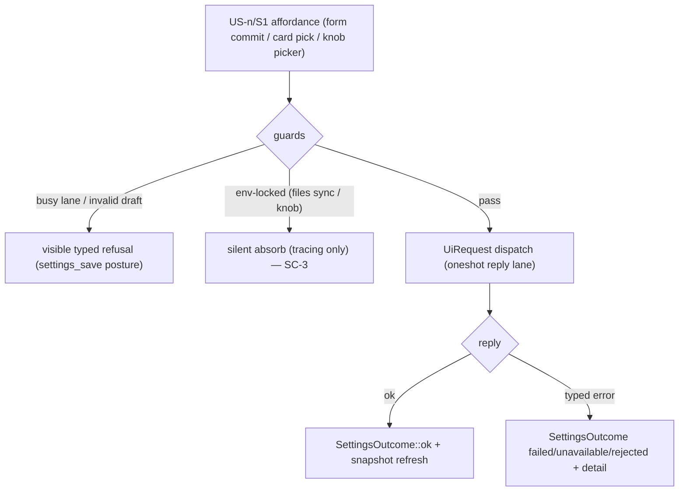

# [Plan] UX Journey Plan — Settings & connections (retrofit, registry F-9)

- **Date**: 2026-11-14
- **Kind**: UX journey plan — **retrofit** (phase 4 of the UX journey
  framework rollout): user stories, journeys, flows, wiring inventory,
  and findings describing the settings surface — accounts, Deck
  connectors, files sync, the knob family, the fact displays — **as
  implemented**. No new capability is planned; no implementation
  decisions are made. **The user's named worst offender**: the
  walkthrough questions and six-heuristic pass ran with extra care
  here (chunk-2 plan D-1); the friction found is described with seams
  cited (§10), never redesigned.
- **Origin**: the UX retrofit & triage dispatch
  `/home/viktoria/src/taskboard/.artifacts/plans/2026-11-14-ux-retrofit-triage-dispatch-plan.md`
  §1/§3 (the retrofit posture binds this plan); the stage-1 chunk plan
  `.artifacts/plans/2026-11-14-ux-retrofit-triage-chunk-plan.md` (D-1
  story set + census feed, D-2 rubric application, D-7 gate
  steady-state, D-6 commit sequencing) applying chunk-1's plan
  `.artifacts/plans/2026-11-14-ux-retrofit-core-chunk-plan.md` D-3
  (the ruling rubric) and D-4 (escape-audit method, walkthrough
  questions); the census Settings slice
  `docs/ux-surface-census.org` (baseline `84c04a0b`); the pilot
  files-roster plan `.artifacts/plans/2026-11-13-r7-files-roster-ux-plan.md`
  (the roster rows' owner — referenced, not re-walked); the live
  worktree code at `docs/ux-retrofit-triage` HEAD `0b98fe5d` (wiring
  anchors are live `file:line`; census cells keep their recorded
  baseline anchors — chunk-1 plan §5 anchor-drift law).
- **Status**: ACCEPTED (retrofit documentation authored under the
  accepted phase-4 dispatch; stage 3 reviews it against this posture).
- **Surfaces touched**: `ui/views/settings-view.slint`,
  `src/adapter.rs` (the settings seams + op fns `adapter.rs:5700-6110`),
  `src/requests.rs` (the 31-variant `UiRequest` lane),
  `src/settings_form.rs` (the form validation), `src/actions.rs`
  (`AppSettings`, GLOBAL)
- **Platform scope**: desktop (the settings view is a desktop surface;
  `AppSettings` is a GLOBAL menu verb, kiosk greys per `entry_states`)

## 1. Scope & goals

This plan documents the settings & connections UX that ships today: a
desktop user saves and removes connections (Deck connectors), lists
remote boards and attaches them, creates local boards, detaches and
publishes, toggles files sync with a re-anchor in one request, edits
the 18-variant knob family, and reads the facts and env-override
displays. Settings talks exclusively in `UiRequest`s — zero
`StateCommand`s (the census's pass-1 named finding; every request
carries a `oneshot<Result<…, SettingsError>>` reply). The per-account
board roster and its binding actions are the pilot files-roster
plan's (referenced, not re-walked). All journeys below are
**journeys-as-implemented** (chunk-2 plan D-1: P1 = the journey a
user actually completes today).

**Non-goals** (retrofit posture — nothing here is a commitment; each
hole is a finding in §10, classification and homing are the phase-5
triage's):

- No CLI write path for knobs or files sync — finding SC-1, not
  planned.
- The env-locked absorb posture — finding SC-3, described, not fixed.

## 2. Capability × surface matrix

<!-- Cells restate the census Settings slice (baseline 84c04a0b)
verbatim in content; the pilot roster rows cite the pilot plan's
rulings (R-Pattern 4), never re-argued. `U` cells are carried as `U`
or converted to `— (R-n)` per chunk-1 plan D-3 (applied mechanically
per chunk-2 plan D-2); every conversion cites this plan's rulings
table below (this plan is the ruling's authority, dated 2026-11-14).
The F-Pattern 1 CLI cells stay `U` as findings SC-1/SC-2. Cells avoid
`|`. -->

| Capability | Board | TaskDetail | Today | Review | Settings | Capture | CLI |
|---|---|---|---|---|---|---|---|
| connection.save | — (R-1) | — (R-1) | — (R-1) | — (R-1) | E (US-1) — the connections form commit `settings-view.slint:653`, seam `adapter.rs:10294-10300`, op `adapter.rs:5700` → =SaveConnection= `requests.rs:381` | — (R-1) | E (pre-existing, =connect= `cli.rs:33`; =login= `cli.rs:56` is the parser's deprecated alias) |
| connection.remove | — (R-1) | — (R-1) | — (R-1) | — (R-1) | X (US-2) — the connection card's remove `settings-view.slint:657`, seam `adapter.rs:10301-10309`, op `adapter.rs:5795` → =RemoveConnection= `requests.rs:390` | — (R-1) | E (pre-existing, =logout= `cli.rs:197`) |
| board.remote_list | — (R-1) | — (R-1) | — (R-1) | — (R-1) | E (US-3) — the connection card's refresh `settings-view.slint:658`, seam `adapter.rs:10310-10318`, op `adapter.rs:5820` → =ListRemoteBoards= `requests.rs:398` (the server's boards feed =boards select=-style binding) | — (R-1) | E (pre-existing, =boards list= `cli.rs:288`) |
| board.attach | — (R-1) | — (R-1) | — (R-1) | — (R-1) | E (US-3) — the remote-bind pick on an unbound board card `settings-view.slint:659`, seam `adapter.rs:10346-10354`, op `adapter.rs:5944` → =AttachConnector= `requests.rs:405` | — (R-1) | E (pre-existing, =boards select= `cli.rs:297`) |
| board.create_local | — (R-1) | — (R-1) | — (R-1) | — (R-1) | C (US-4) — the local-board create pick `settings-view.slint:660`, seam `adapter.rs:10319-10327`, op `adapter.rs:5984` → =CreateLocalBoard= `requests.rs:413` | — (R-1) | C (pre-existing, =boards create= `cli.rs:322`) |
| board.detach | — (R-1) | — (R-1) | — (R-1) | — (R-1) | X (US-5) — the connection card's disconnect `settings-view.slint:661`, seam `adapter.rs:10328-10336`, op `adapter.rs:6016` → =DetachConnector= `requests.rs:421` | — (R-1) | X (pre-existing, =boards unbind= `cli.rs:416`) |
| board.publish | — (R-1) | — (R-1) | — (R-1) | — (R-1) | E (US-5) — the Deck card's publish pick (round-6 D-6.9, #699) `settings-view.slint:666`, seam `adapter.rs:10355-10363`, op `adapter.rs:5853` → =PublishBoard= `requests.rs:431` | — (R-1) | E (pre-existing, =boards publish= `cli.rs:341`) |
| board.roster_display | — (R-2) | — (R-2) | — (R-2) | — (R-2) | D (US-9) — implemented (r7 chunk 3): the per-account roster — every live board once per card, channel badge + per-account sort (=files_board_roster= =presentation.rs:5616=, roster push =adapter.rs:5155=, rows =settings-view.slint:1012=, channel tag =BoardInfo.bound_channel= =ui_requests.rs:1437=; journeys =journeys.rs::us1_s1/us1_s2=) | — (R-2) | U (SC-2) |
| board.unbind_files (Stop Sync) | — (R-1) | — (R-1) | — (R-1) | — (R-1) | X (binding only) (US-2) — implemented (r7 chunk 3): the roster row's "Stop Sync" button (=settings-view.slint:671= seam, =adapter.rs:5892= handler) → =StopBoardFilesSync= =requests.rs:455= → =UnbindBoard+snapshot =ui_requests.rs:1569=; exact-effect test =ui_requests.rs::stop_board_files_sync_sends_exact_unbind_command= | — (R-1) | X (pre-existing, =boards unbind=) |
| board.move_to_files (Switch to Sync via this Connection) | — (R-1) | — (R-1) | — (R-1) | — (R-1) | E (binding) (US-3) — implemented (r7 chunk 3): the roster row's switch action dispatches =MoveBoardToFiles= verbatim; the =FilesMovePicker= dropdown, its copy global and the =move_choices= table retired (the roster is the picker); journey =journeys.rs::us3_s1= | — (R-1) | E (pre-existing, =boards move --to-files=) |
| board.publish_to_files (Sync via this Connection) | — (R-1) | — (R-1) | — (R-1) | — (R-1) | E (binding) (US-3) — implemented (r7 chunk 3): the roster row's publish action → =PublishBoardToFiles= =requests.rs:465= → the files =BindBoard= assign-step ceremony =ui_requests.rs:1610=; exact-bind test =ui_requests.rs::publish_board_to_files_sends_exact_files_bind_command= | — (R-1) | — (R-2) |
| files.sync_enabled_set | — (R-1) | — (R-1) | — (R-1) | — (R-1) | E (US-6) — the Files pick on a connector card sets sync + re-anchor in one request (a separate anchor request would force two round-trips, `requests.rs:580-588`); op =settings_files_picked= `adapter.rs:6052-6110` (request at `adapter.rs:6085`) → =SetFilesSyncEnabled= `requests.rs:584` | — (R-1) | U (SC-1) |
| settings.knob_set | — (R-1) | — (R-1) | — (R-1) | — (R-1) | E (US-7) — the grouped knob/set family, one =UiRequest= per knob: =SetKeymapPreset= `requests.rs:471` (=preset-picked= `settings-view.slint:672`), =SetScale= `requests.rs:476` (=scale-committed= `settings-view.slint:673`), =SetDayStart= `requests.rs:488`, =SetRemindersEnabled= `requests.rs:493`, =SetReminderTick= `requests.rs:499`, =SetReminderBefore= `requests.rs:506` (=reminders-picked= `settings-view.slint:689`), =SetReminderSink= `requests.rs:511` (=sink-picked= `settings-view.slint:690`), =SetPollInterval= `requests.rs:516`, =SetBackoffInitial= `requests.rs:522`, =SetBackoffMax= `requests.rs:528`, =SetDueSoonDays= `requests.rs:533`, =SetFocusEnabled= `requests.rs:542` (=focus-enabled-picked= `settings-view.slint:694`), =SetFocusWorkMins= `requests.rs:548`, =SetFocusBreakMins= `requests.rs:553`, =SetFocusChain= `requests.rs:558` (=focus-chain-picked= `settings-view.slint:695`), =SetFocusLongBreakMins= `requests.rs:563`, =SetFocusLongBreakEvery= `requests.rs:568`, =SetFocusNotify= `requests.rs:573` (=focus-notify-picked= `settings-view.slint:696`); seams `adapter.rs:10373-10480`, general fields commit `adapter.rs:10416-10434` | — (R-1) | U (SC-1) |
| app.settings | E (global) — =AppSettings= `actions.rs:698-704` (GLOBAL, menu) | E (global) — same =AppSettings= evidence | E (global) — same =AppSettings= evidence | E (global) — same =AppSettings= evidence | E — the settings view opens/back closes `settings-view.slint:643`, seam `adapter.rs:8284-8309` | E (global) — same =AppSettings= evidence | U (SC-2) |
| connection.roster_display | — (R-2) | — (R-2) | — (R-2) | — (R-2) | D (US-9) — the rendered connections items (the flat positional projection) `settings-view.slint:92-133`, mount `settings-view.slint:933` | — (R-2) | U (SC-2) |
| settings.facts_display | — (R-2) | — (R-2) | — (R-2) | — (R-2) | D (US-8) — the read-only =SettingsFact= inventory (dotted config key, secret-free value, apply/on-restart badges) `requests.rs:332-341`, struct `settings-view.slint:50-56`, facts composition `settings-view.slint:22` | — (R-2) | U (SC-2) |
| settings.env_override_display | — (R-2) | — (R-2) | — (R-2) | — (R-2) | D (US-8) — the env-override badge on each fact row (=SettingsFactRow.env-locked= `settings-view.slint:50-56`; the env-locked absorb path `adapter.rs:6070-6076`) | — (R-2) | U (SC-2) |

**Rulings** (conversions of census `U` cells; every converted cell
above cites one of these; this table is the ruling's authority,
2026-11-14, per chunk-1 plan D-3 applied by chunk-2 plan D-2):

| ID | Ruling | Reason | Home |
|---|---|---|---|
| R-1 | the connection/board-management and knob verbs (connection.save / connection.remove / board.remote_list / board.attach / board.create_local / board.detach / board.publish / files.sync_enabled_set / settings.knob_set) have no mounts outside the settings view | R-Pattern 2 (entity-mount grammar): the connections form and the connector/board cards render only in the settings view (`settings-view.slint`; the census register's Sweep-B/T/Y/R/C evidence "no seam outside the settings view" per row) — no other surface renders the connection or knob entities at all, so no other mount is grammatically possible. The CLI cells of files.sync_enabled_set / settings.knob_set stay `U` as finding SC-1. | this plan §2; census Settings slice register |
| R-2 | the Settings displays (board.roster_display / connection.roster_display / settings.facts_display / settings.env_override_display) render only in the settings view | R-Pattern 3 (display-scoping): the rosters/facts/env badges echo the settings-view's own data (`settings-view.slint:92-133,1012`; the census register's per-row sweep evidence) — surfaces that render no connections or facts have nothing for them to echo. The CLI cells stay `U` as finding SC-2. | this plan §2; census Settings slice register |

(The pilot files-roster rulings R-1..R-5 and PC-10/PC-11 stand
untouched under R-Pattern 4; the pilot rows above cite them, never
re-argue them.)

## 3. User stories

### US-1 — Save a connection

- **Story**: As a desktop user I want to save a Deck connector
  (server + credentials) in the settings form so that the app can
  talk to my Nextcloud.
- **Platforms**: desktop.
- **Entry points**: the connections form commit
  (`settings-view.slint:653`, seam `adapter.rs:10294-10300`); CLI
  `connect` (pre-existing twin).
- **Priority**: P1
- **Acceptance**:
  - AC-1: Given a valid draft, When the form commits, Then
    `UiRequest::SaveConnection` dispatches with a
    `oneshot<Result<ConnectionsSnapshot, SettingsError>>` reply lane
    (`requests.rs:381`, op `adapter.rs:5700`).
  - AC-2: Given an invalid draft or a busy lane, When the form
    commits, Then a *visible* typed refusal renders — never a silent
    absorb (`adapter.rs:5707-5716` "every click reacts … never a
    silent absorb"; the chunk-5 mapping renders the exact reason
    sentence).

### US-2 — Remove a connection / stop files sync

- **Story**: As a desktop user I want to remove a connection (and
  stop a board's files sync from its roster row) so that stale
  accounts and bindings disappear.
- **Platforms**: desktop.
- **Entry points**: the connection card's remove
  (`settings-view.slint:657`); the roster row's "Stop Sync" (the
  pilot plan's US-2 journey — referenced).
- **Priority**: P1
- **Acceptance**:
  - AC-1: Given a connection card, When remove fires, Then
    `UiRequest::RemoveConnection` dispatches (`requests.rs:390`, op
    `adapter.rs:5795`).
  - AC-2: Given a bound roster row, When "Stop Sync" fires, Then
    `StopBoardFilesSync` → `UnbindBoard` + snapshot (the pilot's
    exact-effect test
    `ui_requests.rs::stop_board_files_sync_sends_exact_unbind_command`).

### US-3 — List remote boards / attach / switch / publish-to-files

- **Story**: As a desktop user I want to refresh a connection's
  remote boards, attach an unbound board to a connector, switch a
  board's sync to a connection, or publish it to files — from the
  roster and connector cards.
- **Platforms**: desktop.
- **Entry points**: the connection card's refresh
  (`settings-view.slint:658`); the remote-bind pick (`:659`); the
  roster row's switch/publish actions (the pilot's US-3/US-4
  journeys — referenced).
- **Priority**: P1
- **Acceptance**:
  - AC-1: Given a connection card, When refresh fires, Then
    `ListRemoteBoards` dispatches and the server's boards feed
    binds `boards select`-style (`requests.rs:398`, op
    `adapter.rs:5820`).
  - AC-2: Given an unbound board card, When the remote-bind pick
    fires, Then `AttachConnector` dispatches (`requests.rs:405`, op
    `adapter.rs:5944`).

### US-4 — Create a local board

- **Story**: As a desktop user I want to create a local (unbound)
  board from settings so that a workspace exists without a server.
- **Platforms**: desktop.
- **Entry points**: the local-board create pick
  (`settings-view.slint:660`) — no `ActionId` (the census records
  it); CLI `boards create` (pre-existing twin).
- **Priority**: P1
- **Acceptance**:
  - AC-1: Given the create pick, When it fires, Then
    `UiRequest::CreateLocalBoard` dispatches (`requests.rs:413`, op
    `adapter.rs:5984`).

### US-5 — Detach / publish

- **Story**: As a desktop user I want to disconnect a connector and
  publish a board to Deck so that bindings match reality.
- **Platforms**: desktop.
- **Entry points**: the connection card's disconnect
  (`settings-view.slint:661`); the Deck card's publish pick
  (`settings-view.slint:666`, round-6 D-6.9 #699); CLI
  `boards unbind` / `boards publish` (pre-existing twins).
- **Priority**: P1
- **Acceptance**:
  - AC-1: Given a connection card, When disconnect fires, Then
    `DetachConnector` dispatches (`requests.rs:421`, op
    `adapter.rs:6016`).
  - AC-2: Given a Deck card, When publish fires, Then `PublishBoard`
    dispatches (`requests.rs:431`, op `adapter.rs:5853`).

### US-6 — Toggle files sync

- **Story**: As a desktop user I want the Files pick on a connector
  card to set files sync and re-anchor in one request so that the
  enable does not force two round-trips.
- **Platforms**: desktop.
- **Entry points**: the Files pick on a connector card
  (`settings_files_picked`, `adapter.rs:6052-6110`).
- **Priority**: P1
- **Acceptance**:
  - AC-1: Given a connector card, When the Files pick fires, Then
    `SetFilesSyncEnabled` dispatches with the anchor in the same
    request (`requests.rs:580-588`, request at `adapter.rs:6085`).
  - AC-2: Given an env-locked `files_sync.enabled`/`files_sync.anchor`
    fact, When the Files pick fires, Then the edit is **absorbed
    silently** (`adapter.rs:6068-6075`, the env-locked absorb path) —
    finding SC-3's evidence.

### US-7 — Edit knobs

- **Story**: As a desktop user I want to edit the app's knobs
  (keymap preset, scale, day start, reminders ×4, poll/backoff ×3,
  due-soon, focus ×7) from the settings view so that the app behaves
  the way I work.
- **Platforms**: desktop.
- **Entry points**: the picker seams (`preset-picked`,
  `scale-committed`, `reminders-picked`, `sink-picked`,
  `focus-enabled-picked`, `focus-chain-picked`, `focus-notify-picked`
  — `settings-view.slint:672-696`) and the general fields commit
  (`adapter.rs:10416-10434`); CLI: none (SC-1).
- **Priority**: P1
- **Acceptance**:
  - AC-1: Given a knob edit, When the picker or field commits, Then
    the exact `Set*` `UiRequest` dispatches with its
    `oneshot<Result<…, SettingsError>>` reply (the 18 variants named
    in the census cell, `requests.rs:471-573`).
  - AC-2: Given a failing knob request, When the reply lands, Then
    the typed `SettingsOutcome` renders (ok/busy/failed/unavailable/
    rejected with the error detail — `adapter.rs:4326-4353`,
    `settings-view.slint:293-299,757`).

### US-8 — Facts & env-override display

- **Story**: As a desktop user I want to read the resolved settings
  facts (with apply/on-restart badges) and see which knobs are
  env-locked so that I know what the config file overrode.
  (Display-only story.)
- **Platforms**: desktop.
- **Entry points**: the facts composition
  (`settings-view.slint:22,50-56`); the env-locked badge
  (`SettingsFactRow.env-locked`; the absorb path
  `adapter.rs:6070-6076`).
- **Priority**: P1 (D-verb display)
- **Acceptance**:
  - AC-1: Given a snapshot, When the facts render, Then each fact
    row shows the dotted key, secret-free value, and its
    apply/on-restart badge (`requests.rs:332-341`).

### US-9 — Connection / board rosters

- **Story**: As a desktop user I want to see the connection roster
  and the per-account board roster (the pilot's US-1) so that
  accounts and bindings are visible. (Display-only story.)
- **Platforms**: desktop.
- **Entry points**: the connections items
  (`settings-view.slint:92-133,933`); the per-account roster
  (`files_board_roster` `presentation.rs:5616`, rows
  `settings-view.slint:1012` — the pilot plan's journeys
  `journeys.rs::us1_s1/us1_s2`).
- **Priority**: P1 (D-verb display)
- **Acceptance**:
  - AC-1: Given accounts, When the view renders, Then every live
    board appears once per card with the channel badge and
    per-account sort (the pilot's roster law).

## 4. Journey specs

### US-1 — Save a connection

| Step | Surface & affordance | User action | Dispatches | System response | Escape / failure |
|---|---|---|---|---|---|
| US-1/S1 | settings view connections form (`settings-view.slint:653`) | fill server/username/password, commit | the form seam (`adapter.rs:10294-10300`) → `settings_save` (`adapter.rs:5700-5720`) | the request arms; the status line shows busy (`SettingsOutcome::busy`, `settings-view.slint:293-299`) | a busy lane or an invalid draft is a *visible* typed refusal (`adapter.rs:5707-5716` — the "never a silent absorb" doctrine); the form stays editable |
| US-1/S2 | settings view status line | — (await the reply) | `UiRequest::SaveConnection` (`requests.rs:381`) over the oneshot lane | the connections snapshot refreshes; `SettingsOutcome::ok` renders | a failed reply renders the typed outcome with the error detail (`adapter.rs:4326-4353`; `settings-view.slint:757`) |

### US-2 — Remove a connection / stop files sync

| Step | Surface & affordance | User action | Dispatches | System response | Escape / failure |
|---|---|---|---|---|---|
| US-2/S1 | connection card | click remove | the remove seam (`adapter.rs:10301-10309`) → op `adapter.rs:5795` → `UiRequest::RemoveConnection` (`requests.rs:390`) | the connection leaves the roster (snapshot refresh) | the removal is the deliberate end (no undo — the request lane is outside the journal); the typed outcome renders on failure |
| US-2/S2 | roster row ("Stop Sync" — the pilot's journey) | click Stop Sync | `StopBoardFilesSync` (`requests.rs:455`) → `UnbindBoard` + snapshot | the binding clears; the remote subtree lingers (the pilot's R-4 posture) | the pilot's exact-effect test binds the behavior; referenced, not re-walked |

### US-3 — List remote boards / attach / switch / publish-to-files

| Step | Surface & affordance | User action | Dispatches | System response | Escape / failure |
|---|---|---|---|---|---|
| US-3/S1 | connection card | click refresh | `ListRemoteBoards` (`requests.rs:398`, op `adapter.rs:5820`) | the remote boards feed binds select-style | a failed reply renders the typed outcome (sync-timeout maps `Unavailable`, `adapter.rs:4341`) |
| US-3/S2 | unbound board card | pick the remote bind | `AttachConnector` (`requests.rs:405`, op `adapter.rs:5944`) | the board attaches to the connector | the pick is the commit (no armed stage — SC-5's evidence) |
| US-3/S3 | roster row (the pilot's journeys) | switch / publish-to-files | `MoveBoardToFiles` / `PublishBoardToFiles` (`requests.rs:465` + the assign-step ceremony) | the board's channel moves | the pilot's R-5 posture records the Deck-to-Deck scope; referenced, not re-walked |

### US-4 — Create a local board

| Step | Surface & affordance | User action | Dispatches | System response | Escape / failure |
|---|---|---|---|---|---|
| US-4/S1 | settings view | pick local-board create | `CreateLocalBoard` (`requests.rs:413`, op `adapter.rs:5984`) | the local board appears (board-bar segment, the Board surface's display) | the pick is the commit — no name field at the pick (SC-5's evidence: the Board surface's create field is the named create) |

### US-5 — Detach / publish

| Step | Surface & affordance | User action | Dispatches | System response | Escape / failure |
|---|---|---|---|---|---|
| US-5/S1 | connection card | click disconnect | `DetachConnector` (`requests.rs:421`, op `adapter.rs:6016`) | the connector detaches | deliberate end; typed outcome on failure |
| US-5/S2 | Deck card | pick publish | `PublishBoard` (`requests.rs:431`, op `adapter.rs:5853`) | the board publishes to Deck | deliberate end; typed outcome on failure |

### US-6 — Toggle files sync

| Step | Surface & affordance | User action | Dispatches | System response | Escape / failure |
|---|---|---|---|---|---|
| US-6/S1 | connector card Files pick | pick Files | `settings_files_picked` (`adapter.rs:6052-6110`) → `SetFilesSyncEnabled` (`requests.rs:584`) with the anchor in one request | sync enables and re-anchors | **an env-locked pick is absorbed silently** (`adapter.rs:6068-6075` — no outcome render; SC-3's evidence); otherwise the typed outcome renders |
| US-6/S2 | connector card Files pick (off) | pick to disable | the same seam | sync disables | same posture |

### US-7 — Edit knobs

| Step | Surface & affordance | User action | Dispatches | System response | Escape / failure |
|---|---|---|---|---|---|
| US-7/S1 | settings view knob pickers (`settings-view.slint:672-696`) | pick a knob value | the picker seam → the exact `Set*` request (`requests.rs:471-573`, 18 variants) | the knob applies; the typed outcome renders (ok / busy / failed / unavailable / rejected, `adapter.rs:4326-4353`) | a failing reply renders the typed outcome with detail; **an env-locked knob edit absorbs silently** (the `env_locked` absorb paths — SC-3); **on-restart knobs apply later** (the facts row's badge says so — SC-4's evidence) |
| US-7/S2 | settings view general fields | edit and commit | the general fields commit (`adapter.rs:10416-10434`) | the fields' requests dispatch | the same typed-outcome posture |

### US-8 — Facts & env-override display

| Step | Surface & affordance | User action | Dispatches | System response | Escape / failure |
|---|---|---|---|---|---|
| US-8/S1 | facts composition (`settings-view.slint:22,50-56`) | — display only | — display only | each fact row shows key, secret-free value, apply/on-restart badge, and the env-locked badge where overridden | display only — no dispatch, no escape |

### US-9 — Connection / board rosters

| Step | Surface & affordance | User action | Dispatches | System response | Escape / failure |
|---|---|---|---|---|---|
| US-9/S1 | connections items / roster rows | — display only | — display only | the rosters render (the flat positional projection; the per-account roster with channel badges) | display only — no dispatch, no escape; the roster rows' actions are US-2/US-3's journeys |

## 5. Interaction flows

The settings request ceremony (every journey rides this shape):

## 6. Wiring inventory

<!-- Rows document EXISTING affordances (retrofit): every callback and
request below is live at the worktree HEAD 0b98fe5d. Rows carry the
callback in the Adapter-seam column with the Callback cell `—`; the
Commands column carries the request-lane tokens the gate checks. -->

| ID | Surface file | Widget | Callback | Adapter seam | ActionId | Commands | Row addressing | Journey steps | Test |
|---|---|---|---|---|---|---|---|---|---|
| W-1 | ui/views/settings-view.slint (form 653) | connections form commit | — | on_settings_form_committed (adapter.rs:10294-10300); op settings_save (adapter.rs:5700-5720) | — | UiRequest::SaveConnection | the connections lane (one pending at a time) | US-1/S1-US-1/S2 | — |
| W-2 | ui/views/settings-view.slint (cards 657-666) | connection card actions (remove / refresh / attach / create-local / detach / publish) | — | on_settings_remove_connection (adapter.rs:10301-10309); op settings_remote_boards (adapter.rs:5820); op settings_remote_bind (adapter.rs:5944); op settings_create_local_board (adapter.rs:5984); op settings_detach (adapter.rs:6016); op settings_publish (adapter.rs:5853) | — | UiRequest::RemoveConnection; UiRequest::ListRemoteBoards; UiRequest::AttachConnector; UiRequest::CreateLocalBoard; UiRequest::DetachConnector; UiRequest::PublishBoard | the connection card's account target | US-2/S1, US-3/S1-US-3/S2, US-4/S1, US-5/S1-US-5/S2 | — |
| W-3 | ui/views/settings-view.slint (roster rows, the pilot's journeys) | roster row actions (Stop Sync / switch / publish-to-files) | — | on_settings_files_board_action_clicked (adapter.rs); op handlers adapter.rs:5892+ | — | UiRequest::StopBoardFilesSync; UiRequest::MoveBoardToFiles; UiRequest::PublishBoardToFiles | the roster row's board target | US-2/S2, US-3/S3 | ui_requests.rs::stop_board_files_sync_sends_exact_unbind_command; ui_requests.rs::publish_board_to_files_sends_exact_files_bind_command |
| W-4 | ui/views/settings-view.slint (connector card) | Files pick (sync enable + re-anchor) | — | op settings_files_picked (adapter.rs:6052-6110, request at 6085) | — | UiRequest::SetFilesSyncEnabled | the connector card's account target | US-6/S1-US-6/S2 | — |
| W-5 | ui/views/settings-view.slint (pickers 672-696 + general fields) | knob pickers and fields | — | on_settings_preset_picked family (adapter.rs:10373-10480); general fields commit (adapter.rs:10416-10434) | — | UiRequest::SetKeymapPreset; UiRequest::SetScale; UiRequest::SetDayStart; UiRequest::SetRemindersEnabled; UiRequest::SetReminderTick; UiRequest::SetReminderBefore; UiRequest::SetReminderSink; UiRequest::SetPollInterval; UiRequest::SetBackoffInitial; UiRequest::SetBackoffMax; UiRequest::SetDueSoonDays; UiRequest::SetFocusEnabled; UiRequest::SetFocusWorkMins; UiRequest::SetFocusBreakMins; UiRequest::SetFocusChain; UiRequest::SetFocusLongBreakMins; UiRequest::SetFocusLongBreakEvery; UiRequest::SetFocusNotify | the knob's request variant | US-7/S1-US-7/S2 | — |
| W-6 | ui/views/settings-view.slint (facts 22,50-56) | facts + env-override display | — | — (display only; the snapshot push) | — | — | per-fact render | US-8/S1 | — |
| W-7 | ui/views/settings-view.slint (rosters 92-133,1012) | connections + board rosters | — | — (display only; roster push adapter.rs:5155) | — | — | per-card render | US-9/S1 | journeys.rs::us1_s1; journeys.rs::us1_s2 |
| W-8 | ui/app-window.slint / menu | settings opener (AppSettings GLOBAL; back closes 643) | — | on_menu_settings / the open seam (adapter.rs:8284-8309) | ActionId::AppSettings | — | — (view-level) | — (US-1..US-9's entry) | — |

## 7. Command-contract delta

**None — retrofit** (the contract already exists). The settings
surface talks exclusively in `UiRequest`s (the census's pass-1 named
finding); the table lists the request variants the journeys dispatch,
for greppability (chunk-2 plan D-1):

| Kind | Name | Payload sketch | Journeys |
|---|---|---|---|
| UiRequest | SaveConnection | exists (`requests.rs:381`) — oneshot `Result<ConnectionsSnapshot, SettingsError>` | US-1 |
| UiRequest | RemoveConnection / DetachConnector / AttachConnector | exist (`requests.rs:390,421,405`) | US-2, US-3, US-5 |
| UiRequest | ListRemoteBoards | exists (`requests.rs:398`) | US-3 |
| UiRequest | CreateLocalBoard | exists (`requests.rs:413`) | US-4 |
| UiRequest | PublishBoard / PublishBoardToFiles / MoveBoardToFiles / StopBoardFilesSync | exist (`requests.rs:431,465,455`) — the pilot rows' verbs | US-2, US-3, US-5 |
| UiRequest | SetFilesSyncEnabled | exists (`requests.rs:584`) — sync + re-anchor in one request | US-6 |
| UiRequest | Set* (18 knob variants) | exist (`requests.rs:471-573`) — the grouped `settings.knob_set` row | US-7 |
| ActionId | AppSettings | exists (`actions.rs:698-704`) — GLOBAL menu opener | US-1..US-9's entry |

## 8. Verification plan

- **Journey tests (step-ID-named)**: none exist for this plan's
  journeys — the retrofitted journeys predate the framework's
  step-token test law (chunk-2 plan D-7; backlog #768). The pilot
  roster journeys (`journeys.rs::us1_s1/us1_s2/us3_s1`) exist and are
  cited via the pilot rows.
- **Seam tests (existing, cited per row)**: the pilot's
  exact-effect tests (`ui_requests.rs::stop_board_files_sync_sends_exact_unbind_command`,
  `ui_requests.rs::publish_board_to_files_sends_exact_files_bind_command`);
  the settings_save visible-refusal posture (`adapter.rs:5700-5720`).
- **Fold/presentation tests (existing)**: the `SettingsOutcome`
  mapping (`adapter.rs:4326-4353` — every `SettingsError` variant
  maps to a typed outcome), the roster presentation
  (`presentation.rs::files_board_roster`).
- **Kiosk gates**: the settings view is desktop-mounted; `AppSettings`
  is a GLOBAL menu verb (kiosk greys per `entry_states` — the
  census's review.open evidence posture). The kiosk posture is
  recorded, not judged.
- **Manual**: the apply/on-restart badge semantics and the env-locked
  badge's recognition are judged, not text-asserted; the stage-3
  walkthrough covers them.

## 9. Definition of done (retrofit)

- [x] Wiring inventory: every row FOUND under
  `scripts/ux-coverage.sh` (per-plan gate outcome recorded in the
  stage-2 report — chunk-2 plan D-7)
- [x] Journeys-as-implemented complete end-to-end with the escape
  audit per step; the silent env-locked absorb (US-6/S1) and the CLI
  write-path absence recorded as findings SC-3/SC-1, not fixed
  (retrofit posture)
- [x] Census Settings-slice `U` conversions carry R-1/R-2 and cite
  this plan (rulings table §2, dated 2026-11-14); the pilot rulings
  stand untouched
- [ ] Stage-3 walkthrough protocol executed; findings classified by
  the phase-5 triage (this plan records, never fixes)
- [x] Non-goals: none planned — all holes are findings (§10)

## 10. Findings (retrofit — descriptive only; no redesign proposed)

The user named this surface the worst offender; the walkthrough
questions (framework §4.4's four) and the six-heuristic pass ran with
extra care. The friction found is described with seams cited; the
classification is the triage's.

- **SC-1 — settings have no CLI write path at all** (F-Pattern 1
  evidence note, GUI-only mutation). `settings.knob_set` (18 request
  variants) and `files.sync_enabled_set` have no CLI twin — the
  `config` family is read-only (`config print` `cli.rs:1518` /
  `config path` `cli.rs:1522`; the census register's Sweep-CLI
  evidence), and the config file is the only non-GUI path. The
  mirror image of the label/break-rule families (CLI-only mutation):
  here the *mutation* is GUI-only. Every knob edit and every sync
  toggle requires the desktop settings view; a headless/CLI-only
  workflow must hand-edit the config file. The CLI cells stay `U`.
- **SC-2 — the Settings displays and the settings opener have no CLI
  twins** (F-Pattern 4, vacuous CLI display absences). `app.settings`,
  `connection.roster_display`, `settings.facts_display`,
  `settings.env_override_display`, `board.roster_display` have no
  CLI verbs; `config print` prints the resolved config, not the
  app-stated apply/env facts (the census register's per-row
  evidence). The CLI cells stay `U`.
- **SC-3 — the env-locked absorb is silent, inside a surface whose
  doctrine is "never a silent absorb"** (feedback-absent after
  dispatch; the user's G4 friction has its real instance here). The
  `settings_save` posture commits to "every click reacts … a refused
  click is a *visible* typed refusal — never a silent absorb"
  (`adapter.rs:5707-5712`), but the files-sync pick and the knob
  edits check `env_overridden` and absorb silently on an env-locked
  value (`adapter.rs:6068-6075` for the sync pick; the
  `EnvLocked` variant maps to `Rejected` in the *reply* path
  `adapter.rs:4335` — the request-lane refusal is typed, the
  pre-dispatch absorb is not). A user who edits an env-locked knob
  gets no outcome render at all — the control gives no feedback, the
  only signal is the fact row's env-locked badge, which the user
  must find and interpret (walkthrough Q3 fails: the feedback
  doesn't follow the system-response column). Contrast within the
  same surface: the same user, same view, one click visible-refuses,
  the other silently does nothing.
- **SC-4 — the apply/on-restart semantics live only in the facts
  badge** (recognition-over-recall). Knob edits whose effects apply
  on restart render `SettingsOutcome::ok` at edit time
  (`adapter.rs:4326-4353`); the deferred-application fact is
  communicated only by the facts row's badge (`requests.rs:332-341`,
  `settings-view.slint:50-56`), which lives in a different section
  of the view than the knob the user just edited. Walkthrough Q3:
  the "ok" outcome and the actual effect time can disagree without
  the knob's own feedback saying so.
- **SC-5 — board creation/binding is split across two surfaces with
  different affordance shapes** (consistency & standards). The Board
  surface's create field names a board (`adapter.rs:8220-8226`, the
  board-stack plan's US-1); the settings view's local-board create
  pick mints one with no name field at the pick
  (`settings-view.slint:660`, `CreateLocalBoard` has no `ActionId`);
  remote attach is a pick on an unbound card (`:659`) with no armed
  stage. The same create verb appears as a typed field in one surface
  and an immediate pick in another — the pick-as-commit shape gives
  no preview and no undo stage (walkthrough Q2/Q4 observations; the
  request lane is outside the journal, so `AppUndo` does not cover
  the settings journeys).
- **SC-6 — the settings journeys have no undo anywhere** (user
  control & freedom). The `UiRequest` lane is outside the undo
  journal (the census's two-lanes finding; `adapter.rs:4117-4129`
  the oneshot reply lanes) — connection save/remove, attach/detach,
  publish, files-sync toggles, and knob edits are all
  un-undoable from the GUI. The escape audit's mechanism (a)
  (global undo) fails for every P1 step of this plan; the typed
  refusal + typed outcome is the only guard, and it guards only
  *pre-dispatch* and *reply-time* failures — not regret after a
  successful apply. Contrast: the Board surface's stack/board
  creates are journal PreImages (`undo.rs:155-156`).
- **SC-7 — the connections form is single-pending** (visibility of
  system status). The lane carries one pending request at a time
  (`adapter.rs:4244`; the busy-lane refusal `adapter.rs:5707-5712`),
  so a second affordance click during an in-flight request
  visible-refuses rather than queueing. The status line shows busy
  (`settings-view.slint:293-299`), but the refusal's reason ("a
  request is already pending") is the generic rejected outcome
  (`SettingsOutcome::Rejected` with `None` detail,
  `adapter.rs:5708-5710`) — the user is not told why (walkthrough
  Q3: the refusal's detail is empty for the busy case).
- **SC-8 — the settings view's back affordance is the only exit
  affordance** (user control & freedom, recorded posture). The view
  opens/back closes (`settings-view.slint:643`, seam
  `adapter.rs:8284-8309`); the census records no preset binding for
  the back seam — an in-flight request when the user leaves is
  resolved by the reply lane's drop guard, not by the user (recorded
  posture; no data loss — the requests are idempotent snapshots).
- **W-N1 — walkthrough note (US-1, the deprecated alias)**: `login`
  (`cli.rs:56`) is the parser's deprecated alias for `connect` — the
  CLI twin carries a second name the census records as deprecated
  (naming-consistency evidence note for the triage).
- **W-N2 — walkthrough note (US-7, the knob family's breadth)**: the
  18-variant knob family is grouped under one census capability (the
  stock-take's load-bearing grouping) — the walkthrough treats it as
  18 affordances sharing one picker grammar; the pickers' seam names
  are consistent (`*-picked`, `settings-view.slint:672-696`), a
  consistency positive.
- **W-N3 — walkthrough note (US-3/US-6, the single-request
  re-anchor)**: the Files pick sets sync + re-anchor in one request
  ("a separate anchor request would force two round-trips",
  `requests.rs:580-588`) — a recorded design rationale living in the
  request payload docs, not surfaced in the UI (recognition
  question).
- **W-N4 — walkthrough note (US-9, the roster's honest captions)**:
  non-anchor accounts show disabled actions with honest captions, not
  lanes (the pilot's R-3 ruling, #723) — a recognition-over-recall
  positive worth keeping as the bar (the same posture the task-editing
  plan's W-N3 records for the clear affordance).
- **W-N5 — walkthrough note (US-2, removal without confirmation)**:
  connection remove, detach, and Stop Sync are click-committed with
  no confirmation stage (the seams are direct, `adapter.rs:10301-10309`,
  `adapter.rs:5892`); the request lane is outside the journal, so
  there is no undo after the fact. The audit's escape mechanisms
  (a)-(d) all fail for these steps; whether the loss class warrants
  B-b is the triage's call (the connections are re-creatable; the
  bindings are re-bindable — recorded, not judged).

## 11. Plan corrections

- None required — the stage-2 `scripts/ux-coverage.sh` run
  (2026-11-14) returned checks: 67, FOUND: 46, MISSING: 21; every
  wiring row (including the 18-variant knob token set), no-commands
  reason, and ruling is FOUND; the 21 MISSING rows are the documented
  retrofit limitation (chunk-2 plan D-7; backlog #768; the chunk-1
  plans' PC-2 precedent): the journey-step token rows and their
  story-coverage cascade (the matrix cells citing US-3..US-9 whose
  step tokens have no step-ID tests; the pilot's own journey tests
  resolve for the rows they cover). No wiring row MISSING, no plan
  defect surfaced.
