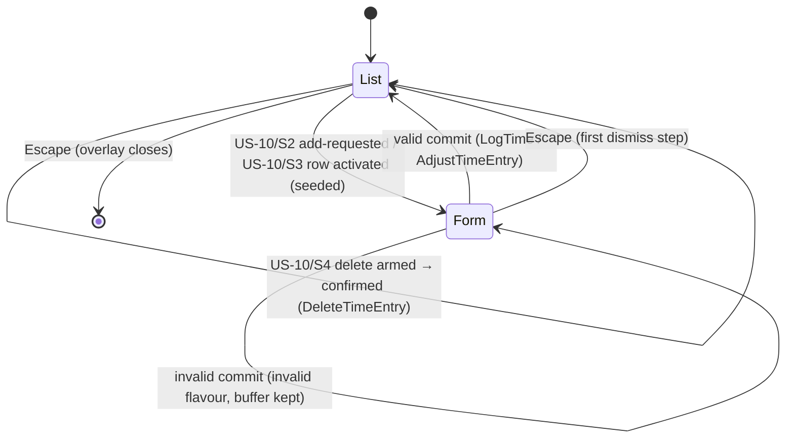

# [Plan] UX Journey Plan — Task editing (retrofit, registry F-3)

- **Date**: 2026-11-14
- **Kind**: UX journey plan — **retrofit** (phase 4 of the UX journey
  framework rollout): user stories, journeys, flows, wiring inventory,
  and findings describing task editing in the detail view **as
  implemented**. No new capability is planned; no implementation
  decisions are made.
- **Origin**: the UX retrofit & triage dispatch
  `/home/viktoria/src/taskboard/.artifacts/plans/2026-11-14-ux-retrofit-triage-dispatch-plan.md`
  §1/§2 (the retrofit posture binds this plan); the chunk plan
  `.artifacts/plans/2026-11-14-ux-retrofit-core-chunk-plan.md` (registry
  row F-3 incl. D-2.4's importance/urgency handling, rubric D-3, gate
  rule D-5, commit sequencing D-6); the census Task detail slice
  (baseline `dc290df2`; the recur rows of that slice are the pilot
  recur-editor plan's — referenced, never re-journeyed); the live
  worktree code (wiring anchors live; census cells keep their baseline
  anchors).
- **Status**: ACCEPTED (retrofit documentation under the accepted
  phase-4 dispatch; stage 3 reviews it against this posture).
- **Surfaces touched**: `ui/views/task-view.slint`,
  `ui/compositions/due-editor.slint`, `ui/compositions/rule-list.slint`,
  `ui/compositions/track-entries.slint`,
  `ui/compositions/status-bar.slint`, `ui/widgets/task-card.slint`,
  `ui/app-window.slint`, `src/adapter.rs` (detail seams), `src/due_edit.rs`,
  `src/actions.rs`, `src/router.rs`, `src/view_state.rs`,
  `keymap/presets.rs`
- **Platform scope**: desktop (the detail view is a desktop surface;
  the recur-editor pilot records the desktop-only editor posture
  R-2 there)

## 1. Scope & goals

This plan documents the task-editing UX that ships today: a user edits
title and description, sets and clears due and scheduled dates
(field + calendar picker), navigates back, manages reminder rules
(preset/custom add, remove, unmute, jump-to-due), mutes and snoozes
reminders from the banner, starts/stops time tracking (detail chips,
status-bar chip, menu verbs), logs/adjusts/deletes time entries in the
track-entries overlay, and reads the tracked totals and rosters. The
label family and the importance/urgency writes are CLI-only (findings
TE-4/TE-5). All journeys are **journeys-as-implemented** (chunk plan
D-4). The recurrence family of the same slice (recur set/clear/
pause/convert) is the pilot recur-editor plan's territory and is
referenced, not duplicated.

**Non-goals** (retrofit posture — holes are findings in §10; the
phase-5 triage classifies and homes them):

- No GUI label family (TE-4), no GUI importance/urgency writes (TE-5,
  census hole #781) — described, not planned.
- No inline card editing on board/today (TE-1) — described, not
  planned.

## 2. Capability × surface matrix

<!-- Rows restate the census Task detail slice (baseline dc290df2)
verbatim in content, minus the pilot recur rows; `U` cells are carried
as `U` or converted to `— (R-n)` per the chunk plan's rubric D-3;
conversions cite the rulings table below (this plan is the ruling's
authority, 2026-11-14). Cells avoid `|`. -->

| Capability | Board | TaskDetail | Today | Review | Settings | Capture | CLI |
|---|---|---|---|---|---|---|---|
| task.back | — (R-1) | E (US-5) — detail back affordance `adapter.rs:8260` (live: the header back button `task-view.slint:278-279` routing `NavFocusBoard`, `adapter.rs:8297-8300`) | — (R-1) | — (R-1) | — (R-1) | — (R-1) | U |
| task.title_edit | — (R-2) | E (US-1) — title edit seams `adapter.rs:8594-8603` (→ `UpdateTask` `messages.rs:44`; live: `adapter.rs:8632-8643`); `TaskTitleEdit` `actions.rs:1046-1048`, F2 `presets.rs:190` | — (R-2) | — (R-2) | — (R-2) | — (R-2) | E (pre-existing, `tasks edit` --title `cli.rs:1670`, TaskEditFlags `cli.rs:1586-1624`) |
| task.description_edit | U (TE-1) | E (US-2) — body editor open/commit `adapter.rs:8614-8630` (live: `adapter.rs:8652-8671`) | U (TE-1) | — (R-3) | — (R-3) | — (R-3) | E (pre-existing, `tasks edit` --description `cli.rs:1670`) |
| task.due_edit | U (TE-1) | E (US-3) — due editor open/accept `adapter.rs:8719-8774`, date-picker seams `adapter.rs:8783-8932`, editor `due-editor.slint:26-104`; `PickerCommit` `actions.rs:1797-1799` | U (TE-1) | — (R-4) | — (R-4) | — (R-4) | E (pre-existing, `tasks edit` --due `cli.rs:1670`) |
| task.scheduled_edit | U (TE-1) | E — scheduled editor open `adapter.rs:8741` (live: `adapter.rs:8779-8781`; shares the due-editor composition) | U (TE-1) | E — the walk's carry date commit → `UpdateTask` (the review-walk plan of chunk 2 owns this cell's journey) | — (R-5) | — (R-5) | E (pre-existing, `tasks edit` --scheduled `cli.rs:1670`) |
| task.reminder_rules_edit | — (R-6) | E (US-6) — rule rows, preset and offset affordances `task-view.slint:731-735` + `rule-list.slint`; seams `adapter.rs:8636` (remove row), `adapter.rs:8728` (jump to due); `ReminderRuleAdd`/`ReminderRuleRemove` `actions.rs:1147-1159` (→ `AddReminderRule`/`RemoveReminderRule` `messages.rs:249,271`) | — (R-6) | — (R-6) | — (R-6) | — (R-6) | E (pre-existing, `tasks remind` `cli.rs:1701`) |
| task.reminders_mute | U (TE-2) | E (US-7) — banner mute `adapter.rs:9272`, rule unmute `adapter.rs:8736`; `ReminderMute`/`ReminderUnmute` `actions.rs:1127-1139` (→ `SetTaskRemindersMuted` `messages.rs:217`) | U (TE-2) | U (TE-2) | U (TE-2) | U (TE-2) | E (pre-existing, `tasks remind` --mute `cli.rs:1734`) |
| task.reminder_snooze | U (TE-2) | E (US-8) — overdue-banner snooze `adapter.rs:9263`; `ReminderSnooze` `actions.rs:1117-1119` (→ `SnoozeReminder` `messages.rs:207`) | U (TE-2) | U (TE-2) | U (TE-2) | U (TE-2) | U |
| task.track_start | U (TE-3) | E (US-9) — track chip `adapter.rs:9567`; `TaskTrackStart` `actions.rs:1193-1195` (GLOBAL) | E (US-9) — `TaskTrackStart` `actions.rs:1193-1195` (GLOBAL) | — (R-7) | — (R-7) | — (R-7) | E (pre-existing, `track start` `cli.rs:1149`) |
| task.track_stop | U (TE-3) | E (US-9) — track chip `adapter.rs:9572`; `TaskTrackStop` `actions.rs:1203-1205` | E (US-9) — status-bar tracking chip `status-bar.slint:77-83`, stop seam `adapter.rs:9562` | — (R-8) | — (R-8) | — (R-8) | E (pre-existing, `track stop` `cli.rs:1159`) |
| task.track_entry_log | — (R-9) | E (US-10) — track form add/commit `adapter.rs:9636,9913`; `TaskTrackEntryLog` `actions.rs:1241-1243` (→ `LogTime` `messages.rs:373`) | — (R-9) | — (R-9) | — (R-9) | — (R-9) | E (pre-existing, `track log` `cli.rs:1178`) |
| task.track_entry_adjust | — (R-9) | E (US-10) — entry row activation `adapter.rs:9921`, span form `adapter.rs:9876-9913`; `TaskTrackEntryAdjust` `actions.rs:1251-1253` (→ `AdjustTimeEntry` `messages.rs:393`) | — (R-9) | — (R-9) | — (R-9) | — (R-9) | E (pre-existing, `track adjust` `cli.rs:1207`) |
| task.track_entry_delete | — (R-9) | E (US-10) — entry delete `adapter.rs:9613`; `TaskTrackEntryDelete` `actions.rs:1261-1263` (→ `DeleteTimeEntry` `messages.rs:409`) | — (R-9) | — (R-9) | — (R-9) | — (R-9) | X (pre-existing, `track delete` `cli.rs:1225`) |
| task.track_total_display | D — running-timer badge `task-card.slint:20-22` | D (US-11) — tracked-total row `task-view.slint:33-36,662-689`, overlay total `task-view.slint:41-45` | D (US-11) — tracked day summary `today-view.slint:243-253` (+ `tracked-today.slint:20-30,49-57`) | U | U | U | U |
| track_entry.roster_display | — (R-10) | D (US-11) — the track-entries table mounts in the detail view (`adapter.rs:9613-9921` family) | — (R-10) | — (R-10) | — (R-10) | — (R-10) | D (pre-existing, `track list` `cli.rs:1166`, the entries table with its date/stack filters `cli.rs:1487-1490`) |
| track.status_display | — (R-11) | — (R-11) | — (R-11) | — (R-11) | — (R-11) | — (R-11) | D (CLI-only — `track status` `cli.rs:1164`; the GUI's running-timer badge is the `task.track_total_display` row) |
| label.create | U (TE-4) | U (TE-4) | U (TE-4) | U (TE-4) | U (TE-4) | U (TE-4) | C (CLI-only — `labels add` `cli.rs:1552` → `CreateLabel` `messages.rs`; the UI crate never constructs a `Label` command and mounts no `on_label*` seam — the Board slice Origin's sweep, `models.rs:2413`) |
| label.edit | U (TE-4) | U (TE-4) | U (TE-4) | U (TE-4) | U (TE-4) | U (TE-4) | E (CLI-only — `labels edit` `cli.rs:1563` → `UpdateLabel`; UI-unreachable, same sweep) |
| label.delete | U (TE-4) | U (TE-4) | U (TE-4) | U (TE-4) | U (TE-4) | U (TE-4) | X (CLI-only — `labels delete` `cli.rs:1570` → `DeleteLabel`; UI-unreachable, same sweep) |
| label.roster_display | U (TE-4) | U (TE-4) | U (TE-4) | U (TE-4) | U (TE-4) | U (TE-4) | D (CLI-only — `labels list` `cli.rs:1546`, a pure read; labels render nowhere in the GUI) |
| task.label_assign | U (TE-4) | U (TE-4) | U (TE-4) | U (TE-4) | U (TE-4) | U (TE-4) | E (CLI-only — `tasks label` `cli.rs:1683` → `AssignLabel`; UI-unreachable, no assign seam) |
| task.label_unassign | U (TE-4) | U (TE-4) | U (TE-4) | U (TE-4) | U (TE-4) | U (TE-4) | E (CLI-only — `tasks unlabel` `cli.rs:1690` → `UnassignLabel`; UI-unreachable) |

**Rulings** (conversions of census `U` cells; this table is the
ruling's authority, 2026-11-14, per chunk plan D-3):

| ID | Ruling | Reason | Home |
|---|---|---|---|
| R-1 | task.back mounts only in the detail view | R-Pattern 2 (entity-mount grammar): the back affordance is the detail view's own navigation (`task-view.slint:278-279`); the detail view renders only where a subject task is mounted, and Sweep-B/Y/R/S/C shows no back affordance anywhere else. The CLI cell stays `U` (a CLI navigation verb is vacuous for a GUI surface transition). | this plan §2; census Task detail slice register |
| R-2 | task.title_edit binds the TaskDetail context exclusively | R-Pattern 1: `ActionId::TaskTitleEdit` binds `&[ContextId::TaskDetail]` (`actions.rs:1046-1052`, live registry); Sweep-B/Y/R/S/C shows no title-edit seam (board cards route click-to-detail, `adapter.rs:8349,8391`). | this plan §2; census Task detail slice register |
| R-3 | task.description_edit has no mount outside the detail view | R-Pattern 2: the description editor arms from the detail's display row (`adapter.rs:8652-8671`); the editor rides the `Editor` element scope (`actions.rs:72-78`), which exists only while the detail mounts it. Sweep-B/Y/R/S/C shows no description seam. The Board/Today cells stay `U` as finding TE-1 (the task entity renders there — inline editing would be convenience). | this plan §2; census Task detail slice register |
| R-4 | task.due_edit has no mount outside the detail view | R-Pattern 2: the due editor and its calendar picker mount in the detail (`due-editor.slint`; `PickerCommit` binds `ContextId::DatePicker`, which exists only in the detail's editor phase); Sweep-B/Y/R/S/C shows no due/date-picker seam. The Board/Today cells stay `U` as finding TE-1. | this plan §2; census Task detail slice register |
| R-5 | task.scheduled_edit has no mount outside the detail view (the Review cell is the walk's carry commit) | R-Pattern 2: the scheduled editor shares the due-editor composition and seams (`adapter.rs:8779-8781`); Sweep-B/Y/S/C shows no scheduled seam. The Board/Today cells stay `U` as finding TE-1. | this plan §2; census Task detail slice register |
| R-6 | task.reminder_rules_edit mounts only in the detail view | R-Pattern 2: rule rows render only in the detail's rule list (`rule-list.slint`; the census register records the notification-surface caveat for chunk 2); `AddReminderRule`/`RemoveReminderRule` are reachable from no other mount (Sweep-B/Y/R/S/C). | this plan §2; census Task detail slice register |
| R-7 | task.track_start has no seam on Review/Settings/Capture | R-Pattern 2: the start affordances are the detail chip (`task-track-start-clicked`, `adapter.rs:9605`), the focus-overlay session start, and the notification-row start (`adapter.rs:10060,10236`) — none mount on those surfaces (Sweep-B/R/S/C: no track-start seam). The Board cell stays `U` as finding TE-3. | this plan §2; census Task detail slice register |
| R-8 | task.track_stop has no seam on Review/Settings/Capture | R-Pattern 2: the stop affordances are the detail chip (`adapter.rs:9610`) and the status-bar chip (`tracking-chip-stop-clicked`, `adapter.rs:9600`) — neither mounts on those surfaces (Sweep-B/R/S/C). The Board cell stays `U` as finding TE-3. | this plan §2; census Task detail slice register |
| R-9 | task.track_entry_log / adjust / delete mount only in the detail view's track-entries overlay | R-Pattern 2 (the rubric's own example): the track-entries overlay mounts only where the detail view mounts it; entry rows address `a.tables.track_entries` (TimeEntryId) inside that overlay; Sweep-B/Y/R/S/C shows no overlay or entry seam outside the detail. | this plan §2; census Task detail slice register |
| R-10 | track_entry.roster_display renders only in the detail overlay and the CLI | R-Pattern 3 (display-scoping): the entries table renders inside the track-entries overlay (`track-entries.slint:293` row loop) and as the CLI `track list` table; no other surface renders time entries (Sweep-B/Y/R/S/C). | this plan §2; census Task detail slice register |
| R-11 | track.status_display renders only as the CLI's `track status` line | R-Pattern 3: the GUI's nearest echoes are the running-timer badge and the status-bar chip — the `task.track_total_display` row's territory, not a status line; the census register records exactly this boundary (2026-11-14 note). A richer status display has no GUI mount (Sweep-B/T/Y/R/S/C). | this plan §2; census Task detail slice register |

## 3. User stories

### US-1 — Edit a task's title

- **Story**: As a desktop user I want to rename the open task inline
  so that titles stay accurate without the CLI.
- **Platforms**: desktop.
- **Entry points**: the header edit affordance
  (`task-title-edit-activated`, `adapter.rs:8632-8635`);
  `ActionId::TaskTitleEdit` (F2; emacs Return); CLI `tasks edit
  --title` (pre-existing twin).
- **Priority**: P1
- **Acceptance**:
  - AC-1: Given the title field armed, When a non-empty buffer
    commits, Then `StateCommand::UpdateTask { changes: TaskChanges {
    title: Some(..) } }` dispatches — verified by
    `journeys.rs::the_title_edits_clicks_arms_and_re_arms`.
  - AC-2: Given an empty buffer, When it settles, Then nothing
    dispatches (the TEXT settle rule, `view_state.rs:2790+`) —
    verified by the settle-rule tests.

### US-2 — Edit a task's description

- **Story**: As a desktop user I want a multi-line description editor
  so that context lives on the task.
- **Platforms**: desktop.
- **Entry points**: the description display row's editor affordance
  (`task-description-edit-opened`, `adapter.rs:8652-8656`); commit via
  the field's accepted/funnel (`task-description-committed`);
  CLI `tasks edit --description`.
- **Priority**: P1
- **Acceptance**:
  - AC-1: Given the editor open, When a non-empty description
    commits, Then `UpdateTask { changes: TaskChanges { description:
    Some(..) } }` + `SetMode(Normal)` + `RefreshNow` dispatch —
    verified by `journeys.rs::the_description_edits_in_place`.
  - AC-2: Given focus loss mid-edit, When it settles, Then the TEXT
    rule applies (trimmed non-empty commits; empty discards) —
    verified by `journeys.rs::the_description_display_mounts_the_editor`
    and the settle family.

### US-3 — Set or clear a due date (field + picker)

- **Story**: As a desktop user I want to type a due date or pick it
  from a calendar so that scheduling survives any input habit.
- **Platforms**: desktop.
- **Entry points**: the due row's edit affordance
  (`task-due-edit-opened`, `adapter.rs:8757-8760`); the calendar
  toggle (`task-date-picker-toggled`, `adapter.rs:8821`);
  `ActionId::PickerCommit` (Return in the picker, `presets.rs:287`);
  the x-clear affordance (round-3 D11, `due-editor.slint:37-39`);
  CLI `tasks edit --due`.
- **Priority**: P1
- **Acceptance**:
  - AC-1: Given a parseable date typed or picked, When it commits,
    Then `UpdateTask { changes: TaskChanges { duedate: Some(Some(d)) } }`
    dispatches through the one `commit_date` funnel — verified by
    `journeys.rs::the_typed_due_entries_reach_the_boundary` and
    `journeys.rs::the_due_picker_journeys_reach_the_boundary`.
  - AC-2: Given an unparseable input, When accepted, Then the buffer
    is kept and nothing dispatches (`adapter.rs:8812-8819` "A refusal
    keeps the buffer and dispatches nothing") — verified by
    `journeys.rs::the_date_field_validity_flips_with_the_parse`.
  - AC-3: Given the clear affordance, When triggered, Then the staged
    clear rides `edited("")` and commits `Some(None)` (the engine's
    clear, `messages.rs:635-641`; `due_edit.rs:24` "empty input means
    clear") — verified by `due_edit.rs::empty_means_clear`.

### US-4 — Set a scheduled date

- **Story**: As a desktop user I want to schedule a task for later so
  that it leaves today's horizon without being due.
- **Platforms**: desktop.
- **Entry points**: the scheduled row's edit affordance
  (`task-scheduled-edit-opened`, `adapter.rs:8779-8781`); shares the
  due-editor composition, picker, and clear affordance; CLI
  `tasks edit --scheduled`.
- **Priority**: P1
- **Acceptance**:
  - AC-1: Given a parseable scheduled date, When it commits, Then
    `UpdateTask { changes: TaskChanges { scheduled: Some(..) } }`
    dispatches with parity to the due editor — verified by
    `journeys.rs::the_scheduled_editor_reaches_the_boundary_with_parity`.

### US-5 — Leave the detail view (back)

- **Story**: As a desktop user I want to return from a task's detail
  to the board so that navigation is one click.
- **Platforms**: desktop.
- **Entry points**: the header back button (`task-back-clicked`,
  `task-view.slint:278-279`, `adapter.rs:8297-8300`) routing
  `ActionId::NavFocusBoard` (Alt+1 / vi gg presets).
- **Priority**: P1
- **Acceptance**:
  - AC-1: Given the detail view mounted, When the back button fires,
    Then the board view re-mounts with the subject's board focused —
    verified by `journeys.rs::the_back_button_returns_to_the_board`.
  - AC-2: Given a mid-edit dirty field, When back fires, Then the
    flow settles by rule before the jump (commit-parseable /
    discard-otherwise) — verified by the settle family
    (`journeys.rs::a_foreign_field_steal_settles_the_due_per_the_rule`
    posture).

### US-6 — Manage reminder rules

- **Story**: As a desktop user I want to add preset or custom reminder
  rules and remove them on the task so that reminders match the work.
- **Platforms**: desktop.
- **Entry points**: rule-list preset buttons
  (`rule-add-preset-clicked`, `adapter.rs:8688-8699`); the custom
  offset field (`rule-add-custom-accepted`, `adapter.rs:8702-8718`);
  the row remove button (`rule-remove-clicked` window token
  `task-rule-remove-clicked`, `adapter.rs:8674-8685`); the
  jump-to-due affordance (`task-rule-jump-to-due-clicked`,
  `adapter.rs:8766-8769`); CLI `tasks remind`.
- **Priority**: P1
- **Acceptance**:
  - AC-1: Given a preset click, When it routes, Then
    `StateCommand::AddReminderRule` dispatches from the focused task
    and the preset table — verified by
    `router.rs::rule_verbs_route_from_their_targets` and
    `journeys.rs::rule_rows_present_per_kind_and_unmute_round_trips`.
  - AC-2: Given an unparseable custom offset, When accepted, Then
    nothing dispatches and the composition clears its own buffer
    ("absorbed — D12", `adapter.rs:8706-8712`) — verified by
    `journeys.rs::the_rule_list_journeys_reach_the_boundary`.
  - AC-3: Given a rule row, When remove is clicked, Then
    `StateCommand::RemoveReminderRule` dispatches with the row's
    ReminderRuleId (`a.tables.task_rules`) — verified by
    `router.rs::rule_verbs_route_from_their_targets`.

### US-7 — Mute / unmute reminders

- **Story**: As a user I want to silence a task's reminders and
  re-enable them so that noise stops without deleting rules.
- **Platforms**: desktop.
- **Entry points**: the rule list's unmute affordance
  (`task-rule-unmute-clicked`, `adapter.rs:8774-8776`); the overdue
  banner's mute (`on_banner_mute_clicked`, `adapter.rs:9310-9319`);
  `ActionId::ReminderMute` (Ctrl+Shift+B); CLI `tasks remind --mute`.
- **Priority**: P1
- **Acceptance**:
  - AC-1: Given a banner or rule target, When mute/unmute routes, Then
    `StateCommand::SetTaskRemindersMuted { task, muted }` dispatches —
    verified by `router.rs::reminder_verbs_route_from_the_target` and
    `lib.rs::banner_actions_send_exact_commands`.

### US-8 — Snooze a reminder

- **Story**: As a user facing an overdue banner I want to push the
  reminder out by an hour so that it comes back later, not now.
- **Platforms**: desktop.
- **Entry points**: the banner snooze (`on_banner_snooze_clicked`,
  `adapter.rs:9301-9308`); `ActionId::ReminderSnooze`
  (Ctrl+Shift+S — key-reachable only while a banner target is armed).
- **Priority**: P1
- **Acceptance**:
  - AC-1: Given a banner row, When snooze fires, Then
    `StateCommand::SnoozeReminder { reminder, occurrence, postpone:
    SNOOZE_POSTPONE }` dispatches — verified by
    `router.rs::reminder_verbs_route_from_the_target` and
    `lib.rs::banner_actions_send_exact_commands`.

### US-9 — Start / stop time tracking

- **Story**: As a user I want to start tracking the open task and stop
  from the status bar so that elapsed work is recorded.
- **Platforms**: both (the status-bar chip renders on kiosk; its stop
  action is gated — `journeys.rs::the_tracking_chip_renders_and_the_
  kiosk_gate_empties_only_the_action`).
- **Entry points**: the detail track chip (`task-track-start-clicked`/
  `task-track-stop-clicked`, `adapter.rs:9605-9612`); the status-bar
  chip stop (`tracking-chip-stop-clicked`, `adapter.rs:9600`);
  `ActionId::TaskTrackStart`/`TaskTrackStop` via the action menu (no
  preset rows — menu-reachable only, `actions.rs:1187-1192`); the
  focus-overlay session start/stop; CLI `track start`/`track stop`.
- **Priority**: P1
- **Acceptance**:
  - AC-1: Given a focused task, When start routes, Then
    `StateCommand::StartTracking { task, kind: Work }` dispatches from
    the track target or focused task — verified by
    `router.rs::tracking_verbs_route_exact_commands_from_their_two_
    sources`.
  - AC-2: Given tracking running, When stop fires, Then
    `StateCommand::StopTracking` dispatches (nothing-open is the
    planner's total no-op) — verified by
    `flow_table_tests.rs::the_header_tracking_buttons_route_their_
    registry_commands`.

### US-10 — Log / adjust / delete time entries

- **Story**: As a desktop user I want to record a manual time span,
  correct an entry, or delete one in the track-entries overlay so that
  the tracked totals are truthful.
- **Platforms**: desktop.
- **Entry points**: the detail's entries affordance
  (`task-track-entries-clicked`, `adapter.rs:9621-9625`); the overlay
  form (`track-form-add-requested`, `track-form-commit-requested`);
  entry row activation (`track-entry-row-activated`,
  `adapter.rs:9959-9976`); the armed delete
  (`track-entry-delete-clicked`, `adapter.rs:9651-9669`); CLI
  `track log`/`track adjust`/`track delete`.
- **Priority**: P1
- **Acceptance**:
  - AC-1: Given a valid span form, When committed, Then
    `StateCommand::LogTime { task, start, end, kind }` dispatches with
    the exact instants — verified by
    `flow_table_tests.rs::the_track_form_add_commit_routes_logtime_
    with_the_exact_instants`.
  - AC-2: Given an invalid span (open end), When committed, Then the
    form stays armed with the invalid flavour and nothing dispatches
    — verified by the commit-funnel `[else (false)]` seam
    (`adapter.rs:9951-9953`).
  - AC-3: Given an entry row armed for deletion, When delete confirms,
    Then `StateCommand::DeleteTimeEntry` dispatches; dismissal disarms
    — verified by
    `flow_table_tests.rs::the_delete_affordance_arms_then_confirms_and_
    dismissal_disarms`.
  - AC-4: Given an entry row activated, When the form opens, Then it
    seeds from the entry and commits `AdjustTimeEntry` with the change
    masks — verified by
    `flow_table_tests.rs::the_track_form_edit_commit_routes_the_exact_
    adjust_mask`.

### US-11 — Read tracked totals and entry rosters (display-only)

- **Story**: As a user I want the tracked total on the detail row, the
  overlay header, and the day summary so that effort is visible
  everywhere it matters. (Display-only story.)
- **Platforms**: both (the day summary and card badge render on
  kiosk's Today surface).
- **Entry points**: the detail total row and overlay header
  (`task-view.slint:33-36,41-45,662-689`; `track-entries.slint:260-277`),
  the today tracked summary (`tracked-today.slint:20-30,49-57`), the
  card running badge (`task-card.slint:19-22`) — display only.
- **Priority**: P1 (D-verb displays)
- **Acceptance**:
  - AC-1: Given tracking data, When the detail mounts, Then the
    tracked-total model renders and freezes when the view closes —
    verified by
    `flow_table_tests.rs::the_task_detail_model_carries_the_tracked_
    total_and_it_freezes_when_closed` and the seconds-gate test.

### US-12 — CLI-only writes: labels and importance/urgency (P2)

- **Story**: When a task needs a label or an importance/urgency level,
  I want the CLI verbs to complete it so that the data model is usable
  — today the GUI has no seam for any of these (findings TE-4/TE-5;
  the census hole is backlog #781).
- **Platforms**: CLI.
- **Entry points**: `labels add/edit/delete/list`
  (`cli.rs:1544-1572`); `tasks label`/`tasks unlabel`
  (`cli.rs:1683,1690`); `tasks edit` importance/urgency flags
  (`cli.rs:592-637` grammar).
- **Priority**: P2
- **Acceptance**:
  - AC-1: Given a label, When `tasks label` runs, Then
    `StateCommand::AssignLabel` dispatches engine-side (the command is
    journal-undoable, `undo.rs:104-109`) — the retrofit evidence for
    TE-4 is the zero `on_label*`/`Label*` seams in the UI crate.

## 4. Journey specs

### US-1 — Edit a task's title

| Step | Surface & affordance | User action | Dispatches | System response | Escape / failure |
|---|---|---|---|---|---|
| US-1/S1 | detail header, edit affordance | click the edit affordance or press F2 | `task-title-edit-activated` (`adapter.rs:8632-8635`) routes `ActionId::TaskTitleEdit` → `begin_edit_title` (`view_state.rs:1690`, seeds the buffer, Insert mode) | the title field arms, seeded with the current title | focus loss settles via `on_text_flow_focus_lost` (`adapter.rs:8627-8630`) — test `journeys.rs::the_title_edits_clicks_arms_and_re_arms` |
| US-1/S2 | title field | edit the buffer | — (flow-local buffer, `task-title-edited`) | the buffer echoes | empty buffer settles to discard (TEXT rule, `view_state.rs:2790+`) — test `journeys.rs::the_commit_affordance_click_equals_return_on_the_title_field` |
| US-1/S3 | title field commit | Return or click-commit | `task-title-committed` → `commit_text` → `StateCommand::UpdateTask { changes: { title } }` (`view_state.rs:1919-1927`, `messages.rs:44`) | the title re-renders; mode returns to Normal | typed engine refusals surface via the outcome lane; undo via `AppUndo` (`UpdateTask` is a PreImage verb) |

### US-2 — Edit a task's description

| Step | Surface & affordance | User action | Dispatches | System response | Escape / failure |
|---|---|---|---|---|---|
| US-2/S1 | detail description row | open the editor | `task-description-edit-opened` (`adapter.rs:8652-8656`) → `begin_edit_description` (settles the pointer conflict first) | the multi-line editor arms (the `Editor` element scope, `actions.rs:72-78`) | focus loss settles by the TEXT rule; the editor is keymap-unbounded while armed (non-masking) — test `journeys.rs::the_description_display_mounts_the_editor` |
| US-2/S2 | description editor | type the body | — (flow-local buffer, `task-description-edited`) | the buffer echoes | empty commit discards silently |
| US-2/S3 | description editor commit | Return / checkmark | `task-description-committed` → `commit_description` (`view_state.rs:1665-1683`) → `StateCommand::UpdateTask { changes: { description } }` + `SetMode(Normal)` + `RefreshNow` | the description echo re-renders | undo via `AppUndo` — test `journeys.rs::the_description_edits_in_place` |

### US-3 — Set or clear a due date

| Step | Surface & affordance | User action | Dispatches | System response | Escape / failure |
|---|---|---|---|---|---|
| US-3/S1 | detail due row | open the editor | `task-due-edit-opened` (`adapter.rs:8757-8760`) → `begin_date_edit(Due)` (`adapter.rs:9012-9041`, seeds buffer, opens the picker by default) | the due-editor composition mounts with echo + validity flavour | the picker dismiss ladder (`on_date_picker_dismiss_requested` → `settle_date_editor`, `adapter.rs:9208`) commits parseable input, discards empty/junk — "empty never means clear on focus loss" — test `journeys.rs::the_picker_overlay_dismisses_without_disturbing_the_editor` |
| US-3/S2 | due field / calendar | type or pick a date | — (buffer mirror; picker keys via `on_task_date_picker_key` → `apply_picker_key`; day clicks `on_task_date_day_clicked`) | the echo updates per keystroke; the validity tri-state flips (`due-editor.slint:109-118`) | an unparseable accept keeps the buffer and dispatches nothing (`adapter.rs:8812-8819`) — test `journeys.rs::the_date_field_validity_flips_with_the_parse` |
| US-3/S3 | due field commit / picker Return | commit | `task-date-accepted` → `commit_date` (`adapter.rs:9246-9283`) → `StateCommand::UpdateTask { changes: { duedate: Some(Some(d)) } }` | the due phrase re-renders (card chips, detail echo) | undo via `AppUndo` (`UpdateTask` PreImage) — test `journeys.rs::the_typed_due_entries_reach_the_boundary` |
| US-3/S4 | x-clear affordance (round-3 D11) | clear the field | the staged clear rides `edited("")`; commit yields `TaskChanges { duedate: Some(None) }` (`due_edit.rs:24,64`) | the due chip clears | the clear is a `UpdateTask` PreImage — `AppUndo` restores — test `due_edit.rs::empty_means_clear` |

### US-4 — Set a scheduled date

| Step | Surface & affordance | User action | Dispatches | System response | Escape / failure |
|---|---|---|---|---|---|
| US-4/S1 | detail scheduled row | open the editor | `task-scheduled-edit-opened` (`adapter.rs:8779-8781`) → `begin_date_edit(Scheduled)` | the shared due-editor composition mounts (label/placeholder differ, `due-editor.slint:29-31`) | the same dismiss ladder and validity posture as US-3/S1 — test `journeys.rs::the_scheduled_editor_reaches_the_boundary_with_parity` |
| US-4/S2 | scheduled field commit | commit | `commit_date` writes the `scheduled` mask (`adapter.rs:9259-9265`) → `StateCommand::UpdateTask { changes: { scheduled } }` | the scheduled phrase re-renders | undo via `AppUndo` |

### US-5 — Leave the detail view (back)

| Step | Surface & affordance | User action | Dispatches | System response | Escape / failure |
|---|---|---|---|---|---|
| US-5/S1 | detail header back button | click Back (or Alt+1 / vi gg) | `task-back-clicked` (`adapter.rs:8298-8300`) routes `ActionId::NavFocusBoard` ("no new view-state semantics", doc `adapter.rs:8293-8296`) | the board view re-mounts with the subject's board focused | no state mutated — pure navigation; a dirty flow settles by rule first — test `journeys.rs::the_back_button_returns_to_the_board` |

### US-6 — Manage reminder rules

| Step | Surface & affordance | User action | Dispatches | System response | Escape / failure |
|---|---|---|---|---|---|
| US-6/S1 | rule list, preset buttons | click a preset | `rule-add-preset-clicked` (`adapter.rs:8688-8699`) sets `rule_add_when` from `RULE_PRESETS[index]` and routes `ActionId::ReminderRuleAdd` → `StateCommand::AddReminderRule` (`router.rs:644-663`, `messages.rs:249`) | the rule row renders in the list | no focus/offset → typed `NoTarget` (`router.rs:1314` test); undo: reminder commands are `NotUndoable(ReminderSurface)` (`undo.rs:150`) — the typed engine refusal is the guard — test `journeys.rs::rule_rows_present_per_kind_and_unmute_round_trips` |
| US-6/S2 | custom offset field | type a custom offset and accept | `rule-add-custom-accepted` (`adapter.rs:8702-8718`) parses; on success routes `ReminderRuleAdd` | the rule row renders | a parse miss returns `false` — nothing dispatches, the composition clears its own buffer ("absorbed — D12") — test `journeys.rs::the_rule_list_journeys_reach_the_boundary` |
| US-6/S3 | rule row remove button | click remove | `task-rule-remove-clicked` (`adapter.rs:8674-8685`) sets `rule_target` from `a.tables.task_rules[index]` and routes `ActionId::ReminderRuleRemove` → `StateCommand::RemoveReminderRule` (`messages.rs:271`) | the rule row disappears | unknown rule id is a typed engine rejection; no undo (ReminderSurface class) — test `router.rs::rule_verbs_route_from_their_targets` |
| US-6/S4 | rule row jump-to-due | click jump | `task-rule-jump-to-due-clicked` (`adapter.rs:8766-8769`) → `begin_date_edit(Due)` | the due editor arms on the rule's task | the US-3/S1 dismiss ladder applies |

### US-7 — Mute / unmute reminders

| Step | Surface & affordance | User action | Dispatches | System response | Escape / failure |
|---|---|---|---|---|---|
| US-7/S1 | overdue banner mute / rule unmute | click mute (banner) or unmute (rule row) | `on_banner_mute_clicked` (`adapter.rs:9310-9319`, `reminder_target` from the banner table) / `task-rule-unmute-clicked` (`adapter.rs:8774-8776`, focused task) route `ReminderMute`/`ReminderUnmute` → `StateCommand::SetTaskRemindersMuted` (`router.rs:612-632`, `messages.rs:217`) | the banner/rule renders the muted state | non-Task anchors (Alarm/Break/Tracker) refuse as typed `NoTarget`; undo: ReminderSurface class is `NotUndoable` — the toggle itself is the inverse — test `router.rs::reminder_verbs_route_from_the_target` |

### US-8 — Snooze a reminder

| Step | Surface & affordance | User action | Dispatches | System response | Escape / failure |
|---|---|---|---|---|---|
| US-8/S1 | overdue banner snooze | click snooze (or Ctrl+Shift+S with the banner target armed) | `on_banner_snooze_clicked` (`adapter.rs:9301-9308`) routes `ActionId::ReminderSnooze` → `StateCommand::SnoozeReminder { reminder, occurrence, postpone: SNOOZE_POSTPONE }` (`router.rs:600-610`, `messages.rs:207`) | the banner clears; the reminder returns in one hour | no banner target → typed `NoTarget`; the postpone is engine-stamped positive — test `lib.rs::banner_actions_send_exact_commands` |

### US-9 — Start / stop time tracking

| Step | Surface & affordance | User action | Dispatches | System response | Escape / failure |
|---|---|---|---|---|---|
| US-9/S1 | detail track chip / menu row | click start or invoke via the menu | `task-track-start-clicked` (`adapter.rs:9605-9607`) routes `ActionId::TaskTrackStart` → `StateCommand::StartTracking { task, kind: Work }` (`router.rs:795-805`) | the chip flips to running; the card badge renders (`models.rs:2433-2440`) | no target → typed `NoTarget`; stopping is the inverse (no journal undo — TrackingSurface class, `undo.rs:177`) — test `router.rs::tracking_verbs_route_exact_commands_from_their_two_sources` |
| US-9/S2 | status-bar chip / detail chip / menu | click stop | `tracking-chip-stop-clicked` (`adapter.rs:9600`) / `task-track-stop-clicked` (`adapter.rs:9610`) route `ActionId::TaskTrackStop` → `StateCommand::StopTracking` (unconditional) | the chip clears; the entry lands in the roster | nothing-open is the planner's total no-op (`router.rs:801`) — test `flow_table_tests.rs::the_header_tracking_buttons_route_their_registry_commands` |

### US-10 — Log / adjust / delete time entries

| Step | Surface & affordance | User action | Dispatches | System response | Escape / failure |
|---|---|---|---|---|---|
| US-10/S1 | detail entries affordance | open the overlay | `task-track-entries-clicked` (`adapter.rs:9621-9625`) sets `track_target` and routes `TaskTrackEntries` | the track-entries overlay mounts (list + form) | the dismiss ladder steps form → list → overlay (`on_track_entries_dismiss_requested`, `adapter.rs:9631-9641`); Escape is bound in the TrackEntries context (`presets.rs:293-298`) — test `journeys.rs::the_entries_overlay_walks_rows_and_the_escape_ladder_steps_back` |
| US-10/S2 | overlay form | fill the span and commit | `track-form-add-requested` / `track-form-commit-requested` (`adapter.rs:9674-9686`, `9951-9953` → `commit_track_form` `adapter.rs:1939`) → `StateCommand::LogTime { task, start, end, kind }` (`router.rs:813-841`, `messages.rs:373`) | the entry row renders; the header total updates | an invalid/open-end draft keeps the form with the invalid flavour, nothing dispatches (`[else (false)]` funnel) — test `flow_table_tests.rs::the_track_form_add_commit_routes_logtime_with_the_exact_instants` |
| US-10/S3 | overlay entry row | activate an entry | `track-entry-row-activated` (`adapter.rs:9959-9976`) → `open_track_entry_form(subject, Some(entry))` seeded via `seed_track_form` | the form opens seeded; commit routes `StateCommand::AdjustTimeEntry { id, start, end }` (change masks; `router.rs:813-841`, `messages.rs:393`) | the same invalid-draft funnel; `AdjustTimeEntry` has "no way to clear an end" (ADR 0017 constraint, `messages.rs:393-407`) — test `flow_table_tests.rs::the_track_form_edit_commit_routes_the_exact_adjust_mask` |
| US-10/S4 | overlay entry delete | activate to arm, then confirm | `track-entry-delete-clicked` (`adapter.rs:9651-9669`; first activation arms `track_entry_target`, second routes `TaskTrackEntryDelete`) → `StateCommand::DeleteTimeEntry { id }` (`messages.rs:409`) | the entry row disappears; the total updates | the armed confirm IS the escape ("not undoable — the confirm is the affordance", `actions.rs:1266`); dismissal disarms; unknown id is an accepted engine no-op — test `flow_table_tests.rs::the_delete_affordance_arms_then_confirms_and_dismissal_disarms` |

### US-11 — Read tracked totals and entry rosters

| Step | Surface & affordance | User action | Dispatches | System response | Escape / failure |
|---|---|---|---|---|---|
| US-11/S1 | detail total row + overlay header | — display only | — display only | the pushed phrase renders mono with the "Tracked time total" accessible label; freezes when the view closes (`flow_table_tests.rs:1828`); the seconds gate holds only while the open entry is mounted | display only |

### US-12 — CLI-only writes (P2)

| Step | Surface & affordance | User action | Dispatches | System response | Escape / failure |
|---|---|---|---|---|---|
| US-12/S1 | CLI `labels` family (`cli.rs:1544-1572`) | run the verbs | `CreateLabel`/`UpdateLabel`/`DeleteLabel` (engine-side) | the label roster changes; the GUI renders none of it (TE-4) | `DeleteLabel` is `NotUndoable(RestoreClass)` (`undo.rs:126-127`); create/edit/assign are journal PreImages |
| US-12/S2 | CLI `tasks label` / `tasks unlabel` (`cli.rs:1683,1690`) | run the verbs | `AssignLabel`/`UnassignLabel` | the task's labels change engine-side; no GUI echo (TE-4) | journal PreImages — `AppUndo`-class reversal exists engine-side |
| US-12/S3 | CLI `tasks edit` importance/urgency (`cli.rs:592-637`) | run the verb | `UpdateTask { changes: { importance, urgency } }` (`messages.rs:653-666`) | the card decorations re-render (`models.rs:2394-2422`) | journal PreImage; the census hole for these rows is backlog #781 (TE-5) |

## 5. Interaction flows

US-3 due/scheduled editor (one composition, one funnel, shared
machine):

```mermaid
stateDiagram-v2
    [*] --> Closed
    Closed --> EditorOpen : US-3/S1 / US-4/S1 edit affordance (begin_date_edit seeds buffer, picker opens)
    EditorOpen --> EditorOpen : US-3/S2 type / pick (echo + validity tri-state)
    EditorOpen --> Committed : US-3/S3 parseable commit (commit_date funnel)
    EditorOpen --> EditorOpen : unparseable accept (buffer kept, nothing dispatched)
    EditorOpen --> Committed : US-3/S4 clear affordance (Some(None))
    EditorOpen --> Closed : dismiss ladder (parseable commits, empty/junk discards)
    Committed --> Closed : phrase re-renders; AppUndo restores
```

US-10 track-entries overlay (list → form ladder):

## 6. Wiring inventory

<!-- Rows document EXISTING affordances; tokens live at the worktree
HEAD; rule rows and entry rows address the adapter id tables
(tables.task_rules / tables.track_entries) — no ItemAddr kinds are
involved on this surface (ItemAddr is Settings-slice). -->

| ID | Surface file | Widget | Callback | Adapter seam | ActionId | Commands | Row addressing | Journey steps | Test |
|---|---|---|---|---|---|---|---|---|---|
| W-1 | ui/views/task-view.slint, ui/app-window.slint | header back button | — | on_task_back_clicked (adapter.rs:8298-8300) — slint callback task-back-clicked | ActionId::NavFocusBoard | — | — (subject-scoped) | US-5/S1 | journeys.rs::the_back_button_returns_to_the_board |
| W-2 | ui/views/task-view.slint, ui/app-window.slint | title edit affordance + field | — | on_task_title_edit_activated (adapter.rs:8632); on_task_title_edited (adapter.rs:8637); on_task_title_committed (adapter.rs:8641) — slint callback task-title-committed | ActionId::TaskTitleEdit | StateCommand::UpdateTask | subject task (subject_task resolution, adapter.rs:2989) | US-1/S1-US-1/S3 | journeys.rs::the_title_edits_clicks_arms_and_re_arms |
| W-3 | ui/views/task-view.slint, ui/app-window.slint | description display row + multi-line editor | — | on_task_description_edit_opened (adapter.rs:8652); on_task_description_edited (adapter.rs:8662); on_task_description_committed (adapter.rs:8668) — slint callback task-description-committed (pointer-armed editor; no ActionId exists — see journey steps) | — | StateCommand::UpdateTask | subject task | US-2/S1-US-2/S3 | journeys.rs::the_description_edits_in_place |
| W-4 | ui/compositions/due-editor.slint, ui/views/task-view.slint, ui/app-window.slint | due field + calendar picker + clear affordance | — | on_task_due_edit_opened (adapter.rs:8757); on_task_date_edited (adapter.rs:8784); on_task_date_accepted (adapter.rs:8812); on_task_date_picker_toggled (adapter.rs:8821); on_date_picker_dismiss_requested (adapter.rs:8856) — slint callbacks task-date-accepted, task-date-picker-toggled | ActionId::PickerCommit | StateCommand::UpdateTask | subject task + DateField::Due mask (commit_date adapter.rs:9246-9283) | US-3/S1-US-3/S4 | journeys.rs::the_due_picker_journeys_reach_the_boundary; due_edit.rs::empty_means_clear |
| W-5 | ui/compositions/due-editor.slint, ui/views/task-view.slint, ui/app-window.slint | scheduled row (shared editor) | — | on_task_scheduled_edit_opened (adapter.rs:8779); scheduled mask of commit_date (adapter.rs:9259-9265) — slint callback task-date-accepted (shared editor) | ActionId::PickerCommit | StateCommand::UpdateTask | subject task + DateField::Scheduled mask | US-4/S1-US-4/S2 | journeys.rs::the_scheduled_editor_reaches_the_boundary_with_parity |
| W-6 | ui/compositions/rule-list.slint, ui/views/task-view.slint, ui/app-window.slint | rule rows: preset add, custom add, remove, unmute, jump-to-due | — | on_rule_add_preset_clicked (adapter.rs:8688); on_rule_add_custom_accepted (adapter.rs:8702); on_task_rule_remove_clicked (adapter.rs:8674); on_task_rule_unmute_clicked (adapter.rs:8774); on_task_rule_jump_to_due_clicked (adapter.rs:8766) — slint callbacks rule-add-preset-clicked, rule-add-custom-accepted, task-rule-remove-clicked, task-rule-unmute-clicked, task-rule-jump-to-due-clicked | ActionId::ReminderRuleAdd | StateCommand::AddReminderRule; StateCommand::RemoveReminderRule; StateCommand::SetTaskRemindersMuted; ActionId::ReminderRuleRemove; ActionId::ReminderUnmute | rule rows via a.tables.task_rules (ReminderRuleId) | US-6/S1-US-6/S4 | journeys.rs::rule_rows_present_per_kind_and_unmute_round_trips |
| W-7 | ui/compositions/notification-surface.slint family (banner seams; the notification rows are chunk 2's slice), src/adapter.rs | banner mute + snooze buttons | — | on_banner_mute_clicked (adapter.rs:9310); on_banner_snooze_clicked (adapter.rs:9301); mirror arms adapter.rs:10194 (banner seams; the census records the notification surface with the alarm-window slice — see journey steps) | ActionId::ReminderMute | StateCommand::SetTaskRemindersMuted; StateCommand::SnoozeReminder; ActionId::ReminderSnooze | banner rows via a.tables.banner | US-7/S1, US-8/S1 | lib.rs::banner_actions_send_exact_commands |
| W-8 | ui/views/task-view.slint, ui/app-window.slint, ui/compositions/status-bar.slint | track chips (detail + status bar) | — | on_task_track_start_clicked (adapter.rs:9605); on_task_track_stop_clicked (adapter.rs:9610); on_tracking_chip_stop_clicked (adapter.rs:9600) — slint callbacks task-track-start-clicked, task-track-stop-clicked, tracking-chip-stop-clicked | ActionId::TaskTrackStart | StateCommand::StartTracking; StateCommand::StopTracking; ActionId::TaskTrackStop | track target = subject task / focused task (router.rs:795-805) | US-9/S1-US-9/S2 | router.rs::tracking_verbs_route_exact_commands_from_their_two_sources |
| W-9 | ui/compositions/track-entries.slint, ui/views/task-view.slint, ui/app-window.slint | entries overlay: form, row list, armed delete | — | on_task_track_entries_clicked (adapter.rs:9621); on_track_form_add_requested (adapter.rs:9674); on_track_form_commit_requested (adapter.rs:9951); on_track_entry_row_activated (adapter.rs:9959); on_track_entry_delete_clicked (adapter.rs:9651); on_track_entries_dismiss_requested (adapter.rs:9631) — slint callbacks task-track-entries-clicked, track-form-commit-requested, track-entry-row-activated, track-entry-delete-clicked | ActionId::TaskTrackEntryLog | StateCommand::LogTime; StateCommand::AdjustTimeEntry; StateCommand::DeleteTimeEntry; ActionId::TaskTrackEntryAdjust; ActionId::TaskTrackEntryDelete; ActionId::TaskTrackEntryDismiss | entry rows via a.tables.track_entries (TimeEntryId) | US-10/S1-US-10/S4 | flow_table_tests.rs::the_track_form_add_commit_routes_logtime_with_the_exact_instants |
| W-10 | ui/views/task-view.slint, ui/compositions/track-entries.slint, ui/views/today-view.slint, ui/widgets/task-card.slint | total row, overlay header total, day summary, card badge | — | — (display only — push-side model fields: task-view.slint:33-45; the tick cadence is the adapter seam flow_table_tests.rs:1912) | — | — | per-render | US-11/S1 | flow_table_tests.rs::the_task_detail_model_carries_the_tracked_total_and_it_freezes_when_closed |

## 7. Command-contract delta

**None — retrofit** (the contract already exists). Existing variants
the journeys dispatch, for greppability:

| Kind | Name | Payload sketch | Journeys |
|---|---|---|---|
| StateCommand | UpdateTask | exists (`messages.rs:44`; `TaskChanges` `messages.rs:627-674`) — sparse masks: title, description, duedate (double option: `Some(None)` clears), scheduled | US-1, US-2, US-3, US-4 |
| StateCommand | AddReminderRule / RemoveReminderRule | exist (`messages.rs:249,271`) | US-6 |
| StateCommand | SetTaskRemindersMuted / SnoozeReminder | exist (`messages.rs:217,207`) | US-7, US-8 |
| StateCommand | StartTracking / StopTracking | exist (`router.rs:795-805`) | US-9 |
| StateCommand | LogTime / AdjustTimeEntry / DeleteTimeEntry | exist (`messages.rs:373,393,409`) | US-10 |
| ActionId | TaskTitleEdit / PickerCommit / ReminderRuleAdd / ReminderRuleRemove / ReminderMute / ReminderUnmute / ReminderSnooze / TaskTrackStart / TaskTrackStop / TaskTrackEntryLog / TaskTrackEntryAdjust / TaskTrackEntryDelete / TaskTrackEntryDismiss | exist (`actions.rs:1046-1052,1117-1167,1193-1205,1241-1281,1797-1803`) | US-1, US-3, US-6, US-7, US-8, US-9, US-10 |
| ActionId | NavFocusBoard | exist (`actions.rs:779-786`, GLOBAL) — the back seam's route | US-5 |

No `UiRequest` and no new variant of any kind is involved in these
journeys.

## 8. Verification plan

- **Journey tests (step-ID-named)**: none exist — the retrofitted
  journeys predate the framework's step-token test law. Per the pilot
  precedent (comparison plan §2, backlog #768; habit-create plan PC-3)
  the §2.3 gate's journey-step token rows stay MISSING on this plan;
  the per-step verification evidence is §6's Test column and §4's
  Escape column (all cited tests exist and pass).
- **Seam tests (existing)**: exact-command funnels —
  `flow_table_tests.rs::the_track_form_add_commit_routes_logtime_with_
  the_exact_instants`, `router.rs::rule_verbs_route_from_their_targets`,
  `lib.rs::banner_actions_send_exact_commands`.
- **Fold/presentation tests (existing)**: the date validity tri-state
  (`journeys.rs::the_date_field_validity_flips_with_the_parse`), the
  tracked-total freeze, the delete armed-confirm fold
  (`flow_table_tests.rs::the_delete_affordance_arms_then_confirms_and_
  dismissal_disarms`).
- **Kiosk gates**: the detail view is a desktop surface (kiosk renders
  Today); the status-bar chip's stop action is gated, its display is
  not (`journeys.rs::the_tracking_chip_renders_and_the_kiosk_gate_
  empties_only_the_action`).
- **Manual**: the consequence-style field labels ("clears the due
  date" echo, `due_edit.rs:170`) and the armed-delete wording are
  judged, not text-asserted; the stage-3 walkthrough covers them.

## 9. Definition of done (retrofit)

- [x] Wiring inventory: every row FOUND under `scripts/ux-coverage.sh`
  (per-plan gate outcome recorded in the stage-2 report — D-5)
- [x] Journeys-as-implemented complete end-to-end with the escape
  audit per step (reminder/tracking surfaces carry typed no-undo
  guards, recorded; no fix proposed — retrofit posture)
- [x] Census Task-detail-slice `U` conversions carry R-1..R-11 and
  cite this plan (rulings table §2, dated 2026-11-14)
- [ ] Stage-3 walkthrough protocol executed; findings classified by
  the phase-5 triage
- [x] Non-goals: none planned — all holes are findings (§10)

## 10. Findings (retrofit — descriptive only; no redesign proposed)

- **TE-1 — no inline editing on board/today cards** (F-Pattern 4).
  The card click grammar opens the detail (`adapter.rs:8349,8391`
  posture; the census register records "board cards carry no title
  editor"), so title/description/due/scheduled edits always require
  the detail view. The matrix's Board/Today `U` cells for these verbs
  stay `U` under this finding (the task entity renders there; inline
  editing would be convenience, not a scoping fact).
- **TE-2 — mute/snooze scoping is banner-and-rule-local** (F-Pattern
  4, with a chunk-2 boundary). The mute affordances live in the
  overdue banner and the rule list; snooze is banner-only with the
  Ctrl+Shift+S key reachable only while a banner target is armed
  (`presets.rs:110-113` comment); `ReminderUnmute` has no key binding
  at all. Whether the banner's mute is reachable from every surface
  depends on the notification surface's mounts, which the census
  assigns to chunk 2's alarm-window slice (`docs/ux-surface-census.org`
  Task detail Origin: "this slice's snooze/mute cells do not pre-empt
  it"). The `U` cells stay `U`.
- **TE-3 — board cards show the running-timer badge display-only**
  (F-Pattern 4). The Tracking decoration renders from
  `field_decorations` (`models.rs:2433-2440`) on any card, but start/
  stop seams exist only in the detail view and the status-bar chip —
  a user who sees a card tracking someone else's timer cannot act on
  it from the board. The Board `U` cells of track_start/track_stop
  stay `U`.
- **TE-4 — the label family is CLI-only and renders nowhere**
  (F-Pattern 1 + F-Pattern 2). No `on_label*` seam, no
  `ActionId::Label*`, no label field in the task-detail model (grep
  evidence, the census Board slice Origin sweep); the CLI family
  (`labels add/edit/delete/list`, `tasks label/unlabel`) mutates user
  data the GUI never shows. The engine's label commands are
  journal-undoable (`undo.rs:104-109`) except `DeleteLabel`
  (RestoreClass, `undo.rs:126-127`). The six label rows stay `U`
  under this finding (US-12 documents the CLI journeys, P2).
- **TE-5 — importance/urgency is display-without-control (and a
  census hole)** (F-Pattern 2). The card decorations render both
  levels (`models.rs:2394-2422`, `level_tone` mapping) but no GUI
  edit seam exists anywhere; the only write path is
  `TaskChanges.importance/urgency` via the CLI. The phase-3 verb
  inventory missed the family — the census has no rows for it; the
  hole is filed as backlog **#781** (chunk plan D-2.4) and no census
  rows are minted here.
- **W-N1 — walkthrough note (US-6, no undo on reminder surfaces)**:
  reminder commands are `NotUndoable(ReminderSurface)` (`undo.rs:150`)
  — the global undo offers no recovery; the guards are the typed
  engine refusals and (for add) the parse-absorb posture. Contrast
  with the task fields, where every edit is a journal PreImage.
- **W-N2 — walkthrough note (US-9, tracking verbs are menu-only)**:
  no preset rows bind `TaskTrackStart`/`TaskTrackStop` in any keymap
  (`actions.rs:1187-1192` comment) — keyboard users reach tracking
  through the two-tier menu; the chips are the pointer path.
- **W-N3 — walkthrough note (US-3, the clear affordance is
  consequence-styled)**: the staged clear echoes "clears the due
  date" before commit (`due_edit.rs:170`) — a recognition-over-recall
  positive worth keeping as the bar when the triage touches these
  fields.

## 11. Plan corrections
- **PC-2 (2026-11-14, gate-outcome corrections)**: the per-plan
  `scripts/ux-coverage.sh` run surfaced wiring-row representation
  defects, fixed here (D-5's plan-defect path): (a) hyphenated slint
  callback tokens cannot resolve the adapter half of the callback
  check on seams predating the framework — the gate matches
  `on_<token>` (underscored) or an `install_seam!` line carrying the
  token, and the house `// slint: <callback>` comment convention
  exists only on framework-era seams — so this plan's §6 rows carry
  the callback in the Adapter-seam column with the Callback cell `—`
  (the callback tokens were verified verbatim in the .slint files at
  correction time); (b) prose fragments in the Commands/ActionId cells
  were split into gate-checked tokens — cells now carry bare
  `StateCommand::`/`ActionId::` tokens only (or exactly `—`, with the
  reason in the Journey-steps column); (c) `RefreshNow` is a
  `FlowOutcome` (`view_state.rs:368`), not a `StateCommand`, and was
  removed from Commands cells. Gate outcome after correction: every
  wiring row, ruling, and no-commands reason FOUND; the only MISSING
  rows are the journey-step token rows and their story-citation
  cascade — the documented retrofit limitation (backlog #768, pilot
  PC-3 precedent, §8 above).

- **PC-1 (2026-11-14)**: the census Task-detail-slice anchors for the
  detail seams are stale at the live HEAD (e.g. title seams
  `adapter.rs:8594-8603` → live `adapter.rs:8632-8643`; banner mute
  `adapter.rs:9272` → live `adapter.rs:9310`; track chip
  `adapter.rs:9567` → live `adapter.rs:9605`). Re-verified per chunk
  plan §5 against the slice baseline before recording; the matrix
  cells keep the baseline anchors verbatim with live corrections
  inline, and the §6 rows cite the live seams. No census cell was
  rewritten.
