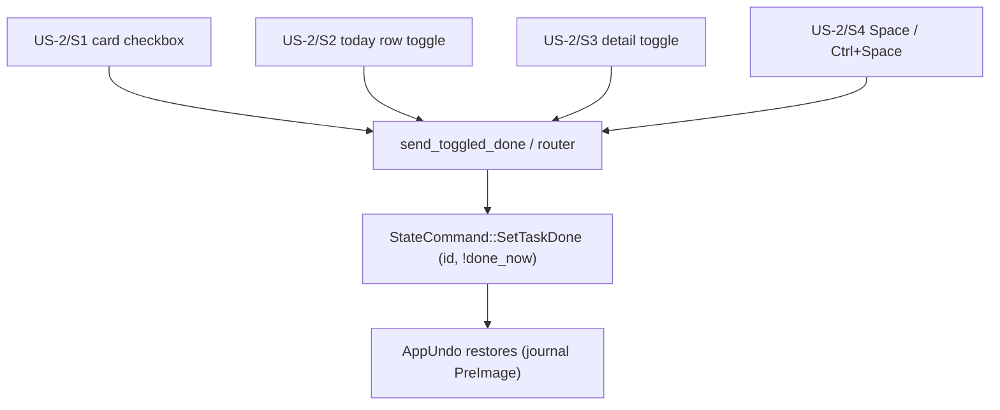

# [Plan] UX Journey Plan — Task lifecycle (retrofit, registry F-2)

- **Date**: 2026-11-14
- **Kind**: UX journey plan — **retrofit** (phase 4 of the UX journey
  framework rollout): user stories, journeys, flows, wiring inventory,
  and findings describing the task lifecycle **as implemented**. No new
  capability is planned; no implementation decisions are made.
- **Origin**: the UX retrofit & triage dispatch
  `/home/viktoria/src/taskboard/.artifacts/plans/2026-11-14-ux-retrofit-triage-dispatch-plan.md`
  §1/§2 (the retrofit posture binds this plan); the chunk plan
  `.artifacts/plans/2026-11-14-ux-retrofit-core-chunk-plan.md` (registry
  row F-2 incl. D-2.1/D-2.2 assignments, rubric D-3, gate rule D-5,
  commit sequencing D-6); the census Board/Today/Capture slices
  (baseline `dc290df2`); the live worktree code at `docs/ux-retrofit-core`
  HEAD (wiring anchors live; census cells keep their baseline anchors).
- **Status**: ACCEPTED (retrofit documentation under the accepted
  phase-4 dispatch; stage 3 reviews it against this posture).
- **Surfaces touched**: `ui/views/board-view.slint`,
  `ui/views/today-view.slint`, `ui/views/task-view.slint`,
  `ui/views/stack-view.slint`, `ui/widgets/task-card.slint`,
  `ui/compositions/tracked-today.slint`, `ui/app-window.slint`,
  `src/adapter.rs` (board/today/task seams), `src/actions.rs`,
  `src/menu.rs`, `src/router.rs`, `src/view_state.rs`,
  `crates/taskboard-domain/src/undo.rs`, `keymap/presets.rs`
- **Platform scope**: desktop; kiosk posture per story (Today rows
  render on kiosk, the row actions are gated — the seed's D-T16
  posture, `ui/compositions/habits.slint:7-10` precedent family)

## 1. Scope & goals

This plan documents the task lifecycle UX that ships today: a user
creates tasks from board columns, completes/reopens them from cards,
today rows, and the detail view, opens the detail view, moves tasks by
pointer drag or the keyboard move flow, deletes them from context
menus or the keyboard, re-commits a task to today, reads the
location/badge/due-phrase displays, and recovers with the global
undo/redo. All journeys are **journeys-as-implemented** (chunk plan
D-4).

**Non-goals** (retrofit posture — holes are findings in §10; the
phase-5 triage classifies and homes them):

- No CLI jump verb for `find` results (TF-2), no detail location/badge
  echoes (TF-3), no CLI badge output (TF-4) — described, not planned.
- Undo scope limits are described (W-N1), not redesigned.

## 2. Capability × surface matrix

<!-- Rows restate the census cells (Board slice, Task detail slice,
Today slice, Capture slice; baseline dc290df2) verbatim in content;
`U` cells are carried as `U` or converted to `— (R-n)` per the chunk
plan's rubric D-3; conversions cite the rulings table below (this plan
is the ruling's authority, 2026-11-14). Cells avoid `|`. -->

| Capability | Board | TaskDetail | Today | Review | Settings | Capture | CLI |
|---|---|---|---|---|---|---|---|
| task.create | C (US-1) — inline create row commit → `CreateTask` `adapter.rs:8409-8414` (view_state.rs:1903,4199), per-column "Add task" ghost `adapter.rs:8374`; `TaskCreate` `actions.rs:1018-1027`, N `presets.rs:127` | — (R-1) | — (R-1) | — (R-1) | — (R-1) | — (R-1) | C (pre-existing, `tasks add` `cli.rs:1634`) |
| task.complete | E (US-2) — card done checkbox `task-card.slint:150-151` → `adapter.rs:8395` / stack detail `adapter.rs:8318` (→ `SetTaskDone` `messages.rs:51`); `TaskComplete`/`TaskReopen` `actions.rs:1057-1075`, Space/Ctrl+Space `presets.rs:125-126` | E (US-2) — detail done toggle `adapter.rs:9952` | E (US-2) — today row done toggle `today-view.slint:74` | — (R-2) | — (R-2) | — (R-2) | E (pre-existing, `tasks done`, --undo reopens `cli.rs:1643`) |
| task.open | E (US-3) — card click `adapter.rs:8349`, double-click/Enter `adapter.rs:8353`; `TaskEdit` `actions.rs:1037-1045`, Return `presets.rs:129` | — (self) | E (US-3) — today row activation `today-view.slint:65-74` | — (R-3) | — (R-3) | E — palette jump `adapter.rs:8536` (the capture-search plan owns the overlay journey) | U (TF-2) |
| task.move | E (US-4) — card drag `adapter.rs:7695-7770` (drop resolves `MoveTask` `view_state.rs:3429-3452`), move flow `view_state.rs:456,3343`; `TaskMove` `actions.rs:1077-1086`, M `presets.rs:130` | E (US-4) — `TaskMove` `actions.rs:1077-1086` (TaskDetail member) | E (US-4) — `TaskMove` `actions.rs:1077-1086` (Today member) | E — the walk's file commit → `MoveTask` (the review-walk plan of chunk 2 owns this cell's journey) | — (R-4) | — (R-4) | E (pre-existing, `tasks move` `cli.rs:1651`) |
| task.delete | X (US-5) — card context menu `adapter.rs:7887`; `TaskDelete` `actions.rs:1097-1106`, Delete `presets.rs:131` | X (US-5) — `TaskDelete` `actions.rs:1097-1106` (TaskDetail member) | X (US-5) — `TaskDelete` `actions.rs:1106-1108` (Today member) | — (R-5) | — (R-5) | — (R-5) | X (pre-existing, `tasks delete` `cli.rs:1678`) |
| task.location_display | D (US-7) — selected-stack highlight and header hints `board-layout.slint:413-437` | U (TF-3) | D (US-7) — row context line "board › stack" `today-view.slint:392-399` (model `today-view.slint:35-37`) | — (R-6) | — (R-6) | — (R-6) | D (pre-existing, `tasks list` grouping `cli.rs:1628`) |
| task.badges_display | D (US-7) — card decoration chips: reminder / running-timer / recur / tracker badges `task-card.slint:18-33,247-260` | U (TF-3) | D (US-7) — the same task cards render on today rows `today-view.slint:20,376` | — (R-7) | — (R-7) | — (R-7) | U (TF-4) |
| task.due_phrase_display | D (US-7) — due/scheduled/effort chips `task-card.slint:195-222`, due phrase in the accessible label `task-card.slint:96-97` | D — due/scheduled echoes `task-view.slint:73,76,556,625` | D (US-7) — the same task cards on today rows `today-view.slint:20,376` | — (R-8) | — (R-8) | — (R-8) | U (TF-4) |
| task.due_today | — (R-9) | — (R-9) | E (US-6) — `TaskDueToday` "Due today (re-commit)" `actions.rs:1076-1078`, Today-only context | — (R-9) | — (R-9) | — (R-9) | U (TF-1) |
| app.undo | E (US-8) — `AppUndo` `actions.rs:678-680`, `presets.rs:72` (→ `Undo` `messages.rs:589`; `RestoreTask` `messages.rs:601` rides the undo path) | E (US-8) — same `AppUndo` evidence | E (US-8) — same `AppUndo` evidence | E (US-8) — same `AppUndo` evidence | E (US-8) — same `AppUndo` evidence | E (US-8) — same `AppUndo` evidence | E (pre-existing, `undo` `cli.rs:1750`) |
| app.redo | E (US-8) — `AppRedo` `actions.rs:688-690`, `presets.rs:73` (→ `Redo` `messages.rs:592`) | E (US-8) — same `AppRedo` evidence | E (US-8) — same `AppRedo` evidence | E (US-8) — same `AppRedo` evidence | E (US-8) — same `AppRedo` evidence | E (US-8) — same `AppRedo` evidence | E (pre-existing, `redo` `cli.rs:1753`) |

**Rulings** (conversions of census `U` cells; this table is the
ruling's authority, 2026-11-14, per chunk plan D-3):

| ID | Ruling | Reason | Home |
|---|---|---|---|
| R-1 | task.create has no mounts outside Board/StackDetail | R-Pattern 1 (context-scoped binding): `ActionId::TaskCreate` binds `&[ContextId::Board, ContextId::StackDetail]` (`actions.rs:1016-1025`, live registry); the inline create row is board-column grammar. The absence on other surfaces is the binding's semantics. | this plan §2; census Board slice register |
| R-2 | task.complete has no seam on Review/Settings/Capture | R-Pattern 1: `TaskComplete`/`TaskReopen` bind `&[ContextId::Today, ContextId::Board, ContextId::TaskDetail]` (`actions.rs:1056-1074`); the census Sweep-R/S/C shows no task row or done seam on those surfaces. | this plan §2; census Board slice register |
| R-3 | task.open has no seam on Review/Settings | R-Pattern 1: `ActionId::TaskEdit` binds `&[ContextId::Today, ContextId::Board, ContextId::TaskDetail]` (`actions.rs:1036-1044`); Sweep-R/S shows no task-open seam. The CLI cell stays `U` as finding TF-2. | this plan §2; census Board slice register |
| R-4 | task.move has no seam on Settings/Capture | R-Pattern 1: `ActionId::TaskMove` binds `&[ContextId::Today, ContextId::Board, ContextId::TaskDetail]` (`actions.rs:1086-1094`); Sweep-R/S/C shows no task-move seam. | this plan §2; census Board slice register |
| R-5 | task.delete has no seam on Review/Settings/Capture | R-Pattern 1: `ActionId::TaskDelete` binds `&[ContextId::Today, ContextId::Board, ContextId::TaskDetail]` (`actions.rs:1106-1114`); Sweep-R/S/C shows no task-delete seam. | this plan §2; census Board slice register |
| R-6 | task.location_display does not render on Review/Settings/Capture | R-Pattern 3 (display-scoping): the "board › stack" context line echoes the task's board placement (`today-view.slint:379-385`); surfaces whose sweep shows no board context render nothing for it to echo. The TaskDetail cell stays `U` as finding TF-3. | this plan §2; census Board slice register |
| R-7 | task.badges_display does not render on Review/Settings/Capture | R-Pattern 3: the decoration chips render inside `TaskCard` (`task-card.slint:247-260`), which mounts only on board/today card surfaces per the sweeps. The TaskDetail and CLI cells stay `U` (findings TF-3/TF-4). | this plan §2; census Board slice register |
| R-8 | task.due_phrase_display does not render on Review/Settings/Capture | R-Pattern 3: the due chips render inside `TaskCard` and the detail's due echo (`task-view.slint:561`); no chip/echo mounts on those surfaces (Sweep-R/S/C). The CLI cell stays `U` as finding TF-4. | this plan §2; census Board slice register |
| R-9 | task.due_today binds Today exclusively | R-Pattern 1: `ActionId::TaskDueToday` binds `&[ContextId::Today]` (`actions.rs:1076-1084`) — the re-commit semantics are the Today context's; Sweep-B/T/R/S/C shows no due-today affordance elsewhere. The CLI cell stays `U` as finding TF-1. | this plan §2; census Today slice register |

## 3. User stories

### US-1 — Create a task from a board column

- **Story**: As a desktop user I want to add a task directly in a
  column so that capture happens where the work lives.
- **Platforms**: desktop (the board surface does not mount in kiosk;
  capture.quick is the kiosk-side creation path — the capture-search
  plan's story).
- **Entry points**: the per-column "Add task" ghost
  (`board-add-task-activated`, `adapter.rs:8412-8414`); the inline
  create field commit (`board-create-committed` window token →
  `on_board_create_committed`, `adapter.rs:8452`);
  `ActionId::TaskCreate` (N);
  context-menu Task rows; CLI `tasks add` (pre-existing twin).
- **Priority**: P1
- **Acceptance**:
  - AC-1: Given a clicked column, When a non-empty title commits,
    Then `StateCommand::CreateTask { title, stack, order }` targets
    that column — verified by
    `journeys.rs::one_ghost_click_opens_the_create_field_in_the_clicked_column`
    and `view_state.rs::create_flow_commits_an_appended_create_task`.
  - AC-2: Given an empty buffer, When the flow settles, Then nothing
    dispatches — verified by
    `view_state.rs::an_empty_create_buffer_commits_nothing_but_ends_the_flow`.

### US-2 — Complete / reopen a task

- **Story**: As a user I want to mark a task done and undo that, from
  the card, the today row, or the detail view, so that progress is
  recorded where I see the task.
- **Platforms**: both (kiosk: the rows render, the actions are gated —
  seed D-T16 posture).
- **Entry points**: card checkbox (`task-card.slint:150-151`,
  window token `board-task-done-toggled`, `adapter.rs:8433`);
  stack-detail toggle (`stack-task-done-toggled`, `adapter.rs:8356`);
  today row toggle (`today-row-done-toggled`, `adapter.rs:8115`);
  detail toggle (`task-done-toggled`, `adapter.rs:9978-9990`);
  `ActionId::TaskComplete`/`TaskReopen` (Space / Ctrl+Space);
  context-menu rows; CLI `tasks done` (+ `--undo` reopens).
- **Priority**: P1
- **Acceptance**:
  - AC-1: Given a card checkbox click, When it toggles, Then
    `StateCommand::SetTaskDone { id, done: !done_now }` addresses the
    clicked card (not the focused task) — verified by
    `journeys.rs::the_card_checkbox_toggles_the_addressed_task` (the
    deliberate funnel, `adapter.rs:8426-8431`).
  - AC-2: Given a tracker card, When rendered, Then the checkbox is
    hidden (`can-done`, `task-card.slint:50`) and the context menu
    omits complete — verified by
    `journeys.rs::the_tracker_context_menu_omits_complete_and_offers_the_toggle`.

### US-3 — Open a task's detail view

- **Story**: As a user I want to open a task's detail from wherever I
  see it so that editing and history are one click away.
- **Platforms**: both (today rows on kiosk render; activation gated).
- **Entry points**: card click / double-click / Return
  (`board-task-clicked`/`board-task-activated`, `adapter.rs:8387-8391`
  routing `ActionId::TaskEdit`); today row activation
  (`today-row-activated`, `adapter.rs:8106`); palette jump (the
  capture-search plan's US-4); stack-detail activation.
- **Priority**: P1
- **Acceptance**:
  - AC-1: Given a card, When activated, Then the detail view mounts
    with the task as subject — verified by
    `journeys.rs::mount_pushes_no_selection_and_a_header_click_moves_it`
    and the today walk test
    `journeys.rs::the_today_view_walks_completes_and_recommits`.

### US-4 — Move a task

- **Story**: As a desktop user I want to move a task between columns
  by dragging (or the keyboard flow) so that its stage matches reality.
- **Platforms**: desktop (drag); both (keyboard flow).
- **Entry points**: card drag (`board-card-drag-armed`/
  `board-drag-hovered`/`board-card-dropped`/`board-card-drag-finished`,
  `adapter.rs:7733-7808`); `ActionId::TaskMove` (M) with slot cycling;
  `ActionId::TaskMoveCancel` (Escape — Global); context-menu rows;
  CLI `tasks move`.
- **Priority**: P1
- **Acceptance**:
  - AC-1: Given a drag drop, When it completes, Then the dispatched
    `MoveTask` equals the keyboard confirm's — verified by
    `view_state.rs::the_drag_drop_and_the_keyboard_confirm_produce_the_same_move_command`.
  - AC-2: Given Escape mid-drag or a release outside any column, When
    it settles, Then nothing dispatches and no click leaks — verified
    by `journeys.rs::escape_mid_drag_cancels_and_the_release_clicks_nothing`
    and `journeys.rs::a_release_outside_any_column_cancels_the_drag`.

### US-5 — Delete a task

- **Story**: As a user I want to delete a task so that stale work
  disappears, knowing the global undo restores it.
- **Platforms**: both (context menu / keyboard; today rows gated on
  kiosk).
- **Entry points**: card/row context menu (`menu::TASK_CONTEXT`,
  `menu.rs:164-172`; open seams `adapter.rs:7902-7942`);
  `ActionId::TaskDelete` (Delete key); CLI `tasks delete`.
- **Priority**: P1
- **Acceptance**:
  - AC-1: Given a focused task, When delete dispatches, Then
    `StateCommand::DeleteTask { id }` drains (tombstone) — verified by
    the ten-step session `journeys.rs::the_ten_step_keyboard_session`
    (step 7, "the confirmation-free flow") and the lib.rs delete-key
    tests.
  - AC-2: Given the deletion, When the user presses Ctrl+Z (AppUndo),
    Then the engine plans the compensating `RestoreTask` (journal
    PreImages class, `undo.rs:104-109`) — verified by
    `journeys.rs::invoking_the_undo_rows_sends_the_engine_verbs` and
    the engine undo suite.

### US-6 — Re-commit a task to today

- **Story**: As a user looking at today I want to push a task's due
  date to today's end so that it re-enters today's list without
  editing the date by hand.
- **Platforms**: both (menu path; no key — TF-1).
- **Entry points**: `ActionId::TaskDueToday` via the action menu only
  (no preset binding, no pointer affordance —
  `journeys.rs:8926` comment "no default stroke; the menu path's
  action").
- **Priority**: P1
- **Acceptance**:
  - AC-1: Given a focused task with a day window, When TaskDueToday
    dispatches, Then `StateCommand::UpdateTask` stamps
    `duedate: Some(Some(<window end>))` — verified by
    `journeys.rs::the_today_view_walks_completes_and_recommits`
    (dispatch at the re-commit leg).

### US-7 — Read location, badges, and due phrase (display-only)

- **Story**: As a user I want a task card to show where it lives, its
  badges, and its due phrase so that I never open a task to know its
  state. (Display-only story.)
- **Platforms**: both (cards render on today rows too).
- **Entry points**: the card decorations/chips and today context line
  — display only.
- **Priority**: P1 (D-verb displays)
- **Acceptance**:
  - AC-1: Given a task card, When rendered, Then the decoration chips
    and due/scheduled/effort phrases render from the model
    (`TaskCardModel`, `task-card.slint:38-56`; decorations
    `task-card.slint:247-260`), and the today row shows the
    "board › stack" context line (`today-view.slint:379-385`) —
    verified by the golden visuals suite (`tests/golden_visuals.rs`)
    and `tests/task_card_title_probe_tests.rs`; display only.

### US-8 — Undo / redo as the global escape

- **Story**: When a lifecycle action went wrong, I want Ctrl+Z /
  Ctrl+Shift+Z (or the menu rows) to step the journal back and forward
  so that every state mutation is recoverable.
- **Platforms**: both.
- **Entry points**: `ActionId::AppUndo`/`AppRedo` (Ctrl+Z /
  Ctrl+Shift+Z; emacs Ctrl+x u; vi u / Ctrl+r); the menu's Undo/Redo
  rows (greyed from the published `UndoView`);
  `ActionId::TaskMoveCancel` (Escape) for armed flows; CLI `undo`/
  `redo`.
- **Priority**: P1
- **Acceptance**:
  - AC-1: Given the undo rows, When the published UndoView greys them,
    Then the menu reflects can_undo/can_redo — verified by
    `journeys.rs::the_undo_rows_grey_from_the_published_undo_view`.
  - AC-2: Given an invoked row, When it fires, Then the engine verbs
    `StateCommand::Undo`/`Redo` drain — verified by
    `journeys.rs::invoking_the_undo_rows_sends_the_engine_verbs` and
    `router.rs::app_undo_and_redo_dispatch_the_engine_verbs`.

## 4. Journey specs

### US-1 — Create a task from a board column

| Step | Surface & affordance | User action | Dispatches | System response | Escape / failure |
|---|---|---|---|---|---|
| US-1/S1 | board column ghost ("Add task") / N key | click the ghost in the target column, or press N | `board-add-task-activated` (`adapter.rs:8412-8414`) selects the column and routes `ActionId::TaskCreate` → `UiEffect` → `begin_create` (`view_state.rs:1838`) | the inline create field arms in the clicked column; another column's open field is replaced (`journeys.rs::a_ghost_click_replaces_another_columns_open_create_field`) | Escape/foreign settle discards via the settle law; the flow is inert without a board/stack target — test `journeys.rs::the_add_task_ghost_is_the_click_equivalent_of_task_create` |
| US-1/S2 | inline create field | type the title | — (flow-local buffer, `on_board_create_edited` `adapter.rs:8447`) | the buffer echoes | empty buffer commits nothing but ends the flow (`view_state.rs:4629` test) |
| US-1/S3 | inline create field commit | press Return | `StateCommand::CreateTask { title, stack, order }` (`view_state.rs:1895-1903`, `messages.rs:23`) | the card appears appended in the target column | typed engine refusals surface via the outcome lane — test `view_state.rs::create_flow_in_stack_detail_targets_the_subject` |

### US-2 — Complete / reopen a task

| Step | Surface & affordance | User action | Dispatches | System response | Escape / failure |
|---|---|---|---|---|---|
| US-2/S1 | card checkbox (`task-card.slint:150-151`) | click the done checkbox | `board-task-done-toggled` (`adapter.rs:8433`) → `send_toggled_done` (`adapter.rs:9348`) → `StateCommand::SetTaskDone { id, done: !done_now }` (`messages.rs:51`) | the card renders done (stamp now engine-side); the checkbox addresses the clicked card, not the focused task (`adapter.rs:8426-8431`) | `AppUndo` reverses the completion (`SetTaskDone` is a PreImages verb, `undo.rs:104-109`) — test `journeys.rs::the_card_checkbox_toggles_the_addressed_task` |
| US-2/S2 | today row done toggle (`today-view.slint:74`) | click the row checkbox | `today-row-done-toggled` (`adapter.rs:8115`) → same funnel | the row's done state flips; the today list re-ranks on refresh | same undo escape; kiosk: the action is gated, the row renders (seed D-T16 posture) — test `journeys.rs::the_today_view_walks_completes_and_recommits` |
| US-2/S3 | detail done toggle (`task-view.slint`) | click the detail toggle | `task-done-toggled` (`adapter.rs:9978-9990`) → same funnel | the detail echo updates | same undo escape |
| US-2/S4 | keyboard | Space (complete) / Ctrl+Space (reopen) on the focused task | `ActionId::TaskComplete`/`TaskReopen` → `SetTaskDone` via the router (`router.rs:585-592,928-934`; reopen only when `focused_task_done`; tracker → `NoTarget`) | the focused task's done state flips | tracker targets refuse as `NoTarget` (typed); undo escape as above — test `journeys.rs::the_tracker_context_menu_omits_complete_and_offers_the_toggle` |

### US-3 — Open a task's detail view

| Step | Surface & affordance | User action | Dispatches | System response | Escape / failure |
|---|---|---|---|---|---|
| US-3/S1 | board card (`task-card.slint:66-67`) | click / double-click the card | `board-task-clicked` (focus; `adapter.rs:8387`) / `board-task-activated` (`adapter.rs:8391`) routes `ActionId::TaskEdit` → `UiEffect::Activate` (`router.rs:893`) | the detail view mounts with the task as subject | the back affordance returns (US-back is the task-editing plan's US-5; the seam `task-back-clicked` routes `NavFocusBoard`); no state mutated — pure navigation |
| US-3/S2 | keyboard / today row | Return on the focused card, or activate a today row | `ActionId::TaskEdit` (presets `presets.rs:129,141`) / `today-row-activated` (`adapter.rs:8106`) | same mount | same pure-navigation posture — test `journeys.rs::the_today_view_walks_completes_and_recommits` |

### US-4 — Move a task

| Step | Surface & affordance | User action | Dispatches | System response | Escape / failure |
|---|---|---|---|---|---|
| US-4/S1 | board card | press and drag the card | `board-card-drag-armed` (`adapter.rs:7733`) arms `Flow::DragMove` seeded to the source stack (`view_state.rs:3356` test); `board-drag-hovered` (`adapter.rs:7754`) retargets | the drag ghost follows; the hover column highlights | Escape mid-drag cancels (`TaskMoveCancel` Global Escape, `presets.rs:119`) — `journeys.rs::escape_mid_drag_cancels_and_the_release_clicks_nothing`; a second flow is refused while one is armed (`journeys.rs::a_drag_never_arms_while_another_flow_holds`) |
| US-4/S2 | board columns | release over the target column | `board-card-dropped` (`adapter.rs:7774`) → drop resolves `MoveTask` (`view_state.rs:3429-3452`); `board-card-drag-finished` (`adapter.rs:7808`) settles | `StateCommand::MoveTask { id, stack, order }` dispatches; the card re-renders in the target column | release outside any column cancels with no dispatch (`journeys.rs::a_release_outside_any_column_cancels_the_drag`); a stale drop column settles rather than guessing (`adapter.rs:7787-7792`) |
| US-4/S3 | keyboard flow (Board/Today/TaskDetail) | M, cycle slots, confirm | `ActionId::TaskMove` → `UiEffect::RequestMove` (`router.rs:895`); `append_move_command` (`view_state.rs:455`) is the one `MoveTask` construction site | the move flow cycles targets; confirm dispatches `MoveTask` | Escape cancels (Global TaskMoveCancel; emacs Ctrl+g — `journeys.rs::move_cancel_routes_through_escape_and_emacs_c_g`); re-requesting cancels without dispatch (`view_state.rs:4786` test); move without focus is inert (`view_state.rs:4798` test) |
| US-4/S4 | after any move | — | — | the move is a journal PreImage; `AppUndo` restores the source placement | undo escape (US-8) — test `journeys.rs::the_placement_routes_one_mask_and_undo_returns_it` |

### US-5 — Delete a task

| Step | Surface & affordance | User action | Dispatches | System response | Escape / failure |
|---|---|---|---|---|---|
| US-5/S1 | card/row context menu | right-click | `on_board_task_context_requested`/`on_stack_task_context_requested`/`on_today_row_context_requested` (`adapter.rs:7925,7942,8134` → `open_task_context_menu` `adapter.rs:7902`) | `menu::TASK_CONTEXT` opens (create/edit/complete/reopen/move/cancel/delete, destructive last) | outside click / Escape dismisses the menu; no dispatch — test `journeys.rs::the_body_right_click_selects_and_opens_the_stack_menu` (menu posture) |
| US-5/S2 | context menu row / Delete key | click "Delete" or press Delete | `ActionId::TaskDelete` → `StateCommand::DeleteTask { id }` (`router.rs:594-598`, `messages.rs:67`) | the task is tombstoned and disappears | **global undo is the escape**: `DeleteTask` is a journal PreImage and `RestoreTask` is its inverse instrument (`undo.rs:104-109`, `messages.rs:601`); no confirmation UI exists ("no confirmation step", `actions.rs:1106-1114`) — the recovery is post-hoc, not pre-hoc (W-N2 note) — test `journeys.rs::the_ten_step_keyboard_session` step 7 |

### US-6 — Re-commit a task to today

| Step | Surface & affordance | User action | Dispatches | System response | Escape / failure |
|---|---|---|---|---|---|
| US-6/S1 | action menu, Today context | open the menu and invoke the "Due today (re-commit)" row | `ActionId::TaskDueToday` (`actions.rs:1076-1084`) → `UpdateTask { duedate: Some(Some(window end)) }` (`router.rs:908-923`) | the task's due phrase re-renders; the today list re-ranks on refresh | no key and no pointer affordance bind the verb (TF-1); a wrong re-commit is a `UpdateTask` PreImage — `AppUndo` restores the prior due date — test `journeys.rs::the_today_view_walks_completes_and_recommits` |

### US-7 — Read location, badges, and due phrase

| Step | Surface & affordance | User action | Dispatches | System response | Escape / failure |
|---|---|---|---|---|---|
| US-7/S1 | task card (board + today rows) | — display only | — display only | decoration chips (reminder / running-timer / recur / tracker / importance / urgency) render from `field_decorations` (`models.rs:2394-2440`); due/scheduled/effort chips render (`task-card.slint:195-222`); the accessible label embeds the due phrase (`task-card.slint:96-97`) | display only — no dispatch, no escape; echo fidelity is the adapter's push seam |
| US-7/S2 | today row context line | — display only | — display only | "board › stack" renders when the context is non-empty (`today-view.slint:379-385`) | display only |

### US-8 — Undo / redo as the global escape

| Step | Surface & affordance | User action | Dispatches | System response | Escape / failure |
|---|---|---|---|---|---|
| US-8/S1 | menu Undo/Redo rows or Ctrl+Z / Ctrl+Shift+Z | invoke undo | `ActionId::AppUndo` → `StateCommand::Undo` (`router.rs:570-571`, `messages.rs:589`) | the journal plans the inverse (`plan_undo`, `undo.rs:539`); the app state re-renders; rows grey from the published UndoView | typed refusals are named, not silent (`NothingToUndo`/`TargetNotUndoable`, `undo.rs:535-555`); the window is the 10-entry recent journal (`journal.rs:42`) — W-N1 — test `journeys.rs::the_undo_rows_grey_from_the_published_undo_view` |
| US-8/S2 | same rows | invoke redo | `ActionId::AppRedo` → `StateCommand::Redo` (`messages.rs:592`) | the undone change re-applies as a new edit | same typed-refusal posture — test `router.rs::app_undo_and_redo_dispatch_the_engine_verbs` |
| US-8/S3 | armed move/drag flow | press Escape | `ActionId::TaskMoveCancel` (Global Escape, all presets) → `UiEffect::CancelMove` | the flow disarms, nothing dispatches | the pre-dispatch escape for armed flows (distinct from the post-hoc journal undo) — test `journeys.rs::move_cancel_routes_through_escape_and_emacs_c_g` |

## 5. Interaction flows

US-4 move (pointer and keyboard converge on the one `MoveTask`
construction site):

```mermaid
stateDiagram-v2
    [*] --> None
    None --> Armed : US-4/S1 drag-armed (Flow::DragMove) / US-4/S3 M (Flow::Move)
    Armed --> Armed : US-4 hover retarget / slot cycle
    Armed --> Committed : US-4/S2 drop / keyboard confirm (MoveTask)
    Armed --> None : Escape (TaskMoveCancel) / release outside / foreign settle
    Committed --> None : card re-renders; AppUndo restores (US-8)
```

US-2 completion funnel (four mounts, one command):



## 6. Wiring inventory

<!-- Rows document EXISTING affordances; all tokens live at the
worktree HEAD; tasks are addressed through the adapter id tables
(a.tables.board_task/stack_task/today_row) — no task-shaped ItemAddr
exists (the ItemAddr kinds are Settings-slice seams). -->

| ID | Surface file | Widget | Callback | Adapter seam | ActionId | Commands | Row addressing | Journey steps | Test |
|---|---|---|---|---|---|---|---|---|---|
| W-1 | ui/views/board-view.slint, ui/app-window.slint | per-column ghost + inline create field | board-add-task-activated | on_board_add_task_activated (adapter.rs:8412); on_board_create_committed (adapter.rs:8452) | ActionId::TaskCreate | StateCommand::CreateTask | (column, row) resolved via a.tables.board_task / stack_ids; stale → None absorbed | US-1/S1-US-1/S3 | journeys.rs::one_ghost_click_opens_the_create_field_in_the_clicked_column; view_state.rs::create_flow_commits_an_appended_create_task |
| W-2 | ui/widgets/task-card.slint, ui/views/board-view.slint, ui/views/today-view.slint, ui/views/task-view.slint | card done checkbox (view re-emits) | board-task-done-toggled | on_board_task_done_toggled (adapter.rs:8433); on_today_row_done_toggled (adapter.rs:8115); on_task_done_toggled (adapter.rs:9990) | — (the checkbox addresses an arbitrary card; the registry route is the keyboard twin, see W-3) | StateCommand::SetTaskDone | card/row via a.tables.board_task / today_row(section, row) | US-2/S1-US-2/S3 | journeys.rs::the_card_checkbox_toggles_the_addressed_task |
| W-3 | src/router.rs, src/actions.rs | keyboard complete/reopen verbs | — (registry-routed; no widget) | router.rs:585-592,928-934; enablement via adapter state | ActionId::TaskComplete; ActionId::TaskReopen | StateCommand::SetTaskDone | focused task (the registry route) | US-2/S4 | journeys.rs::the_today_view_walks_completes_and_recommits |
| W-4 | ui/widgets/task-card.slint, ui/views/board-view.slint, ui/views/today-view.slint | card / row activation | board-task-activated | on_board_task_clicked (adapter.rs:8387); on_board_task_activated (adapter.rs:8391); on_today_row_activated (adapter.rs:8106) | ActionId::TaskEdit | — (pure navigation: UiEffect::Activate mounts the detail; no command) | (column, row) via a.tables.board_task; today_row(section, row) | US-3/S1-US-3/S2 | journeys.rs::the_today_view_walks_completes_and_recommits |
| W-5 | ui/views/board-view.slint (drag seams), src/view_state.rs | card drag-to-move | board-card-drag-armed | on_board_card_drag_armed (adapter.rs:7733); on_board_drag_hovered (adapter.rs:7754); on_board_card_dropped (adapter.rs:7774); on_board_card_drag_finished (adapter.rs:7808) | ActionId::TaskMoveCancel (the Escape instrument) | StateCommand::MoveTask | drop column via a.tables.stack_ids; stale drop settles, never guesses (adapter.rs:7787-7792) | US-4/S1-US-4/S2 | journeys.rs::the_pointer_drag_drops_the_keyboard_move_command |
| W-6 | src/view_state.rs (flow), src/router.rs | keyboard move flow | — (keyboard flow; no widget callback) | UiEffect::RequestMove / CancelMove arms (router.rs:895-898; adapter effect arms) | ActionId::TaskMove; ActionId::TaskMoveCancel | StateCommand::MoveTask | focused → selected chain (view_state.rs:4798 test) | US-4/S3-US-4/S4 | view_state.rs::the_drag_drop_and_the_keyboard_confirm_produce_the_same_move_command |
| W-7 | src/menu.rs (TASK_CONTEXT rows), src/adapter.rs | task context menu / Delete key | — (menu rows invoke through the generic menu seams; the keyboard verb has no widget) | on_menu_entry_invoked (adapter.rs:7035) routes the action id; router.rs:594-598 | ActionId::TaskDelete | StateCommand::DeleteTask | focused task (router requires Some(id), else NoTarget) | US-5/S1-US-5/S2 | journeys.rs::the_ten_step_keyboard_session |
| W-8 | src/router.rs, src/actions.rs | due-today re-commit (menu row only) | — (no widget; menu-dispatched action) | menu invoke route → router.rs:908-923 | ActionId::TaskDueToday | StateCommand::UpdateTask | focused task + the day window (ctx) | US-6/S1 | journeys.rs::the_today_view_walks_completes_and_recommits |
| W-9 | ui/widgets/task-card.slint, ui/views/today-view.slint | decoration chips, due chips, context line | — (display only — no callback) | — (push-side model fields: field_decorations models.rs:2394-2440) | — | — (display only — no command) | per-card render | US-7/S1-US-7/S2 | tests/golden_visuals.rs; tests/task_card_title_probe_tests.rs |
| W-10 | ui/compositions/action-menu.slint, src/menu.rs | Undo/Redo menu rows (greyed from UndoView) | — (menu rows invoke through the generic menu seams) | on_menu_entry_invoked (adapter.rs:7035); enablement gate adapter.rs:509-510 (can_undo/can_redo) | ActionId::AppUndo; ActionId::AppRedo | StateCommand::Undo; StateCommand::Redo | — (global verbs; no row addressing) | US-8/S1-US-8/S3 | journeys.rs::invoking_the_undo_rows_sends_the_engine_verbs |

## 7. Command-contract delta

**None — retrofit** (the contract already exists). Existing variants
the journeys dispatch, for greppability:

| Kind | Name | Payload sketch | Journeys |
|---|---|---|---|
| StateCommand | CreateTask | exists (`messages.rs:23`) — `{ title, stack, order }` | US-1 |
| StateCommand | SetTaskDone | exists (`messages.rs:51`) — `{ id, done }`, stamp-now on true | US-2 |
| StateCommand | MoveTask | exists (`messages.rs:58`) — `{ id, stack, order }` | US-4 |
| StateCommand | DeleteTask | exists (`messages.rs:67`) — tombstone | US-5 |
| StateCommand | UpdateTask | exists (`messages.rs:37`) — sparse `TaskChanges { duedate: Some(Some(end)) }` at the re-commit | US-6 |
| StateCommand | Undo / Redo | exist (`messages.rs:589,592`) — engine-routed journal verbs | US-8 |
| ActionId | TaskCreate / TaskComplete / TaskReopen / TaskEdit / TaskMove / TaskMoveCancel / TaskDelete / TaskDueToday | exist (`actions.rs:240-249`, registry `actions.rs:1016-1114`) | US-1, US-2, US-3, US-4, US-5, US-6 |
| ActionId | AppUndo / AppRedo | exist (`actions.rs:217-218`) | US-8 |

No `UiRequest` and no new variant of any kind is involved in these
journeys.

## 8. Verification plan

- **Journey tests (step-ID-named)**: none exist — the retrofitted
  journeys predate the framework's step-token test law. Per the pilot
  precedent (comparison plan §2, backlog #768; habit-create plan PC-3)
  the §2.3 gate's journey-step token rows stay MISSING on this plan;
  the per-step verification evidence is §6's Test column and §4's
  Escape column (all cited tests exist and pass).
- **Seam tests (existing)**: exact-command drains and funnel
  equivalence — `view_state.rs::the_drag_drop_and_the_keyboard_confirm_
  produce_the_same_move_command`, `journeys.rs::the_card_checkbox_
  toggles_the_addressed_task`, `router.rs::app_undo_and_redo_dispatch_
  the_engine_verbs`.
- **Fold/presentation tests (existing)**: the undo-row grey fold
  (`journeys.rs::the_undo_rows_grey_from_the_published_undo_view`),
  the tracker can-done hide, the kiosk action gate
  (`journeys.rs::the_tracking_chip_renders_and_the_kiosk_gate_empties_
  only_the_action` posture family).
- **Kiosk gates**: today rows render on kiosk; the row actions and
  pointer affordances are gated (the seed's D-T16 posture — the gate
  empties the ACTION, never the model).
- **Manual**: the ghost affordance's discoverability, the re-commit
  menu row's label semantics, and the decoration chip meanings are
  judged, not text-asserted; the stage-3 walkthrough covers them.

## 9. Definition of done (retrofit)

- [x] Wiring inventory: every row FOUND under `scripts/ux-coverage.sh`
  (per-plan gate outcome recorded in the stage-2 report — D-5)
- [x] Journeys-as-implemented complete end-to-end with the escape
  audit per step (delete's post-hoc undo escape recorded; no fix
  proposed — retrofit posture)
- [x] Census Board/Today-slice `U` conversions carry R-1..R-9 and cite
  this plan (rulings table §2, dated 2026-11-14)
- [ ] Stage-3 walkthrough protocol executed; findings classified by
  the phase-5 triage
- [x] Non-goals: none planned — all holes are findings (§10)

## 10. Findings (retrofit — descriptive only; no redesign proposed)

- **TF-1 — task.due_today has no key and no pointer affordance**
  (F-Pattern 4, entry-point asymmetry). `TaskDueToday` is
  menu-dispatch only: no preset row in any keymap (grep of
  `presets.rs` returns nothing) and no slint callback mounts it
  (`journeys.rs:8926` "no default stroke; the menu path's action").
  A user must open the two-tier menu, navigate to the task submenu
  posture, and invoke — discoverable but buried; the click-vs-key
  parity law has no instance for this verb at all.
- **TF-2 — no CLI jump for `find` results** (F-Pattern 4). `find`
  (`cli.rs:89-101`, `commands/find.rs`) shares the palette's ranking
  engine but prints and exits — there is no open/jump verb, so the
  CLI's search cannot complete the US-3 journey (the GUI palette's
  `NavShowTask` row activation is the jump). The census `task.open`
  CLI cell stays `U` under this finding.
- **TF-3 — the detail view echoes the due phrase but not location or
  badges** (F-Pattern 4). `task-view.slint` renders due/scheduled
  echoes (`task-view.slint:561`) but no "board › stack" context line
  and no decoration chips — a user who arrived via the palette jump
  (which selects the board and stack, `view_state.rs:2585+`) sees the
  location only in the switcher, not on the subject.
- **TF-4 — no CLI badge/due-phrase output** (F-Pattern 4).
  `tasks list` (`cli.rs:1628`) groups by location but prints no
  decoration chips and no due phrase — the CLI cell of
  `task.badges_display`/`task.due_phrase_display` stays `U`.
- **W-N1 — walkthrough note (US-8/S1, undo scope)**: the journal
  window is the 10 most recent changes (`journal.rs:42
  UNDO_RECENT_WINDOW`); beyond it undo is typed-refused
  (`NothingToUndo`). Task ops (create/complete/move/delete) are
  undoable (`undo.rs:104-109`); board ceremony is not (chunk-1 plan 1
  findings BF-5/BF-6) — the global undo is broad but not universal,
  and the boundary is invisible in the UI until a refusal names it.
- **W-N2 — walkthrough note (US-5/S2, delete posture)**: task delete
  is confirmation-free ("no confirmation step",
  `actions.rs:1106-1114`) with the recovery entirely post-hoc
  (journal undo). Contrast with the plan-1 stack/board deletes, which
  are escape-less (BF-5/BF-6) — the same "destructive" gesture has an
  undo path for tasks and none for stacks/boards, an
  inconsistency (consistency-and-standards observation; the triage
  classifies).
- **W-N3 — walkthrough note (US-2, kiosk)**: the today rows render on
  kiosk while the row actions are gated (seed D-T16 posture) — the
  display half of the lifecycle (US-7) is kiosk-complete; the control
  half is desktop-only by gating, and the gating is silent (no
  disabled affordance renders, the action simply does not mount).

## 11. Plan corrections

- **PC-1 (2026-11-14)**: the census Board-slice `task.move` cell cites
  the drag resolve at `view_state.rs:3429-3452` and move flow at
  `view_state.rs:456,3343` — live, the one `MoveTask` construction
  site is `append_move_command` (`view_state.rs:455`) with the flow
  machine at `view_state.rs:2633-2760`; the §4/§6 rows cite the live
  seams. The census cell keeps its baseline anchors verbatim (chunk
  plan D-6 confines the census diff to `U` conversions).
