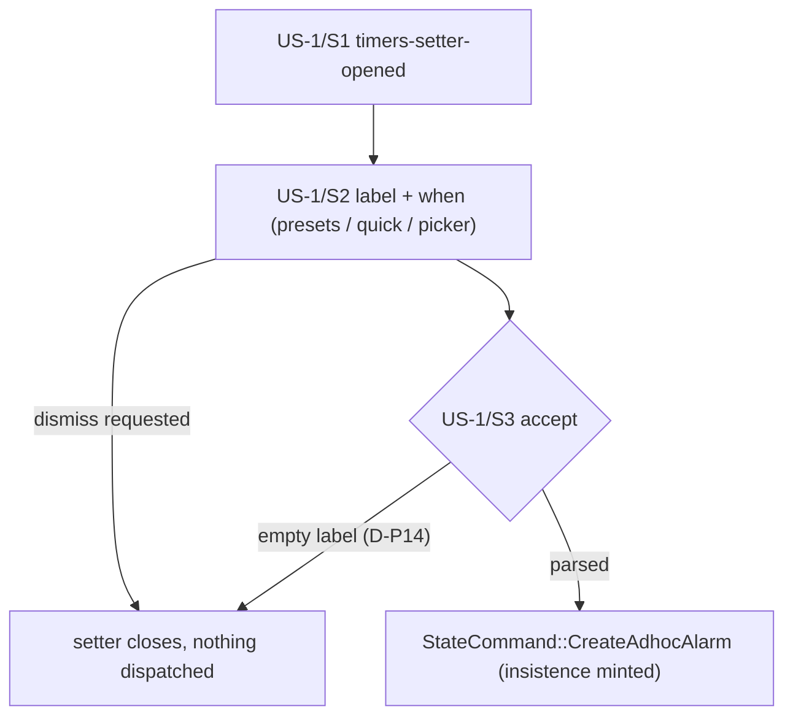
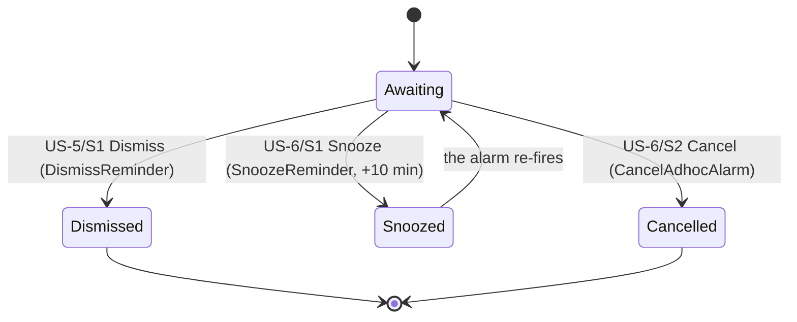

# [Plan] UX Journey Plan — Timers & alarms (retrofit, registry F-7)

- **Date**: 2026-11-14
- **Kind**: UX journey plan — **retrofit** (phase 4 of the UX journey
  framework rollout): user stories, journeys, flows, wiring inventory,
  and findings describing ad-hoc timers/alarms, the alarm window, the
  notification surface, and the break-rule family **as implemented**.
  No new capability is planned; no implementation decisions are made.
- **Origin**: the UX retrofit & triage dispatch
  `/home/viktoria/src/taskboard/.artifacts/plans/2026-11-14-ux-retrofit-triage-dispatch-plan.md`
  §1/§3 (the retrofit posture binds this plan); the stage-1 chunk plan
  `.artifacts/plans/2026-11-14-ux-retrofit-triage-chunk-plan.md` (D-1
  story set + census feed, D-2 rubric application, D-7 gate
  steady-state, D-6 commit sequencing, D-8's D-P11 restatement rule)
  applying chunk-1's plan
  `.artifacts/plans/2026-11-14-ux-retrofit-core-chunk-plan.md` D-3
  (the ruling rubric) and D-4 (escape-audit method, walkthrough
  questions); the census Today + Alarm window slices
  `docs/ux-surface-census.org` (baselines `dc290df2` / `84c04a0b`);
  the live worktree code at `docs/ux-retrofit-triage` HEAD `0b98fe5d`
  (wiring anchors are live `file:line`; census cells keep their
  recorded baseline anchors — chunk-1 plan §5 anchor-drift law).
- **Status**: ACCEPTED (retrofit documentation authored under the
  accepted phase-4 dispatch; stage 3 reviews it against this posture).
  **Amended 2026-11-15** (UX remediation chunk 1 — completability,
  stage 2; authority: the accepted triage report findings T-7 (#790),
  TA-W-N4 and the remediation chunk plan
  `.artifacts/plans/2026-11-15-ux-r1-completability-chunk-plan.md`
  D-2/D-4): the alarm window's kiosk posture gains the **recorded
  absence** — a static muted caption on the Today timers host section
  (the D-2 grammar's "hint where the surface is fenced" arm); the
  R3.5.3 fence stands (no window mounts, the model stays empty,
  zero new commands), the alarm-window stories' platform notes record
  it. Command-contract delta of the amendment: **zero new variants**
  (the caption is display state — `timers-absence-hint`).
- **Surfaces touched**: `ui/views/today-view.slint` (timers section),
  `ui/compositions/timer-setter.slint`, `ui/alarm-window.slint`,
  `ui/compositions/notification-surface.slint`, `src/adapter.rs`
  (timers + notification seams), `src/lib.rs` (the alarm lanes),
  `src/presentation.rs`
- **Platform scope**: desktop for the alarm window (mounted lazily
  iff not kiosk — the R3.5.3 fence, `lib.rs:322-330`); the Today
  timers section renders on kiosk (the display half); break rules are
  CLI-only

## 1. Scope & goals

This plan documents the timers & alarms UX that ships today: a
desktop user creates and cancels ad-hoc timers/alarms from the Today
section's timers setter; fired alarms surface in the always-on-top
alarm window (Dismiss / Snooze / Cancel — the D-P11 anchor-aware
shape) and reminders surface in the global notification surface
(dismiss / done / snooze / mute / cancel / start-task / open); break
rules are a CLI-only engine family with no GUI anywhere. All journeys
below are **journeys-as-implemented** (chunk-2 plan D-1: P1 = the
journey a user actually completes today).

**Non-goals** (retrofit posture — nothing here is a commitment; each
hole is a finding in §10, classification and homing are the phase-5
triage's):

- No GUI for break rules — finding TA-1, not planned.
- No CLI twins for occurrence dismissal/snooze/open — findings
  TA-2/TA-4, not planned.

## 2. Capability × surface matrix

<!-- Cells restate the census Today + Alarm window slices verbatim in
content (the alarm window's rows carry the same evidence cell in
every GUI column — the census's column semantics for the
always-on-top second window). `U` cells are carried as `U` or
converted to `— (R-n)` per chunk-1 plan D-3 (applied mechanically per
chunk-2 plan D-2); every conversion cites this plan's rulings table
below (this plan is the ruling's authority, dated 2026-11-14). The
F-Pattern 1 cells (break_rule.*, the Alarm-window CLI twins) stay `U`
as findings TA-1..TA-4. Cells avoid `|`. -->

| Capability | Board | TaskDetail | Today | Review | Settings | Capture | CLI |
|---|---|---|---|---|---|---|---|
| alarm.create_adhoc | — (R-1) | — (R-1) | E (US-1) — timers section setter `today-view.slint:82-90` (+ `timer-setter.slint`), commit → =CreateAdhocAlarm= `messages.rs:303` (live seams `adapter.rs:9368-9408`) | — (R-1) | — (R-1) | — (R-1) | E (pre-existing, =timers add= `cli.rs:921`) |
| alarm.cancel_adhoc | — (R-1) | — (R-1) | E (US-2) — timers section cancel `today-view.slint:82-90` → =CancelAdhocAlarm= `messages.rs:314` (live seam `adapter.rs:9409-9426`) | — (R-1) | — (R-1) | — (R-1) | E (pre-existing, =timers cancel= `cli.rs:958`) |
| alarm.display | — (R-2) | — (R-2) | D (US-3) — timers section mount `today-view.slint:163-180` (props `today-view.slint:79-92`) | — (R-2) | — (R-2) | — (R-2) | D (pre-existing, =timers list= `cli.rs:954`) |
| review.walk_preview | U | U | D — review-walk surfacing card `today-view.slint:206-238` (props `today-view.slint:127-131`) | U | U | U | U |
| break_rule.create | U (TA-1) | U (TA-1) | U (TA-1) | U (TA-1) | U (TA-1) | U (TA-1) | E (CLI-only — =breaks add= `cli.rs:971` → =CreateBreakRule= `messages.rs:324`; the UI crate never constructs the command and mounts no =on_break*= seam, adapter.rs swept) |
| break_rule.remove | U (TA-1) | U (TA-1) | U (TA-1) | U (TA-1) | U (TA-1) | U (TA-1) | X (CLI-only — =breaks remove= `cli.rs:995` → =DeleteBreakRule= `messages.rs:343`; UI-unreachable, same sweep) |
| break_rule.roster_display | U (TA-1) | U (TA-1) | U (TA-1) | U (TA-1) | U (TA-1) | U (TA-1) | D (CLI-only — =breaks list= `cli.rs:990`, a pure read of the canonical rule roster) |
| alarm.dismiss | E (US-5) — the window row's Dismiss `alarm-window.slint:32-34`, callback `lib.rs:854-859` → =DismissReminder= | E — same alarm-window evidence | E — same alarm-window evidence | E — same alarm-window evidence | E — same alarm-window evidence | E — same alarm-window evidence | U (TA-2) |
| alarm.snooze | E (US-6) — the window row's Snooze `alarm-window.slint:32-34`, callback `lib.rs:860-866` → =SnoozeReminder= with =ALARM_WINDOW_SNOOZE= = 10 min (`presentation.rs:2228`) | E — same alarm-window evidence | E — same alarm-window evidence | E — same alarm-window evidence | E — same alarm-window evidence | E — same alarm-window evidence | U (TA-2) |
| alarm.cancel | E (US-6) — the window row's Cancel `alarm-window.slint:32-34`, callback `lib.rs:867-869` → =CancelAdhocAlarm= (the timers section's engine twin) | E — same alarm-window evidence | E — same alarm-window evidence | E — same alarm-window evidence | E — same alarm-window evidence | E — same alarm-window evidence | E (pre-existing, =timers cancel= `cli.rs:958`) |
| alarm.window_display | D (US-4) — the awaiting-alarm rows (title snapshot + elapsed phrase), derived =alarm_window_rows= `presentation.rs:2253-2290`, attention-gained edge `lib.rs:778-786` | D — same alarm-window evidence | D — same alarm-window evidence (the timers *section* is the Today slice's =alarm.display= row — a different surface) | D — same alarm-window evidence | D — same alarm-window evidence | D — same alarm-window evidence | U (TA-2) |
| notification.dismiss | E (global overlay) (US-7) — the notification row's dismiss seam `adapter.rs:10157-10169` → =DismissReminder=; mounts over any view `app-window.slint:597` | E (global overlay) — same notification-surface evidence | E (global overlay) — same notification-surface evidence | E (global overlay) — same notification-surface evidence | E (global overlay) — same notification-surface evidence | E (global overlay) — same notification-surface evidence | U (TA-2) |
| notification.done | E (global overlay) (US-7) — the notification row's done seam `adapter.rs:10172-10185` → =SetTaskDone= (the done-seam's guard shape; a stale index degrades to a no-op) | E (global overlay) — same notification-surface evidence | E (global overlay) — same notification-surface evidence | E (global overlay) — same notification-surface evidence | E (global overlay) — same notification-surface evidence | E (global overlay) — same notification-surface evidence | E (pre-existing, =tasks done= `cli.rs:1643`) |
| notification.snooze | E (global overlay) (US-7) — the notification row's snooze seam `adapter.rs:10188-10200` routes =ReminderSnooze= `actions.rs:1117-1119` (the Task-detail banner's engine twin) | E (global overlay) — same notification-surface evidence | E (global overlay) — same notification-surface evidence | E (global overlay) — same notification-surface evidence | E (global overlay) — same notification-surface evidence | E (global overlay) — same notification-surface evidence | U (TA-2) |
| notification.mute | E (global overlay) (US-7) — the notification row's mute seam `adapter.rs:10197-10210` routes =ReminderMute= `actions.rs:1127-1139` (→ =SetTaskRemindersMuted= `messages.rs:217`) | E (global overlay) — same notification-surface evidence | E (global overlay) — same notification-surface evidence | E (global overlay) — same notification-surface evidence | E (global overlay) — same notification-surface evidence | E (global overlay) — same notification-surface evidence | E (pre-existing, =tasks remind= --mute `cli.rs:1734`) |
| notification.cancel | E (global overlay) (US-7) — the notification row's cancel seam `adapter.rs:10210-10229` routes =TimerCancel= over the row's adhoc-alarm target (DR-3/3, D-I7) | E (global overlay) — same notification-surface evidence | E (global overlay) — same notification-surface evidence | E (global overlay) — same notification-surface evidence | E (global overlay) — same notification-surface evidence | E (global overlay) — same notification-surface evidence | E (pre-existing, =timers cancel= `cli.rs:958`) |
| notification.track_start | E (global overlay) (US-7) — the notification row's "Start Task" seam `adapter.rs:10229-10244` routes =TaskTrackStart= over the row's target (DR-5/4, D-TU7; the implicit dismissal lives planner-side, D-T5) | E (global overlay) — same notification-surface evidence | E (global overlay) — same notification-surface evidence | E (global overlay) — same notification-surface evidence | E (global overlay) — same notification-surface evidence | E (global overlay) — same notification-surface evidence | E (pre-existing, =track start= `cli.rs:1149`) |
| notification.open | E (global overlay) (US-8) — the notification row's open seam `adapter.rs:10245-10251` (the stale-index guard, `adapter.rs:9410`) | E (global overlay) — same notification-surface evidence | E (global overlay) — same notification-surface evidence | E (global overlay) — same notification-surface evidence | E (global overlay) — same notification-surface evidence | E (global overlay) — same notification-surface evidence | U (TA-4) |

**Rulings** (conversions of census `U` cells; every converted cell
above cites one of these; this table is the ruling's authority,
2026-11-14, per chunk-1 plan D-3 applied by chunk-2 plan D-2):

| ID | Ruling | Reason | Home |
|---|---|---|---|
| R-1 | alarm.create_adhoc / alarm.cancel_adhoc have no mounts outside the Today section | R-Pattern 2 (entity-mount grammar): the timers section (the setter and the cancel affordances) mounts only in the Today view (`today-view.slint:79-92,163-180`; the census register's Sweep-B/T/R/S/C evidence "no alarm-create/cancel seam"), and no other surface renders the timers roster at all — no other mount is grammatically possible. | this plan §2; census Today slice register |
| R-2 | alarm.display renders only in the Today section (and the status bar's chip, which the census records there) | R-Pattern 3 (display-scoping): the timers display echoes the adhoc-alarm roster where the roster is rendered (`today-view.slint:163-180`); surfaces that render no timers have nothing for it to echo (the census register's "no timers display outside Today and the status bar"). The CLI cell stays `D (pre-existing, timers list)` — the census records it populated. | this plan §2; census Today slice register |

(The `review.walk_preview` cells are the review-walk plan's census
feed row — they convert with that plan's commit per chunk-2 plan D-6;
this plan carries them verbatim (`U`) only so its
matrix is complete. The D-P11 anchor-aware shape — no Done/Mute on
the anchor-aware alarm rows — is restated as finding TA-3's evidence;
its classification is the triage report's, never re-ruled here,
chunk-2 plan D-8.)

## 3. User stories

### US-1 — Create an ad-hoc timer / alarm

- **Story**: As a desktop user I want to set a quick timer or alarm
  from the Today section so that a nudge exists without opening
  settings.
- **Platforms**: desktop for the dispatch; on kiosk the timers
  section renders with the setter greyed and the absence caption
  (remediated 2026-11-15, the D-2 grammar; test
  `journeys.rs::the_kiosk_alarm_fence_stands_with_the_absence_hint`).
- **Entry points**: the timers section's setter
  (`timers-setter-opened`, `adapter.rs:9439-9448`; the setter
  composition `timer-setter.slint`); commit
  (`timers-create-accepted`, `adapter.rs:9374-9408`); CLI `timers
  add` (pre-existing twin).
- **Priority**: P1
- **Acceptance**:
  - AC-1: Given a non-empty label and a parsed when, When the commit
    seam fires, Then `StateCommand::CreateAdhocAlarm` dispatches with
    the two-rung insistence minted at the trust boundary
    (`adapter.rs:9375-9407`, D-P14's whitespace-empty refusal).
  - AC-2: Given a whitespace-empty label, When the commit fires,
    Then nothing dispatches (D-P14, `adapter.rs:9376-9378`).

### US-2 — Cancel an ad-hoc timer

- **Story**: As a desktop user I want to cancel a waiting timer from
  the Today section so that a no-longer-wanted nudge disappears.
- **Platforms**: desktop.
- **Entry points**: the timers section's cancel affordance
  (`timers-cancel-clicked`, `adapter.rs:9409-9426`) →
  `CancelAdhocAlarm`; CLI `timers cancel` (pre-existing twin); the
  alarm window's Cancel button (US-6).
- **Priority**: P1
- **Acceptance**:
  - AC-1: Given a waiting alarm row, When cancel fires, Then
    `StateCommand::CancelAdhocAlarm` dispatches for the resolved
    target (`adapter.rs:9412-9420`, stale index → no-op).

### US-3 — Timers display

- **Story**: As a desktop user I want the Today section (and the
  status bar chip) to show waiting and elapsed timers so that my
  nudges are visible at a glance. (Display-only story.)
- **Platforms**: both (the display half renders on kiosk).
- **Entry points**: the timers section mount
  (`today-view.slint:163-180`, props `today-view.slint:79-92`).
- **Priority**: P1 (D-verb display)
- **Acceptance**:
  - AC-1: Given adhoc alarms, When the section renders, Then the
    rows echo title and countdown state — verified by the census's
    display evidence and the timers presentation model (display
    only, no dispatch).

### US-4 — Alarm window as-displayed

- **Story**: When an alarm fires I want an always-on-top window with
  the awaiting occurrences so that the alarm is unmissable over
  whatever I am doing. (Display story over the window's shape.)
- **Platforms**: desktop (mounted lazily iff not kiosk —
  `lib.rs:322-330`, the R3.5.3 fence; lanes `lib.rs:218-233`).
- **Entry points**: the alarm pass (the driver's minute-cadence
  alarm pass, `lib.rs:666+`); attention-gained edge
  (`lib.rs:778-786`, request-never-focus).
- **Priority**: P1 (D-verb display)
- **Acceptance**:
  - AC-1: Given a fired, undismissed occurrence, When the window
    renders, Then one row shows the title snapshot + elapsed phrase
    (`presentation.rs::alarm_window_rows`, `presentation.rs:2253-2290`)
    with Dismiss / Snooze / Cancel only — the D-P11 anchor-aware
    shape (no Done, no Mute; TA-3's evidence).

### US-5 — Dismiss an occurrence (alarm window)

- **Story**: As a desktop user whose alarm fired I want to dismiss
  the occurrence from the window so that it stops claiming
  attention.
- **Platforms**: desktop (mouse-only surface — TA-5).
- **Entry points**: the window row's Dismiss button
  (`alarm-window.slint:32-34`; `lib.rs:854-859`).
- **Priority**: P1
- **Acceptance**:
  - AC-1: Given an awaiting row, When Dismiss is pressed, Then
    `StateCommand::DismissReminder` dispatches for the row's
    reminder+occurrence (`lib.rs:854-859`; a stray index degrades to
    a no-op, `lib.rs:483-485`).

### US-6 — Snooze / cancel an occurrence (alarm window)

- **Story**: As a desktop user not ready for the alarm I want to
  snooze it a fixed 10 minutes (or cancel the adhoc alarm outright)
  from the window so that the nudge returns later or never.
- **Platforms**: desktop.
- **Entry points**: the window row's Snooze / Cancel buttons
  (`lib.rs:860-869`); the Today section's cancel (US-2); CLI
  `timers cancel` (the cancel twin).
- **Priority**: P1
- **Acceptance**:
  - AC-1: Given an awaiting row, When Snooze is pressed, Then
    `StateCommand::SnoozeReminder` dispatches with
    `ALARM_WINDOW_SNOOZE` = 10 min (`presentation.rs:2228`,
    `lib.rs:860-866`).
  - AC-2: Given an awaiting row, When Cancel is pressed, Then
    `StateCommand::CancelAdhocAlarm` dispatches for the row's alarm
    (`lib.rs:867-869`).

### US-7 — The notification surface's action family

- **Story**: When a reminder or timer notification appears over any
  view I want to dismiss it, mark the task done, snooze, mute the
  rules, cancel the timer, or start tracking the task — all from the
  notification row itself.
- **Platforms**: desktop.
- **Entry points**: the notification surface's row seams
  (`adapter.rs:10157-10251`); CLI twins recorded per census row.
- **Priority**: P1
- **Acceptance**:
  - AC-1: Given a rendered notification row, When a row button is
    pressed, Then the exact engine command routes (`DismissReminder`
    / `SetTaskDone` / `ReminderSnooze` / `ReminderMute` /
    `TimerCancel` / `TaskTrackStart` — the census row evidence,
    `adapter.rs:10157-10244`).
  - AC-2: Given a stale target index, When done fires, Then it
    degrades to a no-op (the done-seam's guard shape,
    `adapter.rs:10172-10185`).

### US-8 — Open a notification's task

- **Story**: As a desktop user acting on a notification I want to
  jump to the notified task so that I see it in context.
- **Platforms**: desktop.
- **Entry points**: the notification row's open seam
  (`notification-row-open-requested`, `adapter.rs:10245-10251`; the
  stale-index guard `adapter.rs:9410`). No CLI twin (TA-4).
- **Priority**: P1
- **Acceptance**:
  - AC-1: Given a notification row with a task target, When open
    fires, Then the task opens (the stale-index guard absorbs a
    vanished target).

### US-9 — Break rules (P2, CLI-only journeys)

- **Story**: When a work/break cadence rule needs creating, removing,
  or listing, the CLI verbs complete it — the GUI has no break-rule
  affordance anywhere (finding TA-1; F-Pattern 1: CLI-only mutation
  of user data).
- **Platforms**: CLI.
- **Entry points**: `breaks add` (`cli.rs:971` → `CreateBreakRule`
  `messages.rs:324`); `breaks remove` (`cli.rs:995` →
  `DeleteBreakRule` `messages.rs:343`); `breaks list`
  (`cli.rs:990`, a pure read).
- **Priority**: P2
- **Acceptance**:
  - AC-1: Given a break cadence need, When `breaks add` runs, Then
    `StateCommand::CreateBreakRule` dispatches engine-side (zero GUI
    dispatch sites — the sweep evidence for TA-1).

## 4. Journey specs

### US-1 — Create an ad-hoc timer / alarm

| Step | Surface & affordance | User action | Dispatches | System response | Escape / failure |
|---|---|---|---|---|---|
| US-1/S1 | Today timers section | open the setter | `timers-setter-opened` (`adapter.rs:9439-9448`) | the setter composition arms (`timer-setter.slint`) | dismiss requested closes it (`timer-setter-dismiss-requested`, `adapter.rs:9449-9453`) — the setter's escape (audit mechanism (b)) |
| US-1/S2 | timer setter | type the label / pick or type the when | `timer-setter-quick-typed` (`adapter.rs:9480-9494`); `timer-setter-time-picked` (`adapter.rs:9517-9527`); `timer-setter-day-picked` (`adapter.rs:9528+`) | the buffer echoes; presets ride `timer-setter-preset-picked` (`adapter.rs:9454-9467`) | the when parse happens at commit — no intermediate dispatch to escape |
| US-1/S3 | timer setter commit | press accept | `timers-create-accepted` (`adapter.rs:9374-9408`) → `StateCommand::CreateAdhocAlarm` (`messages.rs:303`) with the minted insistence | the timer appears in the timers section | whitespace-empty label dispatches nothing (D-P14, `adapter.rs:9376-9378`) — the typed-guard escape (mechanism (c)) |

### US-2 — Cancel an ad-hoc timer

| Step | Surface & affordance | User action | Dispatches | System response | Escape / failure |
|---|---|---|---|---|---|
| US-2/S1 | Today timers section row | click cancel | `timers-cancel-clicked` (`adapter.rs:9409-9426`) → `ActionId::TimerCancel` → `StateCommand::CancelAdhocAlarm` (`messages.rs:314`) | the timer leaves the roster | a stale index degrades to a no-op (`adapter.rs:9412-9419`); the cancel is the deliberate end of the entity (no undo — the CLI/GUI twins share the posture) |

### US-3 — Timers display

| Step | Surface & affordance | User action | Dispatches | System response | Escape / failure |
|---|---|---|---|---|---|
| US-3/S1 | Today timers section (`today-view.slint:163-180`) | — display only | — display only | waiting/elapsed timers render with countdown state. Kiosk leg (remediated 2026-11-15, D-2): the section renders with the setter greyed and the muted absence caption (the R3.5.3 fence's honest signal) — `journeys.rs::the_kiosk_alarm_fence_stands_with_the_absence_hint` | display only — no dispatch, no escape |

### US-4 — Alarm window as-displayed

| Step | Surface & affordance | User action | Dispatches | System response | Escape / failure |
|---|---|---|---|---|---|
| US-4/S1 | alarm window (`alarm-window.slint`) | — display only (the window is moved-to, not opened) | — display only | the awaiting rows render title snapshot + elapsed phrase (`presentation.rs::alarm_window_rows`); the window gains attention (`lib.rs:778-786`, request-never-focus) | display only — the row's buttons are US-5/US-6's journeys; the D-P11 shape (no Done/Mute) is TA-3's evidence |

### US-5 — Dismiss an occurrence

| Step | Surface & affordance | User action | Dispatches | System response | Escape / failure |
|---|---|---|---|---|---|
| US-5/S1 | alarm window row | click Dismiss | `window.on_dismiss` (`lib.rs:854-859`) → `StateCommand::DismissReminder` | the row leaves the window; the reminder occurrence is dismissed | a stray index degrades to a no-op (`lib.rs:483-485`); the dismissal is the deliberate end (no undo — occurrence lifecycle, not user data loss) |

### US-6 — Snooze / cancel an occurrence

| Step | Surface & affordance | User action | Dispatches | System response | Escape / failure |
|---|---|---|---|---|---|
| US-6/S1 | alarm window row | click Snooze | `window.on_snooze` (`lib.rs:860-866`) → `StateCommand::SnoozeReminder` (ALARM_WINDOW_SNOOZE = 10 min, `presentation.rs:2228`) | the occurrence re-arms 10 minutes out | the snooze is itself the escape from the fired alarm; a further cancel is available (US-6/S2) |
| US-6/S2 | alarm window row | click Cancel | `window.on_cancel` (`lib.rs:867-869`) → `StateCommand::CancelAdhocAlarm` | the adhoc alarm is cancelled outright | deliberate end; no undo |

### US-7 — The notification surface's action family

| Step | Surface & affordance | User action | Dispatches | System response | Escape / failure |
|---|---|---|---|---|---|
| US-7/S1 | notification surface row (`app-window.slint:597`) | click dismiss / done / snooze / mute / cancel / start | the row seams (`adapter.rs:10157-10244`) route `DismissReminder` / `SetTaskDone` / `ReminderSnooze` / `ReminderMute` / `TimerCancel` / `TaskTrackStart` | the row's effect lands (dismiss/mute/cancel end the notification; done completes; track-start opens tracking) | the done seam's stale-index guard degrades to a no-op (`adapter.rs:10172-10185`); mute is `NotUndoable(ReminderSurface)` (`undo.rs:150` — the task-editing plan's W-N1 posture) |

### US-8 — Open a notification's task

| Step | Surface & affordance | User action | Dispatches | System response | Escape / failure |
|---|---|---|---|---|---|
| US-8/S1 | notification surface row | click open | `notification-row-open-requested` (`adapter.rs:10245-10251`) → the task opens (stale-index guard `adapter.rs:9410`) | the notified task's surface becomes the subject | a vanished target is absorbed by the stale-index guard — pure navigation, no state mutation to escape |

### US-9 — Break rules (P2)

| Step | Surface & affordance | User action | Dispatches | System response | Escape / failure |
|---|---|---|---|---|---|
| US-9/S1 | CLI `breaks add` / `breaks remove` / `breaks list` (`cli.rs:971,995,990`) | run the verbs | `StateCommand::CreateBreakRule` (`messages.rs:324`) / `StateCommand::DeleteBreakRule` (`messages.rs:343`) / pure read | the rule roster changes engine-side; no GUI shows it anywhere (TA-1) | `DeleteBreakRule` removal posture is CLI-only; no GUI recovery surface exists |

## 5. Interaction flows

The timers setter flow:

The alarm window's occurrence lifecycle (the window is moved-to):

## 6. Wiring inventory

<!-- Rows document EXISTING affordances (retrofit): every callback and
command below is live at the worktree HEAD 0b98fe5d. Rows carry the
callback in the Adapter-seam column with the Callback cell `—` (the
chunk-1 plans' PC-2 correction posture); the alarm window's lanes are
wired in src/lib.rs (no adapter seams — the census's direct-mpsc
finding). -->

| ID | Surface file | Widget | Callback | Adapter seam | ActionId | Commands | Row addressing | Journey steps | Test |
|---|---|---|---|---|---|---|---|---|---|
| W-1 | ui/views/today-view.slint + ui/compositions/timer-setter.slint | timers setter (open/edit/commit/dismiss) | — | install_seam! on_timers_setter_opened (adapter.rs:9439-9448); install_seam! on_timers_when_edited (adapter.rs:9368-9373); install_seam! on_timers_create_accepted (adapter.rs:9374-9408); install_seam! on_timer_setter_dismiss_requested (adapter.rs:9449-9453) | — | StateCommand::CreateAdhocAlarm | alarm target via a.tables (stale → no-op) | US-1/S1-US-1/S3 | adapter.rs D-P14 whitespace-empty refusal (the seam's typed guard) |
| W-2 | ui/views/today-view.slint | timers section cancel affordance | — | install_seam! on_timers_cancel_clicked (adapter.rs:9409-9426) | ActionId::TimerCancel | StateCommand::CancelAdhocAlarm | alarm target via a.tables | US-2/S1 | — |
| W-3 | ui/views/today-view.slint (props today-view.slint:79-92,163-180) | timers section display | — | — (display only) | — | — | per-row render | US-3/S1 | — |
| W-4 | ui/alarm-window.slint | alarm window rows (Dismiss/Snooze/Cancel) | — | window.on_dismiss / window.on_snooze / window.on_cancel (lib.rs:854-869, the alarm lanes — direct mpsc, no adapter seams) | — | StateCommand::DismissReminder; StateCommand::SnoozeReminder; StateCommand::CancelAdhocAlarm | row index via the lanes' rows table (stray → no-op) | US-5/S1, US-6/S1-US-6/S2 | — |
| W-5 | ui/alarm-window.slint (rows model presentation.rs:2253-2290) | alarm window display | — | — (display only; lib.rs:778-786 attention edge) | — | — | per-row render | US-4/S1 | — |
| W-6 | ui/compositions/notification-surface.slint | notification row action family | — | install_seam! on_notification_dismiss_clicked (adapter.rs:10157-10169); install_seam! on_notification_done_clicked (adapter.rs:10172-10185); install_seam! on_notification_snooze_clicked (adapter.rs:10188-10200); install_seam! on_notification_mute_clicked (adapter.rs:10197-10210); install_seam! on_notification_cancel_clicked (adapter.rs:10210-10229); install_seam! on_notification_track_start_clicked (adapter.rs:10229-10244) | ActionId::ReminderSnooze | StateCommand::DismissReminder; StateCommand::SetTaskDone; StateCommand::SetTaskRemindersMuted; StateCommand::CancelAdhocAlarm; StateCommand::StartTracking | row target via the notification row's resolved index | US-7/S1 | lib.rs::the notification seam tests (invoke_notification_dismiss_clicked / invoke_notification_snooze_clicked exact-command asserts) |
| W-7 | ui/compositions/notification-surface.slint | notification row open seam | — | install_seam! on_notification_row_open_requested (adapter.rs:10245-10251) | — | — | row target via the stale-index guard (adapter.rs:9410) | US-8/S1 | — |
| W-8 | crates/taskboard-app/src/cli.rs | `breaks add` / `breaks remove` / `breaks list` verbs | — | — (CLI-only; no GUI seam anywhere — TA-1's sweep evidence) | — | StateCommand::CreateBreakRule; StateCommand::DeleteBreakRule | — (CLI verbs, not UI seams) | US-9/S1 | — |
| W-9 | ui/compositions/timers.slint (pass-through via ui/views/today-view.slint, ui/app-window.slint) | the Today timers host's muted absence caption (amendment 2026-11-15, UX R-1 D-2 / TA-W-N4) | — | — (no seam: pure display caption, framework §2.1.6 reason law — display state only, zero new commands) | — | — | — (the flag `timers-absence-hint` is a pushed display bit, not a row address) | US-3/S1 kiosk leg: pure display caption (framework §2.1.6 reason law) | journeys.rs::the_kiosk_alarm_fence_stands_with_the_absence_hint |

## 7. Command-contract delta

**None — retrofit** (the contract already exists). The table lists
the existing variants the journeys dispatch, for greppability
(chunk-2 plan D-1):

| Kind | Name | Payload sketch | Journeys |
|---|---|---|---|
| StateCommand | CreateAdhocAlarm | exists (`messages.rs:303`) — the two-rung insistence minted at the trust boundary | US-1 |
| StateCommand | CancelAdhocAlarm | exists (`messages.rs:314`) | US-2, US-6, US-7 |
| StateCommand | DismissReminder | exists — reminder + occurrence | US-5, US-7 |
| StateCommand | SnoozeReminder | exists (`messages.rs:207`) — ALARM_WINDOW_SNOOZE = 10 min from the window | US-6, US-7 |
| StateCommand | SetTaskDone | exists (`messages.rs:51`) — the notification done seam | US-7 |
| StateCommand | SetTaskRemindersMuted | exists (`messages.rs:217`) — the notification mute seam | US-7 |
| StateCommand | StartTracking | exists — the notification track-start seam | US-7 |
| StateCommand | CreateBreakRule / DeleteBreakRule | exist (`messages.rs:324,343`) — CLI-only (TA-1) | US-9 |

## 8. Verification plan

- **Journey tests (step-ID-named)**: none exist — the retrofitted
  journeys predate the framework's step-token test law. Per the pilot
  precedent (comparison plan §2, backlog #768; chunk-1 plans' PC-2)
  the §2.3 gate's journey-step token rows stay MISSING on this plan;
  the per-step verification evidence is the Test column of §6 and the
  Escape column of §4.
- **Seam tests (existing, cited per row)**: the notification seam
  exact-command asserts (`lib.rs` tests invoking
  `notification_dismiss_clicked` / `notification_snooze_clicked` /
  `notification_row_open_requested` — the exact-command matches at
  `lib.rs:3128-3160`), the setter's D-P14 typed guard
  (`adapter.rs:9374-9408`).
- **Fold/presentation tests (existing)**: the alarm window rows
  (`presentation.rs::alarm_window_rows`), the window snooze constant
  (`presentation.rs:2228`).
- **Kiosk gates**: the alarm window never mounts in kiosk
  (`lib.rs:322-330`, the R3.5.3 fence — the whole surface is gated,
  not its affordances); the Today timers section renders on kiosk
  while the setter/cancel affordances follow the section's edit
  gating. The kiosk posture is recorded as W-N4, not fixed.
- **Manual**: the alarm row labels' recognition (Dismiss vs Cancel
  semantics on an anchor-aware row) is judged, not text-asserted; the
  stage-3 walkthrough covers it.

## 9. Definition of done (retrofit)

- [x] Wiring inventory: every row FOUND under
  `scripts/ux-coverage.sh` (per-plan gate outcome recorded in the
  stage-2 report — chunk-2 plan D-7)
- [x] Journeys-as-implemented complete end-to-end with the escape
  audit per step; the F-Pattern 1 cells (break rules) recorded as
  finding TA-1, not fixed (retrofit posture)
- [x] Census Today-slice `U` conversions (alarm.create_adhoc /
  alarm.cancel_adhoc / alarm.display) carry R-1/R-2 and cite this
  plan (rulings table §2, dated 2026-11-14); the F-Pattern 1 cells
  stay `U`
- [ ] Stage-3 walkthrough protocol executed; findings classified by
  the phase-5 triage (this plan records, never fixes)
- [x] Non-goals: none planned — all holes are findings (§10)

## 10. Findings (retrofit — descriptive only; no redesign proposed)

Walkthrough answers (framework §4.4's four questions, applied
descriptively) and the six-heuristic pass surfaced the following;
each carries evidence, never a fix.

- **TA-1 — break rules are CLI-only mutation of user data with no
  GUI anywhere** (F-Pattern 1). `CreateBreakRule`/`DeleteBreakRule`
  (`messages.rs:324,343`) have zero UI-crate dispatch sites and no
  `on_break*` seam exists (adapter.rs swept — the census register
  evidence); the roster itself (`breaks list`) renders nowhere in the
  GUI. A user's break cadence is invisible and unmanageable outside
  the CLI; the Today slice carries the rows as the timer/alarm-adjacent
  daily surface. Walkthrough Q1: no control exists to see.
- **TA-2 — occurrence dismissal/snooze and the window display have
  no CLI twins** (CLI-absence evidence note). `alarm.dismiss`,
  `alarm.snooze`, `alarm.window_display`, `notification.dismiss`,
  `notification.snooze` have CLI cells `U` (census Sweep-CLI
  evidence: the `tasks remind` family mutates rules, not
  occurrences). The GUI windows complete these journeys, so no
  journey depends on the twins (the CLI-absence decision rule's
  MINOR arm applies unless the triage finds otherwise). The CLI
  cells stay `U`.
- **TA-3 — the D-P11 anchor-aware shape: alarm rows carry no Done,
  no Mute** (restated evidence per chunk-2 plan D-8; classification
  is the triage's). An alarm anchor has no task — the window's rows
  carry Dismiss/Snooze/Cancel only (`alarm-window.slint:8-10,32-34`,
  `lib.rs:854-869`). A reminder anchor's row (notification surface)
  does carry Done/Mute — the two anchor shapes are deliberately
  different, and the difference is recorded, not judged here.
- **TA-4 — notification.open has no CLI twin** (F-Pattern 4,
  vacuous CLI absence). `find` prints results, no open/jump verb
  (census Sweep-CLI evidence — the `task.open` register's CLI sweep).
  The CLI cell stays `U`.
- **TA-5 — the alarm window is a mouse-only surface** (keyboard-mouse
  parity). The lanes' doc records "no new commands, a mouse-only
  surface" (`lib.rs:483-485`): the window's three buttons have no
  keyboard route in any preset, and the window carries no action
  registry entries (the census's direct-mpsc finding — no `ActionId`s
  on the window). A keyboard-only user presented with the modal
  window must reach for the pointer. Walkthrough Q1/Q2 posture:
  visible, operable, pointer-only.
- **TA-6 — timer/alarm cancel has no undo** (F-Pattern 4, recorded
  posture). `CancelAdhocAlarm` ends the entity deliberately from
  Today, the window, and the notification surface; no undo path is
  recorded for the cancel family (the undo journal's habit/surface
  classes do not cover it). The cancel is the user's explicit intent,
  so the posture is recorded, not judged a loss path here.
- **W-N1 — walkthrough note (US-1, feedback)**: the created timer
  appears in the timers section on the next render (the display
  half); no transient acknowledgement exists. The state change is
  visible; the note records the absence of an explicit
  acknowledgement.
- **W-N2 — walkthrough note (US-7, mute reachability)**: the
  notification mute routes `ReminderMute` (the Task-detail banner's
  engine twin) — the mute posture and its `NotUndoable(ReminderSurface)`
  class are the task-editing plan's W-N1 territory; recorded here as
  the cross-surface twin so the triage sees the family whole.
- **W-N3 — walkthrough note (US-4, attention semantics)**: the
  window requests attention, never focus (`lib.rs:778-786`,
  request-never-focus; the types ride slint's winit re-export, a
  non-winit backend no-ops structurally). The alarm is unmissable
  only as far as the desktop environment honors
  `UserAttentionType::Critical` — a recorded environment-dependent
  posture.
- **W-N4 — walkthrough note (US-1/US-3, kiosk)**: *(Remediated
  2026-11-15 — UX remediation chunk 1 / triage T-7 (#790), within the
  R3.5.3 fence: the Today timers host renders the muted absence
  caption on kiosk (`timers-absence-hint` — display state only, zero
  new commands; test
  `journeys.rs::the_kiosk_alarm_fence_stands_with_the_absence_hint`).
  History: the timers section rendered on kiosk (the display half)
  while the alarm window never mounted (`lib.rs:322-330` — the whole
  surface, display and controls together, is gated) and nothing told
  the kiosk viewer where alarms live.)*

## 11. Plan corrections

- None required — the stage-2 `scripts/ux-coverage.sh` run
  (2026-11-14) returned checks: 45, FOUND: 29, MISSING: 16; every
  wiring row, no-commands reason, and ruling is FOUND; the 16 MISSING
  rows are the documented retrofit limitation (chunk-2 plan D-7;
  backlog #768; the chunk-1 plans' PC-2 precedent): the journey-step
  token rows for US-5..US-9 (no step-token tests exist for these
  retrofitted journeys) and their story-coverage cascade (the matrix
  cells citing US-5..US-8). No wiring row MISSING, no plan defect
  surfaced.
