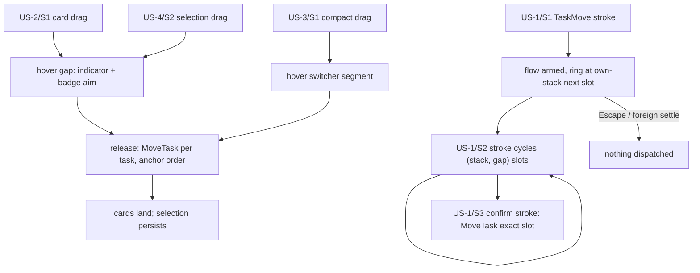
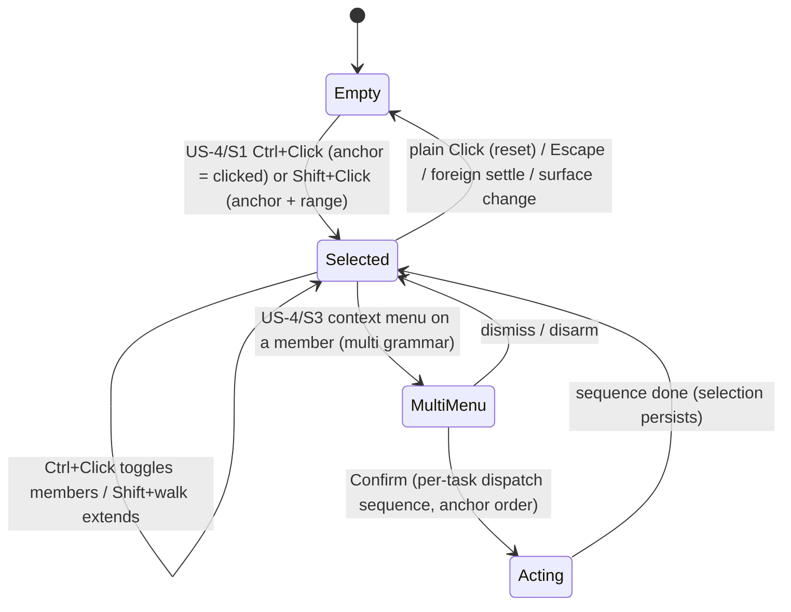

# [Plan] UX Journey Plan — Board interaction: reorder, compact movement, multi-select

- **Date**: 2026-11-16
- **Kind**: UX journey plan — user stories, journeys, flows, wiring
  contract for board-surface interaction round 8: within-stack task
  reordering (drag + keyboard), mouse-only cross-stack movement in the
  compact (narrowest) layout, the compact board switcher, multi-select
  with bulk verbs, and the move-feedback/roster-cue polish. No
  implementation decisions beyond the command contract.
- **Origin**: the operator's round-8 notes N-10/N-15, N-16, N-22,
  N-23 (recorded in the round plan
  `.artifacts/plans/2026-11-16-gui-review-round8-plan.md` §1) + intake
  #823 (T-40, folded per round plan C-2) and #834. Format/framework:
  `docs/ux_planning.org` + `.artifacts/templates/ux-journey-plan.md`.
- **Status**: ACCEPTED — the user accepted the round-8 plan set on 2026-11-16; dispatch may chunk from it (round plan §7,
  chunk 4).
- **Surfaces touched**: `ui/compositions/board-layout.slint` (regular
  + compact legs), `ui/compositions/board-bar.slint`,
  `ui/widgets/task-card.slint`, `ui/app-window.slint`,
  `src/adapter.rs` (board + drag seams), `src/view_state.rs` (the task
  move flow), `src/models.rs`, `src/presentation.rs`
- **Platform scope**: desktop (the board surface does not mount on
  kiosk — the census mount grammar; no new kiosk instances, recorded
  per story)

## 1. Scope & goals

A desktop user can reorder tasks *within* a stack — by dragging a card
between its neighbours and by a keyboard flow — and can move tasks
between stacks with the mouse alone even in the compact (narrowest)
layout, where only one stack renders, by dropping onto the compact
stack-switcher segments. The board bar's compact leg gains a
clickable board switcher (the title display becomes the dropdown).
Multi-select (Shift+Click range, Ctrl+Click toggle) lets a mouse or
keyboard user act on several tasks at once: a drag moves them all in
relative order, and multi-sensible verbs (complete, delete, the quick
schedule family) dispatch per target. The move-flow aim feedback
becomes a designed, discoverable signal (the count badge's move-aim
state is model-carried and labelled), and the archived-boards roster
indicator gains a hover-independent recognition cue.

Engine truth: **no domain delta** — `StateCommand::MoveTask { id,
stack, order: i64 }` already carries the order ("stack and/or order —
one composite intent", `messages.rs:57-65`), so reorder, compact
move, and multi-move all dispatch the existing verb. Multi-move is a
sequence of `MoveTask`s in anchor order (no batch verb — recorded
non-goal, home: a future `backlog:` issue only if the walkthrough
shows undo-per-step hurts).

**Non-goals** (each with a home):

- No cross-stack reordering semantics beyond what `MoveTask` already
  expresses (order computation is presentation-side id/direction
  math over the engine's sort orders — no new order grammar). Home:
  this plan §3 US-1 design note.
- No inline card editing (T-26/#809 — the r6 deferral stands; C-6).
- No kiosk board work (the board surface is desktop-only; census
  mount grammar). Home: recorded per story.
- No new selection persistence (selection is view-state, never
  synced, never journaled — see ruling R-2).

## 2. Capability × surface matrix

<!-- Cells below are this feature's slice; the census rows they touch
(task.move, board.select, board.archive, stack.count_display) are
amended on landing per each row's evidence. -->

| Capability | Board | TaskDetail | Today | Review | Settings | Capture | CLI |
|---|---|---|---|---|---|---|---|
| task.move (same-stack reorder + compact move + multi-move) | E (US-1, US-2, US-3, US-4) — drag-between-cards drop resolves `MoveTask` with an insertion order; the keyboard move flow gains position slots; compact drop-on-segment routes the same verb | E (pre-existing `TaskMove` member) | E (pre-existing `TaskMove` member) | — (R-4 stands) | — (R-4 stands) | — (R-4 stands) | E (pre-existing, `tasks move`, order flag) |
| task.select (multi-select; new presentation capability) | E (US-4) — Shift/Ctrl+Click, Shift+walk, Escape clears; adapter-owned selection state | — (R-1) | — (R-1) | — (R-1) | — (R-1) | — (R-1) | — (R-2) |
| board.select (compact switcher leg) | E (US-6) — the compact bar's title field opens the shared dropdown; row activation routes the existing `BoardSelect` seam | — (R-1) | — (R-1) | — (R-1) | — (R-1) | — (R-1) | E (pre-existing, `boards use`/`select`) |
| board.archive (roster recognition cue) | D (US-7) — the roster indicator gains a visible archive glyph beside the count (the closed-field cue is no longer hover/a11y-only) | U (BF-2 stands) | U (BF-2 stands) | U (BF-2 stands) | U (BF-2 stands) | U (BF-2 stands) | E (pre-existing) |
| stack.count_display (move-aim state) | D (US-5) — the badge's move-aim tone becomes a model-carried state with its own accessible label; the insertion indicator is the primary aim signal | — (R-5 stands) | — (R-5 stands) | — (R-5 stands) | — (R-5 stands) | — (R-5 stands) | — (R-5 stands) |

**Rulings** (every deliberate absence):

| ID | Ruling | Reason | Home |
|---|---|---|---|
| R-1 | task.select mounts only on the Board surface | Selection is a card-grid interaction; the board is the only card-grid surface this round touches (Today rows are a list — a Today selection family would be its own plan). Sweep: no selection seam exists or is planned elsewhere. | this plan §2 |
| R-2 | task.select has no CLI cell | Selection is GUI interaction state with no persisted effect (nothing dispatches until a verb fires); the CLI has nothing to select *with*. Presentation scoping, not a gap. | this plan §2 |
| R-3 | Compact cross-stack drop lands append-only (end of the target stack) | The compact leg renders one stack; the insertion point of another stack is not visible, so a positional drop would guess. Fine positioning happens in the regular layout (US-1/S2) or the keyboard flow. Recorded simplicity rule, not a limitation ceiling. | this plan §3 US-3 |
| R-4 | (unchanged census rulings) task.move's Review/Settings/Capture absences and the board-entity mount grammar stand untouched by this plan | This plan extends evidence on existing rows; it overturns no ruling. | census rows as cited |

## 3. User stories

### US-1 — Reorder a task within its stack (keyboard flow)

- **Story**: As a desktop keyboard user I want to move a task up/down
  within its stack so that my column's order matches my priority
  without touching the mouse.
- **Platforms**: desktop.
- **Entry points**: `ActionId::TaskMove` (the existing M binding and
  menu row) — the move flow *gains position slots*: with the flow
  armed on a task, the insertion ring now walks (stack, position)
  insertion points in board reading order (stack canonical order,
  positions top→bottom within a stack, N+1 per stack); the first
  stroke arms at the slot *after* the task's current position in its
  own stack.
- **Priority**: P1
- **Acceptance**:
  - AC-1: Given the flow armed on a task, When the user strokes to a
    same-stack position slot and confirms, Then exactly
    `StateCommand::MoveTask { id, stack: <same>, order: <slot> }`
    dispatches and the ring clears — verified by journey test
    (step-token named, §8).
  - AC-2: Given the flow armed, When the user presses Escape (the
    existing `TaskMoveCancel` Global row) or a foreign settle fires,
    Then nothing dispatches and the ring clears — verified by journey
    test.
  - AC-3: Given a single-task stack, When the user walks its slots,
    Then exactly two insertion points (before/after) are offered —
    verified by presentation test (slot count, never geometry).

### US-2 — Reorder a task within its stack (drag)

- **Story**: As a desktop mouse user I want to drag a card between its
  neighbours so that reordering is one gesture.
- **Platforms**: desktop.
- **Entry points**: the existing card drag seam (`adapter.rs`
  card-drag family, regular leg) — the drop grammar gains the
  between-cards gap as a first-class target: the drop point between
  two cards (or at a stack's ends) resolves the insertion order.
- **Priority**: P1
- **Acceptance**:
  - AC-1: Given a drag released in the gap between cards A and B of
    one stack, When the drop resolves, Then
    `MoveTask { id, stack: <that stack>, order: <between A and B> }`
    dispatches exactly once — verified by journey test.
  - AC-2: Given a drag released back on the card's own position, When
    it resolves, Then nothing dispatches (in-place no-op, the stack
    move flow's law) — verified by seam test.
  - AC-3: Given a drag, When it hovers a gap, Then the insertion
    indicator (US-5's signal) shows the exact gap — verified by
    presentation test (indicator state per hovered gap index).

### US-3 — Move a task to another stack, mouse-only, in the compact layout

- **Story**: When I work in the narrowest layout (one visible stack),
  I want to move a task to another stack with the mouse alone so that
  I am never forced to the keyboard or a wider window.
- **Platforms**: desktop (compact breakpoint leg).
- **Entry points**: the compact stack-switcher segments
  (`board-layout.slint` compact leg, the segmented row of stack
  titles) become drop targets: dragging a card over a segment
  highlights it; releasing moves the card to that stack (append,
  ruling R-3).
- **Priority**: P1
- **Acceptance**:
  - AC-1: Given the compact leg with a card dragged over a
    non-selected stack's segment, When the drag releases, Then
    `MoveTask { id, stack: <segment's stack>, order: <append> }`
    dispatches once and the segment highlight clears — verified by
    journey test.
  - AC-2: Given a drag over the *selected* stack's own segment, When
    it releases, Then nothing dispatches (same-stack no-op) — verified
    by seam test.
  - AC-3: Given a drag that never enters a segment, When it releases
    inside the column, Then the in-column drop grammar (US-2)
    applies — verified by journey test.

### US-4 — Select several tasks and act on the selection

- **Story**: As a desktop user I want to select multiple tasks
  (Shift+Click for a range, Ctrl+Click to toggle) and move or command
  them together so that bulk tidying takes one gesture per verb
  instead of one per task (round plan C-7: the improvement is
  affirmed).
- **Platforms**: desktop.
- **Entry points**: Shift+Click (range from the selection anchor to
  the clicked card, in board reading order), Ctrl+Click (toggle the
  clicked card; it becomes the anchor when selection was empty),
  plain Click (resets to the clicked card — the existing open-on-click
  posture is preserved: click still opens the detail, selection uses
  the modifier gestures; double-click semantics untouched),
  Shift+`NavNextItem`/`NavPrevItem` (extend the selection over the
  walk), Escape (clears the selection, riding the settle law).
- **Priority**: P1
- **Acceptance**:
  - AC-1: Given a selection of N≥1 tasks, When a drag from any
    selected card drops on a stack (regular leg: a gap; compact leg: a
    segment), Then one `MoveTask` per selected task dispatches in
    anchor order, relative order preserved — verified by journey test.
  - AC-2: Given a selection, When the card context menu opens on a
    selected card, Then the menu renders the multi-selection grammar
    (the count caption; single-target-only rows withheld per the C-4
    rule: tracking arms, series/habit verbs, open/entries) and the
    multi-sensible rows (complete, delete — one armed strip naming the
    set, the quick schedule family once it lands in
    task-card-controls US-1) — verified by presentation test (row-set
    composition, never text).
  - AC-3: Given the multi armed delete strip, When Confirm fires,
    Then one `StateCommand::DeleteTask` per selected task dispatches
    (each journal PreImage — `AppUndo` reverses stepwise); Escape
    disarms without dispatching — verified by journey test.
  - AC-4: Given any selection, When Escape or a foreign settle fires,
    Then the selection clears and nothing dispatches — verified by
    seam test.
  - AC-5: Given a selection and TaskComplete invoked from the menu,
    Then one `SetTaskDone` per selected task dispatches in anchor
    order — verified by seam test.

### US-5 — The move-flow aim feedback is designed, not incidental (T-40 fold, round plan C-2)

- **Story**: As a desktop user I want the aim feedback of every move
  gesture (keyboard flow, drag, multi-drag) to read as *this is where
  it will land* so that the count badge's colour flip is a recognised
  signal, not a mystery.
- **Platforms**: desktop.
- **Entry points**: every US-1/US-2/US-3/US-4 move gesture; the
  feedback itself is display-only.
- **Priority**: P1
- **Acceptance**:
  - AC-1: Given any move gesture aiming at a (stack, gap) point, When
    the aim lands, Then the insertion indicator renders at that point
    (the primary signal) and the aimed stack's count badge carries the
    move-aim state (the existing `Tone.sync-active` flip) *plus* a
    model-side `move-aim` bit driving its accessible label — the
    badge's dual purpose becomes labelled state, closing #823's
    finding — verified by presentation test (the bit + the label
    derivation, never label text).
  - AC-2: Given no move gesture, When the board renders, Then no
    badge carries the move-aim bit — verified by presentation test.

### US-6 — Switch boards with the mouse in the compact layout (N-22)

- **Story**: As a desktop user in the narrow layout I want to click
  the board title display and pick another board from a dropdown so
  that switching boards never needs the wider bar.
- **Platforms**: desktop (compact leg).
- **Entry points**: the board bar's compact/dropdown-mode title
  display (`board-bar.slint` — the selected segment's title field)
  becomes the activatable anchor of the existing shared Dropdown
  (site-1 grammar): click opens the flyout of live boards; a row
  click routes the existing `BoardSelect` seam. Keyboard twin: the
  target-free `BoardSelect` stroke (Ctrl+G / C-c g / g b, r4 US-2/S4)
  opens the same flyout in the compact leg.
- **Priority**: P1
- **Acceptance**:
  - AC-1: Given the compact leg, When the title display is clicked,
    Then the switcher flyout opens with one row per live board and a
    row activation dispatches the `BoardSelect` route (the same seam
    the segment click uses) — verified by journey test.
  - AC-2: Given the flyout open, When Escape or an outside click
    fires, Then it closes with nothing dispatched (the shared
    dropdown's dismissal contract) — verified by journey test.

### US-7 — The archived-boards roster indicator is recognisable without hovering (#834)

- **Story**: As a desktop user I want the archived-boards indicator in
  the board bar to say *what it is* at a glance so that the trailing
  count is never a bare mystery digit.
- **Platforms**: desktop (the kiosk leg renders the disabled
  affordance per the r1 grammar — the glyph rides the same state).
- **Entry points**: the roster indicator's closed state gains a small
  archive glyph beside the count (the icon-button glyph vocabulary) —
  the recognition cue is visible, not hover/a11y-only.
- **Priority**: P2
- **Acceptance**:
  - AC-1: Given a non-empty archive, When the bar renders, Then the
    indicator model carries the glyph flag beside the count — verified
    by presentation test (flag, never text).

## 4. Journey specs

### US-1 — Reorder within a stack (keyboard)

| Step | Surface & affordance | User action | Dispatches | System response | Escape / failure |
|---|---|---|---|---|---|
| US-1/S1 | board column, focused card | press M (`ActionId::TaskMove`) | `ActionId::TaskMove` → `UiEffect::TaskMove` → the task move flow arms | the insertion ring arms at the slot after the task's current position (same stack) | Escape / foreign settle disarms, nothing dispatched (the flow settle law) |
| US-1/S2 | move flow | repeat the stroke to walk insertion points (board reading order; wraps) | same route cycles | the ring moves to the next (stack, gap) slot; the aimed badge carries US-5's move-aim state | Escape at any point cancels; subject-vanish reconcile ends the flow |
| US-1/S3 | move flow | confirm (final stroke) | `StateCommand::MoveTask { id, stack, order }` (the exact slot) | the card re-renders at the slot; the ring clears | in-place confirm dispatches nothing; typed engine refusals surface via the outcome lane |

### US-2 — Reorder within a stack (drag)

| Step | Surface & affordance | User action | Dispatches | System response | Escape / failure |
|---|---|---|---|---|---|
| US-2/S1 | card (regular leg) | press and drag | — (drag is presentation state until release) | the card lifts; the hovered gap renders the insertion indicator (US-5) | release outside any stack/gap cancels silently (the existing drag-absorb posture) |
| US-2/S2 | gap between cards | release | `StateCommand::MoveTask { id, stack, order: <gap> }` | the card lands in the gap; indicator clears | a stale frame re-check absorbs the drop (the width-drag staleness precedent); in-place release dispatches nothing |

### US-3 — Compact cross-stack move (mouse-only)

| Step | Surface & affordance | User action | Dispatches | System response | Escape / failure |
|---|---|---|---|---|---|
| US-3/S1 | compact card | press and drag | — (presentation state) | the card lifts; the switcher segments become live drop targets | release outside all targets cancels silently |
| US-3/S2 | a non-selected stack's segment | release over the segment | `StateCommand::MoveTask { id, stack: <segment>, order: <append> }` (R-3) | the segment highlight clears; the selected stack re-renders without the card | releasing over the selected stack's own segment is the no-op; stale-index absorb per the id-table law |

### US-4 — Multi-select and bulk verbs

| Step | Surface & affordance | User action | Dispatches | System response | Escape / failure |
|---|---|---|---|---|---|
| US-4/S1 | card grid | Shift+Click a card (anchor set) / Ctrl+Click to toggle / Shift+walk to extend | — (selection is adapter state, nothing dispatches) | the selected cards render the selected state; the anchor is marked | plain Click resets; Escape clears; a foreign settle clears (selection never survives into another surface) |
| US-4/S2 | the selection (any member card) | drag to a stack gap (regular) or segment (compact) | one `StateCommand::MoveTask` per selected task, anchor order, relative order kept | each card lands; the selection persists (so a follow-up verb can reuse it) | a mid-sequence stale target absorbs that task's move and continues (per-task absorb, the id-table law); Escape mid-drag cancels the drag only |
| US-4/S3 | the multi-selection context menu | open on a selected card; read the count caption; invoke a multi-sensible row | per row: `ActionId::TaskComplete` → one `SetTaskDone` per task; `ActionId::TaskDelete` → the armed strip; the quick schedule rows (task-card-controls US-1) → one `UpdateTask` per task | the menu's multi grammar renders (C-4: single-target rows withheld) | the armed strip's Confirm dispatches the per-task deletes; Cancel/Escape disarms; single-target verbs are *withheld*, not greyed |
| US-4/S4 | selection, keyboard | invoke Complete/Delete via their preset strokes | the same per-task dispatch sequences | the same outcomes (click ≡ key) | no target → the typed `NoTarget` (the dispatch-time gate) |

### US-5 — Move-aim feedback (display-only)

| Step | Surface & affordance | User action | Dispatches | System response | Escape / failure |
|---|---|---|---|---|---|
| US-5/S1 | insertion indicator + count badge | — display only (rides US-1/S2, US-2/S1, US-3/S1, US-4/S2) | — display only | the indicator marks the exact gap; the aimed badge flips to the move tone with the `move-aim` bit set (labelled state, #823 closed) | display only — the indicator's absence when no gesture aims is the guard |

### US-6 — Compact board switcher

| Step | Surface & affordance | User action | Dispatches | System response | Escape / failure |
|---|---|---|---|---|---|
| US-6/S1 | compact bar title display | click | — (opens the flyout; nothing dispatched) | the shared Dropdown opens under the title, one row per live board, the current board's row highlighted | Escape / outside click closes, nothing dispatched (the dropdown's dismissal contract) |
| US-6/S2 | flyout row | click a board's row | the existing `BoardSelect` route (`board-bar-segment-activated` seam's target) | the board switches; the title display re-renders; the flyout closes | stale index absorbed typed (the id-table law); inert with zero live boards |
| US-6/S3 | keyboard twin | target-free `BoardSelect` stroke | `ActionId::BoardSelect` (no target) → `UiEffect::OpenBoardBarFlyout` | the same flyout, walk + Return routes US-6/S2's seam (the r4 US-2/S4 flow, compact leg) | Escape closes with nothing dispatched |

### US-7 — Roster recognition cue (display-only)

| Step | Surface & affordance | User action | Dispatches | System response | Escape / failure |
|---|---|---|---|---|---|
| US-7/S1 | archived-boards indicator | — display only | — display only | the indicator renders glyph + count (the cue is hover-independent; #834 closed) | display only |

## 5. Interaction flows

The task move flow gains position slots (US-1); drag and multi-drag
converge on the same drop grammar:

Selection state machine (adapter-owned; never UI-side logic):

## 6. Wiring inventory

| ID | Surface file | Widget | Callback | Adapter seam | ActionId | Commands | Row addressing | Journey steps | Test |
|---|---|---|---|---|---|---|---|---|---|
| W-1 | ui/compositions/board-layout.slint (regular leg), ui/app-window.slint | card drag gap targets + insertion indicator | — | the card-drag family's drop resolver gains the gap index (adapter.rs; `// slint:` comment per the #782 fold) | ActionId::TaskMove | StateCommand::MoveTask | drop target = (stack via `a.tables.stack_ids`, gap index over the column's task table) | US-1/S1–S3, US-2/S1–S2 | journeys.rs::us1_s3_keyboard_reorder_commits_the_exact_move |
| W-2 | ui/compositions/board-layout.slint (compact leg) | stack-switcher segments as drop targets | — | the compact drag-release seam (adapter.rs; `// slint:`) | ActionId::TaskMove | StateCommand::MoveTask | segment → stack via the switcher's id table; append order | US-3/S1–S2 | journeys.rs::us3_s2_compact_segment_drop_moves_the_card |
| W-3 | ui/compositions/board-bar.slint (compact/dropdown mode), ui/app-window.slint | the compact title display as dropdown anchor | — | the existing dropdown anchor + `board-bar-segment-activated` route (adapter.rs) | ActionId::BoardSelect | — (navigation) | rows via `a.tables.board_ids` (stale absorbed) | US-6/S1–S3 | journeys.rs::us6_s2_compact_title_dropdown_switches_board |
| W-4 | ui/compositions/board-layout.slint, ui/widgets/task-card.slint, ui/app-window.slint | selection states + modifier click grammar | — | the selection VM (adapter-owned `board_selection`; `// slint:`) | — (modifier gestures ride the existing click/walk seams) | — (nothing until a verb fires — reason: selection is presentation state, R-2) | selection members via `a.tables.task_ids`; anchor index carried VM-side | US-4/S1, US-4/S4 | journeys.rs::us4_s1_modifier_clicks_build_the_selection |
| W-5 | ui/compositions/board-layout.slint (menu site), src/menu.rs | the multi-selection context menu grammar | — | `open_task_context_menu`'s hide-set gains the selection branch (the #492 filter precedent) | ActionId::TaskComplete; ActionId::TaskDelete | StateCommand::SetTaskDone; StateCommand::DeleteTask | per selected task via `a.tables.task_ids` (anchor order) | US-4/S2–S3, US-4/S5 | journeys.rs::us4_s3_multi_menu_withholds_single_target_rows |
| W-6 | ui/compositions/board-layout.slint | insertion indicator + badge move-aim bit | — | — (display only — model fields pushed per refresh; `move-aim` derives from the armed flow/drag state) | — | — (reason: pure display state) | aimed column index | US-5/S1–S2 | presentation.rs::us5_s1_the_move_aim_bit_drives_the_badge_state |
| W-7 | ui/compositions/board-bar.slint (roster indicator) | archive glyph beside the count | — | — (display only — a model flag on the existing roster indicator) | — | — (reason: pure display state) | the indicator model | US-7/S1 | presentation.rs::us7_s1_the_roster_indicator_carries_the_glyph_flag |

## 7. Command-contract delta

**No new `StateCommand`, no new `UiRequest`** — every move dispatches
the existing `MoveTask { id, stack, order }` (reorder = same-stack
order; compact = append order; multi = one verb per task). The delta
is presentation-state and ActionId usage only:

| Kind | Name | Payload sketch | Journeys |
|---|---|---|---|
| StateCommand | MoveTask | exists (`messages.rs:57-65`) — usage notes: same-stack `order` slots (US-1/US-2), append order in compact (US-3, R-3), one-per-task anchor-ordered sequence (US-4/S2) | US-1..US-4 |
| StateCommand | SetTaskDone / DeleteTask | exist — the multi menu's per-task sequences (each `DeleteTask` a journal PreImage; stepwise `AppUndo`) | US-4/S3–S5 |
| ActionId | TaskMove / TaskComplete / TaskDelete / BoardSelect / TaskMoveCancel | exist — no new ids; TaskMove's flow semantics gain position slots (view_state flow, not a contract change) | US-1..US-4, US-6 |

## 8. Verification plan

- **Journey tests** (step-ID-named, `crates/taskboard-ui-slint/tests/`):
  `us1_s3_keyboard_reorder_commits_the_exact_move`,
  `us1_s2_flow_escape_dispatches_nothing`,
  `us2_s2_gap_drop_commits_the_insertion_order`,
  `us3_s2_compact_segment_drop_moves_the_card`,
  `us4_s1_modifier_clicks_build_the_selection`,
  `us4_s2_selection_drag_moves_all_in_anchor_order`,
  `us4_s3_multi_menu_withholds_single_target_rows`,
  `us4_s4_escape_clears_the_selection_without_dispatch`,
  `us6_s2_compact_title_dropdown_switches_board`,
  `us6_s3_target_free_stroke_opens_the_compact_flyout`.
- **Seam tests**: exact per-task `MoveTask`/`SetTaskDone`/`DeleteTask`
  sequences in anchor order; the in-place no-ops (US-2/AC-2, US-3/AC-2);
  the stale-frame absorbs; the selection VM's clear paths.
- **Fold/presentation tests**: the slot-count grammar (US-1/AC-3);
  the indicator state per hovered gap; the `move-aim` bit + label
  derivation (US-5); the multi-menu row-set composition (US-4/AC-2);
  the glyph flag (US-7) — typed flags, never text.
- **Kiosk gates**: none new — the board surface does not mount on
  kiosk (the census grammar); recorded so the absence is decided.
- **Manual**: the insertion indicator's readability at compact sizes;
  the multi-menu count caption's wording — judged at walkthrough,
  never asserted.
- **#760 fold**: stage 3 cross-checks every §6 row against
  `tests/seam_inventory.rs`.

## 9. Definition of done

- [ ] `scripts/ux-coverage.sh <this file> --gate` exits 0 (new-format
  step tokens are REQUIRED rows)
- [ ] Every P1 story's journey completes end-to-end including escapes
- [ ] Walkthrough protocol executed at stage 3; findings resolved or
  homed; the doctrine bar held (BF-W-N2's grey rule intact alongside
  the C-4 hidden rule)
- [ ] All matrix absences carry rulings (R-1..R-4); census cells
  updated (task.move Board evidence, task.select row minted with
  R-1/R-2, board.select compact evidence, stack.count_display move-aim
  note closing #823, board.archive indicator evidence closing #834)
- [ ] Non-goals filed (multi-move batch verb — only if the walkthrough
  surfaces the need; T-26 stands untouched per round plan C-6)
