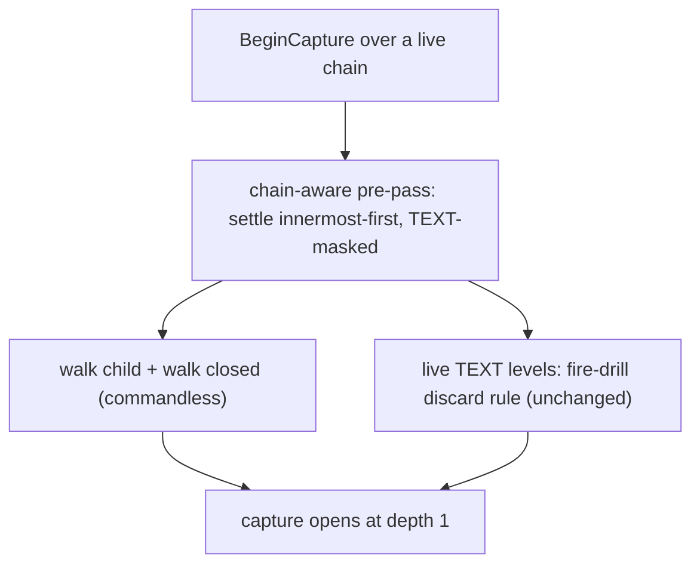

# [Plan] UX Journey Plan — Cross-surface friction & routing repairs

- **Date**: 2026-11-16
- **Kind**: UX journey plan — user stories, journeys, flows, wiring
  contract for the round's cross-surface fixes: the dropdown
  zero-height guard (#753), the menu-routed conversion-arm no-ops
  (#832), the settings armed strip's view-switch disarm (#836), the
  find/palette verb-naming alignment (#772), the one-shot target
  consumption fix (#763), and the Replace-cell × walk-child
  composition (#712). No implementation decisions beyond the command
  contract.
- **Origin**: the round-8 intake (recorded in the round plan
  `.artifacts/plans/2026-11-16-gui-review-round8-plan.md` §4 — these
  six are bug-class items with user-visible failure modes; the pure
  enablers #715/#716/#762 stay on the machinery lane per §6).
  Format/framework: `docs/ux_planning.org` +
  `.artifacts/templates/ux-journey-plan.md`.
- **Status**: ACCEPTED — the user accepted the round-8 plan set on 2026-11-16; dispatch may chunk from it (round plan §7,
  chunk 8, last: it sees the other chunks' final Dropdown and route
  grammar).
- **Surfaces touched**: `ui/widgets/dropdown.slint` (or the
  DropdownFlyout host), `src/adapter.rs` (the route one-shot table,
  the effect-interpret arm, `begin_capture`), `src/view_state.rs`
  (the settings disarm + the chain pre-pass), `ui/views/settings-view.slint`,
  `crates/taskboard-app/src/cli.rs` (the `find` alias),
  `src/router.rs` (the conversion routes)
- **Platform scope**: desktop (all six are desktop-surface
  behaviors; recorded per story)

## 1. Scope & goals

Six latent defects stop lying: a dropdown opened with nothing to show
no longer renders a zero-height panel (#753); the menu-routed convert
verbs actually convert (#832); leaving Settings disarms its armed
strip (#836); `find` and the palette admit they are the same engine
(#772); an interleaved dispatch can no longer eat a confirm's target
(#763); and starting a capture over a live walk closes the walk
instead of slipping beneath it (#712). Each fix is small and
adapter/widget-side; each carries a typed reproduction test written
first.

**Non-goals** (each with a home):

- No new dropdown sites, no flyout-grammar redesign (#762's
  modal-mount enabler stays on the machinery lane). Home: round plan
  §6.
- No undo-grammar changes (the armed strips' staging stands; #836
  only adds the view-switch disarm). Home: §3 US-3.
- No CLI verb renames (#772 lands as the non-breaking alias +
  cross-reference; a rename is the user's call at acceptance). Home:
  §3 US-4.

## 2. Capability × surface matrix

| Capability | Board | TaskDetail | Today | Review | Settings | Capture | CLI |
|---|---|---|---|---|---|---|---|
| app.dropdown (the shared flyout's empty-model guard) | E (US-1 — the switcher's inert open on a zero-board install; evidence extension) | — (R-1) | — (R-1) | — (R-1) | E (US-1 — any settings flyout inherits the guard) | — (R-1) | — (R-1) |
| habit.convert_to_series / task.recur_convert_to_habit (menu-routed arms) | E (US-2 — the card menu's Convert ▸ children become real, composing with task-card-controls' submenus) | E (US-2 — the detail recur row's twin) | E (US-2 — the habit rows' twin) | — (R-2) | — (R-2) | — (R-2) | U (the T-24/RC-3 registers stand) |
| connection.remove / board.detach / board.unbind_files (armed grammar) | — (R-1) | — (R-1) | — (R-1) | — (R-1) | X/E (US-3 — the strips disarm on leaving Settings; evidence extension) | — (R-1) | X/E (pre-existing) |
| palette.search (the naming alignment) | E (global, pre-existing) | E (global) | E (global) | E (global) | E (global) | E (US-4 — the cross-reference; evidence extension) | E (US-4 — `find` gains the `search` alias; one ranking, one admitted name-pair) |
| capture.quick (the Replace composition) | E (global) | E (global) | E (global) | E (global) | E (global) | E (US-6 — the walk child closes before capture opens) | U (T-24 stands) |
| app.routing (the one-shot consumption) | E (US-5 — the fix is route-wide; every armed journey's escape is the proof) | E (US-5) | E (US-5) | — (R-1) | — (R-1) | — (R-1) | — (R-1) |

**Rulings** (every deliberate absence):

| ID | Ruling | Reason | Home |
|---|---|---|---|
| R-1 | The routing/dropdown fixes carry no new capability mounts | They repair existing seams (the census rows' evidence extends); no new verb, no new site. | this plan §1 |
| R-2 | The convert arms gain no kiosk leg | The conversion journeys are the habit/recur families' desktop journeys (the census mount grammar; the kiosk disabled affordances stand unchanged). | this plan §2; the r1 grammar |

## 3. User stories

### US-1 — A dropdown with nothing to show does not open (#753)

- **Story**: As a user on a fresh install I want the switcher flyout
  to stay closed when there are no boards so that no zero-height
  panel ever renders.
- **Platforms**: desktop.
- **Entry points**: the shared Dropdown's open paths (the board
  switcher's field/flyout; the target-free `BoardSelect` stroke; any
  future site inherits the guard).
- **Priority**: P2
- **Acceptance**:
  - AC-1: Given a zero-row model, When an open path fires, Then the
    flyout does not mount (the guard) and the open is the typed
    no-op — verified by journey test (the mount fact).
  - AC-2: Given a non-empty model, When the flyout opens, Then the
    behavior is unchanged (the guard is the empty branch only) —
    verified by the existing dropdown tests standing.
  - AC-3 (the rejected alternative, recorded): no empty-state row —
    a fake row invites activating nothing. The guard is the decision.

### US-2 — The menu-routed convert verbs convert (#832)

- **Story**: As a user invoking "Convert to repeating task"/"Convert
  to habit" from the menu or palette I want the conversion strip to
  arm — the same verb from the same menu must not silently do
  nothing.
- **Platforms**: desktop.
- **Entry points**: `ActionId::HabitConvertArm`/`SeriesConvertArm`
  from the menu/palette (the GLOBAL rows) — routed to the real
  arming seams (the habit row's armed-strip flag; the recur row's
  convert target), subject-resolved (the focused habit row / focused
  series task; no subject → the typed `NoTarget`).
- **Priority**: P2
- **Acceptance**:
  - AC-1: Given a focused habit row, When `HabitConvertArm` routes
    from the menu, Then the row's armed strip arms (identical to the
    row button's arm; the unconditional `Vec::new()` arm is gone) —
    verified by journey test (the armed fact).
  - AC-2: Given a focused series task, When `SeriesConvertArm`
    routes, Then the recur row's convert target arms — verified by
    journey test.
  - AC-3: Given no resolvable subject, When either id fires, Then
    the typed `NoTarget` surfaces (never silence) — verified by seam
    test.
  - AC-4: Given the confirm step, When it fires after the arm, Then
    the existing conversion confirm routes (the #763 fix guarantees
    the target survives interleaving — US-5's test composes) —
    verified by journey test.

### US-3 — Leaving Settings disarms the armed strip (#836)

- **Story**: As a user who armed a remove in Settings and switched
  away, I want the strip disarmed when I return, so that a stale
  armed stage never waits for a forgotten confirm.
- **Platforms**: desktop.
- **Entry points**: the settings view's close/switch seam (the
  unmount path — the disarm rides it).
- **Priority**: P2
- **Acceptance**:
  - AC-1: Given an armed item, When the settings view closes, Then
    the armed identity clears (the adapter-owned flag) — verified by
    seam test.
  - AC-2: Given the disarm, When the user returns, Then no strip
    renders and arming works fresh — verified by journey test.
  - AC-3: Given the armed strip inside Settings, When nothing
    switches, Then the arm/confirm grammar is unchanged (the r2
    tests stand) — verified by the existing armed tests standing.

### US-4 — `find` and the palette admit they are one engine (#772)

- **Story**: As a user I want the CLI search verb and the GUI palette
  to cross-reference each other so that the one ranking does not hide
  behind two anonymous names.
- **Platforms**: both.
- **Entry points**: the CLI `find` subcommand gains the `search`
  alias (clap alias — non-breaking; `find` stays primary); the
  palette's affordance text/hint cross-references `taskboard find`
  (presentation text — judged, never asserted).
- **Priority**: P3
- **Acceptance**:
  - AC-1: Given the CLI, When `taskboard search <query>` runs, Then
    it behaves identically to `taskboard find <query>` (the alias)
    — verified by app-arm test.
  - AC-2: Given the census row, When the chunk lands, Then the
    CLI cell's evidence names the alias (the two-names finding
    closed by the recorded pair) — verified by the census update.
  - AC-3 (the recorded alternative): a full rename is the user's
    call at acceptance; the alias is the default because it breaks
    nothing.

### US-5 — An interleaved dispatch cannot eat a confirm's target (#763)

- **Story**: As a user mid-armed-flow I want unrelated dispatches to
  leave my flow's target alone, so that arm → (anything) → confirm
  always confirms what I armed.
- **Platforms**: desktop.
- **Entry points**: `route()`'s one-shot table (the fix: the
  dispatched `ActionId`'s named consumption set — route takes only
  the one-shots its router arm declares; the armed-strip seams'
  re-arm law stays as defense-in-depth).
- **Priority**: P2
- **Acceptance**:
  - AC-1 (the reproduction, test-first): Given an armed convert (or
    detach/stop-strip) flow, When an unrelated dispatch interleaves
    (a status refresh, an unrelated verb), Then the confirm still
    routes with its original target (the take-all consumption is
    gone) — verified by journey test (the interleaving scripted
    deterministically).
  - AC-2: Given the fix, When each armed journey's own arm→confirm
    pair runs clean, Then behavior is unchanged (the per-action
    sets name exactly the arm's needs) — verified by the existing
    armed-journey tests standing.
  - AC-3: Given a one-shot whose owner flow ended, When the table
    reconciles, Then the stale one-shot clears (no leak across
    flows) — verified by seam test.

### US-6 — Capture over a live walk closes the walk (#712)

- **Story**: As a user starting a capture while a review-walk child
  is armed, I want the walk to close (its commandless close) before
  capture opens, so that no half-settled walk survives beneath.
- **Platforms**: desktop.
- **Entry points**: `BeginCapture` (the Replace cell) — the
  chain-aware pre-pass: settle every flow level innermost-first
  (each level by its own kind rule; the walk's commandless close)
  **except live TEXT levels** (the capture fire-drill keeps its
  discard-over-TEXT semantics), then capture at depth 1.
- **Priority**: P2
- **Acceptance**:
  - AC-1: Given the walk with a File-to/date child armed, When
    `BeginCapture` fires, Then the child and the walk close (no walk
    layer survives) and the capture overlay opens — verified by
    journey test (the chain depth after the replace).
  - AC-2: Given a live TEXT flow (the title editor), When
    `BeginCapture` fires, Then the text flow settles by the
    fire-drill's discard rule (unchanged semantics — the mask works)
    — verified by the existing capture-over-flow tests standing.
  - AC-3: Given capture open over the closed walk, When capture
    dismisses, Then the restored root is the walk's parent view (not
    a phantom walk) — verified by journey test.

## 4. Journey specs

### US-1 — The empty-model guard

| Step | Surface & affordance | User action | Dispatches | System response | Escape / failure |
|---|---|---|---|---|---|
| US-1/S1 | the switcher (zero boards) | the open gesture / the target-free stroke | the open route | **no flyout mounts** (the typed no-op) | the guard is the escape; a populated model opens as today |

### US-2 — The conversion arms

| Step | Surface & affordance | User action | Dispatches | System response | Escape / failure |
|---|---|---|---|---|---|
| US-2/S1 | menu/palette → Convert ▸ child (or the direct ids) | invoke the arm | `ActionId::HabitConvertArm`/`SeriesConvertArm` → the real arming seams (subject-resolved) | the row's armed strip arms (the conversion grammar's stage 1) | no subject → typed `NoTarget`; Escape disarms |
| US-2/S2 | the armed strip | confirm | the conversion verb (the existing route) | the conversion commits (the owning family's journey) | the US-5 guarantee: interleaving cannot eat the target |

### US-3 — The settings disarm

| Step | Surface & affordance | User action | Dispatches | System response | Escape / failure |
|---|---|---|---|---|---|
| US-3/S1 | settings, an armed strip | switch views (the close seam) | — (the disarm) | the armed identity clears; returning shows no strip | arming again works fresh (the r2 grammar) |

### US-4 — The naming pair

| Step | Surface & affordance | User action | Dispatches | System response | Escape / failure |
|---|---|---|---|---|---|
| US-4/S1 | CLI | `taskboard search <query>` | the `find` route (the alias) | identical output to `find` | the alias carries `find`'s own refusals |

### US-5 — The one-shot consumption fix

| Step | Surface & affordance | User action | Dispatches | System response | Escape / failure |
|---|---|---|---|---|---|
| US-5/S1 | an armed flow | interleave an unrelated dispatch, then confirm | the interleaved verb's route; then the confirm's route | the confirm routes with the original target (the per-action consumption set) | a foreign settle still disarms by law (the settle rules unchanged — the fix governs target *consumption*, not settle) |

### US-6 — The Replace pre-pass

| Step | Surface & affordance | User action | Dispatches | System response | Escape / failure |
|---|---|---|---|---|---|
| US-6/S1 | capture over a live walk child | fire `BeginCapture` | the capture open (existing) | the walk levels close innermost-first (commandless), capture at depth 1 | live TEXT levels keep the discard rule (the mask); dismiss restores the parent view |

## 5. Interaction flows

The Replace pre-pass (the chain fold):

## 6. Wiring inventory

| ID | Surface file | Widget | Callback | Adapter seam | ActionId | Commands | Row addressing | Journey steps | Test |
|---|---|---|---|---|---|---|---|---|---|
| W-1 | ui/widgets/dropdown.slint (or the flyout host), src/adapter.rs | the empty-model guard | — | the open paths' zero-row guard (`// slint:` per the #782 fold) | — (guard — reason: no new affordance) | — | the open route | US-1/S1 | journeys.rs::us1_ac1_zero_row_open_mounts_nothing |
| W-2 | src/adapter.rs (the effect-interpret arm), src/router.rs | the conversion routes | — | the `HabitConvertArm`/`SeriesConvertArm` effect arm routes the real seams (subject-resolved) | ActionId::HabitConvertArm; ActionId::SeriesConvertArm | (the conversion verbs' existing commands) | the focused habit row / series task via the id tables | US-2/S1–S3 | journeys.rs::us2_ac1_menu_convert_arm_arms_the_row_strip |
| W-3 | src/view_state.rs / src/adapter.rs, ui/views/settings-view.slint | the view-switch disarm | — | the settings unmount path clears `armed_item` | — (disarm — reason: no new affordance) | — | the armed identity | US-3/S1–S2 | journeys.rs::us3_ac1_leaving_settings_disarms_the_strip |
| W-4 | crates/taskboard-app/src/cli.rs | the `search` alias | — | the clap alias on the find subcommand | — (CLI) | — (the find route) | — | US-4/S1 | set/find app-arm tests::us4_ac1_search_alias_matches_find |
| W-5 | src/adapter.rs (route) | the per-action consumption set | — | the one-shot table gains the per-action declaration (the fix) | — (machinery — reason: route repair) | — | the one-shot table | US-5/S1–S3 | journeys.rs::us5_ac1_interleaved_dispatch_spares_the_confirm_target |
| W-6 | src/adapter.rs (begin_capture), src/view_state.rs | the chain-aware pre-pass | — | the Replace cell's fold with the TEXT mask (the D-H4 letter) | — (route repair) | — | the flow chain | US-6/S1–S3 | journeys.rs::us6_ac1_capture_over_a_walk_child_closes_the_walk |

## 7. Command-contract delta

**None.** All six fixes repair existing seams and routes; every verb,
id, and request already exists. (US-4's alias is a CLI surface
spelling, not a new engine verb; US-5's consumption set is
adapter-internal policy.)

| Kind | Name | Payload sketch | Journeys |
|---|---|---|---|
| — | (delta-free plan) | the §6 rows carry `—`/existing tokens only; the reproduction tests are the delta's proof-of-need | US-1..US-6 |

## 8. Verification plan

- **Journey tests** (step-ID-named, test-first per US-5/AC-1 and
  US-2/AC-1's reproductions):
  `us1_ac1_zero_row_open_mounts_nothing`,
  `us2_ac1_menu_convert_arm_arms_the_row_strip`,
  `us2_ac3_subjectless_convert_surfaces_no_target`,
  `us3_ac1_leaving_settings_disarms_the_strip`,
  `us5_ac1_interleaved_dispatch_spares_the_confirm_target`,
  `us6_ac1_capture_over_a_walk_child_closes_the_walk`,
  `us6_ac3_capture_dismiss_restores_the_parent_view`.
- **Seam/app-arm tests**: the `search` alias ≡ `find` (US-4); the
  stale one-shot reconciliation (US-5/AC-3); the convert confirms
  composing with US-5's guarantee (US-2/AC-4).
- **Fold/presentation tests**: the guard's mount fact; the disarm
  fact — typed, never text.
- **Kiosk gates**: none new (R-2). Recorded.
- **Manual**: the palette's cross-reference wording (US-4) judged at
  walkthrough.
- **#760 fold**: stage 3 cross-checks every §6 row against
  `tests/seam_inventory.rs`.

## 9. Definition of done

- [ ] `scripts/ux-coverage.sh <this file> --gate` exits 0 (the
  delta-free §7 is the plan's declared posture; the gate's row checks
  resolve against the §6 tokens)
- [ ] Every P2/P3 story's journey completes end-to-end including
  escapes; the reproductions (US-2/AC-1, US-5/AC-1) were written
  first and failed before their fixes
- [ ] Walkthrough protocol executed at stage 3; the doctrine bar held
  (the armed grammars and settle laws survive every fix — AC-2/AC-3
  guards on each)
- [ ] Census cells updated: the dropdown-guard evidence (#753), the
  conversion arms' menu-route evidence (#832), the settings disarm
  evidence (#836), `palette.search`'s alias evidence (#772), the
  route-consumption note (#763), the Replace-composition evidence
  (#712)
- [ ] Non-goals: #762/#715/#716 stay on the machinery lane (round
  plan §6); no renames beyond the alias
