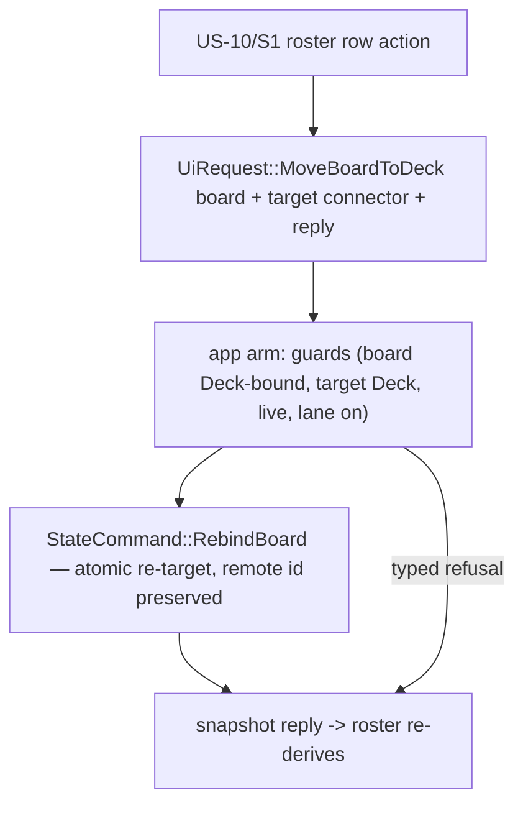
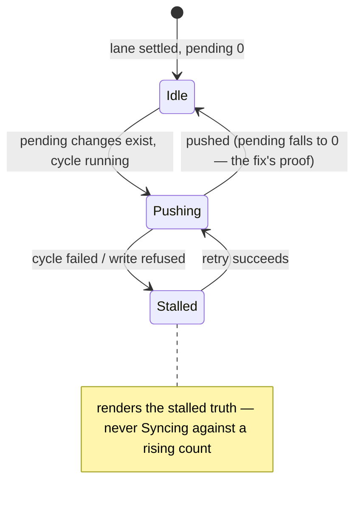

# [Plan] UX Journey Plan — Files sync status & the Settings-Files family

- **Date**: 2026-11-16
- **Kind**: UX journey plan — user stories, journeys, flows, wiring
  contract for the files-sync family round 8: the status chip's honest
  tones, the sync-pending investigation (N-19), and the Settings-Files
  UX gap set (#741/#743/#745/#748/#749/#750) plus the publish-picker
  flyout site (#746) and the Deck-to-Deck rebind ceremony (#756). No
  implementation decisions beyond the command contract.
- **Origin**: the operator's round-8 notes N-18, N-19 (recorded in the
  round plan `.artifacts/plans/2026-11-16-gui-review-round8-plan.md`
  §1) + the intake issues above. Format/framework:
  `docs/ux_planning.org` + `.artifacts/templates/ux-journey-plan.md`.
- **Status**: ACCEPTED — the user accepted the round-8 plan set on 2026-11-16; dispatch may chunk from it (round plan §7,
  chunk 6, parallelizable with chunks 3–5). The N-19 investigation is
  the chunk's first work item: its findings gate the fix design
  (recorded as this plan's US-2).
- **Surfaces touched**: `ui/compositions/status-bar.slint` (the chip),
  `ui/views/settings-view.slint` (the Files card, the roster rows, the
  publish busy window, the env-lock captions),
  `src/presentation.rs` (the chip state/tone folds),
  `src/adapter.rs` (the settings seams), `src/models.rs`,
  `crates/taskboard-app/src/ui_requests.rs` (the ceremony arms) +
  `crates/taskboard-domain/src/messages.rs` (the #756 rebind delta
  only), `crates/taskboard-sync-files-nextcloud/` (the N-19
  investigation)
- **Platform scope**: desktop (Settings is desktop; the chip renders
  in the status bar — its kiosk posture is display-only and unchanged)

## 1. Scope & goals

The status bar's files-sync chip stops crying wolf: the healthy
`Ok` state renders as a neutral status (no warning tone, no `!`
badge), warning tones are reserved for the states that are warnings,
and danger stays on `Forked` (N-18 — the chip *is* the sync status
indicator; it conveys the files-sync lane's health, and the round
plan records that answer). The operator's live sync failure — two
boards showing Syncing/Idle while the pending count only rises and
only `identity.json` lands in the Nextcloud folder (N-19) — is
diagnosed and fixed, with the pending count returning to zero as the
user-visible proof. The Settings-Files gaps close: the mount
auto-list gains failure backoff (#741), the Files row's env-lock
caption becomes per-key (#743), the publish ceremony shows per-row
progress instead of a full-page disable (#745), the move ceremony's
undo window is exposed in the GUI (#748), the files-bound roster's
disconnect story is re-verified against the landed r7 roster and
closed or repaired (#749), per-board adoption state renders on the
Files card (#750), the Deck publish picker gets its proper flyout
site (#746), and a board can move between two Deck connectors
(#756 — the round's one true engine delta).

**Non-goals** (each with a home):

- No multi-account files lanes (#723 stands — R-3's honest captions
  remain the posture). Home: census R-3.
- No new `Tone` variants (the chip fix maps onto the existing
  neutral/info/warning/danger vocabulary). Home: §3 US-1.
- No redesign of the move ceremony itself (#748 exposes the
  *existing* `MoveStage::DeckRetired` undo window; #718's GC and
  #755's leftover design stay homed). Home: §3 US-6.
- No kiosk work: the Settings surface is desktop; the chip's kiosk
  posture (display-only) is unchanged. Home: recorded per story.

## 2. Capability × surface matrix

| Capability | Board | TaskDetail | Today | Review | Settings | Capture | CLI |
|---|---|---|---|---|---|---|---|
| files.sync_status_display (the status-bar chip) | D (US-1 — the chip is global; the Ok state is neutral) | D (US-1) | D (US-1) | D (US-1) | D (US-1) | D (US-1) | D (pre-existing, the files-sync log/status output) |
| files.sync_pending_display (the per-board pending count) | — (R-1) | — (R-1) | — (R-1) | — (R-1) | D (US-2 — the count proves the fix: it falls as pushes land) | — (R-1) | D (pre-existing status output) |
| board.remote_list (failure backoff) | — (R-1) | — (R-1) | — (R-1) | — (R-1) | E (US-3 — the auto-list backs off typed after failures; the manual refresh stays) | — (R-1) | E (pre-existing, `boards list`) |
| files.sync_enabled_set (per-key env-lock display) | — (R-1) | — (R-1) | — (R-1) | — (R-1) | D (US-4 — the lock captions name the pinned key(s)) | — (R-1) | E (pre-existing, `config set`) |
| board.publish (per-row progress phase) | — (R-1) | — (R-1) | — (R-1) | — (R-1) | E (US-5 — the addressed card shows the ceremony phase; the page stays usable) | — (R-1) | E (pre-existing, `boards publish`) |
| board.move_to_files (undo window) | — (R-1) | — (R-1) | — (R-1) | — (R-1) | E (US-6 — an interrupted move in the `DeckRetired` window offers Restore) | — (R-1) | E (pre-existing, `boards move --undo`) |
| board.unbind_files (Stop Sync — re-verified) | — (R-1) | — (R-1) | — (R-1) | — (R-1) | X (pre-existing r7 roster row — US-7 verifies and closes #749 or repairs residue) | — (R-1) | X (pre-existing, `boards unbind`) |
| files.adoption_state_display (per-board adopting/adopted) | — (R-1) | — (R-1) | — (R-1) | — (R-1) | D (US-8 — the Files card's rows carry the phase) | — (R-1) | D (pre-existing status output) |
| board.publish (picker flyout site) | — (R-1) | — (R-1) | — (R-1) | — (R-1) | E (US-9 — the publish picker anchors at the Deck card, the site grammar's letter) | — (R-1) | E (pre-existing) |
| board.rebind_deck (new: move a board between Deck connectors) | — (R-1) | — (R-1) | — (R-1) | — (R-1) | E (US-10 — the roster row's "Move to this Connection" for Deck-bound boards on another Deck account) | — (R-1) | E (US-10 — the CLI twin rides the same ceremony) |

**Rulings** (every deliberate absence):

| ID | Ruling | Reason | Home |
|---|---|---|---|
| R-1 | The files family has no cells outside Settings (+ the global status chip) | The r7 roster's own mount ruling (R-1: binding actions live only in the Settings account roster) stands; this plan extends evidence inside it, never widens the mount. | census Settings/files rulings |
| R-2 | The chip's persistent display stays (only the tones change) | The chip is the sync status indicator the operator asked it to live with — persistent presence is recognition (the lane's health is always visible); the defect was the warning costume on a healthy state, not the persistence. | this plan §1, §3 US-1 |
| R-3 | #756's ceremony enters through the roster, not the connection card | The roster row is where a board's binding story lives (the r7 grammar); a connector-level "adopt everything" affordance would re-scatter board verbs (the G4 pattern). | this plan §3 US-10 |

## 3. User stories

### US-1 — The chip's tones tell the truth (N-18)

- **Story**: As a user I want the files-sync chip to look healthy
  when it is healthy so that a warning badge means something.
- **Platforms**: both (the chip renders in the status bar wherever
  that renders; display-only on kiosk, unchanged).
- **Entry points**: the chip (display-only; no entry point).
- **Priority**: P1
- **Acceptance**:
  - AC-1: Given `FilesSyncChipState::Ok`, When the chip renders, Then
    the model carries the neutral/info tone and no warning badge flag
    (the `"!"` badge and `Semantic.warning` caption move to the
    warning states) — verified by presentation test (the tone/flag
    fold per state, typed).
  - AC-2: Given `CycleFailed`/`Parked`/`Diverged`, When the chip
    renders, Then the warning tone + badge hold (the current costume
    becomes the warning states' costume); given `Forked`, the danger
    tone holds — verified by presentation test (the five-state fold).
  - AC-3: Given any state, When the chip renders, Then the caption
    vocabulary is unchanged (the captions already name the states
    honestly — the fix is tone, not words) — verified by the existing
    caption tests standing.

### US-2 — The sync-pending investigation and fix (N-19, P1 — live data at risk)

- **Story**: When my files-synced boards' pending count only rises
  while the indicators claim Syncing/Idle, I want the sync to actually
  write the boards' files so that the Nextcloud folder holds my data
  and the pending count returns to zero.
- **Platforms**: desktop (the surface); the engine lanes are
  surface-free.
- **Entry points**: the diagnosis rides the reported setup (two boards
  files-bound; 165/8 pending; only `identity.json` per board in the
  remote subtree). The user-visible proof: edits to a files-bound
  board land as board files in the Nextcloud folder and the per-board
  pending count falls to zero.
- **Priority**: P1
- **Acceptance**:
  - AC-1 (the diagnosis, stage-2 recorded): Given the reported
    posture, When the investigation completes, Then the root cause is
    recorded in the chunk plan (typed findings: which lane stage
    drops the writes — the push cycle's derivation, the anchor
    resolution, or the lane's board-set derivation) with a
    reproducing test — verified by the reproduction test existing
    before the fix.
  - AC-2 (the fix): Given a files-bound board with pending changes,
    When a sync cycle runs, Then the board's files are written to the
    remote subtree and the pending count decrements to zero —
    verified by an engine/integration test (hermetic: a temp remote
    fixture, no network, the pause/advance clock law for any
    polling).
  - AC-3 (the honest indicator): Given a stalled lane, When the
    cycle cannot push, Then the per-board state renders the stalled
    truth (the Syncing/Idle vocabulary gains the stalled truth from
    the chip's state ladder — no state may claim Syncing while the
    pending count rises cycle over cycle) — verified by a
    presentation fold test.

### US-3 — The mount auto-list backs off (#741)

- **Story**: As a user with an unreachable server I want the settings
  mount auto-list to back off after failures so that every visit does
  not re-fail the same listing.
- **Platforms**: desktop.
- **Entry points**: the settings mount auto-list (the connector
  cards' listing without a stored roster); the manual refresh button
  overrides the backoff (explicit intent).
- **Priority**: P2
- **Acceptance**:
  - AC-1: Given a connector whose auto-list failed, When the settings
    view remounts within the backoff window, Then no new listing
    request fires (the typed backoff state suppresses it) and the
    card renders the failed truth with the retry posture — verified
    by seam test (the request count, typed).
  - AC-2: Given the backoff active, When the user clicks refresh,
    Then the listing fires (explicit intent overrides) and the
    backoff re-arms on failure — verified by journey test.
  - AC-3: Given a successful listing, When it lands, Then the backoff
    clears and the roster renders as today — verified by seam test.

### US-4 — The Files row's env-lock captions are per-key (#743)

- **Story**: As a user with only `files_sync.anchor` env-pinned I
  want the lock caption to name the pinned key so that I know the
  enabled toggle is still file-controlled.
- **Platforms**: desktop.
- **Entry points**: the Files row's lock caption(s) (driven from the
  snapshot's per-key env facts).
- **Priority**: P2
- **Acceptance**:
  - AC-1: Given any combination of env-pinned `files_sync.enabled`
    and `files_sync.anchor`, When the Files row renders, Then the
    caption state names exactly the pinned key set (per-key bits in
    the row model; the r5 typed-refusal posture composes — an edit to
    a pinned key still refuses typed) — verified by presentation test
    (the bit combination, typed).

### US-5 — The publish ceremony shows per-row progress (#745)

- **Story**: As a user publishing a board I want the addressed Deck
  card to show the ceremony phase so that the rest of Settings stays
  usable and I know where the 60-second adoption budget is.
- **Platforms**: desktop.
- **Entry points**: the publish action's pending window (the existing
  `PendingKind` lane) — the addressed card renders the phase; the
  full-page disable is replaced by the card-local busy state.
- **Priority**: P2
- **Acceptance**:
  - AC-1: Given a publish in flight, When the ceremony progresses,
    Then the addressed card's row model carries the phase (the
    typed `MoveStage`/pending phases — the #750 grammar's sibling)
    and the page's other controls stay enabled — verified by
    presentation test (the phase fold) + seam test (no full-page
    disable flag).
  - AC-2: Given the ceremony failed or completed, When the reply
    lands, Then the phase renders the terminal truth and the busy
    state clears (the existing typed-error fold) — verified by the
    existing outcome tests extended.

### US-6 — The move ceremony's undo window is exposed (#748)

- **Story**: As a user whose Deck→Files move was interrupted in the
  retirement window I want a Restore affordance so that I do not need
  the CLI to undo the half-done ceremony.
- **Platforms**: desktop.
- **Entry points**: the Files card's per-board row (the #750 row
  grammar): when the derived move stage sits in the undo window
  (`MoveStage::DeckRetired`), the row offers Restore; outside the
  window the row renders its normal grammar (typed refusal posture —
  `UndoClosed`-class states render honestly, no affordance).
- **Priority**: P2
- **Acceptance**:
  - AC-1: Given an interrupted move inside the window, When the Files
    card renders, Then the row offers Restore and activating it
    restores the Deck binding (the `boards move --undo` ceremony's
    twin, dispatched as a request with the snapshot reply) — verified
    by journey + app-arm test.
  - AC-2: Given a move outside the window (or no move), When the row
    renders, Then no Restore affordance mounts (the window is the
    affordance's mount condition — withholding, not greying) —
    verified by presentation test.

### US-7 — The files-bound disconnect story re-verified (#749)

- **Story**: As a user I want the files-bound roster rows' disconnect
  story to be complete so that the #749 asymmetry is closed by
  evidence or by the missing piece.
- **Platforms**: desktop.
- **Entry points**: the r7 roster's Stop Sync rows (landed — the
  round-6 overturn is the census's recorded history).
- **Priority**: P2
- **Acceptance**:
  - AC-1: Given the landed roster, When stage 2 re-derives #749's
    premise against it, Then the issue closes with the evidence
    comment (Stop Sync on every files-bound row; the guard shape
    documented) — or, if a genuine residue surfaces (e.g. a
    files-bound row outside the roster's reach), the residue is
    fixed under this story's grammar — verified by the issue's
    closing comment (stage 3 bookkeeping) or the residue's own
    tests.

### US-8 — The Files card shows per-board adoption state (#750)

- **Story**: As a user watching a board adopt across devices I want
  the Files card's row to show adopting/adopted so that a mid-move
  device is distinguishable from a settled one.
- **Platforms**: desktop.
- **Entry points**: the Files card's board rows (the
  `FilesSyncStatus` watch folded into the row model — the #750
  letter).
- **Priority**: P2
- **Acceptance**:
  - AC-1: Given a board mid-adoption, When the Files card renders,
    Then the row carries the adopting phase (typed state, the badge
    fold); given a settled board, the adopted/bound truth renders —
    verified by presentation test (the phase fold per state).

### US-9 — The publish picker anchors at its card (#746)

- **Story**: As a user opening the publish picker I want it anchored
  beside the Deck card's rows (the flyout-site grammar) so that the
  picker reads as part of the card, not a detached list.
- **Platforms**: desktop.
- **Entry points**: the Deck card's publish pick — the picker mounts
  at the card (the site-grammar audit's letter: site 1 beside the
  remote rows' site 0).
- **Priority**: P3
- **Acceptance**:
  - AC-1: Given the publish pick, When the picker opens, Then it
    anchors at the Deck card per the flyout-site grammar (the audit's
    decision recorded in the site table) — verified by the site
    grammar's tests + a presentation fact (the anchor site).

### US-10 — Move a board between two Deck connectors (#756)

- **Story**: As a user with two Deck accounts I want to move a board
  bound to one Deck connector to the other so that re-homing a board
  never needs unbind-and-rebind by hand (with the ownership window
  that creates).
- **Platforms**: desktop (the roster rows); the CLI twin rides the
  same ceremony.
- **Entry points**: the roster row's "Move to this Connection" action
  on a Deck-bound board rendered under another Deck account's card
  (the "Synced via other Connection" rows — the badge's honest state
  becomes actionable); the CLI verb (the ceremony's text twin).
- **Priority**: P2
- **Acceptance**:
  - AC-1: Given a Deck-bound board on Deck account A rendered under
    Deck account B's card (the anchor/lane preconditions per R-3's
    grammar), When "Move to this Connection" activates, Then the
    rebind ceremony dispatches (the §7 delta) and the board's binding
    re-targets connector B with the remote identity preserved —
    verified by journey + app-arm test (the exact ceremony commands;
    the remote id unchanged).
  - AC-2: Given the ceremony refused (target not live, lane off,
    non-Deck binding), When it runs, Then the typed refusal renders
    (the existing typed-error fold) and nothing rebinds — verified by
    app-arm test.
  - AC-3: Given the move, When it completes, Then the roster's badges
    re-derive (the row now reads "Synced via this Connection" under
    B) — verified by presentation fold test.

## 4. Journey specs

### US-1 — The chip's honest tones

| Step | Surface & affordance | User action | Dispatches | System response | Escape / failure |
|---|---|---|---|---|---|
| US-1/S1 | the status-bar chip | — display only | — display only | the state's honest tone/flag (Ok neutral, warnings warning, Forked danger) | display only |

### US-2 — The sync-pending investigation and fix

| Step | Surface & affordance | User action | Dispatches | System response | Escape / failure |
|---|---|---|---|---|---|
| US-2/S1 | a files-bound board | edit tasks (any verb) | the verbs' own dispatches | the pending count rises (today's truth), then **falls as pushes land** (the fix) | a stalled cycle renders the stalled truth (AC-3) — the indicator may never claim Syncing against a rising count |
| US-2/S2 | the Nextcloud folder | — (the user's check) | — | the board's files exist beside `identity.json` | the diagnosis/fix gate: AC-1's reproducing test exists first |

### US-3 — Auto-list backoff

| Step | Surface & affordance | User action | Dispatches | System response | Escape / failure |
|---|---|---|---|---|---|
| US-3/S1 | settings mount (failed connector) | visit settings | — (the auto-list suppressed within the backoff) | the card renders the failed truth + retry posture | the manual refresh overrides (S2) |
| US-3/S2 | the connector card | click refresh | `UiRequest::ListRemoteBoards` (existing) | the listing fires; success clears the backoff, failure re-arms | typed refusals via the outcome lane |

### US-4 — Per-key env-lock captions

| Step | Surface & affordance | User action | Dispatches | System response | Escape / failure |
|---|---|---|---|---|---|
| US-4/S1 | the Files row | — display only | — | the per-key lock captions (the pinned set named) | display only; edits to pinned keys still refuse typed (r5 D-3) |

### US-5 — The publish ceremony's per-row phase

| Step | Surface & affordance | User action | Dispatches | System response | Escape / failure |
|---|---|---|---|---|---|
| US-5/S1 | the Deck card | activate publish | `UiRequest::PublishBoard` (existing) | the card renders the ceremony phase; the page stays usable | the typed-error fold on failure; the page's controls never disabled wholesale |

### US-8 — The adoption phase

| Step | Surface & affordance | User action | Dispatches | System response | Escape / failure |
|---|---|---|---|---|---|
| US-8/S1 | the Files card rows | — display only | — | the adopting/adopted phase per row | display only |

### US-6 — The undo window

| Step | Surface & affordance | User action | Dispatches | System response | Escape / failure |
|---|---|---|---|---|---|
| US-6/S1 | the Files row in the undo window | click Restore | the undo request (the `boards move --undo` ceremony's twin; §7) | the Deck binding restores; the row re-derives | outside the window the affordance withholds (no dead control); typed refusal on a raced stage |

### US-7 — The files-bound disconnect story re-verified

| Step | Surface & affordance | User action | Dispatches | System response | Escape / failure |
|---|---|---|---|---|---|
| US-7/S1 | the roster's files-bound rows | exercise Stop Sync (the landed r7 action) | `UiRequest::StopBoardFilesSync` (pre-existing) | the unbind works with its armed-confirm staging (the r2 grammar) | the verification's outcomes: either the issue closes with this evidence, or a surfaced residue gets its own fix + test under this grammar |

### US-9 — The publish picker's site anchor

| Step | Surface & affordance | User action | Dispatches | System response | Escape / failure |
|---|---|---|---|---|---|
| US-9/S1 | the Deck card's publish pick | open the picker | `UiRequest::ListRemoteBoards` (the picker's data, existing) | the picker mounts anchored at the Deck card (the site grammar's letter) | Escape / outside click closes per the flyout dismissal contract |

### US-10 — Deck-to-Deck rebind

| Step | Surface & affordance | User action | Dispatches | System response | Escape / failure |
|---|---|---|---|---|---|
| US-10/S1 | the roster row ("Move to this Connection") | click | the rebind ceremony (§7 — the request → the app arm → the engine verb) | the binding re-targets; the remote identity preserved; badges re-derive | typed refusals (precondition gates); the ceremony is atomic — no unowned window |
| US-10/S2 | CLI twin | run the verb | the same ceremony | the same outcome | the same typed refusals |

## 5. Interaction flows

The rebind ceremony (the round's one engine delta):

The pending-truth contract (US-2's indicator law):

## 6. Wiring inventory

| ID | Surface file | Widget | Callback | Adapter seam | ActionId | Commands | Row addressing | Journey steps | Test |
|---|---|---|---|---|---|---|---|---|---|
| W-1 | ui/compositions/status-bar.slint, src/presentation.rs, src/models.rs | the chip's tone/flag folds | — | — (display only — the fold per state) | — | — (reason: pure display state) | the chip model | US-1/S1 | presentation.rs::us1_ac1_ok_state_renders_neutral_without_the_badge |
| W-2 | crates/taskboard-sync-files-nextcloud/, src (the per-board pending/state model) | the pending truth + the stalled state | — | the lane state fold into the per-board model (`// slint:` where the row model is pushed) | — | — (the engine fix is engine-tested; the surface renders the truth) | the per-board row model | US-2/S1 | the reproduction test (AC-1) + presentation.rs::us2_ac3_stalled_renders_the_stalled_truth |
| W-3 | src/adapter.rs, ui/views/settings-view.slint | the auto-list backoff | — | the mount auto-list's typed backoff state + the refresh override | — (request-side) | UiRequest::ListRemoteBoards | the connector card | US-3/S1–S2 | journeys.rs::us3_ac1_backoff_suppresses_the_auto_list |
| W-4 | ui/views/settings-view.slint, src/models.rs | per-key env-lock captions | — | the snapshot's per-key env facts → the row model bits | — | — (reason: pure display state) | the Files row model | US-4/S1 | presentation.rs::us4_ac1_the_caption_names_the_pinned_key_set |
| W-5 | ui/views/settings-view.slint, src/adapter.rs | the card-local publish phase | — | the pending lane's phase → the addressed card's row model | — | UiRequest::PublishBoard | the addressed card | US-5/S1–S2 | presentation.rs::us5_ac1_the_card_renders_the_ceremony_phase |
| W-6 | ui/views/settings-view.slint, crates/taskboard-app/src/ui_requests.rs | the Restore affordance | — | the derived move stage → the row's Restore mount; the undo request arm | — | the undo request (§7) | the Files row via its board id | US-6/S1 | ui_requests.rs::us6_ac1_restore_rebinds_deck_inside_the_window |
| W-7 | ui/views/settings-view.slint, src/models.rs | the adoption phase | — | the `FilesSyncStatus` watch → the row model | — | — (reason: pure display state) | the Files row model | US-8/S1 | presentation.rs::us8_ac1_the_row_carries_the_adoption_phase |
| W-8 | ui/views/settings-view.slint, src/adapter.rs | the publish picker's site anchor | — | the flyout-site grammar's site-1 anchor at the Deck card | — | UiRequest::PublishBoard | the Deck card | US-9/S1 | the site grammar tests + presentation.rs::us9_ac1_the_picker_anchors_at_the_card |
| W-9 | ui/views/settings-view.slint, src/adapter.rs, crates/taskboard-app/src/ui_requests.rs, crates/taskboard-domain/src/messages.rs | the rebind row action + ceremony | — | the roster row action (the r7 files-action grammar's twin) + the app arm + the engine verb (`// slint:`) | — | UiRequest::MoveBoardToDeck; StateCommand::RebindBoard | the roster row via its board id + the target connector id | US-10/S1–S3 | ui_requests.rs::us10_ac1_rebind_preserves_the_remote_identity |

## 7. Command-contract delta

| Kind | Name | Payload sketch | Journeys |
|---|---|---|---|
| UiRequest | MoveBoardToDeck | new — `{ board, target_connector, reply: oneshot<Result<SettingsSnapshot, SettingsError>> }` (the move-family shape); the app arm guards the preconditions and performs the ceremony | US-10 |
| StateCommand | RebindBoard | new — the engine's atomic rebind: `{ board, remote: RemoteBoardId::deck(<unchanged uuid>), connector: <target> }`; journal class recorded at the delta (the ceremony is its own recovery surface — the typed refusals; a mis-target re-targets back, the self-reversing letter where the remote allows) | US-10 |
| UiRequest | the move-undo request | new — the `boards move --undo` twin's request shape (`{ board, reply }`; the arm derives the stage and refuses typed outside the window) | US-6 |
| (engine) | the N-19 fix | no contract change intended — the investigation decides whether the fix is a derivation repair inside the existing push cycle (the expected shape) or a contract repair (an amended delta, recorded before the fix lands) | US-2 |

No new `ActionId` (the roster rows are the r7 pointer-grade grammar).
The chip/backoff/phase/adoption work is display- and request-side.

## 8. Verification plan

- **Journey tests** (step-ID-named):
  `us3_ac1_backoff_suppresses_the_auto_list`,
  `us3_ac2_refresh_overrides_the_backoff`,
  `us6_ac1_restore_rebinds_deck_inside_the_window`,
  `us10_ac1_rebind_preserves_the_remote_identity`,
  `us10_ac2_precondition_refusal_renders_typed`.
- **Seam/app-arm tests**: the ceremony arms (exact commands, typed
  refusals); the backoff's request counts; the N-19 reproduction test
  (hermetic remote fixture; the pause/advance clock for polling — no
  sleeps, AGENTS §5).
- **Fold/presentation tests**: the chip's five-state tone/flag fold;
  the per-key env-lock bits; the publish phase fold; the adoption
  phase fold; the stalled-truth fold — typed, never text.
- **Kiosk gates**: none new — Settings is desktop; the chip's kiosk
  posture (display) unchanged. Recorded.
- **Manual**: the operator's real Nextcloud confirms US-2's fix (the
  folder holds the boards' files; the pending counts fall); the
  chip's healthy look judged at walkthrough.
- **#760 fold**: stage 3 cross-checks every §6 row against
  `tests/seam_inventory.rs`.

## 9. Definition of done

- [ ] `scripts/ux-coverage.sh <this file> --gate` exits 0
- [ ] Every P1 story's journey completes end-to-end including escapes
  (US-1, US-2 are P1; US-2's AC-1 reproduction test precedes the fix)
- [ ] Walkthrough protocol executed at stage 3; the doctrine bar held
  (SC-W-N4's honest captions and R-3's single-lane posture stand)
- [ ] Census cells updated: the chip row minted (`files.sync_status_display`),
  the per-key lock evidence (#743), the phase evidence (#745/#750),
  the undo-window evidence (#748), the rebind rows minted (#756),
  `board.remote_list` backoff evidence (#741); #749 closes with
  evidence (C-8)
- [ ] Non-goals: #723 lanes, #718/#755 GC/leftover, no new Tones
- [ ] The N-19 root-cause record + the operator's manual confirmation
  filed on the chunk report
