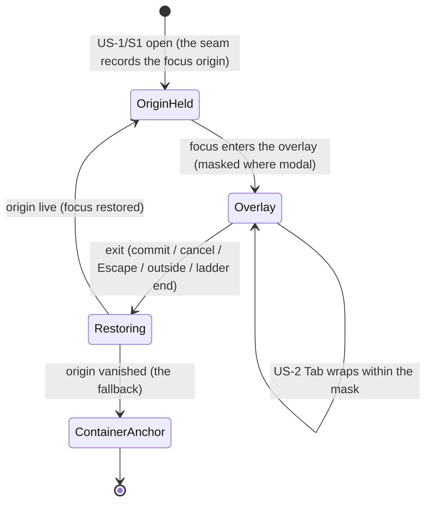

# [Plan] UX Journey Plan — Focus restoration & modal containment

- **Date**: 2026-11-16
- **Kind**: UX journey plan — user stories, journeys, flows, wiring
  contract for the round-8 focus family: the general
  focus-restore-on-close rule for pickers and overlays (with the
  app-wide site census), the Tab trap on modal surfaces, the action
  menu's focus posture, the Today walk's focus handoff, the
  title/description focus indicators, and keyboard activation parity
  for the notification/alarm rows. No implementation decisions beyond
  the command contract.
- **Origin**: the operator's round-8 notes N-3, N-20 (recorded in the
  round plan `.artifacts/plans/2026-11-16-gui-review-round8-plan.md`
  §1) + intake #668, #669, #670, #724. Format/framework:
  `docs/ux_planning.org` + `.artifacts/templates/ux-journey-plan.md`.
- **Status**: ACCEPTED — the user accepted the round-8 plan set on 2026-11-16; dispatch may chunk from it (round plan §7,
  chunk 2; the editor and card plans' new overlays ride this plan's
  seams).
- **Surfaces touched**: `src/adapter.rs` (the focus-origin fact + the
  dismiss/restore funnels), `src/view_state.rs` (the walk's focus
  handoff), `src/actions.rs` (+ a new overlay context for the
  notification surface), `src/keymap/presets.rs`,
  `ui/compositions/due-editor.slint`,
  `ui/compositions/recur-editor.slint`,
  `ui/compositions/labels-overlay.slint`,
  `ui/compositions/track-entries.slint`,
  `ui/compositions/action-menu.slint`,
  `ui/compositions/notification-surface.slint`,
  `ui/views/task-view.slint`, the picker/overlay hosts in
  `ui/app-window.slint`
- **Platform scope**: desktop (focus choreography is a desktop
  keyboard/pointer concern; kiosk renders Today passively — recorded
  per story)

## 1. Scope & goals

Closing any picker or overlay returns focus to the element that was
active before it opened — the rule the operator states as a general
law (N-3), named on the due/start date pickers (which today reset
focus to the window top) and installed app-wide by an overlay-site
census: every site that opens a picker, editor, menu, or overlay
records a focus origin at open and restores it at every exit (commit,
cancel, Escape, dismiss ladder end); a vanished origin falls back to
its container's anchor (the row, the column header, the view root).
Tab is trapped inside modal surfaces (#668) — the walk cycles the
modal's own controls and never leaks to the underlying view; the
action menu opens focused on its rows (#669); the Today item walk
parks focus on the walked row, not the key root (#670); the task
title and description fields carry visible focus indicators so the
walk has no gaps (N-20); and the notification-surface rows gain the
r5 alarm-window keyboard grammar (#724).

**Non-goals** (each with a home):

- No focus memory across app restarts, no focus pseudo-classes beyond
  the Theme's existing focus tokens (no theme work). Home: this §1.
- No pointer-caret micro-history (the restore targets the element;
  the caret enters at the field's end — recorded, not per-caret
  restore). Home: §3 US-1 design note.
- No alarm-window changes (r5 D-7's grammar stands; #724's alarm half
  is satisfied by it — this plan covers the notification surface's
  rows). Home: §2 R-2.

## 2. Capability × surface matrix

| Capability | Board | TaskDetail | Today | Review | Settings | Capture | CLI |
|---|---|---|---|---|---|---|---|
| app.overlay_focus_restore (new presentation capability: the restore contract over every overlay site) | E (US-1) — the card/context origins | E (US-1) — the date editor + picker, recur editor, labels overlay, priority pickers, track entries | E (US-1) — the timer setter, the walk focus (US-4) | E (US-1) — the walk overlay | E (US-1) — the settings pickers | E (US-1) — capture/palette restore on dismiss | — (R-1) |
| app.modal_tab_trap | E (US-2 — the menus' hosting views) | E (US-2 — the editor overlays) | E (US-2 — the timer setter) | E (US-2 — the walk) | E (US-2 — the settings overlays) | E (US-2 — palette/capture) | — (R-1) |
| app.menu_focus (open lands on the menu) | E (US-3) | E (US-3) | E (US-3) | E (US-3) | E (US-3) | E (US-3) | — (R-1) |
| nav.item_walk (Today focus handoff) | E (pre-existing) | E (pre-existing) | E (US-4 — the handoff fix; evidence extension) | — (R-6 stands) | — (R-6 stands) | — (R-6 stands) | U (T-24 family stands) |
| task.title_edit / task.description_edit (focus indicators) | D (pre-existing chips) | E (US-5 — the armed fields carry the visible focus indicator; evidence extension) | D (pre-existing) | — (R-3 stands) | — (R-3 stands) | — (R-3 stands) | E (pre-existing) |
| notification.row_actions (keyboard parity) | E (global) | E (global) | E (global) | E (global) | E (global) | E (global) | — (R-1) |

**Rulings** (every deliberate absence):

| ID | Ruling | Reason | Home |
|---|---|---|---|
| R-1 | The focus family has no CLI cells | Focus choreography is presentation state over GUI seams; the CLI has no overlays, modals, or walk. Presentation scoping, not a gap. | this plan §2 |
| R-2 | The alarm window needs no new work | r5 D-7 landed `ContextId::AlarmWindow` + the row walk + per-row ids; #724's alarm half is closed by that grammar. This plan extends the same grammar to the notification surface's rows. | this plan §1; the r5 chunk plan D-7 |
| R-3 | The focus indicators are armed-field state, not a global restyle | The N-20 finding names the title/description armed fields (the walk's visible gaps); other fields' indicators are audited in US-1's census and fixed under the same seam where missing — no blanket theme change. | this plan §1, §3 US-5 |

## 3. User stories

### US-1 — Focus returns to the invoking element when any picker or overlay closes (N-3, the general rule)

- **Story**: As a keyboard or mouse user I want focus back where I was
  when a picker, editor, menu, or overlay closes, so that the walk
  never restarts me at the window top.
- **Platforms**: desktop.
- **Entry points**: every overlay open site — the app-wide census
  (stage 2 delivers it as a seam-inventory table): the due/scheduled
  editor + calendar picker + datetime quick options, the recur editor,
  the labels overlay, the priority pickers, the track-entries overlay,
  the action menu, the search palette, the capture overlay, the timer
  setter, the focus overlay, the notification surface, the walk
  overlay. (The named instance: the due/start date pickers' close
  resets focus to the window top — the census's first fix.)
- **Priority**: P1
- **Acceptance**:
  - AC-1 (the rule): Given an overlay open from an invoking element,
    When any exit fires (commit, cancel, Escape, dismiss-ladder end,
    outside click), Then focus rests on the invoking element (the
    focus-origin fact recorded adapter-side at open, restored at every
    exit) — verified by journey test per site family (the
    focused-control fact, typed).
  - AC-2 (the fallback): Given an exit whose origin vanished (the row
    tombstoned, the column closed), When the restore fires, Then
    focus rests on the origin's container anchor (the row's stack
    header / the view root), never on no-control — verified by
    journey test (the fallback branch).
  - AC-3 (the armed-field half): Given a text-bearing editor exit
    that *commits* (the date field's settle rule commits parseable
    input on dismiss), When the editor closes, Then focus rests in
    the subject field's host row (the field is gone post-commit; the
    row is the anchor) — verified by journey test.
  - AC-4 (the census gate): Given the site census table, When the
    chunk lands, Then every site's restore is seam-tested (the
    journey tests' site families below; no site is "decided later") —
    verified by the test catalogue's enumeration.

### US-2 — Tab is trapped inside modal surfaces (#668)

- **Story**: As a keyboard user inside any modal surface I want Tab
  to cycle that surface's controls so that focus never leaks into the
  obscured view.
- **Platforms**: desktop.
- **Entry points**: Tab/Shift+Tab inside the masked contexts (the
  palette, capture, the timer setter, the focus overlay, track
  entries, the date picker, the recur editor, the labels overlay, the
  notification surface).
- **Priority**: P1
- **Acceptance**:
  - AC-1: Given a modal context holding, When Tab (or Shift+Tab)
    walks past the context's last (first) control, Then the walk
    wraps within the context (clamp at the mask boundary; nothing
    under the mask receives focus) — verified by journey test (the
    wrap fact per context family).
  - AC-2: Given a modal with one focusable control, When Tab fires,
    Then focus stays on that control (the degenerate wrap) —
    verified by journey test.
  - AC-3: Given insert mode inside a text field of a masked context,
    When the field consumes Tab as text per its grammar, Then the
    field's own grammar wins (the CONTROL_NAV insert-mode law
    unchanged; the trap governs the walk, not text) — verified by the
    existing text-motion tests standing.

### US-3 — Opening the action menu lands focus on the menu (#669)

- **Story**: As a keyboard user opening the action menu I want its
  rows immediately walkable so that the menu is one keypress away
  from invocation, not two.
- **Platforms**: desktop.
- **Entry points**: `ActionId::AppMenu` (all presets), the menu
  invocation seams.
- **Priority**: P1
- **Acceptance**:
  - AC-1: Given the menu opens from any surface, When it renders,
    Then the menu's first (or remembered) row is the focused control
    — the walk starts inside the menu, arrows/Tab move rows, Return
    invokes — verified by journey test (the focused-control fact).
  - AC-2: Given the menu closes (invoke or Escape), When the restore
    fires, Then US-1's rule returns focus to the origin — verified by
    journey test.

### US-4 — The Today item walk parks focus on the walked row (#670)

- **Story**: As a keyboard user walking Today items across boards I
  want focus to land on each walked row so that the walk and the
  focus agree.
- **Platforms**: desktop.
- **Entry points**: `NavNextItem`/`NavPrevItem`/`NavFirstItem`/
  `NavLastItem` in the Today context (the cross-board walk).
- **Priority**: P1
- **Acceptance**:
  - AC-1: Given a walk step that switches the focused board, When
    the refocus handoff runs, Then focus rests on the target row (the
    refocus-view re-run is suppressed when the walk already carries
    the focus target; the double-handoff that parks the key root is
    fixed) — verified by journey test (the focused-row fact after the
    board switch).
  - AC-2: Given a same-board walk step, When it runs, Then today's
    behavior is unchanged — verified by the existing walk tests
    standing.

### US-5 — The title and description fields carry visible focus indicators (N-20)

- **Story**: As a keyboard user walking the detail view I want the
  title and description armed fields to show focus like every other
  control so that the walk has no invisible stops.
- **Platforms**: desktop.
- **Entry points**: the CONTROL_NAV walk reaching the title field,
  the description row; the F2/Return arm paths.
- **Priority**: P1
- **Acceptance**:
  - AC-1: Given the walk (or an arm path) focuses the title field or
    the description editor, When it renders focused, Then the field
    model carries the focus flag driving the Theme's focus indicator
    (the same tokens as every other field; no new primitive) —
    verified by presentation test (the flag per field, typed).
  - AC-2 (the census rider): Given US-1's overlay census, When a
    census site's armed field lacks the indicator, Then it gains it
    under the same seam (one fix grammar app-wide) — verified by the
    census table's per-site flag tests.

### US-6 — The notification-surface rows are keyboard-activatable (#724)

- **Story**: As a keyboard user facing the notification surface I
  want to walk its rows and invoke their actions (dismiss, done,
  snooze, mute, cancel, track-start, open) so that the surface has
  the same parity the alarm window got.
- **Platforms**: desktop.
- **Entry points**: the notification surface's context (the r5
  `AlarmWindow` grammar extended): a row-selection walk (ArrowUp/Down)
  + per-verb ids routing the same commands the row buttons dispatch;
  Escape closes the surface committing nothing.
- **Priority**: P1
- **Acceptance**:
  - AC-1: Given the notification surface mounted, When the walk moves
    the selected row, Then the verbs apply to the selected row (the
    r5 D-7 grammar verbatim: one row pre-selected; the walk clamps) —
    verified by journey test.
  - AC-2: Given each row verb, When its id fires, Then the identical
    command the button callback sends routes (click ≡ key, the r5
    seam-test shape) — verified by seam test (structural command
    equality).
  - AC-3: Given the surface, When Escape fires, Then it closes with
    nothing dispatched (the alarm window's Escape posture) — verified
    by journey test.
  - AC-4: Given the keymap, When the contract suite runs, Then the
    new context's ids bind in every preset (totality; the no-second-class
    contract) — verified by the keymap contract tests.

## 4. Journey specs

### US-1 — The restore contract (per site family)

| Step | Surface & affordance | User action | Dispatches | System response | Escape / failure |
|---|---|---|---|---|---|
| US-1/S1 | any overlay site (the census families) | open the overlay | — (the open seam records the focus-origin fact) | the overlay holds focus (masked where modal) | the origin fact is one-shot; a second open overwrites it (the last-open-wins law) |
| US-1/S2 | the overlay | exit (commit / cancel / Escape / ladder end / outside click) | the exit's own dispatches (per the owning journeys — unchanged) | focus rests on the origin (or the container anchor when the origin vanished — AC-2) | a restore that cannot resolve falls to the container anchor, never to no-control |

### US-2 — The modal Tab trap

| Step | Surface & affordance | User action | Dispatches | System response | Escape / failure |
|---|---|---|---|---|---|
| US-2/S1 | a masked context's controls | Tab / Shift+Tab | — (walk) | the walk wraps within the context (clamp at the boundary) | text fields in insert mode keep their grammar (AC-3) |

### US-3 — The menu's focus posture

| Step | Surface & affordance | User action | Dispatches | System response | Escape / failure |
|---|---|---|---|---|---|
| US-3/S1 | `ActionId::AppMenu` / the menu seams | open the menu | `ActionId::AppMenu` (existing) | the menu renders focused on its rows | Escape closes → US-1/S2's restore |
| US-3/S2 | the menu rows | walk, invoke | the row's action id (unchanged) | the invocation's own feedback; the menu closes; restore fires | the disabled-row notice posture (r5 D-6) stands |

### US-4 — The Today walk handoff

| Step | Surface & affordance | User action | Dispatches | System response | Escape / failure |
|---|---|---|---|---|---|
| US-4/S1 | Today rows (cross-board) | Nav*Item stroke | `ActionId::NavNextItem`/`NavPrevItem` (existing) | the target row is the focused control (the double-handoff fixed) | the walk's existing bounds (no wrap) stand |

### US-5 — The focus indicators

| Step | Surface & affordance | User action | Dispatches | System response | Escape / failure |
|---|---|---|---|---|---|
| US-5/S1 | title field / description editor | walk to / arm | — (walk + arm paths, unchanged) | the focus flag renders the house indicator | display only |

### US-6 — The notification surface's keyboard grammar

| Step | Surface & affordance | User action | Dispatches | System response | Escape / failure |
|---|---|---|---|---|---|
| US-6/S1 | the surface's rows | ArrowUp/Down | — (the walk) | the selected row moves (clamped; pre-selected on mount) | Escape closes, nothing dispatched |
| US-6/S2 | the selected row | invoke a verb id | the per-verb ids → the same commands the buttons send (dismiss/done/snooze/mute/cancel/track-start/open) | the row's outcome renders; the surface updates | typed engine refusals surface via the outcome lane; the mute class's `NotUndoable(ReminderSurface)` posture stands (the toggle is the inverse) |

## 5. Interaction flows

The focus-origin contract (the round's standing law):

The notification surface's grammar rides the r5 alarm-window machine
(walk → selected row → verb ids), extended per US-6.

## 6. Wiring inventory

| ID | Surface file | Widget | Callback | Adapter seam | ActionId | Commands | Row addressing | Journey steps | Test |
|---|---|---|---|---|---|---|---|---|---|
| W-1 | src/adapter.rs (all overlay open/dismiss funnels), ui/app-window.slint (overlay hosts) | the focus-origin fact + the restore calls | — | the open seams record the origin; the exit funnels restore (`// slint:` per the #782 fold) | — (the contract is seam-side — reason: focus choreography, no new verb) | — | the origin's control identity (typed: seam id + row/table index) | US-1/S1–S2 | journeys.rs::us1_s1_picker_close_restores_the_invoking_field (the family set per §8) |
| W-2 | src/actions.rs, src/keymap/presets.rs, the masked contexts | the walk clamp at the mask boundary | — | the CONTROL_NAV walk's context-bound clamp | ActionId::NavNextControl; ActionId::NavPrevControl | — (walk) | the masked context's control set | US-2/S1–S3 | journeys.rs::us2_s1_tab_wraps_inside_the_masked_context |
| W-3 | ui/compositions/action-menu.slint, src/adapter.rs | the menu's focused-open | — | the menu open seam sets the focused row | ActionId::AppMenu | — (navigation) | the menu's row model | US-3/S1–S2 | journeys.rs::us3_s1_menu_open_lands_focus_on_the_menu |
| W-4 | src/view_state.rs, src/adapter.rs | the walk's single handoff | — | the refocus suppression when the walk carries the target | ActionId::NavNextItem; ActionId::NavPrevItem | — (navigation) | the walked row | US-4/S1 | journeys.rs::us4_s1_cross_board_walk_parks_focus_on_the_row |
| W-5 | ui/views/task-view.slint | title/description focus flags | — | — (display only — armed-field flags through the existing field models) | ActionId::TaskTitleEdit (the arm path, existing) | — | the armed field models | US-5/S1–S2 | presentation.rs::us5_s1_the_title_and_description_fields_carry_the_focus_flag |
| W-6 | ui/compositions/notification-surface.slint, src/actions.rs, src/keymap/presets.rs, src/adapter.rs | the row walk + per-verb ids (the r5 grammar extended) | — | the surface's context + verb seams (the r5 D-7 shape verbatim; `// slint:`) | the per-verb notification ids (new, `ContextId::NotificationSurface`) | the verbs' existing commands (the buttons' routes) | the surface's row table | US-6/S1–S4 | journeys.rs::us6_s2_notification_verb_id_matches_the_button_command |

## 7. Command-contract delta

| Kind | Name | Payload sketch | Journeys |
|---|---|---|---|
| ActionId | the notification row verbs (dismiss/done/snooze/mute/cancel/track-start/open ids) | new — `ContextId::NotificationSurface` (new, total mask); routing to the existing commands the row buttons dispatch; per-preset bindings (the r5 alarm grammar's twin) | US-6 |
| ContextId | NotificationSurface | new — total mask while the surface holds (the Palette/FocusMode/AlarmWindow letter) | US-2, US-6 |
| (seam) | the focus-origin fact | adapter-side typed fact (origin seam id + row identity), one-shot, last-open-wins — not a command; the census table is its contract | US-1 |

No new `StateCommand`, no new `UiRequest` — every verb routes existing
commands.

## 8. Verification plan

- **Journey tests** (step-ID-named; the site families enumerate the
  census): `us1_s1_picker_close_restores_the_invoking_field`,
  `us1_s1_menu_close_restores_the_origin`,
  `us1_s1_overlay_escape_restores_the_origin`,
  `us1_s2_vanished_origin_falls_to_the_container_anchor`,
  `us1_s3_commit_exit_restores_the_row_anchor`,
  `us2_s1_tab_wraps_inside_the_masked_context`,
  `us2_s2_single_control_context_degenerates_to_stay`,
  `us3_s1_menu_open_lands_focus_on_the_menu`,
  `us4_s1_cross_board_walk_parks_focus_on_the_row`,
  `us6_s1_notification_walk_selects_and_clamps`,
  `us6_s2_notification_verb_id_matches_the_button_command`,
  `us6_s3_notification_escape_closes_without_dispatch`.
- **Seam tests**: the notification verb ids ≡ button commands
  (structural equality); the restore calls on every exit arm of the
  census families.
- **Fold/presentation tests**: the focus flags (US-5, per field);
  the clamp/wrap facts; the census table's per-site enumeration is
  the test list itself (no site without a test).
- **Keymap totality**: the contract suite covers the new context's
  ids in all three presets.
- **Kiosk gates**: none new — focus choreography is desktop; the
  notification surface's kiosk posture is unchanged (its rows render
  where they did; no new kiosk capability). Recorded.
- **Manual**: the indicator's visual parity across fields; the
  restore's "feels right" judgment on the editor commit exits —
  walkthrough territory.
- **#760 fold**: stage 3 cross-checks every §6 row against
  `tests/seam_inventory.rs`.

## 9. Definition of done

- [ ] `scripts/ux-coverage.sh <this file> --gate` exits 0
- [ ] Every P1 story's journey completes end-to-end including escapes
- [ ] The overlay-site census table delivered (stage 2) and every site
  restore-tested — the census becomes the round's standing posture
  note (round plan §8); #668/#669/#670/#724 close with the PR
- [ ] Walkthrough protocol executed at stage 3; the doctrine bar held
  (RW-W-N1's command-free Escape preset untouched by the trap — the
  walk clamp governs Tab, not the Escape ladder)
- [ ] Census cells updated: the `app.overlay_focus_restore`,
  `app.modal_tab_trap`, `app.menu_focus` rows minted (R-1's scoping),
  `nav.item_walk` Today evidence, the title/description indicator
  evidence, the notification-rows keyboard evidence
- [ ] Non-goals: no theme work; no caret history; no alarm-window work
  (R-2)
