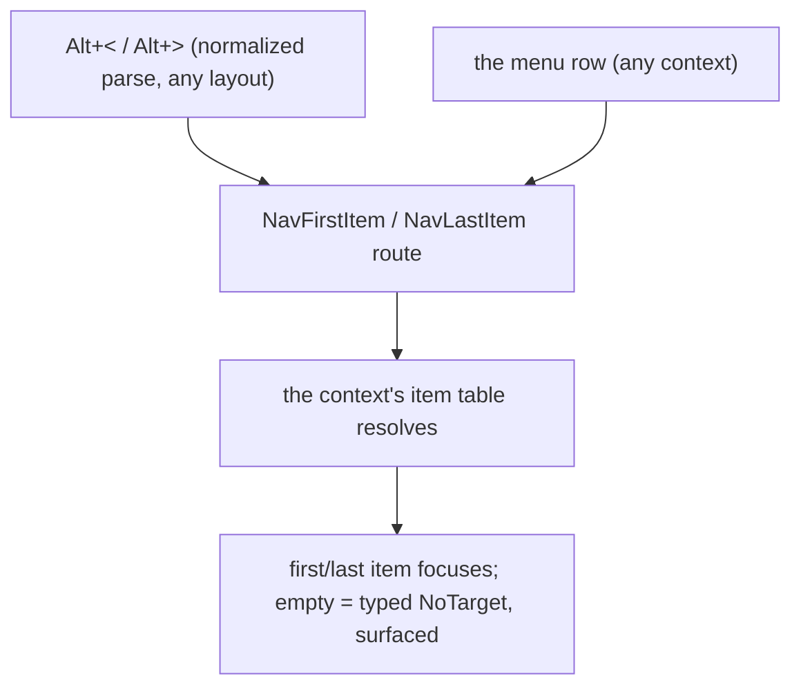

# [Plan] UX Journey Plan — Keymap parity: emacs motions, M-< / M->, task-action shortcuts

- **Date**: 2026-11-16
- **Kind**: UX journey plan — user stories, journeys, flows, wiring
  contract for the round-8 keymap family: the emacs motion family in
  the Task and Settings views, the M-< / M-> dead-action diagnosis
  (menu-vs-key asymmetry and the Dvorak key-parsing hypothesis), and
  the task detail's action-shortcut family (org-mode-shaped emacs
  candidates). No implementation decisions beyond the command
  contract.
- **Origin**: the operator's round-8 notes N-1, N-2, N-17, N-21
  (recorded in the round plan
  `.artifacts/plans/2026-11-16-gui-review-round8-plan.md` §1).
  Format/framework: `docs/ux_planning.org` +
  `.artifacts/templates/ux-journey-plan.md`.
- **Status**: ACCEPTED — the user accepted the round-8 plan set on 2026-11-16; dispatch may chunk from it (round plan §7,
  chunk 1; its preset rows are dependencies of the quick-action
  shortcuts, task-card-controls US-1).
- **Surfaces touched**: `src/keymap/presets.rs` (Standard/Emacs/Vi),
  `src/actions.rs` (the new ids), `src/router.rs` (the detail routes),
  `src/keymap/` (the key parser's keysym normalization),
  `src/adapter.rs` (the menu-invocation item resolution), the keymap
  contract tests + snapshots
- **Platform scope**: desktop (keymap rows are desktop grammar; the
  layout hypothesis is the operator's own environment — the manual
  test)

## 1. Scope & goals

The emacs motion family works uniformly: C-n/C-p walk items in the
TaskDetail context (today they exist only in Board and Today — the
verified gap: the emacs preset's `NavNextItem`/`NavPrevItem` rows are
Board/Today-only, `presets.rs:433-436,448-451`), and C-f/C-b walk the
control (field) walk everywhere the view contexts hold, including
Settings. M-< / M-> reach the first/last item from both the key and
the menu in every context — the TaskDetail menu invocation's silent
no-op (N-2: the bindings exist, `presets.rs:570-571`, yet the menu
entry does nothing) is diagnosed as a route bug and fixed under the
click ≡ key law; the board view's shortcut failure on the operator's
Dvorak International layout (N-17: Alt+Shift+,/. never parse as
M-</M->) is fixed by keysym normalization that stops deriving
punctuation matches from the layout's glyph output. The task detail's
frequent actions gain shortcuts in every preset — due date,
scheduled date, description edit, reminder-rule add, clock in/out —
with org-mode-shaped emacs candidates (N-21), resolved against the
chord space per the round plan's C-5 rule.

**Non-goals** (each with a home):

- No vi-preset changes beyond what the totality oracle requires (vi's
  H/G first/last rows already exist, `presets.rs:768-769`; this plan's
  new ids join the existing vi tables per their own free keys). Home:
  §3 US-3.
- No re-binding of the Standard preset's existing rows (F2/F3/F4
  stand). Home: §3 US-3.
- No three-stroke chords (the house chord grammar is two-stroke; the
  org `C-c C-x C-i/o` clock chords are approximated as two-stroke
  candidates — recorded, not silently reshaped). Home: §1; §3 US-3's
  candidates.

## 2. Capability × surface matrix

| Capability | Board | TaskDetail | Today | Review | Settings | Capture | CLI |
|---|---|---|---|---|---|---|---|
| nav.item_walk (emacs C-n/C-p member rows + the M-< M-> route fix) | E (pre-existing; the Dvorak fix lands here) | E (US-1, US-2 — the C-n/C-p rows + the menu-invocation route fix) | E (pre-existing) | — (R-6 stands) | — (R-6 stands) | — (R-6 stands) | U (T-24 stands) |
| nav.control_walk (C-f/C-b rows) | E (US-1 — evidence extension) | E (US-1) | E (US-1) | — (R-6 stands) | E (US-1 — the Settings rows) | — (the masked contexts keep their own grammars) | U (T-24 stands) |
| plan.box_reorder (AMENDMENT 2026-11-28, US-4) | — | — | — | — | — | — | U (T-24 stands); the family lives in the planner's `PlanNextDay` context: E (US-4) |
| review.stage_verbs (AMENDMENT 2026-11-28, US-5) | — | — | — | E (US-5) | — | — | U (T-24 stands) |
| nav.field_departure (AMENDMENT 2026-11-28, US-6 — the Alt axis departs a focused text field; the field-stop surfaces) | E (US-6) | E (US-6) | E (US-6) | — (the walk carries its own stage verbs, US-5) | E (US-6) | — (the capture field keeps its own grammar) | U (T-24 stands) |
| task.due_edit (keyboard entry point) | U (TE-1 stands) | E (US-3 — the editor's key arm; evidence extension) | U (TE-1 stands) | E (pre-existing) | — (R-5 stands) | — (R-5 stands) | E (pre-existing) |
| task.scheduled_edit (keyboard entry point) | U (TE-1 stands) | E (US-3) | U (TE-1 stands) | E (pre-existing) | — (R-5 stands) | — (R-5 stands) | E (pre-existing) |
| task.description_edit (keyboard entry point) | U (TE-1 stands) | E (US-3) | U (TE-1 stands) | — (R-3 stands) | — (R-3 stands) | — (R-3 stands) | E (pre-existing) |
| task.reminder_rules_edit (key binding) | — (R-6 stands) | E (US-3 — `ReminderRuleAdd` binds per preset if unbound) | — (R-6 stands) | — (R-6 stands) | — (R-6 stands) | — (R-6 stands) | E (pre-existing) |
| task.track_start / task.track_stop (preset rows) | U (TE-3 stands until task-card-controls lands; the keys are the detail/context rows) | E (US-3 — the first preset rows for the tracking ids; the TE-W-N2 menu-only note retires) | E (US-3 — the Today-context rows) | — (R-7/R-8 stand) | — (R-7/R-8 stand) | — (R-7/R-8 stand) | E (pre-existing) |

**Rulings** (every deliberate absence):

| ID | Ruling | Reason | Home |
|---|---|---|---|
| R-1 | No CLI cells for keymap rows | Bindings are GUI grammar; the CLI has no keys. The T-24 CLI register stands untouched. | this plan §2 |
| R-2 | The layout fix is parser-side, not per-preset rows | The presets already spell `Alt+<`/`Alt+>`; the failure is the event-to-token match (glyph-derived). One normalization in the parser fixes every affected token for every layout; no preset edits for this. | this plan §3 US-2 |

## 3. User stories

### US-1 — The emacs motion family works in Task and Settings views (N-1)

- **Story**: As an emacs-mode user I want C-n/C-p to walk items and
  C-f/C-b to walk controls in the Task and Settings views, so that my
  motion grammar is uniform across views.
- **Platforms**: desktop.
- **Entry points**: the emacs preset rows (new): TaskDetail
  C-n/C-p → `NavNextItem`/`NavPrevItem` (member rows, the
  Board/Today pattern); TaskDetail C-f/C-b → `NavNextControl`/
  `NavPrevControl`; Settings C-n/C-p/C-f/C-b → the control walk
  (Settings has no items). C-f/C-b control-walk rows for Board/Today/
  StackDetail join for uniformity (they are free today — candidates;
  the oracle decides).
- **Priority**: P1
- **Acceptance**:
  - AC-1: Given the TaskDetail context (emacs preset), When C-n or
    C-p fires, Then the item walk steps (the same route the Standard
    preset's Down/Up rows take) — verified by the keymap contract
    tests + a journey test.
  - AC-2: Given the Settings context (emacs preset), When
    C-n/C-p/C-f/C-b fire, Then the control walk steps (the Settings
    field walk) — verified by journey test.
  - AC-3: Given any preset, When the contract suite runs, Then the
    new rows bind with no conflicts (totality; a colliding stroke is
    re-picked from the same context's free set and recorded — never a
    dropped row) — verified by the contract tests.

### US-2 — M-< / M-> work from both the key and the menu, on any layout (N-2, N-17)

- **Story**: As a user on a non-US layout I want M-< / M-> to jump to
  the first/last item from the keyboard, and I want the menu entries
  for them to actually act in the task view.
- **Platforms**: desktop.
- **Entry points**: the existing `NavFirstItem`/`NavLastItem` rows
  (emacs `Alt+<`/`Alt+>` in every view context; the menu rows; the
  vi H/G rows) — no new ids; this story fixes two routes.
- **Priority**: P1
- **Acceptance**:
  - AC-1 (the menu no-op, N-2): Given the TaskDetail context, When
    `NavFirstItem`/`NavLastItem` is invoked from the action menu,
    Then the identical route fires as the key (the same item-table
    resolution; the silent no-op absorb is the bug and is fixed) —
    verified by journey test (menu invocation ≡ key invocation, the
    click ≡ key law).
  - AC-2 (the layout parse, N-17): Given a punctuation token bound as
    `Alt+<` (the shift-composed punctuation set), When the key event
    arrives from a layout whose Alt+Shift+key produces a different
    glyph (the Dvorak International case), Then the parser matches
    the token (keysym normalization: the match keys on the
    position/base key + modifiers for the affected punctuation
    tokens, never on the layout's glyph output) — verified by parser
    unit tests (the normalization map's cases) + the operator's
    manual confirmation on their layout (§8 Manual).
  - AC-3: Given the fix, When any other punctuation-keyed binding is
    exercised (the existing tokens over the same parser), Then their
    behavior is unchanged (the normalization is additive) — verified
    by the keymap snapshot + contract tests standing.

### US-3 — The task detail's frequent actions carry shortcuts (N-21)

- **Story**: As a keyboard user in the task detail I want due date,
  scheduled date, description edit, reminder-rule add, and clock
  in/out on keys so that the detail loop never needs the mouse.
- **Platforms**: desktop.
- **Entry points**: new `ActionId`s in the TaskDetail context
  (`TaskDueEdit`, `TaskScheduledEdit`, `TaskDescriptionEdit`), the
  existing `ReminderRuleAdd`/`TaskTrackStart`/`TaskTrackStop` gaining
  preset rows; each routes the same seam its pointer affordance uses
  (the row edit affordances; the track chip; the rule-list preset
  buttons' add funnel) — click ≡ key.
- **Priority**: P1
- **Acceptance**:
  - AC-1: Given the detail view, When the due/scheduled shortcut
    fires, Then the corresponding editor arms exactly as its row's
    edit affordance does (the same `begin_date_edit` funnel; the
    emacs candidates `C-c C-d` due / `C-c C-s` scheduled — the C-5
    collision rule governs `C-c C-s`'s occupancy by ReminderSnooze:
    context precedence or a recorded retune, never a dropped row) —
    verified by journey test (arm parity with the pointer path).
  - AC-2: Given the detail view, When the description shortcut
    fires, Then the description editor arms (the emacs candidate
    `C-c '`; Standard candidate F7; per-preset free keys otherwise) —
    verified by journey test.
  - AC-3: Given the detail view, When the clock-in/out shortcuts
    fire, Then `StartTracking`/`StopTracking` route exactly as the
    chip does (the emacs candidates `C-c C-i` / `C-c C-o` — the
    two-stroke approximation of org's `C-c C-x C-i/o`, recorded; the
    TE-W-N2 menu-only note retires) — verified by seam test (the
    exact commands).
  - AC-4: Given any preset, When the contract suite runs, Then the
    new ids bind in the TaskDetail (and Today, for the tracking ids)
    contexts with generated hints and no conflicts — verified by the
    contract tests + regenerated snapshots.

### US-4 — The plan-window box family (AMENDMENT 2026-11-28 —
the keybinding-coverage plan §4 verbatim; issues #1394)

Reorder the focused placed box earlier/later and remove it from the
keyboard in every preset (Standard Shift+Up/Shift+Down/Delete; Emacs
Ctrl+Shift+p/Ctrl+Shift+n/Delete; Vi K/J/Delete); the placement commit
stays Return (the armed grammar — no second address for one
semantics).

### US-5 — The review walk's stage verbs (AMENDMENT 2026-11-28 —
the keybinding-coverage plan §4 verbatim; issue #1393)

Inside the masking walk, Left/Right walk the armed File-to target,
Alt+Left returns to the previous stage, Ctrl+Shift+p jumps to the
planner, Alt+a arms the abort (Return/Escape remain the armed
confirm/dismiss).

### US-6 — The field departure (AMENDMENT 2026-11-28 —
the keybinding-coverage plan §4 verbatim; issue #1257)

From any focused text field on a directional surface, Alt+Right (Emacs:
Alt+f too) departs the field along the walk without altering the
field's text; caret keys keep their in-field meaning. The axis binds
in the view contexts AND in the insert chain's `ViInsert` context (a
focused field replaces the chain — the journey-oracle finding
recorded in the stage-2 report).

## 4. Journey specs

### US-1 — The motion family

| Step | Surface & affordance | User action | Dispatches | System response | Escape / failure |
|---|---|---|---|---|---|
| US-1/S1 | TaskDetail / Settings (emacs) | C-n / C-p / C-f / C-b | the mapped walk ids (item walk where items exist, control walk otherwise) | the walk steps; the focused control moves | the walk's bounds (no wrap; clamp per the focus plan US-2 inside masks) |

### US-2 — First/last item, any front

| Step | Surface & affordance | User action | Dispatches | System response | Escape / failure |
|---|---|---|---|---|---|
| US-2/S1 | TaskDetail: menu row **or** the `Alt+<`/`Alt+>` key | invoke first/last | `ActionId::NavFirstItem`/`NavLastItem` | the same first/last item focuses (the routes are identical; the no-op absorb is gone) | an empty item set is the typed `NoTarget` (the dispatch-time gate — surfaced, not silent) |
| US-2/S2 | any layout with shift-composed punctuation | press the bound stroke | the parser's normalized match | the action routes | unmatched events fall through unchanged (the parser's additive normalization) |

### US-3 — The detail shortcut family

| Step | Surface & affordance | User action | Dispatches | System response | Escape / failure |
|---|---|---|---|---|---|
| US-3/S1 | TaskDetail | the due/scheduled shortcut | `ActionId::TaskDueEdit`/`TaskScheduledEdit` → the `begin_date_edit` funnel | the editor arms (identical to the row affordance's arm; the focus-origin records the field) | Escape settles by the editor's rules (the existing ladder) |
| US-3/S2 | TaskDetail | the description shortcut | `ActionId::TaskDescriptionEdit` → the description editor arm | the editor arms (the `Editor` scope) | the TEXT settle rule applies (commit-parseable, discard-otherwise) |
| US-3/S3 | TaskDetail / Today | the clock in/out shortcuts | `ActionId::TaskTrackStart`/`TaskTrackStop` | the exact commands (the chip's routes) | no target → typed `NoTarget`; nothing-open is the total no-op |
| US-3/S4 | TaskDetail | the rule-add shortcut | `ActionId::ReminderRuleAdd` (bound per preset) | the rule add funnel arms (the preset buttons' route) | the custom-offset parse miss absorbs as today |

### US-4 — The box family (AMENDMENT 2026-11-28)

| Step | Surface & affordance | User action | Dispatches | System response | Escape / failure |
|---|---|---|---|---|---|
| US-4/S1 | PlanNextDay | open the planner, begin place, commit a box (Return), reorder (Shift+Down / Shift+Up — the D1 twins; `PlanBoxEarlier`/`PlanBoxLater`), remove (Delete — `PlanRemoveBox`) | the plan-family ids → the swap/unplace/placement writes | box order changes; the box is removed; one honest write per leg | the box verbs' one-shot `plan_target` mints only at the activation/click seams today — a bare chord after cursor nav is the typed `NoTarget` (recorded; the cursor-fallback mint is the follow-up) |

### US-5 — The stage verbs (AMENDMENT 2026-11-28)

| Step | Surface & affordance | User action | Dispatches | System response | Escape / failure |
|---|---|---|---|---|---|
| US-5/S1 | ReviewWalk (the masking walk) | arm the File-to picker, Left/Right change the target, Alt+Left steps the stage back, Ctrl+Shift+p lands the planner, Alt+a arms the abort | `ReviewFileTargetPrev/Next`, `ReviewWalkPrev`, `ReviewWalkPlanner`, `ReviewAbortArm` | the armed target moves (the commit's `MoveTask` names it); the stage steps back; the planner is the walk's own stage; the abort confirm arms | Escape dismisses the armed abort; Return/Escape stay the armed confirm/dismiss (no chord rows — the armed grammar) |

### US-6 — The field departure (AMENDMENT 2026-11-28)

| Step | Surface & affordance | User action | Dispatches | System response | Escape / failure |
|---|---|---|---|---|---|
| US-6/S1 | TaskDetail's description editor (Standard) | edit, take the edit back (the value restored), then Alt+Right | `NavFocusRight` (the insert-chain half resolves under the focused editor) | the editor is left; the text is unchanged; Left/Right in-field stayed caret | vi has no axis rows — its Escape contract is the insert-chain exit |
| US-6/S2 | TaskDetail's description editor (Emacs) | Alt+f departs; re-arm; Alt+b departs | `NavFocusRight`/`NavFocusLeft` (the Alt-letter quartet, same law) | the editor is left; the text is unchanged | the emacs editor table's Ctrl-family commands keep their in-field meanings |

## 5. Interaction flows

One route table, two fronts (the story of US-2):

## 6. Wiring inventory

| ID | Surface file | Widget | Callback | Adapter seam | ActionId | Commands | Row addressing | Journey steps | Test |
|---|---|---|---|---|---|---|---|---|---|
| W-1 | src/keymap/presets.rs | the emacs motion rows | — | — (preset rows; the contract suite is the oracle; the row's ids: NavNextItem / NavPrevItem / NavNextControl / NavPrevControl — the gate's one-token cell cites the first) | ActionId::NavNextItem | — | the walk ids' contexts | US-1/S1 (commands —: navigation) | keymap contract tests + journeys.rs::us1_s1_emacs_motion_rows_step_the_walks |
| W-2 | src/keymap/ (the parser), src/router.rs | the keysym normalization + the menu-invocation item resolution | — | the parser's normalization map; the menu invoke path's item resolution (the no-op fix; the row's ids: NavFirstItem / NavLastItem — the gate's one-token cell cites the first) | ActionId::NavFirstItem | — | the context's item table | US-2/S1–S2 (commands —: navigation) | parser unit tests (the punctuation cases) + journeys.rs::us2_s1_menu_first_last_matches_the_key_route |
| W-3 | src/actions.rs, src/keymap/presets.rs, src/adapter.rs | the detail shortcut ids + rows | — | the routes into the existing funnels (`begin_date_edit`, the description arm, the tracking/rule routes; `// slint:` where a seam is touched; the row's ids: TaskDueEdit / TaskScheduledEdit / TaskDescriptionEdit / ReminderRuleAdd / TaskTrackStart / TaskTrackStop — the gate's one-token cell cites the first) | ActionId::TaskDueEdit | StateCommand::StartTracking; StateCommand::StopTracking; StateCommand::AddReminderRule | the subject task | US-3/S1–S4 | journeys.rs::us3_s1_due_shortcut_arms_the_editor_like_the_row |
| W-4 (AMENDMENT 2026-11-28) | src/keymap/presets.rs | the plan-window box family rows (D1) | — | — (preset rows; the plan-family arms route today — the router's `PlanBoxEarlier/Later/RemoveBox` + the swap/unplace/placement funnel) | ActionId::PlanBoxEarlier | StateCommand::UpdateTask | the planner's placed-box rows | US-4/S1 | journeys.rs::us4_s1_box_family_keyboard_journey |
| W-5 (AMENDMENT 2026-11-28) | src/keymap/presets.rs | the review-walk stage-verb rows (D2) | — | — (preset rows; the walk intents route today — the `WalkIntent` arms) | ActionId::ReviewFileTargetPrev | — | the walk's stage/cursor state | US-5/S1 | journeys.rs::us5_s1_walk_stage_verbs_journey |
| W-6 (AMENDMENT 2026-11-28) | src/keymap/presets.rs | the Alt departure axis — view contexts + the insert-chain `ViInsert` half (D3) | — | — (preset rows; nav.focus routes today — the directional table) | ActionId::NavFocusRight | — | the six view contexts' walk | US-6/S1–S2 | journeys.rs::us6_s1_alt_axis_departs_the_field_and_caret_keys_stay_caret + journeys.rs::us6_s2_emacs_alt_f_quartet_departs_the_field |

## 7. Command-contract delta

| Kind | Name | Payload sketch | Journeys |
|---|---|---|---|
| ActionId | TaskDueEdit | new — `ContextId::TaskDetail`; routes the due editor arm (click ≡ key with the row affordance) | US-3/S1 |
| ActionId | TaskScheduledEdit | new — `ContextId::TaskDetail`; the scheduled twin | US-3/S1 |
| ActionId | TaskDescriptionEdit | new — `ContextId::TaskDetail`; the description editor arm | US-3/S2 |
| ActionId | ReminderRuleAdd / TaskTrackStart / TaskTrackStop | exist — gain preset rows (the finding's letter: bindings, not seams) | US-3/S3–S4 |
| (parser) | the punctuation keysym normalization | additive parser change — no preset edits, no id changes (R-2) | US-2 |

No new `StateCommand`, no new `UiRequest`.

## 8. Verification plan

- **Journey tests** (step-ID-named):
  `us1_s1_emacs_motion_rows_step_the_walks`,
  `us1_ac2_settings_control_walk_rows_step`,
  `us2_s1_menu_first_last_matches_the_key_route`,
  `us3_s1_due_shortcut_arms_the_editor_like_the_row`,
  `us3_s2_description_shortcut_arms_the_editor`,
  `us3_s3_clock_shortcuts_route_the_exact_commands`,
  `us3_s4_rule_add_shortcut_arms_the_funnel`.
- **Parser unit tests**: the normalization map's cases (Alt+Shift+
  punctuation across layout spellings; the additive fall-through).
- **Keymap totality**: the contract suite covers every new/changed
  row per preset (coverage + conflict detection + snapshot
  regeneration; a retune is recorded, never dropped — the C-5 rule
  governs `C-c C-s`).
- **Kiosk gates**: none new — keymap rows are desktop grammar.
  Recorded.
- **Manual**: the operator's Dvorak International layout confirms the
  M-< / M-> fix on the real keyboard (the AC-2 oracle's human half);
  the chord-space choices' feel (the C-c family's mnemonics) judged at
  walkthrough.
- **Addendum (2026-11-18, issue #855)**: the operator's manual
  acceptance of US-2 AC-2 *failed* on Dvorak International — PR
  #862's D-3 partner map was a symmetric superset over the delivered
  glyph, so a bare Alt+, / Alt+. resolved the begin/end tokens (role
  theft) while the shifted press did not. The fix: the partner pass
  is directional — it fires only when the event's Shift flag is
  genuinely held (`Stroke::chord_shift_partners`, the fold + partner
  candidates). The map's retirement trigger (the physical/base
  keysym seam) stands; this addendum narrows it, it does not close
  it.
- **#760 fold**: stage 3 cross-checks every §6 row against
  `tests/seam_inventory.rs`.

- **AMENDMENT 2026-11-28 (the keybinding-coverage chunk, issues
  #1394/#1393/#1257)** — the new tests of the chunk plan's §6
  catalogue, keyed US-4/US-5/US-6:
  `journeys.rs::us4_s1_box_family_keyboard_journey` (US-4/S1),
  `journeys.rs::us5_s1_walk_stage_verbs_journey` (US-5/S1),
  `journeys.rs::us6_s1_alt_axis_departs_the_field_and_caret_keys_stay_caret`
  (US-6/S1),
  `journeys.rs::us6_s2_emacs_alt_f_quartet_departs_the_field`
  (US-6/S2); the keymap table tests T1–T3
  (`the_plan_box_family_resolves_in_every_preset`,
  `the_review_walk_stage_verbs_resolve_in_every_preset`,
  `the_alt_departure_axis_is_field_proof`) are the preset-grammar
  oracle. The D-table's `Alt+Left` board-return journey superseded to
  the primaries (dated in the test: the axis shadows the Global
  alternate in the view chains — the C-5/D-5 recorded cost).

## 9. Definition of done

- [ ] `scripts/ux-coverage.sh <this file> --gate` exits 0
- [ ] Every P1 story's journey completes end-to-end including escapes
- [ ] Walkthrough protocol executed at stage 3; the doctrine bar held
  (RW-W-N1's Escape preset and the existing chord rows untouched
  except a recorded C-5 retune if the oracle demands one)
- [ ] Census cells updated: `nav.item_walk`/`nav.control_walk`
  evidence (the emacs rows; the Dvorak fix), the detail verbs' key
  evidence (US-3's six rows), the TE-W-N2 retirement note
- [ ] Non-goals: no vi redesign, no Standard re-binds, no three-stroke
  chords (the approximation recorded)
