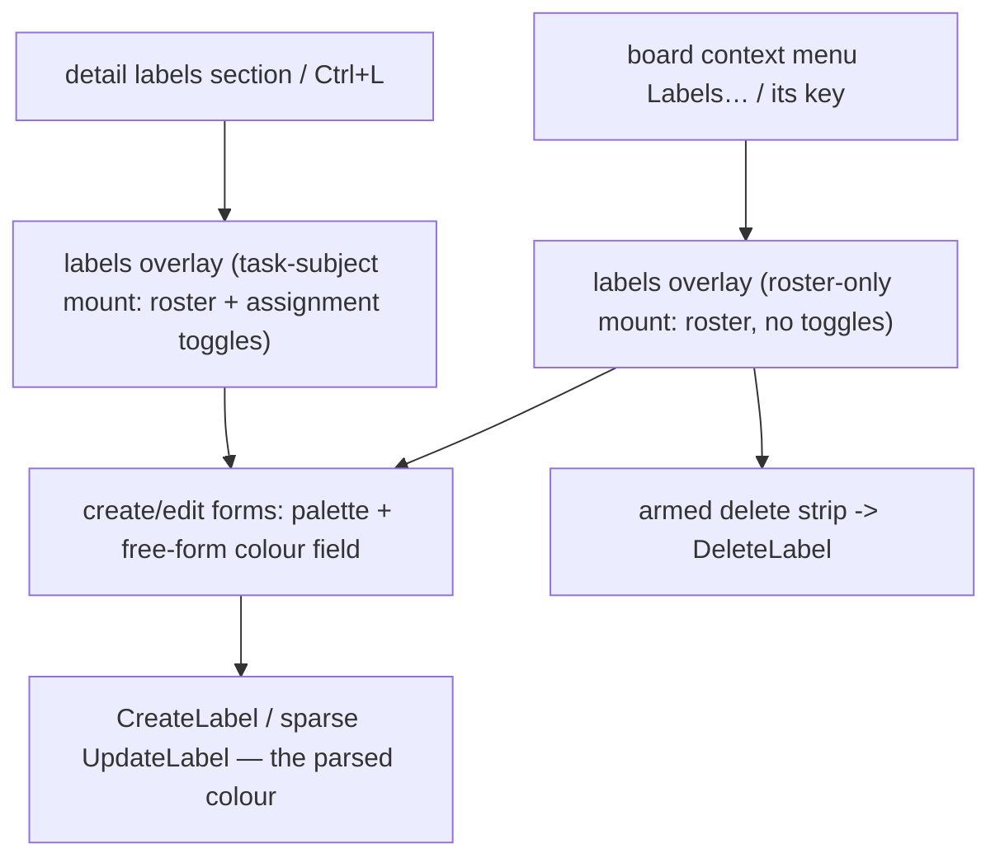

# [Plan] UX Journey Plan — Tag colour configuration & the tag GUI design phase

- **Date**: 2026-11-16
- **Kind**: UX journey plan — the GUI design phase for the tag
  (label) feature that the operator's round-8 note requests: the
  free-form colour field, discoverable label-management entry points,
  and the card-chip display half. This plan is that design phase's
  artefact. No implementation decisions beyond the command contract.
- **Origin**: the operator's round-8 note N-14 ("We will also need a
  menu somewhere that allows the user to configure the colour of
  tags. The whole tag feature in the GUI will need a gui design phase
  following the new standards for how to do that." — recorded in the
  round plan `.artifacts/plans/2026-11-16-gui-review-round8-plan.md`
  §1) + intake #839. The collision with the r3 scope line ("no
  free-form hex in the GUI") is ruled in the round plan C-3: the note
  wins. Format/framework: `docs/ux_planning.org` +
  `.artifacts/templates/ux-journey-plan.md`.
- **Status**: ACCEPTED — the user accepted the round-8 plan set on 2026-11-16; dispatch may chunk from it (round plan §7,
  chunk 7).
- **Surfaces touched**: `ui/compositions/labels-overlay.slint` (the
  create/edit forms' colour field), `ui/views/task-view.slint` (the
  labels section), `ui/compositions/board-layout.slint` +
  `ui/widgets/task-card.slint` (card chips), `src/menu.rs`
  (BOARD_CONTEXT row), `src/actions.rs` + `src/keymap/presets.rs`
  (the board-context entry binding), `src/adapter.rs` (the overlay's
  board-surface mount), `crates/taskboard-domain/src/entities.rs`
  (the `Color` parse — pure)
- **Platform scope**: desktop (labels surface from the detail view and
  now the board surface; kiosk renders neither — the census mount
  grammar)

## 1. Scope & goals

The labels overlay's create and edit forms accept a free-form colour
value — the same six-hex grammar the CLI owns, minted through a
domain-side fallible `Color` constructor so no validator is
re-implemented in the UI crate (round plan C-3's letter) — beside the
existing fixed palette. Label management becomes discoverable from
the board surface: a "Labels…" row in the board context menu (and a
preset binding) opens the labels overlay in **roster-only mode** over
the selected board — the full roster with create/edit/delete, the
assignment toggles appearing only when a task subject is open in the
detail view (where the owning-surface posture stands). Task cards
render their live labels as colour chips, completing the tag
feature's display half on the surfaces that show tasks. Together:
configure a tag's colour, find the tag manager without the detail
view, and see tags where tasks are.

**Non-goals** (each with a home):

- No re-scoping of assign/unassign away from the detail view (the
  r3 D-2 owning-surface ruling stands for the *task*-binding verbs;
  the roster-only board mount is management, not assignment). Home:
  §2 R-2.
- No per-board colour themes, no colour-derivation logic in the UI
  (the lenient stored value renders through the existing
  `swatch_hex` hygiene: unparsable values render transparent — never
  re-derived). Home: §3 US-1's echo rule.
- No CLI changes (the CLI's colour grammar is the contract this plan
  adopts). Home: §2 R-3.

## 2. Capability × surface matrix

| Capability | Board | TaskDetail | Today | Review | Settings | Capture | CLI |
|---|---|---|---|---|---|---|---|
| label.create (free-form colour) | E (US-2 — the roster-only overlay's create form) | E (US-1 — the overlay's create form gains the colour field; the palette stays) | — (R-1) | — (R-1) | — (R-1) | — (R-1) | C (pre-existing, `labels add` — the grammar's owner) |
| label.edit (free-form colour) | E (US-2) | E (US-1) | — (R-1) | — (R-1) | — (R-1) | — (R-1) | E (pre-existing, `labels edit`) |
| label.delete | E (US-2 — the staged strip, roster-only mode included) | E (pre-existing staged strip) | — (R-1) | — (R-1) | — (R-1) | — (R-1) | X (pre-existing) |
| label.roster_display | D/E (US-2, US-3 — the roster-only overlay from the board menu; the card chips) | D/E (pre-existing section + overlay) | D (US-3 — the today-row card chips) | — (R-1) | — (R-1) | — (R-1) | D (pre-existing, `labels list`) |
| task.label_assign / task.label_unassign | — (R-2) | E (pre-existing — the toggles stay detail-only) | — (R-2) | — (R-2) | — (R-2) | — (R-2) | E (pre-existing, `tasks label/unlabel`) |
| task.label_chips_display (new display capability: the card chips) | D (US-3) | D (US-3 — the detail section's chips, pre-existing) | D (US-3) | — (R-1) | — (R-1) | — (R-1) | — (R-3) |

**Rulings** (every deliberate absence):

| ID | Ruling | Reason | Home |
|---|---|---|---|
| R-1 | The label family has no Review/Settings/Capture mounts | Labels bind to tasks/boards; those surfaces render neither (the census sweeps' own scoping). The r3 Origin's sweep stands. | this plan §2; census label rows |
| R-2 | Assign/unassign stay detail-only (no card-chip assignment affordance) | The r3 owning-surface ruling stands for the binding verbs; chips are display atoms (the T-46 display-atom posture) — a chip-click assign would promote a binding verb onto every card surface. | this plan §1; r3 chunk plan D-2 |
| R-3 | The chips have no CLI cell | The chips render `Task::live_labels` — the CLI's `tasks list` output already carries its own label rendering (its own cell); a separate CLI chip cell would duplicate the capability row. | this plan §2 |

## 3. User stories

### US-1 — Configure a tag's colour, free-form (N-14, #839; round plan C-3)

- **Story**: As a desktop user I want to set a label's colour to any
  valid value — not only the fixed palette — so that tags can carry
  the colours my boards already use.
- **Platforms**: desktop.
- **Entry points**: the labels overlay's create form and edit form
  (the colour field beside the swatch palette — palette for one-click
  picks, the field for exact values); the CLI `labels add/edit` (the
  grammar's owner, unchanged).
- **Priority**: P1
- **Acceptance**:
  - AC-1: Given the create/edit form, When a six-hex value is
    committed, Then `CreateLabel`/`UpdateLabel` carries exactly that
    colour (minted via the domain's fallible `Color` constructor —
    the A1 pattern; no UI-side re-derivation) — verified by seam test
    (the exact payload).
  - AC-2: Given an invalid colour string, When committed, Then the
    typed invalid echo renders and nothing dispatches (commit inert;
    the form stays open — the editor refusal posture) — verified by
    journey test.
  - AC-3: Given a label whose stored colour is lenient (outside the
    six-hex vocabulary — CLI history), When any surface renders its
    swatch/chip, Then the echo is transparent (the `swatch_hex`
    hygiene — never re-derived, never invented) — verified by
    presentation test.
  - AC-4: Given the palette, When a swatch is clicked, Then the field
    reflects the swatch's value (one vocabulary, two pickers) —
    verified by presentation test (the field model's value, typed).

### US-2 — Open label management from the board surface (N-14's "a menu somewhere")

- **Story**: As a desktop user I want a board-context "Labels…" entry
  that opens the label manager over my board, so that organising tags
  never requires opening a task first.
- **Platforms**: desktop.
- **Entry points**: the board context menu's "Labels…" row;
  a preset binding routing the same id (the `LabelManage` action
  widens its contexts to Board — roster-only mount; in TaskDetail it
  keeps the task-subject mount); the detail view's existing
  labels-section entry (unchanged).
- **Priority**: P1
- **Acceptance**:
  - AC-1: Given a selected board, When the board menu's Labels row
    (or its key) fires, Then the labels overlay mounts in roster-only
    mode over the board surface: the board's live label roster with
    create/edit/delete (the staged delete grammar), and no assignment
    toggles (no task subject — R-2's letter made visible) — verified
    by journey test (the mount + the row-set composition).
  - AC-2: Given the roster-only overlay, When create/edit/delete
    commit, Then the exact `CreateLabel`/`UpdateLabel`/`DeleteLabel`
    payloads dispatch with the board subject (the same funnels the
    detail view uses — one overlay, two mounts) — verified by seam
    test.
  - AC-3: Given the roster-only overlay, When Escape fires, Then the
    ladder disarms/closes per the r3 grammar (the #840 fix's cleared
    identity included) — verified by journey test.
  - AC-4: Given the keymap, When the contract suite runs, Then the
    widened `LabelManage` contexts bind without conflicts (the
    existing TaskDetail binding stands; the Board row is a
    candidate key per preset) — verified by the contract tests.

### US-3 — Task cards render their labels (the tag feature's display half)

- **Story**: As a desktop user I want my tasks' tags visible on their
  cards — colour chip + title — so that tags do their classifying work
  where I actually look.
- **Platforms**: desktop (board + stack-detail cards; today rows).
- **Entry points**: display-only (the card decoration region, beside
  the existing chips — the decoration grammar).
- **Priority**: P2
- **Acceptance**:
  - AC-1: Given a task with live labels, When its card renders, Then
    the card model carries one chip row entry per live label (colour
    echo + title, canonical order) — verified by presentation test
    (the chip set from `Task::live_labels`, never strings).
  - AC-2: Given a lenient colour, When a chip renders, Then the
    echo follows US-1/AC-3's hygiene — verified by presentation test.
  - AC-3: Given many labels on one card, When the card renders in the
    compact leg, Then the chips collapse to the overflow posture the
    decoration grammar already owns (the chips never grow the card's
    height contract) — verified by presentation test (the overflow
    flag).

## 4. Journey specs

### US-1 — The colour field

| Step | Surface & affordance | User action | Dispatches | System response | Escape / failure |
|---|---|---|---|---|---|
| US-1/S1 | overlay form, colour field | type a six-hex value (or click a swatch — the field reflects it) | — (form-local draft) | the field echoes; the swatch preview updates | Escape/cancel discards the form (the r3 grammar) |
| US-1/S2 | the form's commit | commit | `StateCommand::CreateLabel { board, title, color }` / the sparse `UpdateLabel` — the exact parsed colour | the roster re-renders; the chips re-echo | an invalid value renders the typed invalid echo, commits nothing; `AppUndo` reverts a committed label |

### US-2 — The board-surface label manager

| Step | Surface & affordance | User action | Dispatches | System response | Escape / failure |
|---|---|---|---|---|---|
| US-2/S1 | board context menu "Labels…" / its key | open | `ActionId::LabelManage` (Board context) → the roster-only mount | the overlay mounts over the board: the roster, create/edit/delete, no assignment toggles | Escape ladders (disarm → close); outside click closes |
| US-2/S2 | the roster rows | manage (create/edit/staged delete) | the existing label commands (the same funnels) | the roster re-renders | the staged delete's Cancel/Escape disarms; `DeleteLabel` stays `NotUndoable(RestoreClass)` — the staging is the escape |

### US-3 — The card chips

| Step | Surface & affordance | User action | Dispatches | System response | Escape / failure |
|---|---|---|---|---|---|
| US-3/S1 | board/today cards | — display only | — display only | one chip per live label (colour echo + title; overflow posture in compact) | display only |

## 5. Interaction flows

The overlay's two mounts, one grammar:

## 6. Wiring inventory

| ID | Surface file | Widget | Callback | Adapter seam | ActionId | Commands | Row addressing | Journey steps | Test |
|---|---|---|---|---|---|---|---|---|---|
| W-1 | ui/compositions/labels-overlay.slint, src/adapter.rs | the free-form colour field (+ preview) | — | the form's draft funnel parses via the domain constructor (`// slint:` per the #782 fold) | — (the forms' existing commit seams) | StateCommand::CreateLabel; StateCommand::UpdateLabel | the form's board/label ids via `a.tables.label_ids` | US-1/S1–S2 | journeys.rs::us1_ac1_the_form_commits_the_exact_parsed_colour |
| W-2 | src/menu.rs, src/actions.rs, src/keymap/presets.rs, ui/views/board-view.slint + ui/app-window.slint, src/adapter.rs | the board menu row + the roster-only mount | — | the overlay's board-surface mount (subject = the selected board; `// slint:`) | ActionId::LabelManage | StateCommand::CreateLabel; StateCommand::UpdateLabel; StateCommand::DeleteLabel | the selected board via the id-table pass | US-2/S1–S3 | journeys.rs::us2_ac1_board_menu_opens_the_roster_only_overlay |
| W-3 | ui/widgets/task-card.slint, src/models.rs, src/presentation.rs | the card label chips | — | — (display only — the chips derive from `Task::live_labels` per refresh) | — | — (reason: pure display state) | the card's decoration model | US-3/S1–S3 | presentation.rs::us3_ac1_the_card_carries_one_chip_per_live_label |

## 7. Command-contract delta

| Kind | Name | Payload sketch | Journeys |
|---|---|---|---|
| ActionId | LabelManage | exists — contexts widen to include `ContextId::Board` (the roster-only mount; the TaskDetail mount stands) | US-2 |
| StateCommand | CreateLabel / UpdateLabel / DeleteLabel | exist — usage notes: the colour payload now comes from either the palette or the parsed field (one vocabulary); the roster-only mount passes the selected board as the create subject | US-1, US-2 |
| (domain) | `Color` fallible constructor | new pure parse (`Color::parse(&str) -> Result<Color, InvalidColor>` — the CLI's six-hex grammar promoted to the domain minting point; the CLI refactored onto it, one behavior one implementation). No schema, no message change | US-1 |

No new `UiRequest`.

## 8. Verification plan

- **Journey tests** (step-ID-named):
  `us1_ac1_the_form_commits_the_exact_parsed_colour`,
  `us1_ac2_invalid_colour_renders_the_typed_echo_and_commits_nothing`,
  `us2_ac1_board_menu_opens_the_roster_only_overlay`,
  `us2_ac2_roster_only_commits_the_exact_label_commands`,
  `us2_ac3_roster_only_escape_ladders`.
- **Seam tests**: the exact colour payloads (palette and field paths
  agree); the staged delete in roster-only mode (the r3 test family's
  twin).
- **Domain tests**: `Color::parse` unit tests (accepted/rejected
  forms; the CLI's corpus as the contract) + the CLI refactor's
  parity tests standing.
- **Fold/presentation tests**: the chip set per `Task::live_labels`;
  the lenient-colour transparent echo; the compact overflow flag;
  the field-reflects-swatch fact — typed, never text.
- **Keymap totality**: the contract suite covers the widened
  `LabelManage` contexts per preset.
- **Kiosk gates**: none new — labels surface on desktop card/detail
  surfaces; kiosk renders neither. Recorded.
- **Manual**: the chip's visual weight beside the existing
  decorations; the roster-only overlay's title/subject clarity —
  judged at walkthrough.
- **#760 fold**: stage 3 cross-checks every §6 row against
  `tests/seam_inventory.rs`.

## 9. Definition of done

- [ ] `scripts/ux-coverage.sh <this file> --gate` exits 0
- [ ] Every P1 story's journey completes end-to-end including escapes
- [ ] Walkthrough protocol executed at stage 3; the doctrine bar held
  (SC-W-N2's `*-picked` seam-name consistency extends to the colour
  field's seam; the r3 staged-delete grammar intact)
- [ ] Census cells updated: `label.create/edit` Board cells `U` →
  `E (US-2)` (the roster-only mount; the dated supersession note on
  the r3 board-surface scoping), `label.roster_display` Board/Today
  cells → `D/E`, the `task.label_chips_display` row minted, #839's
  closure recorded with the C-3 supersession note
- [ ] Non-goals: no card-chip assignment (R-2), no CLI changes, no
  colour derivation
