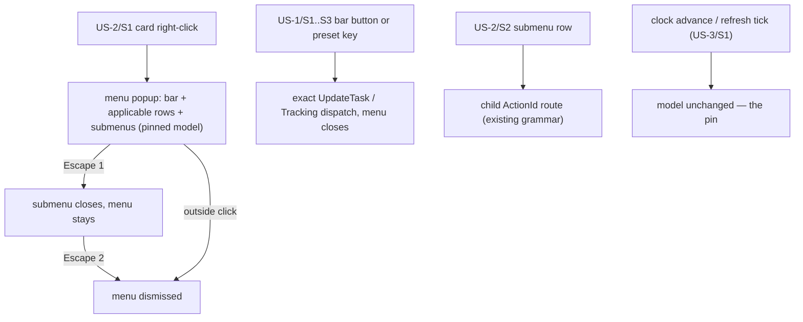
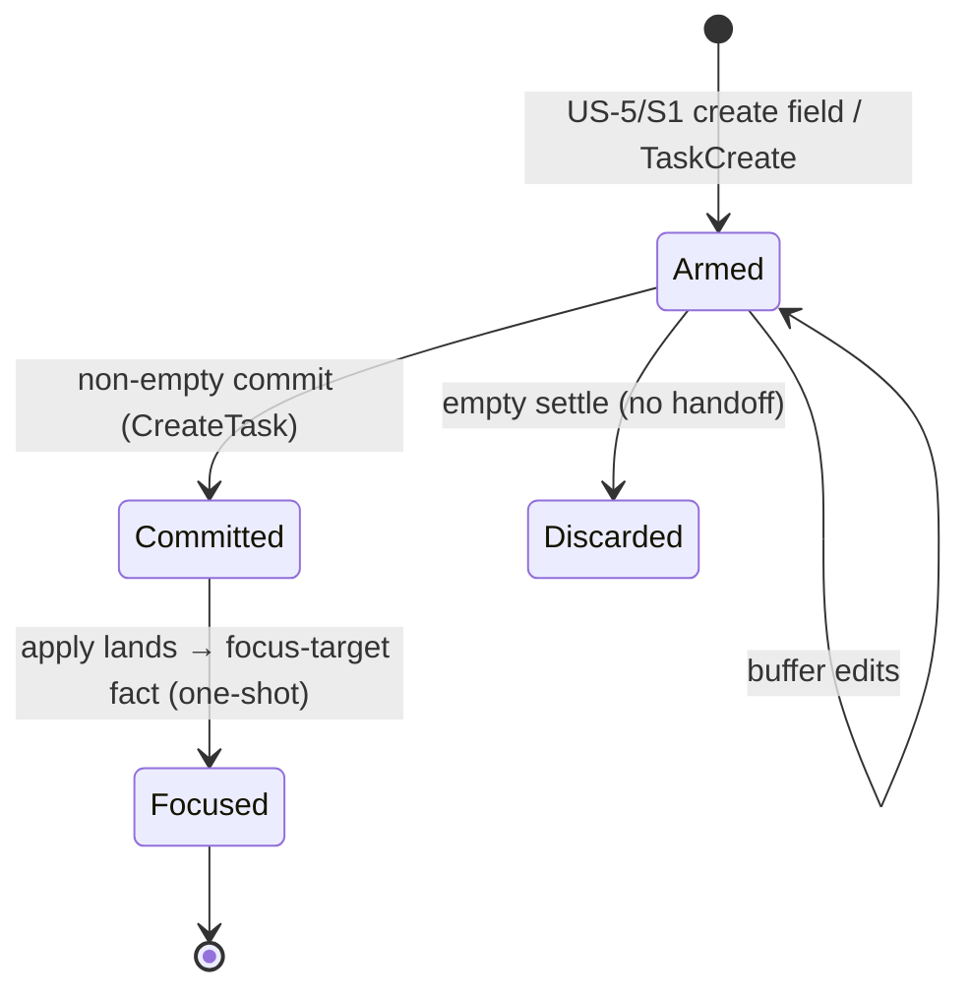

# [Plan] UX Journey Plan — Task card controls & the context menu grammar

- **Date**: 2026-11-16
- **Kind**: UX journey plan — user stories, journeys, flows, wiring
  contract for the task card's control family: the context-menu quick
  actions bar (with shortcuts), the context-menu restructure
  (context-applicable rows + submenus), the open-menu content-swap bug,
  the card play/pause tracking control, focus-on-create, the done
  checkbox hover, and the compact add-task field growth fix. No
  implementation decisions beyond the command contract.
- **Origin**: the operator's round-8 notes N-7, N-8, N-9, N-11, N-12,
  N-13, N-15 (hover half) (recorded in the round plan
  `.artifacts/plans/2026-11-16-gui-review-round8-plan.md` §1) + intake
  #811 (T-28 — the note wins, round plan C-1). The design reference is
  the operator's SuperProductivity screenshot (round plan Origin):
  an icon quick-actions row atop the menu, ▸ submenus, per-row key
  badges. Format/framework: `docs/ux_planning.org` +
  `.artifacts/templates/ux-journey-plan.md`.
- **Status**: ACCEPTED — the user accepted the round-8 plan set on 2026-11-16; dispatch may chunk from it (round plan §7,
  chunk 5; depends on keymap-parity chunk 1 and board-interaction
  chunk 4).
- **Surfaces touched**: `src/menu.rs` (TASK_CONTEXT + the bar/submenu
  grammar), `src/adapter.rs` (`open_task_context_menu` + the menu
  popup seams), `ui/compositions/action-menu.slint` (or the context
  menu popup's host composition), `ui/widgets/task-card.slint`,
  `ui/compositions/board-layout.slint` (compact leg's add-task field),
  `src/view_state.rs` (create-focus handoff), `src/actions.rs`,
  `src/keymap/presets.rs`
- **Platform scope**: desktop (the board surface does not mount on
  kiosk; Today rows share the context-menu grammar — the Today leg is
  desktop too)

## 1. Scope & goals

The task context menu gains a quick actions bar — icon-buttons for
schedule today, schedule tomorrow, unschedule, and Start/Stop tracking
(the shown half depends on the task's tracking state), each with a
keyboard shortcut routing the same `ActionId` — and a restructured row
set: rows that cannot apply to the subject's state are *withheld*
(not greyed — the C-4 complement to the BF-W-N2 doctrine bar), and the
rare families (convert, reminders, timers, entries) move into
submenus. The card itself gains a play/pause tracking control (the
T-28 deferral superseded by the note, round plan C-1). Creating a task
in board view focuses the new task's card; the done checkbox gains its
hover state; the compact leg's add-task field stops growing
vertically. The open-context-menu content swap (N-11) is diagnosed and
fixed — a time-dependent bug reproduced under the paused test clock.

The quick schedule actions operate on the **scheduled** field (the
taskboard vocabulary: scheduled = the day you plan to do the task;
"unschedule" = the `Some(None)` clear), dispatching the existing
sparse `UpdateTask` mask — no domain delta. "Schedule today" stamps
today's day-window end (the same day-facts the due editor uses after
the task-detail-editor plan's N-4 semantics land), so the scheduled
phrase renders "today" and the day-boundary law is uniform.

**Non-goals** (each with a home):

- No change to `TaskDueToday`'s Today-only scope (ruling R-9 stands —
  the quick bar's "schedule today" is the scheduled field's verb, not
  the due twin). Home: this plan §2 R-1.
- No inline card editing (T-26 stands, round plan C-6).
- No multi-selection grammar here (board-interaction US-4 owns it;
  the quick bar composes with it — the bar's rows are multi-sensible
  and ride that menu).
- No CLI twins for the quick actions (the scheduled field's CLI write
  path exists: `tasks edit --scheduled`; the quick actions are
  affordances over it, not new verbs). Home: §2 R-2.

## 2. Capability × surface matrix

| Capability | Board | TaskDetail | Today | Review | Settings | Capture | CLI |
|---|---|---|---|---|---|---|---|
| task.scheduled_edit (quick set/clear affordance family) | E (US-1) — the quick bar's schedule-today / schedule-tomorrow / unschedule rows + keys route `UpdateTask { scheduled }` (the census Board `U (TE-1)` cell converts on landing) | E (pre-existing editor) | E (pre-existing member + the bar rows on today cards) | E (pre-existing walk carry) | — (R-5 stands) | — (R-5 stands) | E (pre-existing, `tasks edit --scheduled`) |
| task.track_start / task.track_stop | E (US-1, US-4) — the quick bar's tracking button + the card play/pause control route the existing ids (the census Board `U (TE-3)` cells convert on landing — round plan C-1) | E (pre-existing chip) | E (pre-existing GLOBAL rows) | — (R-7/R-8 stand) | — (R-7/R-8 stand) | — (R-7/R-8 stand) | E (pre-existing, `track start/stop`) |
| task.create (focus handoff) | E (US-5) — the create flow's commit focuses the new card (evidence extension; the cell stays `E`) | — (R-1 stands) | — (R-1 stands) | — (R-1 stands) | — (R-1 stands) | — (R-1 stands) | C (pre-existing, `tasks add`) |
| app.menu (task context grammar) | E (US-2, US-3) — the context menu renders the applicable row set + submenus + the quick bar (evidence extension of the global menu capability) | E (global) | E (global) | E (global) | E (global) | E (global) | U (T-24 family stands) |

**Rulings** (every deliberate absence):

| ID | Ruling | Reason | Home |
|---|---|---|---|
| R-1 | The quick bar has no "due today" row on board cards | `TaskDueToday` binds `ContextId::Today` exclusively (r4 D-8's recorded filter; census R-9) and its verb writes the *due* field; the operator's "schedule" family is the scheduled field. The two stay distinct — widening R-9 would conflate due and scheduled. | this plan §1; census task.due_today row |
| R-2 | The quick actions have no CLI twins beyond the existing `tasks edit --scheduled` | The actions are affordances over an existing engine verb (`UpdateTask`); the CLI's write path already covers the field. No new verb, no twin debt. | this plan §1 |
| R-3 | The card play/pause control is pointer-grade (no card-scoped key beyond the quick bar's shortcuts) | The keyboard path is the quick bar's shortcut rows (click ≡ key at the action level); a per-card key would promote tracking onto every card's stroke space (the r4 D-7 prominence reasoning). The control itself routes the same ids the shortcuts do. | this plan §3 US-4 |
| R-4 | Withheld-vs-greyed split (round plan C-4): rows inapplicable to the subject's *state* are withheld; rows applicable but precondition-blocked stay greyed | The BF-W-N2 doctrine bar governs enablement within the applicable set; this plan narrows the set. Recorded as the standing grammar extension. | this plan §3 US-2; `ux_planning.org` §2.6 |

## 3. User stories

### US-1 — The quick actions bar (schedule today / tomorrow / unschedule / tracking, with shortcuts)

- **Story**: As a desktop user I want the task's most frequent
  actions as icon-buttons at the top of its context menu, each with a
  keyboard shortcut, so that scheduling and tracking are one gesture
  (N-7; the SuperProductivity shape).
- **Platforms**: desktop (board + stack-detail + today card menus).
- **Entry points**: the context menu's leading bar (icon-buttons);
  per-preset keyboard rows routing the same ids; the menu's row twins
  for each bar entry.
- **Priority**: P1
- **Acceptance**:
  - AC-1: Given a task card's context menu, When the "schedule today"
    bar button (or its key) fires, Then
    `StateCommand::UpdateTask { changes: TaskChanges { scheduled:
    Some(Some(<today's day-window end>)) , ..Default::default() } }`
    dispatches with every other mask `None` and the card's scheduled
    chip re-renders "today" — verified by journey test
    (exact-mask assertion).
  - AC-2: Given the same menu, When "schedule tomorrow" fires, Then
    the identical mask shape carries tomorrow's day-window end —
    verified by seam test.
  - AC-3: Given a scheduled task, When "unschedule" fires, Then
    `TaskChanges { scheduled: Some(None) }` dispatches (the clear
    twin) — verified by journey test.
  - AC-4: Given a non-tracking task, When the tracking bar button
    fires, Then `StateCommand::StartTracking { task, kind: Work }`
    routes (the existing id); given a tracking task, the button's
    shown half flips and fires `StateCommand::StopTracking` — verified
    by journey test (the context-shown rule, N-7).
  - AC-5: Given any bar entry, When its preset stroke fires anywhere
    the menu context holds, Then the identical dispatch routes (click
    ≡ key) — verified by seam test; candidates per preset recorded as
    candidates, the keymap contract suite is the oracle (collisions
    resolved per round plan C-5's rule; hints registry-generated).

### US-2 — The context menu shows what applies, and groups what is rare (N-8)

- **Story**: As a desktop user I want the task context menu to stop
  offering actions that cannot apply to the clicked task, and to
  group the rare families in submenus, so that the menu is scannable
  again.
- **Platforms**: desktop.
- **Entry points**: the card right-click (`open_task_context_menu`);
  the today-row context (the shared grammar).
- **Priority**: P1
- **Acceptance**:
  - AC-1: Given a non-tracking task, When its menu opens, Then the
    Stop Tracking row is withheld (and Start shown); given a tracking
    task, the halves swap — verified by presentation test (row-set
    composition, the C-4 withheld rule).
  - AC-2: Given a rule-less task, When its menu opens, Then
    `ReminderUnmute`/`ReminderSnooze`/`ReminderRuleRemove` are
    withheld (nothing to unmute/snooze/remove) while `ReminderMute`/
    `ReminderRuleAdd` stay; given a series-less task, the Series*
    rows are withheld; given a habit-kind task, the Series* rows are
    withheld (and vice versa — the #492 kind-filter grammar extended
    to state, not just kind) — verified by presentation test.
  - AC-3: Given any task menu, When it renders, Then the rare
    families render as submenus — Convert ▸ (the habit/series convert
    arms), Reminders ▸ (rule add/remove, mute/unmute, snooze),
    Timers ▸ (create/cancel), Entries ▸ (track entries) — each child
    row keeping its `ActionId`, hint, and shortcut projection; the
    top-level set is the frequent core (open, complete, move, delete,
    the quick bar) with destructive rows last (BF-W-N2 stands) —
    verified by presentation test (the row-set tree, never text).
  - AC-4: Given a submenu open, When Escape or an outside click
    fires, Then the submenu closes first and the menu stays (the
    Escape-ladder order), a second Escape closes the menu — verified
    by journey test.

### US-3 — The open menu's contents never swap to the main menu (N-11 bug)

- **Story**: When I leave a task context menu open for a few seconds,
  I want its contents to stay put so that the menu I read is the menu
  that fires.
- **Platforms**: desktop.
- **Entry points**: the investigation rides the menu popup lifecycle
  (the reproduction: open a card context menu, hold it open, advance
  the clock under `tokio::time::pause()`/`advance()` — §5's clock
  law; the bug is time-dependent and the reproduction must be
  deterministic).
- **Priority**: P1
- **Acceptance**:
  - AC-1: Given a card context menu open, When the test clock
    advances past the main menu's group-dwell interval (and any
    refresh tick fires), Then the popup's model is unchanged (the
    context rows, not the main menu's) — verified by journey test
    (typed model assertion; the *fix* is the pin: the context popup's
    model is built once at open and nothing re-derives it while
    open; the dwell re-derivation is scoped to the main menu's own
    open state).
  - AC-2: Given the main menu open on a group page, When the dwell
    interval elapses, Then the main menu's own behaviour is unchanged
    (the fix does not regress the two-tier grammar) — verified by the
    existing menu tests standing.

### US-4 — The card carries a play/pause tracking control (N-12; round plan C-1)

- **Story**: As a desktop user I want to start or stop tracking a
  task directly from its card so that the board's tracking badge is
  never display-only.
- **Platforms**: desktop.
- **Entry points**: the card's tracking control (the play/pause
  icon-button beside the decoration region; the shown icon depends on
  the task's tracking state — N-7's context rule); keyboard: the
  quick bar's tracking shortcut (US-1/AC-5).
- **Priority**: P1
- **Acceptance**:
  - AC-1: Given a non-tracking task's card, When the control fires,
    Then `StateCommand::StartTracking { task, kind: Work }` routes
    with the card's task as target (the context seams' focus-first
    posture); the control re-renders as pause — verified by journey
    test.
  - AC-2: Given a tracking task's card, When the control fires, Then
    `StateCommand::StopTracking` routes; the running badge and the
    control flip back — verified by journey test.
  - AC-3: Given the control, When the task is already tracked by this
    stop/start cycle, Then no double dispatch is possible (the id is
    one-shot per state flip; the stale-absorb law) — verified by seam
    test.

### US-5 — A newly created task receives focus (N-9)

- **Story**: As a desktop user I want the board's create flow to land
  focus on the new card so that naming-and-detailing a task does not
  start another hunt.
- **Platforms**: desktop.
- **Entry points**: the per-column inline create field's commit and
  the `ActionId::TaskCreate` flow (both create funnels).
- **Priority**: P1
- **Acceptance**:
  - AC-1: Given a non-empty create commit, When the engine's apply
    lands, Then the created task's card is the focused card (the
    focus-target fact derives from the create outcome — the
    selected-card machinery, compact's `FocusScrollHint` precedent
    for the scroll-into-view half) — verified by journey test (the
    focused-card model fact).
  - AC-2: Given an empty-buffer settle, When the flow ends, Then no
    focus handoff fires (nothing was created) — verified by seam
    test.

### US-6 — The done checkbox has a hover state (N-15's hover half)

- **Story**: As a desktop mouse user I want the done checkbox to
  visibly react to hover so that the click target is discoverable
  like every other control.
- **Platforms**: desktop (the checkbox renders on today rows too —
  the same widget grammar).
- **Entry points**: the checkbox's hover state (presentation).
- **Priority**: P2
- **Acceptance**:
  - AC-1: Given the pointer over the checkbox, When the card renders
    the hover state, Then the checkbox model carries the hover flag
    driving the house hover treatment (the Theme's existing hover
    tokens — no new primitive, the r1 R-1 posture) — verified by
    presentation test (flag, never styling text).

### US-7 — The compact add-task field keeps its height (N-13 bug)

- **Story**: As a desktop user in the narrowest layout I want the
  add-task field to render at its normal height so that the column
  header is not swallowed.
- **Platforms**: desktop (compact breakpoint leg).
- **Entry points**: the compact leg's add-task ghost/create field
  (`board-layout.slint` compact leg).
- **Priority**: P1
- **Acceptance**:
  - AC-1: Given the compact leg, When the add-task field renders
    (armed or ghost), Then the field's height constraint is the
    single-line field height (the layout fix: the surplus-height
    absorption the compact viewport owns must not reach the field) —
    verified by a presentation/golden test (the constraint fact; the
    golden suite re-baselines per the r2 R-3 mechanism).

## 4. Journey specs

### US-1 — Quick actions bar

| Step | Surface & affordance | User action | Dispatches | System response | Escape / failure |
|---|---|---|---|---|---|
| US-1/S1 | context menu bar (top), icon-buttons | click "schedule today" / press its key | `ActionId::TaskScheduleToday` → `StateCommand::UpdateTask { changes: { scheduled: Some(Some(<today window end>)) } }` (sparse) | the menu closes; the card's scheduled chip re-renders "today" | typed engine refusals surface via the outcome lane; `AppUndo` reverts (`UpdateTask` PreImage) |
| US-1/S2 | bar / key | "schedule tomorrow" | `ActionId::TaskScheduleTomorrow` → the same mask with tomorrow's window end | the chip re-renders "tomorrow" | as S1 |
| US-1/S3 | bar / key | "unschedule" (mounted only on a scheduled task — the withheld rule) | `ActionId::TaskUnschedule` → `TaskChanges { scheduled: Some(None) }` | the scheduled chip clears | as S1 |
| US-1/S4 | bar tracking button (shown half per the task's tracking state) | click / key | `ActionId::TaskTrackStart`/`TaskTrackStop` (existing ids, card-focused) | the shown half flips; the running badge updates | no target → typed `NoTarget`; stop's nothing-open is the total no-op |

### US-2 — Menu applicability + submenus

| Step | Surface & affordance | User action | Dispatches | System response | Escape / failure |
|---|---|---|---|---|---|
| US-2/S1 | card right-click | open the menu | — (menu assembly) | the menu renders: the quick bar, the applicable core rows, the four submenus, destructive last; inapplicable rows withheld (C-4) | outside click / Escape dismisses (the existing dismissal seam) |
| US-2/S2 | a submenu row (e.g. Convert ▸) | open the submenu; invoke a child row | the child row's existing `ActionId` → its existing route (the conversion arm arms the row strip per the conversion grammar) | the submenu closes; the verb's own feedback follows its journey | Escape closes the submenu first, then the menu (the ladder); a disabled child row is greyed (BF-W-N2), never silently absorbed (the r5 D-6 notice posture) |

### US-3 — Open-menu stability (bug fix)

| Step | Surface & affordance | User action | Dispatches | System response | Escape / failure |
|---|---|---|---|---|---|
| US-3/S1 | open card context menu | wait (test: advance the paused clock past the dwell interval + a refresh tick) | — | the popup's model is unchanged (the pin: built once at open) | the fix's guard; any re-derivation attempt is the finding the test pins against |
| US-3/S2 | the menu rows | invoke any row | the row's action (unchanged grammar) | the pinned model's action routes — the menu read is the menu fired | the existing dismissal/absorb laws |

### US-4 — Card play/pause

| Step | Surface & affordance | User action | Dispatches | System response | Escape / failure |
|---|---|---|---|---|---|
| US-4/S1 | card tracking control (play icon) | click | `ActionId::TaskTrackStart` (card-focused) → `StateCommand::StartTracking { task, kind: Work }` | the control flips to pause; the running badge renders | no target → typed `NoTarget`; the tracking class has no journal undo (the recorded posture) — the stop is the inverse |
| US-4/S2 | card tracking control (pause icon) | click | `ActionId::TaskTrackStop` → `StateCommand::StopTracking` | the control flips to play; the badge clears | nothing-open is the total no-op |

### US-5 — Focus on create

| Step | Surface & affordance | User action | Dispatches | System response | Escape / failure |
|---|---|---|---|---|---|
| US-5/S1 | inline create field / `TaskCreate` flow | type a title, commit | `StateCommand::CreateTask { .. }` (existing funnel) | the card renders **and becomes the focused card** (scroll-into-view on compact) | empty buffer settles to discard — no handoff (the empty-buffer law); the focus handoff is one-shot (a second apply does not re-steal focus) |

### US-6 — The done checkbox's hover state

| Step | Surface & affordance | User action | Dispatches | System response | Escape / failure |
|---|---|---|---|---|---|
| US-6/S1 | done checkbox | hover | — display only | the hover flag drives the house hover treatment | display only |

### US-7 — The compact add-task field's height

| Step | Surface & affordance | User action | Dispatches | System response | Escape / failure |
|---|---|---|---|---|---|
| US-7/S1 | compact add-task field | arm / render | — display only | single-line height holds (the constraint fix) | display only |

## 5. Interaction flows

The quick bar and the restructured menu (one popup grammar):

Create-focus handoff:

## 6. Wiring inventory

| ID | Surface file | Widget | Callback | Adapter seam | ActionId | Commands | Row addressing | Journey steps | Test |
|---|---|---|---|---|---|---|---|---|---|
| W-1 | src/menu.rs, ui/compositions/action-menu.slint (the context popup host), src/adapter.rs | the quick actions bar (icon-button row) | — | the menu popup builder's bar section; the bar-button seam (`// slint:` per the #782 fold) | ActionId::TaskScheduleToday | StateCommand::UpdateTask; StateCommand::StartTracking; StateCommand::StopTracking | the addressed card via `a.tables.task_ids` (the context seams' focus-first posture; multi-selection rides board-interaction W-5) | US-1/S1–S3, US-1/AC-4–5 | journeys.rs::us1_s1_schedule_today_commits_the_exact_mask |
| W-2 | src/menu.rs, src/adapter.rs | the applicable row set + submenus (Convert/Reminders/Timers/Entries ▸) | — | `open_task_context_menu`'s extended hide-set (state-filtered, the #492 grammar) + the submenu page assembly | — | — | menu model rows (typed row-set, tested as composition) | US-2/S1–S2, US-3/S2 | presentation.rs::us2_ac1_stop_tracking_withheld_on_non_tracking_task |
| W-3 | src/adapter.rs, ui/compositions/action-menu.slint | the context popup model pin | — | the open seam pins the model; the dwell re-derivation scoped to the main menu (the fix) | — | — | the pinned popup model | US-3/S1–S2 | journeys.rs::us3_s1_open_context_menu_survives_the_dwell_interval |
| W-4 | ui/widgets/task-card.slint, ui/app-window.slint, src/adapter.rs | the card play/pause control | — | the card control seam (focus-first, the context-verb posture; `// slint:`) | ActionId::TaskTrackStart | StateCommand::StartTracking; StateCommand::StopTracking | card task via `a.tables.task_ids` | US-4/S1–S3 | journeys.rs::us4_s1_card_play_routes_starttracking |
| W-5 | ui/compositions/board-layout.slint, ui/app-window.slint, src/view_state.rs, src/adapter.rs | the create-focus handoff | — | the create flow's outcome carries the created task; the adapter sets the focus-target fact (the selected-card machinery) | ActionId::TaskCreate | StateCommand::CreateTask | created task via the apply's id table | US-5/S1–S2 | journeys.rs::us5_s1_create_focuses_the_new_card |
| W-6 | ui/widgets/task-card.slint | done checkbox hover state | — | — (display only — the hover flag on the existing checkbox model) | — | — | the checkbox model | US-6/S1 | presentation.rs::us6_s1_the_done_checkbox_carries_the_hover_flag |
| W-7 | ui/compositions/board-layout.slint (compact leg) | the add-task field height constraint | — | — (display only — the layout constraint) | — | — | the compact leg's field | US-7/S1 | golden_visuals.rs (re-baselined) + presentation.rs::us7_s1_the_compact_add_task_field_holds_its_height |

## 7. Command-contract delta

**No new `StateCommand`, no new `UiRequest`.** The delta is
ActionIds + preset rows + menu grammar:

| Kind | Name | Payload sketch | Journeys |
|---|---|---|---|
| ActionId | TaskScheduleToday | new — Task-group contexts (Board/StackDetail/Today/TaskDetail); dispatches `UpdateTask { scheduled: Some(Some(<today day-window end>)) }`; the quick bar button, the menu row, and the preset key route it | US-1/S1 |
| ActionId | TaskScheduleTomorrow | new — same contexts; tomorrow's window end | US-1/S2 |
| ActionId | TaskUnschedule | new — same contexts; `Some(None)` clear; the bar row withholds on unscheduled tasks (the C-4 rule) | US-1/S3 |
| ActionId | TaskTrackStart / TaskTrackStop | exist — the bar button and the card control route them (the shown half per tracking state) | US-1/AC-4, US-4 |
| ActionId | TaskCreate | exists — the create flow's focus handoff is outcome-side | US-5 |
| (grammar) | the context menu's submenu pages | no new ids — child rows keep their ActionIds; the popup model gains the bar section, the withheld filter, and the submenu tree | US-2, US-3 |

Preset rows: the three new ids bind in all three presets (candidates
recorded as candidates; the keymap contract suite is the oracle;
collisions per round plan C-5 — in particular the emacs `C-c` chord
space's occupancy is checked before any candidate is pinned; hints
registry-generated).

## 8. Verification plan

- **Journey tests** (step-ID-named): `us1_s1_schedule_today_commits_the_exact_mask`,
  `us1_s2_schedule_tomorrow_commits_the_exact_mask`,
  `us1_s3_unschedule_commits_the_clear_twin`,
  `us1_ac5_bar_key_and_click_route_identically`,
  `us2_ac4_escape_ladder_steps_submenu_then_menu`,
  `us3_s1_open_context_menu_survives_the_dwell_interval`,
  `us4_s1_card_play_routes_starttracking`,
  `us4_s2_card_pause_routes_stoptracking`,
  `us5_s1_create_focuses_the_new_card`,
  `us5_s2_empty_settle_hands_off_nothing`.
- **Seam tests**: the exact sparse masks (every quick action, per the
  r3 exact-mask shapes); the tracking ids' card-focused routes; the
  one-shot state flips (US-4/AC-3, US-5's one-shot handoff).
- **Fold/presentation tests**: the withheld row-set per subject state
  (US-2/AC-1–2) and the submenu tree (US-2/AC-3) as typed
  compositions; the checkbox hover flag; the compact field height
  constraint — typed flags, never text; the golden suite re-baselines
  for the card/menu visuals.
- **Keymap totality**: the contract suite covers the three new ids per
  preset (coverage + conflict detection + snapshot regeneration).
- **Kiosk gates**: none new — the board surface does not mount on
  kiosk; the Today leg's menu rows are the existing desktop grammar.
  Recorded so the absence is decided.
- **Manual**: the bar's icon vocabulary and the submenu naming are
  judged at walkthrough (the SuperProductivity reference is the
  operator's direction, not a pixel spec); the count caption wording
  rides board-interaction US-4.
- **#760 fold**: stage 3 cross-checks every §6 row against
  `tests/seam_inventory.rs`.

## 9. Definition of done

- [ ] `scripts/ux-coverage.sh <this file> --gate` exits 0
- [ ] Every P1 story's journey completes end-to-end including escapes
- [ ] Walkthrough protocol executed at stage 3; the doctrine bar held
  (grey-within-applicable + withheld-inapplicable recorded as the C-4
  grammar; destructive rows last)
- [ ] Census cells updated: `task.scheduled_edit` Board `U (TE-1)` →
  `E (US-1)`; `task.track_start/stop` Board `U (TE-3)` → `E (US-1,
  US-4)` (round plan C-1 — the dated supersession note on r6 D-6);
  `task.create` focus evidence; the app.menu task-context evidence
- [ ] #811 closes with the PR (C-1); the N-11 fix's reproduction test
  is the pinned guard
- [ ] Non-goals filed: none new (T-26 stands; R-9 stands per R-1)
