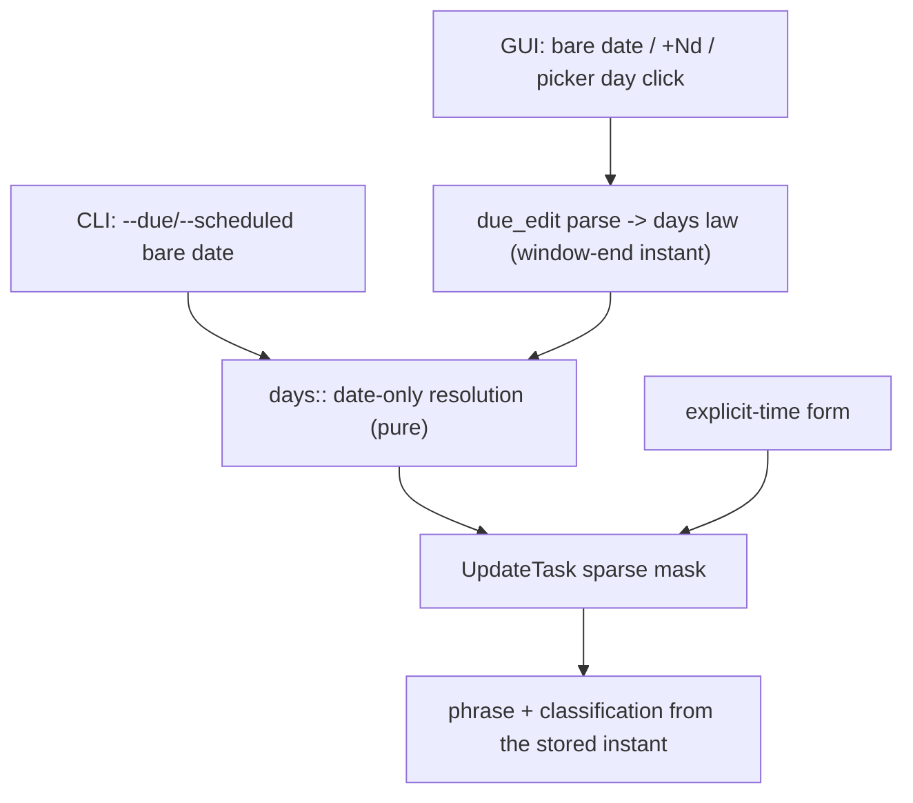

# [Plan] UX Journey Plan — Task detail editor: date grammar, effort seam, editor-friction repairs

- **Date**: 2026-11-16
- **Kind**: UX journey plan — user stories, journeys, flows, wiring
  contract for the detail view's editor family round 8: the day-boundary
  due/scheduled stamping law, the date-time picker's pointer repairs
  (HH:MM click, quick-options autoscroll), the effort detail seam, and
  four editor-friction repairs (#759 pause preservation, #706 dead
  subject, #840 armed-flag/Escape rung). No implementation decisions
  beyond the command contract.
- **Origin**: the operator's round-8 notes N-4, N-5, N-6 (recorded in
  the round plan `.artifacts/plans/2026-11-16-gui-review-round8-plan.md`
  §1) + intake #838, #759, #706, #840. Format/framework:
  `docs/ux_planning.org` + `.artifacts/templates/ux-journey-plan.md`.
- **Status**: ACCEPTED — the user accepted the round-8 plan set on 2026-11-16; dispatch may chunk from it (round plan §7,
  chunk 3; depends on focus-restoration chunk 2).
- **Surfaces touched**: `crates/taskboard-domain/src/days.rs` (the
  stamping law — pure), `crates/taskboard-ui-slint/src/due_edit.rs`
  (the parse), `ui/compositions/due-editor.slint` (+ the datetime
  slots composition), `ui/views/task-view.slint` (the effort row),
  `ui/compositions/labels-overlay.slint`,
  `src/adapter.rs` (editor funnels), `src/view_state.rs`
  (restoration), `crates/taskboard-app/src/commands/tasks.rs` +
  `cli.rs` (the CLI due/scheduled parse parity)
- **Platform scope**: desktop (the detail view is a desktop surface —
  the census mount grammar; the domain law is surface-free)

## 1. Scope & goals

A date-only due or scheduled input (a bare `YYYY-MM-DD`, a `+Nd`
relative day, the calendar picker's day click) resolves to **that
local date's day-window end** — never 00:00 — so overdue computation
gives the whole configured day, the due instant wanders into the early
morning of the next day when the day boundary is set specially, and
the default boundary yields the end-of-day the operator named (N-4;
the recorded equivalence below). The date-time picker stops closing
when the mouse clicks into its HH:MM fields (N-5) and its quick
options auto-scroll to the current time (N-6). The detail view gains
an effort edit seam (#838). Re-setting a recurrence rule no longer
silently clears the series pause (#759); a dead subject never
restores a subject-less detail view as the root (#706); the labels
overlay's delete can no longer leave an invisible armed flag that
eats an Escape rung (#840).

**The day-end decision (N-4's letter, recorded)**: the day end is
**derived, not a second knob** — it is `day_window`'s end
(`[preferences] day_start_time` + 24h, `days.rs`, the D-F6 law). A
day start of `"03:00"` makes the day end 03:00 the *next* morning —
exactly the operator's "wander into the early morning hours" case.
With the default `"00:00"` the derived end is next-midnight, one
millisecond after the operator's literal `23:59:59.999` — identical
classification at every whole-second comparison, so the note's
default clause is satisfied by the same definition rather than a
second constant. A separate `day_end_time` knob is rejected: it opens
an inconsistent state space (an end at-or-before the start) and would
need its own settings-editor row and validation grammar for no
semantic gain. Recorded as this plan's standing decision; the
operator can overturn it at acceptance and the plan's §7 payload
sketch absorbs either shape.

**Non-goals** (each with a home):

- No migration of already-stored 00:00-stamped due/scheduled instants
  — stored data stays; only newly minted stamps follow the law (the
  phrase/classification renders from the stored instant either way).
  Home: this §1; a retro-relabel pass is a `backlog:` issue only if
  the walkthrough shows real drift.
- No re-litigating the recurrence editor's scope (r7 R-2 stands) —
  #759's fix is a preservation law inside the existing mint, not an
  editor redesign.
- No CLI grammar change beyond routing the date-only forms through
  the shared domain law (the CLI's `--due/--scheduled` acceptance
  forms are unchanged).

## 2. Capability × surface matrix

| Capability | Board | TaskDetail | Today | Review | Settings | Capture | CLI |
|---|---|---|---|---|---|---|---|
| task.due_edit (date-only stamping law) | U (TE-1 stands) | E (US-1) — the editor's date-only forms and the picker's day clicks commit the day-window end (the census cell's evidence gains the law) | U (TE-1 stands) | E (pre-existing walk carry) | — (R-4 stands) | — (R-4 stands) | E (pre-existing, `tasks edit --due`, now minting via the shared law) |
| task.scheduled_edit (date-only stamping law) | U (TE-1 stands) | E (US-1, the shared editor) | U (TE-1 stands) | E (pre-existing) | — (R-5 stands) | — (R-5 stands) | E (pre-existing, `--scheduled`, shared law) |
| task.effort_edit (new GUI seam) | U (TE-1-class) | E (US-2) — the effort detail row + editor commits the sparse `UpdateTask { effort }` mask (the #838 finding's seam) | U (same class) | E (pre-existing walk placement) | — (R-5 stands) | — (R-5 stands) | E (pre-existing, `tasks edit` effort flag) |
| task.recur_set (pause preservation) | — (R-2 stands) | E (US-3) — set/replace preserves `paused_until` (the census cell's evidence gains the preservation law) | — (R-2 stands) | — (R-2 stands) | — (R-2 stands) | — (R-1 stands) | E (pre-existing, `tasks repeat`, shared mint) |
| task.back (restoration guard) | — (R-1 stands) | E (US-4) — the detail restores only with a live subject (evidence extension) | — (R-1 stands) | — (R-1 stands) | — (R-1 stands) | — (R-1 stands) | U |
| label.delete (armed grammar) | U (labels surface from the detail — the owning-surface note stands) | E (US-5) — confirm clears the armed identity (the r2 grammar completed; the census cell's evidence gains it) | U (same note) | U (same note) | U (same note) | U (same note) | X (pre-existing) |
| task.recur_preview (time options) | — (R-2 stands) | D (US-1) — the quick options list opens scrolled to the current time (evidence extension) | — (R-2 stands) | — (R-2 stands) | — (R-2 stands) | — (R-2 stands) | U (RC-4 stands) |

**Rulings** (every deliberate absence):

| ID | Ruling | Reason | Home |
|---|---|---|---|
| R-1 | No stored-instant migration | Existing 00:00-stamps are user data; re-stamping them silently would move real deadlines. The law governs new stamps; a retro pass is opt-in future work. | this plan §1 |
| R-2 | The effort row mounts only in the detail view (the r3 D-6 posture) | The detail view is the task field's owning surface (the census register's own scoping; the walk's placement form is the review-side twin). | this plan §2; census Task detail slice |
| R-3 | The datetime quick options gain no new commands | Autoscroll is presentation state over the existing slot model (`date-time-slots`/`date-time-nearest-row`); nothing dispatches differently. | this plan §3 US-1 |

## 3. User stories

### US-1 — Date-only due/scheduled stamps at the day-window end (N-4)

- **Story**: As a user picking a bare day as a due date I want the
  whole configured day to count so that the task is not overdue at
  midnight-before-breakfast.
- **Platforms**: desktop (the law itself is domain-pure; the CLI twin
  rides it).
- **Entry points**: the due/scheduled field's date-only forms
  (`YYYY-MM-DD`, `+Nd`), the calendar picker's day click, the CLI
  `tasks edit --due/--scheduled` date-only forms.
- **Priority**: P1
- **Acceptance**:
  - AC-1 (domain law): Given a local date D and the config's
    `day_start_time`, When the date-only form resolves, Then the
    minted instant is D's local date at the day-window end
    (`days::`-law; pure function, proptest: for every D and every
    legal day start, the instant equals `day_window(D's day start
    instant, ..).1` shifted to D — verified by domain unit tests +
    proptest).
  - AC-2 (GUI): Given a bare date typed or a picker day clicked on
    the due editor, When it commits, Then `UpdateTask { changes: {
    duedate: Some(Some(<window-end instant>)) } }` dispatches and the
    overdue classification flips only after that instant — verified
    by journey test (the exact instant asserted, the paused-clock
    classification check).
  - AC-3 (parity): Given the same bare date on the CLI, When
    `tasks edit --due <date>` runs, Then the identical instant is
    minted (one law, two fronts — the shared domain function) —
    verified by app-arm test.
  - AC-4 (explicit time unchanged): Given an input carrying an
    explicit time (`YYYY-MM-DD HH:MM`), When it commits, Then the
    instant is the typed time (the law is date-only) — verified by
    the existing parse tests extended.
  - AC-5 (datetime quick-set forms): Given the picker's quick-set
    buttons (now / today / tomorrow families), When one commits, Then
    the same law applies to its date half — verified by seam test.

### US-2 — The date-time picker's pointer repairs (N-5, N-6)

- **Story**: As a mouse user I want to click into the picker's HH:MM
  fields and edit them, and I want the quick options to open scrolled
  to the current time, so that the common "set it to roughly now"
  journey is two clicks.
- **Platforms**: desktop.
- **Entry points**: the due/scheduled editor's time fields + the
  quick options list (the existing datetime slots composition).
- **Priority**: P1
- **Acceptance**:
  - AC-1 (N-5): Given the editor open, When the pointer clicks into
    an HH:MM field, Then the field gains focus and the editor stays
    open (the bug: the click currently settles/dismisses the editor —
    the TouchArea/funnel ordering fix; the dismiss ladder must not
    fire for intra-editor clicks) — verified by journey test.
  - AC-2 (N-6): Given the quick options list opening, When it
    renders, Then the current-time slot is the scrolled-to,
    highlighted row (the nearest-row derivation focused instead of
    the list head) — verified by presentation test (the focused slot
    index, never geometry).
  - AC-3: Given the HH fields focused, When the user types/steps and
    commits, Then the parse grammar is unchanged (`parse_time_lenient`
    + `step_minutes` stand; the fix is focus, not grammar) — verified
    by the existing time-parse tests standing.

### US-3 — The effort detail seam (#838)

- **Story**: As a desktop user I want to set or clear a task's effort
  from its detail view so that estimating does not require the review
  walk or the CLI.
- **Platforms**: desktop.
- **Entry points**: the effort detail row's edit affordance (mounted
  beside the priority rows, the r3 D-1 metadata-block grammar); the
  CLI's effort flag remains the text twin.
- **Priority**: P2
- **Acceptance**:
  - AC-1: Given a task open, When the effort editor commits a valid
    value, Then `UpdateTask { changes: { effort: Some(Some(..)) } }`
    dispatches sparse; the clear commits `Some(None)` — verified by
    journey test (exact masks; the parse predicate mirrors the walk's
    placement form — one predicate, two fronts).
  - AC-2: Given an invalid value, When accepted, Then the buffer is
    kept and nothing dispatches (the date-editor refusal posture) —
    verified by journey test.
  - AC-3: Given the walk's effort parse and the row's parse, When
    both accept/reject the same corpus, Then they agree (the shared
    predicate) — verified by a parity test.

### US-4 — Rule replacement preserves the series pause (#759)

- **Story**: As a user editing a paused series' rule I want the pause
  to survive the edit so that fixing a pattern does not silently
  resume the series.
- **Platforms**: desktop; the CLI twin rides the same mint.
- **Entry points**: the recur editor's set/replace commit (GUI);
  `tasks repeat` (CLI).
- **Priority**: P1
- **Acceptance**:
  - AC-1: Given a series with `paused_until` set, When a new rule is
    set (GUI or CLI), Then the minted `RecurRule` carries the existing
    `paused_until` (the D-S4 law holds end-to-end; the drop — wherever
    stage 2 finds it, mint or setter — is fixed) and the pause chip
    stays — verified by a round-trip test over both fronts.
  - AC-2: Given a deliberate un-pause, When the user resumes through
    the pause flow, Then clearing works as before (the preservation
    law must not wedge the resume) — verified by the existing resume
    tests standing.

### US-5 — A dead subject never restores as the root (#706)

- **Story**: When the detail view's subject is gone under a pushed
  over-view, I want the restored root to be a live view so that I am
  never parked in an empty detail shell.
- **Platforms**: desktop.
- **Entry points**: the view-stack restoration path (the over-view
  dismiss/restore funnel).
- **Priority**: P2
- **Acceptance**:
  - AC-1: Given the detail view buried under an over-view and its
    subject tombstoned (delete/complete elsewhere), When the
    over-view restores, Then the root falls back to the subject's
    board (or the app root when the board is gone) — the typed
    subject-liveness guard at restore — verified by journey test.
  - AC-2: Given a live subject, When the over-view restores, Then the
    detail view restores unchanged (the guard is inert) — verified by
    the existing restoration tests standing.

### US-6 — The labels overlay's delete cannot eat an Escape rung (#840)

- **Story**: As a user deleting a label I want the confirm to leave
  no invisible armed state so that Escape closes the overlay on the
  first press after a fast double-click delete.
- **Platforms**: desktop.
- **Entry points**: the labels overlay's row delete (the r2 armed
  grammar).
- **Priority**: P2
- **Acceptance**:
  - AC-1: Given the delete affordance armed and confirmed (including
    the fast double-click path), When the delete dispatches, Then the
    armed identity is cleared (the r2 confirm law: the flag clears
    before/at the send) and the next Escape closes the overlay
    directly — verified by journey test (the rung count, typed).
  - AC-2: Given the strip armed, When Cancel or Escape fires, Then
    the disarm leaves the overlay's ladder intact (the existing
    grammar, now with the cleared identity) — verified by journey
    test.

## 4. Journey specs

### US-1 — Date-only stamping

| Step | Surface & affordance | User action | Dispatches | System response | Escape / failure |
|---|---|---|---|---|---|
| US-1/S1 | due/scheduled field, bare `YYYY-MM-DD` (or `+Nd`, or a picker day click) | type/pick, commit | `StateCommand::UpdateTask { changes: { duedate/scheduled: Some(Some(<window-end instant>)) } }` — the mint via the shared domain law (A1 constructor at the trust boundary) | the due/scheduled phrase re-renders; overdue classification flips only past the instant | an unparseable accept keeps the buffer, dispatches nothing (the existing refusal posture); `AppUndo` reverts |
| US-1/S2 | the editor's explicit-time form | type `YYYY-MM-DD HH:MM`, commit | the typed-time instant (unchanged grammar) | as S1 | as S1 |
| US-1/S3 | CLI `tasks edit --due <date>` | run the verb | the same law's instant (parity) | the engine applies; the GUI phrase re-renders on next read | the CLI's parse refusals are typed, unchanged |

### US-2 — Picker pointer repairs

| Step | Surface & affordance | User action | Dispatches | System response | Escape / failure |
|---|---|---|---|---|---|
| US-2/S1 | editor time fields (HH/MM) | click into a field | — (focus, nothing dispatches) | the field focuses; the editor stays open | Escape dismisses per the existing ladder (parseable commits, empty/junk discards) |
| US-2/S2 | quick options list | open the list | — (presentation) | the list opens scrolled to the current-time slot, highlighted | arrow walk + Return as today; Escape closes the list first |

### US-3 — Effort row

| Step | Surface & affordance | User action | Dispatches | System response | Escape / failure |
|---|---|---|---|---|---|
| US-3/S1 | effort row, edit affordance | open the editor | — (the editor arms, seeded from the current effort) | the field arms (one editor at a time — the detail exclusivity posture) | Escape/outside settles by rule (parseable commits, empty discards) |
| US-3/S2 | effort field | type, commit | `StateCommand::UpdateTask { changes: { effort: Some(Some(..)) } }` sparse | the effort chip re-renders | invalid value keeps the buffer, nothing dispatches; `AppUndo` reverts |

### US-4 — Rule replace preserves pause

| Step | Surface & affordance | User action | Dispatches | System response | Escape / failure |
|---|---|---|---|---|---|
| US-4/S1 | recur editor (or CLI `tasks repeat`) | edit the rule of a paused series, commit | `UpdateTask { changes: { recur: Some(Some(rule with paused_until preserved)) } }` | the pattern echo updates; the pause chip stays | invalid draft arms the fold, commit inert (the existing editor grammar); typed failure keeps the editor open |

### US-5 — Restoration guard

| Step | Surface & affordance | User action | Dispatches | System response | Escape / failure |
|---|---|---|---|---|---|
| US-5/S1 | over-view dismiss over a dead subject | close the over-view | — (restoration) | the root falls back to the subject's board / the app root (the typed guard) | the guard is inert for live subjects (no behavior change) |

### US-6 — Labels delete rung

| Step | Surface & affordance | User action | Dispatches | System response | Escape / failure |
|---|---|---|---|---|---|
| US-6/S1 | overlay row delete | arm, confirm (fast double-click included) | `StateCommand::DeleteLabel { id }` | the row leaves; **the armed identity is cleared** | the next Escape closes the overlay directly (no phantom rung); Cancel/Escape before confirm disarms |

## 5. Interaction flows

The date-only resolution law (one funnel, two fronts):

The labels delete ladder with the cleared identity:

```mermaid
stateDiagram-v2
    [*] --> Row : US-6/S1 arm (strip mounts)
    Row --> Armed : first activation
    Armed --> Confirmed : Confirm / fast second activation (DeleteLabel; identity CLEARED)
    Armed --> Row : Cancel / Escape (disarm)
    Confirmed --> OverlayClosed : next Escape closes the overlay directly
```

## 6. Wiring inventory

| ID | Surface file | Widget | Callback | Adapter seam | ActionId | Commands | Row addressing | Journey steps | Test |
|---|---|---|---|---|---|---|---|---|---|
| W-1 | crates/taskboard-domain/src/days.rs (pure), src/due_edit.rs, ui/compositions/due-editor.slint | the date-only resolution + the picker day-click funnel | — | the editor funnel passes the typed day facts (day start + offset, the `day_window` consumers contract) into the parse | ActionId::PickerCommit | StateCommand::UpdateTask | subject task + the field mask | US-1/S1–S2 | days.rs proptests + journeys.rs::us1_s1_bare_date_commits_the_window_end |
| W-2 | crates/taskboard-app/src/commands/tasks.rs | the CLI due/scheduled date-only parse | — | the same domain law (CLI-side call) | — | StateCommand::UpdateTask | CLI task arg | US-1/S3 (the ActionId cell is — — the CLI verb routes no UI action) | set_tests-family app-arm::us1_s3_cli_bare_date_matches_the_gui_instant |
| W-3 | the datetime slots composition, ui/compositions/due-editor.slint | HH:MM field focus ordering + quick-options focused slot | — | the editor funnel's TouchArea/focus ordering fix; the nearest-slot focus (display state) | ActionId::PickerCommit | — | the slots model | US-2/S1–S2 (the Commands cell is — — grammar unchanged: focus + presentation only) | journeys.rs::us2_s1_time_field_click_focuses_and_stays_open |
| W-4 | ui/views/task-view.slint, src/adapter.rs | the effort detail row + editor | — | the effort editor funnel (the date-editor buffer pattern; `// slint:`) | — | StateCommand::UpdateTask | subject task + the effort mask | US-3/S1–S2 (the ActionId cell is — — pointer-grade row verb, the rule-row posture) | journeys.rs::us3_s1_effort_commit_routes_the_sparse_mask |
| W-5 | ui/compositions/recur-editor.slint, src (the mint/setter) | the preserve law | — | the mint path's preservation (stage 2 anchors mint vs setter; `// slint:` if a seam changes) | ActionId::SeriesEdit | StateCommand::UpdateTask | subject task + the recur mask | US-4/S1 | journeys.rs::us4_s1_rule_replace_preserves_paused_until |
| W-6 | src/view_state.rs (restoration) | the subject-liveness guard | — | the restore funnel's typed guard | — | — | the restored root | US-5/S1 (both cells are — — a guard: no new affordance, no new command) | journeys.rs::us5_s1_dead_subject_restores_the_board |
| W-7 | ui/compositions/labels-overlay.slint, src/adapter.rs | the armed-identity clear on confirm | — | the r2 confirm law completed (flag clears at the send; `// slint:`) | — | StateCommand::DeleteLabel | the armed row via `a.tables.label_ids` | US-6/S1–S2 (the ActionId cell is — — the existing r2 ids route the verb) | journeys.rs::us6_s1_double_click_delete_leaves_no_armed_identity |

## 7. Command-contract delta

| Kind | Name | Payload sketch | Journeys |
|---|---|---|---|
| StateCommand | UpdateTask | exists — usage notes: the date-only masks now carry day-window-end instants (US-1); the effort sparse mask (US-3, `Some(Some(..))` / `Some(None)`); the recur mask preserves `paused_until` (US-4) | US-1, US-3, US-4 |
| (domain) | `days::` date-only resolution | new pure function — the N-4 law (`date -> day-window-end instant`, given day start + offset); consumed by the GUI parse and the CLI parse (the A1 minting point; proptest-covered). No schema, no message change | US-1 |

No new `ActionId`, no new `UiRequest`. The effort row is pointer-grade
(the rule-row posture, R-2's letter); its field grammar mirrors the
existing editors.

## 8. Verification plan

- **Journey tests** (step-ID-named):
  `us1_s1_bare_date_commits_the_window_end`,
  `us1_s2_explicit_time_commits_the_typed_time`,
  `us1_s5_quick_set_forms_follow_the_law`,
  `us2_s1_time_field_click_focuses_and_stays_open`,
  `us2_s2_quick_options_open_on_the_current_slot`,
  `us3_s1_effort_commit_routes_the_sparse_mask`,
  `us3_s2_invalid_effort_keeps_the_buffer`,
  `us4_s1_rule_replace_preserves_paused_until`,
  `us5_s1_dead_subject_restores_the_board`,
  `us6_s1_double_click_delete_leaves_no_armed_identity`,
  `us6_s2_cancel_disarm_keeps_the_ladder`.
- **Domain tests**: the `days` law's unit examples + proptest (every
  date × legal day start); the round-trip law (AC-1).
- **Seam tests**: the exact masks; the CLI/GUI instant parity
  (app-arm, the set_tests shapes); the walk/row effort-parse parity.
- **Fold/presentation tests**: the quick-options focused-slot index;
  the restore-guard branches; the armed-identity clear — typed, never
  text.
- **Kiosk gates**: none new — the detail view is desktop (census);
  the domain law is surface-free. Recorded.
- **Manual**: the quick-options highlight's visibility; the effort
  row's wording — judged at walkthrough.
- **#760 fold**: stage 3 cross-checks every §6 row against
  `tests/seam_inventory.rs`.

## 9. Definition of done

- [ ] `scripts/ux-coverage.sh <this file> --gate` exits 0
- [ ] Every P1 story's journey completes end-to-end including escapes
- [ ] Walkthrough protocol executed at stage 3; the doctrine bar held
  (TE-W-N3's staged-clear echo untouched by the law change)
- [ ] Census cells updated: `task.due_edit`/`task.scheduled_edit`
  evidence gains the stamping law (CLI cells note the shared law);
  `task.effort_edit` TaskDetail cell minted `E (US-3)` closing #838;
  `task.recur_set` evidence gains the preservation law (#759);
  `task.back` restoration evidence (#706); `label.delete` evidence
  (#840); the day-end decision recorded as the plan's standing
  posture (the census Settings/day-facts note if the slice carries
  one)
- [ ] Non-goals: #838/#759/#706/#840 close with the PR; no migration
  (R-1); no CLI grammar change
