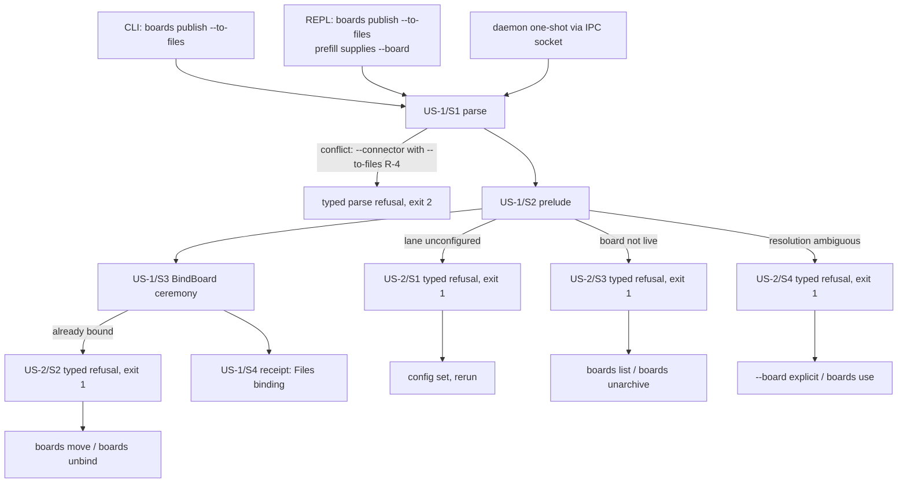

# [Plan] UX Journey Plan — `boards publish --to-files` (the CLI's direct local-to-Files path)

<!--
How to use: copy this file to
`.artifacts/plans/YYYY-MM-DD-<topic>-ux-plan.md`, and fill every
`<...>` placeholder. This guidance comment STAYS in the copy — it
instructs future readers; only the `<...>` placeholders go unfilled.

A UX journey plan is written BEFORE the dispatch plan that chunks the
feature (the dispatch plan's Origin must cite this file). It plans the
user-visible capability: stories, journeys, flows, and the wiring
contract. No implementation decisions beyond the command contract.
Full law: docs/ux_planning.org; trigger rule: AGENTS.md §7.

Sections 2, 4, 6, 7 use fixed table headers AND fixed level-2 heading
titles — scripts/ux-coverage.sh parses them. Do not rename columns or
section headings. Step IDs are greppable tokens; tests embed them in
snake_case (US-1/S2 -> us1_s2). Cells avoid `|`.
-->

# [Plan] UX Journey Plan — `boards publish --to-files`

- **Date**: 2026-11-17
- **Kind**: UX journey plan — user stories, journeys, flows, wiring
  contract for the `boards publish --to-files` CLI verb (#764). No
  implementation decisions beyond the command contract.
- **Origin**: the backlog-reduction round plan
  `.artifacts/plans/2026-11-17-backlog-reduction-round-plan.md` §3-C11
  + intake issue #764 (the verb's recorded contract: local-to-Files
  direct; Deck-first-then-move stays the CLI's only remote path; the
  GUI roster already carries the direct path, round-7 D-7.3). Format /
  framework: `docs/ux_planning.org` (phase 6 active) +
  `.artifacts/templates/ux-journey-plan.md`.
- **Status**: DRAFT — pending operator acceptance; dispatch may chunk
  from it only after acceptance.
- **Surfaces touched**: `crates/taskboard-app/src/cli.rs` (the verb
  grammar + help), `crates/taskboard-app/src/commands/boards.rs` +
  `commands/mod.rs` (the ceremony arm + receipt render, standalone and
  REPL twins), `crates/taskboard-app/src/commands/output.rs` (the
  receipt type), `crates/taskboard-app/src/repl.rs` (prefill +
  completion routing), `crates/taskboard-app/tests/cli_standalone.rs`
  (the journey tests), `docs/ux-surface-census.org` (the R-2 row
  overturn), `crates/taskboard-domain/src/messages.rs` — no delta
  (the verb mints the existing `StateCommand::BindBoard`).
- **Platform scope**: desktop (CLI verbs have no kiosk delta; the GUI
  surface set is unchanged)
- **Test-root**: crates/taskboard-app/tests

Test-root: crates/taskboard-app/tests

## 1. Scope & goals

Today the CLI can put a local board on the files tier only via
`boards move --to-files`, which refuses non-Deck-bound boards — so a
stand-alone installation has *no* CLI path to Files, while the GUI
roster publishes a local board directly to Files without touching
Deck (round-7 D-7.3, `UiRequest::PublishBoardToFiles`). This chunk
closes that asymmetry: `boards publish --to-files` binds a local board
straight onto the files connector with the same ceremony the GUI row
dispatches (`BindBoard { remote: RemoteBoardId::files(uuid),
connector: FILES_SYNC_CONNECTOR_NAME }`), with typed refusals and a
read-back receipt. The Deck publish path (`boards publish` bare, and
with `--connector`) is byte-for-byte unchanged, and
Deck-first-then-move remains the CLI's only *remote* (Deck) path per
#764's recorded boundary.

**Non-goals** (each with a home):

- No new remote path: the verb never creates a Deck board; `boards
  publish` bare stays the Deck migration path. Home: #764's recorded
  boundary (this plan's R-2).
- No `--undo` on publish: the bind is atomic (one `BindBoard`, no
  staged ceremony); recovery is the existing `boards unbind`. Home:
  this plan's R-3.
- No GUI delta: the roster's publish row already exists; this chunk
  is CLI-only. Home: this plan's R-1.
- No multi-connector files lanes: the files connector is the single
  `FILES_SYNC_CONNECTOR_NAME`; `--connector` is rejected alongside
  `--to-files`. Home: this plan's R-4.
- No new engine verbs: the ceremony mints the existing
  `StateCommand::BindBoard`. Home: §7.

## 2. Capability × surface matrix

| Capability | Board | TaskDetail | Today | Review | Settings | Capture | CLI |
|---|---|---|---|---|---|---|---|
| board.publish_to_files (direct local-to-Files bind) | — (R-1) | — (R-1) | — (R-1) | — (R-1) | E (pre-existing — the roster row's publish action, round-7 D-7.3, unchanged) | — (R-1) | E (US-1, US-2 — new `boards publish --to-files`) |
| board.publish_deck (Deck migration publish) | — (R-1) | — (R-1) | — (R-1) | — (R-1) | E (pre-existing — the Deck card's publish pick, round-6 D-6.9) | — (R-1) | E (pre-existing, `boards publish` bare — unchanged; this chunk adds no flag to it beyond the new direction flag) |
| board.move_to_files (Deck-first-then-move) | — (R-1) | — (R-1) | — (R-1) | — (R-1) | E (pre-existing) | — (R-1) | E (pre-existing, `boards move --to-files` — stays the CLI's only path for an already-Deck-bound board) |
| board.unbind (publish recovery) | — (R-1) | — (R-1) | — (R-1) | — (R-1) | E (pre-existing roster row) | — (R-1) | E (pre-existing, `boards unbind`) |
| files.sync_enabled_set (the lane the verb requires) | — (R-1) | — (R-1) | — (R-1) | — (R-1) | D/E (pre-existing Files card) | — (R-1) | E (pre-existing, `config set` — unchanged) |

**Rulings** (every deliberate absence):

| ID | Ruling | Reason | Home |
|---|---|---|---|
| R-1 | No GUI delta in this chunk | The direct local-to-Files GUI path shipped in round 7 (D-7.3); the gap this chunk closes is CLI-only (#764). GUI cells are pre-existing and untouched. | docs/ux-surface-census.org (the `board.publish_to_files` row) |
| R-2 | `boards publish --to-files` never touches Deck; bare `boards publish` stays the only Deck-creating path | #764's recorded boundary: Deck-first-then-move remains the CLI's only *remote* path; the new verb is the local-to-Files direct path. The census R-2 row ("no `--to-files` verb in this slice") is overturned by this plan — the census row flips to implemented citing this file. | #764; docs/ux-surface-census.org R-2 |
| R-3 | No `--undo` flag on the new verb | The direct bind is a single atomic `BindBoard` — there is no staged window to undo (unlike `boards move`'s multi-stage ceremony). Recovery is the existing `boards unbind`. | §3 US-2 (S3 escape); `boards unbind` |
| R-4 | `--connector` is a parse-time conflict with `--to-files` | The files tier has exactly one connector (`FILES_SYNC_CONNECTOR_NAME`); a connector choice would be dead grammar. The conflict surfaces as a clap typed error, not a runtime refusal. | §4 US-1/S1 escape; clap `conflicts_with` |
| R-5 | Daemon/IPC one-shot and REPL invocations are allowed (no `boards use`-style refusal) | The verb mutates no session state (no selection change); the command-family convention reserves refusal for session mutation only (`boards use`). | crates/taskboard-app/src/repl.rs (the `Use` refusal precedent) |

## 3. User stories

### US-1 — Publish a stand-alone local board onto Files from the CLI

- **Story**: As a kiosk operator running stand-alone whose files-sync
  lane is configured, I want `taskboard boards publish --to-files` to
  bind my local board straight onto the files tier without Deck, so
  that the board syncs across my machines without a Nextcloud Deck
  detour.
- **Platforms**: desktop (CLI; no GUI delta — R-1)
- **Entry points**: CLI `taskboard boards publish --to-files
  [--board <uuid>] [--timeout-secs <n>]`; REPL line `boards publish
  --to-files` (the prefill supplies `--board` from the session
  selection per the command-family convention); daemon one-shot via
  the IPC socket (R-5).
- **Priority**: P1
- **Acceptance**:
  - AC-1: Given a live local-only board and a configured files-sync
    lane When the verb runs Then the board's binding is the files
    connector with the board's own uuid as the files remote id — the
    exact mint of the GUI ceremony — and the receipt read-back shows
    the board on the Files channel — verified by journey test
    (`us1_s1`–`us1_s4` tokens).
  - AC-2: Given `--to-files` and `--connector` together When the line
    is parsed Then the parse fails as a typed conflict before any
    boot (R-4) — verified by parse test (`us1_s1`).

### US-2 — The verb's typed refusals and escapes

- **Story**: When I run `boards publish --to-files` and the
  preconditions fail (no files lane, board already bound, board
  unknown/soft-deleted/archived), I want a typed, non-zero exit per
  class — never a partial bind — so that scripts can branch and I can
  recover with the existing verbs.
- **Platforms**: desktop (CLI)
- **Entry points**: same as US-1; each refusal is a journey step with
  its own escape.
- **Priority**: P1
- **Acceptance**:
  - AC-1: Given the files-sync lane unconfigured When the verb runs
    Then the typed files-lane-disabled error surfaces and no
    `BindBoard` is executed (the state tree is unchanged) — verified
    by journey test (`us2_s1`).
  - AC-2: Given the target board already carries any remote binding
    When the verb runs Then the typed bind-refused error surfaces and
    the existing binding is untouched — verified by journey test
    (`us2_s2`).
  - AC-3: Given the target board is unknown, soft-deleted, or
    archived When the verb runs Then the typed gone error surfaces —
    verified by journey test (`us2_s3`).
  - AC-4: Given the omitted `--board` with either zero or several
    live boards When the verb runs Then the same
    exactly-one-live-board resolution error the other boards verbs
    use surfaces (no new resolution semantics) — verified by journey
    test (`us2_s4`).
  - AC-5: Every refusal leaves the board's persisted state
    unchanged (assert the state tree, never message text) — verified
    across the AC-1–AC-4 tests.

## 4. Journey specs

### US-1 — Direct local-to-Files publish (happy path)

| Step | Surface & affordance | User action | Dispatches | System response | Escape / failure |
|---|---|---|---|---|---|
| US-1/S1 | CLI grammar (`taskboard boards publish --to-files`) | Type the line with `--to-files` (and optionally `--board`, `--timeout-secs`) | — (clap parse; `--to-files` conflicts with `--connector` per R-4) | The parse resolves the direction flag and rejects the R-4 conflict before boot | Parse failure: clap typed conflict error, exit 2, nothing booted; the user drops one of the two flags |
| US-1/S2 | Verb prelude (lane + board resolution) | The verb checks the files-sync lane is configured and resolves the target board (explicit `--board`, REPL prefill, or the exactly-one-live-board default) | — (read-side checks over the booted core's config + state snapshot) | Preconditions hold; the ceremony proceeds | Lane unconfigured or board unresolvable: the US-2/S1–S4 typed refusals; exit 1, state unchanged |
| US-1/S3 | The bind ceremony | The verb executes the direct files bind | `StateCommand::BindBoard { board, remote: RemoteBoardId::files(board uuid), connector: FILES_SYNC_CONNECTOR_NAME }` | The board is bound to the files tier (the exact GUI-ceremony mint); the files-sync actor picks the board up on its next cycle | Engine refusal or timeout: the typed `CommandError` surface (exit 1), no partial state — the bind is a single atomic command; retry reruns safely (already-bound lands in US-2/S2's refusal, not a duplicate) |
| US-1/S4 | The receipt | The user reads the outcome | — (read-back of the published snapshot for the receipt render) | The receipt shows the board with its files binding (bound channel Files, the files remote id) — structural fields, rendered once | Render reads a fresh snapshot; a read-back failure surfaces as the typed error path (exit 1) with the bind already committed (the user re-runs and sees the US-2/S2 refusal naming the existing binding) |

### US-2 — Typed refusals (escape paths)

| Step | Surface & affordance | User action | Dispatches | System response | Escape / failure |
|---|---|---|---|---|---|
| US-2/S1 | Files lane unconfigured | Run the verb on an install whose config has no files-sync lane | — (the lane guard refuses before any command) | The typed files-lane-disabled outcome, exit 1 | Escape: configure the lane (`config set`) and rerun; state unchanged throughout |
| US-2/S2 | Board already bound (Deck or Files) | Run the verb on a board that carries any remote binding | — (the prelude's live-row check refuses) | The typed bind-refused outcome, exit 1 | Escape: use `boards move` (Deck-bound) or accept the existing binding; the existing binding is untouched |
| US-2/S3 | Board gone (unknown / soft-deleted / archived) | Run the verb naming or defaulting to a board that is not live | — (the prelude's live-row check refuses) | The typed gone outcome, exit 1 | Escape: `boards list`/`boards unarchive` as applicable, then rerun |
| US-2/S4 | Board resolution ambiguous (omitted `--board`, not exactly one live board) | Run the verb without `--board` when zero or several live boards exist | — (the shared boards-family resolution refuses) | The shared exactly-one-live-board resolution outcome, exit 1 (no new semantics) | Escape: pass `--board <uuid>` explicitly or `boards use` in the REPL, then rerun |

## 5. Interaction flows

No overlay/modal is involved; a `stateDiagram-v2` does not apply
(the ceremony is a single atomic command, not a staged editor — R-3).

## 6. Wiring inventory

| ID | Surface file | Widget | Callback | Adapter seam | ActionId | Commands | Row addressing | Journey steps | Test |
|---|---|---|---|---|---|---|---|---|---|
| W-1 | crates/taskboard-app/src/cli.rs | `BoardsCmd::Publish` gains the `--to-files` direction flag (`conflicts_with` `--connector` per R-4; help text names the direct path) | — | — | — | StateCommand::BindBoard | The clap variant `BoardsCmd::Publish { to_files, .. }` is the contract; no list-row addressing (CLI) | US-1/S1, US-1/S3 | crates/taskboard-app/tests/cli_standalone.rs::publish_to_files_happy_path_us1_s1_us1_s4 + the parse test embedding us1_s1 |
| W-2 | crates/taskboard-app/src/commands/boards.rs + commands/mod.rs | The publish arm branches on `to_files` into the shared files-bind ceremony (`*_on` family convention; both the standalone `run_core` and the REPL/IPC `boards_line` twins route it) | — | — | — | StateCommand::BindBoard | The dispatch arm `BoardsCmd::Publish { to_files, .. }` in commands/mod.rs (standalone) and repl.rs/boards_line (REPL) — one ceremony, two routings | US-1/S2, US-1/S3, US-2/S1–S4 | crates/taskboard-app/tests/cli_standalone.rs::publish_to_files_refusals_us2_s1..s4 |
| W-3 | crates/taskboard-app/src/commands/output.rs + commands/boards.rs | The files-publish receipt render (read-back: bound channel + files remote id, structural fields, no label-text assertions in tests) | — | — | — | — | The receipt type reuses the boards-family read-back shape (`PublishReceipt`-shaped) — no command variant here: pure read-back render, the bind itself is W-1/W-2's BindBoard | US-1/S4 | crates/taskboard-app/tests/cli_standalone.rs::publish_to_files_receipt_readback_us1_s4 |
| W-4 | crates/taskboard-app/src/repl.rs | The REPL prefill + completion routing gain the `Publish { to_files, .. }` arm (the command-family convention; no session-mutation refusal per R-5) | — | — | — | — | The `prefill_boards` arm list and the completion route for `boards publish` — no command variant here: routing only, the arm forwards into W-2's ceremony | US-1/S2 (the prefill step), US-1/S1 | crates/taskboard-app/src/repl.rs::prefill fills publish to-files arm (unit test embedding us1_s2) |
| W-5 | docs/ux-surface-census.org | The census `board.publish_to_files` CLI cell and the R-2 ruling row flip to implemented citing this plan | — | — | — | — | The R-2 row in the census rulings table — no command variant here: documentation row, no dispatch | US-1/S1 | — (census is prose-checked at review; the walkthrough verifies the flip) |

## 7. Command-contract delta

| Kind | Name | Payload sketch | Journeys |
|---|---|---|---|
| — (no new or changed StateCommand) | StateCommand::BindBoard (existing) | `board`, `remote: RemoteBoardId::files(board uuid)`, `connector: FILES_SYNC_CONNECTOR_NAME` — the exact payload the GUI ceremony mints (ui_requests.rs `publish_board_to_files`) | US-1/S3 |
| CliVerb | `boards publish --to-files` (`BoardsCmd::Publish` gains `to_files: bool`) | flags: `--board <uuid>` (default: the single live board / REPL prefill), `--timeout-secs <n>` (default 60, the settling-sync budget; rejected alongside R-4's `--connector` conflict), `--to-files` | US-1/S1–S4, US-2/S1–S4 |

The CLI is a presentation client over the existing engine verb: no
new `StateCommand`, no new `UiRequest` (the GUI's
`UiRequest::PublishBoardToFiles` is untouched and is not on the CLI
path — the CLI rides the booted core directly, per the boards-family
convention). The typed error surface reuses the existing
`CommandError` classes (the lane guard, the bind refusal, the
gone/resolution classes); stage 2 maps them without new variants
unless the implementation proves a class is missing — any such delta
is recorded in the chunk plan before it lands.

## 8. Verification plan

- **Journey tests** (step-ID-named, Test-root
  `crates/taskboard-app/tests`): `us1_s1` (parse + conflict),
  `us1_s2` (prelude/prefill), `us1_s3` (the exact files bind mint),
  `us1_s4` (receipt read-back), `us2_s1` (lane disabled),
  `us2_s2` (already bound), `us2_s3` (board gone), `us2_s4`
  (resolution ambiguous) — embedded in test-function names under
  `crates/taskboard-app/tests/cli_standalone.rs`.
- **Seam tests**: the exact `StateCommand::BindBoard` payload
  assertion (the GUI twin's
  `publish_board_to_files_sends_exact_files_bind_command` shape,
  asserted CLI-side too — US-1/S3).
- **Fold/presentation tests**: the receipt's structural fields
  (bound channel + remote id), never rendered-text assertions.
- **Kiosk gates**: none — CLI verbs have no kiosk surface delta (R-1).
- **Manual**: help-text readability of the new flag (the walkthrough
  protocol's recognize-it step covers it at stage 3).

## 9. Definition of done

- [ ] `scripts/ux-coverage.sh <this file> --gate` exits 0
      (Test-root: crates/taskboard-app/tests)
- [ ] Every P1 story's journey completes end-to-end including escapes
      (US-1 and US-2 both land in the first slice — the verb without
      its typed refusals is not shippable)
- [ ] Walkthrough protocol executed at stage 3; findings resolved or
      homed
- [ ] All matrix absences carry rulings (R-1–R-5); the census
      `board.publish_to_files` CLI cell + R-2 row flip lands with the
      verb (W-5)
- [ ] Non-goals filed as backlog issues (none beyond the recorded
      boundaries: R-2/R-3/R-4 homes are existing artefacts; #764
      closes at merge)
