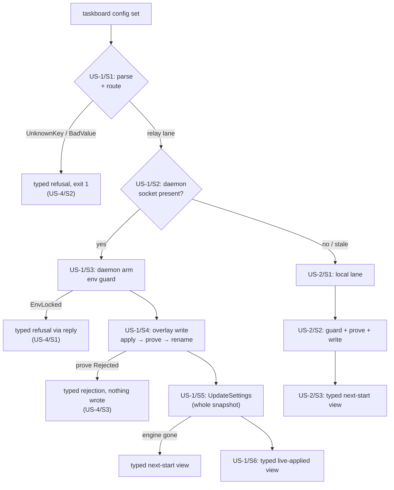

# [Plan] UX Journey Plan — `config set`/`unset` propagation to the running app (#845)

<!--
Written from .artifacts/templates/ux-journey-plan.md (the guidance
comment stays; only placeholders were filled). Full law:
docs/ux_planning.org; trigger rule: AGENTS.md §7.
-->

# [Plan] UX Journey Plan — config-set propagation

- **Date**: 2026-11-17
- **Kind**: UX journey plan — user stories, journeys, flows, wiring
  contract for `taskboard config set`/`unset` propagation to a
  concurrently running app (#845). No implementation decisions beyond
  the command contract.
- **Origin**: issue #845 (the divergence: the r5/T-18 config verbs
  write only the file layer; a running app holds knobs in memory
  until restart) + the round plan
  `.artifacts/plans/2026-11-17-backlog-reduction-round-plan.md`
  §3-C10 (normative) + the dispatch plan §1 C10 row. Format/framework:
  `docs/ux_planning.org` + `.artifacts/templates/ux-journey-plan.md`.
- **Status**: DRAFT — journey-gated chunk (C10): stage 2 proceeds only
  on the operator's acceptance of this plan.
- **Surfaces touched**: `crates/taskboard-app/src/commands/mod.rs`
  (the IPC route pin), `crates/taskboard-app/src/commands/config.rs`
  (the set/unset write port + typed outcomes), `crates/taskboard-app/
  src/ipc/server.rs` (the daemon-side set arm's engine access),
  `crates/taskboard-app/src/ui_requests.rs` (the shared live-write
  choreography), `crates/taskboard-app/src/settings_overlay.rs` (the
  removal writer), `crates/taskboard-app/src/cli.rs` (help text). No
  Slint files change — the GUI editor already renders the engine's
  published snapshot and needs no delta.
- **Platform scope**: both (CLI-only surface; the beneficiary is any
  concurrently running desktop GUI or kiosk daemon — kiosk's
  weeks-long sessions are exactly where the divergence bites hardest).

## 1. Scope & goals

**The semantics decision (the question §3-C10 posed).** Three
candidates were weighed:

1. **Write-through to the running app** — `config set`/`unset`
   reaches the daemon over the existing IPC relay and applies live.
2. **Explicit restart contract** — keep the file-only write; sharpen
   help text and output to always say "applies at the next start".
3. **Surfaced divergence** — keep the file-only write; when a daemon
   is serving, warn that the running app holds stale knobs.

**Recommendation (recorded): option 1 — write-through — with option
3's honesty retained as a typed outcome, not a warning.** Rationale:

- The live-apply seam already exists end-to-end and is *the GUI
  editor's* write port: the settings-overlay writers (apply → prove →
  atomic write, `settings_overlay.rs`), the whole-snapshot mint
  (`AppConfig::settings_snapshot()`), and `StateCommand::UpdateSettings`
  (the engine replaces its settings wholesale; every consuming actor —
  reminders, sync cadence, focus timers, display — re-reads the
  snapshot per iteration). All seventeen CLI knob-table keys are
  members of `SettingsSnapshot`'s projection; a live write needs **no
  new engine capability**, only the choreography's reuse.
- The relay lane exists: `Request::Exec` already carries arbitrary
  argv to the daemon ("the server is the single parse authority");
  only the route pin (`route_for_ipc` pins all of `Command::Config` to
  `IpcRoute::Local`) and the daemon-side handler's engine access are
  missing.
- Option 2 is rejected: it leaves a real divergence for the knobs a
  kiosk changes mid-session (focus timings, reminder sinks), for a
  seam that already exists. Option 3 is rejected as the terminal
  state (a warning users learn to ignore) but is *absorbed*: when no
  daemon serves, the command succeeds file-only and reports the typed
  "applies at the next start" outcome — the restart contract becomes
  a typed result, never a silent divergence.

The user-visible delta: setting a knob while the app runs now takes
effect immediately (the focus timer, reminder cadence, sync backoff,
due-soon horizon all move live, exactly as the GUI editor's commits
always have), and the CLI tells you, typed, which lane happened.

**Non-goals** (each with a home):

- No live-reload file watcher (watching `taskboard.toml` for external
  edits). The IPC write-through closes the CLI's own divergence;
  external-editor edits keep the restart contract. Home: §2 R-3;
  filed as `backlog:` issue (see the chunk plan §7).
- No multi-key/batch `config set` transaction. Home: §2 R-4; filed as
  `backlog:` issue.
- No change to `config print`/`config path` — they stay `Local`
  (file-authoritative diagnostics; after write-through the file is
  written *before* the engine apply, so print remains truthful).
  Home: §2 R-2.
- No new GUI surface: the Settings editor already displays the
  engine's published snapshot, so a CLI-originated live write is
  visible there with zero Slint delta. Home: §2 R-1.
- No connection/section-level writes; the knob table stays exactly
  the GUI editor's `Field::key()` vocabulary (the T-18 contract).
  Home: `commands/config.rs` `ConfigKey` docs; unchanged.

## 2. Capability × surface matrix

<!-- Header row is a parser contract — do not rename or reorder. -->

| Capability | Board | TaskDetail | Today | Review | Settings | Capture | CLI |
|---|---|---|---|---|---|---|---|
| setting.set | — | — | — | — | E (US-4) | — | E (US-1, US-2) |
| setting.unset | — | — | — | — | E (US-4) | — | E (US-3) |
| setting.read_effective | — | — | — | — | D (existing) | — | D (US-5) |
| setting.read_writepath | — | — | — | — | — | — | D (US-5) |

**Rulings** (every deliberate absence):

| ID | Ruling | Reason | Home |
|---|---|---|---|
| R-1 | No new GUI surface for CLI-originated writes | The Settings editor reads the engine's published snapshot (`settings_snapshot_from_domain`); a live `UpdateSettings` from any lane is already reflected there. Display-without-control does not arise: the editor *is* the control. | §1 non-goals |
| R-2 | `config print`/`config path` stay `IpcRoute::Local` | Read-only diagnostics are file-authoritative by design (ADR 0009 posture); write-through guarantees the file is written before the engine apply, so local print never lags a successful set. | §1 non-goals |
| R-3 | No file-watcher live reload for external edits | External-editor edits are out of this issue's scope; the write-through lane covers the CLI's own writes. Watcher machinery (debounce, partial writes, editor rename storms) is a separate capability. | backlog issue (see chunk plan §7) |
| R-4 | No multi-key batch `config set` | One intent = one atomic write is the overlay skeleton's invariant; batching is an ergonomics feature, not a propagation one. | backlog issue (see chunk plan §7) |
| R-5 | Board/TaskDetail/Today/Review/Capture stay `—` for all setting verbs | Settings have exactly two modality fronts by the T-18 contract ("one vocabulary, two modality fronts"); write-through adds a lane, not a surface. | §1 non-goals |

## 3. User stories

### US-1 — Set a knob on a running app; it takes effect live

- **Story**: As a desktop user running the GUI while I drive the CLI,
  I want `taskboard config set <key> <value>` to apply to the running
  app immediately, so that I don't have to restart (and lose session
  context) to change a focus or reminder knob.
- **Platforms**: both (desktop GUI session; kiosk daemon session).
- **Entry points**: CLI `taskboard config set <key> <value>` (direct
  invocation; the REPL twin follows the existing command-family
  conventions).
- **Priority**: P1.
- **Acceptance**:
  - AC-1: Given a running daemon, When `config set focus.work_mins 50`
    succeeds, Then the daemon's engine publishes the new value
    (`StateCommand::UpdateSettings` applied) and the CLI reports the
    typed live-applied outcome — verified by seam test (daemon-side
    handler) + journey test (IPC relay).
  - AC-2: Given the same write, Then the file layer carries the value
    *and* the prove gate ran (a write that would invalidate the file
    refuses before the engine is touched) — verified by seam test.
  - AC-3: Given a kiosk daemon and `config set reminders.sink desktop`,
    Then the reminder lane's next tick uses the new sink — verified by
    seam test (actor re-reads the published snapshot).

### US-2 — Set a knob with no app running; the file layer lands, typed

- **Story**: When no daemon is serving, I want `config set` to still
  write the file layer and tell me — typed — that the value applies at
  the next start, so that offline/kiosk-provisioning workflows keep
  working and the divergence is stated, never silent.
- **Platforms**: both.
- **Entry points**: CLI `taskboard config set <key> <value>`.
- **Priority**: P1.
- **Acceptance**:
  - AC-1: Given no daemon socket, When `config set` succeeds, Then the
    file layer carries the value and the CLI reports the typed
    next-start outcome — verified by seam test.
  - AC-2: Given an unreachable (stale) socket, When `config set`
    falls back, Then the behavior equals AC-1 (fallback to local, not
    an error) — verified by journey test.

### US-3 — Unset a knob propagates live on a running app

- **Story**: As a user, I want `config unset <key>` to remove the
  override and have the running app fall back to the default (or env
  value) immediately, so that un-setting behaves symmetrically with
  setting.
- **Platforms**: both.
- **Entry points**: CLI `taskboard config unset <key>`.
- **Priority**: P1.
- **Acceptance**:
  - AC-1: Given a running daemon and an overridden key, When
    `config unset` succeeds, Then the engine publishes the
    default-derived snapshot and the file layer no longer carries the
    key — verified by seam test.
  - AC-2: Given no daemon, When `config unset` succeeds, Then the
    typed next-start outcome reports — verified by seam test.

### US-4 — The typed refusals hold on both lanes

- **Story**: As a user, I want the env-locked / unknown-key /
  bad-value refusals to behave identically whether a daemon serves or
  not, and to write nothing in either lane, so that the honesty the
  GUI editor renders is the CLI's contract too.
- **Platforms**: both.
- **Entry points**: CLI `config set`/`config unset`.
- **Priority**: P1.
- **Acceptance**:
  - AC-1: Given an env-pinned key, When `config set` runs (either
    lane), Then the typed env-locked refusal returns and the file is
    untouched — verified by seam test (composition over the existing
    lock-set seam).
  - AC-2: Given an unknown key or malformed value, Then the typed
    refusal returns before any IPC send or file touch — verified by
    seam test.
  - AC-3: Given a set whose resulting document would fail
    `AppConfig::validate` on a previously-valid file, Then the prove
    gate refuses typed and neither file nor engine changes — verified
    by seam test.

### US-5 — The CLI states which lane served, and print stays truthful

- **Story**: As a script author, I want the set/unset outcome to be
  machine-checkable (which lane applied, the echoed value) and `config
  print` to keep reading the file layer, so that automation can assert
  outcomes without parsing prose.
- **Platforms**: both.
- **Entry points**: CLI `config set`/`unset` (JSON emit), `config
  print`.
- **Priority**: P2 (rides the same slice; the *typed view* is P1
  plumbing, the polish is P2).
- **Acceptance**:
  - AC-1: Given a successful set, When emitted as JSON, Then the view
    carries `key`, `value`, and the typed lane bit (`applied_live`) —
    verified by seam test (structural assertions only).
  - AC-2: Given any successful set (either lane), When `config print`
    runs, Then the printed effective value equals the written one —
    verified by seam test.

## 4. Journey specs

### US-1 — Live set on a running app

| Step | Surface & affordance | User action | Dispatches | System response | Escape / failure |
|---|---|---|---|---|---|
| US-1/S1 | CLI `config set <key> <value>` | type the command | CLI parse; `route_for_ipc` → relay lane | key/value parse-checked; daemon socket located | unknown key or bad value → typed refusal (`UnknownKey`/`BadValue`), exit 1, nothing sent (US-4/S2) |
| US-1/S2 | daemon IPC server (`Request::Exec`) | — (relay) | the daemon parses the same argv (single parse authority) and dispatches its config-set arm | the daemon holds the engine + write path handles | stale socket → client falls back to the local lane (US-2) |
| US-1/S3 | daemon config-set arm | — | env guard (`env_overridden_keys`) → overlay writer for the key | typed env-locked refusal travels back as the Exec reply; nothing wrote | `EnvLocked` refusal, exit 1 (US-4/S1) |
| US-1/S4 | daemon config-set arm | — | overlay write (apply → prove → atomic rename) | file layer carries the value; the whole document proved bootable | prove-gate `Rejected` → typed refusal, file untouched, engine untouched (US-4/S3) |
| US-1/S5 | daemon config-set arm | — | `StateCommand::UpdateSettings { settings }` (whole snapshot minted from the proven file) | engine replaces settings; consuming actors pick the values up per iteration; UI snapshot reflects | engine gone mid-flight → typed `Gone`-shaped outcome: file written, next-start lane reported (the editor's precedent) |
| US-1/S6 | CLI stdout | — | — | typed live-applied view (JSON `applied_live: true`) | reply transport failure → client reports the local-lane uncertainty honestly (typed, exit 1) |

### US-2 — Offline set (typed next-start)

| Step | Surface & affordance | User action | Dispatches | System response | Escape / failure |
|---|---|---|---|---|---|
| US-2/S1 | CLI `config set` | type the command | relay attempt fails (no socket) → local lane | identical local parse/guard chain | typed refusals as US-4 |
| US-2/S2 | local file layer | — | env guard → overlay write (prove gate) | file carries the value | prove-gate refusal → typed, file untouched |
| US-2/S3 | CLI stdout | — | — | typed next-start view (JSON `applied_live: false`) | I/O failure → typed `Io`, exit 1 |

### US-3 — Unset propagates

| Step | Surface & affordance | User action | Dispatches | System response | Escape / failure |
|---|---|---|---|---|---|
| US-3/S1 | CLI `config unset <key>` | type the command | relay/local as US-1/S1–S2 | key checked; lane chosen | `UnknownKey` typed refusal |
| US-3/S2 | daemon/local removal writer | — | env guard → overlay *removal* write (new prove-gate removal writer — none exists today) | the key leaves the toml layer; document still proves bootable | env-locked or prove-gate refusal, typed |
| US-3/S3 | daemon config-set arm | — | `StateCommand::UpdateSettings` (snapshot minted from the now-unset file) | engine publishes default-derived settings | engine gone → typed next-start outcome |

### US-4 — Refusals hold on both lanes

| Step | Surface & affordance | User action | Dispatches | System response | Escape / failure |
|---|---|---|---|---|---|
| US-4/S1 | env-pinned key, either lane | `config set` | env guard fires first (daemon-side or local) | typed `EnvLocked`; nothing sent, nothing wrote | this *is* the escape path |
| US-4/S2 | unknown/malformed pair | `config set` | CLI-side parse before any send | typed `UnknownKey`/`BadValue`; exit 1 | this *is* the escape path |
| US-4/S3 | validity-crossing write | `config set` | prove gate on the daemon/local write | typed rejection; file byte-identical; engine untouched | this *is* the escape path |

### US-5 — Typed lane view + truthful print

| Step | Surface & affordance | User action | Dispatches | System response | Escape / failure |
|---|---|---|---|---|---|
| US-5/S1 | CLI stdout (JSON emit) | `config set --json …` | — display only | the view carries `key`, `value`, `applied_live` | parse/emit failure → typed `Io` |
| US-5/S2 | CLI `config print` | `taskboard config print` | local decode-only read | effective value equals the written one (file written before engine apply) | decode failure → the existing print posture (exit 1, nothing honest to print) |

## 5. Interaction flows

No overlay/editor/modal state machine is introduced: the CLI is
stateless per invocation, and the engine-side settings replacement is
the existing `UpdateSettings` whole-snapshot swap (no partial states).

## 6. Wiring inventory

<!-- Header row is a parser contract — do not rename or reorder. -->

| ID | Surface file | Widget | Callback | Adapter seam | ActionId | Commands | Row addressing | Journey steps | Test |
|---|---|---|---|---|---|---|---|---|---|
| W-1 | crates/taskboard-app/src/commands/mod.rs | — (routing) | — | `route_for_ipc`: the `Command::Config` arm splits — `Set`/`Unset` take the relay lane, `Print`/`Path` stay `Local` (R-2) | — | `Request::Exec` (no new wire variant) | — | US-1/S1–S2, US-2/S1 | commands::route_for_ipc tests + the routing pin test |
| W-2 | crates/taskboard-app/src/ipc/server.rs | — | — | the daemon's Exec dispatch reaches the app handles (engine + write path) so the config-set arm can apply live | — | `StateCommand::UpdateSettings` | — | US-1/S3–S5 | ipc server seam test::us1_ac1 |
| W-3 | crates/taskboard-app/src/ui_requests.rs, src/commands/config.rs | — | — | the editor's live-write choreography (`run_editor_write`'s guard → write → mint → apply → echo) extracted into a shared write port both the GUI arm and the daemon's config arm call — one vocabulary, three fronts | — | `StateCommand::UpdateSettings` | — | US-1/S3–S5, US-3/S2–S3 | ui_requests seam tests (the extracted port's own truth table) |
| W-4 | crates/taskboard-app/src/settings_overlay.rs | — | — | the prove-gate *removal* writer (`remove_key`) — unset has no overlay writer today; the local `write_dotted(None)` path migrates onto it so both lanes share the prove gate | — | — | — | US-3/S2, US-2/S2 | settings_overlay tests::us3_ac1 |
| W-5 | crates/taskboard-app/src/commands/config.rs, src/commands/output.rs | — | — | the typed outcome view (`ConfigSetView { key, value, applied_live }`) replacing the free-text "applies at the next start" line; text render keeps a human line, JSON emit carries the bits | — | — | — | US-5/S1, US-2/S3 | commands::config tests (structural `matches!`/field assertions) |
| W-6 | crates/taskboard-app/src/cli.rs | — | — | help text for `config set`/`unset`: the live-vs-next-start posture stated per the accepted semantics | — | — | — | US-5 (docs-only) | — (help text; no text assertions — walkthrough judges it) |

## 7. Command-contract delta

| Kind | Name | Payload sketch | Journeys |
|---|---|---|---|
| IPC route | `Command::Config { cmd: Set/Unset }` relay-lane re-pin | no new wire variant — rides `Request::Exec` (the daemon is the single parse authority) | US-1/S1–S2, US-2/S1 |
| StateCommand | *(none new)* | `UpdateSettings { settings }` exists; the delta is its third caller (the daemon's config arm) | US-1/S5, US-3/S3 |
| Typed view | `ConfigSetView { key, value, applied_live }` | emitted via `emit_to` (JSON lane: the bits; text lane: one honest line) | US-5/S1, US-2/S3 |
| Overlay writer | `settings_overlay::remove_key(path, section, key)` | prove-gate removal (the unset twin of `prove_and_write`) | US-3/S2 |

## 8. Verification plan

- **Test root**: `Test-root: crates/taskboard-app/` (CLI/daemon app
  crate; no Slint delta).
- **Journey tests** (step-ID-named): `us1_s1_...` routing relay vs
  local; `us2_s1_...` fallback parity; `us3_s2_...` removal writer
  round-trip.
- **Seam tests**: the daemon-side config arm's exact choreography
  (env guard before write, prove gate before `UpdateSettings`, typed
  outcomes via `matches!`); the extracted shared write port's truth
  table (mirrors `run_editor_write`'s documented lanes).
- **Fold/presentation tests**: the `ConfigSetView` lane bit per
  outcome; never label text.
- **Kiosk gates**: no affordance renders differently — CLI-only
  surface; the kiosk daemon is the *beneficiary* lane (US-1 AC-3).
- **Manual**: help-text honesty and the one-line outcomes (W-5 text
  lane, W-6) — judged at the stage-3 walkthrough.

## 9. Definition of done

- [ ] `scripts/ux-coverage.sh .artifacts/plans/2026-11-17-config-set-propagation-ux-plan.md --gate` exits 0
- [ ] Every P1 story's journey completes end-to-end including escapes
- [ ] Walkthrough protocol executed at stage 3; findings resolved or homed
- [ ] All matrix absences carry rulings (R-1 … R-5); census updated
- [ ] Non-goals filed as backlog issues (R-3, R-4)
