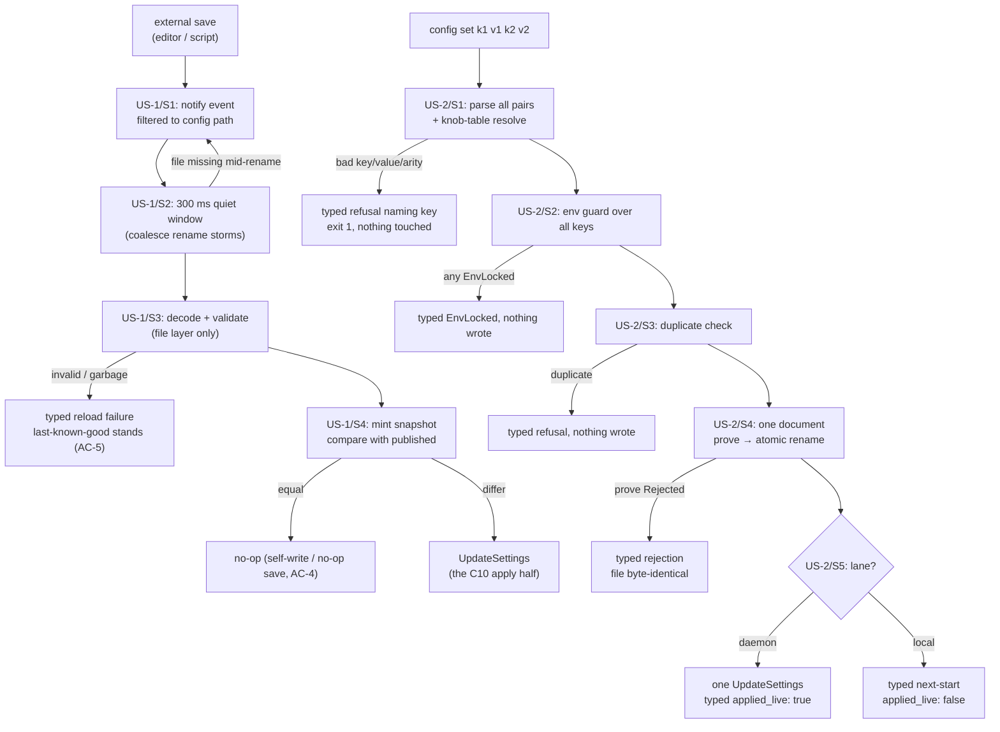

# [Plan] UX Journey Plan — config live-reload + batch set (#909, #910)

<!--
Written from .artifacts/templates/ux-journey-plan.md (the guidance
comment stays; only placeholders were filled). Full law:
docs/ux_planning.org; trigger rule: AGENTS.md §7. Sibling of the
accepted #845 config journey — its rulings R-3/R-4 scoped these two
capabilities out; this plan scopes them back in as two stories under
one journey-gated chunk (tier-2 dispatch plan §6).
-->

# [Plan] UX Journey Plan — config live-reload + batch set

- **Date**: 2026-11-18
- **Kind**: UX journey plan — user stories, journeys, flows, wiring
  contract for (a) live-reload of `taskboard.toml` on external edits
  (#909) and (b) multi-key atomic `config set` batches (#910). No
  implementation decisions beyond the command contract.
- **Origin**: issues #909 + #910, both homed by rulings R-3/R-4 of the
  accepted journey plan
  `.artifacts/plans/2026-11-17-config-set-propagation-ux-plan.md`;
  chunked by `.artifacts/plans/2026-11-18-tier2-dispatch-plan.md` §6
  (normative). Format/framework: `docs/ux_planning.org` +
  `.artifacts/templates/ux-journey-plan.md`.
- **Status**: DRAFT — journey-gated chunk (P6): stage 2 proceeds only
  on the operator's acceptance of this plan AND the recorded `notify`
  stack-table addition (one gate, both decisions).
- **Surfaces touched**: `crates/taskboard-app/src/commands/config.rs`
  (the batch parse/guard/atomic-write surface + typed outcomes),
  `crates/taskboard-app/src/cli.rs` (the `config set` pair grammar +
  help text), `crates/taskboard-app/src/settings_overlay.rs` (the
  multi-section batch writer over the shared prove skeleton), a new
  `crates/taskboard-app/src/config_watcher.rs` (the reload actor),
  `crates/taskboard-app/src/bootstrap.rs` (actor spawn), the root
  `Cargo.toml` `[workspace.dependencies]` (`notify` — the operator
  gate). No Slint files change — the GUI editor already renders the
  engine's published snapshot (the #845 R-1 posture carries over).
- **Platform scope**: both (CLI/daemon surfaces; the reload watcher
  benefits any running session — a kiosk's weeks-long uptime is
  exactly where an external edit would otherwise sit unread until
  restart).

## 1. Scope & goals

**Story 1 (#909 — external-edit live reload).** Today a running app
never re-reads `taskboard.toml`: the C10 write-through lane (#845)
closes the CLI's *own* divergence, but an edit made by an editor
(`vim`, `nano`, a provisioning script) still holds only until the
next restart. The delta: the running app watches the resolved config
file and, when it changes externally, reloads through the *same*
file→prove→mint→`UpdateSettings` path the write-through lane uses, so
both convergence lanes produce identical state. A reload that cannot
prove the new document (garbage or invalid TOML from a partial write)
keeps the last-known-good state and reports typed — the app must
never go down or hold an unbootable config because the file was
mid-save.

**Story 2 (#910 — batch set).** Today `config set` carries exactly
one key/value pair; provisioning several knobs means several
invocations (several documents, several engine applies, and a
mid-script failure leaves a half-provisioned file). The delta: one
invocation carries several key/value pairs and lands them as **one
atomic document** — one intent, one prove verdict, one write, one
engine apply. Any refusal (unknown key, bad value, env-locked key, a
batch that would invalidate the file) writes nothing and names the
offending key typed.

**The reuse law (binding for stage 2).** The reload path is *not* a
second write semantic: it reads the file through the existing
file-layer decode (`AppConfig::extract_file_only` /
`decode_file_only_str` — the prove gate's read half) + validate +
whole-snapshot mint + `StateCommand::UpdateSettings`, exactly the
C10 lane's apply half (`ui_requests.rs` steps 3–4). Batch is not a
new propagation semantic either: it is the existing
`prove_and_write_with` skeleton generalized to a multi-section edit
— one document load, all mutations, one verdict, one atomic rename.

**Decisions recorded by this plan** (details in the chunk plan):

- D-STACK: the `notify` crate joins `[workspace.dependencies]`
  (AGENTS §4 stack-table entry; operator-gated alongside plan
  acceptance). Polling `stat` checks were weighed and rejected.
- D-DEBOUNCE: a 300 ms quiet window, hand-rolled inside the watcher
  actor over tokio timers (deterministic `pause`/`advance` tests; no
  second watcher crate).
- D-SELFWRITE: the app's own atomic writes also fire the watcher;
  convergence is a snapshot comparison — an unchanged decode is a
  no-op, so self-writes and no-op external saves cost nothing.
- D-BATCH-GRAMMAR: `config set <k1> <v1> [<k2> <v2> ...]` argv pairs;
  the single-pair form is unchanged.
- D-BATCH-ATOMIC: parse all pairs → env-guard all keys → one
  multi-section prove+write → one `UpdateSettings`. Any refusal
  before or during the write leaves the file byte-identical; the
  typed error names the offending key.

**Non-goals** (each with a home):

- No watching of non-config files, or of the config *directory*
  beyond the resolved file's parent (the rename-storm watch surface).
  Home: §2 R-3.
- No new knob to disable the watcher (`[app] reload = false`-style).
  The watcher is passive: no edit means no event; adding an off
  switch is speculative surface. Home: §2 R-4.
- No live `TASKBOARD_*` env re-read. Env is process-boot state (the
  #845 D16 posture: nothing mutates its own env); reload is
  file-layer only, env pins standing at boot keep standing. Home:
  §2 R-5.
- No batch `config unset`, no batch across `config set` + `unset` in
  one invocation. Ergonomics parity for unset is a separate idea
  with no observed demand. Home: §2 R-6.
- No change to `config print`/`path` lanes (the #845 R-2 posture:
  read-only diagnostics stay `IpcRoute::Local`; the file-before-
  engine ordering keeps print truthful after both batch and reload).
  Home: §2 R-7.
- No new GUI surface. The Settings editor renders the engine's
  published snapshot; a reload- or batch-originated `UpdateSettings`
  is already reflected there. Home: §2 R-1 (carried).

## 2. Capability × surface matrix

<!-- Header row is a parser contract — do not rename or reorder. -->

| Capability | Board | TaskDetail | Today | Review | Settings | Capture | CLI |
|---|---|---|---|---|---|---|---|
| setting.set | — | — | — | — | E (existing) | — | E (US-2) |
| setting.set_batch | — | — | — | — | — | — | E (US-2) |
| setting.reload_external | — | — | — | — | D (existing, via snapshot) | — | — |
| setting.read_effective | — | — | — | — | D (existing) | — | D (existing) |

**Rulings** (every deliberate absence):

| ID | Ruling | Reason | Home |
|---|---|---|---|
| R-1 | No new GUI surface for batch writes or reloads | Both land as the existing whole-snapshot `UpdateSettings`; the Settings editor already renders the engine's published snapshot (#845 R-1 posture). Display-without-control does not arise: the editor *is* the control. | §1 non-goals |
| R-2 | `setting.set_batch` stays CLI-only (Settings column `—`) | The GUI editor commits whole field-groups already — its commits are the batch semantic in origin; a GUI batch button would duplicate a capability the editor has by construction. | §1 non-goals |
| R-3 | The watcher watches only the resolved config file (its parent dir for rename events, filtered to the file) | Watching the whole config dir or sibling files drags in foreign writes (lockfiles, sockets, the db) for zero user value. | §1 non-goals |
| R-4 | No off-switch knob for the watcher | The watcher is passive and cheap (one inotify descriptor); an off switch is speculative surface with no user story. | §1 non-goals |
| R-5 | `setting.reload_external` stays `—` on CLI | Reload is system-triggered (the file changed); a manual CLI `config reload` verb would duplicate what any no-op external write (or restart) already does. If demand appears it files as a new issue. | §1 non-goals |
| R-6 | No batch `config unset` / mixed set+unset batches | No observed demand; mixed set+unset atomicity doubles the writer surface (insert + remove in one document) for an unproven ergonomics win. | §1 non-goals |
| R-7 | `config print`/`path` stay `IpcRoute::Local` | Carried from #845 R-2: file-before-engine ordering keeps print truthful for batch writes, and reload *is* a file change, so local print never lags a reload. | §1 non-goals |
| R-8 | Board/TaskDetail/Today/Review/Capture stay `—` for all setting verbs | The #845 R-5 posture carries over: settings have two modality fronts (the T-18 contract); this chunk adds lanes, not surfaces. | §1 non-goals |

## 3. User stories

### US-1 — An external edit reaches the running app live

- **Story**: When an editor or script changes `taskboard.toml` while
  the app is running, I want the running app to pick the change up
  within a moment and by the same path its own writes converge, so
  that a long-lived kiosk or desktop session never needs a restart
  to honor a config I fixed from outside.
- **Platforms**: both.
- **Entry points**: external file change (editor save, rename-based
  write, provisioning script) — no user action inside the app; the
  Settings editor's published snapshot is where the result is
  visible.
- **Priority**: P1.
- **Acceptance**:
  - AC-1: Given a running daemon and an external write that changes
    `focus.work_mins`, Then the daemon's engine publishes the new
    value via the same minted-whole-snapshot `UpdateSettings` the C10
    lane applies — verified by seam test (the reload path's exact
    choreography asserted via `matches!`/structural facts).
  - AC-2: Given a rename-storm save pattern (remove + create +
    multiple modify events inside the debounce window), Then exactly
    one reload runs after the window closes — verified by
    deterministic test (tokio `pause`/`advance` over the debounce
    seam — never sleeps).
  - AC-3: Given a partial write (file truncated or half-written when
    the reload attempts), Then the last-known-good state stands,
    the failure is typed, and a later good write inside/after the
    window still converges — verified by deterministic test.
  - AC-4: Given the app's *own* write-through set (which fires the
    watcher's atomic-rename event), Then the reload decodes the
    already-converged document and applies nothing (snapshot
    equality → no-op) — verified by seam test.
  - AC-5: Given an external write to a file that fails decode or
    `validate`, Then the engine keeps the previous snapshot and a
    typed failure surfaces (broadcast event; the CLI lane reports it
    at the next interaction) — verified by seam test (typed outcome,
    no text assertions).

### US-2 — Provision several knobs as one atomic batch

- **Story**: As a user (or provisioning script) setting several
  knobs in one go, I want `taskboard config set k1 v1 k2 v2 …` to
  land all pairs as one atomic write, so that either the whole batch
  is in effect or nothing is — never a half-provisioned config.
- **Platforms**: both.
- **Entry points**: CLI `taskboard config set <k1> <v1> [<k2> <v2>
  …]` (direct invocation; the daemon relay lane via `Request::Exec`
  as in #845; the REPL twin follows the command-family conventions).
- **Priority**: P1.
- **Acceptance**:
  - AC-1: Given a valid batch, Then the file layer carries all pairs
    as one document (one atomic rename) and the engine receives
    exactly one `UpdateSettings` — verified by seam test.
  - AC-2: Given a batch whose second pair is malformed, Then the
    typed refusal names that key and the file is byte-identical to
    before — verified by seam test.
  - AC-3: Given a batch containing an env-pinned key, Then the typed
    env-locked refusal names the key and nothing is written —
    verified by seam test.
  - AC-4: Given a batch that would invalidate the file (prove gate),
    Then the typed rejection is returned, the file is untouched, and
    the engine is untouched — verified by seam test.
  - AC-5: Given a duplicate key in one batch, Then the typed refusal
    fires before any write (ambiguity is never resolved silently) —
    verified by seam test.
  - AC-6: Given a running daemon and a valid batch, Then the typed
    outcome reports `applied_live` truthfully for the batch as a
    whole (one lane per invocation) — verified by seam test.

## 4. Journey specs

### US-1 — External-edit live reload

| Step | Surface & affordance | User action | Dispatches | System response | Escape / failure |
|---|---|---|---|---|---|
| US-1/S1 | watcher actor (`config_watcher.rs`), spawned at bootstrap | none (system-triggered: the file changes) | — (event source: `notify` raw events on the config file's parent, filtered to the resolved path) | events enter the debounce accumulator | watcher setup failure (no inotify, exotic fs) → typed fallback: reload disabled, broadcast warns once; the restart contract degrades to today's behavior, never an error loop |
| US-1/S2 | debounce accumulator (300 ms quiet window) | — | — | events coalesce; the trailing edge schedules one reload | transient absence (mid-rename read attempt) → the attempt is skipped and retried on the window's next trailing edge (AC-3) |
| US-1/S3 | reload read half | — | file-layer decode (`extract_file_only` posture) + `AppConfig::validate` | the new document proves bootable | decode/validate failure → typed reload-failure outcome; engine keeps the previous snapshot (AC-5) |
| US-1/S4 | reload apply half (the C10 lane's mint) | — | whole-snapshot mint; compare with the engine's published settings; on difference `StateCommand::UpdateSettings` | engine replaces settings; consuming actors re-read per iteration; UI snapshot reflects | snapshot equal → no-op (self-writes and no-op saves, AC-4); engine gone → typed next-start-shaped outcome, watcher keeps running |
| US-1/S5 | Settings editor (published snapshot) | — | — display only | the editor shows the reloaded values (no Slint delta) | — display only |

### US-2 — Batch set

| Step | Surface & affordance | User action | Dispatches | System response | Escape / failure |
|---|---|---|---|---|---|
| US-2/S1 | CLI `config set k1 v1 k2 v2 …` | type the command | CLI parse: argv must be an even list of pairs; each key resolves in the knob table | all keys/values parse-checked *before* anything is touched | odd pair count → typed `BadValue`-class refusal; unknown key / malformed value → typed refusal naming the offending key, exit 1, nothing sent (AC-2) |
| US-2/S2 | batch guard (relay or local lane as in #845) | — | env guard over *all* batch keys before any write | no key env-pinned | any env-pinned key → typed `EnvLocked` naming the key; nothing wrote (AC-3) |
| US-2/S3 | duplicate check | — | in-memory set over the parsed pairs | no duplicates | duplicate key → typed refusal naming the key; nothing wrote (AC-5) |
| US-2/S4 | multi-section batch writer (`settings_overlay.rs`) | — | one document load, all section/key mutations, one prove verdict, one atomic rename | the file carries all pairs; comments/formatting preserved by construction | prove `Rejected` → typed rejection, file byte-identical, engine untouched (AC-4) |
| US-2/S5 | daemon arm (`Request::Exec`) | — | one whole-snapshot mint → `StateCommand::UpdateSettings` | engine replaces settings once for the whole batch | engine gone mid-flight → typed next-start-shaped outcome: file written, lane reported honestly (the #845 precedent) |
| US-2/S6 | CLI stdout | — | — display only | typed batch view: the per-key echoes + the one lane bit | reply transport failure → the local-lane uncertainty reported typed, exit 1 |

## 5. Interaction flows

No overlay/editor/modal state machine is introduced: the watcher is
a two-state event loop (accumulating → reloading), and the batch is
a single atomic document transition (no partial states).

## 6. Wiring inventory

<!-- Header row is a parser contract — do not rename or reorder.
     Test-column nominations are exact-name (§920 nomination law):
     full fn names, so the tokens never resolve against the #845
     plan's landed us<n>_s<k> tests ambiently. W-8 credits the
     display-only step and the apply-half no-op. -->

| ID | Surface file | Widget | Callback | Adapter seam | ActionId | Commands | Row addressing | Journey steps | Test |
|---|---|---|---|---|---|---|---|---|---|
| W-1 | crates/taskboard-app/src/config_watcher.rs (new) | — | — | the watcher actor: `notify` recommended watcher on the resolved config path's parent, event filter, debounce accumulator, reload choreography (S3 read half + S4 apply half) | — | StateCommand::UpdateSettings | — | US-1/S1, US-1/S2, US-1/S3, US-1/S4 | crates/taskboard-app/src/config_watcher.rs::us1_s1_watcher_filter_skips_foreign_events, crates/taskboard-app/src/config_watcher.rs::us1_s2_rename_storm_coalesces_into_one_reload, crates/taskboard-app/src/config_watcher.rs::us1_s3_reload_proves_the_file_layer_before_apply, crates/taskboard-app/src/config_watcher.rs::us1_s4_partial_write_keeps_last_good_and_retries |
| W-2 | Cargo.toml ([workspace.dependencies]) + crates/taskboard-app/Cargo.toml | — | — | the `notify` stack-table addition (D-STACK; operator-gated) | — | — | — | US-1/S1 | — (build-time; the watcher's own tests prove the seam) |
| W-3 | crates/taskboard-app/src/bootstrap.rs | — | — | actor spawn: the watcher task receives the engine handle + resolved config path, respects the daemon's shutdown ordering | — | — | — | US-1/S1 | crates/taskboard-app/src/bootstrap.rs::us1_s1_watcher_spawns_with_engine_handle_and_shutdown_ordering |
| W-4 | crates/taskboard-app/src/settings_overlay.rs | — | — | the multi-section batch writer: generalize `prove_and_write_with` to a doc-level multi-section edit — one load, N mutations, one verdict, one write (the batch twin of the per-intent writers) | — | — | — | US-2/S4 | crates/taskboard-app/src/settings_overlay.rs::us2_s4_batch_lands_one_atomic_document |
| W-5 | crates/taskboard-app/src/commands/config.rs | — | — | the batch surface: even-pair parse, per-key knob resolve, batch env guard, duplicate check, one `run_settings_write`-shaped port call with the batch writer; typed batch outcome view | — | StateCommand::UpdateSettings | — | US-2/S1, US-2/S2, US-2/S3, US-2/S5 | crates/taskboard-app/src/commands/config.rs::us2_s1_batch_parse_refusals_name_the_offending_key, crates/taskboard-app/src/commands/config.rs::us2_s2_batch_env_guard_names_the_pinned_key, crates/taskboard-app/src/commands/config.rs::us2_s3_duplicate_batch_key_refuses_before_any_write, crates/taskboard-app/src/commands/config.rs::us2_s5_batch_apply_is_one_update_settings |
| W-6 | crates/taskboard-app/src/cli.rs | — | — | the `config set` pair grammar (`<k1> <v1> [<k2> <v2> …]`; the single-pair form unchanged) + help text for batch + the reload posture | — | — | — | US-2/S1 (docs-only) | crates/taskboard-app/src/cli.rs::us2_s1_batch_arity_parse |
| W-7 | crates/taskboard-app/src/commands/output.rs | — | — | the typed batch view's JSON emit (per-key entries + the lane bit) | — | — | — | US-2/S6 | crates/taskboard-app/src/commands/output.rs::us2_s6_batch_view_carries_per_key_entries_and_the_lane_bit |
| W-8 | crates/taskboard-app/src/config_watcher.rs | — | — | the self-write convergence: snapshot compare → no-op on equality (AC-4) and the typed failure event on an invalid external write (AC-5) | — | — | — | US-1/S4, US-1/S5 | crates/taskboard-app/src/config_watcher.rs::us1_s4_self_write_snapshot_equality_is_a_noop, crates/taskboard-app/src/config_watcher.rs::us1_s5_reloaded_snapshot_reaches_the_published_settings |

## 7. Command-contract delta

| Kind | Name | Payload sketch | Journeys |
|---|---|---|---|
| StateCommand | *(none new)* | `UpdateSettings { settings }` exists; the delta is its fourth caller (the reload actor) and the batch's single-apply shape | US-1/S4, US-2/S5 |
| CLI grammar | `config set` arity widening | argv pairs `<k> <v>…`; zero pairs and odd counts are typed refusals; one pair is exactly today's behavior | US-2/S1 |
| Typed view | `ConfigBatchSetView { entries: Vec<ConfigSetView>, applied_live }` | one lane bit per invocation (AC-6); JSON emit via `emit_to` (W-7) | US-2/S6 |
| Typed error | `ConfigBatchError` (set's lattice + `DuplicateKey { key }`) | every refusal names the offending key; the prove-gate rejection maps onto the blamed field per the overlay attribution rule | US-2/S1–S4 |
| Broadcast event | reload-failure / reload-applied system event | typed payloads (`ReloadOutcome`), not log text; the settings/UI lane may surface them read-only later (no surface in this chunk) | US-1/S3, US-1/S5 |
| Stack entry | `notify` in `[workspace.dependencies]` | version-pinned once (AGENTS §4); feature set: cross-platform watch backend, raw events (debounce is hand-rolled, D-DEBOUNCE) | US-1/S1 |

## 8. Verification plan

<!-- The Test-root line is a parser contract for scripts/ux-coverage.sh
     (value = one bare path): the CLI/daemon app crate; no Slint delta. -->
Test-root: crates/taskboard-app/
- **Journey tests** (step-ID-named, exact-name nominated in §6):
  `us1_s2_rename_storm_coalesces_into_one_reload` (AC-2),
  `us1_s4_partial_write_keeps_last_good_and_retries` (AC-3),
  `us1_s4_self_write_snapshot_equality_is_a_noop` (AC-4),
  `us2_s4_batch_lands_one_atomic_document` (AC-1).
- **Seam tests**: the reload choreography's exact shape (filter →
  debounce → prove → compare → apply-or-noop) via `matches!` /
  structural facts; the batch truth table (AC-2/3/4/5/6); the
  self-write no-op (AC-4); the watcher-setup fallback (US-1/S1
  escape).
- **Fold/presentation tests**: the `ConfigBatchSetView` lane bit and
  per-key echoes; never label text.
- **Kiosk gates**: no affordance renders differently — the CLI is
  unchanged in shape (batch is the same verb) and the reload is
  invisible except through the published snapshot; the kiosk daemon
  is the reload's primary beneficiary.
- **Manual**: help text honesty (W-6) and the reload's perceived
  latency ("within a moment") — judged at the stage-3 walkthrough.

## 9. Definition of done

- [ ] `scripts/ux-coverage.sh .artifacts/plans/2026-11-18-config-reload-batch-ux-plan.md --gate` exits 0
- [ ] Every P1 story's journey completes end-to-end including escapes
- [ ] Walkthrough protocol executed at stage 3; findings resolved or homed
- [ ] All matrix absences carry rulings (R-1 … R-8); census updated
- [ ] Non-goals filed as backlog issues
- [ ] The `notify` stack addition confirmed by the operator (the P6
      journey gate — one gate, plan + stack decision)
