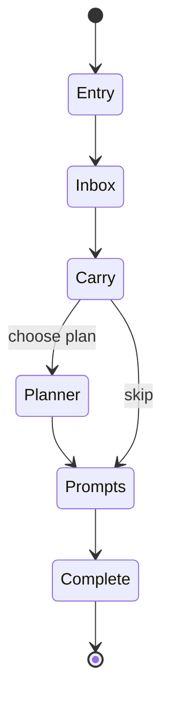

# UX Journey Plan Template

<!--
Copied from .artifacts/templates/ux-journey-plan.md 2026-11-18 for
GUI review round 9. Guidance comment stays.
-->

# [Plan] UX Journey Plan — Day-Review Journey Redesign

- **Date**: 2026-11-18
- **Kind**: UX journey plan — the guided day-review journey on the
  J2 modal base.
- **Origin**: round-9 round plan §4 (D2); research
  `.artifacts/reports/2026-11-18-round9-dayreview-details-research.md`;
  operator ruling O-3 (planner embedded as a step).
- **Status**: ACCEPTED — dispatch may chunk from it (operator acceptance 2026-11-18, full review pass).
- **Surfaces touched**: `review-walk-overlay.slint`, adapter review
  seams, `plan-next-day-view.slint`, app-window mount.
- **Platform scope**: desktop (kiosk: review absent today — unchanged).

## 1. Scope & goals

The day review becomes a guided 6-step journey inside a properly
behaving modal (J2 base): entry → inbox → carry → planner (embedded
step, O-3) → prompts → completion summary. Empty stages auto-skip
(including the carry stage's "Move to tomorrow" inert case). Focus is
contained, inside clicks don't close, size fits contents, no narrow
max-width bug.

Non-goals: standalone PlanNextDay view removal (stays for direct
entry); notification-surface changes.

## 2. Capability × surface matrix

| Capability | Board | TaskDetail | Today | Review | Settings | Capture | CLI |
|---|---|---|---|---|---|---|---|
| review.start | — | — | C | C | — | — | — |
| review.step.inbox | — | — | — | E | — | — | — |
| review.step.carry | — | — | — | E | — | — | — |
| review.step.planner | — | — | — | E | — | — | — |
| review.step.prompts | — | — | — | E | — | — | — |
| review.complete | — | — | — | E | — | — | — |
| review.abort | — | — | — | E | — | — | — |

**Rulings**:

| ID | Ruling | Reason | Home |
|---|---|---|---|
| R-1 | "Leave it as is" no longer hand-offs to a bare candidates view; planner is an embedded step | O-3 | this plan |
| R-2 | Outside click / Escape = abort-with-confirm, not silent step-back | draft-safety dismissal law (J2) | this plan |
| R-3 | The **embedded planner child is built now**, in this round (operator Q1 answer, 2026-11-18 — O-3 made definitive; rides issue #716's integration) | operator, 2026-11-18 | this plan |

## 3. User stories

### US-1 — Guided entry and stepping

- **Story**: When I open the day review I am walked stage by stage
  with clear stage labels, progress, and a visible way to finish.
- **Platforms**: desktop
- **Priority**: P1
- **Acceptance**:
  - AC-1: Journey passes entry → inbox → carry → planner → prompts →
    completion; every stage shows its position and next/prev — journey
    test.

### US-2 — Empty stages skip safely

- **Story**: When a stage has no items it is skipped, and no verb on
  it is inert.
- **Platforms**: desktop
- **Priority**: P1
- **Acceptance**:
  - AC-1: Empty carry stage auto-skips (extends
    view_state.rs:2977's inbox skip); "Move to tomorrow" with cursor
    None is never rendered clickable — journey test
    (adapter.rs:3174 fix).

### US-3 — Planner as an embedded step

- **Story**: When I choose to plan next day inside the review the
    planner appears as a step in the same dialog and returning
    continues the review.
- **Platforms**: desktop
- **Priority**: P1
- **Acceptance**:
  - AC-1: Planner step embeds (issue #716 integration) with its own
    guidance header; completing it advances to prompts — journey test.
  - AC-2: PlanNextDay embedded mount respects
    Theme.layout-severing-max-width without clamping the window —
    geometry test (plan-next-day-view.slint:327 fix).

### US-4 — Modal behavior

- **Story**: While the review is open, focus stays inside; clicking
  the dialog background does nothing destructive; the dialog sizes to
  contents.
- **Platforms**: desktop
- **Priority**: P1
- **Acceptance**:
  - AC-1: Tab walk contained (MaskWalkFacts armed by the J2 host, not
    ad-hoc); background click no-op; content-bounded height — journey +
    geometry tests.

## 4. Journey specs

### US-1 — Guided entry and stepping

| Step | Surface & affordance | User action | Dispatches | System response | Escape / failure |
|---|---|---|---|---|---|
| US-1/S1 | Today / menu | start review | UiRequest::ReviewWalkStart | modal opens at entry stage | abort R-2 |
| US-1/S2 | stage footer | next / prev | UiRequest::ReviewWalkStep | stage advances / returns | — |
| US-1/S3 | completion stage | finish | UiRequest::ReviewWalkComplete | summary + close, focus restored | — |

### US-2 — Empty stages skip safely

| Step | Surface & affordance | User action | Dispatches | System response | Escape / failure |
|---|---|---|---|---|---|
| US-2/S1 | carry stage (empty) | arrive at stage | — | auto-skip with toast/hint | — |

### US-3 — Planner as an embedded step

| Step | Surface & affordance | User action | Dispatches | System response | Escape / failure |
|---|---|---|---|---|---|
| US-3/S1 | carry stage | choose plan-next-day | UiRequest::ReviewWalkStep(Planner) | embedded planner step | back returns to carry |
| US-3/S2 | planner step | complete planning | UiRequest::ReviewWalkStep | advances to prompts | — |

## 5. Interaction flows

## 6. Wiring inventory

| ID | Surface file | Widget | Callback | Adapter seam | ActionId | Commands | Row addressing | Journey steps | Test |
|---|---|---|---|---|---|---|---|---|---|
| W-1 | review-walk-overlay.slint (remounted on J2 host) | stage shell | walk-button-invoked | walk_cursor + clamp_review_walk | ActionId::ReviewWalkPlanner | — | ItemAddr issue rows | US-1/S1-S3 | journeys.rs::us1_s1_entry_opens_and_steps_forward |
| W-2 | adapter.rs | empty-stage skip | — | clamp_review_walk extension | — | — | — | US-2/S1 | journeys.rs::us2_s1_empty_carry_stage_auto_skips |
| W-3 | plan-next-day-view.slint | embedded planner mount | — | embedded-child (#716) | — | — | — | US-3/S1-S2 | journeys.rs::us3_s1_planner_embeds_and_back_returns_to_carry |
| W-4 | app-window.slint | J2 modal host mount | — | review host | — | — | — | US-4 | journeys.rs::us4_s1_modal_containment |

## 7. Command-contract delta

| Kind | Name | Payload sketch | Journeys |
|---|---|---|---|
| UiRequest | ReviewWalkStep | WalkStep::Planner variant added | US-3 |
| UiRequest | ReviewWalkComplete | summary payload | US-1 |

## 8. Verification plan

- **Journey tests**: us1_s1-s3, us2_s1, us3_s1-s2, us4_s1.
- **Seam tests**: CarryTomorrow never dispatched with None cursor;
  walk_resume path exercised.
- **Fold tests**: stage-progress presentation flags.
- **Kiosk gates**: review absent (unchanged).
- **Manual**: guidance wording; walkthrough covers.

## 9. Definition of done

- [ ] `scripts/ux-coverage.sh <this file> --gate` exits 0
- [ ] Every P1 story's journey completes end-to-end including escapes
- [ ] Walkthrough protocol executed at stage 3; findings resolved or homed
- [ ] All matrix absences carry rulings; census updated
- [ ] Non-goals filed as backlog issues

## 10. Stage-2 evidence bindings (2026-11-19)

`bound-test:` lines per #768 — the §4 steps resolved against the
landed journey names in `crates/taskboard-ui-slint/tests/journeys.rs`
(the `day_review_journeys.rs` file in §6's Test column was the
nomination sketch; the shared journeys file is the evidence home):

    bound-test: US-1/S1 -> journeys.rs::us1_s1_entry_opens_and_steps_forward
    bound-test: US-1/S2 -> journeys.rs::us1_s2_stage_next_prev_roundtrip
    bound-test: US-1/S3 -> journeys.rs::us1_s3_complete_closes_and_restores_focus
    bound-test: US-2/S1 -> journeys.rs::us2_s1_empty_carry_stage_auto_skips
    bound-test: US-3/S1 -> journeys.rs::us3_s1_planner_embeds_and_back_returns_to_carry
    bound-test: US-3/S2 -> journeys.rs::us3_s2_planner_complete_advances_to_prompts

## 11. Erratum — W-1 Commands cell (E1, 2026-11-22, #1164)

*2026-11-22 (E1, #1164): W-1's Commands cell carried prose ("UiRequest
variants"); the walk is flow-only — `ActionId::ReviewWalkPlanner`
routes to `UiEffect::ReviewWalk` (router.rs), no `UiRequest` or
`StateCommand` rides the row. Cell corrected to `—` (the gate scans
declared tokens only).*
