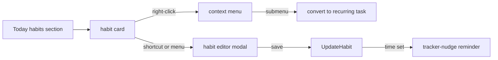

# UX Journey Plan Template

<!--
How to use this file: copied from .artifacts/templates/ux-journey-plan.md
on 2026-11-18 for GUI review round 9. Guidance comment stays.
-->

# [Plan] UX Journey Plan — Habit UX Parity

- **Date**: 2026-11-18
- **Kind**: UX journey plan — stories, journeys, flows, wiring contract
  for habit/task parity in the Today view (plus additive domain fields).
- **Origin**: round-9 round plan §4 (H-chunks); research
  `.artifacts/reports/2026-11-18-round9-habit-parity-research.md`;
  operator rulings O-1 (anchor-day windows) and O-2 (UI-level RowSubject).
- **Status**: ACCEPTED — dispatch may chunk from it (operator acceptance 2026-11-18, full review pass).
- **Surfaces touched**: `ui/compositions/habits.slint`, Today view,
  adapter/router (`adapter.rs`), `menu.rs`, domain habit types.
- **Platform scope**: both (kiosk: no editor/create, display + complete
  only — matches task-card kiosk gating).

## 1. Scope & goals

Habits behave like tasks in every interaction: cards, context menu,
keyboard, drag-drop, editing, reminders, time display. The habit
parallel implementation is replaced by a shared row substrate
(`RowSubject::Task|Habit` at the adapter/router layer — O-2; no domain
`TaskKind`). Additive domain changes: habit description field (HAB-2)
and anchor-day recurrence windows (O-1, supersedes the D-H12
canonicality law via dated census entry).

Non-goals (approved by the operator 2026-11-18, homed as backlog
issues so they are not lost): planned skip days #955, undo completion
#956, heatmap/month-grid history #957 (a prime motivator — revisit
early), pause #958, per-habit reminder overrides #959, per-weekday
schedules #960, inline quota edit #961 (rider candidate for H2/W3–W6),
streak badge upgrade #962, statistics #963. Declined: notes per
completion (D-H5 law stands). Board mount for habits stays absent —
habits live outside boards (O-7 Q2); future week/month/year calendar
views may show them once those exist.

## 2. Capability × surface matrix

| Capability | Board | TaskDetail | Today | Review | Settings | Capture | CLI |
|---|---|---|---|---|---|---|---|
| habit.create | — | — | C | — | — | — | C |
| habit.edit | — | E | E | — | — | — | C |
| habit.remove | — | X | X | — | — | — | X |
| habit.describe | — | E | E | — | — | — | C |
| habit.schedule-time | — | E | E | — | — | — | C |
| habit.schedule-day | — | E | E | — | — | — | C |
| habit.complete | — | E | C | — | — | — | C |
| habit.reorder-drag | — | — | E | — | — | — | — |
| habit.reorder-keys | — | — | E | — | — | — | — |
| habit.menu-context | — | E | C | — | — | — | — |
| habit.convert-to-task | — | E | C | — | — | — | C |
| habit.reminder | — | E | E | — | — | — | C |

**Rulings**:

| ID | Ruling | Reason | Home |
|---|---|---|---|
| R-1 | No Board column for habits | census R-1 reaffirmed; roaming sync family | #934-adjacent backlog |
| R-2 | GUI habit editing exists (overturns 2026-11-13 R-2 "CLI covers") | this operator pass | census supersession |
| R-3 | Convert-to-recurring-task is a context-menu submenu entry only | operator finding | this plan |

## 3. User stories

### US-1 — Habit rows are task cards

- **Story**: As a Today-view user I want habit rows that look and
  behave like task cards so that one set of instincts covers both.
- **Platforms**: both
- **Entry points**: Today view habits section.
- **Priority**: P1
- **Acceptance**:
  - AC-1: Habits render via the task-card substrate with horizontal
    action row; entry height matches a task row — journey test.

### US-2 — Habit context menu + convert submenu

- **Story**: As a user I want to right-click a habit and see the same
  menu grammar as tasks, with conversion tucked into a submenu.
- **Platforms**: desktop
- **Priority**: P1
- **Acceptance**:
  - AC-1: Context menu opens with task-parity entries + habit-specific
    verbs; "Convert to recurring task" lives in a submenu — journey.

### US-3 — Habit keyboard parity

- **Story**: As a keyboard user I want habit actions bound to shortcuts
  and directional traversal to cross the habit section like task rows.
- **Platforms**: desktop
- **Priority**: P1
- **Acceptance**:
  - AC-1: Traversal enters/leaves habit rows with the same keys as
    tasks (closes #934) — journey test.
  - AC-2: Keyboard reorder works on habit rows — journey test.

### US-4 — Habit drag reorder

- **Story**: As a pointer user I want to drag habits to new positions.
- **Platforms**: desktop
- **Priority**: P2
- **Acceptance**:
  - AC-1: Gap-drop pattern (#918) works across the habit list —
    journey test.

### US-5 — Habit editing (description, time, day)

- **Story**: As a user I want to edit habits: description, optional
  time, optional per-week/per-month day.
- **Platforms**: desktop (kiosk: display only)
- **Priority**: P1
- **Acceptance**:
  - AC-1: Editor round-trips description/time/day via
    `UpdateHabit`/`HabitChanges` — seam test.
  - AC-2: Set time displays in the row and arms a tracker-nudge
    reminder (existing `ReminderRef::Tracker` engine) — journey test.

### US-6 — Optional day inside the canonical window

- **Story**: As a user I want to give a per-week/per-month habit an
  optional day that governs display and nudging, while windows stay
  canonical (ISO-Monday / calendar-1st).
- **Platforms**: both
- **Priority**: P1
- **Acceptance**:
  - AC-1: Optional day stored as a display/nudge day (O-1, option b);
    window boundaries and the streak walk unchanged — property test.
  - AC-2: With a day set, tracker nudging starts relative to that day;
    without one, at the period's start; snooze offers hour/day choices
    (O-7 Q7) — journey test.

## 4. Journey specs

### US-1 — Habit rows are task cards

| Step | Surface & affordance | User action | Dispatches | System response | Escape / failure |
|---|---|---|---|---|---|
| US-1/S1 | Today habits section | open app with ≥1 habit | — | habits render as cards, horizontal actions | empty section hint |
| US-1/S2 | habit card | click complete | StateCommand::LogHabit | completion state + streak tick | undo via history if landed |

### US-2 — Habit context menu + convert submenu

| Step | Surface & affordance | User action | Dispatches | System response | Escape / failure |
|---|---|---|---|---|---|
| US-2/S1 | habit card | right-click | UiRequest::OpenContextMenu(MenuKind::HabitRow) | task-grammar menu + habit verbs | Esc dismisses |
| US-2/S2 | menu submenu | hover "Convert…" | — | submenu with recurring-task options | Esc / outside click |

### US-3 — Habit keyboard parity

| Step | Surface & affordance | User action | Dispatches | System response | Escape / failure |
|---|---|---|---|---|---|
| US-3/S1 | Today | traverse into habits | ActionId::nav.focus-* (J3) | focus enters habit rows like task rows | — |
| US-3/S2 | focused habit | shortcut (complete/edit/menu) | ActionId::habit.* | same verbs as pointer path | Esc |

### US-5 — Habit editing

| Step | Surface & affordance | User action | Dispatches | System response | Escape / failure |
|---|---|---|---|---|---|
| US-5/S1 | habit card / menu | open editor | UiRequest::OpenHabitEditor | modal (J2 ModalDialog) with fields | cancel discards |
| US-5/S2 | editor | set time + save | StateCommand::UpdateHabit(HabitChanges) | row shows time chip; reminder armed | invalid input stays in editor |
| US-5/S3 | habit context menu | click remove (arm) | — (adapter staging) | confirm flips enabled inside the open menu; another subject's menu disarms | Esc dismisses |
| US-5/S4 | armed menu | click confirm | StateCommand::DeleteHabit | row leaves the section; the log survives | — |

### US-6 — Anchor-day windows

| Step | Surface & affordance | User action | Dispatches | System response | Escape / failure |
|---|---|---|---|---|---|
| US-6/S1 | habit editor day field | pick Wednesday, cadence weekly | StateCommand::UpdateHabit | day stored; window stays canonical (Mon-start) | — |
| US-6/S2 | engine | time passes (test clock) | — | nudge arms relative to Wednesday; snooze offers hours/days | — |

## 5. Interaction flows

## 6. Wiring inventory

| ID | Surface file | Widget | Callback | Adapter seam | ActionId | Commands | Row addressing | Journey steps | Test |
|---|---|---|---|---|---|---|---|---|---|
| W-1 | compositions/habits.slint | TaskCard substrate | habits-log-clicked | RowSubject::Habit router | habit.log | StateCommand::LogHabit | ItemAddr habit row | US-1/S2 | crates/taskboard-ui-slint/tests/journeys/habits_journey.rs::us1_s2 |
| W-2 | menu.rs | HabitRow context menu | habits-context-requested | MenuKind stays {Main, Object} (D4 deviation) | habit.log | — | — | US-2/S1 | crates/taskboard-ui-slint/tests/journeys/habits_journey.rs::us2_s1 |
| W-3 | menu.rs | convert submenu | — | — | habit.convert | StateCommand::ConvertHabitToSeries | — | US-2/S2 | crates/taskboard-ui-slint/tests/journeys/habits_journey.rs::us2_s2 |
| W-4 | habit editor (shared task-view variant) | fields | habit-save-clicked | UpdateHabit seam | habit.edit | StateCommand::UpdateHabit | — | US-5/S2 | crates/taskboard-ui-slint/tests/journeys/habits_journey.rs::us5_s2 |
| W-5 | habit card | time chip | — | presentation | — | — | — | US-5/S2 | fold test |
| W-6 | adapter.rs | traversal | — | RowSubject walk | nav.focus-board | — | ItemAddr | US-3/S1 | crates/taskboard-ui-slint/tests/journeys/habits_journey.rs::us3_s1 |

(W-6's action cell spelled the wildcard `nav.focus-*`; chunk 8 landed
the concrete `nav.focus-board` id — cell corrected 2026-11-19, H4
review, the gate greps the cell verbatim.)

## 7. Command-contract delta

| Kind | Name | Payload sketch | Journeys |
|---|---|---|---|
| StateCommand | UpdateHabit | + description, anchor day fields (HabitChanges) | US-5, US-6 |
| UiRequest | OpenHabitEditor | habit id | US-5 |
| UiRequest | OpenContextMenu | MenuKind::HabitRow variant | US-2 |
| ActionId | habit.* | complete/edit/menu/convert family | US-2, US-3 |
| ActionId | nav.focus-* | shared with J3 | US-3 |

## 8. Verification plan

Chunk-4 substrate binding (#768's retro map): the US-6/S1 evidence at
the domain/engine seam tier lands in this round's habit-domain-fields
chunk, so the step binds to its seam test now; the UI-journey test
above stays the editor-tier evidence when H2/H4 land it.

bound-test: US-6/S1 -> crates/taskboard-state/tests/habits.rs::us6_s1_update_habit_stores_the_day_inside_the_canonical_window

- **Journey tests** (step-ID-named): us1_s1 us1_s2 us2_s1 us2_s2 us3_s1
  us3_s2 us5_s1 us5_s2 us6_s1 us6_s2 (crates/taskboard-ui-slint/tests/).
- **Seam tests**: UpdateHabit changeset round-trip incl. description +
  anchor day; ConvertHabitToTask unchanged semantics.
- **Fold/presentation tests**: time chip presence flag; card row shape.
- **Property tests**: anchor-day window derivation (weekly + monthly),
  streak computation on anchor windows.
- **Kiosk gates**: editor/convert absent; complete renders.
- **Manual**: card visual parity with tasks.

## 9. Definition of done

- [ ] `scripts/ux-coverage.sh <this file> --gate` exits 0
- [ ] Every P1 story's journey completes end-to-end including escapes
- [ ] Walkthrough protocol executed at stage 3; findings resolved or homed
- [ ] All matrix absences carry rulings; census updated (R-2, D-H12
      supersessions)
- [ ] Non-goals filed as backlog issues

## 8. Stage-2 landing deviations (2026-11-18, chunk 6 H2 — recorded)

- W-1's callback/action spellings land as the seams' real names:
  the done slot and the strip share `habits-log-clicked`
  (`ActionId::HabitLog`, slug `habit.log` — no `habit.complete` slug
  exists; the done slot IS the log control, never a done bit).
- W-2's callback is the row's right-click seam
  `habits-context-requested`; the menu projection stays an Object
  menu (no `MenuKind::HabitRow` variant — the stage-1 plan D4
  deviation, cited by the census). W-2's action cell carries
  `habit.log` (the menu row routes the same id the strip does —
  click ≡ key).
- W-3's command is `ConvertHabitToSeries` (the existing domain verb;
  the plan's `ConvertHabitToTask` spelling named no real variant).
US-1/S1 carries no wiring row of its own, so the #768 mapping binds
the substrate journey to its landing file:

bound-test: US-1/S1 -> crates/taskboard-ui-slint/tests/journeys/habits_journey.rs::us1_s1_habit_rows_render_on_the_task_card_substrate

## 9. Stage-landing deviations (2026-11-19, chunk 10 H4 — recorded)

The habit-editing chunk (round 9 chunk 10, plan
`.artifacts/plans/2026-11-19-habit-editing-plan.md`) lands journeys
whose step IDs postdate this plan's ACCEPTED token list (its §4
journey specs predate O-7 Q6's scope join that brought GUI habit
remove into the round). Per the H2 precedent (§8) the steps bind here:

- `US-5/S1` lands as `us5_s1_habit_editor_opens_and_cancel_discards`
  (the editor surface opens from the habit menu row and the
  `habit.edit` key; cancel discards — no `UpdateHabit` dispatched).
- `US-5/S2` lands as `us5_s2_habit_editor_round_trips_time_and_day`
  (set time + day, save; the row shows the time chip — W-5's fold —
  and `UpdateHabit` carried the sparse changeset).
- `US-6/S2`'s journey half lands as
  `us6_s2_snooze_offers_hours_and_days` (the snooze flyout spans
  hours AND days; the engine nudge arms per the day gate).
- The remove grammar's two steps join the §4 US-5 table as S3/S4
  (the gate's step-id grammar is US-conformant; the landing tests
  keep the plan's h4_remove token names — the names are addresses,
  the steps are the contract):

| Step | Surface & affordance | User action | Dispatches | System response | Escape / failure |
|---|---|---|---|---|---|
| US-5/S3 | habit context menu | click remove (arm) | — (adapter staging) | confirm flips enabled inside the open menu; another subject's menu disarms | Esc dismisses |
| US-5/S4 | armed menu | click confirm | StateCommand::DeleteHabit | row leaves the section; the log survives | — |

bound-test: US-5/S1 -> crates/taskboard-ui-slint/tests/journeys/habits_journey.rs::us5_s1_habit_editor_opens_and_cancel_discards
bound-test: US-5/S2 -> crates/taskboard-ui-slint/tests/journeys/habits_journey.rs::us5_s2_habit_editor_round_trips_time_and_day
bound-test: US-6/S2 -> crates/taskboard-ui-slint/tests/journeys/habits_journey.rs::us6_s2_snooze_offers_hours_and_days
bound-test: US-5/S3 -> crates/taskboard-ui-slint/tests/journeys/habits_journey.rs::h4_remove_s1_remove_arms_and_the_confirm_flips
bound-test: US-5/S4 -> crates/taskboard-ui-slint/tests/journeys/habits_journey.rs::h4_remove_s2_confirm_tombstones_and_closes
bound-test: US-3/S2 -> crates/taskboard-ui-slint/tests/journeys/habits_journey.rs::us3_s2_the_task_complete_stroke_and_shift_up_route_the_habit_verbs
  (bound 2026-11-19, H4 review: the step's habit-side evidence was
  unbound, so the gate read AMBIGUOUS over the six task-journey
  `us3_s2_*` homonyms; chunk 8 landed the test, the binding rides the
  deviations section it belongs to)

- W-4's callback spelling lands as the seam's real name
  `habit-save-clicked` (the §6 `on_save` cell named no real callback —
  the H2 precedent); the editor is NOT a J2 modal: it mounts the
  shared `task-view.slint` surface with the `is-habit` mount
  discriminator (stage-1 plan D1, which supersedes this plan's modal
  sketch — the round plan O-7 Q4's reuse law).
- The remove grammar's wiring lands as W-9 (stage-1 plan
  `.artifacts/plans/2026-11-19-habit-editing-plan.md` §3): the menu
  rows in `menu.rs::HABIT_CONTEXT` (destructive-last), the staging in
  `adapter.rs` (`habit_remove_armed`, the states-map grammar), the
  confirm routing `StateCommand::DeleteHabit`; journeys bound above
  (US-5/S3/S4).
