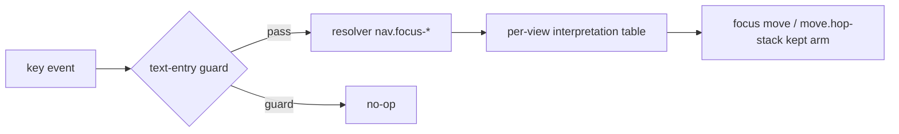

# UX Journey Plan Template

<!--
Copied from .artifacts/templates/ux-journey-plan.md 2026-11-18 for
GUI review round 9. Guidance comment stays.
-->

# [Plan] UX Journey Plan — Keyboard & Focus Architecture

- **Date**: 2026-11-18
- **Kind**: UX journey plan — stories, journeys, flows, wiring contract
  for the directional-focus law, chord case-seam fix, board move fix,
  and task-details shortcut completion.
- **Origin**: round-9 round plan §4 (K-chunks); research
  `.artifacts/reports/2026-11-18-round9-keyboard-focus-research.md`.
- **Status**: ACCEPTED — dispatch may chunk from it (operator acceptance 2026-11-18, full review pass).
- **Surfaces touched**: keymap seam (`to_stroke`, presets),
  `ActionRouter`/interpret tables, adapter settle matrix, TaskDetail,
  Board, Today, task-details widgets.
- **Platform scope**: desktop (kiosk: read surfaces unaffected).

## 1. Scope & goals

- **The law**: C-f/C-b/C-n/C-p move THE FOCUS (directional Tab
  alternative) in every view, preset-independent; where a clear
  left/right/up/down geometry exists they move in that direction
  (board semantics generalized). They never change the active task.
- Board move C-c C-w: C-f/C-b hop the drop target between stacks
  without breaking the move.
- Chord case seam: uppercase-spelled chorded letters (Ctrl+T etc.)
  fire; today view reachable via Ctrl+Shift+T as spelled.
- Task details: every activatable widget has a dedicated shortcut
  (done, tracker toggle, entries, effort, back); tracker verbs bound
  in Board context too.

Non-goals: vi/emacs preset remapping beyond conformance to the law
(preset violations recorded + fixed where trivially conformant);
#935 refusal pass (homed).

## 2. Capability × surface matrix

| Capability | Board | TaskDetail | Today | Review | Settings | Capture | CLI |
|---|---|---|---|---|---|---|---|
| nav.focus-directional | E | E | E | E | E | E | — |
| move.hop-stack | E | — | — | — | — | — | — |
| chord.uppercase-fire | E | E | E | E | E | E | — |
| task.toggle-tracker | E | E | E | — | — | — | — |
| taskdetail.widget-shortcuts | — | E | — | — | — | — | — |
| row.cursor (R-7, chunk 12) | — | E | — | — | — | — | — |

**Rulings** (operator pass 2026-11-18 over the keyboard research §8):

| ID | Ruling | Reason | Home |
|---|---|---|---|
| R-1 | The C-f/b/n/p directional law is **emacs-binding-scoped**. Vi's equivalent directional keys (its motion keys) get the same functionality; the **Standard preset uses the arrow keys** as its directional-focus keys (with the existing text-entry guard making them move the cursor while editing). Preset conventions that conflict (Standard C-f=search, vi C-f/b=scroll) are not violations. | operator Q2 answer | this plan |
| R-2 | TaskDetail C-n/p change focus, not active task | supersedes round-8 D-2 via dated census entry | this plan |
| R-3 | No viewed-task changing from the task detail view at all — the subject_task walk is removed, not re-homed to another chord (return-to-board-and-walk suffices) | operator Q1 answer | this plan |
| R-4 | Today's left/right is a **control-walk first implementation**; the operator will try it and report | operator Q3 answer | this plan |
| R-5 | The planner (PlanNextDay) **gets the directional grammar** (pool/boxes two-pane). Standing policy: **strict keyboard–mouse parity for the whole app** — every pointer-reachable interaction is keyboard-reachable | operator Q4 answer | this plan |
| R-6 | **Chorded-letter case law**: Ctrl+T ≡ Ctrl+Shift+t (equivalent in all functionality — no modern OS can send Ctrl+uppercase without Shift). Ctrl+T and Ctrl+t are **distinct** bindings (upper vs lower case). Bindings standardize on the **Ctrl+Shift+t spelling** for uppercase letters; `parse()` accepts both spellings as the same binding | operator ruling, 2026-11-18 | this plan |
| R-7 | Selected-row **cursors for every widget with interactable rows, app-wide** (internal-consistency heuristic); the rule-list cursor is this round's chunk | operator Q6 answer | this plan |
| R-8 | Tracking uses **one smart toggle** (`task.track-toggle` over the focused task), not two verbs | operator Q7 answer | this plan |

## 3. User stories

### US-1 — Directional focus everywhere

- **Story**: As a keyboard user I want C-f/b/n/p to move focus
  directionally between interactable elements in every view.
- **Platforms**: desktop
- **Priority**: P1
- **Acceptance**:
  - AC-1: In each view the four chords move focus per geometry table;
    in text entry they do not fire — journey test.
  - AC-2: In TaskDetail C-n/p walk the widget stop ladder
    (TaskViewWalkFacts), never write `subject_task` — journey test.

### US-2 — Board move survives stack hops

- **Story**: While moving a card with C-c C-w I want C-f/C-b to move
  the drop target between stacks.
- **Platforms**: desktop
- **Priority**: P1
- **Acceptance**:
  - AC-1: During Flow::Move, C-f/C-b are kept arms hopping the column;
    the move completes after hops — journey test
    (settle-matrix change at adapter.rs:4992).

### US-3 — Chorded-letter case law

- **Story**: As a user I want uppercase chord bindings spelled
  Ctrl+Shift+t to fire, with Ctrl+T understood as the same binding and
  Ctrl+t distinct.
- **Platforms**: desktop
- **Priority**: P1
- **Acceptance**:
  - AC-1: `parse("Ctrl+T")` ≡ `parse("Ctrl+Shift+t")` (same binding
    identity); delivery of Ctrl+Shift+t fires it; bare Ctrl+t does not —
    seam tests.
  - AC-2: `from_event` delivery contract tests over every preset's
    chorded-letter rows — seam test.
  - AC-3: All preset definitions re-spelled to the Ctrl+Shift+t
    convention — fold test.

### US-6 — Selected-row cursors app-wide

- **Story**: As a user I want every widget with interactable rows to
  carry a selected-row cursor so the basic motions are identical across
  the app; this round lands the rule-list cursor.
- **Platforms**: desktop
- **Priority**: P2
- **Acceptance**:
  - AC-1: Rule rows gain a selected-rule cursor walkable by the
    directional keys — journey test.
  - AC-2: The app-wide cursor heuristic is recorded in
    docs/widget_interactions.org (with W7) — doc check.

### US-4 — Task-details full shortcut coverage

- **Story**: As a keyboard user I want every activatable widget in
  task details reachable without Tab.
- **Platforms**: desktop
- **Priority**: P1
- **Acceptance**:
  - AC-1: The 22-verb table (research finding 3) fully bound or ruled;
    hover tooltips show strokes — journey + fold test.

### US-5 — Tracker verbs everywhere

- **Story**: As a user I want start/stop/toggle tracking bound,
  including Board context.
- **Platforms**: desktop
- **Priority**: P2
- **Acceptance**:
  - AC-1: Board-context bindings + toggle verb bound — journey test.

## 4. Journey specs

### US-1 — Directional focus everywhere

| Step | Surface & affordance | User action | Dispatches | System response | Escape / failure |
|---|---|---|---|---|---|
| US-1/S1 | TaskDetail | press C-n / C-p | ActionId::nav.focus-down/up | focus moves down/up widget ladder | at edges: clamp |
| US-1/S2 | Today | press C-f / C-b | ActionId::nav.focus-left/right | focus moves left/right | clamp |
| US-1/S3 | text field | press C-n | — | no action (text-entry guard) | — |

### US-2 — Board move survives stack hops

| Step | Surface & affordance | User action | Dispatches | System response | Escape / failure |
|---|---|---|---|---|---|
| US-2/S1 | Board card | C-c C-w then C-f | ActionId::move.hop-stack (kept arm) | drop target next stack; move alive | C-g aborts move |

### US-3 — Chorded uppercase letters fire

| Step | Surface & affordance | User action | Dispatches | System response | Escape / failure |
|---|---|---|---|---|---|
| US-3/S1 | any view | press Ctrl+Shift+T | ActionId::view.today | Today view opens | unbound chord: no-op |
| US-3/S2 | any view | press bare Ctrl+t | — | no dispatch (distinct binding, unbound) | — |

### US-6 — Selected-row cursors app-wide (round 9 chunk 12: the rule list)

| Step | Surface & affordance | User action | Dispatches | System response | Escape / failure |
|---|---|---|---|---|---|
| US-6/S1 | TaskDetail rule rows | press the preset's vertical directional keys | ActionId::nav.focus-down/up | the rule cursor arms at row 0 then walks clamped (zero commands — presentation state) | empty roster: the control ladder (chunk 9 byte-identical) |

### US-4 — Task-details full shortcut coverage

| Step | Surface & affordance | User action | Dispatches | System response | Escape / failure |
|---|---|---|---|---|---|
| US-4/S1 | TaskDetail | press done-checkbox stroke | ActionId::task.toggle-done | done toggles | — |
| US-4/S2 | TaskDetail | press tracker-toggle stroke | ActionId::TaskToggleTracker | tracking toggles | — |

## 5. Interaction flows

## 6. Wiring inventory

| ID | Surface file | Widget | Callback | Adapter seam | ActionId | Commands | Row addressing | Journey steps | Test |
|---|---|---|---|---|---|---|---|---|---|
| W-1 | keymap stroke parse | — | — | to_stroke/from_event case-fold | — | — | — | US-3/S1 | crates/taskboard-ui-slint/tests/journeys/keymap_case_seam.rs::us3_s1 |
| W-2 | interpret table | — | — | UiEffect::FocusDirectional table | nav.focus-up | — | — | US-1/S1-S2 | crates/taskboard-ui-slint/tests/journeys/focus_law_journeys.rs::us1_s1 |
| W-3 | adapter settle matrix | — | — | Flow::Move kept arms | nav.focus-right | — | — | US-2/S1 | crates/taskboard-ui-slint/tests/journeys/board_move_journeys.rs::us2_s1 |
| W-4 | task-view widgets | done/tracker/entries/effort/back | on activation | detail shortcut map | task.toggle-done, TaskToggleTracker, task.entries.open, task.effort.set, task.back | StateCommand variants | — | US-4/S1-S2 | detail_shortcuts_journeys.rs::us4_s1 |
| W-5 | board view | tracker verbs | — | board-context keymap arm | TaskStartTracker/TaskStopTracker/TaskToggleTracker | StateCommand | ItemAddr card | US-5 | tracker_journeys.rs::us5_s1 |
| W-6 | rule-list.slint rows | selected-rule cursor | — | on_task_rule_row_clicked (adapter.rs install_task_seam) — slint callback task-rule-row-clicked; the directional TaskDetail arm + Activate resolution (adapter.rs::interpret_directional / activate_rule_cursor) | nav.focus-down | — | — | US-6/S1 | focus_law_journeys.rs::us6_s1 |

## 7. Command-contract delta

| Kind | Name | Payload sketch | Journeys |
|---|---|---|---|
| ActionId | nav.focus-up/down/left/right | direction only | US-1 |
| ActionId | move.hop-stack | direction | US-2 (deviation: no such id — see §8) |
| ActionId | TaskToggleTracker | existing id, newly bound | US-4, US-5 |
| ActionId | task.toggle-done, task.entries.open, task.effort.set, task.back | new detail verbs | US-4 |

## 8. Verification plan

- **Journey tests**: us1_s1-s3, us2_s1, us3_s1, us4_s1-s2, us5_s1,
  us6_s1-s4 + us6_n1 (the chunk-9 negative; round 9 chunk 12).
- **Seam tests**: `from_event` chorded-letter delivery contract
  (uppercase + lowercase + shift-preserved); settle-matrix kept-arm
  assertion.
- **Fold tests**: tooltip hint coverage flags per verb.
- **Kiosk gates**: n/a (desktop-only affordances).
- **Manual**: preset feel on real keyboard (Dvorak re-check like #855).

## 9. Definition of done

- [ ] `scripts/ux-coverage.sh <this file> --gate` exits 0
- [ ] Every P1 story's journey completes end-to-end including escapes
- [ ] Walkthrough protocol executed at stage 3; findings resolved or homed
- [ ] All matrix absences carry rulings; census updated (D-2 supersession)
- [ ] Non-goals filed as backlog issues

## 8. Stage-2 landing deviations (2026-11-19, round 9 chunk 9 — recorded)

- **No `move.hop-stack` id exists.** The US-2 kept arms are the
  directional ids' own arms in the interpret table
  (`adapter.rs::interpret_move`): during a `Flow::Move` the
  horizontal keys hop the drop column
  (`view_state.rs::cycle_move_stack_column`), the vertical keys ride
  the target ring byte-identically to the FocusNext/Prev kept arm;
  `MoveStack`'s horizontals hop the insertion slot; `DragMove`
  absorbs. The plan's `move.hop-stack` shorthand named no real id —
  the W-3 action cell carries the carrier (`nav.focus-right`).
- **The family's real slugs**: `nav.focus-left/right/up/down` +
  `nav.extend-next`/`nav.extend-prev` (#875 RIDER; Board-only) — the
  §7 row's slash-compound is the shorthand, one slug per id in
  `actions.rs`.
- **Standard's Settings arrow rows are deliberately absent**: the
  settings pane's slider owns the raw arrows as its keyboard step
  (the slider journey's keyboard contract); the settings
  directional grammar rides emacs' chord rows, and the routed
  NavFocus* ids still interpret as the control walk (the per-view
  table's Settings row stands).
- **The planner lands pane-switch only** (J3 R-5's two-pane grammar):
  left/right flip the boxes ↔ pool focus
  (`view_state.rs::switch_plan_pane`, the `PlanModel.focus-pane`
  mirror); no in-pane cursor seam exists today — the in-pane walk is
  the recorded follow-up (backlog issue filed at landing).
- **The detail's item walk is retired** (R-3, census-dated
  supersession in `docs/ux-surface-census.org` `nav.item_walk`);
  US-1/S1's TaskDetail step reads as the control ladder with the
  subject pinned (`crates/taskboard-ui-slint/tests/journeys/focus_law_journeys.rs::us1_s1_taskdetail_
  directional_rows_walk_the_ladder_subject_pinned`).
- **Evidence files**: the journeys live in the nominated
  `crates/taskboard-ui-slint/tests/journeys/focus_law_journeys.rs` / `crates/taskboard-ui-slint/tests/journeys/board_move_journeys.rs`; the per-view
  steps beyond the W-2-nominated token carry their step ids in the
  test doc comments, and the two un-nominated steps map here:

  bound-test: US-1/S2 -> crates/taskboard-ui-slint/tests/journeys/focus_law_journeys.rs::today_horizontal_is_the_control_walk_first_cut
  bound-test: US-1/S3 -> crates/taskboard-ui-slint/tests/journeys/focus_law_journeys.rs::the_text_entry_guards_own_the_directional_keys
