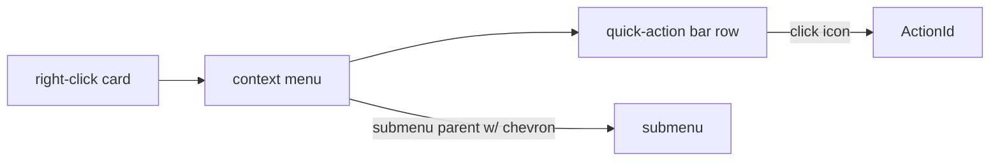

# UX Journey Plan Template

<!--
Copied from .artifacts/templates/ux-journey-plan.md 2026-11-18 for
GUI review round 9. Guidance comment stays.
-->

# [Plan] UX Journey Plan — Menus Remainder (quick bar, arrows, stale rows)

- **Date**: 2026-11-18
- **Kind**: UX journey plan — context-menu quick-bar regression +
  remainder, submenu chevrons, #927 stale rows.
- **Origin**: round-9 round plan §4 (M1); research
  `.artifacts/reports/2026-11-18-round9-menus-controls-research.md`;
  operator ruling O-4 incl. the screenshot regression report.
- **Status**: ACCEPTED — dispatch may chunk from it (operator acceptance 2026-11-18, full review pass).
- **Surfaces touched**: `menu.rs`, `action-menu.slint`, adapter
  context-menu seams.
- **Platform scope**: desktop (context menus absent on kiosk).

## 1. Scope & goals

- The task right-click context menu shows the quick-actions icon bar
  (SuperProductivity style) — PR #933 claims it, the operator's
  latest-main build (screenshot 2026-11-18 141914) does not: root-cause
  with an actual GUI test and fix.
- Multi-selection context menu gets a sensible bar (not empty).
- Bar buttons carry shortcut tooltips (`hint-keys`).
- Submenu-capable entries in ALL menus (context + main) render a
  chevron indicator.
- #927: stale pinned object-menu rows disarm via reconcile.

Non-goals: dropdown de-siting (backlog); #938 Labels row (backlog,
BOARD_CONTEXT scoping stands).

## 2. Capability × surface matrix

| Capability | Board | TaskDetail | Today | Review | Settings | Capture | CLI |
|---|---|---|---|---|---|---|---|
| menu.quick-bar-single | E | E | E | — | — | — | — |
| menu.quick-bar-multi | E | E | E | — | — | — | — |
| menu.submenu-indicator | E | E | E | — | E | — | — |
| menu.bar-tooltips | E | E | E | — | — | — | — |

**Rulings** (operator pass 2026-11-18 over the menus research §6):

| ID | Ruling | Reason | Home |
|---|---|---|---|
| R-1 | Multi bar rows are multi-sensible actions only | origin §1 wording wins over chunk D-4 narrow reading | this plan |
| R-2 | The quick bar is a **confirmed live regression**: the operator's build is from 2026-11-18 ~13:20 (review ~1h later), post-#933-merge, and the bar still does not render (screenshot Screenshot_20261118_141914.png). Root-cause, do not re-verify-stale-build | operator Q1 answer | this plan |
| R-3 | The multi-selection bar carries **whatever hot-bar elements make sense for multiple selected items** (design freedom within multi-sensibility) | operator Q2 answer | this plan |
| R-4 | Bar look-and-feel questions are decided **after implementation** (operator will judge the real thing) | operator Q3 answer | this plan |
| R-5 | The **priority picker becomes a dropdown**; the other currently-used pickers (time combobox, labels) stay as they are — the dropdown is a bad fit for them. Requires the dropdown de-siting first | operator Q4 answer | this plan |
| R-6 | Labels multi-toggle dropdown semantics **deferred**; when taken up, design for quickly setting multiple labels on a task | operator Q5 answer | this plan |

## 3. User stories

### US-1 — Quick bar present on latest main (regression)

- **Story**: As a user I right-click a task and see the icon
  quick-actions bar atop the context menu.
- **Platforms**: desktop
- **Priority**: P1
- **Acceptance**:
  - AC-1: A GUI-level test (slint rig on `on_slint_thread`, or the
    browser-GUI harness against a running build) mounts the task
    context menu and asserts the bar row structurally — test.
  - AC-2: Root cause recorded (gate/MenuKind arm/build?); fix lands.

### US-2 — Multi-selection bar

- **Story**: When I right-click a multi-selection I get multi-sensible
  quick actions, not an empty strip.
- **Platforms**: desktop
- **Priority**: P2
- **Acceptance**:
  - AC-1: `open_context_menu` multi path passes a populated bar
    (adapter.rs ~:10159) — journey test.

### US-3 — Submenu chevrons everywhere

- **Story**: Menu entries that open submenus show a chevron.
- **Platforms**: desktop
- **Priority**: P1
- **Acceptance**:
  - AC-1: `ActionMenu` row renderer draws chevron when
    `entry.submenu` (action-menu.slint:256-274) for context + main
    menus — golden/fold test.

### US-4 — Bar tooltips + stale-row disarm

- **Story**: Bar buttons show their shortcuts on hover; pinned menu
  rows never go stale.
- **Platforms**: desktop
- **Priority**: P2
- **Acceptance**:
  - AC-1: `hint-keys` populated per preset — fold test.
  - AC-2: Reconcile-driven disarm closes #927 — journey test.

## 4. Journey specs

### US-1 — Quick bar present on latest main

| Step | Surface & affordance | User action | Dispatches | System response | Escape / failure |
|---|---|---|---|---|---|
| US-1/S1 | task card | right-click | UiRequest::OpenContextMenu(MenuKind::TaskCard) | menu with quick-bar row first | Esc |

### US-3 — Submenu chevrons everywhere

| Step | Surface & affordance | User action | Dispatches | System response | Escape / failure |
|---|---|---|---|---|---|
| US-3/S1 | any menu | observe submenu parent | — | chevron rendered | — |
| US-3/S2 | submenu parent | activate | — | submenu opens | Esc closes submenu only |

## 5. Interaction flows

## 6. Wiring inventory

| ID | Surface file | Widget | Callback | Adapter seam | ActionId | Commands | Row addressing | Journey steps | Test |
|---|---|---|---|---|---|---|---|---|---|
| W-1 | action-menu.slint | quick-bar row mount | menu_quick_bar_invoked | task_quick_bar seam (menu.rs:559; the on_menu_quick_bar_invoked install) | ActionId::TaskScheduleToday | StateCommand::UpdateTask; StateCommand::StartTracking | — | US-1/S1 | crates/taskboard-ui-slint/tests/probes/action_menu_bar_probe_tests.rs::us1_s1 |
| W-2 | adapter.rs | multi-path bar | — | open_context_menu multi arm (multi_quick_bar builder) | — | — | — | US-2 | journeys.rs::us2_s1_the_multi_bar_routes_per_member |
| W-3 | action-menu.slint | chevron in row renderer | — | — | — | — | — | US-3/S1 | crates/taskboard-ui-slint/tests/probes/action_menu_bar_probe_tests.rs::us3_s1 |
| W-4 | action-menu.slint | hint-keys on bar buttons | — | preset stroke lookup | — | — | — | US-4 | fold test |
| W-5 | adapter.rs | reconcile disarm | — | MenuKind pin reconcile | — | — | — | US-4 | journeys.rs::us4_s2 |
| W-6 | dropdown.slint | the de-sited facts mount (DropdownConsumer + the ONE generic AnchoredOverlayHost flyout mount in app-window.slint) | — | — | — | — | — | addendum §10 structural probes; no command variants by design | probes/dropdown_probe_tests.rs (addendum §10) |
| W-7 | task-view.slint | the two embedded Dropdown fields in the LabeledValueRow content slots (addendum §10, D-4; the adapter seams on_task_importance_edit_asked / on_task_urgency_edit_asked / on_priority_slot_clicked / on_priority_dismiss_requested route D-9-identical; the urgency twin routes ActionId::TaskUrgencyEdit) | — | TaskImportanceEdit / TaskUrgencyEdit routes + the slot-commit seam | ActionId::TaskImportanceEdit | StateCommand::UpdateTask | vocabulary index (unset + 5 levels) | US-6/S1–S4 (addendum §10) | journeys.rs::us6_s1..s4 |

## 7. Command-contract delta

| Kind | Name | Payload sketch | Journeys |
|---|---|---|---|
| UiRequest | OpenContextMenu | multi bar payload (non-empty builder) | US-2 |

## 8. Verification plan

Stage-2 resolution (2026-11-18, recorded at review): the journey tests
land in `tests/journeys.rs` (the harness is journeys-local — a separate
`menus_remainder_journeys.rs` would have duplicated the ~300-line
Harness) and the structural probe in
`crates/taskboard-ui-slint/tests/probes/action_menu_bar_probe_tests.rs`. US-3/S2's activation behavior
(submenu parent opens the family page, Esc closes the submenu only) is
already covered by the UX-R8 chunk-5 escape-ladder journey, so the step
binds there rather than duplicating it (#768's retro map):

bound-test: US-3/S2 -> crates/taskboard-ui-slint/tests/journeys.rs::us2_ac4_escape_ladder_steps_submenu_then_menu

- **Journey tests**: us1_s1, us2_s1, us3_s1, us4_s2 (§6 Test column
  names the files).
- **Seam tests**: single + multi bar builder payloads.
- **Fold tests**: submenu flag → chevron; hint-keys presence.
- **Kiosk gates**: context menus absent (unchanged).
- **Manual**: operator re-check on fresh build (the screenshot case).

## 9. Definition of done

- [ ] `scripts/ux-coverage.sh <this file> --gate` exits 0
- [ ] Every P1 story's journey completes end-to-end including escapes
- [ ] Walkthrough protocol executed at stage 3; findings resolved or homed
- [ ] All matrix absences carry rulings; census updated
- [ ] Non-goals filed as backlog issues

## 10. Addendum (2026-11-20) — US-6: the priority pickers are dropdowns

Added by round-9 chunk 15 (the R-5 ruling's implementation; the
one-line-amendment pattern research §5.2 sanctioned). The priority
picker — today's in-layout six-slot quick-list — becomes the shared
`Dropdown` widget class, per R-5, after the dropdown de-siting
(round-9 chunk 15's `DropdownFacts` consumer-kind mount; the T-0
spike proved the primary self-registration path unparsable on Slint
1.18.1, so the recorded consumer-kind fallback carries the identity).
R-6 stands untouched: the labels picker stays bespoke (multi-select
semantics deferred); the time combobox stays bespoke (typed filter +
nearest-row seek, research §4.2).

### Journey specs (new)

- **US-6 — the priority pickers are dropdowns** (P2, TaskDetail):
  - `/S1` — the importance edit intent opens the widget's flyout
    under its consumer kind; a pick commits the exact `UpdateTask`
    importance mask (D-9 byte-identical).
  - `/S2` — Escape closes through the widget's dismissal seam and
    dispatches nothing (the deep focus-restore assertions stay
    `us1_s1_picker_close_restores_the_invoking_field`, unchanged).
  - `/S3` — the selector ladder on the detail view: arrows move the
    highlight (the `DropdownLadder` seam), Return selects, Escape
    closes only.
  - `/S4` — the urgency field is the mirror twin (urgency mask).

### Wiring inventory (new rows)

| ID | Surface file | Widget | Callback | Adapter seam | ActionId | Commands | Row addressing | Journey steps | Test |
|---|---|---|---|---|---|---|---|---|---|
| W-6 | `ui/widgets/dropdown.slint` | the de-sited facts mount (`DropdownConsumer` + the ONE generic `AnchoredOverlayHost` flyout mount, `app-window.slint`) | — | — | — | — | — | — | `probes/dropdown_probe_tests.rs` (the geometry/ladder suites + the de-sited identity proof + the check-glyph probe) |
| W-7 | `ui/views/task-view.slint` + `adapter.rs::on_priority_slot_clicked` | the two embedded `Dropdown` fields in the `LabeledValueRow` content slots (D-4); the retired pencil routes nothing | `importance-edit-asked`/`urgency-edit-asked` (unchanged), `priority-dismiss-requested` (the D-6 dismissal seam) | `TaskImportanceEdit`/`TaskUrgencyEdit` (unchanged), `priority_slot_clicked(index)` (D-9: the adapter resolves the level from the row index, `adapter.rs:12710`), `priority_dismiss_requested` (unchanged) | `ActionId::TaskImportanceEdit`/`TaskUrgencyEdit` | `StateCommand::UpdateTask` (masks byte-identical) | vocabulary index (`unset` + 5 levels) | US-6/S1–S4 | `journeys.rs::us6_s1..s4` |

### Command-contract delta

None (D-9): the `UpdateTask` masks, the open actions, and the
dismissal seam are byte-identical; the J5 R-5 adoption is a
presentation-layer swap only. The check glyph moves to the class-wide
selected-row rendering law (D-5) — a visual delta re-baselined per
chunk 15's D-11, not a contract delta.
