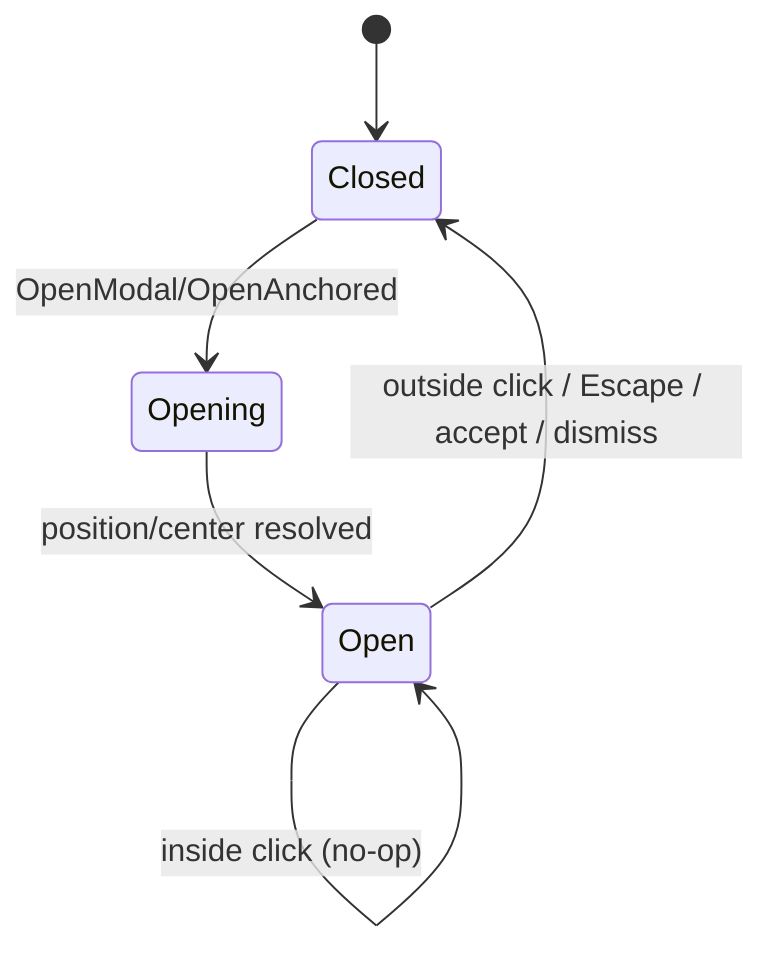

# UX Journey Plan Template

<!--
Copied from .artifacts/templates/ux-journey-plan.md 2026-11-18 for
GUI review round 9. Guidance comment stays.
-->

# [Plan] UX Journey Plan — Widget Framework (modals, overlays, positioning)

- **Date**: 2026-11-18
- **Kind**: UX journey plan — stories, journeys, flows, wiring contract
  for the base widget layer + migration of ad-hoc overlays onto it.
- **Origin**: round-9 round plan §4 (W-chunks); research
  `.artifacts/reports/2026-11-18-round9-widget-framework-research.md`
  and `.artifacts/reports/2026-11-18-round9-dayreview-details-research.md`
  (task-details cluster).
- **Status**: ACCEPTED — dispatch may chunk from it (operator acceptance 2026-11-18, full review pass).
- **Surfaces touched**: `app-window.slint` overlay mounts,
  `ui/widgets/` (new base components), task-view editors, time-field,
  date-picker, recur editor, labels flyout, search palette,
  `docs/widget_interactions.org` (new).
- **Platform scope**: both.

## 1. Scope & goals

The app gains base widgets with industry-standard behavior, and every
existing ad-hoc overlay/dialog migrates onto them:

- `ModalDialog`: centered, scrim behind, sized to contents (caps as
  bounds), large accept/cancel buttons (extensible custom-button
  model), focus walk contained by construction, inside clicks never
  close, outside/Escape close per host semantics.
- `AnchoredOverlay` positioning helper: places an overlay below/above
  its invoking widget, flips near window edges, clamps, never covers
  the anchor, never shifts the underlying layout.

Non-goals: Slint-native Dialog/anchor APIs (absent in 1.18.1);
day-review journey redesign (J4 consumes this plan); dropdown
de-siting (backlog).

## 2. Capability × surface matrix

| Capability | Board | TaskDetail | Today | Review | Settings | Capture | CLI |
|---|---|---|---|---|---|---|---|
| dialog.open-modal | C | C | C | C | C | C | — |
| dialog.focus-contained | E | E | E | E | E | E | — |
| dialog.dismiss-outside | E | E | E | E | E | E | — |
| overlay.anchor-position | E | E | — | — | — | — | — |
| overlay.no-layout-shift | E | E | E | E | E | E | — |

**Rulings**:

| ID | Ruling | Reason | Home |
|---|---|---|---|
| R-1 | PopupWindow primitive not used | round-5 D6 rejection stands | census |
| R-2 | In-layout editor swaps migrate to overlays where they shift layout | operator law: overlays never resize the view | this plan |
| R-3 | Modals carry a soft visible translucent scrim | operator Q2 answer, 2026-11-18 | this plan |
| R-4 | Outside-click dismissal follows the dialog's role: text/field editing dialogs treat outside-click as **accept/save** (modern autosave expectation); destructive-confirm dialogs treat outside-click as **cancel** | operator Q3 answer, 2026-11-18 | this plan |
| R-5 | The search palette becomes a focus-trapped modal | operator Q5 answer, 2026-11-18 | this plan |
| R-6 | Content-bounded sizing uses framework-conventional **minimum and maximum widths** (min: stays interactable; max: never unwieldy with long entries) — defaults researched from Qt/web conventions by the widget audit | operator Q6 answer, 2026-11-18 | this plan |
| R-7 | The Q1 layout shift is pinned: the in-flow DueEditor swap (task-view.slint:650-706) replaces the one-line due cell with the expanded editor, re-flowing the metadata rows; the picker additionally occludes its opener. Both screenshots recorded: /home/viktoria/Pictures/Screenshots/Screenshot_20261118_143611.png (closed) → Screenshot_20261118_143626.png (open). Migration makes the editor a true overlay; the geometry test asserts sibling rects unchanged across open/close | operator Q1 answer, 2026-11-18 | this plan |
| R-8 | The operator's layout-shift repro is specifically the **due/scheduled editor's calendar + time panel** (operator day-review Q2 clarification, 2026-11-18) — the US-2 anchor-mirror races and the US-1 geometry assertions target it first | operator, 2026-11-18 | this plan |
| R-9 | The Effort Estimate textbox **commits on focus loss** (operator day-review Q3 answer, 2026-11-18) — no explicit save step | operator, 2026-11-18 | this plan |

## 3. User stories

### US-1 — Modal dialogs behave like modern dialogs

- **Story**: As a user I want every modal dialog centered with a scrim,
  sized to its contents, trapping Tab/focus until closed, safe against
  inside clicks, closable via outside click or Escape.
- **Platforms**: both
- **Entry points**: repeat settings, add-label, day-review (via J4),
  habit editor (via J1), search palette (migration candidate).
- **Priority**: P1
- **Acceptance**:
  - AC-1: Opening any migrated dialog changes no underlying layout —
    geometry assertion test.
  - AC-2: Tab walk stays inside the dialog while open — journey test.
  - AC-3: Click on dialog background does not close; click on scrim or
    Escape does — journey test.
  - AC-4: Dialog width/height bound by content with caps — fold test.

### US-2 — Anchored overlays position relative to their opener

- **Story**: As a user I want pickers/menus to open below (or above
  when no room) their invoking button, never covering it.
- **Platforms**: both
- **Entry points**: due/start date buttons, time picker, any anchored
  flyout.
- **Priority**: P1
- **Acceptance**:
  - AC-1: Overlay never intersects its anchor's rect — geometry
    non-intersection assertion (both flip directions) — test.
  - AC-2: Near window bottom the overlay flips above — test.
  - AC-3: Time picker no longer appears on top of its opening button
    (anchor-mirror races fixed: task-view.slint:315-333,
    time-field.slint:92-126) — journey test.

### US-3 — Task-details editor polish

- **Story**: As a user I want the description editor to keep its size
  in edit mode, and an always-visible "Effort Estimate" textbox on one
  line with its label.
- **Platforms**: both
- **Entry points**: task details view.
- **Priority**: P1
- **Acceptance**:
  - AC-1: Description editor height unchanged between display and edit
    mounts — geometry test (task-view.slint:1301-1319).
  - AC-2: Effort row renders label "Effort Estimate" + always-mounted
    textbox on one line; edit-button swap machinery deleted — journey +
    fold test.

### US-4 — Button roles on modals

- **Story**: As a user I want large accept/cancel buttons arrayed at
  the dialog's foot (left/right), with custom buttons supported.
- **Platforms**: both
- **Priority**: P2
- **Acceptance**:
  - AC-1: Button model exposes accept/dismiss/custom roles; migrated
    dialogs render per model — fold test.

## 4. Journey specs

### US-1 — Modal dialogs behave like modern dialogs

| Step | Surface & affordance | User action | Dispatches | System response | Escape / failure |
|---|---|---|---|---|---|
| US-1/S1 | opener button (e.g. repeat settings) | click | UiRequest::OpenModal(host) | centered dialog + scrim; no layout shift | — |
| US-1/S2 | dialog | press Tab repeatedly | — | focus stays within dialog widgets | — |
| US-1/S3 | dialog background | click | — | dialog stays open | — |
| US-1/S4 | scrim / Escape | click / press Esc | UiRequest::CloseModal | dialog closes; focus restored to opener | draft discard per host |

### US-2 — Anchored overlays position relative to their opener

| Step | Surface & affordance | User action | Dispatches | System response | Escape / failure |
|---|---|---|---|---|---|
| US-2/S1 | due button | click | UiRequest::OpenAnchored | picker below button, anchor visible | Esc |
| US-2/S2 | due button near bottom | click | UiRequest::OpenAnchored | picker flips above | Esc |
| US-2/S3 | time field | click | UiRequest::OpenAnchored | flyout below field, not on top | Esc |

### US-3 — Task-details editor polish

| Step | Surface & affordance | User action | Dispatches | System response | Escape / failure |
|---|---|---|---|---|---|
| US-3/S1 | description editor | enter edit mode | UiRequest::EditDescription | editor keeps full height | cancel |
| US-3/S2 | Effort Estimate textbox | type + commit | StateCommand::UpdateTask(effort) | value persists, one-line row | invalid input flagged |

## 5. Interaction flows

## 6. Wiring inventory

<!-- O-6 addendum (2026-11-18): rows W-6..W-10 of the whole-widget
centralization audit
(.artifacts/reports/2026-11-18-round9-widget-inventory-centralization-report.md
§7) are a normative addendum to this inventory — TextButton renders the
dialog button model, AnchoredOverlayHost absorbs the anchor-facts
mirroring, the effort/description rows become LabeledValueRow modes.
Chunks W3–W7 of the round plan implement them; base-widget sizing
follows the sourced defaults (32px click target; dialogs 280/560 px;
menus/flyouts 200/360 px, ×base-scale). -->

| ID | Surface file | Widget | Callback | Adapter seam | ActionId | Commands | Row addressing | Journey steps | Test |
|---|---|---|---|---|---|---|---|---|---|
| W-1 | ui/widgets/modal-dialog-host.slint (new; the host intents accepted/dismissed/button-invoked resolve per D-W1-1 — the W1 proof mount wires capture-dismiss-requested) | ModalDialog + host | capture-dismiss-requested | modal host mount point | — | — | — | US-1/S1-S4 | widget_framework_probe_tests.rs::g11_dismissal_law_left_click_right_click_inside |
| W-2 | ui/widgets/anchored-overlay.slint (new) | AnchoredOverlay helper | — | anchor facts struct | — | — | — | US-2/S1-S3 | widget_framework_probe_tests.rs::g2_below_places_the_overlay_clear_of_the_anchor |
| W-3 | task-view.slint | description editor mount | — | — | — | — | — | US-3/S1 | overlay_migration_probe_tests.rs::om_us3_s1_description_section_keeps_its_height_across_the_edit_mount |
| W-4 | task-view.slint | Effort Estimate row | task-effort-focus-lost | effort seam | — | StateCommand::UpdateTask | — | US-3/S2 | journeys.rs::om_us3_s2_effort_commits_once_on_focus_loss_and_never_twice |
| W-5 | migrated mounts (recur, labels, palette, date/time pickers) | — | — | host-based mount | — | — | — | US-1/S1 | journeys.rs::om_us1_s1_recur_scrim_click_commits_a_valid_draft_and_nothing_else (the modal-family routing pair; om_us1_s1_labels / om_us1_s2_s3_palette are the siblings) |

## 7. Command-contract delta

| Kind | Name | Payload sketch | Journeys |
|---|---|---|---|
| UiRequest | OpenModal | host id, button model | US-1 |
| UiRequest | CloseModal | host id, outcome role | US-1 |
| UiRequest | OpenAnchored | host id, anchor facts | US-2 |
| ActionId | task.effort.set | effort value | US-3 |

## 8. Verification plan

- **Journey tests**: us1_s1–s4, us2_s1–s3, us3_s1–s2 (rig tests on
  `on_slint_thread`).
- **Seam tests**: geometry non-intersection (anchor vs overlay rect),
  layout-shift assertion (sibling rects unchanged across open/close).
- **Fold tests**: button role model; content-bounded sizing flags.
- **Kiosk gates**: dialogs render; scrim non-interactive.
- **Manual**: visual scrim/centering quality; walkthrough covers.

Bound-test mappings (round-9 W1 — chunk-3 rows; the base-layer laws
live on the probe fixture, the routing pairs on the real mounts):

bound-test: US-1/S1 -> widget_framework_probe_tests.rs::g1_modal_panel_is_centered_within_the_floor_band
bound-test: US-1/S2 -> widget_framework_probe_tests.rs::g10_tab_from_the_body_stop_reaches_the_buttons
bound-test: US-1/S3 -> journeys.rs::us1_s3_inside_click_never_closes_and_scrim_click_dismisses
bound-test: US-1/S4 -> widget_framework_probe_tests.rs::g12_dismissal_restores_the_opener_focus
bound-test: US-2/S1 -> journeys.rs::us2_s1_the_setter_opens_below_the_anchor_never_covering_it
bound-test: US-2/S2 -> widget_framework_probe_tests.rs::g3_the_overlay_flips_above_near_the_floor
bound-test: US-2/S3 -> journeys.rs::the_quick_time_button_opens_the_menu_without_closing_the_picker
bound-test: US-2/S3 -> journeys.rs::om_us2_s3_time_flyout_never_over_its_field_and_the_mirror_tracks
bound-test: US-3/S1 -> overlay_migration_probe_tests.rs::om_us3_s1_description_section_keeps_its_height_across_the_edit_mount
bound-test: US-3/S2 -> journeys.rs::om_us3_s2_effort_commits_once_on_focus_loss_and_never_twice

US-3's rows landed with chunk 5 (2026-11-18, the overlay migration).

## 9. Definition of done

- [ ] `scripts/ux-coverage.sh <this file> --gate` exits 0
- [ ] Every P1 story's journey completes end-to-end including escapes
- [ ] Walkthrough protocol executed at stage 3; findings resolved or homed
- [ ] All matrix absences carry rulings; census updated
- [ ] Non-goals filed as backlog issues
- [ ] `docs/widget_interactions.org` skeleton lands with the base layer
