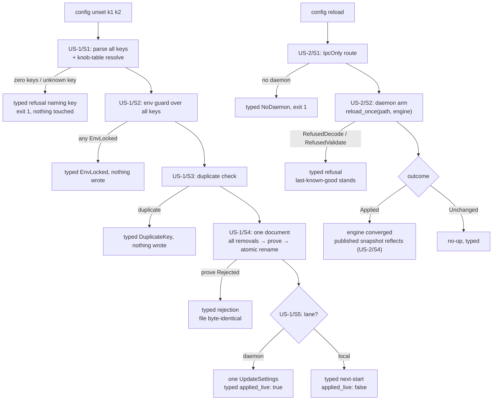

# [Plan] UX Journey Plan — config batch unset + manual reload (#1014, #1015)

<!--
Written from .artifacts/templates/ux-journey-plan.md (the guidance
comment stays; only placeholders were filled). Full law:
docs/ux_planning.org; trigger rule: AGENTS.md §7. Sibling of the
accepted #845/#909/#910 config family — its rulings R-5 (no manual
reload verb) and R-6 (no batch unset) scoped these two capabilities
out "until demand appears"; the demand appeared (#1014, #1015 — both
filed by the operator per those exact rulings), and this plan scopes
them back in as two stories under one journey-gated chunk (round-3
dispatch plan §14, normative).
-->

# [Plan] UX Journey Plan — config batch unset + manual reload

- **Date**: 2026-11-20
- **Kind**: UX journey plan — user stories, journeys, flows, wiring
  contract for (a) multi-key atomic `config unset` (#1014) and (b) a
  manual `config reload` CLI verb (#1015). No implementation decisions
  beyond the command contract.
- **Origin**: issues #1014 + #1015, both homed by rulings R-6 and R-5
  of the accepted journey plan
  `.artifacts/plans/2026-11-18-config-reload-batch-ux-plan.md`
  ("file this if unset-batch demand appears" / "file as a real feature
  if a use case appears where the watcher cannot be relied on");
  chunked by `.artifacts/plans/2026-11-19-backlog-reduction-round3-dispatch-plan.md`
  §14 (normative). Format/framework: `docs/ux_planning.org` +
  `.artifacts/templates/ux-journey-plan.md`.
- **Status**: DRAFT — awaiting operator acceptance at the B7 journey
  gate (dispatch plan §14).
- **Surfaces touched**: `crates/taskboard-app/src/commands/config.rs`
  (the unset batch surface + the daemon reload arm + typed outcomes),
  `crates/taskboard-app/src/cli.rs` (the `config unset` variadic-key
  grammar + the `config reload` verb + help text),
  `crates/taskboard-app/src/settings_overlay.rs` (the doc-level
  multi-key removal writer over the shared prove skeleton),
  `crates/taskboard-app/src/repl.rs` (the relay resolver's verb set),
  `crates/taskboard-app/src/commands/mod.rs` (the reload verb's
  `IpcRoute`), `crates/taskboard-app/src/commands/output.rs` (the
  typed reload view's emit). No Slint files change — the GUI editor
  already renders the engine's published snapshot (the #845/#910
  R-1 posture carries over).
- **Platform scope**: both (CLI/daemon surfaces; the manual reload's
  primary beneficiary is the watcher-disabled session — a kiosk on an
  exotic filesystem where `ConfigReloadOutcome::WatcherDisabled` was
  broadcast at boot).

## 1. Scope & goals

**Story 1 (#1014 — batch unset).** Today `config unset` removes
exactly one key per invocation; de-provisioning several knobs means
several invocations (several documents, several engine applies, and a
mid-script failure leaves a half-deprovisioned file). The landed
batch `config set` (#910) set the precedent: one invocation = one
atomic document. The delta: `config unset k1 [k2 …]` removes several
overrides as **one atomic document** — one intent, one prove verdict,
one write, one engine apply. Any refusal (zero keys, unknown key,
env-pinned key, duplicate key, a removal that would invalidate the
file) writes nothing and names the offending key typed.

**Story 2 (#1015 — manual reload).** Today the running app reloads
its config only when the watcher fires (#909). When the watcher could
not start for the session (`ConfigReloadOutcome::WatcherDisabled` —
no inotify descriptor, an exotic filesystem), an external edit sits
unread until restart: the escape hatch the #909 ruling asked for
before this becomes a real feature has appeared. The delta:
`taskboard config reload` triggers **the watcher lane's apply half,
explicitly** — the identical `reload_once` choreography (file→prove→
mint→compare→`UpdateSettings`) — and reports the same typed
`ConfigReloadOutcome` back to the invoking terminal. No new reload
semantic is introduced; the verb is the watcher's own path with a
human finger on the trigger.

**The reuse law (binding for stage 2).** Batch unset is not a second
removal semantic: it is the landed `prove_and_write_doc` skeleton
generalized to carry removals alongside inserts — one document load,
all mutations, one verdict, one atomic rename (the `remove_key`
per-intent writer's doc-level twin). The reload verb is not a new
propagation lane: it calls the landed `reload_once(&path, &engine)`
with the daemon's engine handle, so manual and watcher reloads are
the same function and their convergence equivalence holds by
construction (pinned by one daemon-lane test, not assumed).

**Decisions recorded by this plan** (details in the chunk plan):

- D-UNSET-GRAMMAR: `config unset <k1> [<k2> …]` — the existing
  `Unset { key }` position widens to variadic keys; the one-key form
  is unchanged in behavior. Zero keys is a typed refusal (`BadArity`).
- D-UNSET-ERROR: the unset batch reuses the landed `ConfigBatchError`
  lattice (`UnknownKey` / `EnvLocked` / `DuplicateKey` / `Io` /
  `Rejected` / `BadArity`); `BadValue` is unreachable for unset
  (unset carries no values) and documented as set-only. One error
  family for both batch verbs keeps the relay's typed classes
  end-to-end (the #910 lane precedent) without a parallel enum.
- D-UNSET-ATOMIC: parse all keys → env-guard all keys → duplicate
  check → **one** doc-level prove+write carrying every removal → one
  `UpdateSettings` when live. Any refusal before or during the write
  leaves the file byte-identical; the typed error names the offending
  key. No mixed set+unset batch — that widens the writer to insert+
  remove in one pass for an unproven win (the #909 R-6 reasoning
  stands for the mixed form).
- D-UNSET-ABSENT: removing an absent key is idempotent success for
  that key (the landed `remove_key` posture: "absent removal
  succeeds"); the batch still counts it a success entry.
- D-RELOAD-ROUTE: `config reload` is `IpcRoute::IpcOnly` — like
  `status`/`daemon stop`, the verb only means something with a
  running daemon; without one the existing typed `NoDaemon` refusal
  fires (no local fallback fiction: the file is already the boot
  authority of a non-running session).
- D-RELOAD-OUTCOME: the daemon arm returns the landed
  `ConfigReloadOutcome` verbatim inside a typed view (outcome + the
  resolved path); no new outcome classes — `WatcherDisabled` at boot
  does not disable the manual verb (the manual path never touches
  `notify`), which is exactly the #1015 escape hatch.
- D-REPL: the REPL/relay resolver's config-verb match (`Set | Unset`)
  widens to include `Reload` — one parse authority, the daemon's own
  arm executes (the #845 relay precedent).

**Non-goals** (each with a home):

- No mixed `config set`+`unset` batch in one invocation. The insert
  half exists (P6), the remove half lands here, but one invocation
  carrying both doubles the writer-grammar surface for an unproven
  ergonomics win. Home: §2 R-4.
- No new `ConfigReloadOutcome` variants, no UI surface for reload
  outcomes (#1045 is the UI lane — deferred, out of this round's
  scope). The manual verb reports to the *invoking terminal* only.
  Home: §2 R-5.
- No watcher-on-demand restart verb (e.g. `config watch` re-arming a
  disabled watcher). A disabled watcher is a boot-time environment
  fact; re-arming mid-session is speculative surface. Home: §2 R-6.
- No change to `config print`/`path` lanes (the #909 R-7 posture:
  read-only diagnostics stay `IpcRoute::Local`; a manual reload *is*
  a file change, so local print never lags it). Home: §2 R-7.
- No new GUI surface for either story. Batch unset lands as the
  existing whole-snapshot `UpdateSettings`; the Settings editor
  already renders the published snapshot. Home: §2 R-1 (carried).
- No `config unset` of multiple keys *across* env boundaries beyond
  the landed guard: an env-pinned key anywhere in the batch refuses
  the whole batch (parity with the set batch's AC-3). Home: §2 R-2.

## 2. Capability × surface matrix

<!-- Header row is a parser contract — do not rename or reorder. -->

| Capability | Board | TaskDetail | Today | Review | Settings | Capture | CLI |
|---|---|---|---|---|---|---|---|
| setting.unset_batch | — | — | — | — | — | — | E (US-1) |
| setting.unset (single) | — | — | — | — | — | — | E (US-1, unchanged one-key form) |
| setting.reload_manual | — | — | — | — | D (existing, via snapshot) | — | E (US-2) |
| setting.read_effective | — | — | — | — | D (existing) | — | D (existing) |

**Rulings** (every deliberate absence):

| ID | Ruling | Reason | Home |
|---|---|---|---|
| R-1 | No new GUI surface for batch unset or manual reload | Both land through the existing whole-snapshot `UpdateSettings`/published-settings path; the Settings editor already renders it (#909 R-1 posture carried). | §1 non-goals |
| R-2 | `setting.unset_batch` stays CLI-only (Settings column `—`) | The GUI editor's per-field commit *is* the single-unset semantic; a GUI multi-remove button has no user story (the demand that re-opened R-6 is scripting/provisioning). | §1 non-goals |
| R-3 | Board/TaskDetail/Today/Review/Capture stay `—` for all setting verbs | The #845 R-5 posture carries over: settings have two modality fronts (the T-18 contract); this chunk adds lanes, not surfaces. | §1 non-goals |
| R-4 | No mixed set+unset batch | One invocation, one mutation kind: mixing inserts and removals in one document doubles the grammar surface for an unproven win — the same reasoning that scoped R-6 originally, now applied to the mixed form. | §1 non-goals |
| R-5 | No UI lane for `ConfigReloadOutcome` (this chunk) | #1045 owns the settings/UI reload surface; the manual verb's report goes to the invoking terminal only. | §1 non-goals; #1045 |
| R-6 | No watcher re-arm verb | A `WatcherDisabled` session degrades to restart-based convergence (the #909 contract); the manual verb covers the gap without re-arming `notify`. | §1 non-goals |
| R-7 | `config print`/`path` stay `IpcRoute::Local` | Carried from #909 R-7: a manual reload changes the file, so file-authoritative local print never lags it. | §1 non-goals |

## 3. User stories

### US-1 — De-provision several knobs as one atomic batch

- **Story**: As a user (or provisioning script) removing several
  knob overrides in one go, I want `taskboard config unset k1 k2 …`
  to remove them all as one atomic write, so that either the whole
  batch is removed or nothing is — never a half-deprovisioned
  config.
- **Platforms**: both.
- **Entry points**: CLI `taskboard config unset <k1> [<k2> …]`
  (direct invocation; the daemon relay lane via `Request::Exec` as in
  #845/#910; the REPL twin follows the command-family conventions).
- **Priority**: P1.
- **Acceptance**:
  - AC-1: Given a valid multi-key unset, Then the file layer loses
    all named overrides as one document (one atomic rename) and the
    engine receives exactly one `UpdateSettings` — verified by seam
    test.
  - AC-2: Given a batch whose second key is not in the knob table,
    Then the typed refusal names that key and the file is
    byte-identical to before — verified by seam test.
  - AC-3: Given a batch containing an env-pinned key, Then the typed
    env-locked refusal names the key and nothing is written —
    verified by seam test.
  - AC-4: Given a batch whose removals would invalidate the file
    (prove gate), Then the typed rejection is returned, the file is
    untouched, and the engine is untouched — verified by seam test.
  - AC-5: Given a duplicate key in one batch, Then the typed refusal
    fires before any write (ambiguity is never resolved silently) —
    verified by seam test.
  - AC-6: Given a running daemon and a valid batch, Then the typed
    outcome reports `applied_live` truthfully for the batch as a
    whole (one lane per invocation) and each entry echoes
    `value: none` (the landed unset posture) — verified by seam test.
  - AC-7: Given a batch naming an absent key alongside present keys,
    Then the absent removal succeeds idempotently and the present
    keys are removed — verified by seam test.

### US-2 — Force a converged reload without the watcher

- **Story**: When the live-reload watcher could not start for the
  session (or I want certainty that the running app reflects the
  file on disk right now), I want `taskboard config reload` to run
  the same reload the watcher would run and tell me typed what
  happened, so that an external edit reaches the running app without
  a restart even on a watcher-disabled session.
- **Platforms**: both.
- **Entry points**: CLI `taskboard config reload` (daemon relay lane;
  the REPL twin follows the command-family conventions).
- **Priority**: P1.
- **Acceptance**:
  - AC-1: Given a running daemon and an external edit that changed
    the config since boot, Then `config reload` converges the engine
    to the file through the *same* `reload_once` choreography the
    watcher lane uses and reports `Applied` typed — verified by seam
    test (the equivalence pin: manual and watcher outcomes are the
    same enum produced by the same function).
  - AC-2: Given a daemon whose published settings already equal the
    file, Then the verb reports `Unchanged` typed (a no-op costs a
    decode, never an engine round trip) — verified by seam test.
  - AC-3: Given a file mid-save (decode or validate failure) at the
    attempt, Then the verb reports `RefusedDecode`/`RefusedValidate`
    typed and the engine keeps the last-known-good snapshot —
    verified by seam test.
  - AC-4: Given no running daemon, Then the typed `NoDaemon` refusal
    fires (the verb is daemon-only; a non-running session's file is
    already its boot authority) — verified by seam test.
  - AC-5: Given a session where the watcher was disabled at boot
    (`WatcherDisabled` broadcast), Then the manual verb still works —
    it never touches `notify` — and reports the file's truth typed —
    verified by seam test.

## 4. Journey specs

### US-1 — Batch unset

| Step | Surface & affordance | User action | Dispatches | System response | Escape / failure |
|---|---|---|---|---|---|
| US-1/S1 | CLI `config unset k1 k2 …` | type the command | CLI parse: argv is a non-empty key list; each key resolves in the knob table | all keys parse-checked *before* anything is touched | zero keys → typed `BadArity` refusal; unknown key → typed refusal naming the offending key, exit 1, nothing written (AC-2) |
| US-1/S2 | batch guard (relay or local lane as in #845/#910) | — | env guard over *all* batch keys before any write | no key env-pinned | any env-pinned key → typed `EnvLocked` naming the key; nothing wrote (AC-3) |
| US-1/S3 | duplicate check | — | in-memory set over the parsed keys | no duplicates | duplicate key → typed `DuplicateKey` refusal naming the key; nothing wrote (AC-5) |
| US-1/S4 | doc-level multi-removal writer (`settings_overlay.rs`) | — | one document load, all section/key removals, one prove verdict, one atomic rename | the file carries none of the named overrides; comments/formatting preserved by construction | prove `Rejected` → typed rejection, file byte-identical, engine untouched (AC-4); absent keys remove idempotently (AC-7) |
| US-1/S5 | daemon arm (`Request::Exec`) / local port | — | one whole-snapshot mint → `StateCommand::UpdateSettings` when live | engine replaces settings once for the whole batch | engine gone mid-flight → typed next-start-shaped outcome: file written, lane reported honestly (the #845/#910 precedent) |
| US-1/S6 | CLI stdout | — | — display only | typed batch view: per-key entries (each `value: none`) + the one lane bit | reply transport failure → the local-lane uncertainty reported typed, exit 1 |

### US-2 — Manual reload

| Step | Surface & affordance | User action | Dispatches | System response | Escape / failure |
|---|---|---|---|---|---|
| US-2/S1 | CLI `config reload` | type the command | CLI parse (no arguments) | the verb resolves `IpcRoute::IpcOnly` | no daemon → typed `NoDaemon` refusal, exit 1 (AC-4) |
| US-2/S2 | daemon arm (`Request::Exec`) | — | `reload_once(&write_path, &app.engine)` — the watcher lane's exact choreography: file-layer decode → validate → whole-snapshot mint → compare → `UpdateSettings` on difference | typed `ConfigReloadOutcome` travels back as the Exec payload | decode/validate refusal → `RefusedDecode`/`RefusedValidate`, last-known-good stands (AC-3); engine gone → `EngineGone` typed |
| US-2/S3 | CLI stdout | — | — display only | typed reload view: the outcome + the resolved path | reply transport failure → reported typed, exit 1 |
| US-2/S4 | Settings editor (published snapshot) | — | — display only | the editor shows the reloaded values (no Slint delta) | — display only |

## 5. Interaction flows

No overlay/editor/modal state machine is introduced: batch unset is
a single atomic document transition (no partial states), and the
manual reload is the watcher's existing two-phase read→apply with
the outcome handed to the invoking terminal instead of the broadcast
lane.

## 6. Wiring inventory

<!-- Header row is a parser contract — do not rename or reorder.
     Test-column nominations are exact-name (§920 nomination law);
     the us1_* tokens here name THIS plan's stories (the #845/#909/
     #910 landed tests are different numbers — their files are
     named, so no ambient collision). -->

| ID | Surface file | Widget | Callback | Adapter seam | ActionId | Commands | Row addressing | Journey steps | Test |
|---|---|---|---|---|---|---|---|---|---|
| W-1 | crates/taskboard-app/src/settings_overlay.rs | — | — | the doc-level multi-removal writer: generalize `prove_and_write_doc`'s skeleton to a removals twin — one load, N `remove_key`-shaped mutations, one verdict, one write (the batch-unset twin of the batch-set writer) | — | — | — | US-1/S4 | crates/taskboard-app/src/settings_overlay.rs::us1_s4_batch_unset_lands_one_atomic_document |
| W-2 | crates/taskboard-app/src/commands/config.rs | — | — | the unset batch surface: non-empty key list parse, per-key knob resolve, batch env guard, duplicate check, one `run_settings_write`-shaped port call with the removals writer; typed batch view (entries `value: none` + the lane bit) | — | StateCommand::UpdateSettings | — | US-1/S1, US-1/S2, US-1/S3, US-1/S5 | crates/taskboard-app/src/commands/config.rs::us1_s1_batch_unset_parse_refusals_name_the_offending_key, crates/taskboard-app/src/commands/config.rs::us1_s2_batch_unset_env_guard_names_the_pinned_key, crates/taskboard-app/src/commands/config.rs::us1_s3_duplicate_batch_unset_key_refuses_before_any_write, crates/taskboard-app/src/commands/config.rs::us1_s5_batch_unset_apply_is_one_update_settings |
| W-3 | crates/taskboard-app/src/commands/config.rs | — | — | the daemon reload arm: `reload_once(&write_path, &app.engine)` invoked explicitly, the outcome wrapped in the typed reload view (the equivalence pin — same function as the watcher lane) | — | — | — | US-2/S2 | crates/taskboard-app/src/commands/config.rs::us2_s2_manual_reload_uses_the_watcher_lane_choreography |
| W-4 | crates/taskboard-app/src/cli.rs | — | — | the `config unset` variadic-key grammar (`<k1> [<k2> …]`; the one-key form unchanged) + the `config reload` verb + help text for both | — | — | — | US-1/S1 (docs+arity), US-2/S1 | crates/taskboard-app/src/cli.rs::us1_s1_batch_unset_arity_parse, crates/taskboard-app/src/cli.rs::us2_s1_reload_parses_bare |
| W-5 | crates/taskboard-app/src/commands/mod.rs | — | — | `route_for_ipc`: `ConfigCmd::Reload` → `IpcRoute::IpcOnly(IpcOnlyVerb::ConfigReload)`; the `NoDaemon` typed refusal rides the existing IpcOnly lane | — | — | — | US-2/S1 | crates/taskboard-app/src/commands/mod.rs::us2_s1_reload_routes_ipc_only |
| W-6 | crates/taskboard-app/src/repl.rs | — | — | the relay resolver's config-verb match widens to Set / Unset / Reload (one parse authority; the daemon's arm executes) | — | — | — | US-1/S5, US-2/S2 | crates/taskboard-app/src/repl.rs::us2_s2_reload_rides_the_config_relay |
| W-7 | crates/taskboard-app/src/ipc/server.rs | — | — | the daemon Exec dispatch: the reload verb reaches `handle_daemon`'s new arm (the relay lane's third config verb) | — | — | — | US-2/S2 | crates/taskboard-app/src/ipc/server.rs::us2_s2_relayed_reload_reaches_the_daemon_arm |
| W-8 | crates/taskboard-app/src/commands/output.rs | — | — | the typed views' JSON emit: the unset batch view (per-key `none` entries + lane bit) and the reload view (outcome + path) | — | — | — | US-1/S6, US-2/S3 | crates/taskboard-app/src/commands/output.rs::us1_s6_batch_unset_view_carries_none_entries_and_the_lane_bit, crates/taskboard-app/src/commands/output.rs::us2_s3_reload_view_carries_outcome_and_path |
| W-9 | crates/taskboard-app/src/commands/config.rs | — | — | US-2/S4's display-only leg: the published snapshot reflects a manual reload — the Settings editor renders the engine's published settings verbatim (no Slint delta, R-1); the pin asserts the published settings carry the file's truth after the daemon arm's `Applied` reload | — | — | — | US-2/S4 | crates/taskboard-app/src/commands/config.rs::us2_s4_the_published_snapshot_reflects_a_manual_reload |

## 7. Command-contract delta

| Kind | Name | Payload sketch | Journeys |
|---|---|---|---|
| StateCommand | *(none new)* | `UpdateSettings { settings }` exists; the delta is its caller count (batch unset's single apply, manual reload's apply half) | US-1/S5, US-2/S2 |
| CLI grammar | `config unset` arity widening | positional keys `<k1> [<k2> …]`; zero keys is a typed `BadArity` refusal; one key is exactly today's behavior | US-1/S1 |
| CLI verb | `config reload` | no arguments; `IpcRoute::IpcOnly`; daemon-only | US-2/S1 |
| Typed view | `ConfigBatchUnsetView = ConfigBatchSetView` (alias) | the landed batch shape with every entry `value: none`; one lane bit per invocation | US-1/S6 |
| Typed view | `ConfigReloadView { outcome: ConfigReloadOutcome, path: PathBuf-ish }` | the landed outcome enum verbatim; no new classes | US-2/S3 |
| Typed error | `ConfigBatchError` (reused) | `BadValue` unreachable for unset (documented set-only); `BadArity` now covers the zero-keys unset form | US-1/S1–S4 |
| Typed error | `NoDaemon` (existing, reused) | the IpcOnly lane's standing refusal | US-2/S1 |
| IPC route | `IpcOnlyVerb::ConfigReload` | the verb list gains one entry; `route_for_ipc` maps it | US-2/S1 |

## 8. Verification plan

<!-- The Test-root line is a parser contract for scripts/ux-coverage.sh
     (value = one bare path): the CLI/daemon app crate; no Slint delta. -->
Test-root: crates/taskboard-app/
- **Journey tests** (step-ID-named, exact-name nominated in §6):
  `us1_s4_batch_unset_lands_one_atomic_document` (AC-1/AC-4/AC-7),
  `us2_s2_manual_reload_uses_the_watcher_lane_choreography` (AC-1),
  `us2_s1_reload_routes_ipc_only` (AC-4),
  `us2_s2_relayed_reload_reaches_the_daemon_arm` (AC-5).
- **Seam tests**: the unset batch truth table (AC-2/3/5/6 —
  `matches!`/structural facts, never text); the absent-key
  idempotence (AC-7); the reload outcomes `Applied`/`Unchanged`/
  `RefusedDecode`-class typed (AC-1/2/3); the watcher-disabled
  session's manual verb (AC-5).
- **Fold/presentation tests**: the `ConfigBatchUnsetView` lane bit
  and per-key `none` echoes; the `ConfigReloadView`'s outcome field;
  never label text.
- **Kiosk gates**: no affordance renders differently — the CLI
  grammar widens in place (unset stays the same verb; reload is a
  new terminal verb) and neither story adds a GUI surface; the
  kiosk's watcher-disabled session is the manual reload's primary
  beneficiary.
- **Manual**: help-text honesty for both grammar changes (W-4) —
  judged at the stage-3 walkthrough.

## 9. Definition of done

- [ ] `scripts/ux-coverage.sh .artifacts/plans/2026-11-19-config-batch-unset-reload-ux-plan.md --gate` exits 0
- [ ] Every P1 story's journey completes end-to-end including escapes
- [ ] Walkthrough protocol executed at stage 3; findings resolved or homed
- [ ] All matrix absences carry rulings (R-1 … R-7); census updated
- [ ] Non-goals filed as backlog issues
- [ ] Issues #1014 and #1015 closed at merge with the accepted plan
      permalink in the closing comment
