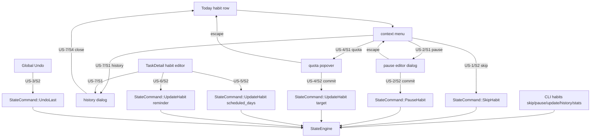
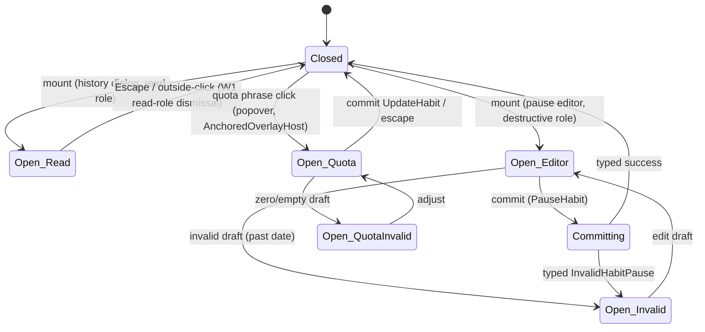

# Habit Feature Family UX Journey Plan — skip/pause, undo/quota, schedules, history

<!--
Copied from .artifacts/templates/ux-journey-plan.md; guidance comment
retained per the template's own instruction. This is the round-4
centerpiece journey plan (scope report §A1): one plan above the four
implementation chunks HF1–HF4.
-->

# Habit Feature Family UX Journey Plan — skip/pause, undo/quota, schedules, history

- **Date**: 2026-11-21
- **Kind**: UX journey plan — user stories, journeys, flows, wiring
  contract for the habit feature family (#955–#963). No implementation
  decisions beyond the command contract.
- **Origin**: round-4 scope report
  `.artifacts/reports/2026-11-21-backlog-reduction-round4-scope-report.md`
  §A1 (normative); the round-9 habit-parity research report
  `.artifacts/reports/2026-11-18-round9-habit-parity-research.md` §3/§4;
  the O-rulings of `.artifacts/plans/2026-11-18-gui-review-round9-round-plan.md`
  — **O-1** (superseded window/nudge law: optional day = display/nudge
  day inside the canonical window; nudge day-relative, else period
  start, snooze in hours/days), **O-2** (no `TaskKind` variant; UI-level
  unification only; domain changes additive), **O-7** (the nine Q-answers:
  habits outside boards, armed-confirm convert, shared detail editor,
  #935 rides, GUI remove in scope, notes-per-completion declined under
  D-H5) — cited as *authority*, not re-litigated here. Approved issues:
  #955, #956, #957, #958, #959, #960, #961, #962, #963.
- **Status**: DRAFT — awaiting operator acceptance (the round's
  centerpiece gate); dispatch may chunk from it only after ACCEPTED.
- **Surfaces touched**: `ui/compositions/habits.slint` (row model,
  context menu rows), `ui/views/task-view.slint` (the shared habit
  editor variant — O-7 Q4), new `ui/views/habit-history-view.slint`
  (W1 `ModalDialog` layer), `menu.rs` (`HABIT_CONTEXT` extensions),
  `actions.rs`, `adapter.rs`, `router.rs`, `keymap/presets.rs`;
  domain/state: `habit.rs`, `messages.rs`, `undo.rs`, `reminders.rs`,
  `command.rs`.
- **Platform scope**: both — habit rows render on kiosk with actions
  gated (the D-P13/`editing-enabled` grammar, HAB-14); the history
  dialog is desktop-only (unmountable on kiosk, D7 posture); per-story
  platforms below.

## 1. Scope & goals

**Structure decision (recorded against the granularity law).** The
framework's default is *one UX journey plan per feature*; the feature
here is the habit family as one wave with one operator gate (scope
report §E: "one gate sitting"). This single plan therefore carries all
stories, journeys, wiring, and the command-contract delta for the four
chunks HF1–HF4; each chunk gets an *implementation* plan
(`2026-11-21-habit-{skip-pause,undo-quota,schedules,history-view}-plan.md`)
citing this file as Origin and mapping to its story group. Per-chunk
journey plans would split the census slice and the Σ-property
extension across four files that all touch the same streak walk —
rejected as granularity-law non-compliant (plan-splitting is for
independently reviewable features, which these are not: HF1's window
semantics are HF3's display inputs and HF4's schedule semantics are
HF1's transparency inputs).

What the user can now do that they couldn't:

- **Skip** a habit's current window deliberately (typed planned skip,
  #955) — the streak survives; and **pause** a habit through a date
  (#958) — the series `paused_until` twin.
- **Undo a logged completion** through the global undo stack (#956) —
  the `NotUndoable(HabitSurface)` fence superseded for `LogHabit` only
  (recorded ruling R-7 below, with the dated census note).
- **Edit the quota inline** by clicking the row's "3/8" phrase (#961).
- **Schedule a daily habit per weekday** (#960) — non-scheduled days
  are planned-off, never misses; and give a habit a **reminder
  override** (#959) riding O-1's nudge law (day-relative or
  period-start base, snooze in hours/days).
- **Open a history view** per habit (#957 — the prime motivator):
  month-grid heatmap of past windows; **streak badge** upgrade (#962);
  **statistics** (adherence %, best streak, per-period totals, #963).

Non-goals, each with a home:

- Notes per completion — declined by the operator (O-7; D-H5 law
  stands). No issue: declined rulings are recorded, not parked.
- Habits on boards (census R-1 stands; O-7 Q2) — no new surface.
- Per-day heatmap cells inside weekly/monthly windows (history is
  window-grain, the log's own grain) — `backlog:` issue (see §9/DD).
- Skipping *past* windows from the row (the audited `AdjustHabitLog`
  valve remains the only past-window writer) — R-4 below; no
  additional surface planned.
- Habit streak/history on the Review view — R-9 below.

## 2. Capability × surface matrix

| Capability | Board | TaskDetail | Today | Review | Settings | Capture | CLI |
|---|---|---|---|---|---|---|---|
| habit.skip | — (R-1) | — (R-1) | E (desktop; kiosk: disabled) (US-1) | — (R-9) | — (R-1) | — (R-1) | E (US-1, `habits skip`) |
| habit.pause | — (R-1) | E (desktop) (US-2, editor field) | E (desktop; kiosk: disabled) (US-2, context menu + badge) | — (R-9) | — (R-1) | — (R-1) | E (US-2, `habits pause`/`habits resume`) |
| habit.undo_completion | — (R-1) | — (R-2) | E (desktop; kiosk: disabled) (US-3, global undo) | — (R-9) | — (R-1) | — (R-1) | E (US-3, global `undo`) |
| habit.quota_edit | — (R-1) | E (desktop) (US-4, editor target field) | E (desktop; kiosk: disabled) (US-4, click the 3/8 phrase) | — (R-9) | — (R-1) | — (R-1) | E (pre-existing, `habits update --target`) |
| habit.schedule | — (R-1) | E (desktop) (US-5, weekday picker) | D (US-5, off-day transparency shown) | — (R-9) | — (R-1) | — (R-1) | E (US-5, `habits update --days`) |
| habit.reminder_override | — (R-1) | E (desktop) (US-6, override editor) | D (US-6, armed-chip display) | — (R-9) | — (R-1) | — (R-1) | E (US-6, `habits update --reminder`) |
| habit.history | — (R-1) | E (desktop) (US-7, open from editor) | D (desktop-only dialog; kiosk: absent) (US-7) | — (R-9) | — (R-1) | — (R-1) | E (US-7, `habits history`) |
| habit.streak_badge | — (R-1) | D (US-8) | D (US-8, badge replaces 🔥N) | — (R-9) | — (R-1) | — (R-1) | D (US-8, `habits list` streak column unchanged data) |
| habit.statistics | — (R-1) | D (desktop) (US-9, inside history dialog) | — (R-10) | — (R-9) | — (R-1) | — (R-1) | E (US-9, `habits stats`) |
| habit.create | — (R-1) | — (R-1) | C (pre-existing) | — (R-1) | — (R-1) | — (R-1) | C (pre-existing) |
| habit.log | — (R-1) | — (R-1) | E (pre-existing, H2 card) | — (R-1) | — (R-1) | — (R-1) | E (pre-existing) |
| habit.edit | — (R-1) | E (pre-existing, H4) | E (pre-existing, context menu) | — (R-1) | — (R-1) | — (R-1) | E (pre-existing) |
| habit.remove | — (R-1) | — (R-1) | E (pre-existing, staged confirm) | — (R-1) | — (R-1) | — (R-1) | X (pre-existing) |

**Rulings** (every deliberate absence):

| ID | Ruling | Reason | Home |
|---|---|---|---|
| R-1 | All new habit verbs stay off Board/Settings/Capture/Review row-groups; Today (+ the shared TaskDetail editor) remains the habit home | Census R-1 (Today-only mount) stands per O-7 Q2 — "no habits in boards"; Settings owns connections, not habits | Census R-1 (2026-11-13, reaffirmed O-7 2026-11-18) |
| R-2 | `habit.undo_completion` has no TaskDetail cell | Completion counting is a Today row act; the undo entry point is the global undo verb, not an editor field | US-3 journey |
| R-3 | Kiosk: skip/pause/quota/schedule/override actions render disabled (visible-disabled posture), history dialog absent | HAB-14 + D7 kiosk law: rows render, actions gate; dialogs unmountable on kiosk | Kiosk gates §8 |
| R-4 | Skip targets the **current canonical window only**; past windows are reachable only through the audited `AdjustHabitLog` valve | The log is the window's state (`habit.rs` "nothing ticks" law); a retroactive skip would forge history without audit; skip is a *decision*, adjust is a *correction* | Ruling recorded here; engine law in HF1 chunk plan |
| R-5 | Skip is **period-grain** (one skip per canonical window), not per-day inside weekly/monthly windows | The log key is `(habit, window)` — the window is the module's grain (habit.rs §DR-6/5); a per-day skip inside a period would need a second key family (validate-and-forget risk, type-driven policy §2.1) | HF1 chunk plan §domain |
| R-6 | `scheduled_days` is **inert for PerWeek/PerMonth habits** (documented leniency at the field) | Week/month windows are already period-grain; O-1's supersession keeps windows ISO-Monday/calendar-1st — per-weekday day sets only refine the daily grain | HF4 chunk plan §domain; backlog issue for the week/month generalization |
| R-7 | `NotUndoable(HabitSurface)` is **superseded for `LogHabit` only** — `LogHabit` becomes journal-invertible (pre-image: prior row count+clock); `AdjustHabitLog` and skip-mint stay NotUndoable | #956's parity ask integrates habit logging into the *global undo line*; the audited correction valve keeps its fence (an undo-of-a-correction would double-forge); **census note (dated 2026-11-21)**: the habit.undo/repair fence cells' "NotUndoable(HabitSurface)" text gains the dated supersession "LogHabit journal-invertible since 2026-11-21 (habit-family UX plan R-7)" | HF2 chunk plan §undo |
| R-8 | Reminder override base defaults to **the nudge day (O-1)**; `PeriodStart` is the explicit alternative; snooze units are hours/days per O-1 | O-1's nudge law binds verbatim — the override parameterizes it, never contradicts it | HF4 chunk plan §nudge |
| R-9 | No habit cells on the Review view | Review reviews *tasks* (day-review grammar, O-3); habit history has its own dedicated dialog | §1 non-goals |
| R-10 | Statistics have no Today cell — they live inside the history dialog and the CLI | Row real estate on Today is budgeted (HAB-8); stats are reflection-time, not glance-time data | US-9 journey |

## 3. User stories

### US-1 — Skip today's window deliberately

- **Story**: As a desktop user who will not do my habit today (travel,
  illness, planned rest) I want to mark the window *skipped* rather
  than let it become a miss, so my streak survives an intentional gap.
- **Platforms**: desktop (kiosk: action renders disabled).
- **Entry points**: habit context menu row (Skip), keyboard
  `ActionId::HabitSkip` (Today context, O-8 parity), CLI
  `taskboard habits skip <id>`.
- **Priority**: P1.
- **Acceptance**:
  - AC-1: Given a habit whose current window is unmet When skip is
    dispatched Then the window's log row carries the typed skip mark
    and `streak()` is unchanged from its pre-miss value — verified by
    seam test + domain unit test.
  - AC-2: Given a skipped window whose grace has closed When the
    streak walk runs Then the window is transparent (neither counts
    nor breaks) — verified by domain property (Σ extension).
  - AC-3: Given a skipped window When the quota is met anyway Then the
    window counts normally (skip is only consulted when unmet) —
    verified by domain unit test.
  - AC-4: Given a skip When global undo runs Then the skip mark is
    removed (journal-invertible) — verified by engine snapshot test.
  - AC-5: Given a skipped window When the row renders Then the row
    shows the typed skip state (chip, not the miss posture) — verified
    by journey test `us1_s3_`.

### US-2 — Pause a habit through a date

- **Story**: When I will be away (or unable) through a known date I
  want to pause the habit until then, so covered windows are neither
  counted nor missed and no nudges fire.
- **Platforms**: desktop (kiosk: action disabled).
- **Entry points**: habit context menu row (Pause until…), habit
  editor field (TaskDetail), keyboard `ActionId::HabitPause`, CLI
  `taskboard habits pause <id> --until <date>` / `habits resume <id>`.
- **Priority**: P1.
- **Acceptance**:
  - AC-1: Given a habit paused through an inclusive local date When
    windows covered by the pause elapse Then they are transparent in
    the streak walk (the series-pause twin's "no miss, no credit"
    semantics, D-C10 shape) — verified by domain property.
  - AC-2: Given a paused habit When the nudge pass runs Then no
    tracker nudge arms for it — verified by engine test.
  - AC-3: Given a paused habit When the row renders Then the row shows
    the paused state (badge, pause-through date in the meta line) —
    verified by journey test.
  - AC-4: Given a pause When resume (explicit `None`) runs Then the
    field clears (badge hygiene, the PauseSeries posture) — verified
    by seam test.
  - AC-5: Given a pause through a date in the past When dispatched
    Then a typed rejection (`InvalidHabitPause`) — verified by engine
    test.

### US-3 — Undo a logged completion via the global undo stack

- **Story**: As a desktop user who fat-fingered a completion (or
  several) I want the global undo to revert habit logs, so habit
  counting obeys the same recoverability grammar as every other verb.
- **Platforms**: desktop (kiosk: global undo gated as today).
- **Entry points**: global Undo action (pre-existing `ActionId::Undo`),
  CLI `taskboard undo`.
- **Priority**: P1.
- **Acceptance**:
  - AC-1: Given a `LogHabit` as the newest undoable journal entry When
    global undo runs Then the window's count decrements and the
    receipt names the habit surface — verified by engine snapshot
    test (R-7 supersession behavior).
  - AC-2: Given a same-second burst of logs (the #986 bump mint) When
    undo runs repeatedly Then each undo pops one increment (per-entry
    invertibility, the bump's monotone clocks distinguish rows) —
    verified by engine test.
  - AC-3: Given an `AdjustHabitLog` as the newest entry When global
    undo runs Then the typed NotUndoable(HabitSurface) posture holds
    (R-7: the valve keeps its fence) — verified by engine test.
  - AC-4: Given a `LogHabit` older than the undo stack's window When
    undo runs Then the existing typed no-undo outcome — verified by
    existing engine behavior, extended snapshot.

### US-4 — Edit the quota inline from the row

- **Story**: When I see my "3/8" and realize the quota is wrong I
  want to click the phrase and fix it in place, so I don't open the
  whole editor for a one-number change.
- **Platforms**: desktop (kiosk: disabled).
- **Entry points**: click the progress phrase on the habit row
  (H2 card), keyboard `ActionId::HabitQuotaEdit` on the focused row,
  habit editor target field (TaskDetail, pre-existing), CLI
  `habits update --target` (pre-existing).
- **Priority**: P1.
- **Acceptance**:
  - AC-1: Given the row's progress phrase clicked When the popover
    mounts Then it shows the current quota with a stepper (count ≥ 1,
    the `NonZeroCount` mint's law; period-kind picker unchanged) —
    verified by journey test.
  - AC-2: Given a committed quota When the draft dispatches Then it
    routes the existing `UpdateHabit { changes: HabitChanges { target:
    Some(...) } }` — exact-command seam test.
  - AC-3: Given a draft of 0 (or an empty field) When commit is
    attempted Then commit stays blocked with the typed invalid-draft
    state (no route) — verified by journey test.
  - AC-4: Given a committed quota change When the log's former-kind
    rows exist Then they stay (D-H12 inertness; no deletion) —
    verified by existing domain test, re-run green.

### US-5 — Schedule a daily habit per weekday

- **Story**: As a desktop user whose habit belongs on specific days
  (Mon/Wed/Fri) I want to pick the scheduled weekdays, so off-days are
  planned-off — the streak never counts nor breaks on them and no
  nudge fires.
- **Platforms**: desktop (kiosk: action disabled; off-day
  transparency still displays).
- **Entry points**: habit editor weekday picker (TaskDetail), habit
  context menu (Edit → opens the editor), keyboard
  `ActionId::HabitScheduleEdit`, CLI `habits update --days <mo,we,fr>`.
- **Priority**: P1.
- **Acceptance**:
  - AC-1: Given scheduled weekdays set on a PerDay habit When a
    non-scheduled day's window elapses unmet Then it is transparent in
    the streak walk — verified by domain property (Σ extension).
  - AC-2: Given a non-scheduled day When the nudge pass runs Then no
    nudge arms — verified by engine test.
  - AC-3: Given the picker with zero weekdays selected When commit is
    attempted Then commit stays blocked (an all-off habit is
    meaningless; the empty set is a typed invalid draft, not a
    validate-and-forget) — verified by journey test.
  - AC-4: Given `scheduled_days` set on a PerWeek/PerMonth habit Then
    the field is inert (R-6) and the editor does not offer the picker
    for those kinds — verified by presentation fold test.
  - AC-5: Given adherence computed over a scheduled habit Then the
    denominator counts scheduled windows only — verified by domain
    unit test (US-9 dependency).

### US-6 — Give a habit a reminder override

- **Story**: When a habit's default nudge timing or snooze grammar
  doesn't fit (weekly habit, nudge on Saturday, snooze in days) I
  want to override that habit's reminder parameters, so the nudge
  lands when it is useful.
- **Platforms**: desktop (kiosk: action disabled).
- **Entry points**: habit editor reminder-override section
  (TaskDetail), keyboard `ActionId::HabitReminderEdit`, CLI
  `habits update --reminder ...` / `--reminder-clear`.
- **Priority**: P2.
- **Acceptance**:
  - AC-1: Given an override with base = nudge day (default, R-8) or
    period start When the nudge occurrence derives Then it equals
    O-1's nudge law shifted by the override's offset — verified by
    domain unit test over `nudge_day`/`tracker_anchor_occurrence`.
  - AC-2: Given a snooze chosen in hours or days When the nudge
    snoozes Then the snooze duration uses the habit's chosen grammar
    — verified by engine test.
  - AC-3: Given the override cleared (`Some(None)` clear leg) Then the
    habit reverts to the plain O-1 default — verified by seam test.
  - AC-4: Given a habit with no `anchor_time` and an override When
    the nudge pass runs Then the override's base+offset still arms
    (an override does not require an anchor time; the occurrence's
    local time-of-day falls back to the override's own time field) —
    verified by domain unit test.

### US-7 — Open a habit's history (heatmap / month grid)

- **Story**: As a desktop user reflecting on my habit I want a
  month-grid heatmap of past windows, so I can see the pattern of my
  adherence — the prime motivator for tracking habits at all (#957).
- **Platforms**: desktop only (kiosk: dialog absent, R-3).
- **Entry points**: habit context menu row (History), habit editor
  (History row, TaskDetail), keyboard `ActionId::HabitHistory`, CLI
  `taskboard habits history <id>`.
- **Priority**: P1.
- **Acceptance**:
  - AC-1: Given a habit with log rows over several windows When the
    history dialog mounts Then the current and past canonical windows
    render as month-grid cells with the per-window state (met / unmet
    / pending / skipped / paused / off-schedule / missed) — verified
    by journey test `us7_s2_`.
  - AC-2: Given a window of a former target kind in the log (D-H12)
    Then it renders as inert/absent (never as a miss) — verified by
    presentation fold test.
  - AC-3: Given the dialog open When Escape/outside-click (the W1
    dismissal law's read-dialog role) runs Then it closes with no
    state change — verified by journey test.
  - AC-4: Given months of history When the user pages back Then prior
    month grids render (pure projection over the log) — verified by
    journey test.
  - AC-5: Given a deleted (tombstoned) habit When the CLI history verb
    runs Then history still renders (the log outlives the tracker) —
    verified by engine/CLI test.

### US-8 — Streak badge upgrade

- **Story**: As a desktop or kiosk viewer I want the streak as the
  badge widget with tooltip semantics, so the streak reads as
  first-class data, not emoji decoration (#962).
- **Platforms**: both (display-only; kiosk renders it).
- **Entry points**: display-only — habit row (Today), habit editor
  header (TaskDetail), CLI `habits list` streak column (data
  unchanged).
- **Priority**: P2.
- **Acceptance**:
  - AC-1: Given a live habit row When it renders Then the 🔥N emoji
    slot is replaced by the badge widget (O-6 centralization;
    `widgets/badge.slint`) carrying the streak value — verified by
    journey test.
  - AC-2: Given the badge When hovered/focused Then the tooltip names
    the streak semantics (judged at walkthrough; the test asserts the
    badge's typed model value, never label text) — verified by
    journey test + manual.

### US-9 — Habit statistics

- **Story**: When I review a habit's history I want adherence %, best
  streak, and per-period totals alongside the heatmap, so the grid
  comes with its numbers (#963).
- **Platforms**: desktop only (inside the history dialog, R-10) +
  CLI.
- **Entry points**: inside the US-7 history dialog (statistics
  section), CLI `taskboard habits stats <id>`.
- **Priority**: P2.
- **Acceptance**:
  - AC-1: Given a habit's log When statistics compute Then adherence
    % = met windows ÷ scheduled windows (US-5's denominator), best
    streak = max over historical runs, per-period totals per current
    target kind — verified by domain unit/property tests.
  - AC-2: Given a habit with a paused or skipped span When statistics
    compute Then transparent windows leave both numerator and
    denominator (planned gaps don't dilute adherence) — verified by
    domain unit test.
  - AC-3: Given empty history When statistics compute Then the typed
    empty state (no division-by-zero posture; 0 windows, not 0%) —
    verified by domain unit test.

## 4. Journey specs

### US-1 — Skip today's window

| Step | Surface & affordance | User action | Dispatches | System response | Escape / failure |
|---|---|---|---|---|---|
| US-1/S1 | Today habit row context menu (`menu.rs::HABIT_CONTEXT`) | Open context menu on the row, select the Skip row | — (menu open; arms the one-shot habit subject) | Menu shows Skip with the consequence caption (current window named) | Escape closes the menu; stale row → typed NoTarget notice (#935 law) |
| US-1/S2 | Menu Skip row / `ActionId::HabitSkip` | Activate | `StateCommand::SkipHabit { habit }` | Window's log row carries the skip mark; streak unchanged; transient status notice arms | Deleted habit → typed `HabitDeleted`; kiosk → typed refusal (disabled posture) |
| US-1/S3 | Today habit row | Observe | — display only | Row chip shows the typed skip state; streak badge unchanged | — display only |
| US-1/S4 | Global undo (US-3's verb) | Undo | `StateCommand::UndoLast` (pre-existing) | Skip mark removed; notice | No-undo-window → existing typed outcome |

### US-2 — Pause through a date

| Step | Surface & affordance | User action | Dispatches | System response | Escape / failure |
|---|---|---|---|---|---|
| US-2/S1 | Context menu Pause row / editor field | Choose Pause until… | — (mounts the pause editor, W1 `ModalDialog`) | Editor mounts with the date field + consequence caption (covered windows: no miss, no credit) | Escape/outside-cancel (destructive-role dismissal law → cancel, nothing written) |
| US-2/S2 | Pause editor date field | Enter/commit the through-date | `StateCommand::PauseHabit { habit, until: Some(date) }` | Row renders paused badge + through-date; nudges disarm | Past date → typed `InvalidHabitPause` notice; editor stays open |
| US-2/S3 | Context menu Resume row / `ActionId::HabitResume` | Activate Resume | `StateCommand::PauseHabit { habit, until: None }` | Badge clears (badge hygiene, PauseSeries posture) | Not paused → accepted no-op (PauseSeries twin) |
| US-2/S4 | Today row | Observe | — display only | Paused rows sort in place with the paused badge; streak shows the frozen value | — display only |

### US-3 — Undo a logged completion

| Step | Surface & affordance | User action | Dispatches | System response | Escape / failure |
|---|---|---|---|---|---|
| US-3/S1 | Today habit row +1 / done slot | Log (pre-existing H2 seam) | `StateCommand::LogHabit` | Count +1; journal gains the invertible entry | Mis-click covered by this story's undo; the −1 valve stays (US-6 of the habit-family seed plan) |
| US-3/S2 | Global Undo action | Undo | `StateCommand::UndoLast` | Count reverts to the pre-image; receipt names the habit surface | `AdjustHabitLog` newest → typed NotUndoable(HabitSurface) notice (R-7) |
| US-3/S3 | Today row | Observe | — display only | Count/streak reflect the revert; the transient notice arms | No-undo-window → existing typed outcome |

### US-4 — Inline quota edit

| Step | Surface & affordance | User action | Dispatches | System response | Escape / failure |
|---|---|---|---|---|---|
| US-4/S1 | Habit row progress phrase ("3/8") | Click the phrase | — (mounts the quota popover, `AnchoredOverlayHost`) | Popover shows the current count + stepper + period-kind picker (locked to current kind for the inline edit) | Escape/outside-cancel; kiosk → disabled posture |
| US-4/S2 | Popover stepper | Adjust; commit | `StateCommand::UpdateHabit { changes: HabitChanges { target: Some(..) } }` | Quota updates; row re-projects (3/5) | 0/empty → commit blocked, typed invalid-draft state |
| US-4/S3 | Today row | Observe | — display only | Progress phrase shows the new quota; D-H12 former-kind rows untouched (invisible) | — display only |

### US-5 — Per-weekday schedule

| Step | Surface & affordance | User action | Dispatches | System response | Escape / failure |
|---|---|---|---|---|---|
| US-5/S1 | Habit editor (TaskDetail, habit variant) | Open; locate the weekday picker (PerDay habits only, R-6) | — display only | Picker shows the seven weekdays with the current set | Kiosk: editor unmountable (D7) |
| US-5/S2 | Weekday picker rows | Toggle weekdays; save | `StateCommand::UpdateHabit { changes: HabitChanges { scheduled_days: Some(set) } }` | Set saved; off-day transparency applies from the next window | Empty set → commit blocked (typed invalid draft) |
| US-5/S3 | Today row on an off-day | Observe | — display only | Row renders the off-schedule state (no miss posture, no nudge) | — display only |

### US-6 — Reminder override

| Step | Surface & affordance | User action | Dispatches | System response | Escape / failure |
|---|---|---|---|---|---|
| US-6/S1 | Habit editor reminder section | Open the override editor | — display only | Fields: base (nudge day / period start, R-8), offset (days), time-of-day, snooze (hours/days), clear leg | Escape/cancel; kiosk: unmountable |
| US-6/S2 | Override fields; save | Commit | `StateCommand::UpdateHabit { changes: HabitChanges { reminder: Some(Some(..)) } }` | Nudge arms per the override; row meta chip shows the armed state | Invalid draft (bad offset) → typed invalid state, no route |
| US-6/S3 | Override editor Clear leg | Clear | `StateCommand::UpdateHabit { changes: HabitChanges { reminder: Some(None) } }` | Reverts to the O-1 default nudge | — typed no-op if none set |

### US-7 — History dialog

| Step | Surface & affordance | User action | Dispatches | System response | Escape / failure |
|---|---|---|---|---|---|
| US-7/S1 | Context menu History row / editor History row / `ActionId::HabitHistory` | Activate | — (mounts `habit-history-view.slint`, W1 `ModalDialog`, read role) | Month grid of canonical windows with typed per-window states | Tombstoned habit → dialog still renders (log outlives); kiosk → absent |
| US-7/S2 | History grid | Observe | — display only | Cells: met / unmet-pending / skipped / paused / off-schedule / missed / inert (D-H12) | — display only |
| US-7/S3 | Dialog month pager | Page back | — display only | Prior month grids render | Oldest month → pager clamps (no wrap) |
| US-7/S4 | Dialog | Close | — (W1 dismiss, no command) | Dialog closes, zero state change | Escape / outside-click (read-role dismissal) |

### US-8 — Streak badge

| Step | Surface & affordance | User action | Dispatches | System response | Escape / failure |
|---|---|---|---|---|---|
| US-8/S1 | Today habit row / editor header | Observe | — display only | Badge widget renders the streak value; tooltip available on hover/focus | — display only (pure presentation swap) |

### US-9 — Statistics

| Step | Surface & affordance | User action | Dispatches | System response | Escape / failure |
|---|---|---|---|---|---|
| US-9/S1 | History dialog statistics section | Observe | — display only | Adherence %, best streak, per-period totals render under the grid | Empty history → typed empty state |
| US-9/S2 | CLI `habits stats <id>` | Run | — (CLI projection) | Typed statistics output | Unknown/deleted id → typed rejection; deleted still renders stats |

## 5. Interaction flows

## 6. Wiring inventory

| ID | Surface file | Widget | Callback | Adapter seam | ActionId | Commands | Row addressing | Journey steps | Test |
|---|---|---|---|---|---|---|---|---|---|
| W-1 | ui/compositions/habits.slint | context menu row (MenuShell) | `skip-asked(int row)` | `adapter.rs::habit_menu_entries` (entry mint) | `ActionId::HabitSkip` | `StateCommand::SkipHabit` | row index → `IdTables.habits` (existing habit-row addressing) | US-1/S1, US-1/S2 | crates/taskboard-ui-slint/tests/journeys/habit_family_journeys.rs::us1_s1_skip_menu_row_arms_the_subject, crates/taskboard-ui-slint/tests/journeys/habit_family_journeys.rs::us1_s2_skip_dispatches_the_exact_command |
| W-2 | ui/compositions/habits.slint | row chip (HabitRowModel) | — (display; model field) | `presentation.rs::habit_row_model` (typed skip state bit) | — | — | model carries the typed skip state; no command (pure display) — reason per journey steps US-1/S3 | US-1/S3 | crates/taskboard-ui-slint/tests/journeys/habit_family_journeys.rs::us1_s3_row_shows_the_typed_skip_state |
| W-3 | ui/views/pause-editor (inside the shared dialog layer) | ModalDialog (W1) | `pause-until-picked(string date)` / `pause-cancelled()` | `adapter.rs::install_habit_pause_seams` | `ActionId::HabitPause`, `ActionId::HabitResume` | `StateCommand::PauseHabit` | one-shot `habit_pause_target` ctx field (the convert trio's one-shot grammar) | US-2/S1, US-2/S2, US-2/S3 | crates/taskboard-ui-slint/tests/journeys/habit_family_journeys.rs::us2_s1_pause_editor_mounts_and_cancels_clean, crates/taskboard-ui-slint/tests/journeys/habit_family_journeys.rs::us2_s2_pause_commit_routes_the_exact_command, crates/taskboard-ui-slint/tests/journeys/habit_family_journeys.rs::us2_s3_resume_routes_the_none_clear_leg |
| W-4 | ui/compositions/habits.slint | row card (H2) | — (display; paused badge) | `presentation.rs::habit_row_model` (paused bit + through-date) | — | — | model carries the paused state; display-only per US-2/S4 | US-2/S3, US-2/S4 | crates/taskboard-ui-slint/tests/journeys/habit_family_journeys.rs::us2_s4_row_shows_the_paused_state |
| W-5 | ui/compositions/habits.slint | progress phrase (clickable text) | `quota-edit-asked(int row)` | `adapter.rs::install_habit_seams` (new popover arm) | `ActionId::HabitQuotaEdit` | `StateCommand::UpdateHabit` | row index → `IdTables.habits` | US-4/S1, US-4/S2 | crates/taskboard-ui-slint/tests/journeys/habit_family_journeys.rs::us4_s1_quota_popover_mounts_from_the_row_phrase, crates/taskboard-ui-slint/tests/journeys/habit_family_journeys.rs::us4_s2_quota_commit_routes_update_habit, crates/taskboard-ui-slint/tests/journeys/habit_family_journeys.rs::us4_s3_row_shows_the_updated_quota |
| W-6 | ui/views/task-view.slint (habit variant) | weekday picker rows (CheckBox primitives, W5) | `schedule-day-toggled(int weekday)` / editor save seam | `adapter.rs::install_habit_editor_seams` (extended draft) | `ActionId::HabitScheduleEdit` | `StateCommand::UpdateHabit` | draft-backed `HabitEditDraft` (H4's existing draft) | US-5/S1, US-5/S2, US-5/S3 | crates/taskboard-ui-slint/tests/journeys/habit_family_journeys.rs::us5_s1_editor_gates_the_weekday_picker_by_kind, crates/taskboard-ui-slint/tests/journeys/habit_family_journeys.rs::us5_s2_schedule_save_routes_the_exact_command, crates/taskboard-ui-slint/tests/journeys/habit_family_journeys.rs::us5_s3_row_shows_the_off_schedule_state |
| W-7 | ui/views/task-view.slint (habit variant) | override editor rows | `reminder-base-picked(int base)` / `reminder-snooze-picked(int)` / editor save seam | `adapter.rs::install_habit_editor_seams` (extended draft) | `ActionId::HabitReminderEdit` | `StateCommand::UpdateHabit` | draft-backed `HabitEditDraft` | US-6/S1, US-6/S2, US-6/S3 | crates/taskboard-ui-slint/tests/journeys/habit_family_journeys.rs::us6_s1_override_editor_mounts_with_the_field_set, crates/taskboard-ui-slint/tests/journeys/habit_family_journeys.rs::us6_s2_override_save_routes_the_exact_command, crates/taskboard-ui-slint/tests/journeys/habit_family_journeys.rs::us6_s3_clear_leg_routes_the_double_option_none |
| W-8 | ui/views/habit-history-view.slint | ModalDialog (W1, read role) + month grid | `history-month-flipped(int delta)` | `adapter.rs::install_habit_history_seams` | `ActionId::HabitHistory` | — (pure projection display only, reason per US-7/S2–S4) | one-shot `habit_history_target` ctx field | US-7/S1, US-7/S2, US-7/S3, US-7/S4 | crates/taskboard-ui-slint/tests/journeys/habit_family_journeys.rs::us7_s1_history_dialog_mounts_from_the_menu, crates/taskboard-ui-slint/tests/journeys/habit_family_journeys.rs::us7_s2_history_grid_renders_the_typed_window_states, crates/taskboard-ui-slint/tests/journeys/habit_family_journeys.rs::us7_s3_pager_clamps_at_the_edges, crates/taskboard-ui-slint/tests/journeys/habit_family_journeys.rs::us7_s4_close_leaves_zero_state_change |
| W-9 | ui/widgets/badge.slint (consumer) | Badge (O-6) | — (display) | `presentation.rs::habit_row_model` (streak value into the badge model) | — | — | display-only badge swap per US-8/S1 | US-8/S1 | crates/taskboard-ui-slint/tests/journeys/habit_family_journeys.rs::us8_s1_row_renders_the_streak_badge |
| W-10 | ui/views/habit-history-view.slint | statistics section (display) | — (display) | `presentation.rs::habit_statistics` (typed stats projection) | — | — | display-only per US-9/S1; CLI stats are the app-crate verb | US-9/S1, US-9/S2 | crates/taskboard-ui-slint/tests/journeys/habit_family_journeys.rs::us9_s1_statistics_render_the_typed_values, crates/taskboard-ui-slint/tests/journeys/habit_family_journeys.rs::us9_s2_cli_stats_renders_the_typed_values |
| W-11 | keymap/presets.rs | keymap preset entries | — (binding rows) | router mapping (pre-existing habit-verb routing) | `ActionId::HabitSkip`, `HabitPause`, `HabitResume`, `HabitQuotaEdit`, `HabitScheduleEdit`, `HabitReminderEdit`, `HabitHistory` | — (bindings only, verbs route via W-1..W-8) | Today context rows in all three presets (O-8 parity law) | US-1/S2, US-2/S2, US-4/S2, US-7/S1 | crates/taskboard-ui-slint/tests/journeys/habit_family_journeys.rs::us1_s2_skip_key_routes_over_the_row_subject |
| W-12 | ui/ global undo affordance (pre-existing surface, changed classification) | global Undo action | — (pre-existing `undo-asked` callback) | `adapter.rs::undo` routing (pre-existing) | `ActionId::Undo` (pre-existing) | `StateCommand::UndoLast` (classification changed per R-7) | no row addressing, global verb | US-1/S4, US-3/S1, US-3/S2, US-3/S3 | crates/taskboard-ui-slint/tests/journeys/habit_family_journeys.rs::us3_s2_undo_reverts_the_logged_completion, crates/taskboard-ui-slint/tests/journeys/habit_family_journeys.rs::us1_s4_undo_clears_the_skip_mark, crates/taskboard-ui-slint/tests/journeys/habit_family_journeys.rs::us3_s1_log_arms_the_invertible_entry, crates/taskboard-ui-slint/tests/journeys/habit_family_journeys.rs::us3_s3_row_reflects_the_reverted_count |

## 7. Command-contract delta

| Kind | Name | Payload sketch | Journeys |
|---|---|---|---|
| StateCommand | `SkipHabit` | `{ habit: HabitId }` — window minted planner-side from the day calendar (the `LogHabit` posture; current canonical window only, R-4) | US-1/S2 |
| StateCommand | `PauseHabit` | `{ habit: HabitId, until: Option<NaiveDate> }` — inclusive pause-through local date; `None` resumes (the `PauseSeries` twin, D-C10 shape) | US-2/S2, US-2/S3 |
| StateCommand | `UpdateHabit` (changed payload, pre-existing command) | `HabitChanges` gains `scheduled_days: Option<WeekdaySet>` and `reminder: Option<Option<HabitReminderOverride>>` (double-option clear leg, the `anchor_time` test twin) | US-4/S2, US-5/S2, US-6/S2, US-6/S3 |
| StateCommand | `LogHabit` (changed classification only) | classification: `NotUndoable(HabitSurface)` → journal-invertible pre-image (prior count+clock); command shape unchanged | US-3/S2 (R-7) |
| StateCommand | `UndoLast` (pre-existing, unchanged) | global undo pops the habit-log entry | US-3/S2, US-1/S4 |
| ActionId | `HabitSkip` | Today context, presets keyed | US-1/S2 |
| ActionId | `HabitPause` / `HabitResume` | Today context; editor field | US-2/S2, US-2/S3 |
| ActionId | `HabitQuotaEdit` | row-focused | US-4/S2 |
| ActionId | `HabitScheduleEdit` / `HabitReminderEdit` | editor-anchored | US-5/S2, US-6/S2 |
| ActionId | `HabitHistory` | dialog mount | US-7/S1 |
| CLI | `habits skip <id>` | app-crate verb, routes `SkipHabit` | US-1 |
| CLI | `habits pause <id> --until <date>` / `habits resume <id>` | routes `PauseHabit` | US-2 |
| CLI | `habits update` (flags added) | `--days <mo,we,...>`, `--reminder ...`, `--reminder-clear` | US-5, US-6 |
| CLI | `habits history <id>` / `habits stats <id>` | projection verbs (read-only) | US-7, US-9 |

## 8. Verification plan

- **Journey tests** (step-ID-named, `tests/journeys/habit_family_journeys.rs`,
  the naming law's per-plan file): `us1_s2_`, `us1_s3_`, `us2_s2_`,
  `us2_s4_`, `us3_s2_`, `us4_s2_`, `us5_s2_`, `us6_s2_`, `us7_s2_`,
  `us7_s4_`, `us8_s1_`, `us9_s1_`, `us1_s2_…_key_routes_…`.
- **Seam tests** (exact-command assertions): every W-row's command
  dispatch (W-1, W-3, W-5, W-6, W-7); the `UpdateHabit` double-option
  clear legs (US-6/S3).
- **Engine/domain tests** (typed outcomes; no text assertions):
  - Domain: skip/paused/off-schedule transparency properties — the Σ
    property family extended (`habit.rs` proptest module): the window
    walk's classification becomes four-valued (counting / pending /
    missed / **transparent**); the pinned properties extend to assert
    (a) a transparent window never increments a count, (b) it never
    breaks a streak, (c) at most two pending windows for any `now`
    (existing), (d) transparency composes (skip ∧ pause ∧ off-day are
    one transparent outcome, not three behaviors), (e) the Σ log
    invariant (each increment lands in exactly one window) unchanged.
  - Domain: `adherence`/`best_streak`/`per_period_totals` unit +
    property tests (US-9), including the scheduled-window denominator
    and the empty-history typed state.
  - Engine (`taskboard-state`): `SkipHabit`/`PauseHabit` planner arms
    (typed `UnknownHabit`/`HabitDeleted`/`InvalidHabitPause`
    rejections), the R-7 undo classification change (snapshot tests:
    `LogHabit` invertible, `AdjustHabitLog` fenced), pause disarming
    nudges, off-day nudge disarm.
  - Reminder engine: override occurrence derivation over
    `nudge_day`/`tracker_anchor_occurrence` (O-1 law verbatim, shifted
    by the override).
- **Fold/presentation tests**: `presentation.rs::habit_row_model`
  typed state bits (skip / paused / off-schedule), the badge model
  value, the editor's kind-gated picker visibility (US-5 AC-4),
  statistics projection values.
- **Kiosk gates**: W-1/W-3/W-5/W-6/W-7 actions render disabled
  (visible-disabled posture); W-8 history dialog absent on kiosk;
  badge (W-9) renders.
- **Manual**: badge tooltip semantics (US-8 AC-2) and heatmap
  readability (US-7) — judged at the stage-3 walkthrough.

## 9. Definition of done

- [ ] `scripts/ux-coverage.sh .artifacts/plans/2026-11-21-habit-family-ux-plan.md --gate` exits 0
- [ ] Every P1 story's journey completes end-to-end including escapes
  (US-1, US-2, US-3, US-4, US-5, US-7)
- [ ] Walkthrough protocol executed at stage 3; findings resolved or homed
- [ ] All matrix absences carry rulings (R-1..R-10 above); the census's
  habit slice gains the R-7 dated supersession note
- [ ] Non-goals filed as backlog issues (per-day heatmap cells issue;
  week/month scheduled-day generalization issue)
- [ ] The Σ property extension lands with HF1 (window semantics) and
  HF4 (scheduled days) — the chunk plans carry the exact property arms
