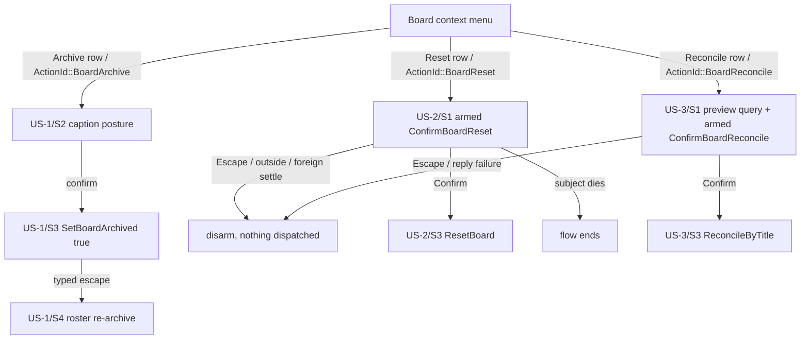
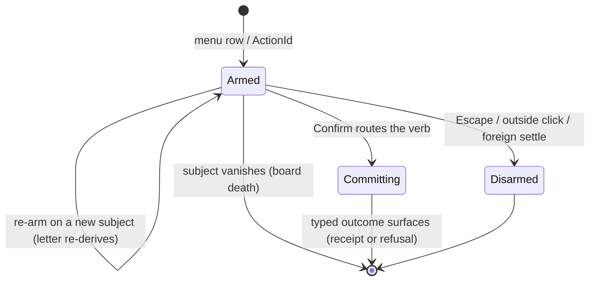

# Board Ceremonies (GUI archive / reset / reconcile) UX Journey Plan — O-5 parity chunk OP1

- **Date**: 2026-11-21
- **Kind**: UX journey plan — user stories, journeys, flows, wiring
  contract for the GUI board-ceremony verbs (archive, reset,
  reconcile). No implementation decisions beyond the command contract.
- **Origin**: O-5 operator parity ruling (2026-11-18: every "the CLI
  covers it" deferral is invalid) via the round-9 CLI-parity sweep
  report's CP register (CP-6/7/8, `.artifacts/reports/2026-11-18-round9-cli-parity-sweep-report.md`),
  backlog issues #945 (archive), #946 (reset), #947 (reconcile), and
  the round-4 scope report §A2 (`.artifacts/reports/2026-11-21-backlog-reduction-round4-scope-report.md`).
  Ruling authority for the supersessions: the board-stack plan's
  R-10/R-11 rows (`.artifacts/plans/2026-11-14-board-stack-management-ux-plan.md:108-109`)
  are **superseded by this plan** — their own revisit notes name this
  exact landing ("the affordance enters through chunk 2's armed-confirm
  grammar (already landed)").
- **Status**: DRAFT — awaits operator acceptance.
- **Surfaces touched**: board context menu (`src/menu.rs`,
  `ui/compositions/action-menu.slint`, `ui/compositions/board-bar.slint`),
  the armed-confirm flow machinery (`src/view_state.rs`), a new
  consent-letter composition (`ui/compositions/board-ceremony-letter.slint`),
  the adapter (`src/adapter.rs`).
- **Platform scope**: desktop only — the board surface does not mount
  on kiosk (the recorded absence stands, board-stack plan PC-4 §6);
  every affordance here is desktop-qualified.

## 1. Scope & goals

The GUI gains the three board-ceremony verbs that today exist only as
CLI verbs (`boards archive` `cli.rs:396`, `boards reset --confirm`
`cli.rs:424`, `boards reconcile --confirm` `cli.rs:450`):

- **Archive** — a board context-menu row archiving the selected board
  (the US-11 roster covers only the *un*archive direction today).
- **Reset** — an armed two-phase context-menu verb with a consequence
  letter naming exactly what the reset clears.
- **Reconcile** — an armed two-phase context-menu verb with an
  informed-consent preview letter (the same-title match counts the CLI
  prints before merging).

The r1 erratum law holds throughout (board-stack plan PC-5/PC-1, homed
on #842): `SetBoardArchived`, `ResetBoard`, and `ReconcileByTitle`
remain `NotUndoable(NotUndoableReason::BoardCeremony)` in the engine —
**the verbs are not re-classified to buy UI convenience**. The surfaces
are *informed-consent confirmations*: the letter carries the blast
radius before the confirm, and the typed escape is the verb's own
reversal path (archive ↔ unarchive), never `AppUndo`.

**Non-goals** (each with a home):

- A GUI restore/undo path for the ceremonies — the engine fence stands;
  restore-class repairs stay CLI/journal territory. Home: the r1
  erratum law itself; a GUI duplicate-management roster beyond the
  reconcile letter is #947's follow-up territory and is **not** filed
  separately (this plan's US-3 letter is the consent surface the
  revisit note asked for).
- Archived-board *content* browsing — the US-11 roster affordances are
  unchanged. Home: existing board-stack plan US-11 scope.
- Any new `StateCommand` variant — all three verbs exist; this chunk is
  presentation + one preview query (§7).

### Recorded decisions

| ID | Decision | Alternatives rejected |
|---|---|---|
| D-1 | **Archive mounts as a single context-menu row with a consent caption, no armed strip.** `SetBoardArchived` is self-reversing (the re-archive path is the typed escape — the r1 erratum law's own wording), and the codebase precedent is explicit: a self-reversing verb takes the `BoardColorPick` shape ("the verb is self-reversing, so no armed strip applies", `view_state.rs` `Flow::BoardColorPick`). The caption states the archive fact and the re-archive escape. #945's "armed-confirm grammar" phrase is read as the shared grammar family, not the two-phase strip specifically. | Two-phase armed strip (double ceremony for a reversible verb — ceremony cost without consent value). |
| D-2 | **Reset and reconcile mount as armed two-phase verbs** reusing the landed `ConfirmDelete` grammar (one armed subject surface-wide, re-arm swaps, Escape → `CancelOnly`, foreign settle disarms, subject-vanish ends the flow). The letter is part of the armed strip mount: consequence counts (reset) or match counts (reconcile) are visible *before* the confirm routes. | One-click verbs with a post-hoc toast (fails the informed-consent requirement — the letter must precede the dispatch). |
| D-3 | **The reset letter derives its counts from presentation state the adapter already holds** (the board's live stacks/tasks/labels rows); no new engine query. The CLI's typed refusal states what *would* clear; the GUI letter states what *will* clear — same facts, earlier. | A new `ResetPreview` engine query (redundant — the adapter's model is the same state the planner reads). |
| D-4 | **The reconcile letter derives its counts from a new oneshot preview query** (`UiRequest::BoardReconcilePreview`, §7) because the merge pairs are planner-derived facts (same-title duplicate adoption) the presentation model does not carry, and staging without the counts is "strictly less informed" — the exact defect R-11 named. | Deriving counts UI-side by title comparison (re-implements the planner in the adapter — violates the dumb-presentation-client law). |
| D-5 | **Kiosk posture: all three verbs render absent on kiosk** (the board surface does not mount there). No disabled affordances are minted for a surface that does not exist. | Disabled rows on kiosk (an affordance for a non-mounting surface is noise). |

## 2. Capability × surface matrix

| Capability | Board | TaskDetail | Today | Review | Settings | Capture | CLI |
|---|---|---|---|---|---|---|---|
| board.archive | E (desktop, US-1) | — (R-1) | — (R-1) | — (R-1) | — (R-1) | — (R-1) | E |
| board.reset | E (desktop, US-2) | — (R-1) | — (R-1) | — (R-1) | — (R-1) | — (R-1) | E |
| board.reconcile | E (desktop, US-3) | — (R-1) | — (R-1) | — (R-1) | — (R-1) | — (R-1) | E |
| board.unarchive | E (landed, R-4) | — (R-1) | — (R-1) | — (R-1) | — (R-1) | — (R-1) | E |

**Rulings** (every deliberate absence):

| ID | Ruling | Reason | Home |
|---|---|---|---|
| R-1 | The three ceremony verbs are board-scoped; non-Board cells stay deliberately absent | The verbs operate on the *selected board*; their organic surface is the board context menu (BF-W-N2: destructive rows last). TaskDetail/Today/Review/Settings/Capture have no board-subject row to hang them on; Settings has no board-management pane. | This plan §2 |
| R-2 | The CLI columns are unchanged (existing verbs) | `boards archive` / `boards reset --confirm` / `boards reconcile --confirm` already exist (`cli.rs:396/424/450`); this chunk adds no CLI delta. | This plan §7 |
| R-3 | No AppUndo escape is offered for any ceremony verb | The r1 erratum law: the verbs stay `NotUndoable(BoardCeremony)`; the typed escapes are re-archive (US-1) and re-create/re-pull (US-2/US-3). Surfacing an undo affordance would promise what the engine refuses. | board-stack plan PC-5; #842 |
| R-4 | `board.unarchive` is landed, unchanged, and owned by the board-stack plan's US-11 — this plan carries no journey for it | Enumerated by default (it is a verb on the entity), but its journey/tests live in the board-stack plan; duplicating them here would violate one-behavior-one-test. The unarchive row appears only as US-1's typed escape target. | `.artifacts/plans/2026-11-14-board-stack-management-ux-plan.md` US-11 |

## 3. User stories

### US-1 — Archive the selected board from the GUI

- **Story**: As a desktop user I want to archive a board I am done
  with from its context menu so that I can tidy the board bar without
  reaching for the terminal.
- **Platforms**: desktop (board surface does not mount on kiosk).
- **Entry points**: board context menu `Archive` row (destructive-order
  placement per BF-W-N2); keyboard `ActionId::BoardArchive` over the
  selected board.
- **Priority**: P1.
- **Acceptance**:
  - AC-1: Given a live selected board, When the archive row confirms,
    Then `StateCommand::SetBoardArchived { board, archived: true }` is
    dispatched and the roster shows the board archived — verified by
    journey test.
  - AC-2: Given the consent caption, Then no `AppUndo` affordance is
    offered and the caption's escape names the re-archive path —
    verified by fold test (flag/enum, never caption text).
  - AC-3: Given a tombstoned board, When the verb is attempted, Then a
    typed rejection is surfaced (the engine's tombstone refusal) and
    nothing dispatches — verified by seam test.

### US-2 — Reset the selected board with an armed consequence letter

- **Story**: When a bound board's local content has diverged into a
  state I want to re-pull cleanly, I want to reset the board from the
  GUI after reading exactly what clears so that I consent to a
  destructive local repair with full knowledge.
- **Platforms**: desktop.
- **Entry points**: board context menu `Reset board…` row;
  `ActionId::BoardReset`.
- **Priority**: P1.
- **Acceptance**:
  - AC-1: Given a live selected board, When the reset row arms, Then
    the armed strip mounts with a consequence letter carrying the live
    stack/task/label counts and nothing dispatches — verified by
    journey test.
  - AC-2: Given the armed strip, When the user confirms, Then
    `StateCommand::ResetBoard { board }` dispatches exactly once —
    verified by seam test.
  - AC-3: Given the armed strip, When Escape / outside click / a
    foreign settle occurs, Then the flow disarms with nothing
    dispatched — verified by journey test.
  - AC-4: Given a bound board, Then the letter states that the board
    row and connect session survive and the next pull re-materializes
    content — verified by fold test (letter-mode enum, never text).

### US-3 — Reconcile the selected board with an informed-consent preview letter

- **Story**: When a bind pull adopted same-title duplicates alongside
  pre-existing local rows, I want to reconcile the board from the GUI
  after reading the match counts so that the irreversible merge is
  consented to with the same information the CLI prints.
- **Platforms**: desktop.
- **Entry points**: board context menu `Reconcile…` row;
  `ActionId::BoardReconcile`.
- **Priority**: P1.
- **Acceptance**:
  - AC-1: Given a live selected board, When the reconcile row arms,
    Then a preview query dispatches (`UiRequest::BoardReconcilePreview`)
    and the armed strip mounts with the returned match counts —
    verified by journey test.
  - AC-2: Given the armed strip, When the user confirms, Then
    `StateCommand::ReconcileByTitle { board }` dispatches exactly once
    — verified by seam test.
  - AC-3: Given the armed strip, When Escape / outside click / a
    foreign settle occurs, Then the flow disarms with nothing
    dispatched and the preview is discarded — verified by journey test.
  - AC-4: Given a preview that reports zero matches, Then the confirm
    routes the verb anyway (idempotent — a second pass is an accepted
    no-op) and the letter says so — verified by fold test
    (preview-count value, never text).

## 4. Journey specs

### US-1 — GUI board archive

| Step | Surface & affordance | User action | Dispatches | System response | Escape / failure |
|---|---|---|---|---|---|
| US-1/S1 | Board context menu (`menu.rs`) | Right-click the selected board; the `Archive` row sits in the destructive tail (BF-W-N2) | — display only (menu open is presentation) | Menu shows the row enabled for a live board, disabled with an honest caption for a tombstone | Close menu: click-away — nothing dispatches |
| US-1/S2 | Menu `Archive` row | Click (or `ActionId::BoardArchive`) | — display only (D-1: single-stage, no armed strip) | The consent caption fact enters the confirmation strip posture: the row click routes immediately per D-1's self-reversing precedent | None — the step is itself the armed moment; see S3 |
| US-1/S3 | Confirmation strip (the caption fact) | Confirm routes the verb | `StateCommand::SetBoardArchived { board, archived: true }` | The board leaves the live bar and joins the archived roster; the caption's escape fact is the re-archive path (US-11) | The engine's typed tombstone rejection surfaces as a typed fact; nothing changes |
| US-1/S4 | Archived roster (US-11, landed) | Re-open the roster and unarchive | `StateCommand::SetBoardArchived { board, archived: false }` (existing) | The board returns live — the typed escape of the NotUndoable verb | Roster affordance unchanged; its own escapes stand |

### US-2 — GUI board reset (armed + letter)

| Step | Surface & affordance | User action | Dispatches | System response | Escape / failure |
|---|---|---|---|---|---|
| US-2/S1 | Board context menu | Click `Reset board…` (destructive tail, last) or `ActionId::BoardReset` | — display only | `Flow::ConfirmBoardReset { board }` arms (one armed subject surface-wide); the strip mounts with the consequence letter (D-3 counts) | Escape / outside click / foreign settle → `CancelOnly`, disarm, nothing dispatched |
| US-2/S2 | Armed strip + letter | Read the letter (stacks/tasks/labels counts; bound-board re-materialization fact) | — display only | Letter reflects the live model at arm time; a member dying mid-arm re-derives the counts (the settle rule) | The board's death ends the flow (reconcile-vanish pattern) |
| US-2/S3 | Armed strip Confirm | Click Confirm (or the strip's keyboard confirm) | `StateCommand::ResetBoard { board }` | The board's content clears; the board row + connect session survive; content re-materializes on the next pull for a bound board | The engine's typed refusal (tombstoned board) surfaces as a typed fact; the flow disarms |
| US-2/S4 | Post-reset board surface | Observe the emptied board | — display only | The empty-board posture the create flow already renders | The re-materialization path (next pull) is the recovery path; no AppUndo (R-3) |

### US-3 — GUI board reconcile (armed + preview letter)

| Step | Surface & affordance | User action | Dispatches | System response | Escape / failure |
|---|---|---|---|---|---|
| US-3/S1 | Board context menu | Click `Reconcile…` or `ActionId::BoardReconcile` | `UiRequest::BoardReconcilePreview { board }` (oneshot) | `Flow::ConfirmBoardReconcile { board }` arms; the strip mounts once the counts reply arrives | Escape before the reply → disarm + the reply is discarded; a failed/timeout reply surfaces a typed fact and disarms |
| US-3/S2 | Armed strip + preview letter | Read the match counts (the merge pairs the planner found) | — display only | The letter carries the same facts the CLI `--confirm` gate prints (R-11's requirement, now built) | The board's death ends the flow; a foreign settle disarms |
| US-3/S3 | Armed strip Confirm | Click Confirm | `StateCommand::ReconcileByTitle { board }` | The merge runs; survivors keep local ids and gain remote refs; duplicates neutralize | The engine's typed rejection surfaces as a typed fact; the flow disarms |
| US-3/S4 | Post-reconcile board surface | Observe the deduplicated board | — display only | The board renders the merged rows | A second reconcile pass is an accepted no-op (idempotent); no AppUndo (R-3) |

## 5. Interaction flows

## 6. Wiring inventory

| ID | Surface file | Widget | Callback | Adapter seam | ActionId | Commands | Row addressing | Journey steps | Test |
|---|---|---|---|---|---|---|---|---|---|
| W-1 | ui/compositions/action-menu.slint + src/menu.rs | board context-menu `Archive` row (destructive tail) | `board-archive-armed` | `install_board_ceremony_seam` (adapter.rs) | `ActionId::BoardArchive` | `StateCommand::SetBoardArchived` | Menu row on the selected board's context menu (menu index, not element id) | US-1/S1, US-1/S2, US-1/S3 | crates/taskboard-ui-slint/tests/journeys/board_ceremonies_journeys.rs::us1_s3_archive_row_dispatches_set_board_archived |
| W-2 | ui/compositions/board-ceremony-letter.slint (new) | archive consent caption | `ceremony-letter-caption` | same seam (presentation fold off `BoardModel`) | — | — (display only — D-1 single-stage) | Letter binds the armed subject's board | US-1/S2 | crates/taskboard-ui-slint/tests/journeys/board_ceremonies_journeys.rs::us1_s2_archive_caption_carries_rearchive_escape_fact |
| W-3 | ui/compositions/action-menu.slint + src/menu.rs | board context-menu `Reset board…` row | `board-reset-armed` | same seam | `ActionId::BoardReset` | `StateCommand::ResetBoard` | Menu row on the selected board's context menu | US-2/S1 | crates/taskboard-ui-slint/tests/journeys/board_ceremonies_journeys.rs::us2_s1_reset_row_arms_confirm_board_reset |
| W-4 | ui/compositions/board-ceremony-letter.slint | reset consequence letter | `ceremony-letter-counts` | same seam (counts derived from the board model — D-3) | — | — (display only) | Letter binds the armed subject's board | US-2/S2 | crates/taskboard-ui-slint/tests/journeys/board_ceremonies_journeys.rs::us2_s2_reset_letter_derives_live_counts |
| W-5 | src/view_state.rs | `Flow::ConfirmBoardReset { board }` | (flow machinery — no slint callback) | `view_state.rs` arm/cancel/confirm helpers | — | `StateCommand::ResetBoard` | Flow subject is the board id | US-2/S1, US-2/S3, US-2/S4 | crates/taskboard-ui-slint/tests/journeys/board_ceremonies_journeys.rs::us2_s3_reset_confirm_dispatches_exactly_once |
| W-6 | ui/compositions/action-menu.slint + src/menu.rs | board context-menu `Reconcile…` row | `board-reconcile-armed` | same seam | `ActionId::BoardReconcile` | `StateCommand::ReconcileByTitle` | Menu row on the selected board's context menu | US-3/S1 | crates/taskboard-ui-slint/tests/journeys/board_ceremonies_journeys.rs::us3_s1_reconcile_row_requests_preview_and_arms |
| W-7 | ui/compositions/board-ceremony-letter.slint | reconcile preview letter | `ceremony-letter-preview` | same seam (counts from the oneshot reply — D-4) | — | `UiRequest::BoardReconcilePreview` | Letter binds the armed subject's board | US-3/S1, US-3/S2 | crates/taskboard-ui-slint/tests/journeys/board_ceremonies_journeys.rs::us3_s2_reconcile_letter_carries_preview_counts |
| W-8 | src/view_state.rs | `Flow::ConfirmBoardReconcile { board }` | (flow machinery) | `view_state.rs` arm/cancel/confirm helpers | — | `StateCommand::ReconcileByTitle` | Flow subject is the board id | US-3/S1, US-3/S3, US-3/S4 | crates/taskboard-ui-slint/tests/journeys/board_ceremonies_journeys.rs::us3_s3_reconcile_confirm_dispatches_exactly_once |
| W-9 | crates/taskboard-ui-slint/src/requests.rs | — | — | adapter oneshot drain (`UiRequest::BoardReconcilePreview` reply carries the counts) | — | `UiRequest::BoardReconcilePreview` | — | US-3/S1 | crates/taskboard-ui-slint/tests/journeys/board_ceremonies_journeys.rs::us3_s1_preview_reply_feeds_letter_or_disarms |

## 7. Command-contract delta

| Kind | Name | Payload sketch | Journeys |
|---|---|---|---|
| StateCommand | `SetBoardArchived` | exists — unchanged (`board: BoardId, archived: bool`) | US-1/S3, US-1/S4 |
| StateCommand | `ResetBoard` | exists — unchanged (`board: BoardId`) | US-2/S3 |
| StateCommand | `ReconcileByTitle` | exists — unchanged (`board: BoardId`) | US-3/S3 |
| UiRequest | `BoardReconcilePreview` | new — `{ board: BoardId }` + oneshot reply carrying the planner's match counts (the letter's payload; no prose) | US-3/S1 |
| ActionId | `BoardArchive` | new — no payload (acts on the selected board) | US-1/S2 |
| ActionId | `BoardReset` | new — no payload | US-2/S1 |
| ActionId | `BoardReconcile` | new — no payload | US-3/S1 |

## 8. Verification plan

- **Journey tests** (step-ID-named,
  `crates/taskboard-ui-slint/tests/journeys/board_ceremonies_journeys.rs`):
  `us1_s3_*`, `us2_s1_*`, `us2_s3_*`, `us3_s1_*`, `us3_s2_*`,
  `us3_s3_*` — per the §6 Test column.
- **Seam tests**: exact-command assertions that the confirm routes
  `SetBoardArchived`/`ResetBoard`/`ReconcileByTitle` with the armed
  subject's board id and exactly once (US-1/AC-1, US-2/AC-2,
  US-3/AC-2).
- **Fold/presentation tests**: letter-mode enum assertions (archive
  caption / reset counts / reconcile preview), the no-AppUndo fact as
  a typed flag (US-1/AC-2, US-2/AC-4, US-3/AC-4) — never caption text.
- **Kiosk gates**: all three verbs are absent on kiosk (the board
  surface does not mount — D-5); the structural inventory asserts no
  ceremony rows exist in the kiosk composition.
- **Manual**: whether the letters *read* as informed consent (the
  walkthrough protocol judges recognition, not text); who: the stage-3
  review agent.

## 9. Definition of done

- [ ] `scripts/ux-coverage.sh <this file> --gate` exits 0
- [ ] Every P1 story's journey completes end-to-end including escapes
- [ ] Walkthrough protocol executed at stage 3; findings resolved or homed
- [ ] All matrix absences carry rulings; the census Board slice's
      `board.reset`/`board.reconcile` rows move from `— (R-10)`/`— (R-11)`
      to `E (US-2)`/`E (US-3)` (the recorded supersession of
      R-10/R-11, dated 2026-11-21, authority O-5 + this plan)
- [ ] Non-goals filed as backlog issues (none beyond the ruling homes — §1)
