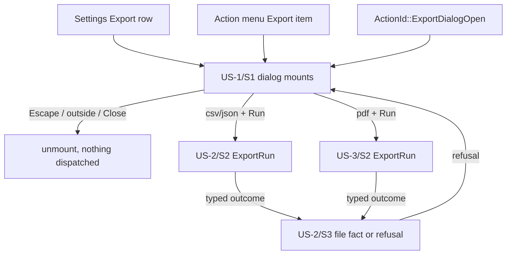

# Export Dialog (GUI export front) UX Journey Plan — O-5 parity chunk OP2

- **Date**: 2026-11-21
- **Kind**: UX journey plan — user stories, journeys, flows, wiring
  contract for the GUI export dialog (tracking CSV/JSON + the pdf
  today-sheet leg). No implementation decisions beyond the command
  contract.
- **Origin**: O-5 operator parity ruling (2026-11-18: no feature may
  stay CLI-only) via the sweep report's CP-9
  (`.artifacts/reports/2026-11-18-round9-cli-parity-sweep-report.md`),
  backlog issue #948 (the largest CLI-only feature family), and the
  round-4 scope report §A2. #948's own sketch is the contract seed: "a
  settings/menu-anchored export dialog: format, filters, pdf
  destination, open-after-export".
- **Status**: DRAFT — awaits operator acceptance.
- **Surfaces touched**: a new export dialog composition
  (`ui/compositions/export-dialog.slint`), the Settings view's export
  row, the toolbar/action menu entry, the adapter (`src/adapter.rs`),
  `src/requests.rs`.
- **Platform scope**: desktop (the dialog is an interactive editing
  surface; kiosk's read-only posture carries no export affordance —
  R-2).

## 1. Scope & goals

The GUI gains the export family's front end. A user can open an export
dialog (from Settings and from the action menu), pick the data family
(tracking CSV/JSON, or the pdf today-sheet where the `pdf-export`
feature is compiled), set the same filters the CLI carries (since /
until / task / board; layout for pdf), choose a destination (pdf leg:
the config default or an explicit file; csv/json leg: D-3's dialog
destination), run the export, and see a typed outcome — the written
file fact or a typed refusal — without leaving the app.

The export engine itself exists (`export` CLI verb, `cli.rs:161`:
`what`, `format`, `since`, `until`, `task`, `board`, `layout`, `out`,
`no_open`). This chunk adds **no engine delta**: the dialog assembles
an export spec and dispatches it app-side (§7). The CLI's D-T15
stdout/pipes exception stays CLI-only — the GUI is a file-writing
front by shape (D-3).

**Non-goals** (each with a home):

- A csv/json preview pane or clipboard handoff inside the dialog —
  polish beyond the parity contract. Home: new backlog issue (filed
  with this plan).
- Additional export families (habits log, journal) — the CLI carries
  `ExportWhat::Tracking` + the pdf sheet only; parity means the same
  families, not more. Home: future engine work, not this round.
- Scheduled/recurring exports — no engine seam exists. Home: the
  standing backlog (out-of-scope idea; not filed twice — the engine
  gap is the blocker, filed only if the operator asks).

### Recorded decisions

| ID | Decision | Alternatives rejected |
|---|---|---|
| D-1 | **The dialog is settings/menu-anchored**: entry points are a Settings export row and an action-menu item + `ActionId::ExportDialogOpen`. Both mount the same dialog composition. | A Board-surface verb (export is entity-less — CP-9's "a matrix row of one cell defeats the surface-scoped grammar" bookkeeping fact stands). |
| D-2 | **The pdf leg mirrors the CLI exactly**: layout picker (`fold` default), destination defaulting to `[export] pdf_dir` + the dated file name with an explicit-path override, and an open-after-export checkbox defaulting from `[export] open_after_export`. | Inventing a GUI-only destination model (divergence from the CLI contract the parity ruling demands). |
| D-3 | **The csv/json leg writes to a destination file in the GUI** (a dialog path field defaulting under the export dir). The CLI's "no file writing" rule is D-T15's *CLI-shape* ruling (pipes are the terminal contract); a GUI has no pipe — the dialog adds a destination, the CLI verb stays byte-compatible and unchanged. | Rendering the csv/json into a read-only pane (a preview feature masquerading as parity; home filed as non-goal). |
| D-4 | **Feature absence is honest**: without the `pdf-export` feature the pdf controls render disabled with an honest caption (the SC-W-N4 doctrine bar: disabled actions with honest captions, not hidden lanes). | Hiding the pdf section (recognition-over-recall: the user should see the capability exists and is not compiled). |
| D-5 | **The run outcome is a typed oneshot reply** (`UiRequest::ExportRun` → `ExportRunOutcome`: written path or typed refusal kind). The dialog shows busy posture between dispatch and reply; the outcome renders as a file fact (open-after-export may fire app-side). | Fire-and-forget dispatch (no escape/failure path — a plan defect by §4's law). |

## 2. Capability × surface matrix

| Capability | Board | TaskDetail | Today | Review | Settings | Capture | CLI |
|---|---|---|---|---|---|---|---|
| export.tracking_csv_json | — (R-1) | — (R-1) | — (R-1) | — (R-1) | E (desktop, US-2) | — (R-1) | E |
| export.pdf_sheet | — (R-1) | — (R-1) | — (R-1) | — (R-1) | E (desktop, US-3) | — (R-1) | E |
| export.dialog_open | — (R-1) | — (R-1) | — (R-1) | — (R-1) | E (desktop, US-1) | — (R-1) | — (R-4) |

**Rulings** (every deliberate absence):

| ID | Ruling | Reason | Home |
|---|---|---|---|
| R-1 | Non-Settings GUI cells stay absent | Export is entity-less (CP-9's bookkeeping fact): it has no board/task/habit subject row anywhere; the dialog is the whole front. | This plan §2 |
| R-2 | No kiosk affordance | Export writes files — a kiosk's read-only, low-power posture has no file-consumption context; the dialog does not mount on kiosk. | This plan §1 |
| R-3 | No new export families or formats | Parity is the contract: `ExportWhat::Tracking` + pdf sheet, `ExportFormat::Csv`/`Json`, the existing pdf layouts — exactly the CLI's grammar. | This plan §1 |
| R-4 | No CLI delta | The `export` verb exists and stays byte-compatible (D-T15's stdout exception included). | This plan §7 |
| R-5 | No GUI pdf preview | The pdf is written then (optionally) opened in the system viewer — the CLI's `open_after_export` model; rendering pdf in-app is a new feature, not parity. | Non-goal §1, third bullet's home pattern; filed if the operator asks |

## 3. User stories

### US-1 — Open the export dialog

- **Story**: As a desktop user I want to open an export dialog from
  Settings or the action menu so that exporting does not require
  remembering CLI flags.
- **Platforms**: desktop.
- **Entry points**: Settings `Export…` row; action-menu `Export…`
  item; `ActionId::ExportDialogOpen`.
- **Priority**: P1.
- **Acceptance**:
  - AC-1: Given any of the three entry points, When invoked, Then the
    export dialog mounts with format/filters/destination controls and
    nothing dispatches app-side — verified by journey test.
  - AC-2: Given the mounted dialog, When Escape / outside click /
    Close, Then the dialog unmounts with nothing dispatched — verified
    by journey test.

### US-2 — Run a tracking export (csv/json)

- **Story**: When I want my time-tracking data out of the app, I want
  to pick format and filters in the dialog and write a file so that I
  get the same payload the CLI pipes, without a terminal.
- **Platforms**: desktop.
- **Entry points**: the dialog's format picker (`csv` default), date
  fields, task/board filter fields, `Run` button.
- **Priority**: P1.
- **Acceptance**:
  - AC-1: Given a valid filter set, When Run, Then
    `UiRequest::ExportRun { spec }` dispatches and the dialog enters
    busy posture — verified by seam test (the spec's fields equal the
    dialog state).
  - AC-2: Given the run succeeds, Then the typed outcome carries the
    written path and the dialog renders the file fact; open-after
    does not apply to csv/json (pdf-only control) — verified by
    journey test.
  - AC-3: Given a typed refusal (bad filter resolution, unwritable
    destination), Then the dialog surfaces the typed outcome kind and
    stays mounted with the filter state intact — verified by journey
    test.

### US-3 — Run the pdf today-sheet export

- **Story**: When I want a printable today sheet, I want the dialog's
  pdf leg with layout, destination, and open-after-export so that the
  CLI's pdf workflow is reachable by mouse and keyboard alike.
- **Platforms**: desktop (pdf leg only where `pdf-export` is compiled).
- **Entry points**: the dialog's `pdf` family pick; layout picker;
  destination field (config default pre-filled); open-after-export
  checkbox (config default pre-filled); `Run`.
- **Priority**: P1.
- **Acceptance**:
  - AC-1: Given the pdf family and defaults, When Run, Then the
    written path is the config default (dated file name) and the
    open-after fact follows the config — verified by seam test
    (spec fields).
  - AC-2: Given an explicit destination override, When Run, Then the
    spec carries the override path — verified by seam test.
  - AC-3: Given a build without `pdf-export`, Then the pdf controls
    render disabled with an honest caption (D-4) and cannot dispatch
    — verified by fold test (enabled flag, never caption text).
  - AC-4: Given a pdf run refusal (unwritable path), Then the typed
    outcome surfaces and the dialog keeps state — verified by journey
    test.

## 4. Journey specs

### US-1 — Open the export dialog

| Step | Surface & affordance | User action | Dispatches | System response | Escape / failure |
|---|---|---|---|---|---|
| US-1/S1 | Settings view `Export…` row / action-menu item / `ActionId::ExportDialogOpen` | Click / key the entry point | — display only (dialog mount is presentation state) | `export-dialog.slint` mounts modal over the shell with defaults loaded from config (D-2/D-3 defaults) | Escape / outside click / Close unmounts — nothing dispatched |
| US-1/S2 | Mounted dialog | Observe the controls | — display only | Family picker, format picker (csv default), since/until fields, task/board filter fields, destination field, (pdf:) layout + open-after-export | The dialog is cancellable at every point below |

### US-2 — Tracking csv/json export

| Step | Surface & affordance | User action | Dispatches | System response | Escape / failure |
|---|---|---|---|---|---|
| US-2/S1 | Dialog controls | Pick `csv` or `json`; fill since/until/task/board; confirm the destination path | — display only | Filter fields echo their state; invalid date input keeps field focus with the invalid fact (the due-editor's invalid-draft posture) | Clear a field to drop that filter |
| US-2/S2 | `Run` button | Click (or the dialog's confirm key) | `UiRequest::ExportRun { spec }` (oneshot) | Busy posture on the Run control | Escape during the run: the dialog closes; the app-side run completes or refuses independently (the reply is consumed by the drain — no orphaned UI wait) |
| US-2/S3 | Dialog outcome area | Observe | — display only | The typed outcome: the written-file fact or the refusal kind; filter state intact on refusal | Re-Run after correcting the failing field |

### US-3 — Pdf today-sheet export

| Step | Surface & affordance | User action | Dispatches | System response | Escape / failure |
|---|---|---|---|---|---|
| US-3/S1 | Dialog family picker | Pick `pdf`; pick layout (`fold` default); confirm/override the destination; toggle open-after-export | — display only | Destination pre-filled from `[export] pdf_dir` + dated name; the open-after checkbox pre-filled from `[export] open_after_export` (D-2) | Feature absent → controls disabled with an honest caption (D-4); nothing dispatches |
| US-3/S2 | `Run` button | Click | `UiRequest::ExportRun { spec }` (oneshot) | Busy posture; app-side the engine writes the pdf and (if enabled) opens the system viewer | Escape during the run as US-2/S2 |
| US-3/S3 | Dialog outcome area | Observe | — display only | The typed outcome: written path (default or override) or refusal kind | Re-Run with a corrected path |

## 5. Interaction flows



```mermaid
stateDiagram-v2
  [*] --> Mounted : entry point
  Mounted --> Editing : controls echo state
  Editing --> Running : Run dispatches ExportRun
  Editing --> [*] : Escape / outside / Close
  Running --> Mounted : typed outcome (file fact or refusal)
  Running --> [*] : Escape closes; app-side run completes independently
```

## 6. Wiring inventory

| ID | Surface file | Widget | Callback | Adapter seam | ActionId | Commands | Row addressing | Journey steps | Test |
|---|---|---|---|---|---|---|---|---|---|
| W-1 | ui/compositions/export-dialog.slint (new) | dialog mount/unmount | `export-dialog-open` / `export-dialog-close` | `install_export_seam` (adapter.rs) | `ActionId::ExportDialogOpen` | — (pure presentation mount; §4 US-1 rows say why) | Modal over the shell | US-1/S1, US-1/S2 | crates/taskboard-ui-slint/tests/journeys/export_journeys.rs::us1_s1_dialog_mounts_from_all_entry_points |
| W-2 | Settings view (settings rows composition) | `Export…` row | `export-settings-open` | same seam | — | — (navigation) | Settings row (row callback, not element id) | US-1/S1 | crates/taskboard-ui-slint/tests/journeys/export_journeys.rs::us1_s1_dialog_mounts_from_all_entry_points |
| W-3 | ui/compositions/export-dialog.slint | family + format pickers, filter fields | `export-spec-picked` | same seam (spec assembly) | — | — (display only until Run) | Dialog-scoped state | US-2/S1, US-3/S1 | crates/taskboard-ui-slint/tests/journeys/export_journeys.rs::us2_s1_filters_echo_dialog_state |
| W-4 | ui/compositions/export-dialog.slint | `Run` button | `export-run` | same seam → `UiRequest::ExportRun` drain | — | `UiRequest::ExportRun` | Dialog-scoped | US-2/S2, US-3/S2 | crates/taskboard-ui-slint/tests/journeys/export_journeys.rs::us2_s2_run_dispatches_export_run_spec |
| W-5 | ui/compositions/export-dialog.slint | outcome area + busy posture | `export-outcome-shown` | same seam (oneshot reply → presentation fold) | — | — (display only) | Dialog-scoped | US-2/S3, US-3/S3 | crates/taskboard-ui-slint/tests/journeys/export_journeys.rs::us2_s3_typed_outcome_renders_file_fact_or_refusal |
| W-6 | crates/taskboard-ui-slint/src/requests.rs | — | — | app-side drain executes the export engine and replies | — | `UiRequest::ExportRun` | — | US-2/S2, US-3/S2 | crates/taskboard-app/tests/it_exports.rs::export_run_reply_carries_typed_outcome |

## 7. Command-contract delta

| Kind | Name | Payload sketch | Journeys |
|---|---|---|---|
| UiRequest | `ExportRun` | new — `{ spec: ExportSpec }` where `ExportSpec` mirrors the CLI verb's fields (`what`, `format`, `since`, `until`, `task`, `board`, `layout`, `out`, `open_after`) + oneshot reply `ExportRunOutcome` (written path or typed refusal kind — D-5) | US-2/S2, US-3/S2 |
| ActionId | `ExportDialogOpen` | new — no payload (mounts the dialog) | US-1/S1 |
| StateCommand | — | none: the export family touches no engine state (the CLI verb bypasses the `--json` receipt envelope per D-T15; so does the GUI leg) | — |

## 8. Verification plan

- **Journey tests** (step-ID-named,
  `crates/taskboard-ui-slint/tests/journeys/export_journeys.rs`):
  `us1_s1_*`, `us2_s1_*`, `us2_s2_*`, `us2_s3_*`, `us3_s1_*` — per the
  §6 Test column.
- **Seam tests**: `ExportRun` spec-field equality with dialog state
  (US-2/AC-1, US-3/AC-1, US-3/AC-2); the app-side executor's typed
  outcome (`crates/taskboard-app` test, W-6).
- **Fold/presentation tests**: enabled/disabled flag for the
  feature-gated pdf controls (US-3/AC-3), busy-posture flag — never
  caption text.
- **Kiosk gates**: the dialog and both entry points are absent on
  kiosk (R-2); the structural inventory asserts the kiosk composition
  carries no export rows.
- **Manual**: whether the dialog reads as the CLI's equal (recognition
  of family/format/destination semantics — judged at walkthrough);
  who: the stage-3 review agent.

## 9. Definition of done

- [ ] `scripts/ux-coverage.sh <this file> --gate` exits 0
- [ ] Every P1 story's journey completes end-to-end including escapes
- [ ] Walkthrough protocol executed at stage 3; findings resolved or homed
- [ ] All matrix absences carry rulings; census CLI-only register's
      export entry moves to the Settings slice (`E (US-2)`/`E (US-3)`)
- [ ] Non-goals filed as backlog issues (the csv/json preview/clipboard
      polish — filed with this plan)
