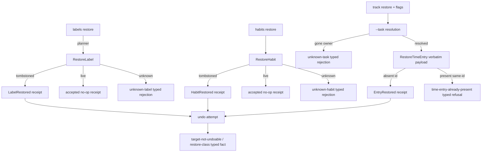

# Restore CLI Surfaces UX Journey Plan — O-5 parity chunk RS (#979's first dispatch surface)

- **Date**: 2026-11-21
- **Kind**: UX journey plan — user stories, journeys, flows, wiring
  contract for the restore-verb family's first dispatch surface (CLI).
  No implementation decisions beyond the command contract.
- **Origin**: backlog issue #979 (chunk N-B's engine-only restore
  verbs ship no surface) via the round-4 scope report §A3 ("restore
  verbs' first CLI surface, journey + small chunk"), the O-5 operator
  parity ruling, and the O-8 parity law. The landed base: the three
  engine verbs (`StateCommand::RestoreLabel` / `RestoreTimeEntry { entry }`
  / `RestoreHabit`, `crates/taskboard-domain/src/messages.rs:685-716`)
  and #993's serde pin (closed; the receipts `LabelRestored` /
  `HabitRestored` / `EntryRestored` decode-stability is pinned in
  `crates/taskboard-domain/src/undo/tests.rs`).
- **Status**: DRAFT — awaits operator acceptance.
- **Surfaces touched**: `crates/taskboard-app/src/cli.rs` (new verb
  arms), `crates/taskboard-app/src/commands/` (dispatch + typed error
  kinds), the `--json` receipt path.
- **Platform scope**: CLI only — this is deliberately the *first*
  surface, not the only one (R-1; GUI homes filed per the standing
  authorization).
- **Test-root**: crates/taskboard-app/tests (a CLI-chunk plan — no
  journey-test root in the UI crate; D-6).

## 1. Scope & goals

The restore-family verbs become dispatchable by a user. Today they are
reachable only through the undo line's own synthesis (#979). The CLI
gains three entity-scoped verbs mirroring the engine grammar:

- `labels restore <id/prefix>` → `RestoreLabel` — tombstone-only
  resurrect with pre-tombstone values verbatim.
- `habits restore <id/prefix>` → `RestoreHabit` — tombstone-only
  resurrect; the log is never touched (D26).
- `track restore <id/prefix>` → `RestoreTimeEntry { entry }` —
  re-materialize a hard-deleted entry from a verbatim payload (D-4's
  flag assembly).

Receipts are the pinned `CommandOutcome` variants (#993): the JSON
receipt envelope (`--json`) carries `LabelRestored` / `HabitRestored` /
`EntryRestored`; text mode renders the typed fact (id + family).
Typed refusals map onto the existing `domain_error_kind` table
(`unknown-label`, `unknown-habit`, `time-entry-already-present`,
`unknown-task`).

**Non-goals** (each with a home):

- GUI restore surfaces (roster-context restore rows for labels/habits,
  a time-entry restore affordance) — deliberately deferred; this plan
  records the absence as R-1 and the home is the new backlog issue
  filed with this plan.
- A `tasks restore` verb — see D-1: task restore already has its
  recovery surface (`RestoreTask { id, resurrect }`'s existing
  routing family); this chunk adds nothing for tasks.
- Restoring from journal pre-images by journal id — the engine verbs
  are id/payload-addressed by design; journal archaeology is the undo
  line's job, not a CLI verb's. Home: this plan D-4's rationale.

### Recorded decisions

| ID | Decision | Alternatives rejected |
|---|---|---|
| D-1 | **No `tasks restore` CLI verb is added, and #979's premise is corrected**: no "existing `tasks restore` verb" exists in `cli.rs` (verified 2026-11-21 — the issue's text predates or misremembers; task restoration's recovery surface is the `RestoreTask`/`RestoreStack` routing family, whose own *first* surface work is #979's follow-up territory if the operator wants it). The chunk's grammar is entity-scoped: `labels restore`, `habits restore`, `track restore`. | A `tasks restore` alias for an existing-but-unrouted verb (none exists to alias). |
| D-2 | **Id resolution follows the house CLI grammar**: uuid \| unique ≥8-char uuid prefix (the `export --task` precedent, `cli.rs` filter docs). Live-target restores are the engine's accepted no-op (the receipt carries the no-op fact); an unknown/deleted id is the typed rejection. | Name-based resolution (ids are the restore family's address — tombstoned rows may share titles). |
| D-3 | **Receipts ride the `--json` envelope; text mode renders the typed fact.** The receipt variants are already serde-pinned (#993) — the CLI consumes them as the stable contract; no text-assertion tests, only typed outcome matches. | Printing free-text receipts (the no-text-assertion law would leave the surface untestable). |
| D-4 | **`track restore` assembles the payload from flags**: `--task <uuid|prefix|exact live title>` (resolved to the owner task id — the engine refuses a gone owner typed), `--start <RFC 3339>`, optional `--end <RFC 3339>`, `--kind <work|break>` (default `work`), and optional `--id <uuid>` defaulting to a fresh v7 when omitted. Verbatim-payload principle: whatever the flags carry is what the engine restores; a present same-id row is the typed `time-entry-already-present` divergence refusal. Reconstructing the payload from the journal instead is rejected — the row is hard-deleted and the journal pre-image is the undo line's internal shape, not a CLI contract. | A journal-id-based `track restore --from-journal <id>` (exposes journal internals on a CLI surface). |
| D-5 | **The restore verbs stay NotUndoable(RestoreClass)** — they *are* the recovery path; the typed escape is the ordinary delete/tombstone verbs (re-delete the restored entity). No new undo-classification work; the fence's existing reason kind already names the class. | Classifying restores as undoable (inverts the recovery semantics). |
| D-6 | **Kiosk posture**: the CLI is platform-free; no GUI delta exists in this chunk (R-1). | — |

## 2. Capability × surface matrix

| Capability | Board | TaskDetail | Today | Review | Settings | Capture | CLI |
|---|---|---|---|---|---|---|---|
| label.restore | — (R-1) | — (R-1) | — (R-1) | — (R-1) | — (R-1) | — (R-1) | E (US-1) |
| habit.restore | — (R-1) | — (R-1) | — (R-1) | — (R-1) | — (R-1) | — (R-1) | E (US-2) |
| timeentry.restore | — (R-1) | — (R-1) | — (R-1) | — (R-1) | — (R-1) | — (R-1) | E (US-3) |

**Rulings** (every deliberate absence):

| ID | Ruling | Reason | Home |
|---|---|---|---|
| R-1 | All GUI cells absent — the CLI is the deliberate *first* surface | #979's proposal names CLI first (parity with the CLI-first dispatch pattern the restore family's siblings use); the GUI legs are follow-up work, filed as backlog (not silently absent — this ruling is the visible decision the framework requires). | New backlog issue filed with this plan |
| R-2 | No `tasks restore` verb | D-1: task restore's engine verb has its own routing family and #979's premise names no existing verb; adding a task verb here would scope-creep the chunk. | #979 (the corrected comment) + D-1 |
| R-3 | No journal-id restore leg | D-4's rationale; journal pre-images are not a CLI contract. | This plan D-4 |
| R-4 | No CLI delta to the undo line | The verbs' undo-line synthesis (their current reachability) is unchanged; this chunk adds the direct dispatch path only. | This plan §7 |

## 3. User stories

### US-1 — Restore a tombstoned label

- **Story**: When I deleted a label and a task's tagging history
  still refers to it, I want to resurrect the label by id so that the
  membership-recovery surface (`AssignLabel`) becomes reachable again.
- **Platforms**: CLI.
- **Entry points**: `taskboard labels restore <id/prefix>`; the
  `--json` envelope for scripts.
- **Priority**: P1.
- **Acceptance**:
  - AC-1: Given a tombstoned label id, When the verb runs, Then
    `StateCommand::RestoreLabel { id }` dispatches and the receipt is
    `CommandOutcome::LabelRestored { label }` — verified by seam test
    (typed outcome).
  - AC-2: Given an unknown/deleted id, Then the typed rejection
    (`unknown-label` kind) surfaces and nothing dispatches — verified
    by seam test.
  - AC-3: Given a live label id, Then the accepted no-op receipt
    surfaces (the engine's no-op fact) — verified by seam test.

### US-2 — Restore a tombstoned habit

- **Story**: When I deleted a habit and want it back with its history
  intact, I want to resurrect it by id so that the tracker resumes
  with pre-tombstone values verbatim (the log is never touched, D26).
- **Platforms**: CLI.
- **Entry points**: `taskboard habits restore <id/prefix>`.
- **Priority**: P1.
- **Acceptance**:
  - AC-1: Given a tombstoned habit id, When the verb runs, Then
    `StateCommand::RestoreHabit { id }` dispatches and the receipt is
    `CommandOutcome::HabitRestored { habit }` — verified by seam test.
  - AC-2: Given an unknown id, Then the typed rejection
    (`unknown-habit` kind) surfaces — verified by seam test.
  - AC-3: Given a live habit id, Then the accepted no-op receipt
    surfaces — verified by seam test.

### US-3 — Re-materialize a hard-deleted time entry

- **Story**: When a time entry was hard-deleted (no tombstone to
  resurrect) and I have its facts (from a prior export or my
  records), I want to re-materialize it from flags so that the
  tracking ledger is whole again.
- **Platforms**: CLI.
- **Entry points**: `taskboard track restore <id/prefix> --task <…> --start <…> [--end <…>] [--kind <…>] [--id <uuid>]`.
- **Priority**: P1.
- **Acceptance**:
  - AC-1: Given a valid flag payload, When the verb runs, Then
    `StateCommand::RestoreTimeEntry { entry }` dispatches with the
    verbatim payload (the `--id` default mints a fresh v7) and the
    receipt is `CommandOutcome::EntryRestored { id }` — verified by
    seam test.
  - AC-2: Given a `--task` that resolves to a gone owner task, Then
    the typed rejection (`unknown-task` kind) surfaces — verified by
    seam test.
  - AC-3: Given a target id whose row is already present, Then the
    typed divergence refusal (`time-entry-already-present` kind)
    surfaces and nothing dispatches — verified by seam test.
  - AC-4: Given a malformed `--start`/`--end`, Then the clap-layer
    typed parse refusal surfaces before any dispatch — verified by
    seam test.

## 4. Journey specs

### US-1 — `labels restore`

| Step | Surface & affordance | User action | Dispatches | System response | Escape / failure |
|---|---|---|---|---|---|
| US-1/S1 | Terminal | Run `taskboard labels restore <id/prefix>` | `StateCommand::RestoreLabel { id }` | The label flips live with pre-tombstone values verbatim and a fresh tombstone clock; the receipt prints (D-3: typed fact text, or the pinned JSON receipt under `--json`) | Unknown/deleted id → the typed `unknown-label` rejection, exit reflects the refusal; nothing changed |
| US-1/S2 | Terminal | Re-run the same verb | `StateCommand::RestoreLabel { id }` | The accepted no-op receipt (a live target is not an error) | — |
| US-1/S3 | Terminal | Undo is attempted on the restore | — display only (the fence answers) | The typed `target-not-undoable` / `restore-class` fact (D-5's fence; the existing `not_undoable_reason_kind` mapping) | The typed escape is the ordinary label-delete verb |

### US-2 — `habits restore`

| Step | Surface & affordance | User action | Dispatches | System response | Escape / failure |
|---|---|---|---|---|---|
| US-2/S1 | Terminal | Run `taskboard habits restore <id/prefix>` | `StateCommand::RestoreHabit { id }` | The habit flips live with pre-tombstone values verbatim and a fresh tombstone clock; the log is untouched (D26); the receipt prints (D-3) | Unknown id → the typed `unknown-habit` rejection |
| US-2/S2 | Terminal | Re-run the same verb | `StateCommand::RestoreHabit { id }` | The accepted no-op receipt | — |
| US-2/S3 | Terminal | Undo is attempted on the restore | — display only | The typed `restore-class` fence fact (D-5) | The typed escape is the ordinary habit-delete verb |

### US-3 — `track restore`

| Step | Surface & affordance | User action | Dispatches | System response | Escape / failure |
|---|---|---|---|---|---|
| US-3/S1 | Terminal | Run `taskboard track restore <id/prefix> --task T --start S [--end E] [--kind K] [--id I]` | `StateCommand::RestoreTimeEntry { entry }` (payload assembled per D-4) | The entry re-materializes verbatim; the receipt prints (`EntryRestored { id }`; the fresh-v7 default surfaces its minted id) | Malformed date/kind → the clap-layer typed parse refusal before dispatch (AC-4) |
| US-3/S2 | Terminal | Run with a `--task` naming a gone/deleted task | (no dispatch — the resolution refuses) | The typed `unknown-task` rejection | Fix `--task` and re-run |
| US-3/S3 | Terminal | Run with `--id` naming a present row | (no dispatch — the planner refuses) | The typed `time-entry-already-present` divergence refusal | Omit `--id` (fresh v7) or name a genuinely absent id |
| US-3/S4 | Terminal | Undo is attempted on the restore | — display only | The typed `restore-class` fence fact (D-5) | The typed escape is the ordinary time-entry delete verb |

## 5. Interaction flows

## 6. Wiring inventory

| ID | Surface file | Widget | Callback | Adapter seam | ActionId | Commands | Row addressing | Journey steps | Test |
|---|---|---|---|---|---|---|---|---|---|
| W-1 | crates/taskboard-app/src/cli.rs | `labels restore <id/prefix>` verb arm | — | `commands/labels.rs` dispatch | — | StateCommand::RestoreLabel | Verb + positional id | US-1/S1, US-1/S2 | crates/taskboard-app/tests/it_restore_cli.rs::us1_s1_labels_restore_dispatches_restore_label_and_receipts, crates/taskboard-app/tests/it_restore_cli.rs::us1_s2_labels_restore_repeat_is_the_accepted_noop |
| W-2 | crates/taskboard-app/src/cli.rs | `habits restore <id/prefix>` verb arm | — | `commands/` habit dispatch | — | StateCommand::RestoreHabit | Verb + positional id | US-2/S1, US-2/S2 | crates/taskboard-app/tests/it_restore_cli.rs::us2_s1_habits_restore_dispatches_restore_habit_and_receipts, crates/taskboard-app/tests/it_restore_cli.rs::us2_s2_habits_restore_repeat_is_the_accepted_noop |
| W-3 | crates/taskboard-app/src/cli.rs | `track restore` verb arm + flags | — | `commands/track.rs` dispatch (payload assembly per D-4) | — | StateCommand::RestoreTimeEntry | Verb + positional id + flags | US-3/S1 | crates/taskboard-app/tests/it_restore_cli.rs::us3_s1_track_restore_assembles_verbatim_payload_and_receipts |
| W-4 | crates/taskboard-app/src/commands/mod.rs | typed-refusal mapping for the new paths | — | `domain_error_kind` arms (existing table) | — | — | — | US-1/S1, US-2/S1, US-3/S2, US-3/S3 | crates/taskboard-app/tests/it_restore_cli.rs::us3_s3_present_same_id_refuses_typed, crates/taskboard-app/tests/it_restore_cli.rs::us3_s2_gone_owner_task_refuses_typed |
| W-5 | crates/taskboard-app/src/cli.rs | `--json` receipt path over the pinned variants | — | the `--json` envelope (D-3) | — | — | — | US-1/S1, US-2/S1, US-3/S1 | crates/taskboard-app/tests/it_restore_cli.rs::us1_s1_json_receipt_decodes_pinned_command_outcome |

## 7. Command-contract delta

| Kind | Name | Payload sketch | Journeys |
|---|---|---|---|
| StateCommand | `RestoreLabel` | exists — unchanged (`id: LabelId`) | US-1/S1, US-1/S2 |
| StateCommand | `RestoreHabit` | exists — unchanged (`id: HabitId`) | US-2/S1, US-2/S2 |
| StateCommand | `RestoreTimeEntry` | exists — unchanged (`entry: Box<TimeEntry>`, payload assembled from flags per D-4) | US-3/S1 |
| StateCommand | — | no new variants: the engine verbs exist and are serde-pinned (#993); the chunk is app-side only | — |
| UiRequest | — | none (CLI chunk) | — |
| ActionId | — | none (CLI chunk) | — |

The CLI grammar delta (prose contract, no domain token): three new
verb arms — `labels restore <id/prefix>`, `habits restore <id/prefix>`,
`track restore <id/prefix> --task <uuid|prefix|exact live title>
--start <RFC 3339> [--end <RFC 3339>] [--kind <work|break>] [--id <uuid>]`
— per D-1/D-2/D-4.

## 8. Verification plan

- **Journey/seam tests** (step-ID-named,
  `crates/taskboard-app/tests/it_restore_cli.rs`): `us1_s1_*`,
  `us2_s1_*`, `us3_s1_*`, `us3_s3_*` — per the §6 Test column.
  Test-root: `crates/taskboard-app/tests/` (a CLI-chunk plan; no
  journey-test root in the UI crate — D-6).
- **Seam tests**: exact-`StateCommand` assertions (variant + payload
  fields, including the fresh-v7 `--id` default and the verbatim
  payload); typed refusal matches (`matches!(err_kind, …)` /
  JSON `kind` equality — structural facts, never text).
- **Fold/presentation tests**: none — the CLI has no presentation
  fold; receipts are typed outcomes (D-3).
- **Kiosk gates**: none — no GUI delta (R-1/D-6).
- **Manual**: none — the surface is fully typed-outcome testable;
  the walkthrough still covers the grammar's recognizability at
  review.

## 9. Definition of done

- [ ] `scripts/ux-coverage.sh <this file> --gate` exits 0
- [ ] Every P1 story's journey completes end-to-end including escapes
- [ ] Walkthrough protocol executed at stage 3; findings resolved or homed
- [ ] All matrix absences carry rulings; the census gains the
      `label.restore` / `habit.restore` / `timeentry.restore` CLI rows
- [ ] Non-goals filed as backlog issues (the GUI restore surfaces — R-1's home)
