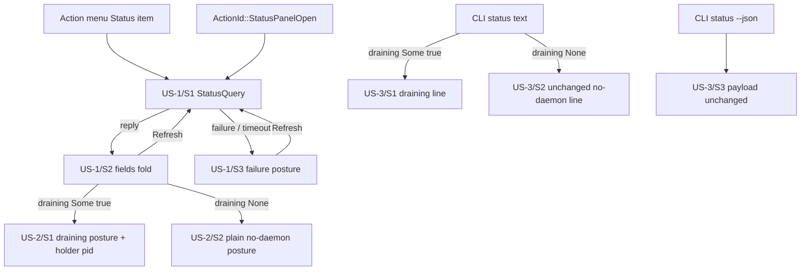

# Status Surface (GUI diagnostics panel + the draining line) UX Journey Plan — O-5 parity chunk OP3

- **Date**: 2026-11-21
- **Kind**: UX journey plan — user stories, journeys, flows, wiring
  contract for the GUI status surface (#949) and the CLI draining line
  (#1111). No implementation decisions beyond the command contract.
- **Origin**: O-5 operator parity ruling (2026-11-18) via the sweep
  report's CP-10 (weak-YES verdict: a GUI status surface or a recorded
  GUI-only waiver), backlog issues #949 (GUI status surface) and #1111
  (the human-readable draining line — the journey-gated twin of B6's
  wire field), and the round-4 scope report §A2 ("one status-surface
  chunk").
- **Status**: DRAFT — awaits operator acceptance.
- **Surfaces touched**: a new status panel composition
  (`ui/compositions/status-panel.slint`) mounted from the action menu,
  the adapter (`src/adapter.rs`), `src/requests.rs`, and the CLI text
  renderer (`crates/taskboard-app/src/commands/status.rs` — the
  #1111 leg).
- **Platform scope**: both — the panel is a read-only display surface
  (desktop interactive; kiosk renders the same panel read-only, kiosk
  gates below). The #1111 CLI leg is platform-free (terminal).
- **Test-root**: crates/taskboard-ui-slint/tests (journey tests);
  the CLI-leg (#1111) tests are nominated crate-exact in §6 —
  `crates/taskboard-app/tests/it_status_surface.rs`.

## 1. Scope & goals

The GUI gains one unified status surface: a menu-anchored diagnostics
panel presenting the facts the `status` CLI verb reports (`cli.rs:225`
— who serves the db, sync posture, daemon/lock diagnostics), which
today exist only as piecemeal chips (files-sync chip, tracking chip).
B6's typed draining distinction (`StatusView.draining: Option<bool>`,
landed byte-additively in `commands/status.rs`) becomes perceivable in
both directions:

- **GUI**: the panel shows the draining fact (an artifact beside a
  held lock + the holder pid) instead of a plain "no daemon" posture.
- **CLI** (#1111): the text renderer prints the draining line (artifact
  + lock holder) instead of plain "no daemon" when
  `daemon == false ∧ draining == true` — pinned via a committed-artifact
  test with the render clock frozen (the clock discipline's committed-
  artifact law).

**Non-goals** (each with a home):

- Actions in the panel (kill the holder, force-unlock, restart the
  daemon) — the panel is read-only by this plan's contract; actor
  commands are a different capability. Home: new backlog issue (filed
  with this plan).
- Auto-polling/live refresh of the panel — D-3 decides
  snapshot-on-open + manual refresh; a watch-channel live lane is
  future work (and #1137's Mutex→watch residue is separate S-wave
  territory). Home: new backlog issue (filed with this plan).
- A GUI-only waiver for #949 — not needed; the surface is built.

### Recorded decisions

| ID | Decision | Alternatives rejected |
|---|---|---|
| D-1 | **One panel, not chips-plus-waiver**: the menu-anchored panel is the unified surface CP-10 asked for; the existing piecemeal chips stay (they are in-context posture, the panel is the diagnostic whole). | Removing the chips (they answer in-context questions the panel does not). |
| D-2 | **The panel mirrors `StatusView` fields 1:1** (daemon, draining, holder_pid, sync posture, the db/lock diagnostics) — no new facts are minted GUI-side; the adapter reads nothing the CLI does not. The draining presentation is the typed rule: `daemon == false ∧ draining == Some(true)` renders the draining posture (artifact + holder pid); `draining == None` renders the plain no-daemon posture (B6's law: never `Some(false)`). | A GUI-specific diagnostics model (divergence between the two status surfaces — the parity ruling's exact failure shape). |
| D-3 | **Snapshot-on-open + explicit refresh affordance**: opening the panel dispatches one status query; a Refresh control re-queries. No polling timer (kiosk memory/perf goals; a live lane is engine work). | Auto-poll on open (burns IPC against a draining/wedged daemon — the exact scenario the panel diagnoses). |
| D-4 | **#1111's CLI line rides the same typed rule as D-2** and is pinned by a committed-artifact test with the render clock frozen (`UiSettings::clock` discipline) — the artifact text embeds nothing clock-derived, but the pin is committed-artifact law regardless. Rendered via the byte-additive `StatusView` (the `{"daemon": false}` byte pin survives; the line is additive rendering, not a payload change). | Rendering the holder pid differently CLI vs GUI (two oracles for one fact — drift by construction). |
| D-5 | **Kiosk posture**: the panel mounts read-only on kiosk from the same menu affordance (display is a kiosk-legitimate verb — no command dispatch anywhere in the journeys). Refresh renders but stays keyboard-reachable per the keyboard parity law. | Absent on kiosk (status is precisely the passive-display fact a kiosk operator needs). |

## 2. Capability × surface matrix

| Capability | Board | TaskDetail | Today | Review | Settings | Capture | CLI |
|---|---|---|---|---|---|---|---|
| status.view | — (R-1) | — (R-1) | — (R-1) | — (R-1) | D (desktop, US-1) | — (R-1) | D |
| status.refresh | — (R-1) | — (R-1) | — (R-1) | — (R-1) | E (desktop, US-1) | — (R-1) | — (R-2) |
| daemon.draining_display | — (R-1) | — (R-1) | — (R-1) | — (R-1) | D (desktop + kiosk, US-2) | — (R-1) | D (US-3) |

**Rulings** (every deliberate absence):

| ID | Ruling | Reason | Home |
|---|---|---|---|
| R-1 | Non-Settings GUI cells stay absent | Status is app-scoped, not entity-scoped: no board/task/habit subject row exists to host it; the menu-anchored panel (Settings column as the fixed surface set's app-scoped home, the export dialog precedent) is the whole front. | This plan §2 |
| R-2 | No CLI `status --refresh` verb | The CLI `status` is already snapshot-per-invocation — invocation *is* the refresh; a flag would duplicate re-running the verb. | This plan §1 |
| R-3 | The panel dispatches no `StateCommand` | Read-only diagnostics (CP-10's "pure read" fact); every action affordance is a non-goal (§1). | This plan §1 |

## 3. User stories

### US-1 — Open the status panel and read the app's posture

- **Story**: As a user I want one place that tells me who serves the
  database, the sync posture, and the daemon/lock diagnostics so that
  I can diagnose "why is nothing syncing" without the terminal.
- **Platforms**: both (kiosk: read-only display).
- **Entry points**: action-menu `Status…` item; `ActionId::StatusPanelOpen`.
- **Priority**: P1.
- **Acceptance**:
  - AC-1: Given the entry point, When invoked, Then one
    `UiRequest::StatusQuery` (oneshot) dispatches and the panel mounts
    with the reply's typed fields — verified by seam test.
  - AC-2: Given the mounted panel, When Refresh is invoked, Then the
    query re-dispatches and the fields re-fold — verified by journey
    test.
  - AC-3: Given a failed/timeout query (e.g. a wedged daemon), Then
    the panel renders the failure as a typed posture (not a blank
    panel) — verified by journey test.
  - AC-4: Given the panel, Then no `StateCommand` is reachable from it
    (R-3) — verified by structural inventory.

### US-2 — See the draining fact in the panel

- **Story**: When the daemon is shutting down but its artifact sits
  beside a held lock, I want the panel to say so (with the holder pid)
  so that I do not misread a draining daemon as "no daemon running".
- **Platforms**: both.
- **Entry points**: US-1's panel; the draining posture is a display
  state of the same fields.
- **Priority**: P1.
- **Acceptance**:
  - AC-1: Given `StatusView { daemon: false, draining: Some(true),
    holder_pid: P }`, Then the panel renders the draining posture
    (draining fact + holder pid) — verified by fold test
    (presentation enum/flag, never text).
  - AC-2: Given `draining: None` with `daemon: false`, Then the panel
    renders the plain no-daemon posture (B6's law: draining never
    reads `Some(false)`) — verified by fold test.

### US-3 — Read the draining line in CLI status output (#1111)

- **Story**: When I run `taskboard status` while a daemon is draining,
  I want the text output to say the daemon is draining (with the
  artifact + lock holder) instead of plain "no daemon" so that the
  terminal tells the same truth the GUI panel does.
- **Platforms**: CLI (terminal).
- **Entry points**: the `status` CLI verb (`cli.rs:225`), text output
  (non-`--json`).
- **Priority**: P1.
- **Acceptance**:
  - AC-1: Given `daemon == false ∧ draining == Some(true)`, Then the
    text renderer emits the draining line (artifact + holder pid) —
    verified by committed-artifact test with the render clock frozen
    (D-4; the journey test embeds step token us3_s1).
  - AC-2: Given `draining: None`, Then the output is byte-identical to
    today's no-daemon rendering (the additive law — #1111's wire pin
    extends to the text path) — verified by committed-artifact test.
  - AC-3: Given `--json`, Then the payload is unchanged (B6's byte pin
    holds; the draining line is a text-render fact only) — verified by
    the existing byte-pin test family (no new test; one-behavior-one-test).

## 4. Journey specs

### US-1 — Open and read the status panel

| Step | Surface & affordance | User action | Dispatches | System response | Escape / failure |
|---|---|---|---|---|---|
| US-1/S1 | Action menu `Status…` item / `ActionId::StatusPanelOpen` | Click / key the entry | `UiRequest::StatusQuery` (oneshot) | Busy posture on the mounting panel until the reply folds the fields | Escape closes the panel; the reply folds or the failure posture renders (S3) |
| US-1/S2 | Status panel | Read the fields (daemon posture, sync posture, db/lock diagnostics) | — display only | The reply's typed fields render per D-2's 1:1 mirror | Close / Escape unmounts — nothing to undo (read-only, R-3) |
| US-1/S3 | Status panel failure posture | Observe | — display only | The failed/timeout query renders a typed failure posture; Refresh remains available | Refresh re-queries (S1 again) |
| US-1/S4 | Status panel `Refresh` control | Click (keyboard-reachable, D-5) | `UiRequest::StatusQuery` (oneshot) | Fields re-fold from the fresh reply | As S3 |

### US-2 — The draining posture (GUI)

| Step | Surface & affordance | User action | Dispatches | System response | Escape / failure |
|---|---|---|---|---|---|
| US-2/S1 | Status panel, opened during a drain | Open the panel (US-1/S1's query returns the draining view) | `UiRequest::StatusQuery` (oneshot) | The panel renders the draining posture: the draining fact + the holder pid (D-2's typed rule) — never the plain no-daemon posture | The panel cannot dispatch; if the drain resolves, Refresh (US-1/S4) shows the next posture |
| US-2/S2 | Status panel, opened with no daemon and no artifact | Observe | — display only | The plain no-daemon posture renders (`draining: None` — B6's law) | — (display-only step; escape = Close) |

### US-3 — The draining line (CLI, #1111)

| Step | Surface & affordance | User action | Dispatches | System response | Escape / failure |
|---|---|---|---|---|---|
| US-3/S1 | Terminal, `taskboard status` (text mode) | Run the verb during a drain | `Command::Status` (existing CLI path) | The text output renders the draining line (artifact + lock holder) instead of plain "no daemon" (D-4) | The verb cannot fail on the rendering path; a wedged daemon's query failure renders its existing typed posture |
| US-3/S2 | Terminal, `taskboard status` (text mode), no drain | Run the verb | `Command::Status` (existing) | Byte-identical no-daemon rendering to today (additive law) | — |
| US-3/S3 | Terminal, `taskboard status --json` | Run the verb | `Command::Status` (existing) | The JSON payload is unchanged (B6's byte pin; the draining line never touches the payload) | — |

## 5. Interaction flows

## 6. Wiring inventory

| ID | Surface file | Widget | Callback | Adapter seam | ActionId | Commands | Row addressing | Journey steps | Test |
|---|---|---|---|---|---|---|---|---|---|
| W-1 | ui/compositions/status-panel.slint (new) | panel mount | status_panel_open | install_status_panel_seam (adapter.rs) | ActionId::StatusPanelOpen | UiRequest::StatusQuery | Panel-scoped state (no list rows) | US-1/S1 | crates/taskboard-ui-slint/tests/journeys/status_surface_journeys.rs::us1_s1_panel_open_dispatches_status_query |
| W-1b | ui/compositions/status-panel.slint | Refresh control | status_panel_refresh | same seam | — | — | Panel-scoped | US-1/S4 | crates/taskboard-ui-slint/tests/journeys/status_surface_journeys.rs::us1_s4_refresh_requeries_and_refolds |
| W-2 | ui/compositions/status-panel.slint | field fold area | status_fields_folded | same seam (oneshot reply → presentation fold) | — | — | Panel-scoped | US-1/S2 (the settled reply folds — evidence rides us1_s1's fold asserts), US-2/S1, US-2/S2 (display only — R-3) | crates/taskboard-ui-slint/tests/journeys/status_surface_journeys.rs::us1_s1_panel_open_dispatches_status_query, crates/taskboard-ui-slint/tests/journeys/status_surface_journeys.rs::us2_s1_draining_view_folds_to_draining_posture, crates/taskboard-ui-slint/tests/journeys/status_surface_journeys.rs::us2_s2_draining_none_folds_to_plain_no_daemon_posture |
| W-3 | ui/compositions/status-panel.slint | failure posture | status_failure_shown | same seam | — | — | Panel-scoped | US-1/S3 (display only) | crates/taskboard-ui-slint/tests/journeys/status_surface_journeys.rs::us1_s3_failed_query_renders_failure_posture |
| W-4 | crates/taskboard-ui-slint/src/requests.rs | — | — | app-side drain answers from the same StatusView the CLI builds | — | UiRequest::StatusQuery | — | US-1/S1 | crates/taskboard-app/tests/it_status_surface.rs::status_query_reply_mirrors_status_view |
| W-5 | crates/taskboard-app/src/commands/status.rs | CLI text renderer | — | the renderer's draining branch (D-4) | — | — | — | US-3/S1, US-3/S2 (CLI verb, unchanged payload — no slint callback, terminal surface; §7 lists no domain delta) | crates/taskboard-app/tests/it_status_surface.rs::us3_s1_draining_view_renders_the_draining_line_committed_artifact, crates/taskboard-app/tests/it_status_surface.rs::us3_s2_draining_none_no_daemon_rendering_is_byte_identical, crates/taskboard-app/tests/it_status_surface.rs::us3_s3_the_json_payload_stays_the_byte_additive_b6_shape |

## 7. Command-contract delta

| Kind | Name | Payload sketch | Journeys |
|---|---|---|---|
| UiRequest | StatusQuery | new — no payload + oneshot reply carrying the StatusView fields (D-2: the same typed view the CLI verb builds; draining rides B6's additive `Option<bool>`) | US-1/S1, US-1/S4, US-2/S1 |
| StateCommand | — | none: the panel is read-only (R-3) | — |
| ActionId | StatusPanelOpen | new — no payload (mounts the panel) | US-1/S1 |

## 8. Verification plan

- **Journey tests** (step-ID-named,
  `crates/taskboard-ui-slint/tests/journeys/status_surface_journeys.rs`):
  `us1_s1_*`, `us1_s3_*`, `us2_s1_*` — per the §6 Test column.
  Test-root note: the plan spans two crates; the CLI-leg tests
  (`us3_*`) live in `crates/taskboard-app/tests/it_status_surface.rs`
  and are nominated exactly in §6's Test column.
- **Seam tests**: `StatusQuery` dispatch + reply-folds-into-fields
  (US-1/AC-1); the app-side drain answers from the same `StatusView`
  (W-4).
- **Fold/presentation tests**: draining → posture enum/flag,
  `draining: None` → plain posture (US-2/AC-1, US-2/AC-2) — never
  rendered text.
- **Committed-artifact tests (clock discipline)**: the #1111 text
  renderings (US-3/AC-1, US-3/AC-2) pin with the render clock frozen
  (`UiSettings::clock` per `docs/testing_strategy.org` §6.1); the
  step token `us3_s1` embeds in the test name.
- **Kiosk gates**: the panel mounts read-only on kiosk (D-5); the
  structural inventory asserts no command dispatch exists on the
  kiosk panel (R-3, US-1/AC-4).
- **Bound-test nominations** (the #768 grammar): the steps whose
  evidence rides a descriptive test name rather than a step-token
  name map explicitly —
  bound-test: US-1/S2 -> status_surface_journeys.rs::us1_s1_panel_open_dispatches_status_query
- **Manual**: whether the panel *reads* as the diagnostic whole
  (recognition of posture semantics — judged at walkthrough); who:
  the stage-3 review agent.

## 9. Definition of done

- [ ] `scripts/ux-coverage.sh <this file> --gate` exits 0
- [ ] Every P1 story's journey completes end-to-end including escapes
- [ ] Walkthrough protocol executed at stage 3; findings resolved or homed
- [ ] All matrix absences carry rulings; the census CLI-only register's
      `status` entry resolves (the CP-10 verdict closes with the panel,
      not a waiver)
- [ ] Non-goals filed as backlog issues (panel actions; live-refresh lane)

## 10. Implementation erratum (OP3 stage 3, 2026-11-21)

Mechanical, decision-free amendments this chunk landed against the
accepted text (the tokens are unchanged — the gate grammar and the
per-step nomination law):

1. **Gate grammar** (#1181's parser classes): §6/§7 token cells are
   unbackticked (the ux-coverage token matcher is boundary-anchored
   over raw source — the template's example rows are unbackticked);
   the callback cells spell the generated underscore form
   (`status_panel_open` etc. — the slint callback is hyphenated, the
   adapter handler and seam manifest are underscored; #1181 variant
   1); W-1's two callbacks split into one row per token (W-1/W-1b —
   #1181 variant 2); the `— (prose)` Commands/Callback cells move
   their prose into the Journey-steps cell (a cell must be exactly
   `—` for the absence check; #1181 variant 3).
2. **Per-step nominations** (#920's law): the W-row Test cells gain
   the nominations for the §4 steps whose evidence rides descriptive
   test names — US-1/S2 (us1_s1's fold asserts, the bound-test
   mapping), US-1/S4 (us1_s4), US-2/S2 (us2_s2), US-3/S2 (us3_s2),
   US-3/S3 (us3_s3) — one nomination per step even where one test
   pins several.
3. **Menu-entry placement** (the recorded deviation): `Status…`
   rides the Help group page (rank 75, the diagnostics row) instead
   of a fifth root quick row — the root page's curated four (menu.rs
   T-1) are exactly the G6 geometry budget at the kiosk panel's
   1024×600; a fifth quick row clipped the menu box's bottom border.
   The entry point is still the action menu (§3 US-1's entry-point
   wording reads as the action menu's Status affordance).
