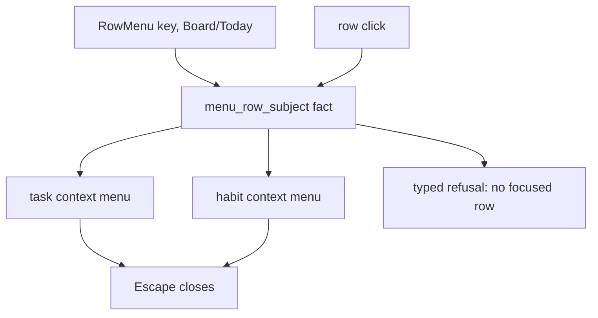
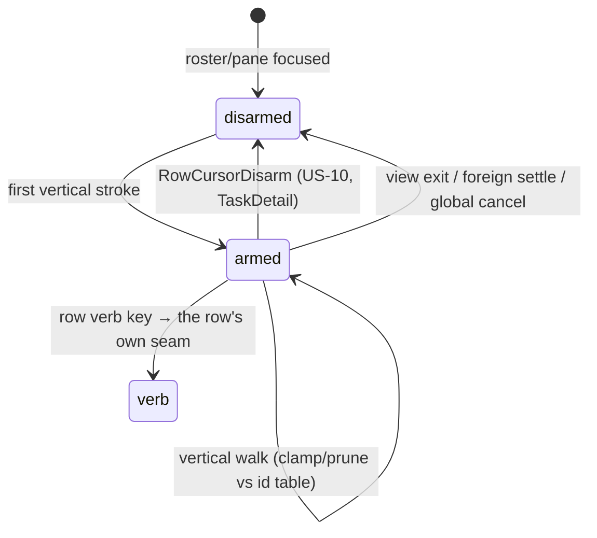
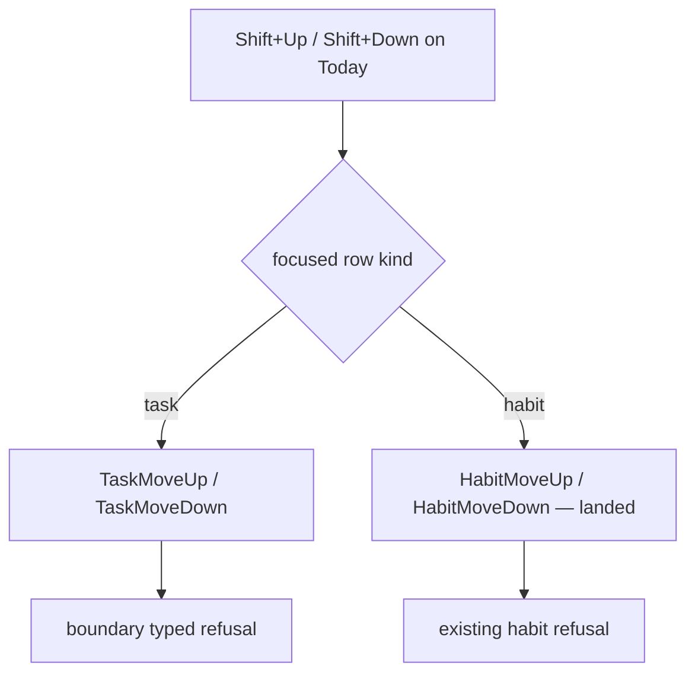

# [Plan] UX Journey Plan — the small gated bundle + parity remainder (round 4, J4)

<!--
Guidance comment STAYS in the copy per the template law; only the
<...> placeholders are filled. Parser contract: §2/§4/§6/§7 headings
and column orders are fixed (scripts/ux-coverage.sh).
-->

- **Date**: 2026-11-21
- **Kind**: UX journey plan — user stories, journeys, flows, wiring
  contract for the round-4 small gated bundle (#976/#1011/#1045/#1083/
  #1093) and the r9-parity remainder sweep (#1030/#1031/#1032/#1041/
  #1057/#1066/#1067/#1068/#1091). No implementation decisions beyond
  the command contract.
- **Origin**: round-4 scope report
  `.artifacts/reports/2026-11-21-backlog-reduction-round4-scope-report.md`
  §A4/§A5; round-4 dispatch plan
  `.artifacts/plans/2026-11-21-backlog-reduction-round4-dispatch-plan.md`
  chunks SB1/SB2/PR1/PR2; operator acceptance of this plan gates the
  four chunks.
- **Status**: DRAFT — GATE-PAUSED awaiting operator acceptance; dispatch
  may chunk from it only after ACCEPTED.
- **Surfaces touched**: Capture overlay, TaskDetail (recur editor, rule
  list, series rows, menu), Today (banner/status area, task rows,
  TimersSection break-rules roster), Review (armed File-to picker,
  planner pane), Settings (Files row, read-only signal lane), the
  app-wide preset key tables (three presets), census.
- **Platform scope**: both; per-story tags below. Keyboard stories are
  desktop-priority; preset tables are global so bindings inherit to
  kiosk where the walk-stop ladder reaches them.
- **Test-root**: crates/taskboard-ui-slint/tests (default). Journey
  tests live in `tests/journeys/small_gated_journeys.rs` (topic =
  `small-gated-journeys` → `small_gated_journeys`), step tokens as
  name prefixes.

## 1. Scope & goals

What the user can now do that they couldn't:

- **SB1 — dialog semantics + unmute**: clicking outside the capture
  overlay or the recur editor **commits** the draft (edit-kind
  dialogs, J2 R-4) instead of silently discarding it; a muted task's
  banner/status-bar button flips to **Unmute** and actually unmutes
  (the #733 twin grammar retires the banner's silent-no-op class).
- **SB2 — config/files/signals**: a Settings lane shows **why a
  external config edit did not take effect** (ConfigReload outcomes,
  read-only); the Files row gains the **poll_secs editor field**
  (retiring #1083's CLI-only exception; the Field lattice and the
  B7b apply registry converge); a **degraded-boot badge** tells the
  user the undo line was truncated while tasks are intact
  (SystemEvent::JournalDegraded — B2's hybrid policy completes).
- **PR1 — keyboard parity remainder**: one key opens a focused row's
  context menu (task AND habit); HabitRepair is keyboard-reachable;
  the break-rules roster gets the selected-row cursor; the rule
  cursor gains a disarm affordance; series pause/resume and the
  tracker-kind toggle leave the Tab-only/menu-only classes.
- **PR2 — walk affordance parity**: File-to candidate rows are
  keyboard-activatable accessible buttons; task rows on Today gain
  the compact-move the habit list already has; the planner gains the
  in-pane row cursor (directional verticals walk it).

Non-goals (each with a home):

- A muted-state badge on the notification row beyond the button
  label toggle — homed in #1011 (out-of-scope note).
- Any UI-initiated config reload or mutation from the read-only
  ConfigReload lane — deliberate absence (Ruling R-3); new
  reload-trigger verbs would need their own journey plan.
- A second cursor mechanism beside the K4 selected-row cursor state —
  deliberate absence (Ruling R-9); cursor adoption always rides K4.
- Undo/branch-picker for the capture outside-click commit's
  accidental-commit recovery — filed as backlog during planning
  (see the round report / issue list in the stage report); the
  Escape-discard path remains the explicit escape (Ruling R-1).
- The rule-cursor walk-stop ladder's semantics change (#1034 landed
  subsumption is the base; the ladder is read, not modified here).

## 2. Capability × surface matrix

<!-- Parser contract: do not rename/reorder columns. Cells cite story
IDs. The planner and the review-walk overlay render inside the Review
column slot (qualification in-cell); the banner/status area renders
app-chrome — qualified in-cell under Board. -->

| Capability | Board | TaskDetail | Today | Review | Settings | Capture | CLI |
|---|---|---|---|---|---|---|---|
| capture.draft.accept_outside_click | — | — | — | — | — | E (US-1) | — |
| recur.editor.accept_outside_click | — | E (US-2) | — | — | — | — | — |
| reminders.mute_toggle.banner | E (US-3, status bar) | D (US-3) | D (US-3) | — | — | — | — |
| config.reload_outcome.view | — | — | — | — | D (US-4, read-only) | — | — |
| files_sync.poll_secs.edit | — | — | — | — | E (US-5) | — | E (existing) |
| journal.degraded_indicator.view | — | — | D (US-6, status area) | — | D (US-6) | — | — |
| row.context_menu.open_key | E (US-7) | — | E (US-7) | — | — | — | — |
| habit.repair.key | — | — | E (US-8) | — | — | — | — |
| breakrules.cursor.walk | — | — | E (US-9) | — | — | — | — |
| rule.cursor.disarm_key | — | E (US-10) | — | — | — | — | — |
| series.pause_resume.key | — | E (US-11) | — | — | — | — | — |
| tracker.kind_toggle.key | — | E (US-12) | — | — | — | — | — |
| fileto.candidate.activate_key | — | — | — | E (US-13) | — | — | — |
| task.compact_move.today | — | — | E (US-14) | — | — | — | — |
| planner.inpane_cursor.walk | — | — | — | E (US-15, planner pane) | — | — | — |

**Rulings** (every deliberate absence; authorities cited):

| ID | Ruling | Reason | Home |
|---|---|---|---|
| R-1 | The capture overlay's outside-click flips from discard to **accept** (edit-kind dialog per J2 R-4); Escape remains the explicit discard. The recur editor's outside-click routes the accept/save seam. The W1 proof-mount's today-behavior retires per the W2 migration debt (#976). | Operator ruling Q3 2026-11-18 (J2 R-4 authority, `.artifacts/plans/2026-11-18-widget-framework-ux-plan.md`); #976 is the owed W2 debt | this plan; accidental-commit recovery homed as a backlog issue |
| R-2 | The banner/status-bar mute control becomes direction-aware: it renders **Unmute** when `state.reminders.muted` is true and dispatches `SetTaskRemindersMuted { muted: false }`; no separate muted badge is added on the banner. | The #733 notification-surface twin grammar (`.artifacts/plans/2026-11-18-tier2-dispatch-plan.md` §5) applied to the sibling surface; kills the R6-2 silent-no-op class | #1011 |
| R-3 | The ConfigReload lane is **read-only forever**: outcomes surface applied / kept-last-known-good; nothing in the UI triggers or mutates a reload. | Config-reload journey plan's command-contract delta (`.artifacts/plans/2026-11-18-config-reload-batch-ux-plan.md` §7); the UI stays a dumb client | this plan |
| R-4 | poll_secs edits write **only** through the existing whole-snapshot `UpdateSettings` lane; the B7b apply registry (`set_files_sync_poll_secs`) is the sole engine writer; no second writer is coined. The Field lattice's explicit-exception list shrinks back (no exception stays). | B7b plan `.artifacts/plans/2026-11-19-files-sync-poll-write-lane-plan.md`; #1083's CLI-only exception retires | this plan |
| R-5 | The JournalDegraded indicator is **display-only and persistent**: visible from the degraded boot until the next healthy boot's state replaces it; no dismiss affordance, no action rows. Typed payload only. | B2's hybrid policy (`.artifacts/plans/2026-11-19-journal-decode-robustness-plan.md` §6); #1093's proposal scope | this plan |
| R-6 | #1066's rollout remainder splits: PR1 lands the **break-rules roster** cursor; the **File-to rows** (#1030) and the **planner in-pane walk** (#1041) ride PR2; any further adopters the doc sweep finds stay on #1066. | The dispatch prompt's chunk mapping; keeps each chunk's cursor work in the chunk that owns the surface | #1066 (stays open) |
| R-7 | Every new chord spells per the O-8 case law (`Ctrl+Shift+t` convention; binding identity = shift bit + case-insensitive letter); the keymap contract suite is the collision authority — no preset-row silent drops, the suite regenerates per C-5's resolution rule. | O-8 (round-9 round plan) + K1 (`fix/ui-keymap-chord-case`); chunk-8 D1's no-coining ban is superseded by this plan's recorded decisions for the three new ids | this plan |
| R-8 | Today's Shift+Up/Shift+Down resolve **by focused row kind**: task row → the task compact-move pair, habit row → the landed HabitMoveUp/Down pair. No separate task chord is coined; the stroke is shared, the resolution is typed. | #1031's asymmetric-grammar finding; option 1 of the issue's proposal (per-step pair over `presentation::habit_drop_order`'s shared midpoint arithmetic) | this plan |
| R-9 | All cursor adoption rides the **K4 selected-row cursor state** (arm-on-first-vertical-stroke, refresh clamp, clear-on-exit/foreign-settle); a second cursor mechanism is a review finding, not a style choice. | K4 (row-cursor-walk plan §9) + the O-8 selected-row-cursor law; #1041's typed inert retires | this plan |
| R-10 | Kiosk inherits all preset bindings (the tables are global); the pointer-only escapes (click-to-open menus, picker clicks) remain the kiosk touch path. No kiosk-specific journeys are authored. | Shared-story platform law (docs/ux_planning.org §2.1.3) | this plan |

## 3. User stories

### US-1 — Capture outside-click commits the draft

- **Story**: As a desktop user typing a quick capture I want an
  outside click to commit my non-empty draft so that a stray click
  never silently throws away what I wrote.
- **Platforms**: desktop (the capture overlay is a desktop affordance)
- **Entry points**: outside-click on the capture overlay backdrop;
  Escape (unchanged explicit discard); the existing accept control.
- **Priority**: P1
- **Acceptance**:
  - AC-1: Given a non-empty capture draft When the backdrop is
    clicked Then the accept seam commits and the overlay closes —
    journey test.
  - AC-2: Given an empty draft When the backdrop is clicked Then no
    commit dispatches and the overlay closes — journey test.
  - AC-3: Given a non-empty draft When Escape is pressed Then the
    draft discards (explicit escape unchanged) — journey test.

### US-2 — Recur editor outside-click accepts

- **Story**: As a desktop user editing a task's recurrence I want an
  outside click to accept my staged pattern so that the editor behaves
  like every other text/field dialog (J2 R-4).
- **Platforms**: desktop
- **Entry points**: outside-click on the recur editor backdrop;
  Escape (unchanged cancel); the existing armed-confirm accept.
- **Priority**: P1
- **Acceptance**:
  - AC-1: Given a valid staged pattern When the backdrop is clicked
    Then the accept seam dispatches the recurrence change and the
    editor closes — journey test.
  - AC-2: Given an invalid/empty staged draft When the backdrop is
    clicked Then no command dispatches and the editor stays open
    (invalid-draft state) — journey test.

### US-3 — Banner Unmute direction

- **Story**: When I mute a task and later want its banner back I want
  the banner's mute control to offer Unmute so that muting is
  reversible from the same surface (no silent no-op).
- **Platforms**: both (status bar renders in both modes)
- **Entry points**: the banner/status-bar mute control (renders Mute
  or Unmute by engine truth); context unchanged.
- **Priority**: P1
- **Acceptance**:
  - AC-1: Given a muted task When the banner control is activated
    Then `SetTaskRemindersMuted { muted: false }` dispatches — seam
    test.
  - AC-2: Given an unmuted task When the banner control is activated
    Then `SetTaskRemindersMuted { muted: true }` dispatches (existing
    behavior preserved) — seam test.

### US-4 — ConfigReload outcomes, read-only lane

- **Story**: When an external edit to `taskboard.toml` is refused I
  want to see why (applied vs kept last-known-good) so that a kiosk
  operator can diagnose a config edit that did not take effect.
- **Platforms**: both (Settings lane; kiosk operator story)
- **Entry points**: the Settings read-only reload-outcome row;
  `SystemEvent::ConfigReload(ConfigReloadOutcome)` broadcast.
- **Priority**: P2
- **Acceptance**:
  - AC-1: Given an applied reload outcome When the event lands Then
    the lane shows the applied state (typed fold, no text assertion
    on prose) — fold test.
  - AC-2: Given a refused outcome (kept last-known-good) When the
    event lands Then the lane shows the kept state — fold test.
  - AC-3: No UI affordance in the lane dispatches any command —
    structural (the lane installs no callbacks beyond display).

### US-5 — Files-row poll_secs field

- **Story**: As a desktop user tuning the Files sync cadence I want a
  poll_secs field on the Files row so that the GUI editor and the CLI
  knob table cover the same keys (no CLI-only exceptions).
- **Platforms**: desktop (Settings editor)
- **Entry points**: the Files row's poll_secs spin/secs field; CLI
  `taskboard config set files_sync.poll_secs <n>` (existing).
- **Priority**: P2
- **Acceptance**:
  - AC-1: Given a valid secs value When the field commits Then the
    whole-snapshot `UpdateSettings` carries the poll_secs value and
    the apply registry honors it — seam test.
  - AC-2: Given 0 or a negative value When the field commits Then the
    typed refusal surfaces (the `> 0` gate, same as the CLI) — seam
    test.

### US-6 — JournalDegraded boot badge

- **Story**: When a boot quarantined undecodable journal rows I want
  a persistent badge telling me the undo line was truncated while all
  tasks are intact so that I understand why recent undo history is
  shorter.
- **Platforms**: both
- **Entry points**: the status-area badge; `SystemEvent::JournalDegraded`
  broadcast (typed details, dropped-row count).
- **Priority**: P2
- **Acceptance**:
  - AC-1: Given a degraded boot When the event lands Then the badge
    renders and persists — fold test.
  - AC-2: Given a healthy boot When no degraded event arrived Then no
    badge renders — fold test.
  - AC-3: The badge installs no command dispatches (display-only per
    R-5) — structural.

### US-7 — One key opens a focused row's context menu

- **Story**: As a keyboard user I want one binding that opens the
  focused row's context menu so that I can browse a row's full verb
  grammar without the pointer (click ≡ key by construction).
- **Platforms**: desktop (bindings inherit to kiosk presets)
- **Entry points**: `ActionId::RowMenu` in Board and Today contexts,
  all three preset tables.
- **Priority**: P1
- **Acceptance**:
  - AC-1: Given a focused task row When the row-menu key fires Then
    the row's context menu opens through the `menu_row_subject` path
    (same fact the pointer uses) — journey test.
  - AC-2: Given a focused habit row When the row-menu key fires Then
    the habit context menu opens — journey test.
  - AC-3: Given no focused row When the key fires Then the typed
    refusal resolves (no menu, no crash) — journey test.

### US-8 — HabitRepair keyboard binding

- **Story**: As a keyboard user with a make-up window open I want a
  chord for HabitRepair so that the repair affordance the habit card
  renders is keyboard-reachable (O-8 strict parity).
- **Platforms**: desktop (bindings inherit to kiosk)
- **Entry points**: `Ctrl+Shift+d` in the Today context, all three
  preset tables (Std/emacs/vi).
- **Priority**: P1
- **Acceptance**:
  - AC-1: Given a habit with a make-up window When Ctrl+Shift+d fires
    Then `ActionId::HabitRepair` resolves through the card strip's
    seam — journey test.
  - AC-2: Given no make-up window When Ctrl+Shift+d fires Then the
    typed refusal resolves (the card's greyed state is the pointer
    twin) — journey test.

### US-9 — Break-rules roster cursor

- **Story**: As a keyboard user on Today I want the break-rules
  roster walkable by the selected-row cursor so that roster rows obey
  the app-wide R-7 heuristic like every other interactable-row widget.
- **Platforms**: desktop
- **Entry points**: first vertical stroke at the TimersSection roster
  (arm-on-first-vertical-stroke); pointer click coherence.
- **Priority**: P2
- **Acceptance**:
  - AC-1: Given the roster focused When the first vertical stroke
    fires Then the K4 cursor arms on a roster row — journey test.
  - AC-2: Given the cursor armed When verticals continue Then the
    cursor walks with clamp/prune against the roster id table —
    journey test.
  - AC-3: Given the cursor armed on a row When the row's verb key
    fires Then the row's own seam dispatches (row verbs through the
    row's own seams) — journey test.

### US-10 — Rule-cursor disarm affordance

- **Story**: When the rule cursor is armed I want a dedicated disarm
  chord so that the TaskDetail control ladder is reachable by
  vertical keys again without a view exit or foreign settle.
- **Platforms**: desktop
- **Entry points**: `Ctrl+Shift+a` at TaskDetail while the rule
  cursor is armed; all three preset tables.
- **Priority**: P2
- **Acceptance**:
  - AC-1: Given the rule cursor armed When Ctrl+Shift+a fires Then
    the cursor disarms and verticals return to the control ladder —
    journey test.
  - AC-2: Given the cursor not armed When Ctrl+Shift+a fires Then the
    typed inert resolves (no state change) — journey test.

### US-11 — Series pause/resume chords

- **Story**: As a keyboard user at the task detail I want chords for
  SeriesPause/SeriesResume so that the series verbs are not
  Tab-only (retiring chunk 11's ruling now that they are scheduled).
- **Platforms**: desktop
- **Entry points**: `Ctrl+Shift+r` (pause) / `Ctrl+Shift+u` (resume)
  at TaskDetail; all three preset tables (R-7 spelling law; the
  keymap contract suite is the collision authority).
- **Priority**: P2
- **Acceptance**:
  - AC-1: Given a paused-eligible series When Ctrl+Shift+r fires Then
    `ActionId::SeriesPause` resolves — journey test.
  - AC-2: Given a paused series When Ctrl+Shift+u fires Then
    `ActionId::SeriesResume` resolves — journey test.

### US-12 — Tracker-kind toggle binding

- **Story**: As a keyboard user I want a chord for the tracker-kind
  toggle (`task.toggle-tracker`) so that the verb is not
  menu-reachable only (chunk 11's candidate adopted, spellings
  re-verified against the free-set).
- **Platforms**: desktop
- **Entry points**: `Ctrl+Shift+k` (Std) / `C-c k` (emacs) / `g k`
  (vi) at TaskDetail.
- **Priority**: P3
- **Acceptance**:
  - AC-1: Given a task at TaskDetail When the kind-toggle key fires
    Then `ActionId::TaskToggleTracker` resolves (distinct from
    `TaskTrackToggle`, the R-8 smart start/stop verb) — journey test.

### US-13 — File-to candidate rows keyboard-activatable

- **Story**: As a keyboard user in the armed File-to picker I want
  candidate rows to be focusable accessible buttons activated by key
  so that I can pick a target without the pointer.
- **Platforms**: desktop
- **Entry points**: the armed picker's candidate rows (accessible-role
  button + Enter activation); prev/next verbs unchanged.
- **Priority**: P2
- **Acceptance**:
  - AC-1: Given the picker armed When a candidate row activates by
    key Then the same commit seam the row's click dispatches fires —
    journey test.
  - AC-2: Rows carry accessible-role button (structural check) —
    structural test.

### US-14 — Today task compact-move

- **Story**: As a keyboard user on Today I want Shift+Up/Shift+Down
  on a focused task row to move the task so that the task list has
  the reorder parity the habit list gained in chunk 8.
- **Platforms**: desktop
- **Entry points**: Shift+Up / Shift+Down on a focused task row
  (R-8 kind-resolved resolution).
- **Priority**: P2
- **Acceptance**:
  - AC-1: Given a focused task row When Shift+Up fires Then
    `StateCommand::TaskMoveUp` dispatches and the Today order
    updates — journey test.
  - AC-2: Given a focused task row at the list boundary When Shift+Up
    fires Then the typed refusal resolves (no wrap) — journey test.
  - AC-3: Given a focused habit row When Shift+Up fires Then the
    landed `HabitMoveUp` pair still dispatches (no regression) —
    journey test.

### US-15 — Planner in-pane cursor

- **Story**: As a keyboard user in the planner I want the vertical
  directionals to walk the focused pane's rows so that the planner's
  directional grammar includes the in-pane half J3 R-7 promised.
- **Platforms**: desktop
- **Entry points**: Up/Down within the focused planner pane (rides
  the K4 cursor state); Left/Right pane switch unchanged.
- **Priority**: P2
- **Acceptance**:
  - AC-1: Given a planner pane focused When Up fires Then the K4
    cursor arms on the pane's first row (the typed inert retires) —
    journey test.
  - AC-2: Given the cursor armed When verticals continue Then the
    cursor walks the pane's rows with clamp; Left/Right still switch
    panes — journey test.
  - AC-3: Given the cursor armed on a row When the row's verb key
    fires Then the row's own seam dispatches — journey test.

## 4. Journey specs

### US-1 — Capture outside-click commits

| Step | Surface & affordance | User action | Dispatches | System response | Escape / failure |
|---|---|---|---|---|---|
| US-1/S1 | Capture overlay, draft typed | click the backdrop | — (overlay effect: outside-release routes accept) | the accept seam runs `commit_capture()`; overlay closes; task appears | US-1/S3 Escape discards instead |
| US-1/S2 | Capture overlay, empty draft | click the backdrop | — (no commit; close only) | overlay closes; no task created | any typed refusal resolves; overlay never traps |
| US-1/S3 | Capture overlay, draft typed | press Escape | — (discard path, unchanged) | draft discarded; overlay closes | the discard is immediate; re-open restores empty |

### US-2 — Recur editor outside-click accepts

| Step | Surface & affordance | User action | Dispatches | System response | Escape / failure |
|---|---|---|---|---|---|
| US-2/S1 | Recur editor, valid staged pattern | click the backdrop | the accept seam (the armed-confirm commit path) | recurrence change dispatches; editor closes; badge updates | US-2/S3 Escape cancels staged draft |
| US-2/S2 | Recur editor, invalid staged draft | click the backdrop | — (no command) | editor stays open in the invalid state; inline invalid caption | Escape cancels; no partial commit exists |
| US-2/S3 | Recur editor, staged draft | press Escape | — (cancel, unchanged) | staged draft dropped; pattern unchanged | editor reopens clean |

### US-3 — Banner Unmute direction

| Step | Surface & affordance | User action | Dispatches | System response | Escape / failure |
|---|---|---|---|---|---|
| US-3/S1 | Banner/status-bar mute control on a muted task | click or key-activate the control | `StateCommand::SetTaskRemindersMuted { muted: false }` | engine truth flips; control re-renders as Mute; banner resumes | typed refusal surfaces if the engine refuses; control stays Unmute |
| US-3/S2 | Banner/status-bar mute control on an unmuted task | activate the control | `StateCommand::SetTaskRemindersMuted { muted: true }` | control re-renders as Unmute; banner quiets | same typed-refusal escape |

### US-4 — ConfigReload read-only lane

| Step | Surface & affordance | User action | Dispatches | System response | Escape / failure |
|---|---|---|---|---|---|
| US-4/S1 | Settings reload-outcome row | — display only | — display only (`SystemEvent::ConfigReload` consumed) | lane shows applied state | stale outcome replaced by the next event; nothing to escape |
| US-4/S2 | Settings reload-outcome row | — display only | — display only | lane shows kept-last-known-good state on refusal | same; the lane never dispatches (R-3) |

### US-5 — Files-row poll_secs field

| Step | Surface & affordance | User action | Dispatches | System response | Escape / failure |
|---|---|---|---|---|---|
| US-5/S1 | Settings Files row poll_secs field | type secs, commit | `StateCommand::UpdateSettings` (whole snapshot incl. poll_secs) | apply registry honors the value; poll cadence updates | typed refusal (≤ 0) surfaces inline; prior value retained |
| US-5/S2 | Settings Files row poll_secs field | press Escape / cancel the staged value | — (no command) | staged value dropped; snapshot unchanged | the staged-edit cancel path is the field's standard escape |

### US-6 — JournalDegraded badge

| Step | Surface & affordance | User action | Dispatches | System response | Escape / failure |
|---|---|---|---|---|---|
| US-6/S1 | Status-area badge | — display only | — display only (`SystemEvent::JournalDegraded` consumed) | badge renders and persists until the next healthy boot | no interaction exists (R-5); the badge is the honest terminal state |
| US-6/S2 | Status-area badge after healthy boot | — display only | — display only | badge absent (or replaced) on the healthy signal | same |

### US-7 — Row context-menu key

| Step | Surface & affordance | User action | Dispatches | System response | Escape / failure |
|---|---|---|---|---|---|
| US-7/S1 | Focused task row (Board/Today) | press the row-menu key | `ActionId::RowMenu` → the `menu_row_subject` path | the task context menu opens, subject = focused row | Escape closes the menu (existing grammar) |
| US-7/S2 | Focused habit row (Today) | press the row-menu key | `ActionId::RowMenu` → `menu_row_subject` | the habit context menu opens | same Escape escape |
| US-7/S3 | No focused row | press the row-menu key | `ActionId::RowMenu` → typed refusal | typed inert; no menu | the refusal is the terminal state |

### US-8 — HabitRepair chord

| Step | Surface & affordance | User action | Dispatches | System response | Escape / failure |
|---|---|---|---|---|---|
| US-8/S1 | Focused habit row, make-up window open | press Ctrl+Shift+d | `ActionId::HabitRepair` | the repair seam (the card strip's twin) resolves | typed refusal when no window: same outcome as the greyed card |
| US-8/S2 | Habit card strip (pointer twin) | click repair | `ActionId::HabitRepair` | identical resolution — click ≡ key | same refusal |

### US-9 — Break-rules roster cursor

| Step | Surface & affordance | User action | Dispatches | System response | Escape / failure |
|---|---|---|---|---|---|
| US-9/S1 | TimersSection roster focused | first vertical stroke | — (ViewState: K4 cursor arms) | cursor arms on a roster row; armed styling | view exit / foreign settle / global cancel clears |
| US-9/S2 | Armed roster cursor | vertical strokes | — (ViewState walk) | cursor walks with clamp/prune against the id table | same clear sites |
| US-9/S3 | Cursor armed on a row | row verb key | the row's own seam | the row verb dispatches | the row verb's own typed refusal |

### US-10 — Rule-cursor disarm

| Step | Surface & affordance | User action | Dispatches | System response | Escape / failure |
|---|---|---|---|---|---|
| US-10/S1 | TaskDetail, rule cursor armed | press Ctrl+Shift+a | `ActionId::RowCursorDisarm` (ViewState) | cursor disarms; verticals return to the control ladder | the disarm itself is the escape; idempotent |
| US-10/S2 | TaskDetail, cursor not armed | press Ctrl+Shift+a | `ActionId::RowCursorDisarm` → typed inert | no state change | terminal |

### US-11 — Series pause/resume chords

| Step | Surface & affordance | User action | Dispatches | System response | Escape / failure |
|---|---|---|---|---|---|
| US-11/S1 | TaskDetail, series active | press Ctrl+Shift+r | `ActionId::SeriesPause` | the series pause seam resolves; pause row state updates | the verb's typed refusal (already paused / not eligible) |
| US-11/S2 | TaskDetail, series paused | press Ctrl+Shift+u | `ActionId::SeriesResume` | the resume seam resolves | the verb's typed refusal |

### US-12 — Tracker-kind toggle binding

| Step | Surface & affordance | User action | Dispatches | System response | Escape / failure |
|---|---|---|---|---|---|
| US-12/S1 | TaskDetail, task focused | press the kind-toggle key (preset spelling) | `ActionId::TaskToggleTracker` | the kind toggle resolves through the menu row's seam | the verb's typed refusal; the menu path remains the pointer twin |

### US-13 — File-to candidate activation

| Step | Surface & affordance | User action | Dispatches | System response | Escape / failure |
|---|---|---|---|---|---|
| US-13/S1 | Armed File-to picker, candidate row | Enter on the focused candidate | the candidate's commit seam (the click path) | the candidate commits; picker closes | Escape closes the picker unarmed (existing); typed refusal on commit failure |
| US-13/S2 | Armed File-to picker | prev/next verb keys | — (existing armed-candidate walk) | the candidate highlight moves | unchanged |

### US-14 — Today task compact-move

| Step | Surface & affordance | User action | Dispatches | System response | Escape / failure |
|---|---|---|---|---|---|
| US-14/S1 | Focused task row on Today | Shift+Up | `StateCommand::TaskMoveUp` | the task's Today order moves one step (shared midpoint arithmetic) | typed refusal at the boundary |
| US-14/S2 | Focused task row on Today | Shift+Down | `StateCommand::TaskMoveDown` | the task's Today order moves one step down | typed refusal at the boundary |
| US-14/S3 | Focused habit row on Today | Shift+Up | `StateCommand::HabitMoveUp` (landed, unchanged) | habit order moves — R-8 resolution proven | the habit pair's existing refusal |

### US-15 — Planner in-pane cursor

| Step | Surface & affordance | User action | Dispatches | System response | Escape / failure |
|---|---|---|---|---|---|
| US-15/S1 | Planner pane focused | Up | — (ViewState: K4 cursor arms in the pane) | cursor arms on the pane's first row; the typed inert retires | pane switch / view exit / global cancel clears |
| US-15/S2 | Armed pane cursor | Up/Down | — (ViewState walk) | cursor walks the pane's rows with clamp | same clear sites |
| US-15/S3 | Armed pane cursor on a row | row verb key | the row's own seam | the row verb dispatches | the row verb's typed refusal |
| US-15/S4 | Armed pane cursor | Left/Right | — (ViewState: `switch_plan_pane`, unchanged) | pane switches; cursor state follows the K4 clear/transfer law | same |

## 5. Interaction flows

### US-1/US-2 — the R-4 outside-click flip (one shared machine per dialog kind)

```mermaid
stateDiagram-v2
    [*] --> open : dialog mounts (capture overlay / recur editor)
    open --> committing : outside-click (edit-kind, R-4)
    open --> discarded : Escape (explicit discard/cancel)
    open --> invalid : staged draft invalid at outside-click (recur only)
    invalid --> open : invalid caption shown, editor stays
    committing --> [*] : accept seam dispatches; dialog closes
    discarded --> [*] : no command; dialog closes
```

### US-7 — row-menu key ≡ pointer click

### US-9/US-15 — cursor adoption (shared K4 shape)

### US-14 — Shift+vertical kind resolution on Today

## 6. Wiring inventory

<!-- Parser contract: do not rename/reorder columns. Row addressing
keys on callbacks + action ids + command variants (ItemAddr kinds for
list rows), never element ids. Rows with — in Commands say why in
Journey steps. Tests nominate tests/journeys/small_gated_journeys.rs
unless named otherwise. -->

<!-- Gate-grammar normalization (2026-11-22, SB2 stage 2; the #1181
classes): the W-5/W-6/W-7 Test cells carry the exact accepted row
semantics with the nominated file sides re-spelled repo-root-relative
(`tests/`-relative spellings defeat nom_file's contains-slash rule);
W-6's cell additionally nominates the app-side seam test that pins the
whole-snapshot leg. No row's meaning changed. -->

| ID | Surface file | Widget | Callback | Adapter seam | ActionId | Commands | Row addressing | Journey steps | Test |
|---|---|---|---|---|---|---|---|---|---|
| W-1 | capture overlay composition | backdrop TouchArea | capture_accepted | `install_seam!` on the overlay's outside-release → routes `view_state.commit_capture()` per R-1 | — | — | overlay singleton (pure reroute of the existing accept path; no command — see journey steps) | US-1/S1, US-1/S2 | crates/taskboard-ui-slint/tests/journeys/small_gated_journeys.rs::us1_s1_outside_click_commits_capture; crates/taskboard-ui-slint/tests/journeys/small_gated_journeys.rs::us1_s2_empty_draft_does_not_commit |
| W-2 | capture overlay composition | overlay Escape handler | capture_dismiss_requested | existing discard seam (unchanged) | — | — | overlay singleton (existing discard path; no command — see journey steps) | US-1/S3 | crates/taskboard-ui-slint/tests/journeys/small_gated_journeys.rs::us1_s3_escape_still_discards |
| W-3 | recur editor composition | backdrop TouchArea | recur_commit_clicked | `install_seam!` → armed-confirm accept path per R-1 | — | — | editor singleton (routes the existing accept path; no command — see journey steps) | US-2/S1, US-2/S2 | crates/taskboard-ui-slint/tests/journeys/small_gated_journeys.rs::us2_s1_outside_click_accepts_recur; crates/taskboard-ui-slint/tests/journeys/small_gated_journeys.rs::us2_s2_invalid_draft_stays_open; crates/taskboard-ui-slint/tests/journeys/small_gated_journeys.rs::us2_s3_escape_cancels_staged_draft |
| W-4 | status bar / banner composition | mute direction control | banner_mute_clicked | `install_seam!` on the banner control | — | StateCommand::SetTaskRemindersMuted | banner singleton (subject task from engine truth) | US-3/S1, US-3/S2 | crates/taskboard-ui-slint/tests/journeys/small_gated_journeys.rs::us3_s1_banner_unmute_dispatches_false; crates/taskboard-ui-slint/tests/journeys/small_gated_journeys.rs::us3_s2_banner_mute_preserved |
| W-5 | settings-view Files row | reload-outcome caption row | — | broadcast consumer fold (`SystemEvent::ConfigReload` → presentation enum) | — | — | settings row kind ConfigReloadLane (display only; R-3 read-only lane installs no commands — see journey steps) | US-4/S1, US-4/S2 | journeys/small_gated_journeys.rs::us4_s1_reload_outcome_folds_applied; journeys/small_gated_journeys.rs::us4_s2_refused_folds_kept |
| W-6 | settings-view Files row | poll_secs spin field | files-poll-secs-committed | the Settings staged-edit seam → whole-snapshot write (R-4: single writer) | — | StateCommand::UpdateSettings | settings row kind FilesPollSecs | US-5/S1, US-5/S2 | journeys/small_gated_journeys.rs::us5_s1_poll_secs_rides_update_settings; journeys/small_gated_journeys.rs::us5_s2_cancel_keeps_snapshot |
| W-7 | status-area composition | degraded-boot badge | — | broadcast consumer fold (`SystemEvent::JournalDegraded` → badge flag) | — | — | status-area singleton (display only; R-5 — see journey steps) | US-6/S1, US-6/S2 | journeys/small_gated_journeys.rs::us6_s1_degraded_badge_renders; journeys/small_gated_journeys.rs::us6_s2_healthy_boot_no_badge |
| W-8 | board + today row compositions | focused-row menu key | — | adapter arm `open_row_menu_keyboard` → `menu_row_subject` (no slint callback: the preset keymap row routes the action directly — see the erratum) | ActionId::RowMenu | — | ItemAddr kind TaskRow / HabitRow (focused subject; menu open is ViewState, no StateCommand — see journey steps) | US-7/S1, US-7/S2, US-7/S3 | crates/taskboard-ui-slint/tests/journeys/small_gated_journeys.rs::us7_s1_row_menu_key_opens_task_menu; crates/taskboard-ui-slint/tests/journeys/small_gated_journeys.rs::us7_s2_row_menu_key_opens_habit_menu; crates/taskboard-ui-slint/tests/journeys/small_gated_journeys.rs::us7_s3_row_menu_no_focus_typed_refusal |
| W-9 | today habit card strip | repair chord row (preset tables ×3) | — | adapter `interpret_action` → the repair seam (habits-repair-clicked twin) | ActionId::HabitRepair | — | preset rows Std/emacs/vi, Today context (existing command path) | US-8/S1, US-8/S2 | crates/taskboard-ui-slint/tests/journeys/small_gated_journeys.rs::us8_s1_habit_repair_chord_resolves; crates/taskboard-ui-slint/tests/journeys/small_gated_journeys.rs::us8_s2_repair_no_window_typed_refusal |
| W-10 | today TimersSection roster | roster rows (K4 cursor) | timers_break_remove_clicked | adapter directional arm/walk over the roster id table; the remove click moves the cursor and routes `ActionId::BreakRuleRemove` (the coherence twin — see the erratum) | ActionId::BreakRuleRemove | — | ItemAddr kind BreakRuleRow (ViewState cursor; row verbs ride existing seams — see journey steps) | US-9/S1, US-9/S2, US-9/S3 | crates/taskboard-ui-slint/tests/journeys/small_gated_journeys.rs::us9_s1_roster_cursor_arms; crates/taskboard-ui-slint/tests/journeys/small_gated_journeys.rs::us9_s2_roster_cursor_walks_clamped; crates/taskboard-ui-slint/tests/journeys/small_gated_journeys.rs::us9_s3_roster_row_verb_uses_own_seam |
| W-11 | task-detail rule list | disarm chord row (preset tables ×3) | — | adapter `interpret_action` → cursor disarm | ActionId::RowCursorDisarm | — | preset rows Std/emacs/vi, TaskDetail context (ViewState; see journey steps) | US-10/S1, US-10/S2 | crates/taskboard-ui-slint/tests/journeys/small_gated_journeys.rs::us10_s1_disarm_chord_disarms_cursor; crates/taskboard-ui-slint/tests/journeys/small_gated_journeys.rs::us10_s2_disarm_unarmed_inert |
| W-12 | task-detail series rows | pause/resume chord rows (preset tables ×3) | — | adapter `interpret_action` → series seams | ActionId::SeriesPause | ActionId::SeriesResume | preset rows Std/emacs/vi, TaskDetail context (existing command paths; the resume chord's routed id rides the Commands cell — the parser's action cell is single-token, see the erratum) | US-11/S1, US-11/S2 | crates/taskboard-ui-slint/tests/journeys/small_gated_journeys.rs::us11_s1_series_pause_chord_resolves; crates/taskboard-ui-slint/tests/journeys/small_gated_journeys.rs::us11_s2_series_resume_chord_resolves |
| W-13 | task-detail menu/verb rows | kind-toggle chord rows (preset tables ×3) | — | adapter `interpret_action` → the toggle seam | ActionId::TaskToggleTracker | — | preset rows Std/emacs/vi, TaskDetail context (existing command path) | US-12/S1 | crates/taskboard-ui-slint/tests/journeys/small_gated_journeys.rs::us12_s1_kind_toggle_chord_resolves |
| W-14 | review-walk-overlay File-to picker | candidate rows as accessible buttons | fileto-candidate-activated | `install_seam!` on the candidate activation → the candidate's commit seam (click ≡ key) | — | — | ItemAddr kind FileToCandidate (routes the existing commit path; no command — see journey steps) | US-13/S1, US-13/S2 | journeys/small_gated_journeys.rs::us13_s1_candidate_key_activation_commits; journeys/small_gated_journeys.rs::us13_s2_candidate_rows_accessible_button |
| W-15 | today task rows | compact-move resolution | task-move-requested | adapter directional/kind resolution → the move seam | — | StateCommand::TaskMoveUp, StateCommand::TaskMoveDown | ItemAddr kind TaskRow (Today order; Shift+Up/Down stay the shared strokes) | US-14/S1, US-14/S2, US-14/S3 | journeys/small_gated_journeys.rs::us14_s1_task_move_up_dispatches; journeys/small_gated_journeys.rs::us14_s2_task_move_boundary_typed_refusal; journeys/small_gated_journeys.rs::us14_s3_habit_pair_unchanged_on_habit_row |
| W-16 | planner composition | pane row cursor (K4) | — | adapter directional arm/walk over `models.rs::plan_position` panes (replaces the typed inert arm) | — | — | ItemAddr kind PlannerRow (ViewState cursor; row verbs ride existing seams — see journey steps) | US-15/S1, US-15/S2, US-15/S3, US-15/S4 | journeys/small_gated_journeys.rs::us15_s1_planner_cursor_arms; journeys/small_gated_journeys.rs::us15_s2_planner_cursor_walks_clamped; journeys/small_gated_journeys.rs::us15_s3_planner_row_verb_uses_own_seam; journeys/small_gated_journeys.rs::us15_s4_pane_switch_preserves_cursor_law |

## 7. Command-contract delta

<!-- Parser contract: do not rename/reorder columns. -->

| Kind | Name | Payload sketch | Journeys |
|---|---|---|---|
| StateCommand | TaskMoveUp | subject: focused Today task row (ItemAddr TaskRow) | US-14/S1 |
| StateCommand | TaskMoveDown | subject: focused Today task row (ItemAddr TaskRow) | US-14/S2 |
| StateCommand (changed) | UpdateSettings | gains the `files_sync.poll_secs` field on the whole-snapshot payload (the engine-side `set_files_sync_poll_secs` apply lane is landed by B7b — no new writer) | US-5/S1 |
| StateCommand (rerouted) | (capture/recur accept paths) | no variant change: outside-click routes the existing accept seams per R-1 | US-1/S1, US-2/S1 |
| ActionId | RowMenu | opens the focused row's context menu via `menu_row_subject`; Board + Today contexts, three presets | US-7/S1–S3 |
| ActionId | RowCursorDisarm | disarms the armed selected-row cursor (TaskDetail context; composed with the armed-flow grammar per the dispatch traps) | US-10/S1–S2 |
| ActionId (bound) | HabitRepair | new preset rows: Ctrl+Shift+d, Today context, three presets (variant exists) | US-8/S1–S2 |
| ActionId (bound) | SeriesPause / SeriesResume | new preset rows: Ctrl+Shift+r / Ctrl+Shift+u, TaskDetail context, three presets (variants exist) | US-11/S1–S2 |
| ActionId (bound) | TaskToggleTracker | new preset rows: Std Ctrl+Shift+k / emacs C-c k / vi g k, TaskDetail context (variant exists; distinct from TaskTrackToggle) | US-12/S1 |
| UiRequest | — none | no new UiRequest: SB2's signal lanes are broadcast consumers, not request/response | — |
| SystemEvent (consumed) | ConfigReload(ConfigReloadOutcome) | existing variant; new read-only UI consumer | US-4/S1–S2 |
| SystemEvent (consumed) | JournalDegraded { details, dropped, re-pinned head } | existing variant; new read-only UI consumer | US-6/S1–S2 |

## 8. Verification plan

- **Journey tests** (all in `tests/journeys/small_gated_journeys.rs`,
  step tokens as name prefixes): us1_s1_outside_click_commits_capture, us1_s2_empty_draft_does_not_commit,
  us1_s3_escape_still_discards, us2_s1_outside_click_accepts_recur,
  us2_s2_invalid_draft_stays_open, us2_s3_escape_cancels_staged_draft,
  us3_s1_banner_unmute_dispatches_false, us4_s1_reload_outcome_folds_applied,
  us5_s1_poll_secs_rides_update_settings, us5_s2_cancel_keeps_snapshot,
  us6_s1_degraded_badge_renders, us6_s2_healthy_boot_no_badge,
  us7_s1_row_menu_key_opens_task_menu, us8_s1_habit_repair_chord_resolves,
  us9_s1_roster_cursor_arms, us10_s1_disarm_chord_disarms_cursor,
  us11_s1_series_pause_chord_resolves, us12_s1_kind_toggle_chord_resolves,
  us13_s1_candidate_key_activation_commits, us14_s1_task_move_up_dispatches,
  us15_s1_planner_cursor_arms.
- **Seam tests**: exact-command assertions for SetTaskRemindersMuted
  (both directions), UpdateSettings poll_secs field presence, the
  TaskMove pair's dispatch; keymap contract suite regeneration for
  every new preset row (no silent drops — C-5's resolution rule).
- **Fold/presentation tests**: ConfigReloadOutcome → presentation
  enum folds; JournalDegraded badge flag; the banner mute-direction
  fold from engine truth; typed outcomes only — no text assertions.
- **Structural tests**: the two read-only lanes install no command
  callbacks (US-4 AC-3, US-6 AC-3); File-to candidate rows carry
  accessible-role button (US-13 AC-2); the Field lattice exception
  list shrinks (no poll_secs exception stays).
- **Kiosk gates**: US-1/US-2 (pointer overlay semantics) render
  desktop-scoped; the status-bar/badge lanes render in both modes;
  preset bindings inherit globally (R-10).
- **Manual**: the walkthrough protocol at stage 3 covers the
  recognition judgments (badge semantics, Unmute label clarity, the
  disarm chord's discoverability) — judged, never text-asserted.

### 8.1 Gate-grammar erratum (SB1 stage-2 normalization, 2026-11-22)

Mechanical amendments to SB1's rows only (the #1181 parser classes;
behavior unchanged):

- **Callback spellings unified with the landed source** (the HF4
  class: the markup names carry the snake spellings the generated
  adapter and the seam manifest list): W-1's
  `capture-backdrop-released` is `capture_accepted` (the host's
  edit-kind `accepted` resolution; the mount chains the existing
  `capture_dismiss_requested` after it so the commit closes the
  overlay, US-1/AC-1); W-2's `capture-escape-requested` is the
  existing `capture_dismiss_requested` discard seam; W-3's
  `recur-backdrop-released` is the existing `recur_commit_clicked`
  (the host already routed it, kind `edit`); W-4's
  `banner-mute-toggled` is the existing `banner_mute_clicked`. No new
  callback was coined — the flip is the pure reroute §7 already
  records; the four cited callbacks were renamed kebab→snake in the
  markup (generated Rust names identical).
- **Test nominations made root-relative**: the §6 Test cells for
  W-1..W-4 nominate
  `crates/taskboard-ui-slint/tests/journeys/small_gated_journeys.rs::…`
  in full (the short `journeys/…` spelling defeats the parser's
  root-relative resolution). US-2/S3's evidence is
  `us2_s3_escape_cancels_staged_draft` (landed with SB1).

SB1 gate evidence: W-1..W-4 + US-1/S1–S3, US-2/S1–S3, US-3/S1–S2 all
FOUND; the residual MISSING rows are SB2/PR1/PR2's (separate chunks).

## 9. Definition of done

- [ ] `scripts/ux-coverage.sh .artifacts/plans/2026-11-21-small-gated-journeys-ux-plan.md --gate` exits 0
- [ ] Every P1 story's journey completes end-to-end including escapes
      (US-1, US-2, US-3, US-7, US-8)
- [ ] Walkthrough protocol executed at stage 3; findings resolved or
      homed
- [ ] All matrix absences carry rulings; the census slice (Board,
      Today, TaskDetail, Review/planner, Settings) updated
- [ ] Non-goals filed as backlog issues (reported in the stage report)
- [ ] The four chunk plans (same date prefix) map 1:1 onto this plan's
      US/W/R ids; P1 slice = SB1 + PR1's US-7/US-8 wiring

### Erratum — the PR1 gate-grammar normalization (the #1181 class; stage-2, 2026-11-22)

Mechanical amendments to PR1's rows only (behavior unchanged; the SB1
normalization's pattern):

- **W-8's callback cell** named `row-menu-requested` — no slint
  callback exists (a new callback would be dead markup). The keymap
  preset row routes `ActionId::RowMenu` straight through the action
  layer; the adapter arm (`open_row_menu_keyboard`) owns the open,
  the anchor, and the typed refusal. Cell normalized to `—` with the
  routing spelled in the Adapter seam column.
- **W-10's callback cell** named `break-rule-row-clicked` — the
  landed coherence seam is the existing `timers_break_remove_clicked`
  remove click, re-rooted onto the routed `ActionId::BreakRuleRemove`
  (the cursor moves, then the arm toggles in the adapter arm). Cell
  normalized to the landed snake spelling.
- **The PR1 rows' Test nominations made root-relative** (the SB1
  normalization's second class): the bare
  `journeys/small_gated_journeys.rs::…` sides resolve against the
  plan root, not the Test-root — the root-relative spellings are the
  landed ones. PR2's rows (W-14/W-15) keep their pre-normalization
  sides (PR2's chunk normalizes its own).
- **W-12's ActionId cell** carried both ids comma-joined; the parser's
  action cell is single-token. `ActionId::SeriesPause` stays in the
  Action cell; `ActionId::SeriesResume` moves to the Commands cell
  (the parser resolves `ActionId::*` command tokens against
  actions.rs — the contract content is unchanged: both are routed
  action ids, neither is a StateCommand).
