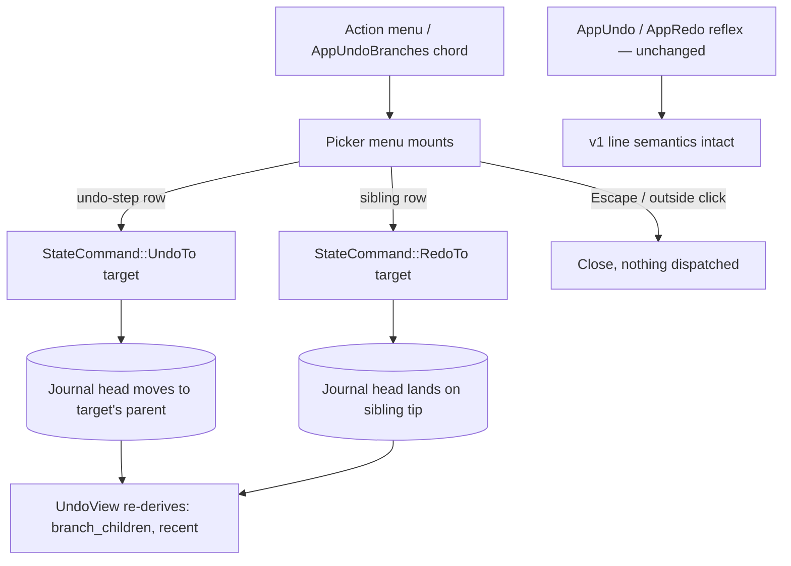
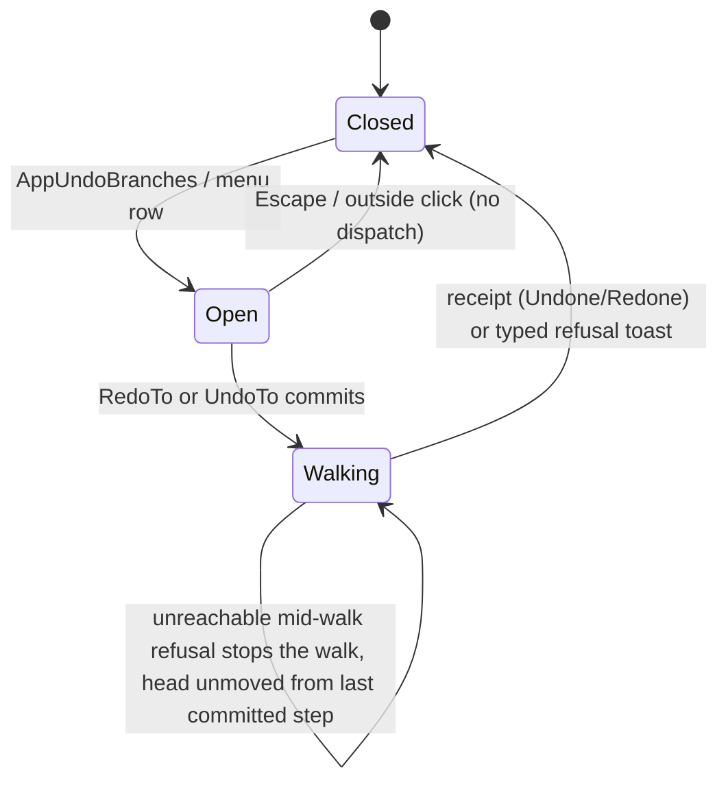

# UX Journey Plan — undo v2, chunk UF2: the branch-picker UI over the journaled tree

<!--
Copied from .artifacts/templates/ux-journey-plan.md; guidance comment
retained per the template's own instruction. This is the round-4
undo-v2 UI family's chunk plan for UF2 (`feat/ui-undo-branch-picker`,
issue #353) — the sibling of
2026-11-21-undo-ui-reminder-undo-plan.md (UF1, #354). The granularity
decision (two per-chunk plans) is recorded in that file's §1.
-->

- **Date**: 2026-11-21
- **Kind**: UX journey plan — user stories, journeys, flows, wiring
  contract for the v2 undo branch-picker UI. No implementation
  decisions beyond the command contract.
- **Origin**: the undo architecture design plan
  (`.artifacts/plans/2026-10-19-undo-architecture-design-plan.md`)
  §3.4 (D-U4: journal the tree, expose a line; the branch-picker
  deferral is "additive data work, not a migration") + §8 candidate 1 →
  issue #353; the landed base: `JournalState` parent pointers +
  `children_of` (journal.rs), `UndoView`/`UndoView::derive`/
  `derive_for_board` (journal.rs:317+), the D5 greatest-child redo
  rule (`plan_redo`), `UndoScope` + `UndoOnBoard`/`RedoOnBoard`
  (#355 landed), the `AppUndo`/`AppRedo` reserved-row wiring (undo
  surfaces flip); round-4 scope report §A3; round-4 dispatch plan
  J3/UF2 rows (traps a–c).
  **Authority note (recorded decision)**: the 2026-10-19 decision
  session parked #353 as "needs further consideration — the v1 line
  discipline may prove sufficient"; the operator **reaffirmed
  #353/#354 into round 4 on 2026-11-21** — this plan is written under
  that reaffirmation, which supersedes the parking note.
- **Status**: DRAFT — operator gate pending.
- **Surfaces touched**: the action-menu composition
  (`ui/compositions/action-menu.slint` — the census already names it
  as the undo/redo host); a new picker menu mounted from the undo
  affordance (MenuShell precedent, the BF-W-N2 doctrine rows);
  `UndoView` widening (domain projection, additive); no journal
  migration, no storage change.
- **Platform scope**: desktop for the picker entry (a pointer+keyboard
  menu affordance); the kiosk keeps the v1 line (ruled R-2 — kiosk
  viewers are not editors of abandoned branches; the reflex stays).
- **O-rulings**: O-2's additive law binds (projection widening +
  engine commands only; no entity/journal shape change). O-5 CLI
  parity: the CLI gains no branch verbs in this chunk — ruled R-5 with
  a backlog home. The UF2 dispatch traps bind verbatim: (a) the picker
  consumes the journal tree's parent pointers — no journal migration;
  (b) the v1 line composes — the picker is the v2 extension, not a
  replacement (Ctrl+Z/Ctrl+Shift+Z keep their exact semantics; the
  picker is an additional, opt-in affordance); (c) sibling-branch
  labels are typed projections derived engine-side, never UI-side
  guesses.

## 1. Scope & goals

**What the user can now do that they couldn't**: after undoing some
steps and making a new edit (the classic branch point), see that the
abandoned redo branch exists and switch to it — the editor-mental-model
feature every desktop undo tree trains: "I experimented, went another
way, and now want the experiment back without losing my newer path."

**Goals**:

- G1: `UndoView` widens additively with a typed sibling projection:
  the head's children (the redo candidates) with their labels —
  `branch_children: Vec<UndoLabel>` (the existing `UndoLabel` type; a
  bounded window like `recent`, kiosk memory stays modest). Derived at
  every publish like the rest of `UndoView`; never persisted; no
  journal migration (trap a).
- G2: two new engine commands, `UndoTo`/`RedoTo`, targeting a journal
  entry id: walk the existing `plan_undo`/`plan_redo` planners until
  the target is reached (one command, N internal steps, each step's
  D-U2 pushed/retract behaviour applied per entry; the head lands on
  the target's parent for undo / on the target for redo). Typed
  refusals: `TargetNotInLine` (the id is not on the current line),
  plus the planners' existing refusals surface unchanged. This is what
  lets the picker choose a *non-greatest* redo sibling — the one thing
  repeated `Redo` (D5 greatest-child) cannot express.
- G3: the picker UI: a bounded menu mounted from the undo affordance
  listing (a) the redo candidates (`branch_children` — the sibling
  branches) and (b) undo-step targets along the current line
  (the `recent` window is the label source; choosing an ancestor is
  `UndoTo`). The v1 line composes (trap b): the picker is additive —
  plain undo/redo rows stay first in the menu (the BF-W-N2 doctrine:
  destructive/less-common rows last).
- G4: sibling labels are typed projections (trap c): each
  `branch_children` row carries the journaled command's derived label
  (`command_label`), which is engine-derived — the UI renders, never
  synthesizes.

**Non-goals (each with a home)**:

- N1: per-board picker filtering — `derive_for_board` exists (#355)
  but the picker ships global-line first (D-U4's board-scoping open
  point stays #355's vehicle). Home: #355.
- N2: arbitrary-node jumping beyond the bounded label windows (deep
  history spelunking over thousands of entries) — the journal is a
  bounded ring (retention, v1); the picker exposes the head's children
  + the recent window, not a full-tree browser. Home: backlog issue
  (filed at acceptance).
- N3: CLI branch verbs (`undo to <id>` / `redo to <id>`) — O-5
  parity for the new engine commands; the picker is GUI-only in this
  chunk. Home: backlog issue (filed at acceptance).
- N4: branch *merge* or cross-branch diffing — research fiction; no
  motivation on record. Home: none (recorded as a non-item; reopen
  only with evidence).
- N5: persistence/sync of "current branch choice" across devices —
  the journal is device-local by design (D-U1); the head is local
  state. Home: none (law, not debt).

## 2. Capability × surface matrix

| Capability | Board | TaskDetail | Today | Review | Settings | Capture | CLI |
|---|---|---|---|---|---|---|---|
| journal.branch_pick | E (US-1 — action-menu entry) | E (US-1 — same global menu, reachable anywhere) | E (US-1) | E (US-1) | E (US-1) | E (US-1) | — (R-5) |
| journal.undo (v1 line) | E (pre-existing; unchanged — US-2 composes) | E | E | E | E | E | E (pre-existing, `undo`) |
| journal.redo (v1 line) | E (pre-existing; unchanged) | E | E | E | E | E | E (pre-existing, `redo`) |
| journal.branch_labels (display) | D (US-1 — picker rows) | D (US-1) | D (US-1) | D (US-1) | D (US-1) | D (US-1) | — (R-5) |

**Rulings** (every deliberate absence):

| ID | Ruling | Reason | Home |
|---|---|---|---|
| R-1 | `journal.branch_pick` is absent from the CLI column | O-5 parity is per-family; #353 is labelled `ui`, the picker's value is pointer/keyboard menu interaction, and the CLI's `undo`/`redo` reflex already covers the line. Parity for the new `UndoTo`/`RedoTo` verbs is a separate, unmotivated surface today | Backlog issue (N3, filed at acceptance) |
| R-2 | Kiosk: the picker entry renders absent (desktop-qualified `E`), the v1 reflex stays global | Kiosk viewers are not editing sessions; the abandoned-branch moment is a desktop-editor scenario. The reflex (Ctrl+Z equivalent rows) keeps its existing kiosk qualification unchanged | This plan §1 (platform scope) |
| R-3 | No board-scoped picker rows | #355 owns per-board line scoping; shipping the picker unscoped avoids a half-fitted filter the operator never asked for | #355 |
| R-4 | No settings surface (no "show branch picker" knob) | The picker is a menu row off an existing affordance, not a mode; a knob would be a setting for a thing that is always available and unobtrusive | This plan §1 |
| R-5 | `UndoTo`/`RedoTo` gain no CLI verb in this chunk | Same reasoning as R-1, kept as a separate ruling so the command-delta rows stay auditable | Backlog issue (N3) |

## 3. User stories

### US-1 — Switch back to an abandoned branch

- **Story**: When I undid a few steps and then made a different edit
  (so the old redo path became an abandoned branch), I want to open
  the undo menu, see that branch listed by what it contained, and
  switch to it — without losing my newer work to manual re-typing.
- **Platforms**: desktop.
- **Entry points**: the picker row in the action menu (hosted where
  undo/redo already live — the census's `action-menu.slint`
  composition), `ActionId::AppUndoBranches` (new, keymap preset).
- **Priority**: P1.
- **Acceptance**:
  - AC-1: Given a journal with an abandoned redo branch When the
    picker mounts Then it lists the head's children as rows with
    engine-derived labels (`UndoView.branch_children` non-empty, rows
    carry typed ids) — verified by journey test.
  - AC-2: Given a chosen sibling row When it commits Then
    `StateCommand::UndoTo`/`RedoTo` moves the line to the chosen
    branch and the presented state reflects that branch's head —
    verified by journey test + state snapshot.
  - AC-3: Given no abandoned branch (head has no children) When the
    picker mounts Then the sibling section renders empty/absent and
    the undo-step rows still mount (typed structural facts, not
    text) — verified by journey test.
  - AC-4: Given Escape or an outside click on the open picker Then it
    closes with nothing dispatched (the R-4 edit-kind grammar; the
    picker is a pure selection menu) — verified by journey test.

### US-2 — Jump several steps back along the line

- **Story**: When I want to undo more steps than I care to repeat
  Ctrl+Z for, I want to pick an earlier point from the picker's undo
  rows so that the walk back is one deliberate action.
- **Platforms**: desktop.
- **Entry points**: the same picker (`AppUndoBranches`); the
  undo-rows section lists the `recent` window's ancestors.
- **Priority**: P1.
- **Acceptance**:
  - AC-1: Given an N-entry line When an ancestor row commits Then
    `StateCommand::UndoTo { target }` lands the head exactly on that
    ancestor (all intermediate inverses applied, one `Undone`
    receipt naming the final entry) — verified by domain fold test +
    journey test.
  - AC-2: Given a target not on the current line (stale picker data
    after an intervening edit) When `UndoTo` plans Then the typed
    refusal `TargetNotInLine` surfaces and the head is unmoved —
    verified by domain fold test (`matches!` on the variant).

### US-3 — The v1 reflex composes with the picker (regression fence)

- **Story**: As a user who never opens the picker I want plain
  undo/redo to behave exactly as today so that the v2 extension
  changes nothing about the reflex I already trust.
- **Platforms**: both.
- **Entry points**: `ActionId::AppUndo` / `AppRedo` (unchanged), CLI
  `undo`/`redo` (unchanged).
- **Priority**: P1.
- **Acceptance**:
  - AC-1: Given the picker shipped When plain `Undo`/`Redo` plans
    Then their behaviour is byte-identical to pre-UF2 semantics (D5
    greatest-child redo; parent-walk undo) — verified by the existing
    engine corpus passing unchanged (no insta regeneration for the
    line arms) + a regression fold test pinning `Redo`'s greatest-child
    choice with two siblings present.

## 4. Journey specs

### US-1 — Switch back to an abandoned branch

| Step | Surface & affordance | User action | Dispatches | System response | Escape / failure |
|---|---|---|---|---|---|
| US-1/S1 | Action menu (the undo host) | Open the menu / press the branches chord | `ActionId::AppUndoBranches` (mount only — no command) | Picker menu mounts: undo-step rows (the `recent` ancestors), redo-candidate rows (the head's `branch_children`, i.e. the sibling branches), plain undo/redo rows first (BF-W-N2 ordering) | Escape / outside click closes with nothing dispatched (US-1/S4) |
| US-1/S2 | Picker: sibling-branch row | Click / keyboard-select the abandoned branch's tip row | `StateCommand::RedoTo { target: <sibling tip id> }` | Engine walks: undo back to the fork, redo down the chosen sibling — head lands on the tip; `Redone { entry }` receipt; state publishes the branch's content | Typed refusal (`TargetNotInLine` for stale data, or a planner refusal mid-walk): toast names the reason, head unmoved |
| US-1/S3 | Presented state | — (display only) | — | The board reflects the chosen branch; `UndoView` re-derives (new head, new `branch_children`) | The picker remains openable — switching to another sibling (or back) is the same journey re-run; plain undo/redo always available |
| US-1/S4 | Picker | Escape / outside click | — (none) | Picker closes, nothing dispatched, no state change | — (this step *is* the escape) |

### US-2 — Jump several steps back along the line

| Step | Surface & affordance | User action | Dispatches | System response | Escape / failure |
|---|---|---|---|---|---|
| US-2/S1 | Picker: undo-step rows | Select an ancestor row | `StateCommand::UndoTo { target: <ancestor id> }` | N inverse steps planned and applied; head lands on the target's parent; `Undone { entry }` names the last undone entry; toast shows the final label | Typed refusal mid-walk (a `NotUndoable` entry on the path is unreachable by construction and its ancestors with it — the walk stops there; the picker's row set derives from the same rule, so a stale row is the only trigger: `TargetNotInLine`) |
| US-2/S2 | Presented state | — (display only) | — | State reflects the earlier point; redo path (the discarded newer edits) is now the sibling branch — reachable again via US-1 | Plain `Redo` walks it back step-by-step (v1 composes) |

### US-3 — The v1 reflex composes (regression fence)

| Step | Surface & affordance | User action | Dispatches | System response | Escape / failure |
|---|---|---|---|---|---|
| US-3/S1 | Global undo reflex | Ctrl+Z (as today) | `StateCommand::Undo` (unchanged) | Identical to pre-UF2 semantics (parent-walk once) | Typed refusals unchanged |
| US-3/S2 | Global redo reflex | Ctrl+Shift+Z (as today) | `StateCommand::Redo` (unchanged) | Greatest-child redo (D5) even when siblings exist — the picker never changes the reflex's choice | Typed refusals unchanged |

## 5. Interaction flows

## 6. Wiring inventory

| ID | Surface file | Widget | Callback | Adapter seam | ActionId | Commands | Row addressing | Journey steps | Test |
|---|---|---|---|---|---|---|---|---|---|
| W-1 | ui/compositions/action-menu.slint | MenuShell picker mount (new composition) | undo_branches_open | adapter.rs::install_undo_seams | ActionId::AppUndoBranches | — | — (mount only; pure navigation — no command dispatch on open, the plan's W-1 row) | US-1/S1, US-1/S4, US-3/S1 | crates/taskboard-ui-slint/tests/journeys/undo_ui_branch_picker_journeys.rs::us1_s1_picker_mounts_with_sections, crates/taskboard-ui-slint/tests/journeys/undo_ui_branch_picker_journeys.rs::us1_s1_kiosk_picker_entry_renders_absent, crates/taskboard-ui-slint/tests/journeys/undo_ui_branch_picker_journeys.rs::us1_s4_escape_closes_without_dispatch, crates/taskboard-ui-slint/tests/journeys/undo_ui_branch_picker_journeys.rs::us3_s1_plain_rows_route_the_unchanged_v1_verbs |
| W-2 | ui/compositions/action-menu.slint | Picker sibling row (per branch_children entry) | undo_branch_picked | adapter.rs::install_undo_seams | — | StateCommand::RedoTo | ItemAddr kind: journal-entry row (the payload id IS the addressing — the UI is id-less over elements, not over journal nodes) | US-1/S2, US-1/S3 | crates/taskboard-ui-slint/tests/journeys/undo_ui_branch_picker_journeys.rs::us1_s2_sibling_commit_redo_to, crates/taskboard-ui-slint/tests/journeys/undo_ui_branch_picker_journeys.rs::us1_s2b_stale_target_toasts_typed_refusal, crates/taskboard-ui-slint/tests/journeys/undo_ui_branch_picker_journeys.rs::us1_s3_post_switch_state_reflects_branch |
| W-3 | ui/compositions/action-menu.slint | Picker undo-step row (per recent ancestor) | undo_target_picked | adapter.rs::install_undo_seams | — | StateCommand::UndoTo | journal-entry row (same kind as W-2) | US-2/S1 | crates/taskboard-ui-slint/tests/journeys/undo_ui_branch_picker_journeys.rs::us2_s1_ancestor_commit_undo_to |
| W-4 | (none — domain projection) | (none) | — | journal.rs UndoView::derive widening (branch_children: Vec UndoLabel, bounded) | — | — | — (derived projection, no command; US-1/S1 and US-1/S3's row source) | US-1/S1, US-1/S3 | crates/taskboard-domain/src/journal/tests.rs::us1_ac1_branch_children_derive_with_labels, crates/taskboard-domain/src/journal/tests.rs::us1_ac3_branch_children_empty_without_fork |
| W-5 | (none — domain) | (none) | — | undo.rs plan_undo_to / plan_redo_to (wrapping the existing planners in a bounded walk) | — | StateCommand::UndoTo; StateCommand::RedoTo | — | US-1/S2, US-2/S1, US-2/AC-2 | crates/taskboard-domain/src/undo/tests.rs::us2_ac2_stale_target_refuses_typed, crates/taskboard-domain/src/undo/tests.rs::us2_ac1_undo_to_lands_head_exactly_on_target, crates/taskboard-domain/src/undo/tests.rs::us3_ac1_redo_greatest_child_unchanged_with_siblings, crates/taskboard-domain/src/undo/tests.rs::us1_s2b_walk_stops_at_unreachable_target, crates/taskboard-domain/src/undo/tests.rs::us1_s2_redo_to_takes_the_chosen_sibling_branch |
| W-6 | ui adapter (existing toast lane) | existing outcome notice | — | adapter.rs::arm_outcome_notice (the existing handler; no new callback — the UF2 refusals ride the unchanged lane) | — | — | — (receipt rendering, unchanged lane; US-1/S2 and US-2/S1's failure paths) | US-1/S2 | crates/taskboard-ui-slint/tests/journeys/undo_ui_branch_picker_journeys.rs::us1_s2b_stale_target_toasts_typed_refusal |

## 7. Command-contract delta

| Kind | Name | Payload sketch | Journeys |
|---|---|---|---|
| StateCommand | `UndoTo` | `{ target: JournalId }` — walk `plan_undo` until the head's parent == target; refusals: `TargetNotInLine`, planner refusals surface unchanged | US-2/S1, US-1 (implicit when the picker's redo walks back) |
| StateCommand | `RedoTo` | `{ target: JournalId }` — undo to the target's fork then redo down the chosen sibling to the tip; refusals: `TargetNotInLine`, planner refusals | US-1/S2 |
| CommandOutcome | (none new) | `Undone { entry }` / `Redone { entry }` receipts name the final entry of the walk | US-1/S2, US-2/S1 |
| CommandError | `TargetNotInLine` | new variant (typed, `matches!`-asserted): the target id is not reachable from the current head | US-2/AC-2 |
| AppState projection | `UndoView.branch_children` | `Vec<UndoLabel>` — the head's children, newest-first, bounded (same cap discipline as `recent`); additive field, `Default`-compatible, never persisted | US-1/S1, US-3 |
| ActionId | `AppUndoBranches` | keymap preset row (chord assigned per the O-8 case law / K1 binding rules at implementation time) | US-1/S1 |
| UiRequest | (none new) | — | — |

## 8. Verification plan

- **Journey tests** (`crates/taskboard-ui-slint/tests/journeys/undo_ui_branch_picker_journeys.rs`):
  `us1_s1_picker_mounts_with_sections`, `us1_s2_sibling_commit_redo_to`,
  `us1_s2b_stale_target_toasts_typed_refusal` (typed variant, not text),
  `us1_s3_post_switch_state_reflects_branch`,
  `us1_s4_escape_closes_without_dispatch`,
  `us2_s1_ancestor_commit_undo_to`.
- **Seam tests**: the two new adapter callbacks dispatch the exact
  command payloads (`us1_s2`/`us2_s1` cover them via the driver; the
  `seam_inventory` gains the two callbacks — an inventory miss at
  stage 2 is the expected pre-landing state, resolved by the chunk).
- **Fold/presentation tests** (domain, exact-name nominated):
  `journal/tests.rs::us1_ac1_branch_children_derive_with_labels`,
  `journal/tests.rs::us1_ac3_branch_children_empty_without_fork`,
  `undo/tests.rs::us2_ac2_stale_target_refuses_typed`,
  `undo/tests.rs::us3_ac1_redo_greatest_child_unchanged_with_siblings`,
  `undo/tests.rs::us1_s2b_walk_stops_at_unreachable_target` (the
  `NotUndoable`-on-path law: the walk refuses before crossing it).
- **Snapshot**: `UndoView` widening is the one deliberate insta
  regeneration pass (DF-9) — the line arms' corpus entries must be
  otherwise unchanged (US-3/AC-1's fence; any diff beyond the
  projection field is a finding).
- **Kiosk gates**: the picker entry renders absent on kiosk (R-2) —
  pinned by the composition probe asserting the affordance's
  platform-qualified absence (structural, not pixel).
- **Bound-test nominations** (the #768 grammar, the descriptively
  named evidence the chunks' fold tests carry):
  bound-test: US-2/S2 -> undo/tests.rs::us2_ac1_undo_to_lands_head_exactly_on_target
  bound-test: US-3/S2 -> undo/tests.rs::us3_ac1_redo_greatest_child_unchanged_with_siblings
- **Manual**: the label semantics of sibling rows (does "Move task"
  with its task name identify the branch well enough?) — judged at the
  stage-3 walkthrough per the recognition-over-recall doctrine; the
  walk's toast copy likewise.

## 9. Definition of done

- [ ] `scripts/ux-coverage.sh <this file> --gate` exits 0
- [ ] Every P1 story's journey completes end-to-end including escapes
      (US-1, US-2, US-3)
- [ ] Walkthrough protocol executed at stage 3; findings resolved or
      homed
- [ ] All matrix absences carry rulings (R-1..R-5); census updated:
      the `app.undo` family gains a `journal.branch_pick` row
      (desktop-qualified) and the action-menu composition note
- [ ] Non-goals filed as backlog issues: N2 (deep-history browsing),
      N3 (CLI parity for `UndoTo`/`RedoTo`) — numbers recorded on
      issue #353

## 10. Erratum — gate-grammar conformance (2026-11-22, stage 2)

Mechanical amendments only, no semantic change (the 28d35937
precedent): the §6 wiring cells normalized to the parser's grammar —
the snake callback spellings the slint source, the adapter
`install_seam!` sites and `seam_inventory.rs` agree on (UF2's seams
landed snake-first); the Commands cells that name an absence reduced
to the bare `—` (the OP1/OP2 erratum's rule — the prose moved to the
Row-addressing cell); the Test cells carry this chunk's full
nomination set, including the kiosk-absence probe and the fence
journey the §8 verification list already named. W-6's callback cell
names the existing handler (`arm_outcome_notice`) instead of the prose
"existing handler". The W-5 test nominations gained the walk tests'
exact names (us2_ac1, us1_s2b, us1_s2, us3_ac1) — the §8 catalogue's
names, verbatim.
