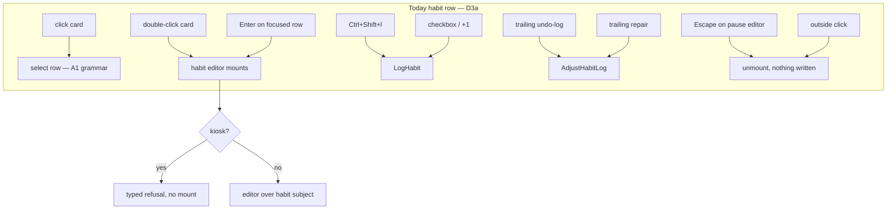
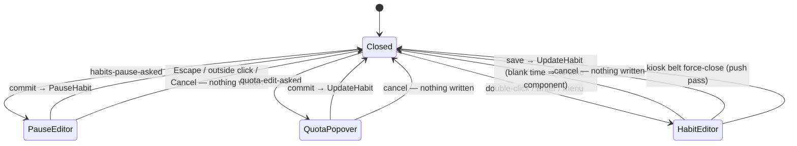
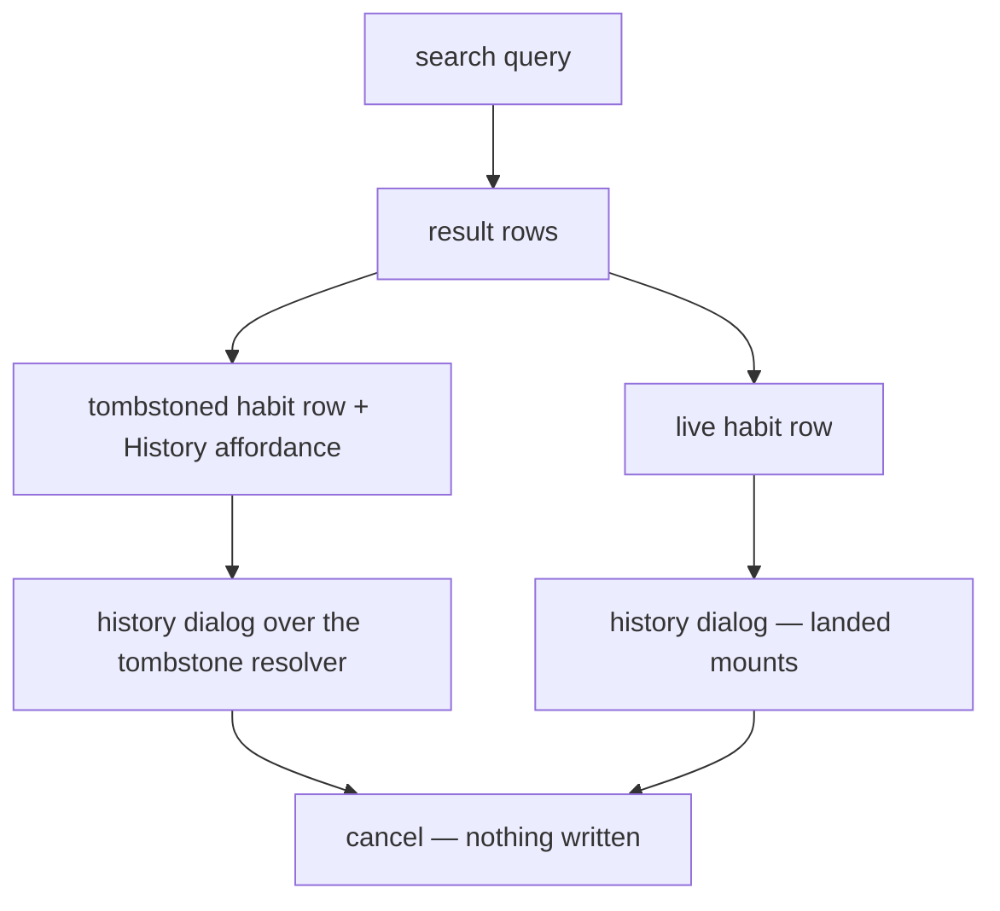

# Habit Surface Journeys UX Journey Plan — Today-habits interaction polish + habit editor/history polish

<!--
Copied from .artifacts/templates/ux-journey-plan.md — the guidance
comment STAYS in the copy. A UX journey plan is written BEFORE the
dispatch plan that chunks the feature; the dispatch plan's Origin
cites this file. Full law: docs/ux_planning.org; trigger rule:
AGENTS.md §7. Sections 2, 4, 6, 7 use fixed table headers AND fixed
level-2 heading titles — scripts/ux-coverage.sh parses them. Step IDs
are greppable tokens; tests embed them in snake_case (US-1/S2 ->
us1_s2). Cells avoid `|`. Tokens in tables are written bare (no
inline-code spans) per the #1181 residue class.
-->

- **Date**: 2026-11-22
- **Kind**: UX journey plan — user stories, journeys, flows, wiring
  contract for the round-5 habit-surface follow-up tail (Today-habits
  interaction polish, chunk D3a; habit editor/history polish, chunk
  D3b). No implementation decisions beyond the command contract.
- **Origin**: round-5 scope report
  .artifacts/reports/2026-11-22-backlog-reduction-round5-scope-report.md
  §D (normative); issues #1199, #1201, #1202, #1208, #1196 (D3a) and
  #1218, #1144, #1212, #1035, #1048, #1049 (D3b); the accepted habit
  family UX plan .artifacts/plans/2026-11-21-habit-family-ux-plan.md
  (the landed base: skip/pause/resume, quota popover, history dialog,
  schedule/override editor); the **operator ruling on #1212** (comment
  7079171625, 2026-11-22): blank time field = anchor-time-only
  posture, the 09:00 mint is retired, the additive domain change is
  pre-authorized — **the ruled semantics is normative and restated as
  US-6 below**.
- **Status**: ACCEPTED — operator acceptance 2026-11-23 (J3 sitting;
  R-5's supersession of R-11 explicitly confirmed). The acceptance
  added a binding condition: the **keyboard-first law** (now
  docs/ux_planning.org §2.7, dated 2026-11-23 — every verb
  keyboard-reachable via focus navigation; common verbs carry
  dedicated chords; a chordless common verb is a defect; the
  R-11-style "no keymap" ruling class retired). The habit-surface
  chord sweep below (§1a, W-16) was added under that law in the same
  acceptance; D3a may chunk from this plan as accepted.
- **Surfaces touched**: ui/compositions/habits.slint,
  ui/widgets/task-card.slint, ui/views/task-view.slint (habit
  variant), ui/views/habit-history-view.slint,
  crates/taskboard-ui-slint/src/adapter.rs, src/router.rs,
  src/keymap/presets.rs, src/actions.rs,
  crates/taskboard-domain/src/habit.rs (the ruled additive type
  change) and the habit log's day-fact overlay (US-8 decision).
- **Platform scope**: both — desktop for the editor surfaces; kiosk
  keeps its gates (the HabitEdit/HabitQuotaEdit/HabitHistoryOpen
  dispatch-time refusals stay; US-11 adds the push-side belt).
- **Test-root**: crates/taskboard-ui-slint/tests/ — journey tests live
  in the per-plan file tests/journeys/habit_surface_journeys.rs
  (topic: habit-surface-journeys → habit_surface_journeys, per the
  naming law in docs/ux_planning.org §2.3).

## 1. Scope & goals

Two chunks of habit-surface polish that round 4's habit family landed
around; this plan gives each its journeys before D3a/D3b may chunk.

D3a (Today-habits interaction polish) — the user can now:

- log, undo-log and make-up-repair a habit entirely from inside the
  habit card (no detached button strip; the redundant Log habit
  button is gone) and see the card's checkbox render filled/done when
  the current window's quota is met, staying filled until the window
  resets (#1199);
- double-click a habit row to open the habit editor, exactly like a
  task row (#1201);
- reach every habit action from the keyboard: habit rows join the
  Today item walk, Enter activates, and Log gains a chord — the
  R-11 section-scope posture is superseded for the chord only (#1202);
- dismiss the pause editor with Escape or an outside click, per the
  destructive-role dismissal law (#1208);
- get a typed, value-preserving seed in the quota popover (no silent
  fallback to 1) (#1196).

D3b (habit editor/history polish) — the user can now:

- leave the override time field blank to mean "override the rule set,
  keep the anchor-time timing" — no time component in the override —
  the ruled #1212 semantics; naming a time still mints one;
- open a tombstoned habit's history dialog from the GUI (#1218) —
  the edge that was CLI-only;
- see per-day cells inside weekly/monthly heatmap windows (#1144),
  fed by an additive per-day log overlay fact (the recorded US-8
  decision below amends the window-canonicality law D-H12);
- read the derived nudge schedule ("nudges from Wednesday 09:00,
  snooze offers 1h/4h/1d/3d") as a live preview in the habit editor
  (#1035);
- edit the habit's title/description through the shared editor flows
  (widened to RowSubject) instead of private draft-backed mirrors
  (#1048);
- rely on a push-side kiosk belt that force-closes the habit editor
  if a future surface ever mounts it on kiosk (#1049).

Non-goals, each with a home:

- #1057 (repair chord) — landed round 4 (feat/ui-keyboard-parity-remainder,
  Ctrl+Shift+d); re-checked in US-3/S4, not re-planned.
- #1031 (compact-move parity for tasks) — task-side keyboard parity,
  not a habit surface; stays on its issue.
- #951 (LabeledValueRow adoption) — row-grammar absorption, stays on
  its issue; #1048 here covers only the flow widening.
- Per-day stats/CLI projections beyond the GUI heatmap (#1144's ask
  is a display change; the CLI stats oracle stays window-canonical)
  — new backlog issue if implementation reveals CLI demand.
- #1094 (cross-device same-second LogHabit merge) — deferred by the
  scope report §F.
- Deep-history browsing beyond the bounded windows — J1's #1156, not
  this plan.

### 1a. Habit-surface chord sweep (keyboard-first law, 2026-11-23)

The acceptance's binding addition: audit the habit surface's verbs
against the chord table; wire chords for the common ones (D3a scope),
record the exceptions. Verdict per verb (Today context unless said):

| Verb (ActionId) | Binding | Verdict |
|---|---|---|
| habit.log (HabitLog) | Ctrl+Shift+l (W-5, this plan) | common — chord wired (the R-5 supersession) |
| habit.edit (HabitEdit) | Return at Today (W-16, NEW — the TaskEdit parity twin) | common — chord wired as an explicit preset row |
| habit.undo_log (HabitUndoLog) | Ctrl+Shift+u (landed) | common — chorded |
| habit.repair (HabitRepair) | Ctrl+Shift+d (landed, #1057) | common — chorded |
| habit.skip (HabitSkip) | Ctrl+Shift+o (landed) | common — chorded |
| habit.pause (HabitPause) | Ctrl+Shift+y (landed) | common — chorded |
| habit.resume (HabitResume) | Ctrl+Shift+w (landed) | common — chorded |
| habit.quota_edit (HabitQuotaEdit) | Ctrl+Shift+q (landed) | common — chorded |
| habit.history (HabitHistory) | Ctrl+Shift+i (landed) | common — chorded |
| habit.convert_arm (HabitConvertArm) | Ctrl+Shift+c (landed) | common — chorded |
| habit.create (HabitCreate) | Ctrl+Shift+h (landed) | common — chorded |
| habit.move (HabitMoveUp/Down) | Shift+Up/Down (landed) | common — chorded |
| habit.pause_commit / pause_cancel (HabitPauseCommit / the cancel seam) | Return confirms, Escape dismisses (US-4 wires Escape) | scope-internal confirm/cancel — served by the modal grammar per §2.7, not the exception clause |
| habit.quota_commit / habit.create_commit / habit.convert_to_series (HabitQuotaCommit / HabitCreateCommit / HabitConvertToSeries) | Return/Escape in their popover/editor scopes (landed grammar) | scope-internal — served by the modal grammar |
| habit.schedule_edit / habit.reminder_edit (HabitScheduleEdit / HabitReminderEdit) | no chord; ride the editor's focus walk (Enter activates the section rows) | rare subsection-jumps inside an already-open editor — exception recorded per §2.7 (a future command window may chord them) |

Net new keymap rows for D3a: W-5 (HabitLog Ctrl+Shift+l) and W-16
(HabitEdit Return). No other chordless common verb exists on the
habit surface; the app-wide audit is the standing backlog issue filed
under the law.

## 2. Capability × surface matrix

<!-- Rows: every verb on every entity this feature touches. Cells: D
display, E edit, C create, X remove + story ID; "—" deliberately
absent. Platform qualification inside cells. -->

| Capability | Board | TaskDetail | Today | Review | Settings | Capture | CLI |
|---|---|---|---|---|---|---|---|
| habit.log | — | — | E (US-1) + E (US-3 chord) | — | — | — | E (landed) |
| habit.undo_log | — | — | E (US-1) | — | — | — | E (landed) |
| habit.repair | — | — | E (US-1) | — | — | — | E (landed) |
| habit.quota_edit | — | — | E (US-5) | — | — | — | E (landed) |
| habit.edit | — | E (US-2, US-10) | E (US-2, US-3/S2) | — | — | — | E (landed) |
| habit.reminder_override.edit | — | E (US-6) | — | — | — | — | E (landed) |
| habit.nudge_preview | — | D (US-9) | — | — | — | — | — |
| habit.pause | — | — | E (US-4) | — | — | — | E (landed) |
| habit.history | — | E (US-7) | E (landed, live rows) | — | — | — | E (landed, tombstone-resolving) |
| habit.search_tombstone_history | — | — | — | — | — | D (US-7) | E (landed) |
| habit.progress_display | — | — | D (US-1/S4) | — | — | — | D (landed) |
| habit.perday_heatmap | — | D (US-8) | — | — | — | — | — |
| habit.kiosk_gate | — | X→gated (US-11) | — | — | — | — | — |

**Rulings** (every deliberate absence):

| ID | Ruling | Reason | Home |
|---|---|---|---|
| R-1 | habit.nudge_preview is display-only on TaskDetail, no CLI cell | the derivation is a pure presentation read of nudge_day / tracker_anchor_occurrence; the CLI already prints the schedule at set time (chunk-10) | US-9; CLI demand → new backlog issue if it arises |
| R-2 | habit.perday_heatmap is GUI-only; the CLI stats oracle stays window-canonical | the window-canonical law (D-H12) remains the adherence oracle; per-day cells are a display projection over the new overlay fact (US-8 decision), not a stats-contract change | US-8; #1144 |
| R-3 | habit.edit stays absent on Board and Today-section contexts beyond the row (no inline rename) | parity is with tasks (double-click/Enter open the editor); an inline-edit affordance is a new verb this plan does not open | #1201's scope line |
| R-4 | habit.log gains a chord but stays out of the root quick page menu group | the O-8/G6 curation budget: the row affordance remains the primary path; the chord routes over the focused row | US-3; #1202 |
| R-5 | The R-11 section-scope ruling (ActionId::HabitLog / HabitUndoLog: "row affordance is the only invocation, no keymap") is superseded 2026-11-22 for the Log chord only, by this plan under operator acceptance | #1202's ask is keyboard parity; the HabitQuotaEdit key (routes over the focused row) is the landed precedent for a section-scoped id gaining a focused-row chord | this plan's US-3; census diff recorded here |
| R-6 | habit.search_tombstone_history rides the Capture/search surface, not the restore surfaces | independent of D1i sequencing (#1146); the US-7 resolver already resolves tombstones; a restore-surface affordance stays a P2 home on #1146 if it lands first | US-7; #1218 |

## 3. User stories

### US-1 — Habit card is self-contained; the strip goes; target fills the slot

- **Story**: As a desktop user logging habits from the Today view, I
  want undo-log and make-up-repair on the habit card itself (and the
  redundant Log habit button gone, the checkbox filled at target) so
  that the row is one self-contained object with honest progress.
- **Platforms**: desktop (kiosk renders the same card display; the
  log/undo/repair affordances stay dispatch-gated as landed).
- **Entry points**: the card's checkbox / +1 affordance (habits-log-clicked),
  the card's trailing undo-log button (undo-log-clicked), the card's
  trailing repair button (repair-clicked), the chords from US-3
  (HabitUndoLog Ctrl+Shift+u landed; HabitLog Ctrl+Shift+l new).
- **Priority**: P1
- **Acceptance**:
  - AC-1: Given a habit row, When the detached button strip renders,
    Then it no longer contains a Log habit button — verified by
    journey test (structural presence fold).
  - AC-2: Given the strip moved into the card, When undo-log or
    repair is pressed, Then the exact AdjustHabitLog command of the
    landed seam dispatches — verified by journey test.
  - AC-3: Given a habit at target x/x for its current window, When
    the row renders, Then the done slot shows the filled/done visual
    (the completed-task visual) until the window resets — verified by
    fold test on the typed model bit.
  - AC-4: Given a log or repair from the card, When the user wants it
    back, Then the landed typed undo side (T-23) recovers it —
    verified by journey test (typed outcome, no text).

### US-2 — Double-click opens the habit editor

- **Story**: As a desktop user, I want double-clicking a habit row to
  open the edit-habit view so that habits behave like tasks.
- **Platforms**: desktop (kiosk: typed refusal per the landed gate).
- **Entry points**: double-click on the habit card;
  ActionId::HabitEdit; Enter on the focused row (US-3/S2); the
  context menu's edit row (landed).
- **Priority**: P1
- **Acceptance**:
  - AC-1: Given a live habit row, When double-clicked, Then
    UiEffect::HabitEdit mounts the habit variant of the editor —
    verified by journey test.
  - AC-2: Given kiosk mode, When the double-click dispatch fires,
    Then the landed typed refusal gate holds (no editor mounts) —
    verified by kiosk-rig journey test.
  - AC-3: Given a single click, When it lands on the row, Then
    selection happens and no editor mounts — verified by journey
    test.

### US-3 — Habit actions from the keyboard: walk + activation + log chord

- **Story**: As a keyboard user, I want habit rows in the Today item
  walk with Enter activation and a log chord, so that no habit action
  requires the pointer.
- **Platforms**: desktop.
- **Entry points**: nav.focus-down/up crossing task rows into habit
  rows (the item walk), Enter (activation), ActionId::HabitLog with
  the new Ctrl+Shift+l preset chord, ActionId::RowMenu (landed),
  ActionId::HabitUndoLog / HabitSkip / HabitPause / HabitResume /
  HabitQuotaEdit / HabitHistory / HabitRepair (chords landed round 4).
- **Priority**: P1
- **Acceptance**:
  - AC-1: Given the Today view with tasks and habits, When the walk
    moves down past the last task row, Then the cursor lands on the
    first habit row (typed cursor state, no second mechanism) —
    verified by journey test.
  - AC-2: Given a focused habit row, When Enter fires, Then the habit
    editor opens (the activation verb; US-2's seam) — verified by
    journey test.
  - AC-3: Given a focused habit row, When Ctrl+Shift+l fires, Then
    the exact LogHabit command for that row's current window
    dispatches — verified by journey test.
  - AC-4: Given no focused habit row, When a habit-target chord
    fires, Then the landed typed NoTarget refusal path holds —
    verified by seam test.
  - AC-5: Given the landed round-4 chords, When the keymap contract
    suite regenerates, Then no preset row is silently dropped —
    verified by seam test (keymap contract suite).

### US-4 — The pause editor dismisses with Escape or an outside click

- **Story**: When I open the habit pause editor and change my mind,
  I want Escape or an outside click to dismiss it writing nothing, so
  that the cancel affordance is not my only escape.
- **Platforms**: desktop.
- **Entry points**: Escape while the section-level pause editor is
  mounted (routed through the global escape/cancel preset to the
  editor's existing habits-pause-cancelled seam); pointer-down
  outside the editor.
- **Priority**: P1
- **Acceptance**:
  - AC-1: Given the pause editor mounted, When Escape fires, Then the
    editor unmounts and no command dispatches (the destructive-role
    dismissal law) — verified by journey test.
  - AC-2: Given the pause editor mounted, When a click lands outside
    it, Then the same clean cancel happens — verified by journey
    test.
  - AC-3: Given the editor mounted, When commit fires afterwards on a
    fresh mount, Then the landed PauseHabit commit path is
    unregressed — verified by journey test.

### US-5 — The quota popover seeds along a typed path

- **Story**: When I open the quota popover on a habit with a large
  quota, I want the stepper seeded with the real value (clamped to
  the draft type's max, never silently 1), so that the opener never
  invents data.
- **Platforms**: desktop (kiosk: landed typed refusal stays).
- **Entry points**: the progress phrase click (landed
  quota-edit-asked); ActionId::HabitQuotaEdit chord (landed).
- **Priority**: P1
- **Acceptance**:
  - AC-1: Given a quota representable in the draft type, When the
    popover opens, Then the seed equals the quota (typed, no
    fallback) — verified by seam test on the seed computation.
  - AC-2: Given a quota above the draft type's max, When the popover
    opens, Then the seed clamps to the max with the clamp documented
    at the type (no silent floor of 1) — verified by seam test.
  - AC-3: Given the seeded popover, When committed, Then the landed
    UpdateHabit path is unregressed — verified by journey test.

### US-6 — Blank override time means anchor-time-only (RULED)

- **Story**: When I edit a habit's reminder override and leave the
  time field blank, I want the override to mean "override the rule
  set, keep the anchor-time timing", so that the editor never silently
  invents 09:00.
- **Platforms**: desktop.
- **Entry points**: the override editor's time field in the habit
  variant (habit_reminder_base_picked / the editor save seam,
  ActionId::HabitScheduleEdit / HabitReminderEdit landed).
- **Priority**: P1
- **Acceptance**:
  - AC-1: Given a drafted override with a blank time field and valid
    base/offset/snooze, When saved, Then the minted
    HabitReminderOverride carries no time component (the additive
    domain change: time becomes optional — pre-authorized by ruling
    comment 7079171625) — verified by seam test on the mint.
  - AC-2: Given a drafted override with a named time, When saved,
    Then the minted override carries that time exactly — verified by
    seam test.
  - AC-3: Given the cleared override leg, When saved, Then the landed
    clear semantics are unregressed — verified by journey test.
  - AC-4: Given an invalid draft (bad offset/snooze), When the save
    gate evaluates, Then the landed typed refusal holds — verified by
    fold test.
  - AC-5: Given the blank-time posture, When the field renders, Then
    the placeholder/doc state the blank meaning (judged at
    walkthrough; never text-asserted) — verified by manual.

### US-7 — A tombstoned habit's history opens from the GUI

- **Story**: When a habit I deleted still carries a log I want to
  inspect, I want to reach its history dialog from the GUI, so that
  the "log outlives the tombstone" edge is not CLI-only.
- **Platforms**: desktop.
- **Entry points**: the search surface's tombstoned-habit row's
  History affordance (habit-history-opened seam;
  ActionId::HabitHistory → UiEffect::HabitHistoryOpen, the
  tombstone-matching resolver US-7/AC-5 pinned).
- **Priority**: P1
- **Acceptance**:
  - AC-1: Given a tombstoned habit with retained logs, When the
    search surface lists it, Then its row renders with a History
    affordance (typed model bit, no forged live-row state) — verified
    by journey test.
  - AC-2: Given the tombstoned row's History affordance, When
    activated, Then the history dialog mounts over the tombstone-
    matching resolution and projects the retained log — verified by
    journey test.
  - AC-3: Given the dialog open on a tombstoned subject, When
    cancelled, Then nothing writes (display-only surface) — verified
    by journey test.
  - AC-4: Given a live habit, When its history opens from search,
    Then behavior is identical to the landed live-row mounts —
    verified by journey test (regression).

### US-8 — Per-day heatmap cells inside weekly/monthly windows

- **Story**: When I scan a weekly or monthly habit's history heatmap,
  I want one cell per day showing that day's activity, so that I can
  see when inside the window the habit happened.
- **Platforms**: desktop.
- **Entry points**: the history dialog's month grid
  (habit-history-view.slint; the landed ActionId::HabitHistory
  mounts).
- **Priority**: P1
- **Acceptance**:
  - AC-1: Given a week/month habit whose log carries per-day overlay
    facts, When the month grid renders, Then each day cell shows that
    day's overlay count — verified by fold/journey test on the
    projection.
  - AC-2: Given a day with no overlay fact, When the grid renders,
    Then the cell renders empty (garbage-input floor; no invention) —
    verified by fold test.
  - AC-3: Given any habit, When the adherence/streak stats render,
    Then the window-canonical oracle is unregressed (R-2) — verified
    by seam test on the stats projection.

### US-9 — The editor previews the derived nudge schedule

- **Story**: When I set a habit's anchor or reminder override in the
  editor, I want a live preview of the resulting nudge schedule (day
  + time + snooze grammar), so that I can read the consequence before
  saving.
- **Platforms**: desktop.
- **Entry points**: the habit editor's schedule/override section (the
  preview is a pure presentation read of the draft; no dispatch).
- **Priority**: P1
- **Acceptance**:
  - AC-1: Given a valid draft, When any schedule/override field
    changes, Then the preview projects the derived nudge day/time and
    snooze offers from the landed derivation — verified by fold test
    on the projection.
  - AC-2: Given a blank override time (US-6 posture), When the
    preview projects, Then it phrases the anchor-time posture (no
    invented clock time) — verified by fold test.
  - AC-3: Given an invalid draft, When the preview evaluates, Then it
    renders the neutral state (no projection from an invalid draft) —
    verified by fold test.

### US-10 — The editor's title/description ride the shared flows

- **Story**: As a user editing a habit's title or description, I want
  the same editor surfaces tasks use, so that both variants behave
  identically (the shared-surface law's full form).
- **Platforms**: desktop.
- **Entry points**: the shared detail editors over the habit variant
  (Flow::EditTitle / Flow::EditDescription widened to
  RowSubject::Task | Habit — the O-2 ruling's vocabulary).
- **Priority**: P1
- **Acceptance**:
  - AC-1: Given the habit variant, When the title flow mounts, Then
    the shared editor surface mounts over the habit subject (the
    draft-backed mirror fields are gone) — verified by journey test.
  - AC-2: Given the habit variant, When the description flow mounts,
    Then the same — verified by journey test.
  - AC-3: Given a task row, When its title/description flows mount,
    Then task behavior is unregressed — verified by journey test
    (regression; the landed task editor corpus is the oracle).

### US-11 — The kiosk belt closes the habit editor on push

- **Story**: When the app runs on kiosk and some future surface has
  mounted the habit editor anyway, I want the reconcile pass to
  force-close it, so that the dispatch-time gate never has a hole.
- **Platforms**: kiosk (belt); desktop (unregressed).
- **Entry points**: none — a system guarantee; the journey is a
  kiosk-rig test (the habits_journey h4 kiosk gate's push-side twin).
- **Priority**: P1
- **Acceptance**:
  - AC-1: Given kiosk and a mounted habit editor subject, When the
    push/reconcile pass runs, Then the view steps back (the
    dead-subject pass's twin) and the editor is closed — verified by
    kiosk-rig journey test.
  - AC-2: Given desktop, When the push pass runs, Then nothing steps
    back — verified by journey test.

## 4. Journey specs

### US-1 — Habit card is self-contained

| Step | Surface & affordance | User action | Dispatches | System response | Escape / failure |
|---|---|---|---|---|---|
| US-1/S1 | habits.slint card done slot | click the checkbox / +1 affordance | habits-log-clicked → StateCommand::LogHabit (landed seam) | quota count rises; the slot fills at target (US-1/S4) | surplus logs are first-class (landed); undo via US-1/S3 |
| US-1/S2 | task-card.slint trailing action slot (new) — habits.slint card, right-aligned | click the trailing undo-log / repair buttons | habits_undo_log_clicked / habits_repair_clicked (the landed callbacks, re-homed into the card) | the strip's detached row is gone; buttons sit on the card line | keyboard twins (US-3 chords) reach the same seams; #1057's repair chord lands |
| US-1/S3 | card trailing undo-log button | click | StateCommand::AdjustHabitLog (the landed typed undo side, T-23) | count steps back; the repair-undoable bit updates | count 0 refuses typed NoTarget (landed) |
| US-1/S4 | card done slot — display | — display only | — | the filled/done visual while the window quota is met; resets with the window | display only; no escape needed (state resets by the window law) |

### US-2 — Double-click opens the habit editor

| Step | Surface & affordance | User action | Dispatches | System response | Escape / failure |
|---|---|---|---|---|---|
| US-2/S1 | habits.slint card (desktop) | double-click the row | habit_edit_asked(int row) → ActionId::HabitEdit → UiEffect::HabitEdit | the habit variant of task-view.slint mounts over the row subject | kiosk: the landed typed refusal (US-2/S2); editor cancel unmounts clean |
| US-2/S2 | kiosk gate | double-click on kiosk | the same dispatch | the adapter refuses typed (landed UiEffect::HabitEdit kiosk arm); no editor mounts | the refusal is the escape (typed, never silent) |
| US-2/S3 | habits.slint card | single click | row-activated (selection path, A1's fixed grammar) | row selects; no editor mounts | — selection state escapes via the landed selection grammar |

### US-3 — Habit actions from the keyboard

| Step | Surface & affordance | User action | Dispatches | System response | Escape / failure |
|---|---|---|---|---|---|
| US-3/S1 | Today item walk (router/presentation cursor) | nav.focus-down / nav.focus-up | the walk's focus verbs (landed) | the cursor crosses task rows into habit rows (one selection truth with A1's fixed grammar) | foreign settle / view exit clears the cursor (the K4 law) |
| US-3/S2 | focused habit row | Enter | ActionId::HabitEdit → UiEffect::HabitEdit | the habit editor opens (US-2's seam) | kiosk typed refusal; Escape closes |
| US-3/S3 | focused habit row | Ctrl+Shift+l | ActionId::HabitLog → StateCommand::LogHabit over the focused row (ctx.habit_target) | the row's current window gains a log | no focused habit → the landed typed NoTarget refusal (US-3/S4) |
| US-3/S4 | no habit focused | any habit-target chord | the same ids | the landed typed NoTarget refusal path (never silent) | typed outcome is the escape |
| US-3/S5 | context menu | RowMenu chord (landed) over a focused habit row | ActionId::RowMenu | the habit context menu opens (click ≡ key by construction) | Escape closes the menu (landed) |

### US-4 — Pause editor Escape/outside dismissal

| Step | Surface & affordance | User action | Dispatches | System response | Escape / failure |
|---|---|---|---|---|---|
| US-4/S1 | section-level pause editor (habits.slint) | Escape (routed through the global escape/cancel preset) | — no command; the editor's habits-pause-cancelled seam unmounts it | editor unmounts; nothing writes; the one-shot pause target clears | the cancel affordance remains as the pointer path (unchanged) |
| US-4/S2 | same, outside the editor | pointer-down outside | — no command; the same seam | same clean unmount | same as US-4/S1 |
| US-4/S3 | pause editor commit seam (fresh mount) | set a date, confirm | habits-pause-until-picked → StateCommand::PauseHabit (landed) | the row shows the paused state (landed) | resume (landed) reverses; Escape before commit writes nothing |

### US-5 — Typed quota popover seed

| Step | Surface & affordance | User action | Dispatches | System response | Escape / failure |
|---|---|---|---|---|---|
| US-5/S1 | quota popover opener (adapter) | open over the progress phrase | quota_edit_asked / ActionId::HabitQuotaEdit → UiEffect::HabitQuotaEdit | the stepper seeds from the quota along the typed path (no unwrap_or(1) fallback; clamp-at-max documented at the draft type) | kiosk: landed typed refusal |
| US-5/S2 | quota popover commit | set a number, confirm | StateCommand::UpdateHabit (landed) | the row's phrase updates (landed) | cancel writes nothing (landed) |

### US-6 — Blank override time = anchor-time-only (RULED)

| Step | Surface & affordance | User action | Dispatches | System response | Escape / failure |
|---|---|---|---|---|---|
| US-6/S1 | override editor time field (habit variant) | leave blank; fill base/offset/snooze; save | the editor save seam → StateCommand::UpdateHabit | the minted HabitReminderOverride carries no time (time: Option — the pre-authorized additive domain change); the nudge arms at the habit's anchor time | the reminder_valid save gate refuses invalid drafts typed (landed) |
| US-6/S2 | same field with a named time | type a time; save | the same seam | the minted override carries the named time exactly | same typed gate |
| US-6/S3 | the override clear leg | clear the override; save | the same seam | the landed clear semantics (reminder clears) are unregressed | same typed gate |
| US-6/S4 | the field's placeholder/doc — display | — display only | — | the placeholder states the blank meaning ("blank = anchor time") | display only |

### US-7 — Tombstoned habit history from the GUI

| Step | Surface & affordance | User action | Dispatches | System response | Escape / failure |
|---|---|---|---|---|---|
| US-7/S1 | search surface (Capture) results rows | search matching a tombstoned habit's title | — display only (search is a query) | the tombstoned habit renders as a result row with the tombstone bit and a History affordance (no live-row state forged) | no results → the landed empty state |
| US-7/S2 | the tombstoned row's History affordance | activate it | habit_history_opened → ActionId::HabitHistory → UiEffect::HabitHistoryOpen | the history dialog mounts via the tombstone-matching resolver and projects the retained log ("log outlives") | kiosk: landed typed refusal; dialog cancel is the escape |
| US-7/S3 | the history dialog (tombstoned subject) | inspect, then cancel | — display only; cancel unmounts | nothing writes; the dialog closes | cancel is the escape (display-only surface) |

### US-8 — Per-day heatmap cells

| Step | Surface & affordance | User action | Dispatches | System response | Escape / failure |
|---|---|---|---|---|---|
| US-8/S1 | habit-history-view.slint month grid | open history (landed mounts) | — display only | each day cell shows the per-day overlay count inside week/month windows; day-kind habits render as landed | missing overlay fact → the cell renders empty (no invention) |
| US-8/S2 | the stats panel beside the grid | — display only | — | adherence/best-streak/per-window counts stay window-canonical (R-2; the oracle is unregressed) | display only |

### US-9 — Nudge-schedule preview

| Step | Surface & affordance | User action | Dispatches | System response | Escape / failure |
|---|---|---|---|---|---|
| US-9/S1 | habit editor schedule/override section — preview row | edit anchor day/time or override fields | — display only (pure read of nudge_day / tracker_anchor_occurrence over the draft) | the preview projects the derived nudge day, effective time and snooze offers live | invalid draft → the neutral state (US-9/S2) |
| US-9/S2 | the preview row on an invalid draft | — display only | — | the neutral state renders; nothing projects from an invalid draft | the save gate's typed refusal remains the commit-side escape |
| US-9/S3 | the preview row with a blank override time | — display only | — | the preview phrases the anchor-time posture (no invented clock time; US-6's semantics) | display only |

### US-10 — Shared title/description flows

| Step | Surface & affordance | User action | Dispatches | System response | Escape / failure |
|---|---|---|---|---|---|
| US-10/S1 | habit variant title flow | activate the title editor | Flow::EditTitle over RowSubject::Habit (widened) | the chunk-5 shared editor surface mounts; the habit draft's title pushes through the shared arm | cancel stages nothing (landed staging law) |
| US-10/S2 | habit variant description flow | activate the description editor | Flow::EditDescription over RowSubject::Habit | the shared surface mounts; the two private mirror fields are gone | cancel stages nothing |
| US-10/S3 | task variant (regression) | the same gestures on a task | Flow::EditTitle / Flow::EditDescription over RowSubject::Task | task behavior identical (landed corpus) | landed escapes |

### US-11 — Kiosk push belt

| Step | Surface & affordance | User action | Dispatches | System response | Escape / failure |
|---|---|---|---|---|---|
| US-11/S1 | kiosk reconcile pass (system guarantee) | none — the push pass runs | — no user dispatch | a mounted habit editor subject steps the view back (the dead-subject pass's twin); the editor closes | the dispatch-time gates (landed) remain the first line; the belt is the second |
| US-11/S2 | desktop reconcile pass | none | — no user dispatch | nothing steps back; the editor behaves as landed | — |

## 5. Interaction flows

## 6. Wiring inventory

<!-- One row per NEW or CHANGED affordance. Bare snake tokens (no
inline-code spans — the #1181 residue class). One ActionId per row.
A row with — in Commands says why in Journey steps. -->

| ID | Surface file | Widget | Callback | Adapter seam | ActionId | Commands | Row addressing | Journey steps | Test |
|---|---|---|---|---|---|---|---|---|---|
| W-1 | ui/widgets/task-card.slint | TaskCard trailing action slot (optional right-side buttons; base-widget ask of #1199) | — | adapter.rs habit seams unchanged (the card exposes the slot; the habit rows mount their landed callbacks into it) | — | — | base-widget shape change; no new command — reason per journey steps US-1/S2 | US-1/S2 | crates/taskboard-ui-slint/tests/journeys/habit_surface_journeys.rs::us1_s2_undo_repair_in_card_trailing |
| W-2 | ui/compositions/habits.slint | card done slot (HabitRowModel) — display; the model carries a typed target-met bit | — | presentation.rs::habit_rows (typed target-met bit) | — | — | model carries the typed bit; no command (pure display) — reason per journey steps US-1/S4 | US-1/S4 | crates/taskboard-ui-slint/tests/journeys/habit_surface_journeys.rs::us1_s4_target_renders_filled_slot |
| W-3 | ui/compositions/habits.slint | the detached action strip — REMOVED (the Log habit button's callback arm goes with it) | — | adapter.rs (the removed button arm) | — | — | removal row; the checkbox/+1 and the trailing buttons are the remaining log paths — reason per journey steps US-1/S1 | US-1/S1, US-1/S3, US-1/S5 | crates/taskboard-ui-slint/tests/journeys/habit_surface_journeys.rs::us1_s1_log_button_removed_checkbox_logs, crates/taskboard-ui-slint/tests/journeys/habit_surface_journeys.rs::us1_s3_undo_log_dispatches_adjust, crates/taskboard-ui-slint/tests/journeys/habit_surface_journeys.rs::us1_s5_keyboard_paths_survive_the_move |
| W-4 | ui/compositions/habits.slint | card double-click shell | habits-edit-asked | adapter.rs install_habit_seams (new arm) | ActionId::HabitEdit | — | row index → IdTables.habits (view intent: UiEffect::HabitEdit, no engine command — reason per journey steps US-2/S1) | US-2/S1, US-2/S2, US-3/S2 | crates/taskboard-ui-slint/tests/journeys/habit_surface_journeys.rs::us2_s1_double_click_opens_habit_editor, crates/taskboard-ui-slint/tests/journeys/habit_surface_journeys.rs::us2_s2_kiosk_double_click_typed_refusal, crates/taskboard-ui-slint/tests/journeys/habit_surface_journeys.rs::us3_s2_enter_activates_habit_editor, crates/taskboard-ui-slint/tests/journeys/habit_surface_journeys.rs::us2_s3_single_click_selects_only |
| W-5 | src/keymap/presets.rs | HabitLog preset chord Ctrl+Shift+l in the Today context (all three preset tables; the R-11 supersession, R-5) | — | src/router.rs (ActionId::HabitLog already routes over ctx.habit_target) | ActionId::HabitLog | StateCommand::LogHabit | keymap-only row; no callback — reason per journey steps US-3/S3 | US-3/S3, US-3/S4 | crates/taskboard-ui-slint/tests/journeys/habit_surface_journeys.rs::us3_s3_log_chord_resolves_over_focused_row, crates/taskboard-ui-slint/tests/journeys/habit_surface_journeys.rs::us3_s4_no_focus_typed_refusal |
| W-6 | src/router.rs + presentation.rs | the Today item walk includes habit rows (K4 cursor state; no second mechanism) | — | presentation.rs::today walk rows (typed cursor over habit rows) | — | — | walk-state change; the walk's focus verbs already exist — reason per journey steps US-3/S1 | US-3/S1, US-3/S5 | crates/taskboard-ui-slint/tests/journeys/habit_surface_journeys.rs::us3_s1_walk_crosses_habit_rows, crates/taskboard-ui-slint/tests/journeys/habit_surface_journeys.rs::us3_s5_row_menu_opens_habit_menu |
| W-7 | ui/compositions/habits.slint | pause editor escape/outside path (the existing cancel seam gains the two dismissal routes) | habits-pause-cancelled | adapter.rs install_habit_seams (the escape/outside routes resolve into the existing cancel arm) | — | — | routes into the landed cancel seam; no command (cancel writes nothing) — reason per journey steps US-4/S1 | US-4/S1, US-4/S2, US-4/S3 | crates/taskboard-ui-slint/tests/journeys/habit_surface_journeys.rs::us4_s1_escape_cancels_pause_editor, crates/taskboard-ui-slint/tests/journeys/habit_surface_journeys.rs::us4_s2_outside_click_cancels_clean, crates/taskboard-ui-slint/tests/journeys/habit_surface_journeys.rs::us4_s3_commit_path_unregressed |
| W-8 | src/adapter.rs | quota popover seed (the UiEffect::HabitQuotaEdit arm) — typed seed, no unwrap_or fallback | — | adapter.rs (the seed computation at the arm) | — | — | seam-only change on the landed arm — reason per journey steps US-5/S1 | US-5/S1, US-5/S2 | crates/taskboard-ui-slint/tests/journeys/habit_surface_journeys.rs::us5_s1_seed_clamps_typed_no_floor, crates/taskboard-ui-slint/tests/journeys/habit_surface_journeys.rs::us5_s2_quota_commit_routes_update_habit |
| W-9 | src/router.rs + crates/taskboard-domain/src/habit.rs | minted_reminder_override — blank time mints no time (time becomes Option; the pre-authorized additive domain change); the field placeholder/doc follow (US-6/S4, display) | — | router.rs (the mint at the trust boundary) | — | — | mint-only change on the landed draft — reason per journey steps US-6/S1 | US-6/S1, US-6/S2, US-6/S3, US-6/S4 | crates/taskboard-ui-slint/tests/journeys/habit_surface_journeys.rs::us6_s1_blank_mints_time_none, crates/taskboard-ui-slint/tests/journeys/habit_surface_journeys.rs::us6_s2_named_time_mints_some, crates/taskboard-ui-slint/tests/journeys/habit_surface_journeys.rs::us6_s3_clear_leg_unregressed, crates/taskboard-ui-slint/tests/journeys/habit_surface_journeys.rs::us6_s4_save_gate_refuses_invalid_drafts |
| W-10 | search surface rows (Capture) | tombstoned habit result row + History affordance | habit-history-opened | adapter.rs install_habit_seams (the search-row arm resolving through the tombstone-matching resolver) | ActionId::HabitHistory | — | search row → the resolver's habit id (tombstone-matching; view intent: UiEffect::HabitHistoryOpen, no engine command — reason per journey steps US-7/S2) | US-7/S1, US-7/S2, US-7/S3, US-7/S4 | crates/taskboard-ui-slint/tests/journeys/habit_surface_journeys.rs::us7_s1_search_mounts_tombstone_history_row, crates/taskboard-ui-slint/tests/journeys/habit_surface_journeys.rs::us7_s2_dialog_projects_tombstoned_log, crates/taskboard-ui-slint/tests/journeys/habit_surface_journeys.rs::us7_s3_dialog_cancel_writes_nothing |
| W-11 | ui/views/habit-history-view.slint | month-grid day cells fed by the per-day overlay fact (display projection) | — | presentation.rs history projection (per-day overlay read) | — | — | display-only; the stats oracle stays window-canonical — reason per journey steps US-8/S1 | US-8/S1, US-8/S2 | crates/taskboard-ui-slint/tests/journeys/habit_surface_journeys.rs::us8_s1_day_cells_render_overlay_facts |
| W-12 | crates/taskboard-domain (log) + storage | the per-day log overlay fact — an additive second key family keyed (habit, day) written alongside the window log (the US-8 decision; D-H12 amendment recorded in §1/§2 R-2) | — | StateEngine write path (the overlay write rides the landed LogHabit/AdjustHabitLog commands — no new command) | — | — | additive fact, no command delta — reason per journey steps US-8/S1 | US-8/S1, US-8/S2 | crates/taskboard-ui-slint/tests/journeys/habit_surface_journeys.rs::us8_s2_window_adherence_oracle_unregressed |
| W-13 | ui/views/task-view.slint (habit variant) | nudge-schedule preview row (display projection of the draft) | — | presentation.rs (the draft projection over nudge_day / tracker_anchor_occurrence) | — | — | display-only projection — reason per journey steps US-9/S1 | US-9/S1, US-9/S2, US-9/S3 | crates/taskboard-ui-slint/tests/journeys/habit_surface_journeys.rs::us9_s1_preview_projects_derived_schedule, crates/taskboard-ui-slint/tests/journeys/habit_surface_journeys.rs::us9_s2_invalid_draft_hides_preview, crates/taskboard-ui-slint/tests/journeys/habit_surface_journeys.rs::us9_s3_blank_time_preview_phrases_anchor |
| W-14 | src/requests.rs (Flow) + adapter.rs + ui/views/task-view.slint | Flow::EditTitle / Flow::EditDescription widened to RowSubject::Task | — | adapter.rs (the title/description push arms read the variant's draft) | — | — | flow-enum widening; the landed flows' dispatches unchanged — reason per journey steps US-10/S1 | US-10/S1, US-10/S2, US-10/S3 | crates/taskboard-ui-slint/tests/journeys/habit_surface_journeys.rs::us10_s1_habit_variant_mounts_shared_editors, crates/taskboard-ui-slint/tests/journeys/habit_surface_journeys.rs::us10_s2_habit_description_flow_mounts_shared_surface, crates/taskboard-ui-slint/tests/journeys/habit_surface_journeys.rs::us10_s3_task_flows_unregressed |
| W-16 | src/keymap/presets.rs | HabitEdit preset row — Return at Today (all three preset tables; the TaskEdit parity twin; makes US-3/S2's activation an explicit chorded row per the keyboard-first law) | — | src/router.rs (ActionId::HabitEdit already routes; the chord is keymap-only) | ActionId::HabitEdit | — | keymap-only row; no callback — reason per journey steps US-3/S2 | US-3/S2 | crates/taskboard-ui-slint/tests/journeys/habit_surface_journeys.rs::us3_s2_enter_activates_habit_editor |
| W-15 | src/adapter.rs | push-side kiosk belt (reconcile: kiosk and a mounted habit subject steps the view back) | — | adapter.rs (the push pass; the dead-subject twin) | — | — | system guarantee; no user affordance — reason per journey steps US-11/S1 | US-11/S1, US-11/S2 | crates/taskboard-ui-slint/tests/journeys/habit_surface_journeys.rs::us11_s1_kiosk_push_steps_view_back, crates/taskboard-ui-slint/tests/journeys/habit_surface_journeys.rs::us11_s2_desktop_push_unregressed |

**Callback existence notes** (the gate greps the callback cells as
bare tokens against the .slint spelling — kebab, per the repo's
callback convention; the three cells corrected 2026-11-23 in the D3a
stage-2 self-check, the d64161a precedent): W-4's habits-edit-asked
is NEW; W-7 routes on the existing habits-pause-cancelled; W-10's
habit-history-opened is NEW (MISSING pre-landing is expected — the gate is a stage-2
self-check, exits 1 until the branch implements them). W-1/W-2/W-3/
W-5/W-6/W-8/W-9/W-11–W-15 carry no new callback by design (base-widget
shape, display bits, keymap rows, seam/mint changes) — each says why
in Journey steps per the parser contract.

## 7. Command-contract delta

<!-- Every new/changed StateCommand, UiRequest, ActionId the journeys
imply — enumerated BEFORE engine chunks. This plan's delta is small by
design: the round-4 habit family already landed the verbs; the only
domain delta is the ruled #1212 optional-time change (pre-authorized)
and US-8's additive per-day overlay fact. -->

| Kind | Name | Payload sketch | Journeys |
|---|---|---|---|
| Domain type (changed) | HabitReminderOverride.time | chrono NaiveTime → Option of NaiveTime — blank = anchor-time-only; serde: absent/None round-trips; the nudge arm reads anchor_time first, then the override time, then nothing arms a clock time (the ruled posture). Pre-authorized by ruling comment 7079171625 | US-6/S1, US-6/S2 |
| Domain fact (new, additive) | per-day habit log overlay | keyed (habit id, day) count recorded alongside the window log by the landed LogHabit / AdjustHabitLog write path; read only by the heatmap projection (R-2: the stats oracle stays window-canonical) — the recorded US-8 decision amending D-H12, subject to this plan's acceptance | US-8/S1 |
| UiRequest (changed) | Flow::EditTitle / Flow::EditDescription | the task payload widens to RowSubject::Task — Habit: the habit variant mounts the shared surfaces and drops its mirrors | US-10/S1, US-10/S2 |
| StateCommand | (none new) | LogHabit, AdjustHabitLog, UpdateHabit, PauseHabit all exist; the journeys dispatch only landed commands — the editor/history opens are view intents (UiEffect::HabitEdit / HabitHistoryOpen), not engine commands | US-1..US-11 |
| ActionId | (none new) | HabitLog gains Ctrl+Shift+l (W-5) and HabitEdit gains Return at Today (W-16) — both ids exist; HabitHistory gains a dispatch arm (W-10) | US-2, US-3, US-7 |

## 8. Verification plan

- **Journey tests** (tests/journeys/habit_surface_journeys.rs, every
  name embedding its step token):
  us1_s1_log_button_removed_checkbox_logs,
  us1_s2_undo_repair_in_card_trailing,
  us1_s3_undo_log_dispatches_adjust,
  us1_s4_target_renders_filled_slot,
  us1_s5_keyboard_paths_survive_the_move,
  us2_s1_double_click_opens_habit_editor,
  us2_s2_kiosk_double_click_typed_refusal,
  us2_s3_single_click_selects_only,
  us3_s1_walk_crosses_habit_rows,
  us3_s2_enter_activates_habit_editor,
  us3_s3_log_chord_resolves_over_focused_row,
  us3_s4_no_focus_typed_refusal,
  us3_s5_row_menu_opens_habit_menu,
  us4_s1_escape_cancels_pause_editor,
  us4_s2_outside_click_cancels_clean,
  us4_s3_commit_path_unregressed,
  us5_s1_seed_clamps_typed_no_floor,
  us5_s2_quota_commit_routes_update_habit,
  us6_s1_blank_mints_time_none,
  us6_s2_named_time_mints_some,
  us6_s3_clear_leg_unregressed,
  us6_s4_save_gate_refuses_invalid_drafts,
  us7_s1_search_mounts_tombstone_history_row,
  us7_s2_dialog_projects_tombstoned_log,
  us7_s3_dialog_cancel_writes_nothing,
  us7_s4_live_row_history_unregressed,
  us8_s1_day_cells_render_overlay_facts,
  us8_s2_window_adherence_oracle_unregressed,
  us9_s1_preview_projects_derived_schedule,
  us9_s2_invalid_draft_hides_preview,
  us9_s3_blank_time_preview_phrases_anchor,
  us10_s1_habit_variant_mounts_shared_editors,
  us10_s2_habit_description_flow_mounts_shared_surface,
  us10_s3_task_flows_unregressed,
  us11_s1_kiosk_push_steps_view_back,
  us11_s2_desktop_push_unregressed.
- **Seam tests**: the quota seed computation (US-5/S1–S2); the
  override mint (US-6/S1–S2, US-6/S4 fold); the stats projection's
  window-canonical oracle (US-8/S2); the keymap contract suite
  regeneration for the W-5 and W-16 preset rows (US-3/S2, US-3/S5 —
  no silent drops, the C-5 resolution rule; a collision moves the
  spelling, never drops the row).
- **Fold/presentation tests**: the target-met bit (US-1/S4); the
  tombstone row bit (US-7/S1); the nudge preview projection (US-9/S1–
  S3); all typed enums/bits, never label text.
- **Kiosk gates**: UiEffect::HabitEdit / HabitQuotaEdit /
  HabitHistoryOpen refusals stay (US-2/S2, US-5/S1, US-7/S2); the
  push-side belt (US-11/S1) is a kiosk-rig journey test.
- **Manual**: the walkthrough judges the moved buttons' recognizability
  (US-1), the placeholder/doc phrasing (US-6/S5) and the preview's
  phrasing (US-9) — labels cited at review, never text-asserted.

## 9. Definition of done

- [x] Operator acceptance 2026-11-23 (with the keyboard-first law
      binding addition; the chord sweep §1a + W-16 added)
- [ ] scripts/ux-coverage.sh .artifacts/plans/2026-11-22-habit-surface-journeys-ux-plan.md --gate exits 0
- [ ] Every P1 story's journey completes end-to-end including escapes
- [ ] Walkthrough protocol executed at stage 3 (both chunks); findings
      resolved or homed
- [ ] All matrix absences carry rulings (R-1..R-6); the census diff
      for the R-5 supersession recorded
- [ ] Non-goals filed as backlog issues
- [ ] D3a composes with A1's fixed selection/DnD grammar (sequence
      after A1 or rebase)
- [ ] The ruled #1212 semantics land as specified (the 09:00 mint
      retired; the placeholder/doc change meaning)
