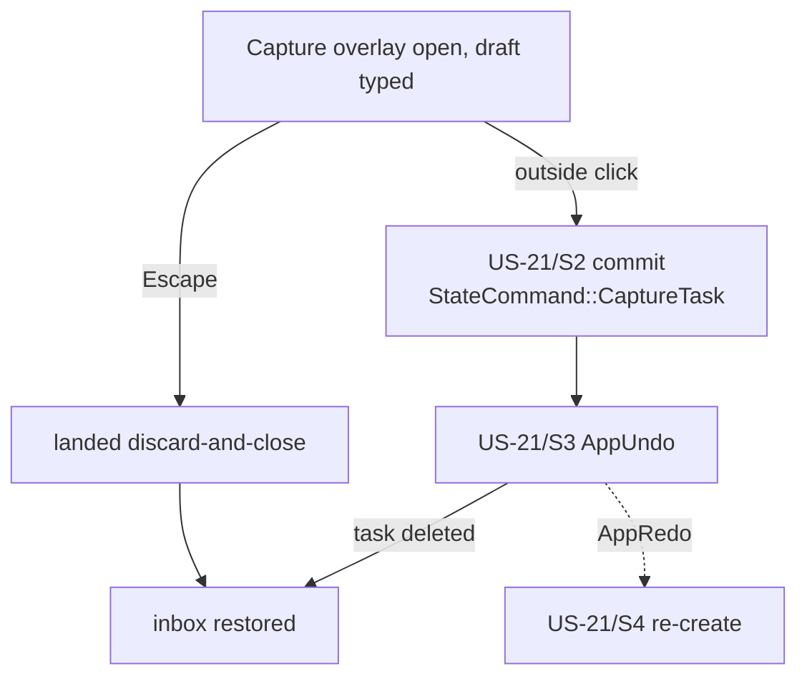
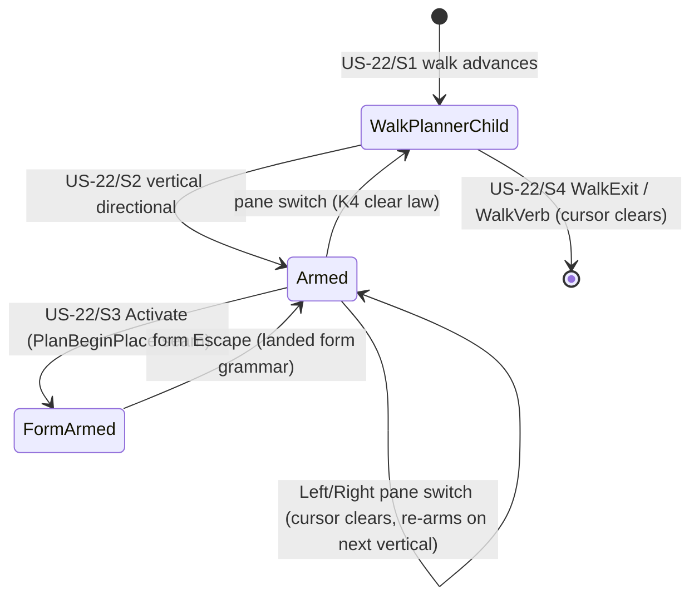
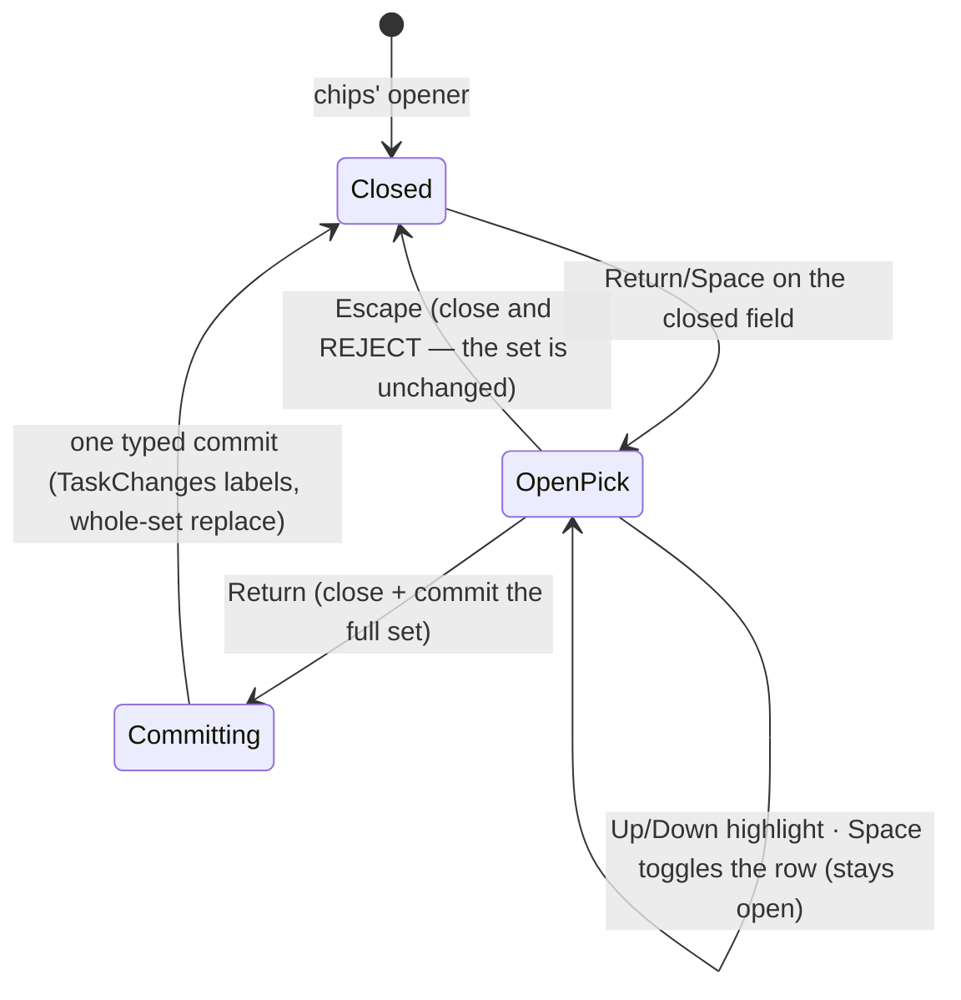

# [Plan] UX Journey Plan — the misc gated family (round 5, D4 origins)

<!--
How to use: copy this file to
`.artifacts/plans/YYYY-MM-DD-<topic>-ux-plan.md`, and fill every
`<...>` placeholder. This guidance comment STAYS in the copy — it
instructs future readers; only the `<...>` placeholders go unfilled.

A UX journey plan is written BEFORE the dispatch plan that chunks the
feature (the dispatch plan's Origin must cite this file). It plans the
user-visible capability: stories, journeys, flows, and the wiring
contract. No implementation decisions beyond the command contract.
Full law: docs/ux_planning.org; trigger rule: AGENTS.md §7.

Sections 2, 4, 6, 7 use fixed table headers AND fixed level-2 heading
titles — scripts/ux-coverage.sh parses them. Do not rename columns or
section headings. Step IDs are greppable tokens; tests embed them in
snake_case (US-21/S2 -> us21_s2). Cells avoid `|`.
-->

# [Plan] UX Journey Plan — the misc gated family (round 5, D4 origins)

- **Date**: 2026-11-22
- **Kind**: UX journey plan — user stories, journeys, flows, wiring
  contract for the round-4 misc-gated follow-up family (reload-lane
  placement, embedded-planner cursor, capture commit recovery, kiosk
  signal-lane inventory, menu quick-row budget, labels multi-toggle
  design). No implementation decisions beyond the command contract.
- **Origin**: round-4 follow-ups #1225, #1234, #1151, #1152, #1184,
  #1104, chunked as round 5 D4 (dispatch plan
  `.artifacts/plans/2026-11-22-backlog-reduction-round5-dispatch-plan.md`
  §8 D4; scope report §D). Base surfaces: the round-4 small-gated
  plans (`2026-11-21-small-gated-journeys-*.md`), the walk-affordance
  chunk plan (`2026-11-21-small-gated-journeys-walk-affordance-parity.md`,
  US-15/W-16), the menus research (§4.3.3 of
  `.artifacts/reports/2026-11-18-round9-menus-controls-research.md`),
  J5 R-6 (`2026-11-18-menus-remainder-ux-plan.md`).
- **Status**: DRAFT — GATE-PAUSED on the operator's acceptance (the
  dispatcher owns operator acceptance; stage 2 opens "GATE CLEARED").
- **Surfaces touched**: capture-overlay.slint (recovery, no widget
  change), adapter.rs flow table / plan cursor (embedded planner),
  status-bar.slint + settings-view.slint (kiosk inventory, no change),
  menu.rs (budget law, docs + one guard test), widgets/dropdown.slint
  (design-only).
- **Platform scope**: desktop and kiosk per story below.

## 1. Scope & goals

Six follow-ups from the round-4 gated features, each small, each
resolved here as a recorded decision plus (where user-visible) pinned
tests:

- **Capture accidental-commit recovery (#1151)**: the R-4 outside-click
  flip (SB1, `2026-11-21-small-gated-journeys-ux-plan.md`) makes an
  outside click on the capture overlay commit a non-empty draft. The
  plan's escape column covered deliberate discard (Escape); the
  accidental commit had no verified recovery path. **Resolved: the
  recovery path already exists** — `StateCommand::CaptureTask` is a
  journaled, undoable command (the v1 undo line inverts it by deleting
  the created task; `crates/taskboard-domain/src/undo.rs:221`, :994,
  :1113; `UndoView` derives from the journal every publish). US-21 pins
  the recovery end-to-end; no confirm-stage and no new undo plumbing
  (R-1).
- **Review walk's embedded planner cursor (#1234)**: the standalone
  planner's in-pane K4 cursor (US-15/W-16, #1041) renders inside the
  review walk's embedded planner child (`Flow::ReviewPlanner`), but
  the walk context routes the directionals, so the embedded mount has
  no cursor walk. US-22 plans the extension through the ONE cursor
  mechanism (the K4 `plan_cursor` state + `adapter.rs::walk_plan_cursor`;
  a second mechanism is a finding per R-9).
- **Kiosk placement inventory (#1152)**: where the ConfigReload lane
  and the degraded-boot badge land in kiosk mode. US-23 records the
  inventory facts and pins them structurally.
- **Reload-lane placement (#1225)**: the landed ConfigReload caption
  row renders at the top of the Settings view, not inside the Files
  card as the round-4 plan's W-5 surface column literally said.
  **Resolved: the whole-view placement stays** — a config reload
  applies to the whole `taskboard.toml`, not the files-sync subtree
  (US-24 ruling R-2; a dated erratum note amends the round-4 plan's
  surface column, per the committed-artefact supersession pattern).
- **Menu quick-row budget (#1184)**: the root action-menu page's quick
  rows are saturated — the G6 geometry law fits exactly five enabled
  root rows at the kiosk panel's 1024×600; a sixth clips the menu box
  above the status bar. **Decision recorded: option (b) with the
  budget measured at five** — see US-25 and R-3.
- **Labels multi-toggle dropdown (#1104)**: **design-only story** —
  US-26 records the multi-select Dropdown design; implementation is
  NOT D4 scope and queues as the follow-up (#1104 stays open, linked
  to this design, until its own chunk lands).

Non-goals (each with a home):

- No confirm-stage or dialog on capture commit — the undo line is the
  recovery (this plan, R-1; #1151 records the ruling).
- No menu-widget scroll/cap (option (a) of #1184 rejected) — the menu
  panel stays a fixed curated page; the curation law, not the widget,
  carries the budget (R-3; #1184 records the decision).
- No labels-picker implementation (#1104) — design only; home is
  #1104 itself.
- No review-walk kiosk surface — `ActionId::ReviewOpen` is
  desktop-only (`adapter.rs` enabled-arms, `!self.kiosk`), so the
  embedded-planner cursor story is desktop-scoped by construction
  (US-23's inventory records the kiosk absence; no new issue needed —
  the exclusion is the landed three-layer law).

## 2. Capability × surface matrix

| Capability | Board | TaskDetail | Today | Review | Settings | Capture | CLI |
|---|---|---|---|---|---|---|---|
| capture.commit_recover (undo of an outside-click commit) | — | — | — | — | — | E (US-21) | U (existing `undo` verb) |
| plan.cursor_embedded_walk (review walk's planner child) | — | — | — | E (US-22, desktop) | — | — | — |
| config.reload_lane_placement (ruling + erratum, landed surface) | — | — | — | — | D (US-24) | — | — |
| journal.degraded_kiosk_badge (inventory pin, landed surface) | — | — | — | — | — | — | — |
| menu.quick_row_budget (curation law + guard test) | X (US-25) | X (US-25) | X (US-25) | X (US-25) | X (US-25) | X (US-25) | — |
| labels.multi_toggle_pick (DESIGN ONLY — no cell ships) | — | — (US-26 records the design) | — | — | — | — | — |
| task.create (existing; recovery's subject) | C | C | C | — | — | C | C |

**Rulings** (every deliberate absence):

| ID | Ruling | Reason | Home |
|---|---|---|---|
| R-1 | The capture commit's accidental-commit recovery is the v1 undo line — no confirm-stage, no dedicated "undo last capture" affordance, no capture-specific undo entry | `CaptureTask` is already journaled and inverted by the undo machinery (`undo.rs:221` — undo deletes the created task); a second recovery mechanism would be redundant machinery per the one-mechanism discipline | #1151 (ruling comment to be added at chunk acceptance) |
| R-2 | The ConfigReload lane STAYS at the top of the Settings view (whole-view caption), not inside the Files card | A `taskboard.toml` reload applies to the whole configuration, not the files-sync subtree; the round-4 W-5 surface spelling was the plan's imprecision, not the implementation's | #1225 (closed by the dated erratum + this ruling) |
| R-3 | Menu quick-row budget: the root page carries exactly the five curated quick rows (`AppSettings`, `CaptureQuick`, `ExportDialogOpen`, `AppUndo`, `AppRedo` — the T-1 order); every future action-menu entry point targets a group page | G6 fits five exactly at 1024×600; a sixth enabled `menu_group: None` row clips the border (measured, #1184). Option (a) — a scroll/cap in the widget — rejected: it converts a curated design surface into an unbounded list and weakens G6's guarantee. Note: this differs from #1184's sketched "≤ 4 + move Export…" variant — Export… is one of the landed five and G6 passes with five; re-churning a landed surface buys nothing the budget rule doesn't | #1184 (decision recorded; the guard test enforces) |
| R-4 | `labels.multi_toggle_pick` has NO shipped cell in this round — the matrix cell is the design record, not a capability delta | #1104 is a design-first story by its own ruling (J5 R-6); D4 scope is design-only per the dispatch plan | #1104 (stays open, linked to §US-26, until its implementation chunk) |
| R-5 | The embedded-planner cursor is desktop-only | The review walk itself is desktop-only (`ReviewOpen` kiosk refusal, the three-layer exclusion); kiosk inherits nothing to arm | docs/ux-surface-census.org (the census row records the platform qualification) |

## 3. User stories

### US-21 — an accidental outside-click capture commit is recoverable

- **Story**: When a stray click lands outside the capture overlay while
  I have typed a draft, I want the accidentally created task to be
  recoverable with the ordinary undo, so that the R-4 commit-on-outside-click
  semantics cannot lose me a clean inbox.
- **Platforms**: both (capture + undo are ungated; kiosk inherits).
- **Entry points**: the capture overlay's scrim TouchArea
  (`modal-dialog-host.slint` `dismissal`, R-4 edit-kind → `accepted`);
  then `ActionId::AppUndo` (action menu row / keymap) — both landed
  seams, zero new wiring.
- **Priority**: P1.
- **Acceptance**:
  - AC-1: Given a non-empty capture draft When an outside click lands
    Then `StateCommand::CaptureTask` dispatches and the overlay closes —
    already landed (SB1 US-1 (the round-4 plan)); re-pinned by the new journey's prefix.
  - AC-2: Given the capture commit just landed When `AppUndo` fires
    Then the created task is deleted (the undo inverts `CaptureTask`)
    and the undo view advances — verified by journey test
    `us21_s3_capture_commit_undo_recovers`.

### US-22 — the review walk's embedded planner step walks the in-pane cursor

- **Story**: As a desktop user walking the review flow, when the walk
  reaches the embedded planner step I want its task rows to arm and
  walk the same in-pane cursor the standalone planner has, so that the
  keyboard grammar is identical on both mounts of `PlanNextDayView`.
- **Platforms**: desktop only (R-5 — the walk is kiosk-refused).
- **Entry points**: `ActionId::ReviewOpen` → walk advances into
  `Flow::ReviewPlanner` (`review.planner_embed`); then the walk's
  vertical directionals while the planner child is focused.
- **Priority**: P1.
- **Acceptance**:
  - AC-1: Given the walk sits on the embedded planner child When a
    vertical directional fires Then the shared K4 cursor
    (`view_state.rs::plan_cursor`) arms over the focused pane's rows —
    the SAME state and the SAME `walk_plan_cursor` seam the standalone
    planner uses; no second cursor mechanism (R-9's law).
  - AC-2: Given the cursor armed When Activate fires Then the cursor'd
    row's own `PlanBeginPlace` seam dispatches (the standalone
    planner's activate contract, unchanged).
  - AC-3: Given the walk exits the planner child (WalkExit / WalkVerb)
    Then the cursor clears pane-scoped per the landed K4 clear law —
    verified by journey tests `us22_s1..us22_s3` and seam tests on the
    amended `Flow::ReviewPlanner` flow-table rows.

### US-23 — the read-only signal lanes have a kiosk-visible home (inventory pin)

- **Story**: When the kiosk appliance boots degraded or a config
  reload lands on the kiosk, I want both signal lanes to be visible
  where kiosk chrome can render them, so that the kiosk is not a
  blind spot for the round-4 read-only surfaces.
- **Platforms**: kiosk (the inventory's subject).
- **Entry points**: display-only — the status bar's degraded-boot
  badge (`status-bar.slint` `journal-degraded-visible`, W-7 of the
  round-4 plan) and the Settings view's reload lane reached via the
  action menu's `AppSettings` row (NOT kiosk-refused — absent from
  the `!self.kiosk` enabled-arms, `adapter.rs`).
- **Priority**: P1.
- **Acceptance**:
  - AC-1: Given kiosk mode When the `JournalDegraded` broadcast lands
    Then the badge property flips true and the status-bar badge row
    renders — the status bar is not kiosk-gated; verified by seam test
    `us23_s1_degraded_badge_renders_in_kiosk` (kiosk profile).
  - AC-2: Given kiosk mode When the menu opens on the kiosk chain
    Then the `AppSettings` row is present and enabled (the reload
    lane's kiosk entry point) — verified by structural test
    `us23_s2_settings_row_present_on_kiosk_chain` over
    `menu.rs::root_page`.
  - AC-3: The review walk's planner cursor story renders nothing on
    kiosk (R-5) — covered by the existing kiosk gate suite, no new
    test.

### US-24 — the reload-lane placement is ruled (docs erratum, no surface change)

- **Story**: When a maintainer reads the round-4 plan's W-5 row, they
  should find the placement question answered with a dated ruling, so
  that the surface column and the landed implementation no longer
  disagree.
- **Platforms**: both (docs artefact).
- **Entry points**: none — documentation-only.
- **Priority**: P1.
- **Acceptance**:
  - AC-1: The round-4 plan
    (`2026-11-21-small-gated-journeys-config-files-signals.md`) carries
    a dated erratum note on W-5's surface column: whole-view caption is
    normative per R-2 — no code, no test; verified by review.

### US-25 — the menu root page's quick-row budget is a recorded law

- **Story**: When a future feature wants an action-menu entry point,
  the curation law tells it to target a group page — not the root —
  so that the G6 geometry guarantee (menu closes above the status bar
  at every geometry) holds by construction rather than by re-measure.
- **Platforms**: both.
- **Entry points**: none new — one guard test + the law's docs home.
- **Priority**: P1.
- **Acceptance**:
  - AC-1: Given the registry When the root page is built for the
    broadest chain Then it carries exactly the five curated quick rows
    in the T-1 order and no registry entry with `menu_group: None`
    exists beyond them — verified by structural guard test
    `us25_s1_root_quick_rows_within_budget` (a registry-wide sweep, not
    just the board chain T-1 already pins).
  - AC-2: G6
    (`usability_components.rs::the_open_menu_closes_its_box_above_the_status_bar_at_every_geometry`)
    stays green unchanged — no widget change (R-3).

### US-26 — the labels picker's multi-toggle dropdown design (design-only)

- **Story**: As a desktop user assigning several labels to a task, I
  want a picker that sets multiple labels in one pass, so that I stop
  paying an overlay round-trip per label. **This story ships a design
  record, not a capability** (R-4).
- **Platforms**: desktop (the task-detail labels picker's audience;
  kiosk posture is recorded for the future implementer).
- **Entry points**: the existing labels chips' opener on the task
  detail view (labels-overlay.slint) — unchanged in this round.
- **Priority**: P2.
- **Acceptance**:
  - AC-1: The design below is recorded in this plan and linked from
    #1104; no implementation, no wiring rows, no tests ship for it in
    D4 — verified by review (the D4 diff carries no dropdown change).

## 4. Journey specs

### US-21 — accidental-commit recovery

| Step | Surface & affordance | User action | Dispatches | System response | Escape / failure |
|---|---|---|---|---|---|
| US-21/S1 | Capture overlay (capture-overlay.slint over ModalDialogHost) | open capture, type a non-empty draft | — (buffer mirror via `capture-edited`) | field holds the draft; hint line shows the commit semantics | Escape discards and closes (the deliberate discard, landed) |
| US-21/S2 | ModalDialogHost scrim (`dismissal` TouchArea, R-4 edit-kind) | click outside the overlay | `capture_accepted` → `StateCommand::CaptureTask { title, board: None }` | task created in the inbox; overlay closes (commit semantics) | empty draft: the same path closes without creating (`commit_capture` trims and bails — a no-op commit, no undo entry to recover) |
| US-21/S3 | Action layer / menu row `AppUndo` | invoke undo | `ActionId::AppUndo` | the undo inverts `CaptureTask`: the created task is deleted; the undo view advances; the status bar's undo pair stays live | `can_undo` false: the action's enabled-arm refuses typed before dispatch (landed arm); a `NotUndoable` head is a planning-time refusal (R-U6), unreachable for a fresh `CaptureTask` head |
| US-21/S4 | Action layer `AppRedo` (optional re-check) | invoke redo | `ActionId::AppRedo` | the capture re-creates the task (the journal's forward arm) | redo unavailable: the enabled-arm refuses typed |

### US-22 — embedded planner cursor walk

| Step | Surface & affordance | User action | Dispatches | System response | Escape / failure |
|---|---|---|---|---|---|
| US-22/S1 | Review walk overlay (review-walk-overlay.slint), desktop | open the review walk | `ActionId::ReviewOpen` (kiosk-refused, landed) | the walk mounts; advance to the planner child (`Flow::ReviewPlanner`, `review.planner_embed`) | WalkExit leaves the walk; the planner child never mounted, nothing to clear |
| US-22/S2 | Embedded planner child (`PlanNextDayView` mount inside the walk) | vertical directional (Up/Down) | the amended `Flow::ReviewPlanner` flow-table vertical arm routes to `adapter.rs::walk_plan_cursor` | the shared K4 cursor (`view_state.rs::plan_cursor`) arms over the focused pane's rows; armed styling renders; clamp, no wrap (the landed planner law) | zero rows in the pane: the cursor stays inert (the landed clamp); the walk step's own escape (WalkExit) always remains |
| US-22/S3 | Embedded planner child | Activate on the cursor'd row | the cursor'd row's own `PlanBeginPlace` seam (unchanged from US-15's W-16) | the inline begin-place form arms as in the standalone planner | form Escape discards (landed form grammar); the walk's directionals are the escape ladder throughout |
| US-22/S4 | Walk context | WalkExit / WalkVerb out of the planner child | the existing flow-table exit rows | the cursor clears pane-scoped (the landed K4 clear/transfer law — `switch_plan_pane` semantics applied to the walk's pane change) | none needed — exit is the escape |

### US-23 — kiosk signal-lane inventory (display-only steps)

| Step | Surface & affordance | User action | Dispatches | System response | Escape / failure |
|---|---|---|---|---|---|
| US-23/S1 | Status bar, kiosk profile | — display only | — | on `E::JournalDegraded` the adapter flips `journal_degraded`; the badge row renders (not kiosk-gated) | badge absence = the absence of the degradation itself (a clean session) — no escape applies to a display lane |
| US-23/S2 | Action menu, kiosk chain | open menu, read the `AppSettings` row | — (display of the row; activation is the landed settings flow) | the row is present and enabled — the reload lane's kiosk-reachable home | row would refuse typed if a future kiosk posture ever gates `AppSettings` — that change would re-open this inventory (#1152 re-notes it) |

### US-24 — reload-lane placement ruling (docs-only steps)

| Step | Surface & affordance | User action | Dispatches | System response | Escape / failure |
|---|---|---|---|---|---|
| US-24/S1 | Round-4 config-files-signals plan, W-5 row | read the dated erratum | — | the erratum states R-2: whole-view caption normative; the Files-card spelling was plan-side imprecision | if the operator rejects R-2 at the gate, the ruling flips to a small UI move chunk (out of D4 scope; #1225 re-homes it) |

### US-25 — quick-row budget law (docs + guard test steps)

| Step | Surface & affordance | User action | Dispatches | System response | Escape / failure |
|---|---|---|---|---|---|
| US-25/S1 | menu.rs registry | — display only | — | guard test `us25_s1_root_quick_rows_within_budget` sweeps the registry: `menu_group: None` entries are exactly the curated five | a sixth `menu_group: None` registration fails the guard at test time — the failure IS the escape (budget breach caught pre-G6) |
| US-25/S2 | Action menu root page, any chain, kiosk 1024×600 | open the menu | — | G6 holds unchanged (five rows close the box above the status bar) | G6 failing is a release blocker per the landed law — no new tolerance |

### US-26 — labels multi-toggle design record (no runtime steps)

| Step | Surface & affordance | User action | Dispatches | System response | Escape / failure |
|---|---|---|---|---|---|
| US-26/S1 | This plan §5 state diagram + #1104 link | read the design | — | none — design-only (R-4) | implementation never starts from this story's dispatch rows; its future chunk re-derives its own plan citing this section |

## 5. Interaction flows

US-21 (the recovery loop — one flow, both platforms):

US-22 (the embedded planner's cursor machine — the walk's planner child):

US-26 (the future labels multi-toggle dropdown — design only, no
runtime; the machine the future implementer inherits):

## 6. Wiring inventory

| ID | Surface file | Widget | Callback | Adapter seam | ActionId | Commands | Row addressing | Journey steps | Test |
|---|---|---|---|---|---|---|---|---|---|
| W-1 | crates/taskboard-ui-slint/tests/journeys/misc_gated_journeys.rs (new member) | journey harness | — | driver over i-slint-backend-testing | ActionId::AppUndo / AppRedo | StateCommand::CaptureTask (invert via undo) | — (no new widget; the row exists to pin US-21's recovery through the landed seams) | US-21/S2..S4 | journeys/misc_gated_journeys.rs::us21_s3_capture_commit_undo_recovers |
| W-2 | crates/taskboard-ui-slint/src/adapter.rs | flow table (Flow::ReviewPlanner vertical arms) | — | the vertical arms route to `walk_plan_cursor` (one-mechanism routing, no new state) | — (flow-event routing, no new ActionId) | — (no new command; PlanBeginPlace reuse only) | flow-table row addressing: the ReviewPlanner tag's vertical arms (E::* events already enumerated; the amendment is routing, not enumeration) | US-22/S2..S4 | flow_table_tests.rs (amended ReviewPlanner rows) + journeys/misc_gated_journeys.rs::us22_s1_embedded_cursor_arms |
| W-3 | crates/taskboard-ui-slint/tests (kiosk profile structural) | — | — | adapter kiosk profile | ActionId::AppSettings (presence read) | — | — (read-only inventory pins; no affordance changes) | US-23/S1, US-23/S2 | structural: us23_s1_degraded_badge_renders_in_kiosk, us23_s2_settings_row_present_on_kiosk_chain |
| W-4 | crates/taskboard-ui-slint/src/menu.rs (tests module) | — | — | — | — (registry sweep, no action) | — | — (a law-guard test, not an affordance) | US-25/S1 | menu.rs tests::us25_s1_root_quick_rows_within_budget |
| W-5 | .artifacts/plans/2026-11-21-small-gated-journeys-config-files-signals.md (dated erratum) | — | — | — | — | — | — (docs artefact) | US-24/S1 | none — review-verified |

Notes: W-1..W-4 carry no new slint callbacks and no new
StateCommand/UiRequest variants — every dispatch in this family rides
a landed seam; the rows above exist so the gate can verify the TESTS
and the routing amendment, which is what D4 actually ships. US-26 has
deliberately no wiring row (R-4: design-only; a wiring row would
falsely claim a shipped affordance).

## 7. Command-contract delta

| Kind | Name | Payload sketch | Journeys |
|---|---|---|---|
| — (none) | the family adds zero new StateCommand / UiRequest / ActionId variants | `CaptureTask` (existing) is dispatched and inverted; the planner cursor reuses `plan_cursor` + `walk_plan_cursor`; the flow-table amendment is routing only; the guard test reads the existing registry | US-21, US-22, US-23, US-25 |

The empty delta is itself the family's headline: all six origins
resolve as decisions, pins, and one routing amendment — no engine work
item exists because no journey step dispatches a new variant.

## 8. Verification plan

- **Journey tests** (step-ID-named, new member
  `crates/taskboard-ui-slint/tests/journeys/misc_gated_journeys.rs`):
  `us21_s3_capture_commit_undo_recovers`,
  `us22_s1_embedded_cursor_arms`,
  `us22_s2_embedded_cursor_walks_clamped`,
  `us22_s3_embedded_activate_uses_own_seam`,
  `us22_s4_walk_exit_clears_cursor`.
- **Seam tests**: the amended `Flow::ReviewPlanner` flow-table rows
  (`flow_table_tests.rs` — vertical routing to the plan cursor, exit
  clearing); kiosk profile badge flip
  (`us23_s1_degraded_badge_renders_in_kiosk`).
- **Fold/presentation tests**: none needed — no new presentation
  enum/flag; the armed styling bit is the landed `cursor` model bit
  (already covered by `us15_*`).
- **Kiosk gates**: US-23's pins run on the kiosk profile;
  `us23_s2_settings_row_present_on_kiosk_chain` is a `menu.rs`
  structural test over the kiosk chain; US-22's stories assert nothing
  on kiosk (the walk is kiosk-refused — the existing exclusion suite
  covers it).
- **Manual**: the operator's gate acceptance covers R-2 (the lane
  reads truer as a whole-view caption on a real screen) and R-3 (the
  five-row root page's composition judgment) — both are decisions a
  human owns; the walkthrough protocol at stage 3 covers US-21's
  accidental-commit feel and US-22's walk fluency with evidence.

## 9. Definition of done

- [ ] `scripts/ux-coverage.sh <this file> --gate` exits 0 (post-landing;
      pre-landing it exits 1 on the MISSING W-1..W-4 test rows — expected)
- [ ] Every P1 story's journey completes end-to-end including escapes
- [ ] Walkthrough protocol executed at stage 3; findings resolved or homed
- [ ] All matrix absences carry rulings; census updated (the embedded
      planner's census row `plan.begin_place` gains the walk-context
      extension note; the platform qualification R-5 recorded)
- [ ] Non-goals filed as backlog issues (none new — every non-goal's
      home pre-exists: #1151, #1184, #1104, the census)
- [ ] #1104 updated with the design link; #1225/#1184 closable at
      stage-3 acceptance (the dispatcher owns at-merge closures)
