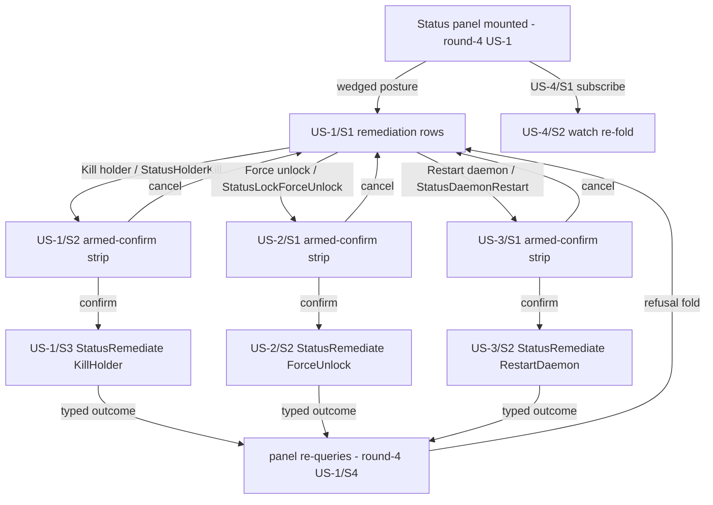
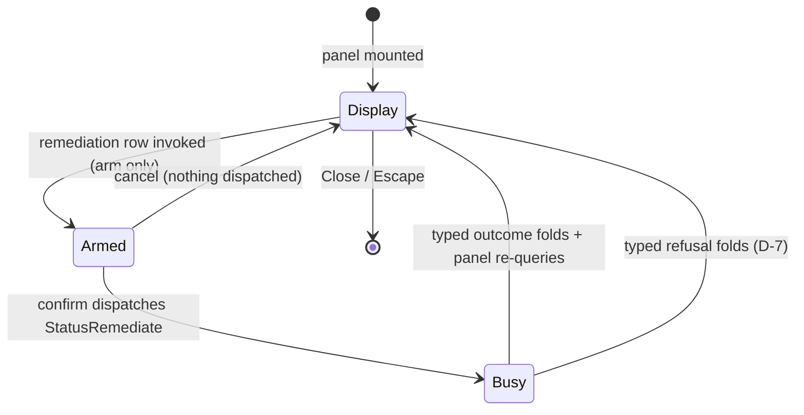

# Status Command Lane + Live Refresh UX Journey Plan — round-5 D2 (status half)

- **Date**: 2026-11-22
- **Kind**: UX journey plan — user stories, journeys, flows, wiring
  contract for the status panel's command lane (#1147: kill holder /
  force-unlock / restart daemon) and the watch-driven live-refresh
  lane (#1148). No implementation decisions beyond the command
  contract.
- **Origin**: backlog issues #1147 and #1148 (filed as the round-4
  status-surface plan's non-goals —
  .artifacts/plans/2026-11-21-parity-restore-journeys-status-surface.md
  §1, rulings R-3/D-3), the round-5 scope report §D (Status/export
  polish group), and the round-5 dispatch plan §8 chunk D2 (traps a–c).
  Consumed contracts: the B6-typed draining status
  (`StatusView.draining: Option<bool>`, never `Some(false)`), the
  round-4 panel's `UiRequest::StatusQuery` snapshot lane, and the
  #1137 watch-channel pattern (landed by PR #1173: the storage
  diagnostics hop is a `tokio::sync::watch` channel) as the seam
  template the live lane generalizes. Outcome-payload wire stability
  follows the #993 serde round-trip pin pattern.
- **Status**: ACCEPTED by the operator (2026-11-23; the dispatcher
  relayed "GATE CLEARED"). Implemented by the D2 stage-2 agent on
  `feat/status-export-polish` — with the D-6 fallback applied (see
  the dated erratum at the end of this file).
- **Surfaces touched**: the existing status panel composition
  (`ui/compositions/status-panel.slint`, round-4 OP3), the adapter
  (`src/adapter.rs`), `src/requests.rs`, `src/actions.rs`; the
  app-side remediation executor (new, `crates/taskboard-app`); no
  CLI delta (R-2).
- **Platform scope**: remediation stories desktop-only (kiosk renders
  the rows disabled with honest captions — the SC-W-N4 doctrine bar;
  trap (a): no process kills or shell-outs from a passive kiosk
  display). The live-refresh display story is both (read-only fold on
  kiosk).
- **Test-root**: crates/taskboard-ui-slint/tests (journey tests);
  the app-side remediation-executor tests are nominated crate-exact
  in §6 — `crates/taskboard-app/tests/it_status_remediation.rs`.

## 1. Scope & goals

The status panel stops being strictly read-only where being
read-only strands the user: when the panel diagnoses a wedged
posture (an artifact beside a held lock, or a dead daemon), the panel
now offers the three remediation verbs the #1147 origin names — kill
the lock holder, force-unlock the stale artifact, restart the daemon
— each behind a staged confirm (the task-delete precedent's
armed-confirm grammar for the destructive class) with typed
outcomes. Independently, the panel's snapshot-on-open posture gains
a watch-driven live lane (#1148): when the engine's status watch seam
is present, mounted panels re-fold on change with no poll timer
(D-3's kiosk law preserved — the watch pushes, the UI never polls).

**Non-goals** (each with a home):

- A kiosk remediation lane (supervisor-managed restart, e.g. a
  systemd-unit bus call) — the desktop restart spawns the daemon
  directly; a headless kiosk's restart belongs to its supervisor.
  Home: backlog issue (filed with this plan).
- CLI remediation verbs (`taskboard unlock`, `taskboard daemon
  restart`) — terminal operators already have `kill`/`rm` and `daemon
  stop`; GUI parity is this plan's contract, not CLI symmetry.
  Home: backlog issue (filed with this plan).
- Widening the panel's displayed facts — D-2's 1:1 `StatusView`
  mirror stands; no new diagnostics are minted.

### Recorded decisions

| ID | Decision | Alternatives rejected |
|---|---|---|
| D-1 | **One typed remediation request, three actions**: `UiRequest::StatusRemediate { action: StatusRemediationAction, reply }` with `StatusRemediationAction { KillHolder, ForceUnlock, RestartDaemon }` and a typed `StatusRemediationOutcome` (executed facts or refusal kinds). One drain lane in the adapter, three typed payloads. | Three separate UiRequests (three drains to review for one behavior class). |
| D-2 | **Staged confirm for all three verbs** (destructive class): invoking a remediation row mounts the armed-confirm strip (the task-delete precedent); nothing dispatches until confirm. Cancel at the strip is always available. | Direct dispatch on click (no escape before an irreversible act — a §4 plan defect). |
| D-3 | **KillHolder means SIGTERM to `holder_pid`** (the same pid the panel already displays). The executor refuses with a typed refusal when the pid is not alive (stale holder → the ForceUnlock verb is the right tool) or is the app's own pid. After any executed remediation the panel re-queries (the existing snapshot lane) so the outcome posture is never stale. | SIGKILL (ungraceful by default; the holder may be mid-drain), or pid-less "best effort" (untyped). |
| D-4 | **ForceUnlock removes the stale lock sidecar** and is offered executable only when the holder pid is not alive (the stale-artifact posture); when a live holder exists the row renders disabled with an honest caption (the SC-W-N4 bar) — killing it is D-3's verb, not this one. | Unconditional unlock (destroying a live daemon's lock is the corruption vector the panel exists to diagnose). |
| D-5 | **RestartDaemon = graceful stop over IPC (when serving) then a detached `taskboard daemon run` spawn**; the typed outcome carries the new pid. When nothing serves the database the stop leg is skipped (the typed `no-daemon` fact is not a refusal here — the spawn proceeds). | Restart-by-exit-and-relaunch of the GUI process (the user's session is not the daemon's), or a supervisor call (non-goal, kiosk home filed). |
| D-6 | **SUPERSEDED 2026-11-23 — the fallback applied** (no engine-side `StatusWatch*` receiver existed at dispatch time; verified per the verification note below). ~~Live refresh consumes a status watch channel (the #1137 pattern generalized), never a poll timer.** The panel opens one `UiRequest::StatusWatchSubscribe` on mount; the adapter folds each watch change into the fields OUTSIDE the adapter borrow (the OP2 erratum's re-entrancy law). **Fallback (the D2 dispatch's sequencing note): if the E2-generalized status watch seam has not landed by D2 dispatch, this story ships as deferred** — the round-4 snapshot+explicit-Refresh posture stands unchanged, the deferral is recorded on #1148, and the plan gains a dated supersession note for the W-5 row (gate: the row is removed, not left MISSING). | A poll timer (D-3's kiosk law forbids; burns IPC against exactly the wedged daemon the panel diagnoses). ~~ |
| D-7 | **Refusals are typed kinds, surfaced in the panel's outcome fold**: `HolderNotAlive` (kill of a stale pid), `HolderAlive` (unlock under a live holder), `SelfPid` (the holder is this process), `SpawnFailed` (restart's spawn leg), `IpcUnavailable`. The panel stays mounted with state intact on any refusal; the retry affordance is the same row. | String/text outcomes (the typed-outcomes round law); auto-retry loops (a wedge must not spin). |
| D-8 | **Serde pins per the #993 pattern**: `StatusRemediationAction` and `StatusRemediationOutcome` get a hand-written-JSON round-trip pin at landing (the receipts' wire stability is a consumed contract, not serde defaults' luck). | No pin (a rename silently breaks persisted/mirrored surfaces — #993's exact finding). |
| D-9 | **Kiosk posture**: the panel's remediation rows render disabled with honest captions on kiosk (the display stays; the verbs do not dispatch — trap (a)'s typed-permission-aware law). The structural inventory asserts no remediation dispatch is reachable on the kiosk composition. | Hiding the rows (recognition-over-recall: the capability exists, the posture forbids it). |

## 2. Capability × surface matrix

| Capability | Board | TaskDetail | Today | Review | Settings | Capture | CLI |
|---|---|---|---|---|---|---|---|
| status.kill_holder | — (R-1) | — (R-1) | — (R-1) | — (R-1) | E (desktop, US-1) | — (R-1) | — (R-2) |
| status.force_unlock | — (R-1) | — (R-1) | — (R-1) | — (R-1) | E (desktop, US-2) | — (R-1) | — (R-2) |
| status.daemon_restart | — (R-1) | — (R-1) | — (R-1) | — (R-1) | E (desktop, US-3) | — (R-1) | — (R-2) |
| status.live_refresh | — (R-1) | — (R-1) | — (R-1) | — (R-1) | — (superseded 2026-11-23: the D-6 fallback applied, the story removed — the deferral lives on #1148) | — (R-1) | — (R-2) |

**Rulings** (every deliberate absence):

| ID | Ruling | Reason | Home |
|---|---|---|---|
| R-1 | Non-Settings GUI cells stay absent | The remediation verbs are app-scoped diagnostics (the round-4 R-1 precedent: no board/task/habit subject row exists to host them; the panel in the Settings column is the whole front). | This plan §2 |
| R-2 | No CLI delta | The lane is GUI parity for terminal-only remediation; the CLI `status`/`daemon stop` verbs stay byte-compatible. A CLI symmetry ask is a separate capability (non-goal home filed). | This plan §1 |
| R-3 | No edit/create/remove of any domain entity | The verbs act on process/lock posture, never on domain state — no `StateCommand` exists in the entire delta (§7). | This plan §7 |

## 3. User stories

### US-1 — Kill a wedged lock holder from the panel

- **Story**: When the panel shows an artifact beside a held lock with
  a holder pid but no serving daemon, I want to signal that holder to
  terminate from the panel so that I do not open a terminal to
  `kill` a pid I just read on screen.
- **Platforms**: desktop (kiosk: the row renders disabled, D-9).
- **Entry points**: the status panel's `Kill holder` remediation row
  (shown in the wedged posture); `ActionId::StatusHolderKill`.
- **Priority**: P1.
- **Acceptance**:
  - AC-1: Given the wedged posture, When the row is invoked, Then the
    armed-confirm strip mounts and nothing dispatches — verified by
    journey test.
  - AC-2: Given the armed strip, When confirmed, Then one
    `UiRequest::StatusRemediate { KillHolder }` dispatches, the panel
    enters busy posture, and the typed outcome folds — verified by
    seam test (action variant equality).
  - AC-3: Given a stale holder pid, When confirmed, Then the typed
    refusal `HolderNotAlive` folds and the panel stays mounted (D-7) —
    verified by journey test.
  - AC-4: Given the armed strip, When cancelled, Then the strip
    unmounts with nothing dispatched — verified by journey test.

### US-2 — Force-unlock the stale artifact

- **Story**: When the holder process is already dead but its lock
  sidecar remains, I want to release the stale lock from the panel so
  that the next boot is not refused `instance-locked` by a ghost.
- **Platforms**: desktop (kiosk: disabled row, D-9).
- **Entry points**: the panel's `Force unlock` row (executable only
  in the stale-holder posture; disabled with an honest caption when a
  live holder exists — D-4); `ActionId::StatusLockForceUnlock`.
- **Priority**: P1.
- **Acceptance**:
  - AC-1: Given a live holder, Then the row is disabled (fold flag,
    never caption text) and cannot dispatch — verified by fold test.
  - AC-2: Given the stale-holder posture and a confirmed strip, Then
    one `StatusRemediate { ForceUnlock }` dispatches and the typed
    outcome (`LockReleased`) folds; the panel re-queries — verified by
    seam test.
  - AC-3: Given a live holder appearing between arm and confirm, Then
    the typed refusal `HolderAlive` folds and the sidecar is untouched —
    verified by journey test (the executor re-checks liveness; the
    enable flag is presentation, not authorization).

### US-3 — Restart the daemon

- **Story**: When the daemon has wedged or died, I want to restart it
  from the panel so that sync resumes without a terminal.
- **Platforms**: desktop (kiosk: disabled row — the supervisor owns
  headless restarts, D-9 + the non-goal home).
- **Entry points**: the panel's `Restart daemon` row; `ActionId::StatusDaemonRestart`.
- **Priority**: P1.
- **Acceptance**:
  - AC-1: Given a confirmed strip, Then one `StatusRemediate { RestartDaemon }`
    dispatches and the typed outcome carries the new daemon pid —
    verified by seam test.
  - AC-2: Given nothing serving the database, Then the restart still
    executes (the stop leg is skipped, D-5) and the outcome is the
    spawn fact, not a refusal — verified by journey test.
  - AC-3: Given a failed spawn, Then the typed refusal `SpawnFailed`
    folds and the panel re-queries (showing the true posture) —
    verified by journey test.

## 4. Journey specs

### US-1 — Kill the holder

| Step | Surface & affordance | User action | Dispatches | System response | Escape / failure |
|---|---|---|---|---|---|
| US-1/S1 | Status panel, wedged posture | Read the remediation row set | — display only | `Kill holder` row enabled; `Force unlock` enabled iff the holder pid is stale (D-4's flag); captions honest on kiosk (D-9) | Close / Escape unmounts; nothing dispatched |
| US-1/S2 | `Kill holder` row / `ActionId::StatusHolderKill` | Click / key the row | — display only (arm, not dispatch) | The armed-confirm strip mounts (D-2); the strip names the pid it will signal | Cancel unmounts the strip — nothing dispatched |
| US-1/S3 | Armed-confirm strip `Confirm` | Confirm | `UiRequest::StatusRemediate { KillHolder }` (oneshot) | Busy posture on the row; the executor signals the holder (D-3) and the typed outcome folds; the panel re-queries (D-3's post-fact refresh) | Typed refusal folds (D-7); the panel stays mounted; the row re-arms on retry |

### US-2 — Force-unlock the stale artifact

| Step | Surface & affordance | User action | Dispatches | System response | Escape / failure |
|---|---|---|---|---|---|
| US-2/S1 | `Force unlock` row / `ActionId::StatusLockForceUnlock` | Click / key the row (stale-holder posture only — D-4) | — display only (arm) | Armed-confirm strip mounts naming the artifact path | Cancel unmounts — nothing dispatched |
| US-2/S2 | Armed-confirm strip `Confirm` | Confirm | `UiRequest::StatusRemediate { ForceUnlock }` (oneshot) | The executor re-checks holder liveness, removes the stale sidecar (D-4), folds `LockReleased`; the panel re-queries | Typed refusal `HolderAlive` folds (a live holder appeared post-arm); the sidecar is untouched; the panel stays |

### US-3 — Restart the daemon

| Step | Surface & affordance | User action | Dispatches | System response | Escape / failure |
|---|---|---|---|---|---|
| US-3/S1 | `Restart daemon` row / `ActionId::StatusDaemonRestart` | Click / key the row | — display only (arm) | Armed-confirm strip mounts | Cancel unmounts — nothing dispatched |
| US-3/S2 | Armed-confirm strip `Confirm` | Confirm | `UiRequest::StatusRemediate { RestartDaemon }` (oneshot) | Graceful stop over IPC when serving, then a detached daemon spawn (D-5); the outcome carries the new pid; the panel re-queries into the serving posture | Typed refusal `SpawnFailed` folds; the panel re-queries showing the true posture; the row re-arms |

## 5. Interaction flows

## 6. Wiring inventory

| ID | Surface file | Widget | Callback | Adapter seam | ActionId | Commands | Row addressing | Journey steps | Test |
|---|---|---|---|---|---|---|---|---|---|
| W-1 | ui/compositions/status-panel.slint | Kill holder remediation row | status_holder_kill | install_status_panel_seam (adapter.rs) | ActionId::StatusHolderKill | UiRequest::StatusRemediate | Panel-scoped state (no list rows) | US-1/S2, US-1/S3 | crates/taskboard-ui-slint/tests/journeys/status_export_journeys_command_journeys.rs::us1_s1_the_wedged_posture_renders_the_remediation_row_set, crates/taskboard-ui-slint/tests/journeys/status_export_journeys_command_journeys.rs::us1_s2_kill_row_arms_confirm_strip, crates/taskboard-ui-slint/tests/journeys/status_export_journeys_command_journeys.rs::us1_s3_confirm_dispatches_kill_holder_remediation |
| W-2 | ui/compositions/status-panel.slint | Force unlock remediation row | status_lock_force_unlock | same seam | ActionId::StatusLockForceUnlock | UiRequest::StatusRemediate | Panel-scoped | US-2/S1, US-2/S2 | crates/taskboard-ui-slint/tests/journeys/status_export_journeys_command_journeys.rs::us2_s1_force_unlock_arms_only_in_stale_posture, crates/taskboard-ui-slint/tests/journeys/status_export_journeys_command_journeys.rs::us2_s2_confirm_dispatches_force_unlock_remediation |
| W-3 | ui/compositions/status-panel.slint | Restart daemon remediation row | status_daemon_restart | same seam | ActionId::StatusDaemonRestart | UiRequest::StatusRemediate | Panel-scoped | US-3/S1, US-3/S2 | crates/taskboard-ui-slint/tests/journeys/status_export_journeys_command_journeys.rs::us3_s1_restart_arms_confirm_strip, crates/taskboard-ui-slint/tests/journeys/status_export_journeys_command_journeys.rs::us3_s2_confirm_dispatches_restart_remediation |
| W-4 | ui/compositions/status-panel.slint | Armed-confirm strip | status_remediation_armed | same seam (presentation fold) | — | — | Panel-scoped | US-1/S2, US-2/S1, US-3/S1 (arm/cancel are pure presentation state — the §4 rows dispatch nothing) | crates/taskboard-ui-slint/tests/journeys/status_export_journeys_command_journeys.rs::us1_s4_cancel_unmounts_the_strip_with_nothing_dispatched |
| W-6 | ui/compositions/status-panel.slint | remediation outcome fold | status_remediation_outcome_shown | same seam (oneshot reply → presentation fold) | — | — | Panel-scoped | US-1/S3, US-2/S2, US-3/S2 (display only) | crates/taskboard-ui-slint/tests/journeys/status_export_journeys_command_journeys.rs::us1_s3_confirm_dispatches_kill_holder_remediation, crates/taskboard-ui-slint/tests/journeys/status_export_journeys_command_journeys.rs::us2_s3_live_holder_refusal_folds_and_the_sidecar_is_untouched, crates/taskboard-ui-slint/tests/journeys/status_export_journeys_command_journeys.rs::us3_s3_spawn_failure_folds_the_typed_refusal |
| W-7 | crates/taskboard-ui-slint/src/requests.rs | — | — | app-side remediation executor (signal/remove/spawn; D-3/D-4/D-5) | — | UiRequest::StatusRemediate | — | US-1/S3, US-2/S2, US-3/S2 | crates/taskboard-app/tests/it_status_remediation.rs::remediation_outcomes_are_typed_per_action, crates/taskboard-app/tests/it_status_remediation.rs::us2_s3_live_holder_refusal_folds_and_the_sidecar_is_untouched, crates/taskboard-app/tests/it_status_remediation.rs::us3_s3_spawn_failure_folds_the_typed_refusal |
| W-8 | crates/taskboard-domain tests (serde pin, #993 pattern) | — | — | — | — | UiRequest::StatusRemediate | — | US-1/S3, US-2/S2, US-3/S2 (wire-stability pin, D-8) | crates/taskboard-domain/src/undo/tests.rs::status_remediation_action_and_outcome_round_trip_serde |

## 7. Command-contract delta

| Kind | Name | Payload sketch | Journeys |
|---|---|---|---|
| UiRequest | StatusRemediate | new — `{ action: StatusRemediationAction, reply: oneshot::Sender<StatusRemediationOutcome> }`; `StatusRemediationAction { KillHolder, ForceUnlock, RestartDaemon }`; `StatusRemediationOutcome` typed per D-3/D-4/D-5/D-7 (`HolderSignalled`, `LockReleased`, `DaemonRestarted { pid }`, refusals `HolderNotAlive`/`HolderAlive`/`SelfPid`/`SpawnFailed`/`IpcUnavailable`); serde round-trip pin per D-8 | US-1/S3, US-2/S2, US-3/S2 |
| UiRequest | StatusWatchSubscribe | new — `{ reply: oneshot::Sender<StatusWatchHandle> }` (the adapter-side handle over the engine's status watch receiver; the D-6 fallback removes this row if the E2 seam has not landed) | US-4/S1, US-4/S2 |
| StateCommand | — | none: the lane acts on process/lock posture, never domain state (R-3) | — |
| ActionId | StatusHolderKill, StatusLockForceUnlock, StatusDaemonRestart | new — no payload (arm the respective remediation row; one ActionId per wiring row, §6 W-1/W-2/W-3) | US-1/S2, US-2/S1, US-3/S1 |

## 8. Verification plan

- **Journey tests** (step-ID-named,
  `crates/taskboard-ui-slint/tests/journeys/status_export_journeys_command_journeys.rs`):
  `us1_s2_*`, `us1_s4_*`, `us2_s1_*`, `us2_s2_*`, `us3_s1_*`,
  `us3_s2_*` — per the §6 Test column.
- **Seam tests**: the `StatusRemediate` action-variant equality per
  verb (US-1/AC-2, US-2/AC-2, US-3/AC-1); the app-side executor's
  typed outcomes (W-7).
- **Fold/presentation tests**: the force-unlock enabled flag
  (US-2/AC-1), the armed-strip flag, kiosk remediation-disabled flags
  (D-9) — flags, never caption text.
- **Kiosk gates**: the structural inventory asserts no remediation
  dispatch is reachable on the kiosk composition (D-9); the live
  re-fold renders on kiosk read-only (US-4).
- **Serde pins**: `StatusRemediationAction`/`StatusRemediationOutcome`
  round-trip over hand-written JSON (D-8, the #993 pattern; W-8).
- **Manual**: whether the armed strips read as the destructive-class
  confirm grammar (consistency with task-delete — judged at
  walkthrough); who: the stage-3 review agent.

## 9. Definition of done

- [ ] `scripts/ux-coverage.sh <this file> --gate` exits 0
- [ ] Every P1 story's journey completes end-to-end including escapes
      (US-4 is P2 and governed by D-6's fallback law)
- [ ] Walkthrough protocol executed at stage 3; findings resolved or homed
- [ ] All matrix absences carry rulings; the census status slice gains
      the remediation verbs (Settings slice, desktop-qualified)
- [ ] Non-goals filed as backlog issues (kiosk supervisor lane; CLI
      remediation symmetry)
- [ ] D-8's serde pins landed with the request types

## Erratum (2026-11-23, the D2 stage-2 agent)

- **The D-6 fallback applied** (see the D-6 row's supersession
  marker, the §2 matrix cell, and the removed §3/§4 US-4 story, the
  §6 W-5 row and the §7 `StatusWatchSubscribe` delta): no
  engine-side `StatusWatch*` receiver existed at dispatch time.
  Verified against current `origin/main` (f15711c6): PR #1173 landed
  the *storage-internal* diagnostics hop
  (`watch::Sender<Option<LoadDiagnostics>>`, storage → engine), and
  E2 (PR #1275) dropped the #1137 closable as "already landed — no
  code", so the generalization never happened. The deferral is
  recorded on #1148; the round-4 snapshot + explicit-Refresh posture
  stands; no private engine-side watch was implemented (R-1's
  cross-chunk law).
- **§6 Test cell extended** (the #1181-era gate law: every §4 step
  token must carry a nomination — the accepted plan left US-1/S1
  unnominated): W-1's cell gains the
  `us1_s1_the_wedged_posture_renders_the_remediation_row_set`
  nomination, the same evidence file the plan already nominates.
- **W-8's pin home deviation**: the serde pins for
  `StatusRemediationAction`/`StatusRemediationOutcome` live beside
  the types (`crates/taskboard-ui-slint/src/requests.rs` tests) — the
  domain crate cannot depend on the UI crate (the workspace boundary
  law, AGENTS §2), so the W-8 row's `crates/taskboard-domain`
  nomination is unimplementable as written. The pin itself is
  unchanged (hand-written-JSON round-trip, the #993 pattern).
- **The ActionIds' dispatch posture**: the §7 delta's five new
  ActionIds mint per the plan; their router arms absorb (`NoTarget`)
  — the dispatch seams are the panel's/dialog's own, the export-Run
  precedent (the verb addresses exist for the census and the context
  resolution; never rendered menu rows — the R-3 menu-budget law).
