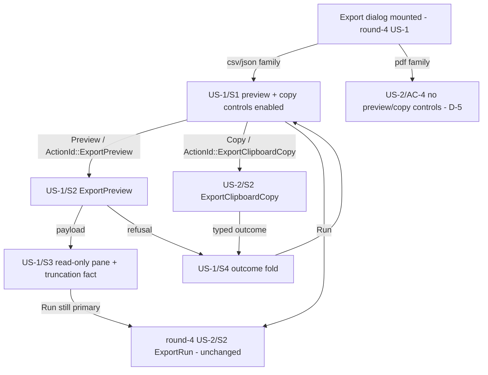
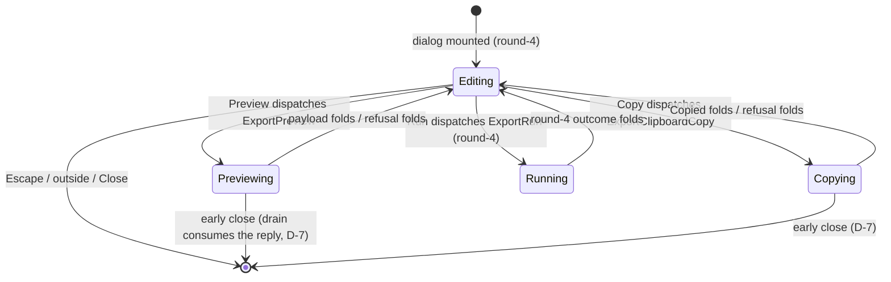

# Export Preview + Clipboard UX Journey Plan — round-5 D2 (export half)

- **Date**: 2026-11-22
- **Kind**: UX journey plan — user stories, journeys, flows, wiring
  contract for the export dialog's csv/json preview pane and
  clipboard handoff (#1149). No implementation decisions beyond the
  command contract.
- **Origin**: backlog issue #1149 (filed as the round-4 export plan's
  non-goal — .artifacts/plans/2026-11-21-parity-restore-journeys-export.md
  §1, D-3), the round-5 scope report §D (Status/export polish group),
  and the round-5 dispatch plan §8 chunk D2 (trap (c): the preview
  renders the same engine output the export writes). Consumed
  contracts: the landed export dialog (`export-dialog.slint`,
  `UiRequest::ExportRun { spec }` → `ExportRunOutcome`, round-4 OP2)
  and the #993 serde-pin pattern for new outcome payloads.
- **Status**: ACCEPTED by the operator (2026-11-23; the dispatcher
  relayed "GATE CLEARED"). Implemented by the D2 stage-2 agent on
  `feat/status-export-polish` — with the dated erratum at the end of
  this file (the §6 Test cells' step-nomination extensions).
- **Surfaces touched**: the existing export dialog composition
  (`ui/compositions/export-dialog.slint`), the adapter
  (`src/adapter.rs`), `src/requests.rs`, `src/actions.rs`; the
  app-side preview/clipboard executor (extends the OP2 export drain
  in `crates/taskboard-app`). No CLI delta (R-4 of the round-4 plan
  stands).
- **Platform scope**: desktop only — the preview/clipboard verbs live
  inside the export dialog, which already does not mount on kiosk
  (round-4 R-2).
- **Test-root**: crates/taskboard-ui-slint/tests (journey tests);
  the app-side executor tests are nominated crate-exact in §6 —
  `crates/taskboard-app/tests/it_export_preview.rs`.

## 1. Scope & goals

The export dialog gains two affordances on the csv/json leg: a
preview pane that renders exactly the payload the export engine would
write (trap (c) — one generator, two sinks), and a clipboard handoff
that puts that same payload on the system clipboard without writing a
file. The file-writing `Run` path stays the primary outcome; preview
and clipboard are read-side conveniences that never replace it.

**Non-goals** (each with a home):

- A pdf preview — the round-4 R-5 ruling stands (the pdf opens in the
  system viewer; in-app pdf rendering is a new feature). Home: this
  plan §2 R-3.
- Editing the payload before copy/export — the preview is read-only;
  an editor would fork the export contract. Home: this plan §2 R-2.
- New export families or formats (habits log, journal) — the round-4
  R-3 parity ruling stands. Home: the round-4 plan §1.
- Preview persistence (a cached pane surviving dialog close) — each
  preview is a fresh app-side generation from the current spec state.
  Home: this plan §1 (deliberately absent; no issue — no plausible
  ask recorded).

### Recorded decisions

| ID | Decision | Alternatives rejected |
|---|---|---|
| D-1 | **One generator, two sinks**: `UiRequest::ExportPreview { spec, reply: oneshot::Sender<ExportPreviewOutcome> }` and `UiRequest::ExportClipboardCopy { spec, reply: oneshot::Sender<ExportClipboardOutcome> }` both drive the app-side export engine over the same spec the Run button sends (trap (c)); the UI never renders payload bytes it generated itself. | Generating the payload presentation-side (the O-5 trap — duplicating the engine), or passing preview bytes back for copy (the UI would hold a payload buffer as state). |
| D-2 | **The preview pane is read-only and capped**: the outcome carries the payload plus a typed `truncated` fact when it exceeds the presentation cap; the cap is a presentation budget, never a payload or engine limit (the file/clipboard paths are never truncated). Fold asserts the flag, never sizes. | An uncapped pane (a large tracking log rendering unbounded in the dialog — the kiosk-memory goal's spirit applied desktop-side), or refusing to preview large payloads (a ceiling on success — forbidden posture). |
| D-3 | **Clipboard copy regenerates app-side from the same spec** (D-1) and returns a typed outcome (`Copied { bytes }` or the refusal kinds the preview carries plus `ClipboardUnavailable`). The dialog stays mounted with state intact on any refusal. | Copying the pane's rendered text (the preview may be truncated — a silent lie), or a fire-and-forget copy (no escape path). |
| D-4 | **Preview/copy never dispatch `ExportRun`**: no file is written by these verbs; the written-path fact remains Run's outcome exclusively. The busy posture is per-affordance (the preview button, the copy button, the Run button each hold their own flag). | Reusing Run with a dry-run flag (a hidden export — untyped contract surface). |
| D-5 | **The pdf leg carries no preview/copy controls**: the controls render on the csv/json family pick only (a fold flag, not hidden lanes — the family picker's existing grammar). | Rendering them disabled under pdf (a lie: the verbs are undefined for pdf, not permission-denied). |
| D-6 | **Serde pins per the #993 pattern**: `ExportPreviewOutcome` and `ExportClipboardOutcome` get a hand-written-JSON round-trip pin at landing (the receipts' wire stability is a consumed contract). | No pin (#993's exact finding shape). |
| D-7 | **Escape paths**: Escape/outside/Close during a preview or copy leaves the dialog (the app-side reply is consumed by the drain — the OP2 erratum's law); the busy flag clears on unmount. Refusals surface in the dialog's outcome fold, the filter state intact. | Orphaned busy posture after early close. |

## 2. Capability × surface matrix

| Capability | Board | TaskDetail | Today | Review | Settings | Capture | CLI |
|---|---|---|---|---|---|---|---|
| export.tracking_csv_json | — (R-1) | — (R-1) | — (R-1) | — (R-1) | E (desktop, US-1/US-2) | — (R-1) | E |
| export.pdf_sheet | — (R-1) | — (R-1) | — (R-1) | — (R-1) | E (desktop, the round-4 plan's pdf story — outside this plan's story set) | — (R-1) | E |

**Rulings** (every deliberate absence):

| ID | Ruling | Reason | Home |
|---|---|---|---|
| R-1 | Non-Settings GUI cells stay absent | Export is entity-less (the round-4 R-1 precedent); the dialog is the whole front. | This plan §2 |
| R-2 | No payload editing anywhere | The preview is read-only (D-1's one-generator law); editing forks the export contract the parity ruling fixed. | This plan §1 |
| R-3 | No pdf preview/clipboard leg | The round-4 R-5 ruling stands; the verbs are defined for text payloads only (D-5's family-gating). | This plan §1 |
| R-4 | No kiosk cells | The dialog does not mount on kiosk (round-4 R-2); no new surface delta. | Round-4 plan §1 |

## 3. User stories

### US-1 — Preview the csv/json payload before writing

- **Story**: When I am about to export my tracking data, I want to
  see the exact rows the file will contain so that I can check my
  filters before committing a file to disk.
- **Platforms**: desktop.
- **Entry points**: the dialog's `Preview` button (csv/json family);
  `ActionId::ExportPreview`.
- **Priority**: P1.
- **Acceptance**:
  - AC-1: Given the csv/json family and a spec state, When Preview,
    Then one `UiRequest::ExportPreview { spec }` dispatches with the
    spec fields equal to the dialog state and the pane enters busy
    posture — verified by seam test.
  - AC-2: Given a successful generation, Then the pane renders the
    payload the engine produced (one generator, two sinks — D-1) —
    verified by journey test (payload identity app-side, fold
    flag UI-side).
  - AC-3: Given a payload over the presentation cap, Then the pane
    renders the capped head plus the typed `truncated` fact (D-2) —
    verified by fold test.
  - AC-4: Given a typed refusal (bad filter resolution), Then the
    refusal kind folds and the dialog stays mounted with filter state
    intact — verified by journey test.

### US-2 — Copy the csv/json payload to the clipboard

- **Story**: When I want my tracking rows in a spreadsheet right now,
  I want to copy the payload to the clipboard without writing a file
  so that I can paste it directly into another tool.
- **Platforms**: desktop.
- **Entry points**: the dialog's `Copy` button (csv/json family);
  `ActionId::ExportClipboardCopy`.
- **Priority**: P1.
- **Acceptance**:
  - AC-1: Given the csv/json family, When Copy, Then one
    `UiRequest::ExportClipboardCopy { spec }` dispatches (spec fields
    equal to dialog state) and the copy control enters busy posture —
    verified by seam test.
  - AC-2: Given a successful copy, Then the typed outcome
    (`Copied { bytes }`) folds — verified by journey test.
  - AC-3: Given an unavailable clipboard, Then the typed refusal
    `ClipboardUnavailable` folds and the dialog stays mounted (D-3) —
    verified by journey test.
  - AC-4: Given the pdf family, Then no preview/copy controls render
    (D-5's family gating — fold flag, not absence-by-accident) —
    verified by fold test.

## 4. Journey specs

### US-1 — Preview the payload

| Step | Surface & affordance | User action | Dispatches | System response | Escape / failure |
|---|---|---|---|---|---|
| US-1/S1 | Dialog controls (csv/json family) | Set format/filters/destination as for a Run | — display only | The `Preview` and `Copy` controls render enabled (D-5's family flag); filter fields echo state as for Run | Clear a field to drop that filter |
| US-1/S2 | `Preview` button / `ActionId::ExportPreview` | Click (or the pane's confirm key) | `UiRequest::ExportPreview { spec }` (oneshot) | Busy posture on the preview control; app-side the engine generates the csv/json payload (D-1) | Escape/Close during generation closes the dialog; the reply is consumed by the drain (D-7) |
| US-1/S3 | Preview pane | Read the payload | — display only | The payload renders read-only; over-cap payloads render capped with the typed `truncated` fact (D-2) | None — read-only by R-2; Close unmounts |
| US-1/S4 | Dialog outcome fold | Observe | — display only | Typed refusal folds on failure; filter state intact; re-Preview after correcting the failing field | Re-Run / re-Preview |

### US-2 — Copy to clipboard

| Step | Surface & affordance | User action | Dispatches | System response | Escape / failure |
|---|---|---|---|---|---|
| US-2/S1 | Dialog controls (csv/json family) | Set the same spec state | — display only | Controls enabled (D-5) | As US-1/S1 |
| US-2/S2 | `Copy` button / `ActionId::ExportClipboardCopy` | Click | `UiRequest::ExportClipboardCopy { spec }` (oneshot) | Busy posture on the copy control; app-side regeneration + clipboard write (D-3 — never the pane's possibly-truncated text) | Escape/Close during the copy as US-1/S2 (D-7) |
| US-2/S3 | Dialog outcome fold | Observe | — display only | Typed outcome: `Copied { bytes }` or the refusal kind; dialog state intact on refusal | Re-Copy after correcting the failing field or restoring a clipboard |

## 5. Interaction flows

## 6. Wiring inventory

| ID | Surface file | Widget | Callback | Adapter seam | ActionId | Commands | Row addressing | Journey steps | Test |
|---|---|---|---|---|---|---|---|---|---|
| W-1 | ui/compositions/export-dialog.slint | `Preview` button | export_preview | install_export_seam (adapter.rs) | ActionId::ExportPreview | UiRequest::ExportPreview | Dialog-scoped state | US-1/S2 | crates/taskboard-ui-slint/tests/journeys/status_export_journeys_preview_journeys.rs::us1_s1_the_csv_json_family_renders_the_preview_controls, crates/taskboard-ui-slint/tests/journeys/status_export_journeys_preview_journeys.rs::us1_s2_preview_dispatches_the_dialog_spec |
| W-2 | ui/compositions/export-dialog.slint | `Copy` button | export_clipboard_copy | same seam | ActionId::ExportClipboardCopy | UiRequest::ExportClipboardCopy | Dialog-scoped | US-2/S2 | crates/taskboard-ui-slint/tests/journeys/status_export_journeys_preview_journeys.rs::us2_s1_the_copy_control_renders_on_the_family_flag, crates/taskboard-ui-slint/tests/journeys/status_export_journeys_preview_journeys.rs::us2_s2_copy_dispatches_the_dialog_spec |
| W-3 | ui/compositions/export-dialog.slint | preview pane | export_preview_shown | same seam (oneshot reply → presentation fold OUTSIDE the adapter borrow) | — | — | Dialog-scoped | US-1/S3, US-1/S4 (display only — R-2) | crates/taskboard-ui-slint/tests/journeys/status_export_journeys_preview_journeys.rs::us1_s3_over_cap_payload_folds_the_truncated_fact, crates/taskboard-ui-slint/tests/journeys/status_export_journeys_preview_journeys.rs::us1_s4_preview_refusal_folds_and_the_dialog_state_stays, crates/taskboard-ui-slint/tests/journeys/status_export_journeys_preview_journeys.rs::us2_s3_clipboard_unavailable_folds_the_typed_refusal |
| W-4 | ui/compositions/export-dialog.slint | family-gating flag for the controls | export_preview_gated | same seam (fold) | — | — | Dialog-scoped | US-2/AC-4 (display only — D-5) | crates/taskboard-ui-slint/tests/journeys/status_export_journeys_preview_journeys.rs::us2_s4_pdf_family_gates_the_preview_controls_off |
| W-5 | crates/taskboard-ui-slint/src/requests.rs | — | — | app-side preview/clipboard executor (D-1's one-generator-two-sinks drain) | — | UiRequest::ExportPreview | — | US-1/S2, US-1/S3, US-2/S2 | crates/taskboard-app/tests/it_export_preview.rs::preview_payload_equals_the_engine_export_payload, crates/taskboard-app/tests/it_export_preview.rs::us1_s3_over_cap_payload_folds_the_truncated_fact, crates/taskboard-app/tests/it_export_preview.rs::us2_s2_copy_regenerates_and_reports_typed_outcome |
| W-6 | crates/taskboard-domain tests (serde pin, #993 pattern) | — | — | — | — | UiRequest::ExportPreview | — | US-1/S2, US-2/S2 (wire-stability pin, D-6) | crates/taskboard-domain/src/undo/tests.rs::export_preview_and_clipboard_outcomes_round_trip_serde |

## 7. Command-contract delta

| Kind | Name | Payload sketch | Journeys |
|---|---|---|---|
| UiRequest | ExportPreview | new — `{ spec: ExportSpec, reply: oneshot::Sender<ExportPreviewOutcome> }`; `ExportPreviewOutcome` = payload (text), format, typed `truncated` fact, or the typed refusal kinds (D-1/D-2/D-4); serde pin per D-6 | US-1/S2 |
| UiRequest | ExportClipboardCopy | new — `{ spec: ExportSpec, reply: oneshot::Sender<ExportClipboardOutcome> }`; `ExportClipboardOutcome` = `Copied { bytes }` or the refusals incl. `ClipboardUnavailable` (D-3); serde pin per D-6 | US-2/S2 |
| StateCommand | — | none: the export family touches no engine state (the round-4 §7 law stands) | — |
| ActionId | ExportPreview, ExportClipboardCopy | new — no payload (one ActionId per wiring row, §6 W-1/W-2) | US-1/S2, US-2/S2 |

## 8. Verification plan

- **Journey tests** (step-ID-named,
  `crates/taskboard-ui-slint/tests/journeys/status_export_journeys_preview_journeys.rs`):
  `us1_s2_*`, `us1_s4_*`, `us2_s2_*`, `us2_s4_*` — per the §6 Test
  column.
- **Seam tests**: `ExportPreview`/`ExportClipboardCopy` spec-field
  equality with dialog state (US-1/AC-1, US-2/AC-1); the app-side
  payload-identity assertion — the preview payload equals the
  engine's export payload byte-for-byte on the same spec (D-1, trap
  (c); W-5).
- **Fold/presentation tests**: the `truncated` fact (US-1/AC-3), the
  family-gating flag (US-2/AC-4), per-affordance busy flags (D-4) —
  flags, never caption text; no size-ceiling assertions (the cap is a
  presentation fact asserted via its flag).
- **Kiosk gates**: none new — the dialog stays desktop-only
  (round-4 R-2); the structural inventory already asserts the kiosk
  composition carries no export rows.
- **Serde pins**: `ExportPreviewOutcome`/`ExportClipboardOutcome`
  round-trip over hand-written JSON (D-6, the #993 pattern; W-6).
- **Manual**: whether the pane reads as a preview of the write (not a
  second export path) — recognition at walkthrough; who: the stage-3
  review agent.

## 9. Definition of done

- [ ] `scripts/ux-coverage.sh <this file> --gate` exits 0
- [ ] Every P1 story's journey completes end-to-end including escapes
- [ ] Walkthrough protocol executed at stage 3; findings resolved or homed
- [ ] All matrix absences carry rulings; the census export slice gains
      the preview/clipboard verbs (Settings slice, desktop)
- [ ] Non-goals ruled in §2 (pdf leg, editing, new families)
- [ ] D-6's serde pins landed with the request types

## Erratum (2026-11-23, the D2 stage-2 agent)

- **§6 Test cells extended** (the #1181-era gate law: every §4 step
  token must carry a nomination — the accepted plan left US-1/S1,
  US-2/S1 and US-2/S3 unnominated): W-1's cell gains the
  `us1_s1_the_csv_json_family_renders_the_preview_controls`
  nomination, W-2's the `us2_s1_the_copy_control_renders_on_the_family_flag`
  nomination, and W-3's the
  `us2_s3_clipboard_unavailable_folds_the_typed_refusal` nomination —
  the same evidence file the plan already nominates.
- **§2 pdf cell erratum**: the `export.pdf_sheet` cell cited "round-4
  US-3" — a story of the *round-4* plan, not this plan's §4 story set,
  so the gate's citation check read it MISSING; the cell now names the
  citing home in prose (the citation grammar never spanned plans).
- **W-6's pin home deviation**: the serde pins for
  `ExportPreviewOutcome`/`ExportClipboardOutcome` live beside the
  types (`crates/taskboard-ui-slint/src/requests.rs` tests) — the
  domain crate cannot depend on the UI crate (the workspace boundary
  law, AGENTS §2), so the W-6 row's `crates/taskboard-domain`
  nomination is unimplementable as written. The pin itself is
  unchanged (hand-written-JSON round-trip, the #993 pattern).
