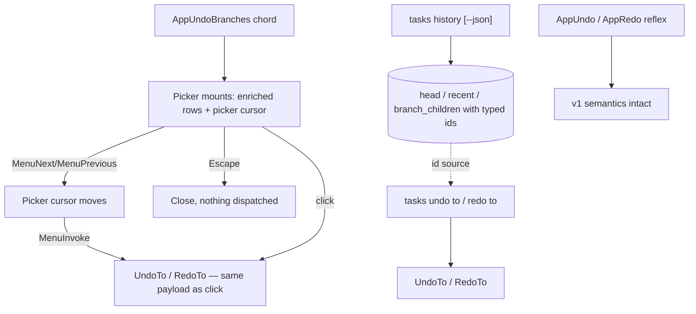
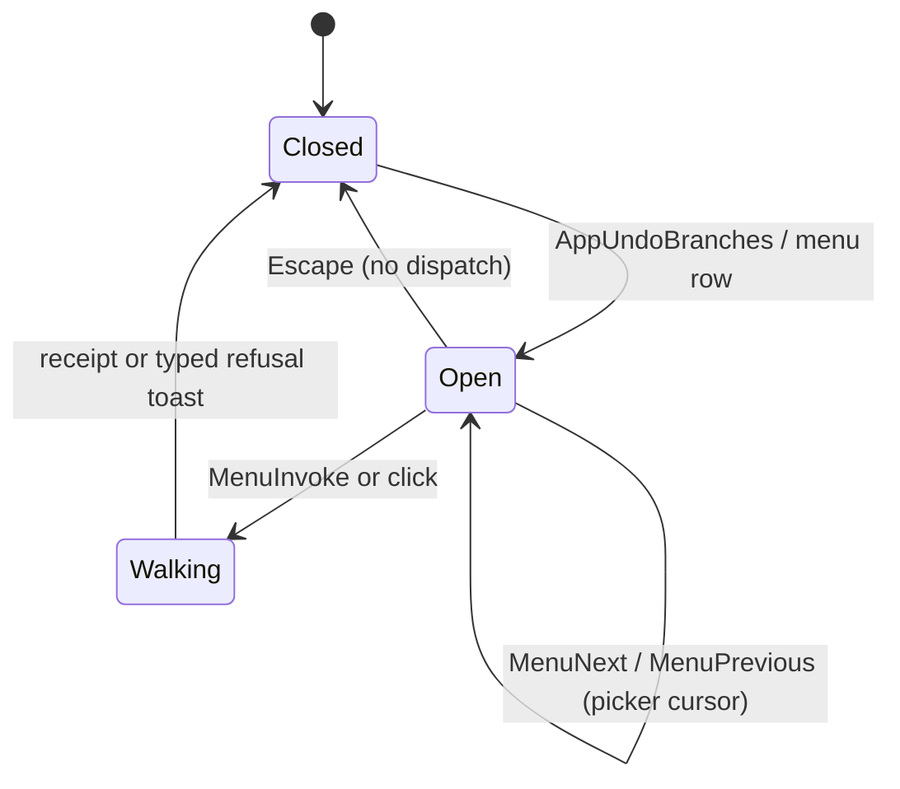

# UX Journey Plan — undo family, chunk D1ii: browse parity (picker keyboard + payload labels, CLI undo-to/redo-to, bounded history)

<!--
Copied from .artifacts/templates/ux-journey-plan.md; guidance comment
retained per the template's own instruction. This is the round-5 undo
family's journey plan for chunk D1ii (`feat/undo-browse-parity`,
#1155 + #1156 + #1226 + #1227). The sibling plan for D1i is
2026-11-22-undo-family-journeys-restore-clear-surfaces.md.
-->

- **Date**: 2026-11-22
- **Kind**: UX journey plan — user stories, journeys, flows, wiring
  contract for the branch picker's parity remainder and the undo
  family's CLI browse/parity verbs. No implementation decisions beyond
  the command contract.
- **Origin**: backlog issues #1155 (CLI parity for `UndoTo`/`RedoTo`),
  #1156 (deep-history browsing beyond the picker's bounded windows),
  #1226 (sibling rows need payload context in their labels), #1227
  (picker rows are pointer-only once mounted) — all homed by the
  round-4 plan `.artifacts/plans/2026-11-21-undo-ui-branch-picker-plan.md`
  (§1 N2/N3, §4 US-1, §8 Manual); the UF2-landed branch picker (the
  landed base: `UndoView.branch_children` + `recent`
  (`crates/taskboard-domain/src/journal.rs:330-400`),
  `StateCommand::UndoTo`/`RedoTo` (`messages.rs:698-724`), the
  `undo_branches_open` / `undo_branch_picked` / `undo_target_picked`
  seams and `ActionId::AppUndoBranches`); the round-5 scope report §D
  (wave 4, undo family).
- **Status**: DRAFT — GATE-PAUSED pending operator acceptance (the
  dispatcher owns the acceptance gate).
- **Surfaces touched**: the branch-picker composition
  (`ui/compositions/action-menu.slint` — keyboard cursor + enriched
  rows), `UndoLabel` widening (domain projection, additive),
  `crates/taskboard-app/src/cli.rs` (new verb arms + typed error
  kinds), the `--json` receipt path.
- **Platform scope**: desktop for the picker stories; the CLI is
  platform-free (kiosk rides it per the UF2 R-2 posture). Kiosk keeps
  the picker entry absent; the CLI verbs serve it.
- **Test-roots**: crates/taskboard-ui-slint/tests (picker journeys:
  `tests/journeys/undo_family_browse_parity_journeys.rs`) and
  crates/taskboard-app/tests (CLI journeys:
  `tests/it_undo_browse_cli.rs`).

## 1. Scope & goals

**What the user can now do that they couldn't**: select a branch-picker
row from the keyboard (today the picker is pointer-only once mounted —
#1227); tell two same-verb sibling branches apart without dispatching
(rows carry payload context — #1226); and from the terminal, list the
undo history's bounded windows with ids and jump the line with
`tasks undo to <id>` / `tasks redo to <id>` (#1155), which is also the
kiosk's only browsing surface.

**Goals**:

- G1 (picker keyboard selection, #1227): the picker's rows join the
  menu family's keyboard ladder — `MenuNext`/`MenuPrevious`/
  `MenuInvoke` gain a picker cursor (the shell's ladder currently
  targets the action menu's cursor, which is closed while the picker
  is mounted). Escape dismisses as today. This closes the journey
  plan US-1/S2 cell's "keyboard-select" half that shipped pointer-only.
- G2 (payload labels, #1226): `UndoLabel` widens additively with a
  typed `payload: Option<String>` — the engine-derived payload context
  (task title / stack name / rule summary per command arm; the UI
  renders, never synthesizes). **Decision: the enrichment is one
  projection consumed by both windows** (`recent` and
  `branch_children`) — recognition-over-recall should not stop at the
  picker's edge; `command_label` stays the bare verb phrase so toasts
  and `head_label` keep their shape.
- G3 (CLI browse + parity, #1155 + #1156's bounded answer): the CLI
  gains `tasks history` (the bounded windows with typed ids + labels +
  payloads, `--json`-envelope-able) and the jump verbs
  `tasks undo to <id/prefix>` / `tasks redo to <id/prefix>` wrapping
  the existing `UndoTo`/`RedoTo`. The history verb is the id source
  that makes the jump verbs usable — without it the jump grammar has
  no discoverable ids.
- G4 (#1156's recorded resolution): the bounded browse parity of G3
  **is** the shipped answer to deep-history browsing; a full-tree
  journal inspector over the retention horizon stays deferred on
  #1156 (motivation-gated, comment recorded) — not silently dropped,
  and not shipped unmotivated.

**Non-goals (each with a home)**:

- N1: the full-tree deep-history inspector (arbitrary-node jumping
  across thousands of entries) — G4's deferred remainder. Home:
  #1156 (stays open; D1ii comments the bounded resolution on it).
- N2: per-board picker rows / board-scoped CLI history — #355 owns
  line scoping. Home: #355.
- N3: branch merge, cross-branch diffing, persisted branch choice —
  the UF2 plan's N4/N5 law stands. Home: none (law, not debt).
- N4: kiosk picker parity — the picker stays desktop-qualified (UF2
  R-2); the CLI verbs are the kiosk's parity surface. Home: this plan
  R-2.

### Recorded decisions

| ID | Decision | Alternatives rejected |
|---|---|---|
| D-1 | **Picker rows join the existing `MenuNext`/`MenuPrevious`/`MenuInvoke` ladder via a picker-scoped cursor**, not a new focus model: `MenuRow` rows never hold focus across the menu family (the dropdown class's recorded law); the picker gets the action menu's cursor mechanics under its own mount flag. No new ActionIds. | Focusable rows (breaks the family law); a fresh chord set (keyboard parity is the point — same keys as the action menu). |
| D-2 | **Payload enrichment is one projection for both windows** (the question #1226 posed explicitly): `UndoLabel.payload` is derived once; both `recent` and `branch_children` rows carry it; the picker renders `label + payload`, and `head_label`/toasts stay bare `command_label` until a surface opts in. | Picker-only enrichment (two derivations of one row type; inconsistent recognition across the undo surfaces). |
| D-3 | **Payload context is engine-derived per arm** in `command_payload` (a sibling of `command_label`): the journaled command's own data only — task title, stack name, label name, rule summary, etc. `Some` where an arm has a natural subject, `None` where it doesn't (never an empty string; the UI hides a `None` payload, never renders a blank dash). | Free-form rendering in the UI (violates the dumb-presentation-client law); stuffing the payload into `label` (churns every consumer). |
| D-4 | **CLI grammar: `tasks history [--json]`, `tasks undo to <id/prefix>`, `tasks redo to <id/prefix>`** — the `tasks` verb family the CLI's undo/redo already lives in; id resolution is uuid \| unique ≥8-char prefix over the *bounded windows only* (the same ids `tasks history` printed — nothing outside the windows is addressable, which is the honest bound of #1156's resolution). | `journal`-scoped verbs (exposes journal internals as a noun); ids piped from elsewhere (no discoverable source). |
| D-5 | **Stale-target CLI refusals are typed** (`TargetNotInLine` via the existing `domain_error_kind` table), matching the GUI picker's contract byte-for-byte — O-5 parity is *parity*, including the failure paths. | CLI-specific error shapes (two contracts for one verb). |

## 2. Capability × surface matrix

| Capability | Board | TaskDetail | Today | Review | Settings | Capture | CLI |
|---|---|---|---|---|---|---|---|
| journal.branch_pick | E (pre-existing, US-1 — now keyboard-complete) | E (US-1) | E (US-1) | E (US-1) | E (US-1) | E (US-1) | E (US-3 — `tasks undo to` / `tasks redo to`) |
| journal.branch_labels (display) | D (US-1 — payload-enriched rows) | D (US-1) | D (US-1) | D (US-1) | D (US-1) | D (US-1) | D (US-2/US-3 — `tasks history`) |
| journal.history_browse (bounded) | — (R-1) | — (R-1) | — (R-1) | — (R-1) | — (R-1) | — (R-1) | E (US-2 — `tasks history`) |
| journal.undo / journal.redo (v1 line) | E (pre-existing, unchanged) | E | E | E | E | E | E (pre-existing) |

**Rulings** (every deliberate absence):

| ID | Ruling | Reason | Home |
|---|---|---|---|
| R-1 | `journal.history_browse` has no GUI cell beyond the picker's existing windows | The picker *is* the GUI browse surface over the bounded windows (UF2); a second GUI browser duplicates it. The CLI verb serves scripts and kiosk. The deep inspector is unmotivated | #1156 (stays open for the deep-tree inspector; D1ii comments the bounded resolution) |
| R-2 | Kiosk: the picker entry renders absent (unchanged UF2 posture); the CLI verbs carry kiosk parity | Kiosk viewers are not editors of abandoned branches; the CLI is platform-free | This plan N4 |
| R-3 | No settings knob for the payload labels or the picker cursor | Both are always-on refinements of existing affordances, not modes | This plan §1 |
| R-4 | `tasks history` exposes the bounded windows only — no retention-horizon dump | The windows are what the GUI shows; parity means the same bound. Unlimited dumps are the deep inspector's territory | #1156 + D-4 |

## 3. User stories

### US-1 — Select a picker row from the keyboard, and tell siblings apart

- **Story**: When I open the branch picker I want to move a cursor
  with the same next/previous/invoke keys the action menu uses, and
  read each sibling row as "verb + subject" so that I can pick the
  right abandoned branch without dispatching to find out.
- **Platforms**: desktop.
- **Entry points**: `ActionId::AppUndoBranches` (unchanged chord) or
  the action-menu picker row.
- **Priority**: P1.
- **Acceptance**:
  - AC-1: Given the picker mounted When `MenuNext`/`MenuPrevious` run
    Then the picker's cursor moves over its rows (typed cursor
    position facts) — verified by journey test.
  - AC-2: Given a cursor on a row When `MenuInvoke` runs Then the
    exact command that row's click path dispatches fires
    (`UndoTo`/`RedoTo` payload identical) — verified by journey test.
  - AC-3: Given two sibling branches of the same verb When the picker
    mounts Then the rows' payload projections differ (typed
    `UndoLabel.payload` inequality, never label text) — verified by
    journey test + domain fold test.
  - AC-4: Given Escape When it runs Then the picker closes, nothing
    dispatched (unchanged) — verified by journey test.
  - AC-5: Given an arm with no natural subject When the projection
    derives Then `payload` is `None` and the row renders label-only —
    verified by domain fold test.

### US-2 — Browse the bounded history from the terminal

- **Story**: When I want to see where the undo line stands and what
  the windows offer, I want `taskboard tasks history` to print the
  head, the recent window, and the sibling branches with typed ids so
  that I can choose a jump target without opening the GUI.
- **Platforms**: CLI (platform-free; kiosk's only browse surface).
- **Entry points**: `taskboard tasks history [--json]`.
- **Priority**: P1.
- **Acceptance**:
  - AC-1: Given a journaled line When the verb runs Then the output
    carries the three windows (head / recent / branch children) with
    typed journal ids, engine-derived labels and payloads — verified
    by seam test (typed structure, never text).
  - AC-2: Given `--json` When the verb runs Then the payload decodes
    against the typed projection (serde round-trip over
    `UndoLabel { id, label, payload }`) — verified by seam test.
  - AC-3: Given an empty journal When the verb runs Then the typed
    empty-fact receipt surfaces (windows empty, exit reflects the
    fact, not an error) — verified by seam test.

### US-3 — Jump the line from the terminal

- **Story**: When I know (from `tasks history` or a script) the id of
  an ancestor or a sibling branch, I want `tasks undo to <id>` /
  `tasks redo to <id>` to land the line there so that the GUI picker's
  power is reachable headlessly — the #1155 parity remainder.
- **Platforms**: CLI.
- **Entry points**: `taskboard tasks undo to <id/prefix>`,
  `taskboard tasks redo to <id/prefix>`.
- **Priority**: P1.
- **Acceptance**:
  - AC-1: Given a window id When `undo to` runs Then
    `StateCommand::UndoTo { target }` dispatches and the receipt
    names the final entry — verified by seam test.
  - AC-2: Given a sibling-branch id When `redo to` runs Then
    `StateCommand::RedoTo { target }` dispatches and the head lands
    on the branch tip — verified by seam test.
  - AC-3: Given an id outside the bounded windows or a stale target
    When the verb plans Then the typed refusal
    (`TargetNotInLine` / unknown-id kind) surfaces and nothing
    dispatches — verified by seam test (`matches!`).
  - AC-4: Given an ambiguous prefix When resolution runs Then the
    typed ambiguous-refusal surfaces before any dispatch — verified
    by seam test.

### US-4 — The v1 reflex and the landed picker compose (regression fence)

- **Story**: As a user I want the keyboard cursor and payload labels
  to change nothing about plain undo/redo or the picker's click
  behaviour so that the refinement is purely additive.
- **Platforms**: both.
- **Entry points**: `ActionId::AppUndo` / `AppRedo` (unchanged); the
  picker's click paths (unchanged).
- **Priority**: P1.
- **Acceptance**:
  - AC-1: Given the chunk shipped When plain `Undo`/`Redo` plans Then
    semantics are byte-identical (the existing engine corpus passes
    unchanged except the deliberate `UndoLabel` projection
    regeneration) — verified by corpus fence + fold test.
  - AC-2: Given the picker with a cursor When a row is *clicked*
    Then the dispatch is identical to US-1/AC-2's invoke — verified by
    journey test.

## 4. Journey specs

### US-1 — Picker keyboard + payload rows

| Step | Surface & affordance | User action | Dispatches | System response | Escape / failure |
|---|---|---|---|---|---|
| US-1/S1 | Branch picker (the UF2 composition) | Open via the chord / menu row | `ActionId::AppUndoBranches` (mount only) | Picker mounts; rows render label + payload context (D-2/D-3); cursor rests on the plain undo/redo rows first (BF-W-N2 ordering, unchanged) | Escape closes, nothing dispatched (US-1/S5) |
| US-1/S2 | Picker rows | `MenuNext` / `MenuPrevious` | — (cursor move, no dispatch) | The picker-scoped cursor moves; the highlighted row's identity is a typed fact | The ladder targets the picker's cursor only while it is mounted (D-1) — the action menu's cursor is unaffected |
| US-1/S3 | Highlighted row | `MenuInvoke` | `StateCommand::UndoTo { target }` or `StateCommand::RedoTo { target }` (the row's own verb) | Identical to the click path's dispatch and receipt (US-4/AC-2 pins the equality) | Typed refusal toast (`TargetNotInLine` for stale rows), head unmoved — the UF2 failure path, unchanged |
| US-1/S4 | Presented state | — (display only) | — | State reflects the landed head; `UndoView` re-derives with enriched rows | The picker remains openable; plain reflexes always available |
| US-1/S5 | Picker | Escape | — (none) | Closes, nothing dispatched | — (escape) |

### US-2 — `tasks history`

| Step | Surface & affordance | User action | Dispatches | System response | Escape / failure |
|---|---|---|---|---|---|
| US-2/S1 | Terminal | Run `taskboard tasks history [--json]` | — (a `UiRequest`-free read; the CLI reads the published snapshot — no engine command) | The three windows print (head / recent / branch children) with typed ids, labels, payloads (AC-1; `--json` per AC-2) | Empty journal → the typed empty-fact receipt (AC-3), not an error path |
| US-2/S2 | Terminal | Note an id for US-3 | — | — | Ids outside the windows are never printed (R-4 — the honest bound) |

### US-3 — `tasks undo to` / `tasks redo to`

| Step | Surface & affordance | User action | Dispatches | System response | Escape / failure |
|---|---|---|---|---|---|
| US-3/S1 | Terminal | Run `taskboard tasks undo to <id/prefix>` | `StateCommand::UndoTo { target }` (resolved per D-4) | N inverse steps; head lands on the target's parent; receipt names the final entry | Unknown/ambiguous prefix → typed resolution refusal before dispatch (AC-3/AC-4) |
| US-3/S2 | Terminal | Run `taskboard tasks redo to <id/prefix>` | `StateCommand::RedoTo { target }` | Undo-to-fork then redo down the sibling; head lands on the tip; receipt names it | `TargetNotInLine` (stale or foreign id) → typed refusal, head unmoved |
| US-3/S3 | Terminal | Run `taskboard tasks undo` after S1 | `StateCommand::Undo` (unchanged) | The v1 reflex walks the line one step (composes) | Typed refusals unchanged |

### US-4 — Regression fence

| Step | Surface & affordance | User action | Dispatches | System response | Escape / failure |
|---|---|---|---|---|---|
| US-4/S1 | Global undo reflex | Ctrl+Z / Ctrl+Shift+Z | `StateCommand::Undo` / `Redo` (unchanged) | Byte-identical v1 semantics (D5 greatest-child redo) | Typed refusals unchanged |
| US-4/S2 | Picker rows | Click a row | the row's `UndoTo`/`RedoTo` | Identical dispatch to US-1/S3's invoke | Typed refusal toast, unchanged |

## 5. Interaction flows

## 6. Wiring inventory

| ID | Surface file | Widget | Callback | Adapter seam | ActionId | Commands | Row addressing | Journey steps | Test |
|---|---|---|---|---|---|---|---|---|---|
| W-1 | ui/compositions/action-menu.slint | Picker cursor wiring on the existing rows | — | adapter.rs::install_undo_seams (the picker's cursor joins the shell's MenuNext/MenuPrevious/MenuInvoke ladder under the picker mount flag) | ActionId::MenuNext | — | — (cursor mechanics; the rows' own addressing is W-2/W-3's) | US-1/S1, US-1/S2, US-1/S5 | crates/taskboard-ui-slint/tests/journeys/undo_family_browse_parity_journeys.rs::us1_s1_picker_mounts_with_cursor_and_payload_rows, crates/taskboard-ui-slint/tests/journeys/undo_family_browse_parity_journeys.rs::us1_s2_menu_ladder_moves_picker_cursor, crates/taskboard-ui-slint/tests/journeys/undo_family_browse_parity_journeys.rs::us1_s5_escape_closes_the_picker_without_dispatch |
| W-1b | ui/compositions/action-menu.slint | Picker cursor wiring (previous direction) | — | adapter.rs::install_undo_seams (same ladder, opposite traversal) | ActionId::MenuPrevious | — | — (cursor mechanics, same row set as W-1) | US-1/S2 | crates/taskboard-ui-slint/tests/journeys/undo_family_browse_parity_journeys.rs::us1_s2_menu_ladder_moves_picker_cursor |
| W-1c | ui/compositions/action-menu.slint | Picker invoke wiring (the cursor's commit) | — | adapter.rs::install_undo_seams (same ladder, the invoke arm routes the cursor's row through W-2/W-3's callbacks) | ActionId::MenuInvoke | — | — (routing only; the dispatch is W-2/W-3's) | US-1/S3, US-4/S2 | crates/taskboard-ui-slint/tests/journeys/undo_family_browse_parity_journeys.rs::us1_s3_invoke_selected_dispatches_the_row_verb, crates/taskboard-ui-slint/tests/journeys/undo_family_browse_parity_journeys.rs::us4_s2_click_and_invoke_dispatch_identically |
| W-2 | ui/compositions/action-menu.slint | Picker sibling row (invoke path added) | undo_branch_picked | adapter.rs::install_undo_seams | — | StateCommand::RedoTo | ItemAddr kind: journal-entry row (unchanged; the callback is the existing one — it gains the cursor's invoke as a second trigger) | US-1/S3, US-1/S4, US-4/S2 | crates/taskboard-ui-slint/tests/journeys/undo_family_browse_parity_journeys.rs::us1_s3_invoke_selected_dispatches_the_row_verb, crates/taskboard-ui-slint/tests/journeys/undo_family_browse_parity_journeys.rs::us1_s4_presented_state_reflects_the_landed_head, crates/taskboard-ui-slint/tests/journeys/undo_family_browse_parity_journeys.rs::us4_s2_click_and_invoke_dispatch_identically |
| W-3 | ui/compositions/action-menu.slint | Picker undo-step row (invoke path added) | undo_target_picked | adapter.rs::install_undo_seams | — | StateCommand::UndoTo | journal-entry row (unchanged; same dual-trigger note as W-2) | US-1/S3 | crates/taskboard-ui-slint/tests/journeys/undo_family_browse_parity_journeys.rs::us1_s3_invoke_matches_click_dispatch |
| W-4 | (none — domain projection) | (none) | — | journal.rs `UndoLabel` widening (`payload: Option<String>` via the new `command_payload`) + derive update for both windows | — | — | — (derived projection, no command; US-1/S1's and US-2/S1's row source) | US-1/S1, US-2/S1, US-1/AC-5, US-4/S1 | crates/taskboard-domain/src/journal/tests.rs::us1_ac3_sibling_rows_carry_distinct_payloads, crates/taskboard-domain/src/journal/tests.rs::us1_ac5_subjectless_arm_derives_none_payload, crates/taskboard-domain/src/journal/tests.rs::us2_s1_both_windows_carry_the_enrichment, crates/taskboard-domain/src/undo/tests.rs::us4_s1_plain_reflex_semantics_unchanged_with_enriched_rows |
| W-5 | crates/taskboard-app/src/cli.rs | `tasks history [--json]` verb arm | — | commands/ read path over the published snapshot (no engine command) | — | — | Verb + flag; no row addressing (flat read) | US-2/S1, US-2/S2 | crates/taskboard-app/tests/it_undo_browse_cli.rs::us2_s1_history_prints_the_three_windows, crates/taskboard-app/tests/it_undo_browse_cli.rs::us2_s2_json_history_decodes_the_projection, crates/taskboard-app/tests/it_undo_browse_cli.rs::us2_s3_empty_journal_is_the_typed_empty_fact |
| W-6 | crates/taskboard-app/src/cli.rs | `tasks undo to <id/prefix>` / `tasks redo to <id/prefix>` verb arms | — | commands/ dispatch + `domain_error_kind` arms (D-5) | — | StateCommand::UndoTo; StateCommand::RedoTo | Verb + positional id, bounded-window resolution per D-4 | US-3/S1, US-3/S2 | crates/taskboard-app/tests/it_undo_browse_cli.rs::us3_s1_undo_to_dispatches_and_receipts, crates/taskboard-app/tests/it_undo_browse_cli.rs::us3_s2_redo_to_lands_the_branch_tip |
| W-7 | crates/taskboard-app/src/commands/mod.rs | typed-refusal mapping for the jump paths | — | `domain_error_kind` arms (TargetNotInLine, unknown-id, ambiguous-prefix) | — | — | — | US-3/S1, US-3/S2 | crates/taskboard-app/tests/it_undo_browse_cli.rs::us3_s3_stale_target_refuses_typed, crates/taskboard-app/tests/it_undo_browse_cli.rs::us3_s4_ambiguous_prefix_refuses_before_dispatch |
| W-8 | ui adapter (existing toast lane) | existing outcome notice | — | adapter.rs::arm_outcome_notice (unchanged lane) | — | — | — (receipt rendering, unchanged) | US-1/S3 | crates/taskboard-ui-slint/tests/journeys/undo_family_browse_parity_journeys.rs::us1_s3_invoke_matches_click_dispatch |

## 7. Command-contract delta

| Kind | Name | Payload sketch | Journeys |
|---|---|---|---|
| StateCommand | `UndoTo` | exists — unchanged; gains its CLI dispatch path | US-3/S1 |
| StateCommand | `RedoTo` | exists — unchanged; gains its CLI dispatch path | US-3/S2 |
| AppState projection | `UndoLabel.payload` | `Option<String>` — additive field, engine-derived via the new `command_payload` per D-3, carried by both windows per D-2, never persisted | US-1/S1, US-2/S1 |
| StateCommand | — | no new variants: the jump verbs and the projection all exist; the chunk is parity + projection work | — |
| UiRequest | — | none (`tasks history` reads the published snapshot) | US-2/S1 |
| ActionId | — | none (D-1 reuses `MenuNext`/`MenuPrevious`/`MenuInvoke`) | US-1/S2 |

The CLI grammar delta (prose contract, no domain token): three new
verb arms — `tasks history [--json]`,
`tasks undo to <id/prefix>`, `tasks redo to <id/prefix>` — per D-4.

## 8. Verification plan

- **Journey tests**
  (`crates/taskboard-ui-slint/tests/journeys/undo_family_browse_parity_journeys.rs`):
  `us1_s2_menu_ladder_moves_picker_cursor`,
  `us1_s3_invoke_selected_dispatches_the_row_verb`,
  `us1_s3_invoke_matches_click_dispatch`.
- **CLI seam tests** (`crates/taskboard-app/tests/it_undo_browse_cli.rs`):
  `us2_s1_history_prints_the_three_windows`,
  `us2_s2_json_history_decodes_the_projection`,
  `us2_s3_empty_journal_is_the_typed_empty_fact`,
  `us3_s1_undo_to_dispatches_and_receipts`,
  `us3_s2_redo_to_lands_the_branch_tip`,
  `us3_s3_stale_target_refuses_typed`,
  `us3_s4_ambiguous_prefix_refuses_before_dispatch` — typed outcome
  matches, never text.
- **Fold/presentation tests** (domain, exact-name nominated):
  `journal/tests.rs::us1_ac3_sibling_rows_carry_distinct_payloads`,
  `journal/tests.rs::us1_ac5_subjectless_arm_derives_none_payload`,
  `journal/tests.rs::us2_s1_both_windows_carry_the_enrichment`.
- **Snapshot**: the `UndoLabel` widening is the one deliberate insta
  regeneration pass; the v1 line arms' corpus must be otherwise
  unchanged (US-4/AC-1's fence).
- **Kiosk gates**: the picker entry renders absent on kiosk (R-2,
  unchanged) — the existing composition probe keeps passing; the CLI
  verbs are platform-free.
- **Manual**: the payload rows' recognizability (does `Create task —
  "beta"` disambiguate same-verb siblings well enough?) — judged at
  the stage-3 walkthrough per recognition-over-recall; this closes
  #1226's deferred walkthrough judgment.

## 9. Definition of done

- [ ] `scripts/ux-coverage.sh <this file> --gate` exits 0
- [ ] Every P1 story's journey completes end-to-end including escapes
      (US-1..US-4)
- [ ] Walkthrough protocol executed at stage 3; findings resolved or
      homed
- [ ] All matrix absences carry rulings (R-1..R-4); census updated:
      `journal.branch_pick` gains its CLI cell,
      `journal.history_browse` is recorded bounded-CLI-only
- [ ] Non-goals homed: N1 stays on #1156 (the bounded resolution
      commented there); N2 stays on #355
