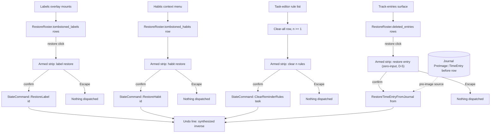
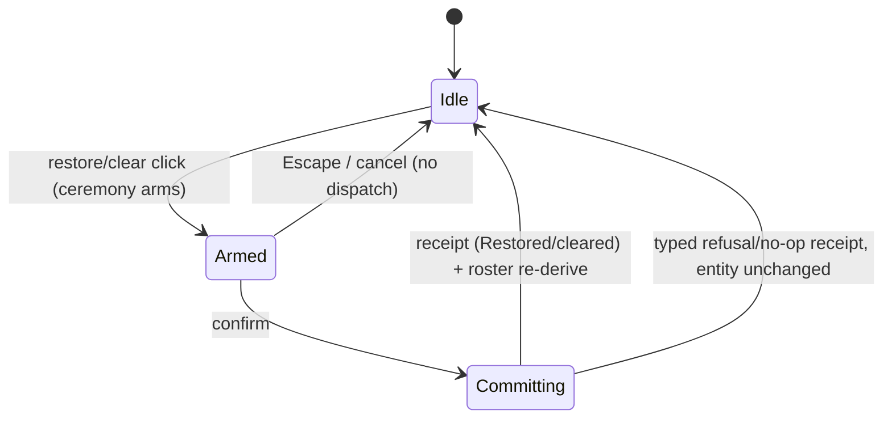

# UX Journey Plan — undo family, chunk D1i: the GUI restore surfaces + ClearReminderRules first-class

<!--
Copied from .artifacts/templates/ux-journey-plan.md; guidance comment
retained per the template's own instruction. This is the round-5 undo
family's journey plan for chunk D1i (`feat/restore-clear-surfaces`,
#1146 + #1154). The sibling plan for D1ii is
2026-11-22-undo-family-journeys-browse-parity.md. The per-chunk
implementation plans cite this file as Origin.
-->

- **Date**: 2026-11-22
- **Kind**: UX journey plan — user stories, journeys, flows, wiring
  contract for the restore-verb family's GUI surfaces and the
  `ClearReminderRules` first-class affordance. No implementation
  decisions beyond the command contract.
- **Origin**: backlog issues #1146 (GUI restore surfaces; the round-4
  CLI-first plan
  `.artifacts/plans/2026-11-21-parity-restore-journeys-restore-cli.md`
  §2 R-1's recorded home) and #1154 (`ClearReminderRules` has no
  first-class surface; homed by
  `.artifacts/plans/2026-11-21-undo-ui-reminder-undo-plan.md` §1 N5 /
  §2 R-3); the round-5 scope report §D (wave 4, undo family, "two
  chunks + journeys"); the landed base: the three engine verbs
  (`StateCommand::RestoreLabel` / `RestoreTimeEntry` / `RestoreHabit`,
  `crates/taskboard-domain/src/messages.rs:773-800`), the #993-pinned
  receipts (`LabelRestored` / `HabitRestored` / `EntryRestored`),
  the #1187 operator ruling (restores are undoable; undo re-deletes),
  and UF1's reminder catalogue (the `PreImage::ReminderRule`
  pre-images make `ClearReminderRules` undoable; its undo-synthesis
  entry already landed in UF1). **Amended 2026-11-23** by the operator's
  zero-input ruling (see D-5 below): D-3 is superseded, N1 reopens,
  and the time-entry GUI + CLI `--from` legs are in scope (US-5/US-6,
  W-8..W-11).
- **Status**: DRAFT — GATE-PAUSED pending operator acceptance (the
  dispatcher owns the acceptance gate).
- **Surfaces touched**: the labels overlay
  (`ui/compositions/labels-overlay.slint` — tombstoned-restore rows),
  the habits composition (`ui/compositions/habits.slint` — context
  restore row), the task-editor rule list
  (`ui/compositions/rule-list.slint` — the clear-all row), the
  track-entries composition (`ui/compositions/track-entries.slint` —
  the deleted-entries restore section, added 2026-11-23 per D-5), the
  adapter seams + a typed restore-roster projection widening (domain,
  additive), and the new zero-input engine verb
  `RestoreTimeEntryFromJournal` + its CLI arm (domain/app, additive).
  No journal migration, no storage change — the pre-image capture
  already records the payload at delete time.
- **Platform scope**: desktop for all three stories (context menus and
  the editor rule list are editing surfaces); kiosk renders the new
  affordances absent (R-2/R-3) and keeps the CLI as its restore path
  (the CLI verbs already shipped in round 4's chunk RS).
- **Test-root**: crates/taskboard-ui-slint/tests (GUI chunk; the
  per-plan journey file naming law applies:
  `tests/journeys/undo_family_restore_clear_surfaces_journeys.rs`).

## 1. Scope & goals

**What the user can now do that they couldn't**: resurrect a
tombstoned label or habit directly in the GUI where they deleted it —
no terminal round-trip — and clear a task's reminder rules with one
armed confirm instead of deleting rules one by one. Until now the
restore verbs were CLI-only (round 4's chunk RS) and
`ClearReminderRules` had zero entry points on any surface (UF1 landed
its undoability; #1154 kept the surfaceless verb visible).

**Goals**:

- G1: a typed tombstone-roster projection, additive on the publish
  path: `RestoreRoster { tombstoned_labels: Vec<RestoreRow>,
  tombstoned_habits: Vec<RestoreRow> }` derived at every publish like
  `UndoView` (engine-derived ids + names; the UI renders, never
  synthesizes; bounded; never persisted). This is the row source the
  GUI restore affordances read — without it the overlays cannot show
*what* is restorable.
- G2: the labels overlay gains a bounded "deleted labels" restore
  section: one row per tombstoned label, each dispatching
  `StateCommand::RestoreLabel { id }` through an armed-confirm
  ceremony (the shared ceremony law — restore is a state-changing
  verb, the armed strip names the consequence).
- G3: the habits composition gains a context-menu restore row for the
  tombstoned habit (same armed-confirm grammar; the log is never
  touched, D26).
- G4: the task-editor rule list gains a first-class "clear all rules"
  row dispatching `StateCommand::ClearReminderRules { task }` —
  destructive-last ordering (BF-W-N2), armed-confirm grammar, and
  undoable via UF1's pre-images for free.
- G5 (added 2026-11-23, the zero-input ruling): restoring a
  hard-deleted time entry requires **no payload input on any
  surface**. The journal already records the full row at delete time
  (`PreImage::TimeEntry { id, before: Some(row) }`, the arm-agnostic
  capture — `undo.rs:589-595`), and undoing the deletion at the head
  is already zero-input (the `DeletedTimeEntry` inverse synthesizes
  `RestoreTimeEntry { entry }` from the pre-image). What was missing
  is the out-of-line restore: a delete buried under newer edits has
  no surface that re-materializes the row without the user re-typing
  its payload. The fix is a journal-addressed engine verb
  (`RestoreTimeEntryFromJournal { from: JournalId }` — reads the
  delete entry's pre-image, applies the existing payload-carrying
  verb internally) plus surfaces that need only a *pick* + confirm:
  the track-entries restore section (GUI) and
  `track restore --from <journal-id/prefix>` (CLI). The flag-assembly
  CLI grammar stays as the recovery path for payloads beyond the
  journal's retention horizon — never as the undo path.

**Non-goals (each with a home)**:

- N1: ~~a GUI time-entry restore affordance~~ **SUPERSEDED
  2026-11-23** (operator zero-input ruling, D-5): the rationale
  evaporated — with a journal-addressed, zero-input restore there is
  no form to assemble, so the GUI leg ships (US-5). #1146 closes in
  full with this chunk.
- N2: bulk restore (restore-all rows) — one-per-idea; no motivation on
  record. Home: backlog issue filed with this plan (#1245).
- N3: reminder-mute undo (`SetTaskRemindersMuted`) — #1153's
  `NotUndoable(ReminderSurface)` posture is adjacent but **not
  reopened**; mute stays a one-click self-healing toggle (the SC-W-N4
  doctrine). This plan does not touch it. Home: #1153.
- N4: restoring tombstoned tasks/stacks from these rosters — task and
  stack restore have their own recovery paths (`RestoreTask` /
  `RestoreStack` routing family); the rosters here are label/habit
  scoped. Home: this plan §2 R-4.
- N5 (added 2026-11-23): restoring entries whose delete pre-image is
  beyond the journal's retention horizon **from the journal** — the
  bounded ring is the honest bound (the UF2 N2 posture); the flag
  grammar remains the out-of-band recovery path for external records.
  Home: #1156's retention law.

### Recorded decisions

| ID | Decision | Alternatives rejected |
|---|---|---|
| D-1 | **The GUI restore rows read a new typed `RestoreRoster` projection**, not the existing undo `recent` window. The journal's pre-images are the undo line's internal shape; tombstones live in the entity maps. A publish-derived roster (ids + names, bounded) keeps the UI id-less and engine-derived. | Deriving restore candidates from journal `Delete*` pre-images (couples the GUI to journal internals; tombstones outlive the retention window). |
| D-2 | **Armed-confirm grammar on all three new affordances.** Restore and clear-all are state-changing verbs on gathered context; the shared ceremony law and BF-W-N2 (destructive rows last) apply. `ClearReminderRules` on a task with zero rules is an accepted no-op — the row renders disabled there rather than ceremony-ing a no-op. | Click-through dispatch (a mis-click resurrects/clears silently); no-confirm for clear (it is the destructive one). |
| D-3 | ~~**Time-entry restore stays CLI-only**~~ **SUPERSEDED 2026-11-23 by the operator's zero-input ruling — see D-5.** The original rationale ("payload assembly is a form, the CLI flags are that form") prescribed exactly what the ruling forbids: asking the user to re-input a payload undo could synthesize itself. | — (superseded; the rejected alternative below is likewise moot). |
| D-4 | **Kiosk renders the new affordances absent** (desktop-qualified rows); kiosk restore rides the already-shipped CLI verbs. Consistent with UF2's R-2 posture (kiosk viewers are not editors of recovery ceremonies). | Shrinking the overlays' kiosk variants to half-mounted menus. |
| D-5 | **(Operator ruling, 2026-11-23) The time-entry restore is zero-input on every surface.** Diagnosis: the journal already stores the full payload at delete time — `DeleteTimeEntry` journals `PreImage::TimeEntry { id, before: Some(row) }` (the arm-agnostic capture, `undo.rs:589-595`) and its undo inverse synthesizes `RestoreTimeEntry { entry }` from that pre-image (`InverseClass::DeletedTimeEntry`). So the *undo* of a deletion already meets the bar; ruling 3's premise ("the journal is not storing enough") is answered: it stores enough. The gap was the *out-of-line forward restore*, whose only surface demanded payload re-assembly. Decision: a new engine verb `RestoreTimeEntryFromJournal { from: JournalId }` — reads the delete entry's pre-image (typed refusal when it is absent or `before: None`), and internally applies the existing serde-pinned `RestoreTimeEntry { entry: row }`; no payload crosses any surface. Surfaces pick + confirm, nothing more. This overturns the round-4 CLI plan's D-4/R-3 rejection of a journal-addressed restore ("pre-images are not a CLI contract") — under the ruling, the pre-image **is** the contract; re-typing it was the defect. | Soft-delete/tombstoning time entries (D-6); asking the user for flags as "the form" (the ruling, verbatim: unacceptable). |
| D-6 | **Hard-delete of time-entry rows is kept; soft-delete is rejected.** The delete path is hard (the row leaves the tracking list), but the journal pre-image already carries the full payload for undo and restore — ruling 2's soft-delete would duplicate that recovery source at real cost: rows are hard-deleted mid-list in the tracking store, so tombstones would ripple through the tracking shape, exports, and sync for no capability the pre-image lacks. One recovery source of truth (the journal), one restore verb family over it. Revisit only if retention shrinkage ever outlives the pre-images AND soft-delete is still wanted. | Tombstoned `TimeEntry` rows (shape churn in `tracking`/`appdata`, export and sync deltas, and a second recovery mechanism beside the journal). |

## 2. Capability × surface matrix

| Capability | Board | TaskDetail | Today | Review | Settings | Capture | CLI |
|---|---|---|---|---|---|---|---|
| label.restore | — (R-2) | — (R-2) | — (R-2) | — (R-2) | E (US-1 — the labels overlay's restore section) | — (R-2) | E (pre-existing, `labels restore`) |
| habit.restore | — (R-2) | — (R-2) | E (US-2 — the habits composition's context row) | — (R-2) | — (R-2) | — (R-2) | E (pre-existing, `habits restore`) |
| timeentry.restore | — (R-1) | — (R-1) | E (US-5 — the track-entries restore section, zero-input per D-5) | — (R-1) | — (R-1) | — (R-1) | E (US-6 — `track restore --from <journal-id>`; the flag grammar is pre-existing recovery, not the undo path) |
| reminder_rule.clear | — (R-3) | E (US-3 — the task-editor rule list's clear-all row) | — (R-3) | — (R-3) | — (R-3) | — (R-3) | — (R-4) |

**Rulings** (every deliberate absence):

| ID | Ruling | Reason | Home |
|---|---|---|---|
| R-1 | `timeentry.restore` appears only where the tracking ledger lives — the track-entries composition (Today) and the CLI; all other GUI cells absent | Same placement law as R-2: the restore affordance belongs at the entity's management surface. ~~The original "no GUI cell in this chunk" ruling was superseded 2026-11-23 (D-5)~~ | This plan D-5 (the superseding decision) |
| R-2 | The restore rows appear only on the surface where the entity's management lives (labels overlay in Settings; habits composition in Today) — all other GUI cells absent | A restore affordance belongs at the delete site's surface (recognition over recall); scattering restore rows across every view duplicates ceremony for nothing | This plan §1 G2/G3 |
| R-3 | `reminder_rule.clear` is TaskDetail-only | Rules are per-task editor state; a clear-all belongs in the rule list it clears, nowhere else | This plan §1 G4 |
| R-4 | `reminder_rule.clear` gains no CLI verb in this chunk | #1154 asks for a *first-class* surface; the task editor's rule list is the natural one. A CLI spelling (`tasks rules clear <task>`) is unmotivated today — rules are edited in the editor | Backlog issue filed with this plan |
| R-5 | Kiosk: all three new affordances render absent | D-4; the CLI carries the kiosk restore path already | This plan D-4 |
| R-6 | No bulk-restore rows | N2; one-per-idea | Backlog issue filed with this plan |

## 3. User stories

### US-1 — Restore a deleted label from the labels overlay

- **Story**: When I deleted a label and realize a task's tagging
  history still needs it, I want to see it listed in the labels
  overlay's deleted section and restore it with one armed confirm so
  that membership recovery (`AssignLabel`) is reachable again without
  opening a terminal.
- **Platforms**: desktop.
- **Entry points**: the labels overlay's "deleted" restore section
  (mounted with the overlay; visible only when the roster is
  non-empty), row context menu → restore row.
- **Priority**: P1.
- **Acceptance**:
  - AC-1: Given a tombstoned label When the overlay mounts Then the
    restore section lists it with its name (roster projection
    non-empty, typed rows) — verified by journey test.
  - AC-2: Given an armed confirm on a restore row When it commits
    Then `StateCommand::RestoreLabel { id }` dispatches and the
    receipt is `CommandOutcome::LabelRestored { label }`; the label
    re-appears live with pre-tombstone values — verified by journey
    test + state snapshot.
  - AC-3: Given a live label id (stale roster) When restore plans
    Then the engine's accepted no-op receipt surfaces and nothing
    breaks — verified by journey test (typed outcome).
  - AC-4: Given cancel/Escape at the armed strip Then nothing
    dispatches — verified by journey test.

### US-2 — Restore a deleted habit from the habits composition

- **Story**: When I deleted a habit and want it back with its history
  intact, I want a context-menu restore row on the habits surface so
  that the tracker resumes with pre-tombstone values verbatim (the
  log is never touched, D26).
- **Platforms**: desktop.
- **Entry points**: the habits composition's context menu (the
  `context-requested` seam) → restore row, present when the roster's
  habit section is non-empty.
- **Priority**: P1.
- **Acceptance**:
  - AC-1: Given a tombstoned habit When the context menu opens Then
    the restore row is present naming the habit — verified by journey
    test.
  - AC-2: Given the armed confirm When it commits Then
    `StateCommand::RestoreHabit { id }` dispatches and the receipt is
    `CommandOutcome::HabitRestored { habit }`; the tracking log is
    unchanged — verified by journey test + snapshot.
  - AC-3: Given Escape at the armed strip Then nothing dispatches —
    verified by journey test.

### US-3 — Clear a task's reminder rules

- **Story**: When a task has accumulated several reminder rules and I
  want them all gone, I want one "clear all rules" row in the rule
  list so that I don't delete rules one by one.
- **Platforms**: desktop.
- **Entry points**: the task-editor rule list's clear-all row
  (destructive-last, BF-W-N2); disabled when zero rules exist.
- **Priority**: P1.
- **Acceptance**:
  - AC-1: Given a task with n ≥ 1 rules When the armed clear commits
    Then `StateCommand::ClearReminderRules { task }` dispatches once
    and the rule list renders empty — verified by journey test.
  - AC-2: Given the clear journaled When `Undo` runs Then the rules
    come back (UF1's `PreImage::ReminderRule` synthesis; one undo
    step restores all n) — verified by domain fold test + journey
    test.
  - AC-3: Given zero rules When the list renders Then the clear row
    is disabled (typed structural fact, not text) — verified by
    journey test.
  - AC-4: Given Escape at the armed strip Then nothing dispatches —
    verified by journey test.

### US-4 — The undo line composes (regression fence)

- **Story**: As a user I want the new GUI verbs to ride the same
  undoable journal facts as their CLI siblings so that restoring or
  clearing from the GUI is undoable exactly like round 4 shipped.
- **Platforms**: both (CLI legs pre-existing).
- **Entry points**: `ActionId::AppUndo` / CLI `tasks undo` (both
  unchanged).
- **Priority**: P1.
- **Acceptance**:
  - AC-1: Given a GUI restore When undone Then the row re-tombstones
    (the #1187 re-delete law, GUI-leg) — verified by journey test.
  - AC-2: Given the GUI shipped When the CLI verbs run Then their
    behaviour is unchanged (the existing `it_restore_cli.rs` corpus
    passes untouched) — verified by the existing test file passing.

### US-5 — Restore a deleted time entry, zero-input (added 2026-11-23, D-5)

- **Story**: When I deleted a time entry and only noticed later (newer
  edits are on top of the delete, so plain undo would walk them back
  too), I want the track-entries surface to list that deleted entry —
  by what it was, engine-derived — and restore it with one armed
  confirm so that nothing about the payload is ever re-typed.
- **Platforms**: desktop.
- **Entry points**: the track-entries composition's deleted-entries
  restore section (mounted with the surface; visible only when the
  roster's entry section is non-empty); each row's confirm is the only
  input.
- **Priority**: P1.
- **Acceptance**:
  - AC-1: Given a journaled `DeleteTimeEntry` whose row is absent When
    the surface mounts Then the deleted-entries section lists it with
    an engine-derived label (from the pre-image row: task title +
    span) and a typed journal id — verified by journey test + domain
    fold test.
  - AC-2: Given the armed confirm When it commits Then
    `StateCommand::RestoreTimeEntryFromJournal { from }` dispatches,
    the engine reads the pre-image and re-materializes the row
    verbatim (the pinned `EntryRestored { id }` receipt), and **no
    payload field was user-provided** — verified by journey test
    asserting the exact command payload carries only the journal id.
  - AC-3: Given a delete entry whose pre-image is `before: None` or
    beyond the retention ring When the roster derives Then the row is
    absent (the bounded honesty of N5), and a stale `--from`-style
    target refuses typed — verified by domain fold test
    (`matches!` on the refusal).
  - AC-4: Given Escape at the armed strip Then nothing dispatches —
    verified by journey test.

### US-6 — CLI zero-input restore from the journal (added 2026-11-23, D-5)

- **Story**: When I work headlessly (scripts, kiosk) and want a
  deleted time entry back, I want `taskboard track restore --from
  <journal-id/prefix>` to re-materialize it from the journal's
  pre-image so that the CLI meets the same zero-input bar as the GUI.
- **Platforms**: CLI (platform-free; kiosk's path).
- **Entry points**: `taskboard track restore --from <journal-id/prefix>`
  (id source: `tasks history`-style typed listing or the GUI roster's
  context; the flag grammar stays for out-of-band recovery, not undo).
- **Priority**: P1.
- **Acceptance**:
  - AC-1: Given a journal id naming a `DeleteTimeEntry` with a
    `Some` pre-image When the verb runs Then
    `StateCommand::RestoreTimeEntryFromJournal { from }` dispatches
    and the receipt is the pinned `EntryRestored { id }` — verified by
    seam test.
  - AC-2: Given an id naming a non-delete entry (or one with a `None`
    pre-image) When the verb plans Then the typed refusal surfaces
    before any dispatch — verified by seam test (`matches!`).
  - AC-3: Given an unknown/ambiguous prefix When resolution runs Then
    the typed resolution refusal surfaces — verified by seam test.

## 4. Journey specs

### US-1 — Restore a deleted label

| Step | Surface & affordance | User action | Dispatches | System response | Escape / failure |
|---|---|---|---|---|---|
| US-1/S1 | Labels overlay (Settings), deleted-labels section | Open the overlay | — (display only; roster read) | The section lists tombstoned labels with names, from `RestoreRoster.tombstoned_labels` (bounded) | Empty roster → the section renders absent; no dead chrome |
| US-1/S2 | Restore row | Click restore | — (arms the ceremony, no dispatch) | The armed-confirm strip mounts naming the label and the consequence | Escape / cancel disarms, nothing dispatched (US-1/S4) |
| US-1/S3 | Armed strip | Confirm | `StateCommand::RestoreLabel { id }` | `LabelRestored { label }` receipt; the label flips live with pre-tombstone values; the roster re-derives (row leaves the section); the toast lane names the typed fact | Stale live target → the accepted no-op receipt; nothing breaks (AC-3) |
| US-1/S4 | Armed strip | Escape / cancel | — (none) | Strip dismounts, no dispatch, no state change | — (this step is the escape) |

### US-2 — Restore a deleted habit

| Step | Surface & affordance | User action | Dispatches | System response | Escape / failure |
|---|---|---|---|---|---|
| US-2/S1 | Habits composition context menu | Right-click / context-request on the habits surface | — (menu mount only) | The menu carries the restore row (last, BF-W-N2) when `RestoreRoster.tombstoned_habits` is non-empty, naming the habit | No tombstoned habits → the row renders absent; menu unchanged otherwise |
| US-2/S2 | Restore row | Click restore | — (arms the ceremony) | Armed strip names the habit; the log-untouched fact (D26) is part of the strip's consequence | Escape disarms (US-2/S4) |
| US-2/S3 | Armed strip | Confirm | `StateCommand::RestoreHabit { id }` | `HabitRestored { habit }` receipt; the habit flips live verbatim, fresh tombstone clock, log untouched; roster re-derives | Stale live target → accepted no-op receipt |
| US-2/S4 | Armed strip | Escape / cancel | — (none) | Nothing dispatched | — (escape) |

### US-3 — Clear a task's reminder rules

| Step | Surface & affordance | User action | Dispatches | System response | Escape / failure |
|---|---|---|---|---|---|
| US-3/S1 | Task-editor rule list | Open a task's editor with n ≥ 1 rules | — (display only) | The clear-all row renders enabled, destructive-last | Zero rules → the row renders disabled (AC-3) |
| US-3/S2 | Clear-all row | Click clear | — (arms the ceremony) | Armed strip names the task and the n-rules consequence | Escape disarms (US-3/S4) |
| US-3/S3 | Armed strip | Confirm | `StateCommand::ClearReminderRules { task }` | One journaled entry carrying n `PreImage::ReminderRule` facts; the list renders empty; the toast names the typed receipt | Unknown/gone task (stale editor) → the typed rejection surfaces, rules unchanged |
| US-3/S4 | Armed strip | Escape / cancel | — (none) | Nothing dispatched | — (escape) |
| US-3/S5 | Global undo reflex | `ActionId::AppUndo` after S3 | `StateCommand::Undo` (synthesized inverse per UF1) | All n rules restored in one undo step | `tasks redo` re-clears (the escape back) |

### US-4 — The undo line composes (regression fence)

| Step | Surface & affordance | User action | Dispatches | System response | Escape / failure |
|---|---|---|---|---|---|
| US-4/S1 | Global undo reflex after a GUI restore | `ActionId::AppUndo` | `StateCommand::Undo` (synthesized `Delete*` inverse) | The restored row re-tombstones (the #1187 law, GUI leg) | `tasks redo` re-restores |
| US-4/S2 | CLI (pre-existing) | `taskboard labels restore` / `habits restore` / `track restore` | unchanged engine verbs | Byte-identical to round-4 behaviour (existing corpus passes) | unchanged typed refusals |

### US-5 — Restore a deleted time entry (zero-input)

| Step | Surface & affordance | User action | Dispatches | System response | Escape / failure |
|---|---|---|---|---|---|
| US-5/S1 | Track-entries surface (Today), deleted-entries section | Open the surface | — (display only; roster read) | The section lists deleted entries with engine-derived labels (task title + span from the pre-image row) and typed journal ids, from `RestoreRoster.deleted_entries` (bounded by retention, N5) | Empty section → renders absent; no dead chrome |
| US-5/S2 | Restore row | Click restore | — (arms the ceremony, no dispatch) | Armed strip names the entry (task + span) and the consequence | Escape / cancel disarms, nothing dispatched (US-5/S4) |
| US-5/S3 | Armed strip | Confirm | `StateCommand::RestoreTimeEntryFromJournal { from: <journal id> }` — the payload carries the journal id only; the engine reads the pre-image row and applies the pinned `RestoreTimeEntry { entry }` internally | `EntryRestored { id }` receipt; the row re-materializes verbatim; the roster re-derives (row leaves the section) | Stale/`None`-pre-image target → the typed refusal, head unmoved, nothing restored (AC-3) |
| US-5/S4 | Armed strip | Escape / cancel | — (none) | Nothing dispatched | — (escape) |
| US-5/S5 | Global undo reflex | `ActionId::AppUndo` after S3 | `StateCommand::Undo` (the `RestoredTimeEntry` inverse) | The row re-deletes (the #1187 law) | `tasks redo` re-restores |

### US-6 — CLI zero-input restore from the journal

| Step | Surface & affordance | User action | Dispatches | System response | Escape / failure |
|---|---|---|---|---|---|
| US-6/S1 | Terminal | Run `taskboard track restore --from <journal-id/prefix>` | `StateCommand::RestoreTimeEntryFromJournal { from }` (resolved per the prefix grammar) | The pre-image row re-materializes verbatim; the pinned `EntryRestored { id }` receipt prints | Non-delete id or `None` pre-image → the typed refusal before dispatch (AC-2); unknown/ambiguous prefix → the typed resolution refusal (AC-3) |
| US-6/S2 | Terminal | Run `taskboard tasks undo` after S1 | `StateCommand::Undo` (synthesized `DeleteTimeEntry`) | The row re-deletes (composes; the flag grammar is untouched for out-of-band payloads) | Typed refusals unchanged |

## 5. Interaction flows

## 6. Wiring inventory

<!-- Gate-grammar normalization (2026-11-23, the #1181 classes, the
UF1 plan's precedent): the W-row cells carry the exact accepted row
semantics re-flowed into the parser's bare-token grammar — the slint
callbacks in their composed spellings (kebab), W-3's callback cell an
em-dash (the implemented roster-addressed staged trio
HabitRestore/HabitRestoreConfirm/HabitRestoreCancel routes the action
layer inside the context menu; the staged-remove grammar has no
composition callback, the arm/confirm/cancel are action-layer rows).
No row's meaning changed. -->

| ID | Surface file | Widget | Callback | Adapter seam | ActionId | Commands | Row addressing | Journey steps | Test |
|---|---|---|---|---|---|---|---|---|---|
| W-1 | (none — domain projection) | (none) | — | `RestoreRoster::derive` on the publish path (the `UndoView::derive` precedent; additive `AppState` field) | — | — | — (derived projection, no command; US-1/S1 and US-2/S1's row source) | US-1/S1, US-2/S1 | crates/taskboard-domain/src/roster/tests.rs::us1_s1_restore_roster_derives_tombstoned_rows, crates/taskboard-domain/src/roster/tests.rs::us1_s1_live_rows_stay_out_of_the_roster |
| W-2 | ui/compositions/labels-overlay.slint | Deleted-labels section rows | label_restore_requested | adapter.rs::install_label_seams | — | StateCommand::RestoreLabel | ItemAddr kind: roster row (roster index → typed id at the adapter seam; the UI stays id-less) | US-1/S1, US-1/S2, US-1/S3 | crates/taskboard-ui-slint/tests/journeys/undo_family_restore_clear_surfaces_journeys.rs::us1_s1_overlay_lists_tombstoned_label, crates/taskboard-ui-slint/tests/journeys/undo_family_restore_clear_surfaces_journeys.rs::us1_s2_restore_arm_mounts_the_strip, crates/taskboard-ui-slint/tests/journeys/undo_family_restore_clear_surfaces_journeys.rs::us1_s3_restore_label_dispatches_and_receipts, crates/taskboard-ui-slint/tests/journeys/undo_family_restore_clear_surfaces_journeys.rs::us1_s3_stale_live_target_is_accepted_noop |
| W-3 | ui/compositions/habits.slint | Context-menu restore row | — | adapter.rs::install_habit_seams | — | StateCommand::RestoreHabit | ItemAddr kind: roster row (same kind as W-2) | US-2/S1, US-2/S2, US-2/S3 | crates/taskboard-ui-slint/tests/journeys/undo_family_restore_clear_surfaces_journeys.rs::us2_s1_context_menu_carries_restore_row, crates/taskboard-ui-slint/tests/journeys/undo_family_restore_clear_surfaces_journeys.rs::us2_s2_habit_restore_arm_mounts_the_strip, crates/taskboard-ui-slint/tests/journeys/undo_family_restore_clear_surfaces_journeys.rs::us2_s3_restore_habit_dispatches_log_untouched |
| W-4 | ui/compositions/rule-list.slint | Clear-all-rules row | rules_clear_asked | adapter.rs::install_rule_seams | — | StateCommand::ClearReminderRules | — (task-scoped row; the editor scope carries the task id) | US-3/S1, US-3/S2, US-3/S3 | crates/taskboard-ui-slint/tests/journeys/undo_family_restore_clear_surfaces_journeys.rs::us3_s1_clear_row_disabled_at_zero_rules, crates/taskboard-ui-slint/tests/journeys/undo_family_restore_clear_surfaces_journeys.rs::us3_s2_clear_arm_mounts_the_strip, crates/taskboard-ui-slint/tests/journeys/undo_family_restore_clear_surfaces_journeys.rs::us3_s3_clear_all_dispatches_once |
| W-5 | ui adapter (armed-confirm ceremony host) | the shared armed strip | — | adapter.rs::install_ceremony_seams (the existing armed-confirm grammar; W-2/W-3/W-4 all arm through it) | — | — | — (ceremony host, no new command; US-1/S2, US-2/S2, US-3/S2 arm here) | US-1/S2, US-1/S4, US-2/S2, US-2/S4, US-3/S2, US-3/S4 | crates/taskboard-ui-slint/tests/journeys/undo_family_restore_clear_surfaces_journeys.rs::us1_s2_restore_arm_mounts_the_strip, crates/taskboard-ui-slint/tests/journeys/undo_family_restore_clear_surfaces_journeys.rs::us1_s4_escape_disarms_without_dispatch, crates/taskboard-ui-slint/tests/journeys/undo_family_restore_clear_surfaces_journeys.rs::us2_s2_habit_restore_arm_mounts_the_strip, crates/taskboard-ui-slint/tests/journeys/undo_family_restore_clear_surfaces_journeys.rs::us2_s4_escape_disarms_without_dispatch, crates/taskboard-ui-slint/tests/journeys/undo_family_restore_clear_surfaces_journeys.rs::us3_s2_clear_arm_mounts_the_strip, crates/taskboard-ui-slint/tests/journeys/undo_family_restore_clear_surfaces_journeys.rs::us3_s4_escape_disarms_without_dispatch |
| W-6 | ui adapter (existing toast lane) | existing outcome notice | — | adapter.rs::arm_outcome_notice (the unchanged lane; the pinned receipts ride it) | — | — | — (receipt rendering, unchanged lane) | US-1/S3, US-2/S3, US-3/S3 | crates/taskboard-ui-slint/tests/journeys/undo_family_restore_clear_surfaces_journeys.rs::us1_s3_restore_label_dispatches_and_receipts |
| W-7 | (none — domain) | (none) | — | undo synthesis: `ClearReminderRules` inverse + `Restore*` re-delete synthesis (already landed in UF1/#1187 — this row is the fence, no new engine work) | — | StateCommand::Undo | — | US-3/S5, US-4/S1 | crates/taskboard-domain/src/undo/tests.rs::us3_s5_clear_reminder_rules_undo_restores_all_rules, crates/taskboard-ui-slint/tests/journeys/undo_family_restore_clear_surfaces_journeys.rs::us4_s1_gui_restore_undo_redeletes |
| W-8 | (none — domain projection) | (none) | — | `RestoreRoster` widening (D-5): `deleted_entries: Vec<DeletedEntryRow>` derived at every publish by scanning the bounded journal for `PreImage::TimeEntry { before: Some(_) }` deletes whose row is currently absent; each row carries the entry id, the delete's journal id, and an engine-derived label (task title + span — the UI renders, never synthesizes) | — | — | — (derived projection, no command; US-5/S1's row source) | US-5/S1 | crates/taskboard-domain/src/roster/tests.rs::us5_s1_deleted_entries_derive_from_delete_preimages, crates/taskboard-domain/src/roster/tests.rs::us5_s1_absent_row_or_none_preimage_stays_out |
| W-9 | ui/compositions/track-entries.slint | Deleted-entries section rows | entry_restore_requested | adapter.rs::install_track_seams | — | StateCommand::RestoreTimeEntryFromJournal | ItemAddr kind: roster row (roster index → typed journal id at the adapter seam; the UI stays id-less) | US-5/S1, US-5/S2, US-5/S3 | crates/taskboard-ui-slint/tests/journeys/undo_family_restore_clear_surfaces_journeys.rs::us5_s1_track_surface_lists_deleted_entry, crates/taskboard-ui-slint/tests/journeys/undo_family_restore_clear_surfaces_journeys.rs::us5_s2_restore_arm_mounts_the_strip, crates/taskboard-ui-slint/tests/journeys/undo_family_restore_clear_surfaces_journeys.rs::us5_s3_restore_from_journal_dispatches_id_only, crates/taskboard-ui-slint/tests/journeys/undo_family_restore_clear_surfaces_journeys.rs::us5_s4_escape_disarms_without_dispatch |
| W-10 | (none — domain) | (none) | — | undo.rs / command.rs: the `RestoreTimeEntryFromJournal { from: JournalId }` verb — reads the journal entry's `PreImage::TimeEntry { before: Some(row) }` (typed refusals: not-a-delete-entry, `before: None`, beyond retention) and applies the existing `RestoreTimeEntry { entry: row }` internally (the `RestoreStack { id }` id-only precedent, journal-sourced); journals `PreImages` of its own writes so undo re-deletes (the #1187 law, W-7's fence covers it) | — | StateCommand::RestoreTimeEntryFromJournal | — | US-5/S3, US-6/S1, US-5/AC-3 | crates/taskboard-domain/src/undo/tests.rs::us5_ac3_none_preimage_refuses_typed, crates/taskboard-domain/src/undo/tests.rs::us5_s3_from_journal_restores_verbatim_and_journals, crates/taskboard-domain/src/undo/tests.rs::us6_s1_cli_verb_and_gui_verb_share_the_engine_arm |
| W-11 | crates/taskboard-app/src/cli.rs | `track restore --from <journal-id/prefix>` arm | — | `commands/track.rs` dispatch + `domain_error_kind` arms (not-a-delete, none-preimage, unknown/ambiguous prefix) | — | StateCommand::RestoreTimeEntryFromJournal | Flag + positional journal id (prefix grammar per the house CLI law) | US-6/S1, US-6/S2 | crates/taskboard-app/tests/it_restore_cli.rs::us6_s1_track_restore_from_journal_dispatches_and_receipts, crates/taskboard-app/tests/it_restore_cli.rs::us6_s2_nondelete_target_refuses_typed |
| W-12 | ui adapter (existing toast lane) | existing outcome notice | — | adapter.rs::arm_outcome_notice (the unchanged lane; the `EntryRestored` receipt rides it) | — | — | — (receipt rendering, unchanged lane) | US-5/S3, US-6/S1 | crates/taskboard-ui-slint/tests/journeys/undo_family_restore_clear_surfaces_journeys.rs::us5_s3_restore_from_journal_dispatches_id_only, crates/taskboard-ui-slint/tests/journeys/undo_family_restore_clear_surfaces_journeys.rs::us5_s4_escape_disarms_without_dispatch |

## 7. Command-contract delta

| Kind | Name | Payload sketch | Journeys |
|---|---|---|---|
| StateCommand | `RestoreLabel` | exists — unchanged (`id: LabelId`) | US-1/S3 |
| StateCommand | `RestoreHabit` | exists — unchanged (`id: HabitId`) | US-2/S3 |
| StateCommand | `ClearReminderRules` | exists — unchanged (`task: TaskId`); gains its first GUI dispatch path | US-3/S3 |
| StateCommand | `RestoreTimeEntryFromJournal` | **new (D-5, added 2026-11-23)**: `{ from: JournalId }` — the zero-input wrapper; reads the delete entry's pre-image and applies the pinned `RestoreTimeEntry { entry }` internally (the existing payload-carrying verb stays serde-pinned, #993, unchanged) | US-5/S3, US-6/S1 |
| StateCommand | — | no other new variants: the payload-carrying `RestoreTimeEntry` and the pre-image capture (`PreImage::TimeEntry`, the #901 arm-agnostic record-time law) already exist | — |
| AppState projection | `RestoreRoster` | `{ tombstoned_labels: Vec<RestoreRow>, tombstoned_habits: Vec<RestoreRow>, deleted_entries: Vec<DeletedEntryRow> }` (the third field added 2026-11-23 per D-5), `RestoreRow { id, name }`, `DeletedEntryRow { entry_id, journal_id, label }` — publish-derived, bounded by retention for the entry section, never persisted, additive | US-1/S1, US-2/S1, US-5/S1 |
| UiRequest | — | none (the ceremony arms adapter-side over the existing grammar) | — |
| ActionId | — | none (the affordances are pointer/context-menu rows; keyboard parity rides the menu-family law, not new ids) | — |

## 8. Verification plan

- **Journey tests**
  (`crates/taskboard-ui-slint/tests/journeys/undo_family_restore_clear_surfaces_journeys.rs`):
  `us1_s1_overlay_lists_tombstoned_label`,
  `us1_s3_restore_label_dispatches_and_receipts`,
  `us1_s3_stale_live_target_is_accepted_noop`,
  `us1_s4_escape_disarms_without_dispatch`,
  `us2_s1_context_menu_carries_restore_row`,
  `us2_s3_restore_habit_dispatches_log_untouched`,
  `us3_s1_clear_row_disabled_at_zero_rules`,
  `us3_s3_clear_all_dispatches_once`,
  `us3_s4_escape_disarms_without_dispatch`,
  `us4_s1_gui_restore_undo_redeletes`,
  `us5_s1_track_surface_lists_deleted_entry`,
  `us5_s2_restore_arm_mounts_the_strip`,
  `us5_s3_restore_from_journal_dispatches_id_only`,
  `us5_s4_escape_disarms_without_dispatch`.
- **Seam tests**: the three new adapter callbacks dispatch the exact
  command payloads; the armed strips dispatch nothing on Escape.
- **Fold/presentation tests** (domain, exact-name nominated):
  `roster/tests.rs::us1_s1_restore_roster_derives_tombstoned_rows`,
  `roster/tests.rs::us1_s1_live_rows_stay_out_of_the_roster`,
  `roster/tests.rs::us5_s1_deleted_entries_derive_from_delete_preimages`,
  `roster/tests.rs::us5_s1_absent_row_or_none_preimage_stays_out`,
  `undo/tests.rs::us3_s5_clear_reminder_rules_undo_restores_all_rules`,
  `undo/tests.rs::us5_ac3_none_preimage_refuses_typed`,
  `undo/tests.rs::us5_s3_from_journal_restores_verbatim_and_journals`,
  `undo/tests.rs::us6_s1_cli_verb_and_gui_verb_share_the_engine_arm`.
- **Seam tests** (CLI): `it_restore_cli.rs::us6_s1_track_restore_from_journal_dispatches_and_receipts`,
  `it_restore_cli.rs::us6_s2_nondelete_target_refuses_typed`.
- **Bound-test nominations** (the #768 grammar — the CLI fence legs
  ride the existing round-4 corpus, which must pass untouched):
  bound-test: US-4/S2 -> crates/taskboard-app/tests/it_restore_cli.rs::us1_s3_labels_restore_undo_redeletes_the_restored_row
  bound-test: US-5/S5 -> crates/taskboard-domain/src/undo/tests.rs::restore_time_entry_undo_re_deletes_the_restored_row
  bound-test: US-6/S2 -> crates/taskboard-app/tests/it_restore_cli.rs::us3_s4_track_restore_undo_redeletes_the_restored_row
- **Snapshot**: the `RestoreRoster` widening is the one deliberate
  insta regeneration pass; any corpus diff beyond the additive
  projection field is a finding.
- **Kiosk gates**: all three affordances render absent on kiosk
  (R-5) — pinned by composition probes asserting platform-qualified
  absence (structural, not pixel).
- **Manual**: the armed strips' consequence copy (does the strip name
  what will come back / how many rules go?) — judged at the stage-3
  walkthrough per the recognition-over-recall doctrine; the deleted
  section's prominence likewise.

## 9. Definition of done

- [ ] `scripts/ux-coverage.sh <this file> --gate` exits 0
- [ ] Every P1 story's journey completes end-to-end including escapes
      (US-1..US-6)
- [ ] Walkthrough protocol executed at stage 3; findings resolved or
      homed
- [ ] All matrix absences carry rulings (R-1..R-6); census updated:
      the `label.restore` / `habit.restore` / `reminder_rule.clear` /
      `timeentry.restore` rows gain their new cells
- [ ] Non-goals filed as backlog issues: N2 (bulk restore, #1245),
      R-4's CLI spelling (#1246)
- [ ] The D-5 zero-input bar holds everywhere: no journey step of any
      story collects a payload field from the user
