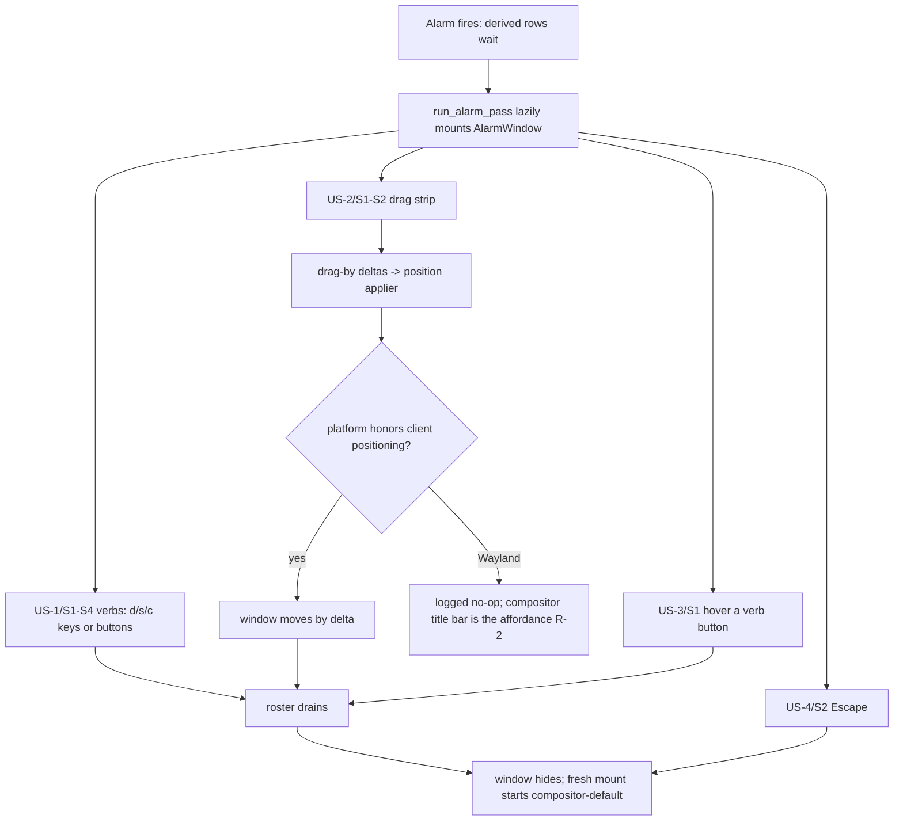
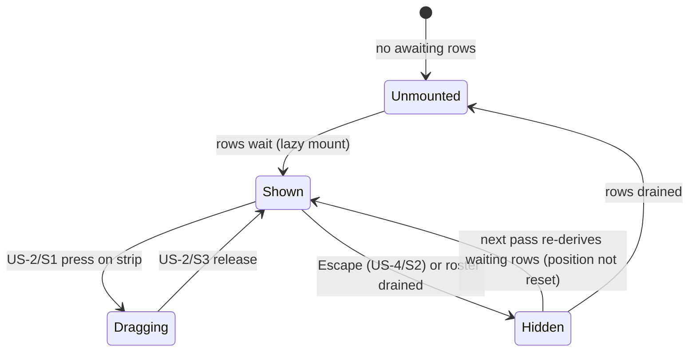

# [Plan] UX Journey Plan — the Alarm Window Redesign (#1308)

<!--
Written from .artifacts/templates/ux-journey-plan.md (the guidance
comment stays per the template's law). Sections 2, 4, 6, 7 use the
parser-contract headers/columns of scripts/ux-coverage.sh.
-->

# [Plan] UX Journey Plan — the Alarm Window Redesign

- **Date**: 2026-11-24
- **Kind**: UX journey plan — user stories, journeys, flows, wiring
  contract for the alarm insistence window's geometry, move, and
  button-visibility redesign (issue #1308). No implementation
  decisions beyond the command contract.
- **Origin**: issue #1308 (p2, bug/design/ui — cannot move, larger
  than contents, no visible tooltips); backlog-reduction round 6
  scope report
  `.artifacts/reports/2026-11-24-backlog-reduction-round6-scope-report.md`
  §B (chunk B1); the landed base: the r7 anchor-aware shape (D-P11 —
  an alarm anchor has no task: no Done, no Mute; closed ruling #815),
  the T-22 keyboard grammar (#805), the #1251 severing gap, and the
  W1 button grammar (`docs/widget_interactions.org`, IconButton +
  TooltipState/TooltipPanel).
- **Status**: ACCEPTED 2026-11-24 — the operator accepted the design
  decisions; the Wayland R-2 posture confirmed as the correct reading
  of the protocol's client-positioning prohibition. B1 chunking cleared.
- **Surfaces touched**: `crates/taskboard-ui-slint/ui/alarm-window.slint`
  (the whole surface), `crates/taskboard-ui-slint/src/lib.rs`
  (alarm-pass mount: `run_alarm_pass`, `install_alarm_callbacks`),
  a probe twin under `crates/taskboard-ui-slint/tests/`.
- **Platform scope**: desktop only — the kiosk fence R3.5.3 stands
  (the alarm lanes never mount on kiosk; journey test
  `the_kiosk_alarm_fence_stands_with_the_absence_hint` keeps guarding
  the fence). No kiosk surface delta is planned or permitted here.

## 1. Scope & goals

What the user gains that they could not do before:

- **A content-sized window** — the alarm window hugs its rows: no
  fixed 384 px width, no height formula that the empty
  stretch-absorbing `FocusScope` inflates, and the selection ring is
  painted inside the row's own geometry (the stray full-window
  `Rectangle` at `alarm-window.slint:104-110` — which today paints a
  window-sized border inside every row — is gone).
- **A user-controllable position** — the window can be dragged out of
  the way on every platform where clients may position windows, and
  the placement posture under Wayland (where they may not) is
  recorded rather than accidental (see R-2).
- **Discoverable buttons** — the three verb buttons show hover text
  in the alarm window itself: a `TooltipPanel` renders the
  `TooltipState` the `IconButton`s already raise, so the verbs
  (Dismiss / Snooze / Cancel) are legible without prior knowledge of
  the icon vocabulary.

Non-goals, each with a home:

- **Persisting the dragged position across sessions** — a settings
  key for last alarm-window placement. Deliberately out: the alarm
  window is transient insistence UI; persistence adds a settings
  surface before the drag model is proven in the wild.
  **backlog #1321.**
- **Snooze-duration choice in the window** (a picker over snooze
  presets) — the window keeps the single default snooze
  (`ALARM_WINDOW_SNOOZE`, 10 min); duration choice is feature-scale
  timers/alarms UI, already homed at **#352** (and the wider
  standalone-timers feature at #211) — not filed anew.
- **Rich rows** (occurrence timestamp, per-row action menu) — the row
  contract stays title + elapsed phrase; the anchor-aware shape
  (D-P11, #815) is restated, not extended. Same home: **#352**.
- **Window-level `window_max` OS-hint probing on Wayland** — the
  probe twin added here is the in-tree layout probe (the #1251
  idiom); OS-level max-hint behavior remains the #778 upstream
  tracker. **#1251 itself is folded INTO this chunk's scope** (the
  sever + probe land with the geometry rework); only the upstream
  report stays homed at #778.

## 2. Capability × surface matrix

<!-- Parser contract: do not rename or reorder columns. Platform
qualification lives inside cells; the alarm window is a desktop-only
surface (R3.5.3 kiosk fence), so every alarm-window cell is
desktop-qualified. -->

| Capability | Board | TaskDetail | Today | Review | Settings | Capture | CLI |
|---|---|---|---|---|---|---|---|
| alarm.dismiss | — | — | E (desktop, US-1) | — | — | — | E (pre-existing `timers cancel`) |
| alarm.snooze | — | — | E (desktop, US-1) | — | — | — | — |
| alarm.cancel | — | — | E (desktop, US-1) | — | — | — | E (pre-existing `timers cancel`) |
| alarm.window_reposition | — | — | E (desktop, US-2) | — | — | — | — |
| alarm.button_hint | — | — | E (desktop, US-3) | — | — | — | — |
| alarm.keyboard_walk | — | — | E (desktop, US-4) | — | — | — | — |
| alarm.escape_close | — | — | E (desktop, US-4) | — | — | — | — |

The alarm verbs live in no fixed column (the window is a global
insistence surface, not a view); **Today** carries them because the
Today timers host is the alarm ladder's in-view half (the
badge/hint arm, `journeys.rs:12342`) — the same convention the
surface census already uses (`docs/ux-surface-census.org:1174-1176`).

**Rulings** (every deliberate absence on a core verb):

| ID | Ruling | Reason | Home |
|---|---|---|---|
| R-1 | The matrix adds no create/edit/remove verb for the reminder entity; the window is an actor over existing reminders, and the anchor-aware shape (D-P11, closed ruling #815) stands unchanged — alarm rows carry Dismiss/Snooze/Cancel, never Done/Mute | An alarm anchor has no task; the r7 shape is landed and closed | This plan, §1 |
| R-2 | `alarm.window_reposition` is **absent on Wayland as a gesture** (the drag strip renders but drag deltas cannot apply — clients may not position windows there); the posture is deliberate: under Wayland `no-frame` no-ops too, so the compositor's own title bar is the native move affordance, and the drag strip degrades to a logged no-op (never a wrong-position bug) | Wayland forbids client-side window positioning; the recorded alternative (persisted placement setting) is deferred to #1321 | This plan, US-2 |
| R-3 | `alarm.snooze` stays absent on CLI (no `timers snooze`) | CLI snooze has no duration story yet; same home as the snooze-duration non-goal | #352 |
| R-4 | `alarm.button_hint` is absent on CLI and on kiosk | CLI has typed verb names in help text (no hover concept); kiosk never mounts the window (R3.5.3 fence) | This plan, §8 kiosk gates |

## 3. User stories

### US-1 — Dismiss, snooze, or cancel a fired alarm from the window

- **Story**: As a desktop user whose alarm has fired I want to
  dismiss, snooze, or cancel it from the always-on-top window so that
  the insistence stops without opening the main app.
- **Platforms**: desktop (kiosk fenced, R3.5.3)
- **Entry points**: the alarm window itself (lazily mounted by
  `run_alarm_pass` when rows wait); each row's three `IconButton`s;
  the keyboard grammar `d`/`s`/`c` over the selected row.
- **Priority**: P1 (regression fence — the redesign must not disturb
  the landed verb wiring; the geometry rework sits *around* it).
- **Acceptance**:
  - AC-1: Given one awaiting alarm row, When the Dismiss button is
    clicked, Then exactly one `DismissReminder` command is dispatched
    index-keyed against the shared rows cell — verified by seam test
    (`router.rs` alarm verb routing, kept green).
  - AC-2: Given the geometry rework, When a verb fires from either
    the button or the `d`/`s`/`c` key, Then the dispatched command is
    identical (click ≡ key, `presentation::alarm_command` is the one
    constructor) — verified by existing contract suite
    (`every_preset_binds_the_alarm_window_grammar`).

### US-2 — Move the alarm window out of the way

- **Story**: When an alarm window covers something I am working on I
  want to drag it to another spot on screen so I can keep both the
  alarm and my work visible.
- **Platforms**: desktop; Wayland degrades per R-2 (compositor title
  bar is the affordance there).
- **Entry points**: the drag strip (a grab handle spanning the
  window's top edge, rendered as part of the content-sized header
  row); pointer drag on it.
- **Priority**: P1.
- **Acceptance**:
  - AC-1: Given the window is open with ≥1 row, When the user drags
    the strip by (dx, dy), Then the window position moves by exactly
    the accumulated drag delta on platforms where client positioning
    is honored — verified by seam test on the position-applier seam
    (the delta accumulator, not a real WM).
  - AC-2: Given a Wayland session, When the same drag occurs, Then
    the apply degrades to a logged no-op and the window stays at its
    compositor-assigned position — verified by seam test on the
    applier's platform-degrade arm (typed outcome, no text
    assertions).
  - AC-3: Given rapid pointer events during a drag, When deltas are
    applied, Then no position update is lost by re-derivation from
    the alarm pass (the pass re-shows the window but never resets a
    user-dragged position) — verified by journey test.

### US-3 — Discover what each button does before clicking it

- **Story**: As a desktop user hovering the alarm window's verb
  buttons I want each button to show its meaning as hover text so
  that I can choose the right verb without guessing icons.
- **Platforms**: desktop (R-4).
- **Entry points**: pointer hover over any of the three `IconButton`s.
- **Priority**: P1.
- **Acceptance**:
  - AC-1: Given the window is open, When a verb button is hovered,
    Then a tooltip renders inside the alarm window itself (not only
    the main app window) carrying that button's role text — verified
    by fold test (the window's own `TooltipPanel` mounts when
    `TooltipState` reports pending/visible) and manual at walkthrough.
  - AC-2: Given a hover ends or the window hides, When the state
    clears, Then the tooltip unmounts with it — verified by fold test.

### US-4 — Walk and close the window with the keyboard (regression fence)

- **Story**: As a keyboard user I keep the T-22 grammar (Up/Down walk
  the selection, `d`/`s`/`c` fire verbs, Escape closes committing
  nothing) through the redesign so that no muscle memory breaks.
- **Platforms**: desktop.
- **Entry points**: the window's keyboard surface (FocusScope), at
  mount focus.
- **Priority**: P1.
- **Acceptance**:
  - AC-1: Given the FocusScope is re-homed inside the content-sized
    layout, When any grammar key is pressed, Then the same callbacks
    route as before — verified by the existing keymap registry
    contract suite (kept green).
  - AC-2: Given Escape, When pressed, Then the window hides
    committing nothing and the next pass re-shows if rows still wait
    — verified by existing mount test (kept green).

## 4. Journey specs

<!-- Parser contract: do not rename or reorder columns. -->

### US-1 — act on a fired alarm

| Step | Surface & affordance | User action | Dispatches | System response | Escape / failure |
|---|---|---|---|---|---|
| US-1/S1 | Alarm window row list, per-row verb `IconButton` | Click Dismiss on the selected row | `dismiss(int)` callback → `presentation::alarm_command(row, AlarmVerb::Dismiss)` → `StateCommand::DismissReminder` (index-keyed over the shared rows cell) | The row's reminder is dismissed; the next derive drops it from the roster; an emptied roster hides the window | A stray index degrades to a no-op (logged); a full command inbox degrades to a logged drop, never a panic |
| US-1/S2 | Alarm window row list, per-row verb `IconButton` | Click Snooze | `snooze(int)` → `StateCommand::SnoozeReminder` (default `ALARM_WINDOW_SNOOZE` = 10 min) | The row leaves the roster; it re-enters when the snooze elapses | Same degrade arms as US-1/S1 |
| US-1/S3 | Alarm window row list, per-row verb `IconButton` | Click Cancel | `cancel(int)` → `StateCommand::CancelAdhocAlarm` | The alarm is cancelled; the row drops from the roster | Same degrade arms as US-1/S1 |
| US-1/S4 | Alarm window keyboard surface (FocusScope) | `d` / `s` / `c` over the selected row | The same three callbacks as S1–S3 (click ≡ key) | Identical responses | Same degrade arms; a shrunk roster clamps the selection Rust-side |

### US-2 — reposition the window

| Step | Surface & affordance | User action | Dispatches | System response | Escape / failure |
|---|---|---|---|---|---|
| US-2/S1 | Drag strip (window-top grab handle, part of the header row) | Press the pointer on the strip | `—` (local gesture arm; no command) | The strip enters drag tracking; cursor posture shows the grab | Click without drag is a no-op (the strip is not a verb button) |
| US-2/S2 | Drag strip | Drag by (dx, dy) | `drag-by(length, length)` callback → Rust-side position applier (`window.set_position` with the accumulated delta) | The window moves by the accumulated delta; `request_attention` is not re-armed by drag motion | Wayland: the applier's degrade arm logs and drops the apply (R-2); a re-derivation pass during drag re-shows the window but never resets the dragged position |
| US-2/S3 | Drag strip | Release the pointer | `—` | Drag tracking ends; the position persists for the window's remaining lifetime (the window object is held by the alarm lane) | The alarm pass hiding the window (drained roster) discards the position naturally — a fresh mount starts at the compositor default |

### US-3 — discover the buttons

| Step | Surface & affordance | User action | Dispatches | System response | Escape / failure |
|---|---|---|---|---|---|
| US-3/S1 | Verb `IconButton` (W1 button grammar: `label` carries the role text) | Hover a button | `—` (display only; `TooltipState.hover(...)` is raised by the widget) | The window's own `TooltipPanel` mounts and renders the role text inside the alarm window | The main app window being closed does not matter — the panel is window-local; a second concurrent hover in the main window shows there independently (shared global state, two panels, same text) |
| US-3/S2 | Verb `IconButton` | Stop hovering / the window hides | `—` | `TooltipState` clears; the panel unmounts | A window hide mid-hover leaves no dangling tooltip (the panel is inside the hidden window's scene) |

### US-4 — keyboard walk and escape

| Step | Surface & affordance | User action | Dispatches | System response | Escape / failure |
|---|---|---|---|---|---|
| US-4/S1 | Keyboard surface (FocusScope at the content-sized layout's key-root) | Up/Down | `select(delta)` (window-local selection walk) | The selection ring moves — now painted inside the focused row's own geometry | The walk is clamped at both ends (no wraparound, no out-of-range selection) |
| US-4/S2 | Keyboard surface | Escape | `escape-requested()` → Rust-side `window.hide()` | The window hides committing nothing; the next pass re-shows if rows still wait | Nothing to escape into — the close is itself the escape; a hidden window's tooltips die with its scene |

## 5. Interaction flows

Single-surface feature; one flowchart covers the drag lifecycle and
one state diagram the window's mount/drag/hide cycle:

Every node is greppable by its step ID (`US-2/S1`, `US-4/S2`, …).

## 6. Wiring inventory

<!-- Parser contract: do not rename or reorder columns. Row
addressing: index-keyed (the notification surface's convention; the
UI is id-less by design). -->

| ID | Surface file | Widget | Callback | Adapter seam | ActionId | Commands | Row addressing | Journey steps | Test |
|---|---|---|---|---|---|---|---|---|---|
| W-1 | `crates/taskboard-ui-slint/ui/alarm-window.slint` | Window geometry rework: drop the fixed `width`; the VerticalLayout sizes to content; the FocusScope is re-homed (`vertical-stretch: 0`, zero layout mass, still the mount-focus keyboard surface); a row floor of `Theme.card-title-min-width` for the title elide | — | `run_alarm_pass` keeps feeding `rows` unchanged | — | — | index-keyed (unchanged) | US-1/S1-S4, US-2/S3, US-4/S1-S2 | `journeys.rs::us2_s3_alarm_rederive_keeps_the_dragged_position` |
| W-2 | `crates/taskboard-ui-slint/ui/alarm-window.slint` | Drag strip: a grab handle spanning the header's top edge (TouchArea `pointer-event`/`moved` → delta extraction) | `drag-by(length, length)` | `install_alarm_callbacks` gains the applier: accumulate deltas, `window.set_position`; Wayland arm = logged no-op | — | — | n/a (window-level) | US-2/S1-S2 | `probes/alarm_window_drag_tests.rs::us2_s2_drag_by_applies_the_accumulated_delta` and `probes/alarm_window_drag_tests.rs::us2_s2_wayland_arm_degrades_to_a_noop` |
| W-3 | `crates/taskboard-ui-slint/ui/alarm-window.slint` | `TooltipPanel` mount inside `AlarmWindow` reading the shared `TooltipState` global (the `IconButton`s already raise it) | — | none (the global is the seam) | — | — | n/a | US-3/S1-S2 | `structural.rs::us3_s1_alarm_window_mounts_its_own_tooltip_panel` |
| W-4 | `crates/taskboard-ui-slint/ui/alarm-window.slint` | Selection-ring fix: the ring `Rectangle` is deleted from inside the row's `ListRow` and re-declared row-local (binds the row's own geometry, never `root.width/height`) | — | none | — | — | index-keyed (unchanged) | US-4/S1 | `probes/alarm_window_ring_probe_tests.rs::us4_s1_selection_ring_is_row_local` |
| W-5 | `crates/taskboard-ui-slint/ui/alarm-window.slint` + `tests/alarm_window_max_probe.slint` | #1251: the content root carries `max-width: Theme.layout-severing-max-width`; the probe twin `alarm_window_max_probe` follows the per-view pattern of `1276151a` | — | none | — | — | n/a | guards every story | `probes/alarm_window_max_probe_tests.rs::alarm_window_max_probe_severs_the_layout` |

Display-only rows (W-1, W-3, W-4, W-5) carry `—` in Commands because
they are pure geometry/display with no engine delta — the why lives
in the journey steps' Dispatches cells (§4). W-2's Commands is `—`
because the drag is window-manager-side: no engine state changes, the
applier acts on the window object only (US-2/S2).

## 7. Command-contract delta

<!-- Parser contract: do not rename or reorder columns. -->

| Kind | Name | Payload sketch | Journeys |
|---|---|---|---|
| StateCommand | *(none — delta is empty)* | The three alarm verbs (`DismissReminder`, `SnoozeReminder`, `CancelAdhocAlarm`) and `presentation::alarm_command` are landed and unchanged; the redesign touches only window-level presentation | US-1/S1-S4 |
| UiRequest | *(none)* | No request-response cycle is introduced | — |
| ActionId | *(none)* | The T-22 grammar lives in the keymap registry's `AlarmWindow` contexts and is kept, not extended | US-4/S1-S2 |
| slint callback (window-local, not an engine contract) | `drag-by(length, length)` | Pointer-drag deltas from the strip; handled Rust-side in `install_alarm_callbacks`' position applier | US-2/S2 |

The delta is deliberately engine-empty: #1308 is a presentation
defect class (geometry, placement, hover affordance), and the W1
button grammar's roles (check = Dismiss, snooze = Snooze, remove =
Cancel, destructive) are kept verbatim.

## 8. Verification plan

Bound-test lines (#768): the landed T-22/verb wiring is pinned by
descriptively-named tests that predate this plan's step IDs; the
steps they guard bind here so the gate credits them instead of
reading AMBIGUOUS from ambient hits. **Gate state at planning time
(expected, not a defect)**: the pre-existing bindings read BOUND
(US-1/S1-S4, US-4/S1); the steps whose tests ship with B1 read
MISSING until those tests land — the §9 DoD gate-green check runs at
chunk completion, not at plan acceptance.

bound-test: US-1/S1 -> src/router.rs::alarm_verbs_route_the_button_commands_from_the_selected_row
bound-test: US-1/S2 -> src/router.rs::alarm_verbs_route_the_button_commands_from_the_selected_row
bound-test: US-1/S3 -> src/router.rs::alarm_verbs_route_the_button_commands_from_the_selected_row
bound-test: US-1/S4 -> src/lib.rs::us6_s3_the_alarm_window_keys_snooze_and_cancel
bound-test: US-2/S1 -> probes/alarm_window_drag_tests.rs::us2_s2_drag_by_applies_the_accumulated_delta
bound-test: US-2/S3 -> journeys.rs::us2_s3_alarm_rederive_keeps_the_dragged_position
bound-test: US-3/S2 -> structural.rs::us3_s1_alarm_window_mounts_its_own_tooltip_panel
bound-test: US-4/S1 -> src/lib.rs::us5_s2_the_alarm_window_keyboard_walk_selects_and_dismisses
bound-test: US-4/S2 -> journeys.rs::us4_s2_alarm_escape_hides_committing_nothing

- **Journey tests** (step-ID-named, root
  `crates/taskboard-ui-slint/tests/`):
  `us2_s3_alarm_rederive_keeps_the_dragged_position` (the drag
  position survives a re-derivation pass that re-shows the window);
  `us4_s2_alarm_escape_hides_committing_nothing` (Escape hides the
  reworked geometry committing nothing).
- **Seam tests**:
  `us2_s2_drag_by_applies_the_accumulated_delta`,
  `us2_s2_wayland_arm_degrades_to_a_noop` (typed degrade outcome, no
  text assertions), plus the kept-green routing suite
  (`router.rs::alarm_verbs_route_the_button_commands_from_the_selected_row`,
  `every_preset_binds_the_alarm_window_grammar`) as the US-1/US-4
  regression fence.
- **Fold/presentation tests**:
  `us3_s1_alarm_window_mounts_its_own_tooltip_panel`,
  `us4_s1_selection_ring_is_row_local` — structural probes over
  window layout info, never label text.
- **Kiosk gates**: the R3.5.3 fence stays
  (`the_kiosk_alarm_fence_stands_with_the_absence_hint`): the alarm
  lanes, and therefore every W-x affordance, never mount on kiosk;
  the probe family asserts the absence hint stays.
- **Manual** (walkthrough covers at stage 3): real-WM drag feel on
  X11 and Windows (delta smoothness, grab cursor), Wayland posture
  (compositor title bar present and movable), tooltip readability at
  scale 1 and 2.

## 9. Definition of done

- [ ] `scripts/ux-coverage.sh .artifacts/plans/2026-11-24-alarm-window-ux-plan.md --gate` exits 0
- [ ] Every P1 story's journey completes end-to-end including escapes
- [ ] Walkthrough protocol executed at stage 3; findings resolved or homed
- [ ] All matrix absences carry rulings (R-1..R-4); the census rows
  `alarm.*` (`docs/ux-surface-census.org:1174-1176`) amended with the
  drag affordance + window-local tooltip evidence
- [ ] Non-goals homed: placement persistence filed (#1321); snooze
  duration + rich rows cite the existing #352
- [ ] #1251 closes with this chunk's W-5 landing (its sever + probe
  twin); #1308 closes at walkthrough sign-off
