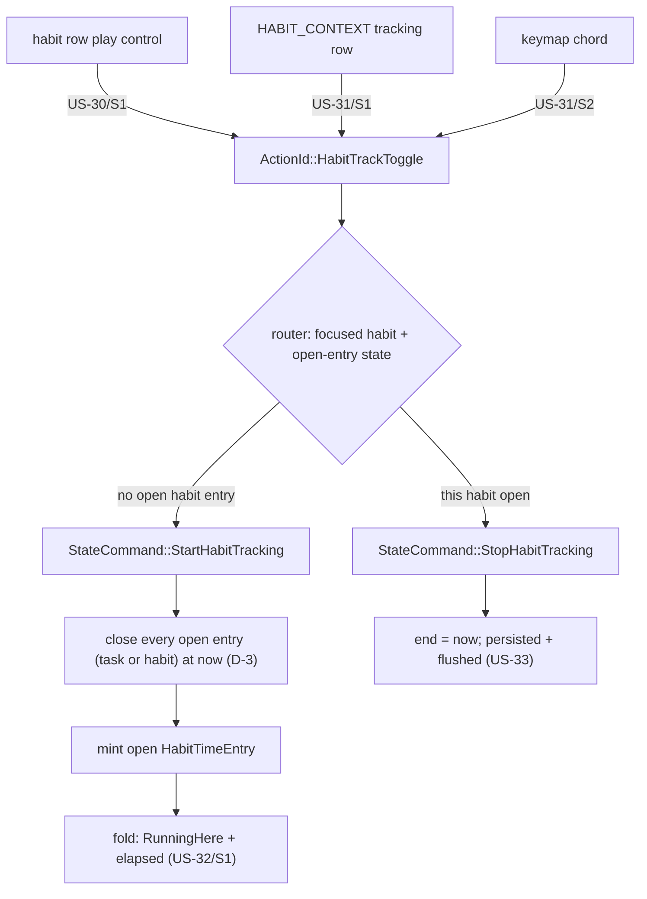

# Habit Time Tracking UX Journey Plan — habit tracking

<!--
Template copy from .artifacts/templates/ux-journey-plan.md; guidance
comment retained per the template's own law.
-->

# [Plan] UX Journey Plan — habit time tracking (#1305 / round-6 A3)

- **Date**: 2026-11-24
- **Kind**: UX journey plan — user stories, journeys, flows, wiring
  contract for habit time tracking. No implementation decisions beyond
  the command contract.
- **Origin**: round-6 scope report
  (`.artifacts/reports/2026-11-24-backlog-reduction-round6-scope-report.md`
  §A A3, normative) chunking issue #1305 ("habit time tracking is dead
  end-to-end"). O-rulings cited: **O-2** (domain changes additive only;
  no domain `TaskKind`-style unification — the habit-side tracker is a
  new additive fact family, not a `TimeEntry` keying rewrite) and
  **O-7** (habits live outside boards, habit parity rides the task
  grammar — the tracker verbs mirror `task.track-toggle`, one semantics
  one seam). The B1 clock-bump rule (`mint_log_clock`, #986) and the
  O-1 window law bind the domain shape per §5/D-1 below.
- **Status**: ACCEPTED 2026-11-24 — the operator accepted the journey
  ("I agree with this plan for a first implementation of habit time
  tracking"); A3 chunking cleared.
- **Surfaces touched**: habits section (`crates/taskboard-ui-slint/ui/compositions/habits.slint`),
  habit card fold (`crates/taskboard-ui-slint/src/models.rs`), habit
  context menu (`crates/taskboard-ui-slint/src/menu.rs`), action
  keymap/router (`crates/taskboard-ui-slint/src/actions.rs`,
  `router.rs`, `adapter.rs`), habit history dialog.
- **Platform scope**: both (per story below).

## 1. Scope & goals

Today the habit row's play control renders (the card fold reuses
`TaskCard` with `can_done: true`, so the `track-control` mounts) but
is **dead**: `habits.slint` never connects `track-toggled`, no adapter
seam exists, `HABIT_CONTEXT` carries no tracking row, and the domain
has no habit-side tracking at all (`tracking.rs` is keyed by `TaskId`
only). After this feature the user can:

- start and stop a **time tracker on a habit** — from the row's play
  control, the context menu, and a dedicated keyboard chord (the
  keyboard-first law, `docs/ux_planning.org` §2.7);
- see **which subject is running** (task or habit — one running timer
  app-wide) and the elapsed time on the running habit row;
- have habit time entries **persisted** (sqlite, restart-safe — the
  open entry is the running timer) and **synced** (a new additive wire
  section, retention-bounded like task time entries).

Decisions recorded at plan time (binding; the dispatch plan's chunks
implement these, never re-decide):

- **D-1 — domain shape (O-2 additive)**: a **new additive fact
  family** — `HabitTimeEntry` rows in a new `HabitState.time_log` map
  (`BTreeMap<HabitTimeEntryId, HabitTimeEntry>`, `serde(default)`
  default-absent like `day_log`) — mirroring the task `TimeEntry`
  grammar verbatim: the **open entry (`end: None`) IS the running
  timer**, nothing ticks, elapsed derives at read. NOT a `TimeEntry`
  keying rewrite (a `subject: enum` on the existing entity would
  churn the task wire/storage lanes O-2 rules out) and NOT a count in
  the adherence `log` (the D-H5 law — count + one LWW clock, no
  instants — is the *adherence* fact shape; time is a different fact
  family). **Replay determinism** per the #986/#1095 precedents: open
  rows stamp `start = created_at = updated_at = now`; the stop stamps
  `end = now` unconditionally (StopHabitTracking stays total — the
  task stop's skew ruling verbatim); a same-instant start-after-stop
  re-mints deterministically because every stamp is a pure function
  of (pre-state, command, `now`) — no wall reads inside the reducer.
- **D-2 — semantics interaction with O-1 windows/streaks: none, by
  ruling.** Habit time entries never feed `log`, `streak`,
  `adherence`, `log_window`, or any stats projection — the O-1 window
  vocabulary counts *quota*, time tracking measures *duration*, and
  crossing the two would make grace/skip/pause semantics
  time-entangled. The Σ transparency property is therefore NOT
  extended; instead a new standalone invariant is pinned: for any
  state and `now`, adding/removing/mutating `time_log` rows leaves
  every existing habit projection byte-identical (proptest over the
  existing generators).
- **D-3 — single-global running timer across subjects**: starting a
  habit tracker closes every open entry, task or habit, at the
  engine-stamped `now` (the task `StartTracking` doc's "single-global
  intent — starting anywhere stops what any device left running",
  extended to habits). Idempotent repeat: exactly one open habit
  entry exists and it is this habit's — the accepted no-op.
- **D-4 — title snapshot**: the entry snapshots the habit's title at
  start (`habit_title`); renames and tombstones never rewrite
  history (the `TimeEntry.task_title` ruling verbatim). An open entry
  on a habit that gets tombstoned keeps running until stopped or
  replaced (D-3); stopping stamps `end = now` — history outlives the
  habit (the `time_entries` no-foreign-key posture).
- **D-5 — pause orthogonality (O-1 untouched)**: a paused habit's
  play control stays live — pause excuses *windows* in the streak
  walk; it does not forbid measuring time. The habit tracker's nudge
  engine never reads `time_log` (D-2's corollary).
- **D-6 — sync wire (additive)**: a new board-level
  `habit-time-entries` section (the `time-entries` lane's structure,
  habit-keyed), retention-bounded by the same
  `TRACKING_SYNC_RETENTION_DAYS` window as task entries (D-T10/D-H14
  precedents: aged rows drop off the wire, sqlite keeps local
  history). The existing `habits`/`habit-log` lanes are untouched.
- **D-7 — dead-affordance repair (the issue's either-way acceptance)**:
  the play control on habit rows becomes **live** (not hidden): the
  feature is approved in scope report A3 ("full chain implementation
  per the issue's own ask"), so the control works end-to-end; hiding
  it would re-create the G2 display-without-control gap inverted.
  The card fold sets `track_state: RunningHere` while this habit's
  open entry exists (today it is hardwired `None`).
- **D-8 — keyboard parity (§2.7 law)**: `habit.track-toggle` carries
  a dedicated chord in the keymap presets over the focused habit row
  (the `task.track-toggle` twin; the O-8 parity machinery owns
  spelling/collision). A chordless common verb is a defect, not a
  posture.

Non-goals (each filed as a `backlog:` issue at plan time; numbers in
the dispatch plan's Origin section):

- Retroactive habit time entry authoring (a `LogTime`-style habit
  valve) — habit time starts live-only in this slice.
- Habit time reports/statistics surfaces (per-habit tracked-time
  aggregates in the history view beyond the running row's elapsed
  chip).
- Concurrent multi-timer support (D-3 rules single-global).

## 2. Capability × surface matrix

| Capability | Board | TaskDetail | Today | Review | Settings | Capture | CLI |
|---|---|---|---|---|---|---|---|
| habit.track-start | — (R-1) | — (R-1) | E (US-30) | — (R-2) | — (R-3) | — (R-3) | — (R-4) |
| habit.track-stop | — (R-1) | — (R-1) | E (US-31) | — (R-2) | — (R-3) | — (R-3) | — (R-4) |
| habit.track-display | — (R-1) | — (R-1) | D (US-32) | — (R-2) | — (R-3) | — (R-3) | — (R-4) |
| habit.create | — (R-1) | — (R-1) | C (existing) | — (R-2) | — (R-3) | — (R-3) | C (existing) |
| habit.log | — (R-1) | — (R-1) | E (existing) | — (R-2) | — (R-3) | — (R-3) | E (existing) |

**Rulings** (every deliberate absence):

| ID | Ruling | Reason | Home |
|---|---|---|---|
| R-1 | No habit tracking affordance on Board | Habits live outside boards (O-7 Q2); the Board view never mounts habit rows | standing (O-7 Q2) |
| R-2 | No habit tracking on Review | Review covers tasks/reflection; habit adherence stats already live in the habits section (HF3). Habit *time* stats are a non-goal this slice | this plan §1 non-goals |
| R-3 | No habit tracking on Settings/Capture | Capture creates; tracking starts on an existing row. Settings carries no entity verbs | standing posture |
| R-4 | No CLI tracking verb this slice | The task `track` CLI exists; a `habit track` twin is natural but out of the #1305 ask (which names the UI chain). P2 follow-up | backlog issue (see dispatch plan) |
| R-5 | No TaskDetail cell for habit verbs | Habit rows mount only in the habits section (Today's section stack); the detail editor is the O-7 Q4 editing surface, not a tracking one | standing (O-7 Q4) |

## 3. User stories

Decade-band sampling (the #1250 convention): bands 1–15 and 21–23
carry existing `fn us<N>_s` members in the journeys tree; the first
fully-unused decade is **30**. This plan uses US-30+; journey tests
live in `crates/taskboard-ui-slint/tests/journeys/habit_tracking_journeys.rs`
(topic = `habit-tracking` → `habit_tracking`).

### US-30 — start tracking a habit from the row

- **Story**: As a desktop user I want to start a timer on a habit
  from its row's play control so that I can measure how long the
  habit actually took without leaving the habits section.
- **Platforms**: desktop (the row play control; kiosk renders it
  disabled per the editing-enabled posture — the greyed-affordance
  law, HAB-14).
- **Entry points**: play control on a habit row (Today ▸ habits
  section), `ActionId::HabitTrackToggle` (chord, US-31), context menu
  row (US-31).
- **Priority**: P1.
- **Acceptance**:
  - AC-1: Given a live habit with no open habit entry, When the play
    control is pressed, Then the adapter dispatches
    `StateCommand::StartHabitTracking { habit }` and the card fold
    reports `TrackCardState::RunningHere` — verified by journey test.
  - AC-2: Given a running task tracker, When a habit's play control
    is pressed, Then the habit entry opens and the task entry closes
    (both typed outcomes from one dispatch) — verified by seam test.
  - AC-3: Given this habit already running, When the play control is
    pressed again, Then no new entry mints (the accepted no-op, D-3)
    — verified by seam test.

### US-31 — track from the context menu and keyboard (parity)

- **Story**: As a keyboard-first user I want start/stop tracking as a
  context-menu row and a dedicated chord over the focused habit so
  that the verb is reachable without the pointer (§2.7 law).
- **Platforms**: desktop.
- **Entry points**: `HABIT_CONTEXT` menu row, `ActionId::HabitTrackToggle`
  chord in the keymap presets.
- **Priority**: P1.
- **Acceptance**:
  - AC-1: Given a focused habit, When the chord fires, Then the same
    `HabitTrackToggle` route dispatches exactly what the play control
    dispatches (click ≡ key) — verified by journey test.
  - AC-2: Given the habit context menu open, When the tracking row is
    activated, Then the same dispatch lands — verified by journey test.
  - AC-3: The menu row's label/running-echo follows the card's
    `track_state` (one running-state source) — verified by fold test
    (typed state, never label text).

### US-32 — see what is running and for how long

- **Story**: When a habit tracker is running I want the row to show
  the running state and the elapsed time so that I can recognize the
  tracking posture without opening anything.
- **Platforms**: both (display renders on kiosk too; only the *edit*
  affordance is desktop).
- **Entry points**: — display only (the running chip on the habit
  row; the card fold's `track_state`).
- **Priority**: P1 (running state) / P2 (elapsed-chip wording polish).
- **Acceptance**:
  - AC-1: Given an open habit entry, When the habits section renders,
    Then the row's `track_state` is `RunningHere` and the elapsed
    chip derives from the open entry's start (display data, derived
    at read) — verified by fold test.
  - AC-2: Given a running *task* tracker and no habit entry, When the
    habits section renders, Then no habit row shows running (the
    D-3 global stop already closed nothing — display reflects the
    maps) — verified by fold test.
  - AC-3: Given a restart with a persisted open habit entry, When the
    app rehydrates, Then the row shows running again (the open entry
    IS the running timer; nothing ticks) — verified by seam test.

### US-33 — history survives stop, restart, and sync

- **Story**: When I stop a habit tracker I want the settled entry
  persisted and synced so that my measured time is durable across
  devices.
- **Platforms**: both (persistence/sync are engine-side; the visible
  outcome is the row's state after restart/reconciliation).
- **Entry points**: consequence of US-30/US-31 stops (no separate
  entry point).
- **Priority**: P1.
- **Acceptance**:
  - AC-1: Given a stopped habit entry, When the state persists and
    reloads, Then the settled row round-trips (typed equality) —
    verified by seam test (storage round-trip).
  - AC-2: Given a settled habit entry within the retention window,
    When the next sync flush runs, Then the `habit-time-entries`
    section carries it (typed wire assertion) — verified by seam test.
  - AC-3: Given a synced habit time entry from a peer device, When it
    folds locally, Then it lands in `time_log` and the running/elapsed
    display derives from it — verified by seam test.

## 4. Journey specs

### US-30 — start tracking a habit from the row

| Step | Surface & affordance | User action | Dispatches | System response | Escape / failure |
|---|---|---|---|---|---|
| US-30/S1 | habits section row, play control (`track-control` on the card) | click the control | `ActionId::HabitTrackToggle` via `habits-track-asked(int)` → adapter `send_habit_track_toggle` | router resolves start (no open habit entry): `StateCommand::StartHabitTracking { habit }` | unknown/tombstoned habit at dispatch: typed rejection surfaces via the existing command-outcome toast path; the control re-renders from state (no dead click) |
| US-30/S2 | engine reduction | — | `StartHabitTracking` | any open entries (task or habit) close `end = now` (D-3); fresh open entry mints (`habit_title` snapshotted, D-4); card fold → `RunningHere` | idempotent repeat (already this habit's open entry): accepted no-op, state unchanged |
| US-30/S3 | habits section row | observe | — display only (running chip + elapsed derive from `time_log`; no command) | running posture visible on the row | state revert (e.g. a synced global stop from a peer) re-renders the row honestly — display always derives, never caches |

### US-31 — track from the context menu and keyboard

| Step | Surface & affordance | User action | Dispatches | System response | Escape / failure |
|---|---|---|---|---|---|
| US-31/S1 | habit context menu (`HABIT_CONTEXT` tracking row) | click the row | `ActionId::HabitTrackToggle` (the menu's existing dispatch chain) | same route as US-30/S1 — one semantics, one seam | menu dismiss (Escape) before activation dispatches nothing; typed rejection as US-30/S1 |
| US-31/S2 | keymap preset, focused habit row | press the `habit.track-toggle` chord | `ActionId::HabitTrackToggle` | same route as US-30/S1 | no focused habit: the chord is a no-op (the router's target-less absorption, the habit keyboard-parity plan posture) |
| US-31/S3 | habits section row | press again (toggle stop) | `ActionId::HabitTrackToggle` → `StateCommand::StopHabitTracking` | this habit's open entry closes `end = now`; fold → not running | stop is total (D-1): nothing open is the accepted no-op |

### US-32 — see what is running (display journey)

| Step | Surface & affordance | User action | Dispatches | System response | Escape / failure |
|---|---|---|---|---|---|
| US-32/S1 | habits section row | observe | — display only (fold derives `track_state`/elapsed from `HabitState.time_log`) | running chip + elapsed visible | a peer's stop arriving via sync re-renders the row (display never caches a stale running bit) |
| US-32/S2 | app restart | relaunch | — display only (persistence rehydrates `time_log`) | the open entry rehydrates → row renders running again (nothing ticks) | corrupt/absent row decodes per the additive default-absent law (empty map) — no decode failure |

### US-33 — history durability (consequence journey)

| Step | Surface & affordance | User action | Dispatches | System response | Escape / failure |
|---|---|---|---|---|---|
| US-33/S1 | storage actor | — (follows a stop) | `PersistenceAction` upsert (new `habit_time_entries` table) | settled row durable across restart | a failed write surfaces the storage actor's existing typed error lane; state stays authoritative |
| US-33/S2 | sync actor | — (follows any change) | flush builds the additive `habit-time-entries` section | peer devices fold the rows | retention: rows past `TRACKING_SYNC_RETENTION_DAYS` drop off the wire (local sqlite keeps them, D-6) |
| US-33/S3 | habits section row | observe after reconcile | — display only | folded entries render in the derived state | a peer row newer by LWW wins; the local display re-derives |

## 5. Interaction flows

No new overlay/editor/modal mounts — the verb is a one-shot row
toggle, so no `stateDiagram-v2` machine is required (the quota
popover / pause editor overlays are untouched).

## 6. Wiring inventory

| ID | Surface file | Widget | Callback | Adapter seam | ActionId | Commands | Row addressing | Journey steps | Test |
|---|---|---|---|---|---|---|---|---|---|
| W-1 | ui/compositions/habits.slint | `TaskCard` delegate track-control | `habits-track-asked` | `install_seam!(window.on_habits_track_asked)` → `send_habit_track_toggle` | `ActionId::HabitTrackToggle` | `StateCommand::StartHabitTracking; StateCommand::StopHabitTracking` | habits row index → adapter resolves `HabitId` (the `focused_habit` one-shot subject pattern) | US-30/S1, US-31/S3 | crates/taskboard-ui-slint/tests/journeys/habit_tracking_journeys.rs::us30_s1_play_control_routes_habit_track_toggle |
| W-2 | src/menu.rs | `HABIT_CONTEXT` row | — | the existing object-menu dispatch (no new seam — the menu rows route `ActionId`s) | `ActionId::HabitTrackToggle` | `StateCommand::StartHabitTracking; StateCommand::StopHabitTracking` | the menu's subject habit | US-31/S1 | crates/taskboard-ui-slint/tests/journeys/habit_tracking_journeys.rs::us31_s1_menu_row_routes_the_same_toggle |
| W-3 | src/actions.rs + keymap presets | keymap preset entry | — | `ActionRouter::dispatch(ActionId::HabitTrackToggle, …)` (keymap-native — no slint callback exists for a chord) | `ActionId::HabitTrackToggle` | `StateCommand::StartHabitTracking; StateCommand::StopHabitTracking` | focused habit row (the `track_target` one-shot set) | US-31/S2 | crates/taskboard-ui-slint/tests/journeys/habit_tracking_journeys.rs::us31_s2_chord_routes_the_same_toggle |
| W-4 | src/models.rs | `habit_card` fold | — | presentation fold reads `HabitState.time_log` open set | — | — | — | US-30/S3, US-32/S1 (display only: no command exists for a derived read — the fold maps `time_log` to `TrackCardState`) | crates/taskboard-ui-slint/src/models.rs::us30_s3_fold_reports_running_here_while_open |
| W-5 | ui/compositions/habits.slint | running/elapsed chip on the row | — | derived property fed by the adapter's state push (display only — no seam installs a callback for a derived chip) | — | — | — | US-32/S1 (display only: elapsed derives at read; no command) | crates/taskboard-ui-slint/tests/journeys/habit_tracking_journeys.rs::us32_s1_running_chip_derives_from_open_entry |

## 7. Command-contract delta

| Kind | Name | Payload sketch | Journeys |
|---|---|---|---|
| StateCommand | `StartHabitTracking` | `{ habit: HabitId }` — kind-less: habit time entries carry no Work/Respite split this slice (D-2: no break-reminder consumer exists for habits; adding a kind later is additive) | US-30/S1, US-31/S1, US-31/S2 |
| StateCommand | `StopHabitTracking` | `{}` — total (nothing open = no-op), closes *this habit's* open entry at engine `now` | US-31/S3 |
| ActionId | `HabitTrackToggle` | `"habit.track-toggle"` — router reads the focused habit's open-entry state to choose start vs stop (the `task.track-toggle` twin) | US-30/S1, US-31/S1–S3 |

No new `UiRequest`; the habit-time-entries wire section and the
`habit_time_entries` sqlite table are engine/storage facts reached
through the two commands above (US-33's steps dispatch nothing new).

## 8. Verification plan

- **Journey tests** (step-ID-named,
  `crates/taskboard-ui-slint/tests/journeys/habit_tracking_journeys.rs`):
  `us30_s1_play_control_routes_habit_track_toggle`,
  `us31_s1_menu_row_routes_the_same_toggle`,
  `us31_s2_chord_routes_the_same_toggle`,
  `us31_s3_toggle_stop_dispatches_stop`,
  `us32_s1_running_chip_derives_from_open_entry` — each asserts the
  drained `StateCommand`s / the derived model state (typed outcomes;
  no label text).
- **Seam tests**: start/stop/no-op/global-arbitration reducer units in
  `taskboard-state` (snapshot-tested per the testing strategy);
  storage round-trip (US-33/AC-1); flush-section and fold tests
  (US-33/AC-2/AC-3) in `taskboard-sync-nextcloud`.
- **Fold/presentation tests**: `models.rs` fold maps `time_log` →
  `TrackCardState` (US-30/S3, US-32/AC-1/AC-2); the D-2 invariant
  proptest (time_log mutations leave every existing habit projection
  byte-identical) in `taskboard-domain`.
- **Kiosk gates**: the play control renders disabled under
  `editing-enabled == false` (the greyed-affordance law); the running
  chip renders (display is not an edit verb).
- **Manual**: chip wording/label semantics judged at the stage-3
  walkthrough (never text-asserted).

## 9. Definition of done

- [ ] `scripts/ux-coverage.sh <this file> --gate` exits 0
- [ ] Every P1 story's journey completes end-to-end including escapes
  (US-30, US-31, US-32 running-state half, US-33)
- [ ] Walkthrough protocol executed at stage 3; findings resolved or
  homed
- [ ] All matrix absences carry rulings (R-1..R-5); census updated
- [ ] Non-goals filed as backlog issues (numbers recorded in the
  dispatch plan)

## 10. Evidence bindings (stage-3 review, 2026-11-24)

The §8-nominated journeys tests own the UI-chain steps; the
engine/storage/sync steps are behavior-bearing tests at their lowest
layer (AGENTS §5 "one behavior, one test, lowest layer" — the reducer
unit lives in `taskboard-domain`, not a second copy through the
journeys harness). The `bound-test:` lines below are the coverage
gate's (#768) evidence bindings, checked with the fn-boundary match:

bound-test: US-30/S2 -> crates/taskboard-domain/src/command.rs::start_habit_tracking_closes_task_and_habit_open_entries_at_now
bound-test: US-31/S3 -> crates/taskboard-ui-slint/tests/journeys/habit_tracking_journeys.rs::us31_s3_toggle_stop_dispatches_stop
bound-test: US-32/S2 -> crates/taskboard-storage-sqlite/tests/roundtrip.rs::habit_time_entry_rows_round_trip_including_the_open_row
bound-test: US-33/S1 -> crates/taskboard-storage-sqlite/tests/roundtrip.rs::habit_time_entry_rows_round_trip_including_the_open_row
bound-test: US-33/S2 -> crates/taskboard-domain/src/appdata.rs::habit_time_entries_builder_scopes_the_board_and_the_retention_window
bound-test: US-33/S3 -> crates/taskboard-domain/src/merge.rs::fold_habit_time_entries_adopts_updates_and_tombstones_by_the_clock
