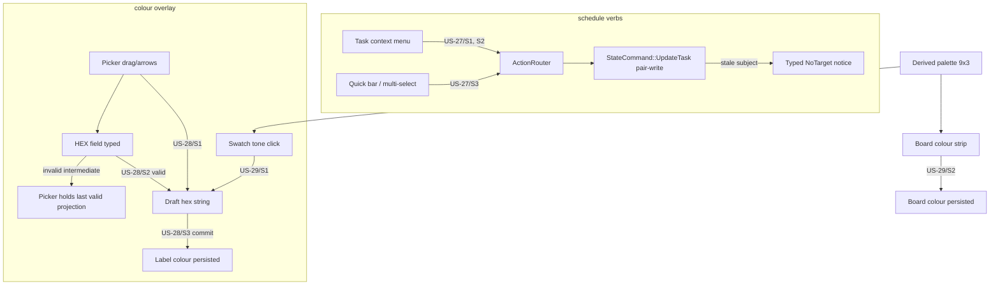
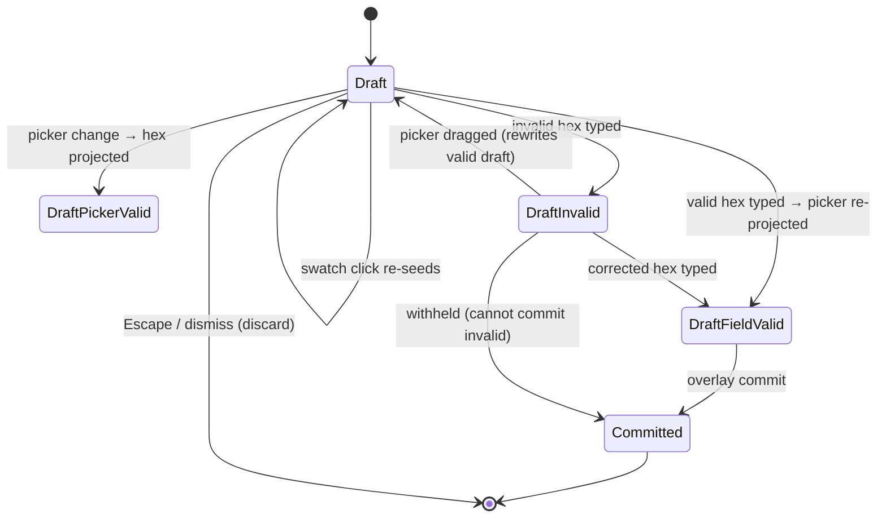

# Schedule + Colour UX Journey Plan — schedule-colour

<!--
Written from .artifacts/templates/ux-journey-plan.md. The guidance
comment STAYS in the copy; only <...> placeholders go unfilled.
-->

# [Plan] UX Journey Plan — schedule quick verbs set start+due; the HSL/HSV picker and the multi-tone palette (#1428, #1440, #1439)

- **Date**: 2026-11-25
- **Kind**: UX journey plan — user stories, journeys, flows, wiring
  contract for: (a) the Schedule today/tomorrow quick verbs writing
  both start and due (#1428); (b) the HSL/HSV colour picker two-way
  with the HEX field (#1440); (c) the multi-tone swatch palette with
  orange/brown/turquoise bases (#1439). No implementation decisions
  beyond the command contract.
- **Origin**: round-8 scope report §C-C3; issues #1428, #1440, #1439 (normative bodies); the day-window first/last rule (the N-4 law: `.artifacts/plans/2026-11-17-ui-r8-task-detail-editor-plan.md` §3 as amended by `.artifacts/plans/2026-11-18-today-due-boundary-plan.md` — due stamps are the day's *last covered* instant, never the raw exclusive end); the colour grammar's A1 mint (`models.rs::swatch_hex`, the lenient 6-hex-digit `Color` body); the tag-color plan D-5 draft model (labels-overlay.slint:243-283).
- **Status**: DRAFT — operator acceptance pending (GATE-PAUSED)
- **Surfaces touched**: `router.rs` schedule verb arms; `days.rs` (a start/end mint helper); task context menu + quick bar (verbs unchanged, effects enriched); `ui/compositions/labels-overlay.slint` (picker + tone-ladder swatch row); `ui/compositions/board-bar.slint` (tone-ladder strip); `presentation.rs` (SWATCHES const → derived palette).
- **Platform scope**: both (schedule verbs wherever they are presented; picker desktop + kiosk per the existing overlay posture)

## 1. Scope & goals

Three capabilities, one grammar:

1. **Schedule quick verbs complete the pair (#1428)**: *Schedule
   today* / *Schedule tomorrow* write **both** fields — start
   (`scheduled`) = the target day's first minute (the
   `day_start_time`-aware window start), due (`duedate`) = the
   target day's last covered instant (the N-4 law's
   `last_covered_instant(day_window_end(date))`). The today/tomorrow
   end-instant asymmetry (today commits the last covered instant,
   tomorrow the raw exclusive end) is reconciled: both verbs mint the
   same shapes. Applies to the single-task context menu, the quick
   bar, and the multi-selection quick bar entries alike.
2. **A visual colour picker (#1440)**: the labels overlay gains a
   pure-Slint HSL/HSV picker (hue strip + SV square) linked **both
   ways** with the free-form HEX field: a picker change writes the
   draft hex; a valid typed hex re-projects the picker; an invalid
   intermediate hex leaves the picker state alone (the draft string
   is the single source of truth; the picker is a projection — the
   tag-color plan D-5 draft model extended, no second truth).
3. **A multi-tone palette (#1439)**: the fixed 6-swatch const becomes
   a derived palette — each base hue (green, blue, red, yellow,
   purple, grey + new orange, brown, turquoise) contributes a small
   tone ladder (HSL-derived lightness/saturation variants); the
   label overlay swatch row and the board colour strip both consume
   the derived palette; derivation is a pure, proptest-ed function
   in Rust-side presentation code (UI purity holds).

**Decisions (recorded, binding for C3b):**

- **D-1 — the schedule mints**: one pair of domain helpers on
  `days.rs`: `day_first_instant(date, day_start_time)` (=
  `window_start`, named alias for the verb site) and
  `day_last_instant(date, day_start_time)` (=
  `last_covered_instant(day_window_end(date))` — the N-4 shape).
  Both verbs (`TaskScheduleToday`, `TaskScheduleTomorrow`) commit
  `UpdateTask { scheduled: Some(start), duedate: Some(due) }` in one
  sparse `TaskChanges` mask. `TaskDueToday` (the due-only twin) is
  unchanged. No new command variant — the existing `UpdateTask`
  carries both fields.
- **D-2 — tomorrow's stamp reconciles to the covered-instant law**:
  tomorrow commits `day_last_instant(tomorrow)` (not the raw
  exclusive `next_day_window` end). Rationale: the raw exclusive end
  is excluded by the day's own `[start, end)` membership (#893's law,
  already recorded at `TaskDueToday`); the asymmetry was a latent
  inconsistency, not a contract.
- **D-3 — picker source of truth**: the overlay's draft colour string
  (D-5 of the tag-color plan) stays the single truth; the picker is a
  projection of the last *valid* draft. Typing an invalid
  intermediate hex does not clobber the picker (the projection holds
  the last valid value); a picker drag rewrites the draft to the
  projected hex (6 lowercase digits, the `swatch_hex` mint's shape).
  Round-trip precision is a proptest law: hex → HSV → hex is the
  identity on the minted domain.
- **D-4 — picker widget shape**: hue strip (horizontal) + SV square
  (2-D drag surface), pure Slint (TouchArea drag, no IO, no shaders
  beyond fills); fully keyboard-operable (arrow nudges on the
  focused picker part; the keyboard-first law §2.7). HSL vs HSV: the
  widget stores HSV internally (the SV square is native to HSV);
  HSL is a display-only projection if ever shown — the *user-facing*
  link is the HEX field, so the colour-space label never surfaces.
- **D-5 — the tone ladders**: 3 tones per base hue (the base +
  one lighter, one darker; saturation held at the base's, lightness
  stepped ±~15% in HSL, clamped) → 9 bases × 3 = 27 swatches; brown =
  low-lightness orange ladder (its own base hue ≈ 30°, derived
  per #1439's recorded derivation); grey's ladder varies lightness
  only. Derivation is pure and proptest-ed: tones stay within the
  base hue, lightness monotone per ladder. The swatch row wraps
  (fixed grid rows) rather than scrolling.
- **D-6 — board colour strip consumes the same derived palette**:
  one palette source (`presentation.rs`), two consumers; board
  colour choice and label colour choice present identical swatch
  sets (consistency & standards, §2.6 SC-W-N2 posture).

**Non-goals (with homes):**

- Colour-contrast auto-validation of a *chosen* colour against chip
  text (#1415's failure mode) — a token-test concern for the fixed
  palette tones (in scope as a test), but no runtime warning UI —
  backlog issue filed with this plan.
- Theme integration (the chosen colours are data, not Theme tokens) —
  the theme design round (#1437, J-C1) owns the token lattice.
- Arbitrary-size picker (color wheels, eyedroppers, alpha) — backlog
  issue (R-4).
- Editing due-only via the schedule verbs (a "schedule without due"
  variant) — the pair-write is the ruled contract; the due-only verb
  is `TaskDueToday` — backlog issue if the operator wants a third
  verb.

## 2. Capability × surface matrix

<!-- Fixed header — parser contract. "C" for picker/swatch = creating
a draft colour value; edit verbs on tasks/boards/labels are
pre-existing. -->

| Capability | Board | TaskDetail | Today | Review | Settings | Capture | CLI |
|---|---|---|---|---|---|---|---|
| task.schedule_today | — (R-1) | E (US-27) | E (US-27) | — (R-1) | — (R-1) | — (R-1) | — (R-2) |
| task.schedule_tomorrow | — (R-1) | E (US-27) | E (US-27) | — (R-1) | — (R-1) | — (R-1) | — (R-2) |
| label.colour_pick | — (R-1) | E (US-28) | — (R-1) | — (R-1) | — (R-1) | — (R-1) | — (R-2) |
| label.colour_swatch | — (R-1) | E (US-29) | — (R-1) | — (R-1) | — (R-1) | — (R-1) | — (R-2) |
| board.colour_swatch | E (US-29) | — (R-1) | — (R-1) | — (R-1) | — (R-1) | — (R-1) | — (R-2) |

**Rulings** (every deliberate absence):

| ID | Ruling | Reason | Home |
|---|---|---|---|
| R-1 | No schedule/colour verbs on Today/Review/Capture beyond the pre-existing ones | The schedule verbs live where tasks are focused (context menu, quick bar); the colour picker lives in the label/board colour overlays. No new surface hosts them | This plan §1 |
| R-2 | No CLI delta | `tasks update` already sets scheduled/duedate arbitrarily; the picker is a GUI affordance by nature | This plan §1 |
| R-3 | No picker on the board colour strip (swatch-only stays) | Boards pick from the fixed derived palette (D-6); a free-form board colour has no requested need and widens the contrast-test surface | Backlog issue if the operator wants free-form board colours |
| R-4 | No alpha/eyedropper/wheel in the picker | The domain colour body is 6-hex opaque; alpha is a domain change | Backlog issue filed with this plan |

## 3. User stories

### US-27 — schedule today/tomorrow sets both start and due

- **Story**: As a user scheduling a task for today (or tomorrow) I
  want the quick verb to set both the start and the due date to that
  day (first/last minute) so that the task is genuinely scoped to the
  day, not just stamped once.
- **Platforms**: both.
- **Entry points**: task context menu rows (`menu.rs` schedule page),
  the quick bar, the multi-selection quick bar entries (all
  pre-existing entry points of `ActionId::TaskScheduleToday` /
  `ActionId::TaskScheduleTomorrow`).
- **Priority**: P1
- **Acceptance**:
  - AC-1: Given a focused task with `day_start_time` = 00:00, When
    Schedule today is dispatched, Then `UpdateTask` commits
    `scheduled = day_first_instant(today)` ∧
    `duedate = day_last_instant(today)` in one mask — journey test.
  - AC-2: Given the same verb on tomorrow, When Schedule tomorrow is
    dispatched, Then both fields carry tomorrow's
    first/last-covered instants (the raw exclusive end is gone) —
    journey test.
  - AC-3: Given `day_start_time` = 05:30, When either verb fires,
    Then start = 05:30 local on the target day (the setting is
    honoured) — journey test.
  - AC-4: Given a multi-selection, When the quick-bar schedule entry
    fires, Then every selected task receives the same pair-write —
    journey test.
  - AC-5: Given no focused/selected subject, When either verb fires,
    Then the typed `NoTarget` stale-absorb posture holds (no partial
    write) — journey test.

### US-28 — the picker and the HEX field stay linked

- **Story**: As a user choosing a label colour I want to drag a
  visual HSL/HSV picker and have the HEX field follow (and vice
  versa) so that I can pick visually or type precisely, never
  fighting the other control.
- **Platforms**: both (the overlay's existing platform posture).
- **Entry points**: the labels overlay's colour section (the picker
  mounts beside the existing colour field); keyboard: focus
  navigation onto the picker parts + arrows (the keyboard-first
  law).
- **Priority**: P1
- **Acceptance**:
  - AC-1: Given a valid draft hex, When the picker's hue/sv surface
    is dragged, Then the draft updates to the projected hex and the
    field text re-seeds — journey test.
  - AC-2: Given the picker showing any colour, When a valid hex is
    typed/committed in the field, Then the picker's projection
    follows — journey test.
  - AC-3: Given an invalid intermediate hex mid-typing, When the
    draft is invalid, Then the picker holds its last valid projection
    (no clobber) and the field border shows invalid (pre-existing
    validity echo) — journey test.
  - AC-4: Given any valid 6-hex draft, When projected to HSV and
    back, Then the hex is the identity (round-trip precision) —
    proptest.
  - AC-5: Given keyboard-only operation, When the picker is focused,
    Then arrows nudge hue/sat/value to any reachable colour — journey
    test.

### US-29 — the palette offers tone ladders and three new bases

- **Story**: As a user picking a colour I want a richer fixed
  palette — multiple tones per base hue plus orange, brown and
  turquoise — so that I can pick a shade that fits without typing
  hex.
- **Platforms**: both.
- **Entry points**: the labels overlay swatch row; the board colour
  strip (board-bar).
- **Priority**: P1
- **Acceptance**:
  - AC-1: Given the derived palette, When the swatch row renders,
    Then it shows 9 base hues × 3 tones, wrapped, with the same
    click/re-seed affordance as today — journey test.
  - AC-2: Given a tone ladder for any base, When derived, Then all
    tones share the base hue and lightness is monotone within the
    ladder — proptest.
  - AC-3: Given the board colour strip, When rendered, Then it
    presents the same derived palette (D-6) with the pre-existing
    selection affordance — journey test.
  - AC-4: Given any palette tone, When checked against chip text
    contrast, Then the existing contrast token-test treatment passes
    for the tones the fixed palette is used on — token test
    (extension of the #1415/#1414 treatment).

## 4. Journey specs

### US-27 — schedule quick verbs set start+due

| Step | Surface & affordance | User action | Dispatches | System response | Escape / failure |
|---|---|---|---|---|---|
| US-27/S1 | Task context menu, schedule page (single subject) | activate the "Schedule today" row | ActionId::TaskScheduleToday → StateCommand::UpdateTask | `TaskChanges { scheduled: Some(day_first_instant(today)), duedate: Some(day_last_instant(today)) }`; the row's scheduled/due chips re-render | Stale/absent subject → typed `NoTarget` notice, no write |
| US-27/S2 | Task context menu, schedule page (single subject) | activate the "Schedule tomorrow" row | ActionId::TaskScheduleTomorrow → StateCommand::UpdateTask | Both fields carry tomorrow's first/last-covered instants (D-2) | Stale/absent subject → typed `NoTarget` notice, no write |
| US-27/S3 | Quick bar / multi-selection quick bar, schedule entry | activate the schedule entry with a selection | ActionId::TaskScheduleToday (or Tomorrow) → StateCommand::UpdateTask per subject | Every selected task receives the same pair-write; the outcome notice arms with the affected count (existing pattern) | Empty/transient selection → typed `NoTarget`; a subject failing mid-batch leaves earlier writes committed (per-subject commands) with the notice reporting the count |

### US-28 — picker ↔ HEX field two-way link

| Step | Surface & affordance | User action | Dispatches | System response | Escape / failure |
|---|---|---|---|---|---|
| US-28/S1 | Labels overlay, colour picker (hue strip / SV square drag) | drag or arrow-nudge the picker | — (overlay-local draft write via the picker callback — no command until commit) | The draft hex updates to the projection; the field text re-seeds (the swatch changed-watch pattern); live preview re-renders | Cancel (overlay Escape / dismiss) discards the draft — the stored label colour is untouched |
| US-28/S2 | Labels overlay, HEX field | type a valid 6-hex value, commit | — (the pre-existing `labels_overlay_colour_edited` draft path) | The picker re-projects to the typed colour | Invalid intermediate text → the picker holds its last valid projection; the field's validity border echoes invalid; commit is withheld |
| US-28/S3 | Labels overlay, commit | accept the overlay | — (the pre-existing overlay commit command — unchanged Kind) | The draft colour persists onto the label | Escape/dismiss discards; the typed `NoTarget`-class failure of the underlying label edit surfaces typed (no partial commit) |
| US-28/S4 | Labels overlay, colour picker focused (keyboard) | arrow keys nudge hue / saturation / value | — (overlay-local draft write, same path as US-28/S1) | The draft hex follows the nudged projection; the field re-seeds (the keyboard-first law: any reachable-by-drag colour is reachable by arrows) | The picker part losing focus / overlay cancel discards the in-flight nudge with the draft (overlay Escape) |

### US-29 — tone-ladder palette

| Step | Surface & affordance | User action | Dispatches | System response | Escape / failure |
|---|---|---|---|---|---|
| US-29/S1 | Labels overlay swatch row (wrapped grid, 27 tones) | click a tone swatch | — (the pre-existing `labels_overlay_swatch_clicked` draft path) | The draft hex becomes the tone's exact value; the field re-seeds; the preview shows it | Same escape as US-28/S1 (overlay discard) |
| US-29/S2 | Board colour strip (board-bar) | click a tone swatch | — (the pre-existing board colour set command — unchanged Kind) | The board colour persists; the strip's selection ring moves | Typed failure of the board update surfaces typed; selection unchanged |

## 5. Interaction flows

## 6. Wiring inventory

<!-- Fixed header — parser contract. Callbacks are spelled exactly as
the slint callback (kebab-case). All commands/ActionIds below exist
today except where a row says why a row has none. -->

| ID | Surface file | Widget | Callback | Adapter seam | ActionId | Commands | Row addressing | Journey steps | Test |
|---|---|---|---|---|---|---|---|---|---|
| W-1 | crates/taskboard-ui-slint/src/router.rs | ActionRouter schedule arms (existing) | — (no new callback — the existing menu/quick-bar rows route the ActionIds) | `ActionRouter::dispatch` schedule arms (the effects enriched per D-1/D-2; ctx gains the start/due mint facts) | ActionId::TaskScheduleToday | StateCommand::UpdateTask | ItemAddr::Task (pre-existing focused/selected subject) | US-27/S1, US-27/S2, US-27/S3 | crates/taskboard-ui-slint/tests/journeys/schedule_colour_journeys.rs::us27_s1_schedule_today_writes_start_and_due |
| W-2 | crates/taskboard-domain/src/days.rs | n/a (domain helpers) | — (no callback — pure functions) | `day_first_instant` / `day_last_instant` (new pure mints; the router ctx minting site consumes them) | — (no ActionId — pure functions) | — (no command — inputs to the existing UpdateTask mask) | n/a | US-27/S1, US-27/S2 | crates/taskboard-ui-slint/tests/journeys/schedule_colour_journeys.rs::us27_s2_schedule_tomorrow_reconciles_to_covered_instant |
| W-3 | crates/taskboard-ui-slint/ui/compositions/colour-picker.slint | hue strip (new pure-Slint widget part) | `hue_picked` | install_seam!` handlers forwarding to the overlay draft (adapter.rs colour seams) | — (no ActionId — pointer/keyboard focus grammar of the overlay; arrows ride the focused-part nudge, not new chords) | — (no command — overlay draft only until commit) | n/a — a single-value control, not a list | US-28/S1, US-28/S4 | crates/taskboard-ui-slint/tests/journeys/schedule_colour_journeys.rs::us28_s1_picker_drag_writes_the_draft_hex |
| W-7 | crates/taskboard-ui-slint/ui/compositions/colour-picker.slint | SV square (new pure-Slint widget part) | `sat_val_picked` | the same install_seam! draft-forwarding handlers as W-3 (one draft seam, two widget parts — the SC-W-N2 `*-picked` family) | — (no ActionId — as W-3) | — (no command — overlay draft only until commit) | n/a — as W-3 | US-28/S1, US-28/S4 | crates/taskboard-ui-slint/tests/journeys/schedule_colour_journeys.rs::us28_s1_picker_drag_writes_the_draft_hex |
| W-4 | crates/taskboard-ui-slint/ui/compositions/labels-overlay.slint | HEX field (existing) + picker mount | `labels_overlay_colour_edited` | the existing colour draft seam (extended: the picker projection consumes the last valid draft; the callback is pre-existing) | — (no ActionId — draft path) | — (no command — draft path) | n/a | US-28/S2 | crates/taskboard-ui-slint/tests/journeys/schedule_colour_journeys.rs::us28_s2_valid_hex_reprojects_the_picker |
| W-5 | crates/taskboard-ui-slint/src/presentation.rs | the derived palette (pure Rust fn replacing the SWATCHES const read) | — (no callback — presentation data) | `derived_swatches()` (new pure fn; models.rs swatch row + board-bar strip consume it) | — (no ActionId — presentation data) | — (no command — presentation data) | n/a | US-29/S1, US-29/S3 | crates/taskboard-ui-slint/tests/journeys/schedule_colour_journeys.rs::us29_s1_swatch_row_shows_the_tone_ladder_grid |
| W-6 | crates/taskboard-ui-slint/ui/compositions/labels-overlay.slint | swatch row (wrapped grid) | `labels_overlay_swatch_clicked` | the existing swatch draft seam (unchanged contract, wider palette) | — (no ActionId — draft path) | — (no command — the labels swatch writes the overlay draft only) | n/a | US-29/S1 | crates/taskboard-ui-slint/tests/journeys/schedule_colour_journeys.rs::us29_s1_swatch_row_shows_the_tone_ladder_grid |
| W-8 | crates/taskboard-ui-slint/ui/app-window.slint | board colour strip swatches (pre-existing) | `board_color_picked` | the existing board colour seam (unchanged contract, wider palette) | — (no ActionId — pre-existing strip callback) | — (no new command — the pre-existing board colour command rides its own row) | n/a | US-29/S2 | crates/taskboard-ui-slint/tests/journeys/schedule_colour_journeys.rs::us29_s2_board_strip_presents_the_same_palette |

## 7. Command-contract delta

<!-- Fixed header — parser contract. The delta is deliberately
near-empty: D-1 composes the existing UpdateTask mask; the picker
lives on the overlay draft path. The only "new" items are domain
pure functions and a slint widget — not commands. -->

| Kind | Name | Payload sketch | Journeys |
|---|---|---|---|
| — (none) | — (no new StateCommand; `UpdateTask`'s existing sparse mask already carries `scheduled` + `duedate` together) | `TaskChanges { scheduled: Some(start), duedate: Some(due), .. }` (existing shape, now written as a pair by the quick verbs) | US-27 |
| — (none) | — (no new UiRequest; the picker is an overlay-local draft projection) | n/a | US-28 |
| — (none) | — (no new ActionId; both schedule ActionIds and the picker's focus/arrow grammar exist or are overlay-local) | n/a | US-27, US-28 |

## 8. Verification plan

- **Journey tests** (`crates/taskboard-ui-slint/tests/journeys/schedule_colour_journeys.rs`, step-ID-named):
  - `us27_s1_schedule_today_writes_start_and_due` (US-27/S1, AC-1)
  - `us27_s2_schedule_tomorrow_reconciles_to_covered_instant` (US-27/S2, AC-2)
  - `us27_s3_day_start_time_is_honoured` (US-27, AC-3)
  - `us27_s4_multi_selection_writes_every_subject` (US-27/S3, AC-4)
  - `us27_s5_subjectless_dispatch_is_typed_notarget` (US-27, AC-5)
  - `us28_s1_picker_drag_writes_the_draft_hex` (US-28/S1, AC-1)
  - `us28_s2_valid_hex_reprojects_the_picker` (US-28/S2, AC-2)
  - `us28_s3_invalid_hex_holds_the_picker_projection` (US-28/S2, AC-3)
  - `us28_s3_overlay_commit_persists_the_pick` (US-28/S3)
  - `us28_s4_keyboard_nudges_reach_any_colour` (US-28/S4, AC-5)
  - `us29_s1_swatch_row_shows_the_tone_ladder_grid` (US-29/S1, AC-1)
  - `us29_s2_board_strip_presents_the_same_palette` (US-29/S2, AC-3)
- **Property tests** (`crates/taskboard-ui-slint/src/presentation.rs` test module / domain days tests):
  - hex → HSV → hex identity on the minted domain (US-28, AC-4)
  - tone ladders stay within the base hue; lightness monotone (US-29, AC-2)
  - `day_first_instant`/`day_last_instant` window membership (start ≤ every covered instant < end ≤ due's successor) across `day_start_time` values (US-27, AC-1/2/3's oracle)
- **Fold/presentation tests**: the validity-echo fold (invalid draft
  → withheld commit) as typed flag assertions; palette count/shape
  fold (9×3, bases present — colour values asserted as hex strings,
  not rendered label text).
- **Kiosk gates**: the picker + swatch row render (and are operable
  via focus navigation) wherever the label overlay mounts on kiosk
  today; the schedule verbs keep their existing kiosk gating
  (unchanged rows).
- **Manual**: picker drag feel and the tone ladder's visual
  distinguishability — walkthrough protocol at stage 3.

## 9. Definition of done

- [ ] `scripts/ux-coverage.sh <this file> --gate` exits 0
- [ ] Every P1 story's journey completes end-to-end including escapes
  (US-27–US-29)
- [ ] Walkthrough protocol executed at stage 3; findings resolved or
  homed
- [ ] All matrix absences carry rulings (R-1…R-4); census updated
  (schedule verb pair-write + picker + palette rows)
- [ ] Non-goals filed as backlog issues (runtime contrast warning;
  free-form board colours; alpha/eyedropper; a schedule-without-due
  variant)
