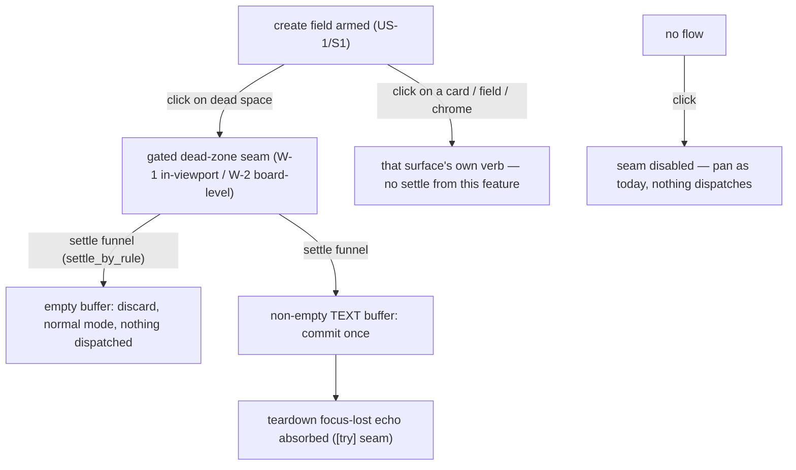

# [Plan] UX Journey Plan — the board dead-zone click-out (flow settle)

<!--
Template copy (2026-11-27). Guidance comment retained per the template
contract; placeholders filled below.
-->

- **Date**: 2026-11-27
- **Kind**: UX journey plan — user stories, journeys, flows, wiring
  contract for the board dead-zone click-out: a pointer click on empty
  board space settles (dismisses) the open text flow, exactly as the
  Escape key already does. No implementation decisions beyond the
  command contract; the click-vs-drag boundary rides the existing
  Flickable pan threshold (ruling R-3).
- **Origin**: issue #1543 (the dead-zone click-out has no route; the
  empty-create-flow click-out journey passed only vacuously until the
  #1490 mechanism fixed the spurious dismissal) + the operator ruling
  of 2026-11-27 (issue #1490 comment thread): option (a) — implement
  the click-out, UX journey plan first; the #1490 PR merges only with
  the click-out landed. The click ≡ key law (§7.1, the round-3 board
  surface plan and every census row since) is the normative frame.
- **Status**: DRAFT — dispatcher accepts before stage 2 dispatches.
- **Surfaces touched**: `crates/taskboard-ui-slint/ui/compositions/board-layout.slint`
  (the dead-zone layer + the in-viewport seam), the adapter board seam
  (`crates/taskboard-ui-slint/src/adapter/seams/board.rs`),
  `crates/taskboard-ui-slint/src/models.rs` (no change expected —
  `board-flow-open` already exists at models.rs:2414).
- **Platform scope**: both (desktop and kiosk — the board is a kiosk
  surface; the click-out is pointer parity for an existing keyboard
  settle, no new kiosk gate).

## 0. Rulings requested (operator decisions, defaults applied)

| ID | Ruling | Recommendation (default applied) | Reason |
|---|---|---|---|
| R-1 | Non-empty-flow click-out semantics | **Commit-if-non-empty** — the click routes the same settle funnel as Escape; `settle_by_rule` (view_state.rs:4380) already owns it: TEXT flows commit a trimmed non-empty buffer, discard an empty one; no ceremony, no refuse. | Already pinned by the pre-existing journey `a_dead_zone_click_settles_the_create_flow` (typed leg commits exactly once) — the design cannot re-open it without weakening the red test. |
| R-2 | Click-vs-drag threshold | **No new threshold.** The seam is gated `enabled: flow-open`; while a flow is open a press+release inside the dead zone is a click-out (slint `TouchArea.clicked`), a press that turns into a pan is consumed by the Flickable's native gesture. With no flow open the seam is disabled and pan behaves exactly as today. | The Flickable owns pan (#1365, D-1365b); a custom slop would fork the gesture grammar. While a text flow is modal-ish, losing pan-start-on-dead-space for that window is acceptable; the wheel, scrollbar (future #1359) and keyboard scroll are untouched. |
| R-3 | Which region settles | **Two gated layers, one callback**: (a) an in-viewport seam inside the columns-row Flickable behind the columns layout (owns clicks over column gaps / task-area whitespace / row padding — the journey's (10, 450) coordinate); (b) a board-level dismissal TouchArea beside the existing dead-zone DropArea (board-layout.slint ~203), gated the same way, owning the board background outside the viewport (the empty-board CreateStack leg, the margins). Both only exist to the pointer while `flow-open` is true. | The Flickable consumes presses over its viewport (the #1543 evidence), so a board-level layer alone cannot own in-viewport dead space; a window-level layer (the app-menu precedent, journeys.rs `an_outside_click_dismisses_the_menu`) would STEAL clicks aimed at cards and fields — the no-fire law forbids that. |
| R-4 | Scope of flows settled | **Flow-generic** — the seam calls the one settle funnel; the adapter's flow state decides. Any live text flow (task create, stack create, board create, title rename, …) settles by its own rule; flowless clicks dispatch nothing. | `board-flow-open` is already flow-generic (models.rs:2414: `flow != Flow::None`), and `settle_flow` is idempotent on `Flow::None` (walk.rs:63) — the gating and the decision line up without new logic. |

## 1. Scope & goals

Today a pointer click on empty board space does nothing while a text
flow is open: the full-board dead-zone `DropArea`
(board-layout.slint:202) handles drag events only, and the Flickable's
pan handling consumes presses over the columns row's empty regions
(#1543's instrumented evidence). The only pointer-independent settle is
the keyboard's Escape. Goal: a click on dead board space settles the
open flow — pointer parity with Escape (click ≡ key, §7.1) — with the
settle *semantics* staying exactly the existing pure taxonomy
(`settle_by_rule`, view_state.rs:4380): empty buffers discard, non-empty
TEXT buffers commit once, move/drag flows cancel, date editors
clean-close.

Non-goals (each with a home):
- No drag-out, no pan-altering: the Flickable's pan affordance
  (#1365) is untouched — R-2/R-3 gating.
- No click-out over aimed surfaces (cards, columns' headers, the
  create field, chrome, other overlays) — those clicks keep their own
  verbs; filed as a *law of this plan*, not debt.
- No centralized scrollbar (#1359's subject, untouched).
- No per-flow pointer ceremony for non-empty buffers (R-1: the settle
  taxonomy already rules; commit-on-clickout is Escape-consistent).
- Kiosk-specific pointer hardware (touch long-press etc.) stays the
  generic TouchArea behavior; no new kiosk setting.

## 2. Capability × surface matrix

| Capability | Board | TaskDetail | Today | Review | Settings | Capture | CLI |
|---|---|---|---|---|---|---|---|
| flow.dismiss_by_escape | E — existing (the Escape resolution lands in the one settle funnel) | E — existing | E — existing | E — existing | E — existing (settings close) | — (R-5) | — (R-6) |
| flow.dismiss_by_dead_zone_click | E (US-1, US-2, US-3) — NEW: the gated dead-zone layers route the one settle funnel | — (R-7) | — (R-7) | — (R-7) | — (R-7) | — (R-5) | — (R-6) |

**Rulings** (every deliberate absence):

| ID | Ruling | Reason | Home |
|---|---|---|---|
| R-5 | No click-out in Capture | Capture has no board dead zone; its flows settle through their own surfaces' laws. | capture surface plans (out of scope here) |
| R-6 | No CLI analog | A pointer dismissal is a GUI interaction; the CLI has no pointer. | n/a |
| R-7 | Only the Board surface gains the click-out this round | The journey evidence (#1543) and the Flickable wrap (#1490) are board-specific; the other surfaces' dead zones have no failing red and no wrap interplay — extending the pattern is cheap follow-up, not owed here. | new backlog issue if a later round wants detail-view/today dead zones |

## 3. User stories

### US-1 — the dead-zone click settles an open create flow

- **Story**: When I have the inline task-create field open on a board
  column and I click on empty board space (a column gap, the
  whitespace under the cards, the row padding), I want the flow to
  close the same way Escape closes it, so I can put the pointer down
  and move on without reaching for the keyboard.
- **Platforms**: both (desktop + kiosk — the board is a kiosk surface).
- **Entry points**: pointer click (`click_at`) on dead board space while
  a text flow is open. Keyboard twin: `ActionId` Escape resolution (the
  existing settle path — click ≡ key §7.1: same funnel, same outcome).
- **Priority**: P1.
- **Acceptance**:
  - AC-1: Given an empty create flow, When a dead-zone click lands,
    Then the flow closes, nothing dispatches, and the keyboard mode
    returns to normal — verified by the existing journey
    `a_dead_zone_click_settles_the_create_flow` (journeys.rs:12669;
    the red that this feature turns green).
  - AC-2: Given a typed (non-empty) create flow, When a dead-zone
    click lands, Then the flow commits exactly once (one
    `StateCommand::CreateTask`) and a subsequent Return dispatches
    nothing (the teardown echo absorbed) — same journey, typed leg.
  - AC-3: After a click-out settle, New Task re-arms with a single
    invocation — same journey, re-arm leg.

### US-2 — the click-out does not fire over aimed surfaces

- **Story**: When a flow is open and I click a card, a column header,
  the create field itself, or any chrome (board bar, switcher, CTAs,
  other overlays), I want that surface's own verb — not a flow
  dismissal — so the click-out only owns space nothing else handles.
- **Platforms**: both.
- **Entry points**: pointer click on an aimed surface while a flow is
  open.
- **Priority**: P1.
- **Acceptance**:
  - AC-1: Given a live create flow, When the create field itself is
    clicked, Then the flow stays open and nothing dispatches (the
    field owns the click).
  - AC-2: Given no flow open, When a dead-zone click lands (the seam
    disabled), Then nothing dispatches and pan behaves as today —
    the adapter-owns-the-decision law (the UI dispatches a typed
    intent; a flowless settle is a no-op at the seam).

### US-3 — the click-out covers the legs outside the columns viewport

- **Story**: When I create a new stack on an empty board (or any flow
  with the board background visible below/outside the columns row) and
  I click the surrounding dead space, I want the same settle, so the
  law is one board-wide rule rather than a per-leg special case.
- **Platforms**: both.
- **Entry points**: pointer click on the board background outside the
  columns viewport while a flow is open.
- **Priority**: P2 (the red journey only pins the populated leg; this
  story is the R-3(b) board-level layer and its parity).
- **Acceptance**:
  - AC-1: Given the empty-board stack-create flow (the "New stack
    name" field), When a click lands on the surrounding dead space,
    Then the flow settles by its own rule (empty discards) and
    nothing dispatches.

## 4. Journey specs

### US-1 — the dead-zone click settles an open create flow

| Step | Surface & affordance | User action | Dispatches | System response | Escape / failure |
|---|---|---|---|---|---|
| US-1/S1 | board column, armed inline create field | press New Task (`ActionId::TaskCreate`) | `ActionId::TaskCreate` → the create flow arms | the field mounts focused inside the column | Escape settles (discard on empty) — the existing path |
| US-1/S2 | dead board space (column gap / whitespace / padding, inside the columns viewport) | left click | — (a pointer seam, not a verb route; the seam calls the one settle funnel directly — the drag seams' precedent, drag.rs) | empty buffer: flow closes, normal mode returns, nothing dispatched | none needed — this IS the dismissal |
| US-1/S3 | dead board space, typed buffer | left click | — (same seam) | the settle taxonomy commits the trimmed non-empty buffer once (`StateCommand::CreateTask`); the teardown focus-lost echo is `[try]`-absorbed; a following Return dispatches nothing | none needed |
| US-1/S4 | board, after a settle | press New Task again | `ActionId::TaskCreate` | the flow re-arms on the first press (no dead click needed first) | Escape settles again |

### US-2 — the click-out does not fire over aimed surfaces

| Step | Surface & affordance | User action | Dispatches | System response | Escape / failure |
|---|---|---|---|---|---|
| US-2/S1 | the create field itself (flow live) | left click on the field | — (the field owns the click) | the flow stays open; nothing dispatches | Escape still settles |
| US-2/S2 | dead board space, no flow | left click | — (the seam is `enabled: flow-open` = false; nothing receives it) | nothing dispatched; Flickable pan untouched | n/a |

### US-3 — the click-out outside the columns viewport

| Step | Surface & affordance | User action | Dispatches | System response | Escape / failure |
|---|---|---|---|---|---|
| US-3/S1 | empty board, stack-create field armed (`stack-create-open`, board-layout.slint:279) | left click on the surrounding dead space | — (the board-level layer, same seam) | the flow settles by its rule: empty buffer discards, nothing dispatched | Escape settles (the existing path) |

## 5. Interaction flows

## 6. Wiring inventory

| ID | Surface file | Widget | Callback | Adapter seam | ActionId | Commands | Row addressing | Journey steps | Test |
|---|---|---|---|---|---|---|---|---|---|
| W-1 | crates/taskboard-ui-slint/ui/compositions/board-layout.slint (inside `columns-row := Flickable`, declared before `columns`, lowest in-viewport z) | TouchArea (`enabled: flow-open`) | `board-dead-zone-clicked` | `on_board_dead_zone_clicked` (crates/taskboard-ui-slint/src/adapter/seams/board.rs, `[try]` install, calls the one `settle_flow`) | — (pointer seam; the settle funnel is the same one the Escape resolution lands in) | — (outcomes per `settle_by_rule`, no new command) | n/a — full-dead-zone addressing, no row | US-1/S1, US-1/S2, US-1/S3, US-1/S4 | crates/taskboard-ui-slint/tests/journeys.rs::us1_s1_dead_zone_journey crates/taskboard-ui-slint/tests/journeys.rs::us1_s2_dead_zone_discard crates/taskboard-ui-slint/tests/journeys.rs::us1_s3_dead_zone_typed_commit crates/taskboard-ui-slint/tests/journeys.rs::us1_s4_dead_zone_rearm |
| W-2 | crates/taskboard-ui-slint/ui/compositions/board-layout.slint (board level, beside the dead-zone DropArea at ~203, lowest z) | TouchArea (`enabled: flow-open`) | `board-dead-zone-clicked` (same callback) | same `on_board_dead_zone_clicked` seam | — | — | n/a | US-3/S1, US-2/S2 | crates/taskboard-ui-slint/tests/journeys.rs::us3_s1_board_level_click_out_settles_stack_create crates/taskboard-ui-slint/tests/journeys.rs::us2_s2_flowless_dead_zone_click_dispatches_nothing |
| W-3 | crates/taskboard-ui-slint/src/adapter/seams/board.rs | — (seam body) | — | `on_board_dead_zone_clicked` — flowless clicks return before settling (the adapter owns the decision; the `[try]` borrow-absorb covers the settle's teardown echo) | — | — | n/a | US-2/S2 | crates/taskboard-ui-slint/tests/journeys.rs::us2_s2_flowless_dead_zone_click_dispatches_nothing |
| W-4 | crates/taskboard-ui-slint/ui/compositions/board-layout.slint | — (z-order fact) | — | — | — | — | aimed surfaces (cards, field, chrome) hit-test above both layers; their clicks never reach the seam | US-2/S1 | crates/taskboard-ui-slint/tests/journeys.rs::us2_s1_click_on_the_field_itself_does_not_settle |

## 7. Command-contract delta

| Kind | Name | Payload sketch | Journeys |
|---|---|---|---|
| StateCommand | — none new | the settle's outcomes are the existing per-flow ones (`CreateTask`, `UpdateTask`, … from `settle_by_rule`) | US-1/S3 |
| UiRequest | — none new | — | — |
| ActionId | — none new | the click-out is an L2 pointer seam (the D-H4 taxonomy), like the drag seams — it calls the adapter's `settle_flow` directly; the keyboard twin is the existing Escape resolution. A callback `board-dead-zone-clicked` is added at the slint seam level (not an ActionId): no key binds it, no resolver cell reads it. | US-1/S2, US-3/S1 |

## 8. Verification plan

- **Journey tests** (step-ID-named):

  test-alias: us1_s1_dead_zone_journey -> crates/taskboard-ui-slint/tests/journeys.rs::a_dead_zone_click_settles_the_create_flow
  test-alias: us1_s2_dead_zone_discard -> crates/taskboard-ui-slint/tests/journeys.rs::a_dead_zone_click_settles_the_create_flow
  test-alias: us1_s3_dead_zone_typed_commit -> crates/taskboard-ui-slint/tests/journeys.rs::a_dead_zone_click_settles_the_create_flow
  test-alias: us1_s4_dead_zone_rearm -> crates/taskboard-ui-slint/tests/journeys.rs::a_dead_zone_click_settles_the_create_flow

  The four aliases bind to the one pre-existing red journey
  (journeys.rs:12669) — it owns US-1's whole step set (entry, empty
  discard, typed commit, re-arm); its assertions stay byte-identical.
  The three nominations below are written by stage 2 (design-stage
  MISSING is the recorded honest steady state):

  - us3_s1_board_level_click_out_settles_stack_create (W-2, US-3/S1)
  - us2_s2_flowless_dead_zone_click_dispatches_nothing (W-3, US-2/S2)
  - us2_s1_click_on_the_field_itself_does_not_settle (W-4, US-2/S1)
- **Seam tests**: the adapter seam body is exercised through the
  journeys above (typed outcomes: `assert_commands(&[])` for the
  discard/no-fire legs; the exact single `StateCommand::CreateTask`
  for the commit leg) — no text assertions.
- **Fold/presentation tests**: none new — `board-flow-open` gating is
  presentation state already pushed by models.rs:2414; if stage 2
  needs a probe, it asserts the boolean, never labels.
- **Kiosk gates**: none — the affordance is pointer parity on an
  existing kiosk surface; nothing renders disabled/absent per platform.
- **Manual**: the click-vs-drag feel over the dead zone while a flow
  is open (R-2) — covered by the stage-3 walkthrough protocol over
  US-1, not automatable in the harness.

## 9. Definition of done

- [x] `scripts/ux-coverage.sh` gate (see §10 of the companion
  implementation plan for the recorded result; design-stage MISSING
  rows for US-3/US-2 tests are the expected honest steady state)
- [ ] Every P1 story's journey completes end-to-end including escapes
  (US-1: the red journey green; US-2: the two no-fire journeys green)
- [ ] Walkthrough protocol executed at stage 3 over US-1; findings
  resolved or homed
- [x] All matrix absences carry rulings (R-5/R-6/R-7)
- [x] Non-goals homed (§1; #1359 scrollbar, capture/today surfaces
  stay with their own plans)
