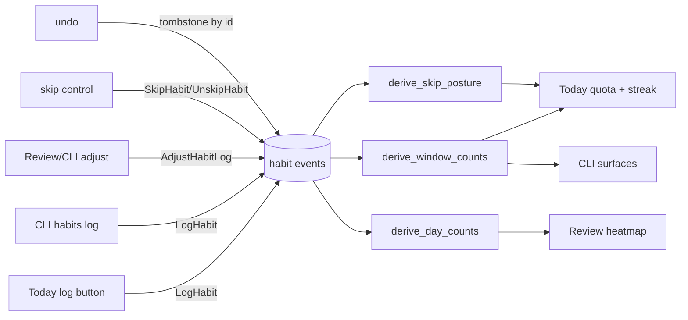

# Habit Event Log (#1519) UX Journey Plan

- **Date**: 2026-11-27
- **Kind**: UX journey plan — user stories, journeys, flows, wiring
  contract for the habit event-log refactor's user-visible semantics
  (quota / streak / heatmap now derive from per-completion events).
  No implementation decisions beyond the command contract.
- **Origin**: the #1519 design round
  (`.artifacts/plans/2026-11-27-habit-event-log-design.md`, Rulings
  A–I) and the operator ruling recorded on #1519 (2026-11-27).
- **Status**: DRAFT — accepted by the operator before the dispatch
  plan chunks implementation.
- **Surfaces touched**: Today (habit rows: quota badge, streak, log
  button), Review (habit history day-grid heatmap + skip badge), CLI
  (`taskboard habits log/adjust/skip/list`).
- **Platform scope**: both (desktop and kiosk render the same habit
  projections; no kiosk-qualified delta).

## 1. Scope & goals

This refactor changes **no verb and no affordance**: every existing
surface keeps its command. What changes is the *semantics the user
sees*:

- Quota, streak, weekly/monthly windows, and the day heatmap all
  derive from one synced per-completion event log (one source of
  truth). Completions logged on device A now appear in device B's
  heatmap and streak — today the day cells are device-local (#1340)
  and a Week/Month undo leaves a phantom day cell (#1341).
- An undo removes exactly the logged completion — no approximation on
  any window kind.
- Two devices logging the same habit in the same second both count
  (#1094 dissolves).
- A habit-kind change or day-start change re-derives all history from
  the same events (no stranded former-kind rows, D-H12 dies).
- After migration, historical Week/Month completions render on the
  migration day (display-acceptable attribution per #1519's ruling;
  design doc Ruling A).

Non-goals (each with a home): no new habit verb (deliberate — the
matrix below rules it); no pause-span event family (F-7, #1524); no
files-connector habit-time lane (#1363); no F-4 time-entry stamps
(#1521, follow-up); local event retention beyond today's never-GC'd
posture (#1489 re-triage on merge).

## 2. Capability × surface matrix

<!-- Rows: every verb on every entity this refactor touches. Cells:
D display, E edit, C create, X remove + story ID. "—" = deliberately
absent. Header row is a parser contract. -->

| Capability | Board | TaskDetail | Today | Review | Settings | Capture | CLI |
|---|---|---|---|---|---|---|---|
| habit.log | — | — | D, E + US-1 | — | — | — | E + US-1 |
| habit.adjust | — | — | — | D + US-2 | — | — | E + US-2 |
| habit.skip | — | — | D, E + US-5 | D + US-5 | — | — | E + US-5 |
| habit.unskip | — | — | E + US-5 | — | — | — | E + US-5 |
| habit.undo (log) | — | — | D + US-3 | — | — | — | D + US-3 |
| habit.heatmap | — | — | — | D + US-4 | — | — | — |
| habit.streak/quota (derived read) | — | — | D + US-1 | D | — | — | D |
| habit.kindChange (re-derive) | — | — | D + US-6 | D + US-6 | — | — | D |

**Rulings** (every deliberate absence):

| ID | Ruling | Reason | Home |
|---|---|---|---|
| R-1 | No new verb is added anywhere | The refactor is semantic, not functional; every journey dispatches an existing StateCommand | this plan, §7 |
| R-2 | habit.heatmap absent on Today/CLI | Unchanged boundary — the day grid lives on Review only (pre-existing shape, not this plan's delta) | docs/ux-surface-census.org |
| R-3 | habit.adjust absent on Today | Unchanged boundary — audited corrections are a Review/CLI verb (pre-existing) | docs/ux-surface-census.org |
| R-4 | Skip stays scoped to the current canonical window | R-4 posture carried verbatim from `command.rs:3377`; design doc Ruling B | design doc §0-B |
| R-5 | No undo surface for skip marks beyond the existing undo path | Unskip is the recovery verb; the journal inverse tombstones the mark id silently | this plan US-5 |
| R-6 | Kiosk: no delta | Habit projections render identically; kiosk is read-only for habits today | census |

## 3. User stories

### US-1 — log a completion; the count derives everywhere

- **Story**: As a user I want to log a habit completion so that every
  surface (quota badge, streak, window count, day cell) reflects it
  from one source of truth.
- **Platforms**: both
- **Entry points**: Today view habit row log button; CLI
  `taskboard habits log <habit>`
- **Priority**: P1
- **Acceptance**:
  - AC-1: Given a Day habit under quota When one log is dispatched
    (`StateCommand::LogHabit`) Then the receipt carries one minted
    event id and the derived window count increments by one — verified
    by seam test + snapshot.
  - AC-2: Given two logs dispatched in the same second When both
    apply Then two distinct events exist and the derived count is 2
    (same-second completions stay distinct) — verified by property
    test.
  - AC-3: Given a log on a Week habit When the day heatmap renders
    Then the completion's calendar day cell increments — derived,
    never a twin row — verified by presentation test (us1_ac3).

### US-2 — audited correction reconciles the window exactly

- **Story**: As a user auditing my history I want to set a window's
  count to an exact value so that the window derives exactly that
  count afterwards.
- **Platforms**: both
- **Entry points**: Review habit surface; CLI
  `taskboard habits adjust <habit> --window --count`
- **Priority**: P1
- **Acceptance**:
  - AC-1: Given derived count 3 When adjust to 1 Then the two newest
    events tombstone and the derived count is 1 — verified by engine
    test (us2_ac1).
  - AC-2: Given derived count 0 (absent window) When adjust to 1 Then
    the correction applies (the D24 refusal is gone) — verified by
    engine test (us2_ac2).
  - AC-3: Given adjust to 0 When applied Then the window derives 0
    (count-0 and row-absence are the same derived fact) — verified by
    engine test (us2_ac3).

### US-3 — undo is exact on every window kind

- **Story**: As a user I want undoing a log to remove exactly that
  completion so that no surface keeps counting it.
- **Platforms**: both
- **Entry points**: the undo affordance over a `HabitLogged` journal
  entry; CLI undo
- **Priority**: P1
- **Acceptance**:
  - AC-1: Given a Week-kind log When undone Then the minted event
    tombstones and the day cell it derived disappears (the #1341
    phantom cell is gone) — verified by engine + presentation test
    (us3_ac1).
  - AC-2: Given a log When undone Then every projection (quota,
    streak, heatmap, CLI list) re-derives without it — verified by
    snapshot (us3_ac2).

### US-4 — the heatmap derives from synced events

- **Story**: When I log a habit on device A I want device B's day
  cells to show it after sync so that my history is fleet-truthful.
- **Platforms**: both
- **Entry points**: Review habit history grid
- **Priority**: P1
- **Acceptance**:
  - AC-1: Given events merged from a peer When the grid renders Then
    day cells derive from the union (no device-local twin) — verified
    by fold test (us4_ac1).
  - AC-2: Given a migrated profile (legacy window rows synthesized)
    When the grid renders Then Week/Month completions render on the
    migration day, labelled as migration attribution in docs —
    verified by storage migration test (us4_ac2).

### US-5 — skip marks are intent events; posture derives

- **Story**: As a user I want to mark a window deliberately skipped
  so that the streak stays transparent for it, and to un-skip when I
  change my mind.
- **Platforms**: both
- **Entry points**: Today habit row skip control; CLI
  `taskboard habits skip <habit>`
- **Priority**: P1
- **Acceptance**:
  - AC-1: Given a skip When applied Then one SkipMark event exists
    and the window derives skipped (transparent in the streak walk)
    — verified by engine test (us5_ac1).
  - AC-2: Given concurrent skip (device A) and log (device B) on the
    same window When merged Then both facts survive — the mark never
    drops the increment (F-2 dissolves) — verified by fold test
    (us5_ac2).
  - AC-3: Given skip then unskip When derived Then the posture is
    unskipped; the walk resumes normal grace/miss rules — verified by
    engine test (us5_ac3).

### US-6 — kind/day-start change re-derives history

- **Story**: When I change a habit's target kind or the day-start
  time I want all history to re-derive so that no completion is
  stranded in an orphaned window.
- **Platforms**: both
- **Entry points**: habit edit surface; CLI `taskboard habits edit`
- **Priority**: P2
- **Acceptance**:
  - AC-1: Given a Day habit with history When kind changes to Week
    Then the same events attribute to Week windows (the D-H12
    stranded-row class has no successor) — verified by property test
    (us6_ac1).

## 4. Journey specs

### US-1 — log a completion

| Step | Surface & affordance | User action | Dispatches | System response | Escape / failure |
|---|---|---|---|---|---|
| US-1/S1 | Today habit row log button | tap log | `StateCommand::LogHabit` | one Completion event minted; receipt carries the id; derived count/badge update | Habit deleted/not found: typed `CommandError`, row stays unchanged |
| US-1/S2 | CLI `habits log` | run command | `StateCommand::LogHabit` | same event path; CLI names window + derived count | same typed rejection |
| US-1/S3 | any surface (read) | observe | — display only | quota badge, streak, heatmap all re-derive from the event set | derived read is total; empty event set derives 0 |

### US-2 — audited correction

| Step | Surface & affordance | User action | Dispatches | System response | Escape / failure |
|---|---|---|---|---|---|
| US-2/S1 | Review / CLI adjust | set count | `StateCommand::AdjustHabitLog` | reconcile diff: tombstones newest-first / mints events to reach target | non-canonical window for current kind: typed `InvalidHabitWindow` rejection |
| US-2/S2 | undo affordance over the adjust | undo | inverse plan | pre-image tombstone state restored exactly | pre-image restore is total (event ids are stable facts) |

### US-3 — exact undo

| Step | Surface & affordance | User action | Dispatches | System response | Escape / failure |
|---|---|---|---|---|---|
| US-3/S1 | undo affordance | undo a log | inverse of `HabitLogged` | the receipt's event id tombstones; all projections re-derive | journal entry already undone: accepted no-op |

### US-4 — heatmap derives

| Step | Surface & affordance | User action | Dispatches | System response | Escape / failure |
|---|---|---|---|---|---|
| US-4/S1 | Review history grid | open month | — display only | cells derive per-day from events (`derive_day_counts`) | missing facts render count 0 — no invention |
| US-4/S2 | sync cycle | — background | fold of `habit-events` section | peer events union in; grid re-derives | unparsable row stays Verbatim, never folds (fail-closed) |

### US-5 — skip marks

| Step | Surface & affordance | User action | Dispatches | System response | Escape / failure |
|---|---|---|---|---|---|
| US-5/S1 | Today habit row skip control | skip | `StateCommand::SkipHabit` | SkipMark event minted; derived posture transparent in streak | already-skipped: accepted no-op |
| US-5/S2 | Today habit row / CLI | unskip | `StateCommand::UnskipHabit` | UnskipMark event minted; posture clears | not-skipped: accepted no-op |
| US-5/S3 | merge | — background | union fold | mark and log facts both survive | — (union is total) |

### US-6 — kind change re-derivation

| Step | Surface & affordance | User action | Dispatches | System response | Escape / failure |
|---|---|---|---|---|---|
| US-6/S1 | habit edit | change kind | `StateCommand::UpdateHabit` | all windows re-derive under the new kind; undo of the edit re-derives back (D25 fence gone) | typed rejection unchanged for other invalid edits |

## 5. Interaction flows

## 6. Wiring inventory

<!-- One row per NEW or CHANGED affordance. No new affordance exists:
the changed rows are the *feeds* behind existing affordances. A row
with — in Commands says why in Journey steps (pure display). -->

| ID | Surface file | Widget | Callback | Adapter seam | ActionId | Commands | Row addressing | Journey steps | Test |
|---|---|---|---|---|---|---|---|---|---|
| W-1 | crates/taskboard-ui-slint/src/models.rs | habit log button (existing) | habits-log-clicked | — | — | StateCommand::LogHabit | habit row | US-1/S1 | crates/taskboard-domain/src/command.rs::us1_s1_log_habit_mints_one_event |
| W-2 | crates/taskboard-ui-slint/src/models.rs | heatmap feed (existing) | — (display only) | — | — | — | habit row | US-4/S1 | crates/taskboard-ui-slint/src/presentation.rs::us4_s1_day_cells_derive_from_events |
| W-3 | crates/taskboard-app/src/commands/habits.rs | CLI log (existing) | — | — | — | StateCommand::LogHabit | — | US-1/S2 | crates/taskboard-app/src/commands/habits.rs::us1_s2_cli_log_derives_count |
| W-5 | crates/taskboard-app/src/commands/habits.rs | CLI adjust (existing) | — | — | — | StateCommand::AdjustHabitLog | — | US-2/S1, US-2/S2 | crates/taskboard-app/src/commands/habits.rs::us2_s1_adjust_reconciles_by_tombstones crates/taskboard-domain/src/undo.rs::us2_s2_adjust_preimage_restores_exactly |
| W-6 | crates/taskboard-app/src/commands/habits.rs | CLI skip/unskip (existing) | — | — | — | StateCommand::SkipHabit | — | US-5/S1, US-5/S2 | crates/taskboard-domain/src/command.rs::us5_s1_skip_mints_mark_event crates/taskboard-domain/src/command.rs::us5_s2_unskip_mints_mark_event |
| W-7 | crates/taskboard-ui-slint/src/models.rs | streak/quota badge feed (existing) | — (display only) | — | — | — | habit row | US-1/S3 | crates/taskboard-domain/src/habit_event.rs::us1_s3_derived_read_is_total |
| W-8 | crates/taskboard-ui-slint/src/models.rs | undo feed (existing) | habits-undo-log-clicked (display only) | — | — | — | habit row | US-3/S1 | crates/taskboard-domain/src/undo.rs::us3_s1_week_undo_tombstones_event_id |
| W-9 | crates/taskboard-domain/src/merge.rs | fold feed (sync, no widget) | — (display only) | — | — | — | — | US-5/S3 | crates/taskboard-domain/src/merge.rs::us5_s3_union_keeps_mark_and_log |
| W-10 | crates/taskboard-domain/src/appdata.rs | fold feed (sync, no widget) | — (display only) | — | — | — | — | US-4/S2 | crates/taskboard-domain/src/appdata.rs::us4_s2_verbatim_never_folds |
| W-11 | crates/taskboard-ui-slint/src/models.rs | habit edit feed (existing) | — (display only) | — | — | — | habit row | US-6/S1 | crates/taskboard-domain/src/habit.rs::us6_s1_kind_change_rederives_history |

## 7. Command-contract delta

<!-- Existing commands; payloads change only. No new StateCommand,
UiRequest, or ActionId. -->

| Kind | Name | Payload sketch | Journeys |
|---|---|---|---|
| StateCommand | LogHabit | unchanged surface; receipt gains `event: HabitEventId` | US-1, US-3 |
| StateCommand | AdjustHabitLog | unchanged surface `(habit, window, count)`; semantics = reconcile diff | US-2 |
| StateCommand | SkipHabit / UnskipHabit | unchanged surface; emits mark events | US-5 |
| StateCommand | UpdateHabit | unchanged; re-derivation is read-side | US-6 |

## 8. Verification plan

- **Journey tests** (step-ID-named): `us1_s1`, `us1_ac3`,
  `us2_ac1`, `us2_ac2`, `us2_ac3`, `us3_ac1`, `us3_ac2`, `us4_ac1`,
  `us4_ac2`, `us5_ac1`, `us5_ac2`, `us5_ac3`, `us6_ac1` — domain
  engine/CLI tests carry the step tokens; the two GUI-facing tokens
  (`us1_s1`, `us4_ac1`) bind at the seam/presentation layer (the UI
  stays a dumb client; the derivation tests live in domain per
  AGENTS §5's lowest-layer rule).
- **Seam tests**: exact-command assertions for every §7 row (receipt
  carries the event id; typed `matches!` on rejections — no text
  assertions).
- **Fold/presentation tests**: union convergence (two devices,
  same-second), mark-vs-log survival, heatmap cell derivation,
  migration attribution (Ruling A1) — enum/structural assertions.
- **Kiosk gates**: none — no affordance changes (R-6).
- **Manual**: post-migration heatmap plausibility on a real profile;
  walkthrough at stage 3.

## 9. Definition of done

- [ ] `scripts/ux-coverage.sh <this file> --gate` exits 0 (or the
      honest steady state is recorded — see the stage-1 report: the
      adapter-universe debt owned by R9-A/#1514 is pre-existing and
      not this plan's rows)
- [ ] Every P1 story's journey completes end-to-end including escapes
- [ ] Walkthrough protocol executed at stage 3; findings resolved or
      homed
- [ ] All matrix absences carry rulings (R-1..R-6 above)
- [ ] Non-goals filed as backlog issues (#1363/#1521/#1524 already
      homed; #1489 re-triage on merge)
