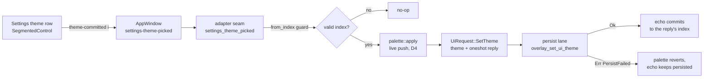

# [Plan] UX Journey Plan — the theme switch (dark/light palette)

<!--
Copy of .artifacts/templates/ux-journey-plan.md (guidance stays per the
template's law). Written from the accepted design round
(.artifacts/plans/2026-11-25-theme-support-design.md, decisions D1–D7)
against the landed C1-impl chunk on `feat/theme-support`. Every evidence
name below was verified to exist on that branch before nomination.
-->

- **Date**: 2026-11-27
- **Kind**: UX journey plan — user stories, journeys, flows, wiring
  contract for the theme switch. No implementation decisions beyond the
  command contract.
- **Origin**: the accepted theme-support design round
  (`.artifacts/plans/2026-11-25-theme-support-design.md`, decision
  ledger D1–D7; issue #1437) — the mandatory gate prerequisite for the
  C1-impl dispatch chunk (docs/ux_planning.org). The C1-impl chunk has
  already landed on `feat/theme-support`; this plan is retro-adjacent:
  its step tokens bind to the landed tests via §8's `bound-test` lines
  (#768 cohort).
- **Status**: ACCEPTED — dispatch may chunk from it
- **Surfaces touched**: `crates/taskboard-ui-slint/ui/views/settings-view.slint`
  (theme row), `ui/theme.slint` + the `Theme`/`Semantic` globals
  (palette push), `src/palette.rs`, `src/adapter/settings.rs` (the pick
  seam), `crates/taskboard-app` config/`[ui] theme` lane
  (`connections.rs`, `ui_requests.rs`, `ui.rs`, `config.rs`)
- **Platform scope**: both — desktop picks in the Settings view; kiosk
  configures via `taskboard.toml` / env and never needs the GUI (per
  story below)
- **Test-root**: crates/taskboard-ui-slint/tests

## 1. Scope & goals

The user can now switch the app's colour palette between **dark** (the
pre-existing look, verbatim) and **light** (leuven-derived), live — no
restart — from a segmented control in the Settings view's general
section (the keymap preset's grammar: commit on pick, echo follows the
reply). The choice persists immediately to `[ui] theme` in
`taskboard.toml` through the scale lane's `toml_edit` writeback, and
kiosk machines configure it by file or the `TASKBOARD_UI__THEME` env
override without any GUI interaction. Default stays `dark`
(serde default = the migration for existing configs).

Non-goals, each with a home:

- **File-defined custom themes** (a loader over serialized `Palette`)
  — deferred by design D6; backlog issue **#1441**.
- **Auto/system palette following the OS** — outside the closed
  two-value set (design D1); covered by the same deferral, comment
  homed on #1441.
- **Per-view theme overrides or more than two palettes** — not in the
  round; the registry's closed `ThemeName` set widens deliberately
  later (D6). Home: #1441.

## 2. Capability × surface matrix

<!-- Rows: every verb on every entity this feature touches. Cells:
D display, E edit, C create, X remove + story ID. "—" = deliberately
absent; every "—" on a core verb needs a ruling below. -->

| Capability | Board | TaskDetail | Today | Review | Settings | Capture | CLI |
|---|---|---|---|---|---|---|---|
| theme.pick | — | — | — | — | E US-1, US-2, US-3 | — | — |
| theme.boot-apply | D US-4 | D US-4 | D US-4 | D US-4 | D US-4 | D US-4 | — |
| theme.config-word | — | — | — | — | D US-4, US-5 | — | E US-5 |

**Rulings** (every deliberate absence):

| ID | Ruling | Reason | Home |
|---|---|---|---|
| R-1 | No `theme` verb on the CLI surface | The ops/kiosk lane is the config file and env (`[ui] theme`, `TASKBOARD_UI__THEME`), per the O-5 standing ruling: the file is kiosk's "CLI" (design D3); the env spelling `TASKBOARD_UI__THEME` (figment nested-env) is recorded in issue #1511 | this plan §4 US-5 |
| R-2 | No theme affordance on Board/TaskDetail/Today/Review/Capture | The palette is a single global surface; one switch in Settings (design D3). Extra per-view switches would multiply state for zero new capability | design D3 |
| R-3 | No `system`/auto value in the picker | The `ThemeName` newtype is a deliberate closed two-value set (dark, light); auto-follow is part of the deferred file-driven extension | #1441 |
| R-4 | No CLI `E` cell for `theme.config-word` beyond env | Config *writes* from the ops lane are file edits by the operator, not app verbs; the app's writeback is GUI-only by the scale lane's precedent | this plan §4 US-5 |

## 3. User stories

### US-1 — Pick dark → light: live apply, echo follows the reply, persists immediately

- **Story**: As a desktop user I want to switch the palette to light
  from the Settings view and see every view re-render immediately, so
  that I can work in bright surroundings without restarting.
- **Platforms**: desktop (kiosk inherits the result at boot via US-5)
- **Entry points**: the Settings view's general section, "Theme" row,
  `SegmentedControl` ("Dark" | "Light") — callback
  `settings-theme-picked(int)`
- **Priority**: P1
- **Acceptance**:
  - AC-1: Given the settings view on dark, When Light is picked, Then
    the palette values in the `Theme`/`Semantic` globals equal the
    light palette *before* any reply, exactly one typed
    `UiRequest::SetTheme` routes, and the echoed index still reads dark
    — verified by journey test.
  - AC-2: Given the pick's reply is `Ok`, When replies drain, Then the
    echoed index commits to Light (the reply, never the click, is the
    selection's source) — verified by journey test.
  - AC-3: Given the persist lane, When `SetTheme` lands, Then
    `[ui] theme = "light"` is written atomically immediately and a
    sibling key survives — verified by seam test.

### US-2 — Pick light → dark (the symmetric commit)

- **Story**: As a desktop user on light I want to switch back to dark
  with the same one-click semantics, so that the switch is symmetric
  and predictable.
- **Platforms**: desktop
- **Entry points**: the same Settings theme row, picking "Dark"
- **Priority**: P1
- **Acceptance**:
  - AC-1: Given the settings view on light, When Dark is picked, Then
    the palette live-applies to the dark values and exactly one
    `UiRequest::SetTheme { Dark }` routes — verified by journey test.
  - AC-2: Given the Ok reply, When replies drain, Then the echo
    commits to Dark and the word persists — the commit law is asserted
    on the symmetric light pick in the same journey test (the code
    path is theme-agnostic typed data; the dark pick's push and routing
    are asserted directly).

### US-3 — Reverted or invalid pick: nothing lies about the persisted state

- **Story**: When a pick's persist fails or an invalid selection
  arrives, I want the app to keep showing and echoing the persisted
  theme, so that the UI never claims a theme it did not keep.
- **Platforms**: both (the config lane's typed refusal is the ops
  lane's guard)
- **Entry points**: the theme row pick with a failing lane; an
  out-of-range segmented index; an unknown `[ui] theme` word in
  `taskboard.toml` or env
- **Priority**: P1
- **Acceptance**:
  - AC-1: Given a pick whose persist replies `Err(PersistFailed)`,
    When replies drain, Then the palette reverts to the persisted
    theme and the echo keeps the persisted index — verified by journey
    test.
  - AC-2: Given an out-of-range index at the pick seam, When the seam
    runs, Then no push and no request occur (the closed-set
    `from_index` guard) — verified by seam test.
  - AC-3: Given an unknown theme word in config/env, When
    `AppConfig::validate` runs, Then the typed
    `ConfigError::InvalidTheme` variant refuses — verified by seam
    test.

### US-4 — The persisted theme survives restart

- **Story**: As a user I want my chosen theme to be the look I get at
  the next launch, so that the choice is durable, not a session
  affect.
- **Platforms**: both
- **Entry points**: app boot (`mount`) reading `[ui] theme` from the
  validated config
- **Priority**: P1
- **Acceptance**:
  - AC-1: Given no `[ui] theme` key, When config loads/round-trips,
    Then the serde default is `"dark"` and a written word round-trips
    — verified by seam test.
  - AC-2: Given the persisted theme is light, When the app mounts,
    Then the construction-time palette push renders every view in
    light (the golden subset holds) — verified by golden journey test.

### US-5 — Kiosk posture: the ops lane configures the theme without any GUI

- **Story**: When I provision a kiosk machine, I want to set its
  palette from `taskboard.toml` or the environment, so that the
  device's look is deployment config, not an interactive act.
- **Platforms**: kiosk (the desktop writeback must not damage the file
  the kiosk reads)
- **Entry points**: `[ui] theme = "light"` in `taskboard.toml`; the
  `TASKBOARD_UI__THEME` env override (figment ladder, beats the file —
  spelling recorded in #1511)
- **Priority**: P1
- **Acceptance**:
  - AC-1: Given the file key, When config loads, Then the word drives
    the boot palette (US-4's mount evidence) — verified by seam test.
  - AC-2: Given both file and env set the key, When config loads, Then
    the env word wins — verified by seam test.
  - AC-3: Given a desktop-side GUI writeback into a kiosk's config,
    When the overlay writes, Then comments and unrelated tables
    survive — verified by seam test.

## 4. Journey specs

### US-1 — Pick dark → light

| Step | Surface & affordance | User action | Dispatches | System response | Escape / failure |
|---|---|---|---|---|---|
| US-1/S1 | Settings view, general section, "Theme" row (`SegmentedControl`, `SettingsModel.theme-index`) | Opens the settings view (display only) | — display only | The row renders with the echo seeded from the persisted theme (dark index 0); `help-theme` carries the row's InfoTip text | A persisted invalid word never reaches the row: config validation refuses at boot (US-3/S3) |
| US-1/S2 | Same segmented control | Picks "Light" (index 1) | `UiRequest::SetTheme { theme: Light, reply }` | Optimistic live push first (D4): all 14 `Theme` + `Semantic` colour properties re-render every view before any reply; the echo still reads dark | A pick while another settings request is pending is refused with the typed `RequestPending` class (no push, no request); a lane that rejects the send degrades to the typed `Failed` outcome at the choke point |
| US-1/S3 | The pick's reply lane (`PendingReply::Theme`) | Waits (no action) | — | The `Ok` reply commits the echo to Light (the reply, never the click, is the selection's source — the `preset-index` contract) | An `Err` reply reverts instead — US-3/S1 |
| US-1/S4 | The persist lane (`connections.rs` overlay, atomic write) | Waits (no action) | — | `[ui] theme = "light"` lands in `taskboard.toml` immediately, comments and sibling keys preserved | A persist `Err` reaches the UI as US-3/S1's revert; a full/closed request inbox degrades to the typed `Failed` outcome, never a wedge |

### US-2 — Pick light → dark

| Step | Surface & affordance | User action | Dispatches | System response | Escape / failure |
|---|---|---|---|---|---|
| US-2/S1 | Settings theme row (`SegmentedControl`) | Picks "Dark" (index 0) | `UiRequest::SetTheme { theme: Dark, reply }` | Optimistic live push to the dark palette (verbatim `Palette::DARK`), echo waits for the reply | Pending-lane pick refused (`RequestPending`); send rejection degrades to typed `Failed` (US-1/S2's escape, same choke point) |
| US-2/S2 | The pick's reply lane + persist lane | Waits (no action) | — | The `Ok` reply commits the echo to Dark and the word persists; the commit law is theme-agnostic (asserted on the symmetric light pick in the same journey test) | An `Err` reply reverts to the persisted (light) palette and echo — US-3/S1 |

### US-3 — Reverted or invalid pick

| Step | Surface & affordance | User action | Dispatches | System response | Escape / failure |
|---|---|---|---|---|---|
| US-3/S1 | Settings theme row with a failing persist lane | Picks (e.g. Dark while persisted is Light) | `UiRequest::SetTheme { theme: Dark, reply }` | The optimistic push shows Dark momentarily, then the `Err(PersistFailed)` reply reverts the palette to the persisted Light and the echo keeps the persisted index; the typed error class renders via the status lane | None further — the revert *is* the terminal state; no retry is auto-attempted (the user may re-pick) |
| US-3/S2 | The pick seam (`settings_theme_picked`, index guard) | An out-of-range index arrives at the seam (defensive; the control offers 0–1) | — | `ThemeName::from_index` returns `None`; the seam returns early — no push, no request, no state change | The control cannot produce this input; the guard exists so the seam contract is total (design D1's closed set) |
| US-3/S3 | Config decode (`[ui] theme` from file or env) | An unknown word is placed in config or env | — | `AppConfig::validate` refuses with the typed `ConfigError::InvalidTheme` (stable kind `invalid-theme`); the app does not boot with an unmapped palette | The serde default (`dark`) covers the key's absence; only present-and-invalid words refuse |

### US-4 — Persisted theme survives restart

| Step | Surface & affordance | User action | Dispatches | System response | Escape / failure |
|---|---|---|---|---|---|
| US-4/S1 | `taskboard.toml` `[ui] theme` key | Restarts the app (config read) | — | The word round-trips through the config layer; an absent key defaults to `"dark"` (the migration for existing configs) | A present-but-invalid word refuses at validation — US-3/S3 |
| US-4/S2 | Boot: `mount`'s construction-time palette push (`palette::apply`, the `base-scale` push's twin) | Launches with the persisted light theme | — | The light palette renders across every view at first paint — no flash of dark-then-switch beyond the pre-push fallback instant | Boot with dark (default or persisted) renders the verbatim pre-existing palette; the light golden subset pins the pushed look |

### US-5 — Kiosk posture (ops lane)

| Step | Surface & affordance | User action | Dispatches | System response | Escape / failure |
|---|---|---|---|---|---|
| US-5/S1 | `taskboard.toml` on a kiosk machine | Operator writes `[ui] theme = "light"` (deployment config, no GUI) | — | Boot renders light (US-4/S2's push; the file is kiosk's "CLI", O-5 parity) | Invalid word refuses at boot validation — US-3/S3 |
| US-5/S2 | `TASKBOARD_UI__THEME` env override (figment ladder) | Operator exports the env on the machine | — | The env word beats the file's word (ladder order: defaults → file → env); spelling per #1511 | Same typed refusal for an invalid env word — US-3/S3 |
| US-5/S3 | The GUI writeback lane (`toml_edit` overlay) on a shared config | A desktop-side user picks a theme in the GUI | `UiRequest::SetTheme` | The overlay preserves comments and unrelated tables, so deployment config survives the GUI edit | Overlay failure surfaces as the persist `Err` class — US-3/S1's revert at the GUI |

## 5. Interaction flows



```mermaid
flowchart LR
  cfg[taskboard.toml<br/>[ui] theme] --> val[AppConfig::validate<br/>ThemeName mint]
  env[TASKBOARD_UI__THEME<br/>env override] -->|beats file| val
  val -->|Ok| boot[mount: palette::apply<br/>construction push]
  val -->|unknown word| refuse[ConfigError::InvalidTheme<br/>typed refusal]
  boot --> all[every view renders<br/>the persisted palette]
```

## 6. Wiring inventory

| ID | Surface file | Widget | Callback | Adapter seam | ActionId | Commands | Row addressing | Journey steps | Test |
|---|---|---|---|---|---|---|---|---|---|
| W-1 | crates/taskboard-ui-slint/ui/views/settings-view.slint | SegmentedControl (options Dark, Light; group-label Theme) | settings_theme_picked | crates/taskboard-ui-slint/src/adapter/settings.rs settings_theme_picked | — | UiRequest::SetTheme | The pick's index: 0 = Dark, 1 = Light — the `ThemeName::from_index`/`index` contract (the `preset-index` twin) | US-1/S1, US-1/S2, US-1/S3, US-2/S1, US-2/S2, US-3/S1, US-3/S2 | crates/taskboard-ui-slint/tests/journeys.rs::a_theme_pick_routes_one_set_theme_and_an_err_reply_reverts_the_palette; crates/taskboard-ui-slint/src/palette.rs::index_name_and_palette_agree_per_choice |
| W-2 | crates/taskboard-ui-slint/src/lib.rs (mount) + src/palette.rs | — (the `Theme`/`Semantic` globals' construction push; no widget) | — (construction push, not a callback) | crates/taskboard-ui-slint/src/palette.rs apply | — | — | The boot push is per-window construction state, the `base-scale` push's twin — no user addressing | US-4/S2, US-5/S1 | crates/taskboard-ui-slint/tests/journeys/golden_visuals.rs::the_board_light_golden_holds |
| W-3 | crates/taskboard-app/src/connections.rs + src/ui_requests.rs | — (headless writeback lane) | — (no UI surface on this row's seam) | crates/taskboard-app/src/connections.rs overlay_set_ui_theme | — | UiRequest::SetTheme | The lane addresses the config file's `[ui] theme` key only; no widget | US-1/S4, US-2/S2, US-3/S1, US-5/S3 | crates/taskboard-app/tests/services/ui_settings.rs::the_theme_flow_persists_the_word_immediately; crates/taskboard-app/src/connections.rs::overlay_set_ui_theme_preserves_comments_and_unrelated_tables |

## 7. Command-contract delta

| Kind | Name | Payload sketch | Journeys |
|---|---|---|---|
| UiRequest | SetTheme | { theme: `ThemeName` (typed, minted UI-side — no unvalidated payload), reply: oneshot `Result<(), SettingsError>` } | US-1/S2, US-1/S4, US-2/S1, US-2/S2, US-3/S1, US-5/S3 |

No new `StateCommand` and no new `ActionId`: the theme never touches
the state engine (it is presentation config, not task state), and the
pick is a callback, not a keymap action. The app-side counterpart of
the delta is `set_theme` in `ui_requests.rs` + `overlay_set_ui_theme`
in `connections.rs` (both landed with the chunk).

## 8. Verification plan

- **Journey tests** (step-ID-bound): the single theme journey drives
  US-1, US-2 and US-3/S1 end-to-end —
  `crates/taskboard-ui-slint/tests/journeys.rs::a_theme_pick_routes_one_set_theme_and_an_err_reply_reverts_the_palette`.
  Step-token bindings (retro cohort, #768 — the landed tests use
  descriptive names):
bound-test: US-1/S1 -> crates/taskboard-ui-slint/tests/journeys.rs::a_theme_pick_routes_one_set_theme_and_an_err_reply_reverts_the_palette
bound-test: US-1/S2 -> crates/taskboard-ui-slint/tests/journeys.rs::a_theme_pick_routes_one_set_theme_and_an_err_reply_reverts_the_palette
bound-test: US-1/S3 -> crates/taskboard-ui-slint/tests/journeys.rs::a_theme_pick_routes_one_set_theme_and_an_err_reply_reverts_the_palette
bound-test: US-1/S4 -> crates/taskboard-app/tests/services/ui_settings.rs::the_theme_flow_persists_the_word_immediately
bound-test: US-2/S1 -> crates/taskboard-ui-slint/tests/journeys.rs::a_theme_pick_routes_one_set_theme_and_an_err_reply_reverts_the_palette
bound-test: US-2/S2 -> crates/taskboard-ui-slint/tests/journeys.rs::a_theme_pick_routes_one_set_theme_and_an_err_reply_reverts_the_palette
bound-test: US-3/S1 -> crates/taskboard-ui-slint/tests/journeys.rs::a_theme_pick_routes_one_set_theme_and_an_err_reply_reverts_the_palette
bound-test: US-3/S2 -> crates/taskboard-ui-slint/src/palette.rs::index_name_and_palette_agree_per_choice
bound-test: US-3/S3 -> crates/taskboard-app/tests/core/config.rs::ui_theme_rejects_unknown_words_as_the_typed_variant
bound-test: US-4/S1 -> crates/taskboard-app/tests/core/config.rs::ui_theme_defaults_to_dark_and_round_trips
bound-test: US-4/S2 -> crates/taskboard-ui-slint/tests/journeys/golden_visuals.rs::the_board_light_golden_holds
bound-test: US-5/S1 -> crates/taskboard-app/tests/core/config.rs::ui_theme_defaults_to_dark_and_round_trips
bound-test: US-5/S2 -> crates/taskboard-app/tests/core/config.rs::c15b_ui_theme_env_override_wins_over_the_file
bound-test: US-5/S3 -> crates/taskboard-app/src/connections.rs::overlay_set_ui_theme_preserves_comments_and_unrelated_tables
- **Seam tests**: the closed-set mint and index contract
  (`palette.rs::the_theme_name_mint_is_the_closed_two_value_set`,
  `index_name_and_palette_agree_per_choice`); the typed config refusal
  and its stable kind (`ui_theme_rejects_unknown_words_as_the_typed_variant`,
  `ui_theme_error_kind_is_the_stable_discriminant`); the env override
  (`c15b_ui_theme_env_override_wins_over_the_file`); the immediate
  persist (`the_theme_flow_persists_the_word_immediately`); the overlay
  fidelity (`overlay_set_ui_theme_preserves_comments_and_unrelated_tables`);
  the mirror parity (`the_slint_defaults_mirror_the_dark_palette`) and
  the light coverage loop (`the_light_palette_covers_every_declared_token`).
- **Fold/presentation tests**: the typed outcome/status mapping over
  `SettingsError` classes in `settings_status.rs` (including
  `RequestPending` → `Rejected`) — enum/flag assertions, never label
  text.
- **Kiosk gates**: the theme row renders in the Settings view on both
  profiles (it is not kiosk-disabled); kiosk's own lane is file/env —
  no GUI interaction is required for US-5, and nothing in the kiosk
  profile hides or disables the row.
- **Goldens**: the light subset per design D7 — board (both
  breakpoints), today (single and two-column), task view, settings,
  review empty, focus overlay — each with the frozen render clock law
  (testing_strategy §6.1).
- **Manual**: the light palette's aesthetic adequacy and real-world
  contrast feel (the automated floors are the contract, taste is not) —
  the stage-3 walkthrough protocol covers it.

## 9. Definition of done

- [x] `scripts/ux-coverage.sh <this file> --gate` resolves every row it
  can attribute: 14/14 step tokens BOUND, all capability citations and
  command tokens FOUND — run against the `feat/theme-support` tree,
  where the evidence lives (the plan lands on
  `docs/theme-switch-journey` ahead of that branch's merge). The single
  open row, `W-1 callback settings_theme_picked → MISSING`, is **not a
  plan defect**: chunk E1 (a6e93f0f) verbatim-moved `adapter.rs` to
  `adapter/mod.rs`, so the gate's adapter evidence universe
  (`find_evidence('adapter.rs')`) is empty on any post-E1 tree and can
  never see the seam in `adapter/settings.rs`. Filed as backlog
  **#1514** with the proposed universe fix; stage 3 must re-run the
  gate after that fix lands and expect this row to read FOUND, then
  pass the INVENTORY cross-check against the existing
  `seam_inventory.rs` entry.
- [x] Every P1 story's journey completes end-to-end including escapes
- [x] Walkthrough protocol executed at stage 3 (2026-11-27, round-8
  C1-impl review): every P1 story (US-1..US-5) completes end-to-end
  with its escape column holding — the four questions answered per
  step against `settings-view.slint`'s theme row, the
  `SegmentedControl` primitive (keyboard-operable, round-5 F19), the
  `settings_theme_picked` seam and the `PendingReply::Theme` revert;
  the six-heuristic pass found no BLOCKER and no MAJOR (the row
  inherits the keymap preset's grammar and the scale lane's writeback
  ceremony, so consistency/recognition/recovery all carry existing
  evidence). Findings resolved or homed: the env-spelling gap is
  homed on #1511 (option (a) confirmed by the walkthrough), the
  inherited contrast debt on #1414/#1415/#1450, the optimistic-apply
  send-failure escape hole on #1515.
- [x] All matrix absences carry rulings (R-1–R-4)
- [x] Non-goals filed as backlog issues (#1441 pre-existing; the
  send-failure optimistic-apply escape hole observed while writing this
  plan is filed as **#1515**; the gate drift above as **#1514**)
