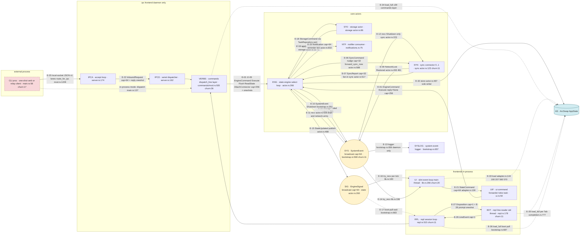
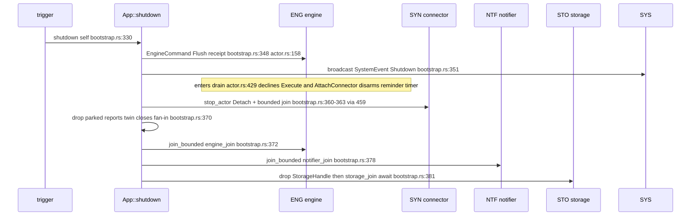

# [Report] v0.1.0 Audit — Phase 1: Data & Control Flow Model (chunk 2, stage 2)

- **Date**: 2026-10-16
- **Branch**: `docs/audit-phase1-flow-model` (worktree
  `../taskboard-WT-docs-audit-phase1-flow-model`), cut off the `v0.1.0`
  tag per dispatch conv 1; the only diff vs the tag is this chunk's
  plan + this report (conv 8). No push, no PR (stage 3 ships).
- **Plan**: `.artifacts/plans/2026-10-16-v0.1.0-audit-flow-model-plan.md`
  (executed per §2's six passes; deviations are listed in §11).
- **Audited tree**: `v0.1.0` → commit `925f50e35697f47cfb47796818c88148ff30cf90`
  (baseline report `§env`, cited per conv 6; the worktree *is* the tag
  tree, so every `file:line` below is tag evidence and clickable).
- **Inputs consumed (never re-derived, conv 6)**: baseline `§env`
  (audited SHA, history window) and `§churn` (hot-seam markers,
  §10/legend in §4).
- **Status**: complete — model derived, sole-writer check clean,
  zero unbounded channels, no structural-surprise findings beyond the
  reality-vs-docs facts of §9 (chunk 15 adjudicates those); F2-01 is
  the promotion recommendation.
- **Consumers**: chunks 9 (concurrency), 15 (docs drift), 16 (arch
  fit) read the edge table (§6) and actor inventory (§3) by row ID.

---

## 1. Method (the plan's six passes, as run)

All greps ran in the worktree with `git grep … v0.1.0 -- crates` (the
worktree equals the tag tree; the tag argument makes the command
reproducible from any clone). **Exclusion rule** (plan D2): hits inside
`#[cfg(test)]` modules, `tests/` directories, and doc comments are not
part of the shipped runtime and are excluded. The excluded production-file
clusters, so a reviewer can reproduce the classification:
`repl.rs:787+` (cfg(test) at 787/934/1055 — hits at 820, 863, 878-879,
906, 917), `ui.rs:212+/315+` (hits at 254, 305), `ipc/server.rs:563+/631+`
(hit at 642), `ui-slint/src/lib.rs:275+` (hits at 286-288, 417-419,
497-499, 618, 739-741, 766), `ui-slint/src/test_platform.rs:79,93`,
`sync-nextcloud/src/push_exec.rs:918+` (hit at 1677 — a test TCP
fixture thread), `secrets.rs` test module (hit at 258),
`state/src/lib.rs:35-40` (doc comment `//!`), and every `tests/` file
in the constructor grep output.

**Pass 1 — channel constructors, workspace-wide.**
`git grep -n -E 'mpsc::channel|mpsc::unbounded_channel|broadcast::channel|oneshot::channel|watch::channel' v0.1.0 -- crates`
→ 100+ raw hits; after the exclusion rule, **23 production constructor
sites** (bootstrap.rs ×6, state/actor.rs ×6, storage-sqlite/actor.rs ×3,
ipc/server.rs ×3, repl.rs ×4 [incl. headless orphan], ui.rs ×1).
`mpsc::unbounded_channel`: **zero hits** in the whole grep — a recorded
fact, not an assumption. Every constructor is classified in the edge
table (§6); the constructor→row reconciliation is in §6.1.

**Pass 2 — spawn sites.**
`git grep -n -E 'tokio::spawn|task::spawn|spawn_blocking|thread::spawn|thread::Builder|run_event_loop' v0.1.0 -- crates`
→ production hits at bootstrap.rs:657, ipc/server.rs:162+174,
notifications.rs:75, repl.rs:178 (std thread), ui.rs:50+194,
state/actor.rs:266, storage-sqlite/actor.rs:86, sync-nextcloud/actor.rs:123,
plus the non-spawn executors: slint event loop on the main thread
(ui-slint/lib.rs:266) and the REPL session loop (an async future inside
the runtime, repl.rs:515). → actor inventory §3.

**Pass 3 — wiring trace.** From the three roots — `bootstrap()`
(bootstrap.rs:499), `run_desktop` (ui.rs:157), `main::run`
(main.rs:79) — each constructor half was followed to its consumer by
reading the owning function and its callers. Key crossings verified by
reading, not inference: engine handle → forwarder/verbs (ui.rs:180,
bootstrap.rs:582-593), `SyncStateReader` hand-off (bootstrap.rs:610),
the fan-in reports clones (bootstrap.rs:614, attach :297), the UI
hand-over tuple (ui.rs:182-188 → lib.rs:124-130), IPC server wiring
(main.rs:291 → server.rs:142), REPL editor hand-off (repl.rs:673),
and the frontend convergence on `dispatch_line` (repl.rs:610,
ipc/server.rs:528, commands/mod.rs:920).

**Pass 4 — ArcSwap trace.**
`git grep -n '\.rcu(' v0.1.0 -- crates` and
`git grep -n -E '\.store\(|\.load_full\(\)|\.load\(\)' v0.1.0 -- 'crates/*/src'`,
production-filtered. Writers: exactly **one** production site
(state/actor.rs:487, inside `publish`; the other `.store` hits are a
`CredentialStore::store` call at commands/connect.rs:415 — a different
type — and test-module injections). Readers: five clusters, §7. The
sole-writer rule of AGENTS §2 **holds by enumeration**.

**Pass 5 — shutdown routes.** Traced from the four triggers (signal,
`daemon stop`, UI window close/signal, REPL EOF/exit) into
`App::shutdown` (bootstrap.rs:330) — the implemented step order is
§5.2; the trigger-specific pre-sequences are §5.1.

**Pass 6 — mode matrix + churn markers.** Modes derived from
`main::run` (main.rs:87-178), `bare_invocation_route` (ui.rs:79),
`entry_point` (repl.rs:71), and the daemon mode gate (main.rs:252-258)
→ §10. Churn markers `churn:N` on diagram nodes/edges = the source
file's commit count in baseline `§churn` (top-30 table only; files
absent from the top-30 carry no marker).

**Mermaid validation (plan §4.3/D14, honest record):** `mmdc` /
`npx @mermaid-js/mermaid-cli` is not available offline in this
environment (checked, time-boxed) — the fallback ran: conservative
label subset (ASCII, all labels quoted, no `end` tokens, no exotic
shapes beyond one `[( )]` database node), plus a structural lint of
balanced quotes/brackets and declare-before-use for every node id
(checked mechanically before commit). **Stage-3 addendum**: both
diagram blocks were then validated with mermaid's own parser
(`mermaid.parse()`, mermaid 12.2.0 under node + jsdom, network-fetched
into /tmp only) — both **parse OK**; no scratch tooling landed in the
repo.

## 2. Vocabulary note (facts only, plan D3)

Names are recorded exactly as the code spells them. Two command
vocabularies meet on one edge and are **not** adjudicated here: the
engine inbox carries `EngineCommand` envelopes (state/actor.rs:46) whose
`Execute` variant wraps a domain `StateCommand` (dispatch non-goal;
chunks 3/4 record crate-local facts, chunk 15 adjudicates the docs
wording, chunk 17 merges).

## 3. Actor inventory (pass 2)

Every long-lived executor of the shipped runtime. "Substrate" is the
execution mechanism as found; join-handle ownership drives §5.

| ID | Actor / task | Crate · module | Substrate | Spawn / entry site | Inbox(es) | Lifetime / join owner |
|---|---|---|---|---|---|---|
| ENG | State engine run loop | taskboard-state · actor.rs | tokio task | `spawn_state_engine` → `tokio::spawn(run_loop(…))` actor.rs:266 (loop fn :302, biased `select!` :354) | E-01..05 (EngineCommand mpsc), E-07 (SyncReport mpsc), E-11 (SystemEvent broadcast), reminder timer arm :463 | `App.engine_join` (bounded join at shutdown, bootstrap.rs:372) |
| STO | Storage actor | taskboard-storage-sqlite · actor.rs | tokio task | `spawn_storage_actor` actor.rs:86 (called bootstrap.rs:566) | E-18 (StorageCommand mpsc :85) | `App.storage_join` (joined unbounded last, bootstrap.rs:381-382) |
| SYN | Sync connector actor (0..1) | taskboard-sync-nextcloud · actor.rs | tokio task | `spawn_sync_actor` actor.rs:123 (boot call bootstrap.rs:608; attach call :293) | E-06 (SyncCommand mpsc), E-12 (SystemEvent broadcast :175) | `SyncActor.join` inside `App.connectors` (bounded join via `stop_actor`, bootstrap.rs:459) |
| NTF | Notifier consumer | taskboard-app · notifications.rs | tokio task | `spawn_notifier` notifications.rs:75 (fn :71; called bootstrap.rs:577) | E-20 (Notification mpsc) | `App.notifier_join` (bounded join, bootstrap.rs:378) |
| SYSLOG | System-event logger | taskboard-app · bootstrap.rs | tokio task | `spawn_system_event_logger` bootstrap.rs:657 (fn :653; called main.rs:280, daemon only) | E-13 (SystemEvent broadcast :656) | daemon-lifecycle local `_logger`; exits on close or first `Lagged` :664-668 |
| IPCA | IPC accept loop | taskboard-app · ipc/server.rs | tokio task | `spawn_server` → server.rs:174 (fn :263) | local-socket listener; E-23 (stop watch) | `IpcServerHandle.accept` (drained by `server.join`, server.rs:104) |
| IPCD | IPC dispatcher (serial) | taskboard-app · ipc/server.rs | tokio task | `spawn_server` → server.rs:162 | E-22 (InboundRequest mpsc :155) | `IpcServerHandle.dispatcher` (same join) |
| UI | Slint event loop + repaint timer | taskboard-ui-slint · lib.rs | **process main thread** (inside `block_on`) | `run` → `slint::run_event_loop()` lib.rs:266; repaint `slint::Timer` lib.rs:176 (fn `start_repaint_driver` :168) | E-16/E-14 (broadcast `try_recv` drains :183/:196) | loop returns on window close or `quit` (lib.rs:272); no join |
| UIF | UI-command forwarder | taskboard-app · ui.rs | tokio task | `spawn_ui_command_forwarder` ui.rs:50 (fn :46; called :180) | E-21 (StateCommand mpsc) | aborted after the loop returns, ui.rs:203 |
| EXITW | UI exit watcher | taskboard-app · ui.rs | tokio task | ui.rs:194 | none — awaits `wait_for_signal` then `slint::quit` :197 | aborted ui.rs:202 |
| RPL | REPL session loop | taskboard-app · repl.rs | async future on the runtime (no dedicated task) | `run_session` repl.rs:761 → `run_session_with_parts` :654 → `repl_loop` :515 | E-26 (LineEvent mpsc) | ends on `Eof`/`Exit`; runs `app.shutdown()` :620 |
| EDT | REPL line-reader ("repl-line-reader") | taskboard-app · repl.rs | **std thread** (`thread::Builder` :178) | `spawn_line_reader` repl.rs:175 | E-27 (Disposition mpsc) | exits when the disposition sender drops (:235 `None`) or on send failure; OS thread, no join handle kept |
| CLI | One-shot verb / relay client | taskboard-app · main.rs | separate OS process | `main` main.rs:58 → `run` :79 (verb dispatch :89-138; relay :107-122) | none in-process (client of E-25 when relaying) | exits with the verb's code |

Non-actor helpers deliberately **not** inventory rows: `wait_for_signal`
(bootstrap.rs:725) and the daemon `select!` (main.rs:306) are arms of
the lifecycle future, not tasks; `wait_for_boot_pull` (bootstrap.rs:682)
is a bounded await inside the CLI/REPL/attach flows (rows E-17/E-36).

## 4. Main runtime graph (mermaid)

Broadcast channels are drawn as hub nodes (plan D6); `ArcSwap<AppState>`
as a shared-state node with one solid write edge and dashed read edges
(D7); the external CLI process in a dashed subgraph (D9); shutdown-only
message flow is drawn dotted (the ordered teardown is §5's diagram, D5).

Reads of AS are dashed (fact of the primitive: lock-free loads — the
performance characterization itself is chunk 13's, not recorded here).
E-10 is drawn as a message flow because the Shutdown broadcast *is*
data flowing to subscribers (the ordering discipline around it is §5).

## 5. Shutdown routes (pass 5, as implemented)

### 5.1 Triggers (pre-sequences)

| Trigger | Route into `App::shutdown` |
|---|---|
| `ctrl_c` / SIGTERM, daemon | `wait_for_signal` (bootstrap.rs:725) vs `server.stopped()` in the daemon `select!` (main.rs:306-313) → `server.join(timeout)` (server.rs:104; aborts accept+dispatcher at the budget, drains accepted connections :288-291) → `Arc::try_unwrap` → `app.shutdown()` (main.rs:315-321). A second signal during the drain force-exits 130 (main.rs:323-329). |
| `taskboard daemon stop` | CLI IpcOnly lane (main.rs:225-237) → `Request::Shutdown` → IPCD answers and sets the stop watch (server.rs:165-169) → the daemon trigger above completes the sequence. |
| `ctrl_c` / SIGTERM, desktop | EXITW (ui.rs:194-198) calls `slint::quit` → loop returns → forwarder+watcher aborted (ui.rs:202-203) → `app.shutdown()` (ui.rs:204). |
| Window close, desktop | `run_event_loop` returns (lib.rs:266) → same ui.rs:200-204 path. |
| REPL `exit` / Ctrl-D / EOF | `repl_loop` breaks (repl.rs:528/533) → `app.shutdown()` (repl.rs:620); the dropped disposition sender is the editor thread's exit signal (repl.rs:513); `TtyStateGuard` restores termios on drop (repl.rs:735-745). |
| Detach (connector only) | `App::detach_connector` (bootstrap.rs:219-241): drain registry → `stop_actor` per actor (send `SyncCommand::Detach` :460-464, bounded join :465) — the rest of the graph keeps running. |
| Attach unwinding | A lost attach race unwinds the refused actor outside the lock (bootstrap.rs:307-310). |

### 5.2 `App::shutdown` implemented order (bootstrap.rs:330-385)

Numbered, each step with evidence: (1) destructure `App` so the parked
reports twin's drop is structural (bootstrap.rs:335-347); (2)
`engine.flush()` — the durability barrier receipt (boot strapping
actor.rs:158) :348; (3) `system.send(SystemEvent::Shutdown)` :351 —
the engine's drain flip (state/actor.rs:429-447: declines
`Execute`/`AttachConnector`, disarms the reminder timer, keeps
ingesting sync reports until the channel closes) and the sync actor's
stop (sync/actor.rs:226-230); (4) per-connector `stop_actor` =
`SyncCommand::Detach` + bounded join with abort-at-budget
(bootstrap.rs:360-363 → :459-467, `join_bounded` :469); (5)
`drop(reports)` — closes the fan-in inbox so the engine's linger-drain
can finish (:365-370); (6) bounded engine join :372; (7) bounded
notifier join :378 (the consumer would exit on its own — the engine
exit closed its channel); (8) `drop(storage)` then `storage_join.await`
(:381-382). Recorded as implemented; comparing against the desired
graceful order (UI → sync flush → outbox durability → storage close)
is chunk 9's axis-K task — this report records only the implemented
sequence.

## 6. Edge table (passes 1+3+4)

Schema per plan §3. "Constructed" is the `channel()` site; "send"/"recv"
pin the production sites of each half. `churn:N` = baseline `§churn`
top-30 commit count for the cited file. External endpoints:
`CLI(proc)`.

| ID | From → To | Primitive | Payload | Capacity | Constructed | Send evidence | Recv evidence | Return path | Notes |
|---|---|---|---|---|---|---|---|---|---|
| E-01 | UIF → ENG | mpsc | `EngineCommand::Execute{reply:None}` | 256 (`COMMAND_BUFFER`, state/actor.rs:36) | state/actor.rs:259 (fn `spawn_state_engine`) | ui.rs:52 → `EngineHandle::dispatch` try_send actor.rs:139 | select arm actor.rs:357 | — | UI path is fire-and-forget; full/closed logged+dropped :139-152 |
| E-02 | VERBS (CLI/RPL/IPC) → ENG | mpsc | `EngineCommand::Execute` + receipt | 256 (same channel as E-01) | state/actor.rs:259 | commands layer → `execute` send actor.rs:125-131 | actor.rs:357 | oneshot actor.rs:124; receipt sent inside `execute_command` (actor.rs:500ff; drain-decline reply :364) | reply implies durability (:115) |
| E-03 | VERBS → ENG | mpsc | `EngineCommand::Flush` | 256 (same) | state/actor.rs:259 | actor.rs:160-161 | actor.rs:357 | oneshot actor.rs:158, reply :384 | `App::shutdown` barrier bootstrap.rs:348 |
| E-04 | SYN (via `SyncStateReader`) → ENG | mpsc | `EngineCommand::ReadState` | 256 (same) | state/actor.rs:259 | port impl actor.rs:214-216 (trait impl :208-220) | actor.rs:357 | oneshot actor.rs:213, reply :387 | sync never reads SQL directly (ADR 0005) |
| E-05 | App (`attach_connector`) → ENG | mpsc | `EngineCommand::AttachConnector` | 256 (same) | state/actor.rs:259 | bootstrap.rs:277 → actor.rs:183-185 | actor.rs:357 | oneshot actor.rs:182, receipt :389-394 (`Attached`/`Draining`) | pushes the new sender onto the nudge registry :396 |
| E-06 | ENG → SYN | mpsc | `SyncCommand` nudges (`SyncNow`/`SetBoard`) | 32 (`SYNC_COMMAND_CAPACITY`, bootstrap.rs:80) | bootstrap.rs:569 | `forward_sync_now` try_send actor.rs:588 (registry fan-out :585-604); ceremony `SetBoard` via `App::sync_commands` boards.rs:278 | sync actor.rs:193 (`commands.recv`) | — | standalone: rx dropped bootstrap.rs:629; full channel = coalesced (:593-597) |
| E-07 | SYN → ENG | mpsc | `SyncReport` | 32 (`SYNC_REPORT_CAPACITY`, bootstrap.rs:82) | bootstrap.rs:570 | sync actor.rs:517 | actor.rs:403 (`sync_reports.recv`, `reports_open` guard) | — | fan-in "N actors, one inbox": parked twin `App.reports` (:149, :370) + per-attach clones (:297); attach pair E-30 feeds the same receiver type |
| E-08 | ENG → SYS hub | broadcast | `SystemEvent::StorageFailed` | 64 (`SYSTEM_BROADCAST_CAPACITY`, bootstrap.rs:77) | bootstrap.rs:568 | state/actor.rs:761 | subscribers below | — | producer-only arm for the engine itself :453 |
| E-09 | SYN → SYS hub | broadcast | `SystemEvent::NetworkLost`/`NetworkRestored` | 64 (same) | bootstrap.rs:568 | sync actor.rs:493 / :461 | subscribers below | — | the sync actor is the network authority (architecture.org:128) |
| E-10 | App::shutdown → SYS hub | broadcast | `SystemEvent::Shutdown` | 64 (same) | bootstrap.rs:568 | bootstrap.rs:351 | subscribers below | — | no live receivers is fine (:350-351) |
| E-11 | SYS hub → ENG | broadcast | all `SystemEvent` | 64 (same) | bootstrap.rs:568 | — | recv arm actor.rs:428 (`system_open` guard) | — | acts on `Shutdown` → drain :429-447, `NetworkLost` → `go_offline` :728, `NetworkRestored` → nudge :446-448; rx handed at bootstrap.rs:589 (`system_rx_engine`) |
| E-12 | SYS hub → SYN | broadcast | all `SystemEvent` | 64 (same) | bootstrap.rs:568 | — | subscribe sync actor.rs:175, recv arm :225 | — | acts on `Shutdown` only :226-230; ignores the rest :231-236 |
| E-13 | SYS hub → SYSLOG | broadcast | all `SystemEvent` | 64 (same) | bootstrap.rs:568 | — | subscribe bootstrap.rs:656, recv :659 | — | daemon-only (:280); exits on close or first `Lagged` :664-668 |
| E-14 | SYS hub → UI | broadcast | all `SystemEvent` | 64 (same) | bootstrap.rs:568 | — | `try_recv` drain lib.rs:196-209 | — | rx handed at mount ui.rs:185 → lib.rs:156; `Shutdown` inert here (:197-199) |
| E-15 | ENG → SIG hub | broadcast | `EngineSignal::StateUpdated` | 64 (`SIGNAL_BUFFER`, state/actor.rs:38) | state/actor.rs:260 | `publish` actor.rs:488 | subscribers below | — | swap-then-signal ordering :482-488 |
| E-16 | SIG hub → UI | broadcast | `StateUpdated` | 64 (same) | state/actor.rs:260 | — | `try_recv` drain lib.rs:183-194 | — | rx handed at ui.rs:184 |
| E-17 | SIG hub → boot-pull wait | broadcast | `StateUpdated` | 64 (same) | state/actor.rs:260 | — | subscribe bootstrap.rs:683, timeout recv :711 | — | `wait_for_boot_pull` :682-713 (REPL/attach/CLI boot flows) |
| E-18 | ENG → STO | mpsc | `StorageCommand::Apply`/`Load` | 64 (literal) | storage-sqlite/actor.rs:85 | engine `repo.apply` via `TaskRepository` port: storage-sqlite/port.rs:15-21 impl (trait: domain/persistence.rs:29); call sites actor.rs:547, :663, :745, :793 | storage actor.rs:89 recv | embedded oneshots | the handle *is* the port adapter (bootstrap.rs:578-582) |
| E-19 | STO → ENG | oneshot | `Result<(), RepositoryError>` / `PersistedState` | n/a | storage actor.rs:55 (apply), :71 (load) | oneshot carried inside the command; actor replies :97 (apply), :104 (load) | engine at the call sites of E-18 | — | per-request pattern (plan D11); dropped reply tolerated :95-96 |
| E-20 | ENG → NTF | mpsc | `Notification` | 64 (`NOTIFIER_CAPACITY`, notifications.rs:17) | bootstrap.rs:572 | reminder tick actor.rs:832 | notifications.rs:77 recv | — | consumer exits when the engine exit closes the channel (bootstrap.rs:575-580); sink = `LogSink` v1 (notifications.rs:49-62) |
| E-21 | UI → UIF | mpsc | `StateCommand` | 64 (`UI_COMMAND_CAPACITY`, ui.rs:39) | ui.rs:179 | adapter try_send adapter.rs:130, :162 | ui.rs:51 recv → `sink.dispatch` :52 | — | the UI never sees an `EngineHandle` (ui.rs:177-180) |
| E-22 | IPCA per-conn → IPCD | mpsc | `InboundRequest{req, reply}` | 64 (literal) | ipc/server.rs:155 | `serve_connection` send :332-338 | dispatcher :163 | embedded oneshot (E-24) | serial dispatch — engine-fairness by construction (:158-159) |
| E-23 | IPCD → IPCA (+daemon) | `watch<bool>` | stop flag | n/a | ipc/server.rs:156 | `send(true)` on `Response::Shutdown` :168 | accept `wait_stopped` :278/:296-302; daemon `server.stopped()` :79 | — | handle holds sender+rx (:177-183) |
| E-24 | IPCD → conn task | oneshot | `Response` | n/a | ipc/server.rs:331 | dispatcher :170 | :342 | — | per-connection pattern |
| E-25 | CLI(proc) ⇄ IPCA | local-socket (`interprocess`) + length-framed JSON v1 | `Request`/`Response` | n/a | bind server.rs:153 (fn :192-233; stale-socket recovery :201-232) | client main.rs:112-121, :198-221, :225-237 | `listener.accept` :277 | — | lanes: `Local`/`IpcOnly`/`IpcOrLocal` (`route_for_ipc`, commands/mod.rs:1228-1244); one request per connection; unix sidecar 0600 (:241-249) |
| E-26 | EDT → RPL | mpsc | `LineEvent` (Line/Interrupted/Eof) | 1 | repl.rs:176 | `blocking_send` :211, :216, :221 | `repl_loop` recv :522 | — | capacity-1 strict alternation (ADR 0014) |
| E-27 | RPL → EDT | mpsc | `Disposition` (Next/Prompt) | 1 | repl.rs:177 | resume :288; prompt ship :294-300 | `blocking_recv` :234 | — | dropped sender = editor exit signal :235 |
| E-28 | EDT → RPL | oneshot | `PromptValue` | n/a | repl.rs:293 | EDT answers :253 | `ask` await :301 | — | rides inside `Disposition::Prompt`; masked reads never enter history (:158-163) |
| E-29 | VERBS (`App::sync_commands` fallback) → ∅ | mpsc | `SyncCommand` | 1 | bootstrap.rs:184 | callers, e.g. boards.rs:278 | receiver dropped :185 | — | sends fail `Closed` by design (:170-186 doc) |
| E-30 | ENG registry → SYN (per attach) | mpsc | `SyncCommand` | 32 (`SYNC_COMMAND_CAPACITY`) | bootstrap.rs:273 | E-06 senders after the E-05 ack | new actor bootstrap.rs:293 | — | fresh pair per attach; the boot pair belongs to the boot actor (:272-274) |
| E-31 | RPL `headless()` → ∅ | mpsc | prompt transport (unused) | 1 | repl.rs:377 | `ReplPrompts::new(orphan)` :379-381 | receiver dropped :377 | — | headless session prompts fail closed (`BrokenPipe`) |
| E-32 | ENG → AS | `ArcSwap` write | `AppState` | n/a | `ArcSwap::from_pointee` state/actor.rs:258 | **state/actor.rs:487** (`publish`; sole production writer) | — | — | sole-writer check = pass 4 enumeration §7 |
| E-33 | UI ← AS | `ArcSwap` read | `AppState` snapshot | n/a | — | — | adapter.rs:144, :190, :207 (`.load`), :560, :570 (`.load_full`) | — | slint thread only (timer + input callbacks) |
| E-34 | VERBS ← AS | `ArcSwap` read | `load_full` ×39 sites | n/a | — | — | commands/{tasks,stacks,boards,labels,reminders,status,sync}.rs (enumerated §7) | — | CLI + REPL + IPC verbs converge here |
| E-35 | EDT ← AS | `ArcSwap` read | completion context | n/a | — | — | completion.rs:777 | — | one load per Tab (:749) |
| E-36 | RPL/boot-pull ← AS | `ArcSwap` read | sync-phase poll | n/a | — | — | bootstrap.rs:687 | — | paired with E-17's signal wait |

### 6.1 Constructor→row reconciliation (plan §2.3 cross-check)

23 production constructors → 36 rows: the engine inbox constructor
(state/actor.rs:259) carries rows E-01..E-05 (one channel, five
sender populations); the system broadcast (bootstrap.rs:568) carries
E-08..E-14 (three producer populations, four subscriber edges); the
signal broadcast (state/actor.rs:260) carries E-15..E-17; the storage
inbox constructor (storage/actor.rs:85) is E-18 with E-19 as its
embedded-receipt rows; the IPC inbound (server.rs:155) is E-22 with
E-24 as its embedded receipt; E-29/E-31 are whole-function orphan
pairs; every other constructor maps 1:1. **Every constructor is
accounted for; every row traces to a constructor** — no orphan rows.

## 7. ArcSwap read/write enumeration (pass 4)

**Writers** — production `.store`/`.rcu` sites on
`ArcSwap<AppState>`, exhaustive:

- state/actor.rs:487 — `publish`: `shared.store(Arc::new(core.app()))`
  then `signals.send(EngineSignal::StateUpdated)` (:488). Every state
  transition publishes through this one function (call sites:
  `execute_command` :500ff, `ingest_sync_report` :606ff,
  `go_offline` :728ff, `reminder_tick` :779ff).
- `commands/connect.rs:415` is `CredentialStore::store` (credential
  persistence — a trait method, not ArcSwap); `secrets.rs:258` and the
  ui-slint `state.store` hits (lib.rs:618, :766) are test-module code.
  **The AGENTS §2 sole-writer rule holds: exactly one production write
  site, in the state actor.**

**Readers** — five clusters, each with its call-site evidence:

| Cluster | Substrate | Sites |
|---|---|---|
| UI adapter (repaint + input) | slint thread | `.load` adapter.rs:144 (`sync_view_context`), :190 (`refresh`), :207 (`interpret`); `.load_full` :560, :570 (stack-select/commit callbacks) |
| Command verbs (CLI one-shot, REPL lines, IPC-relayed verbs — all converge on `dispatch_line`) | runtime workers | `load_full` ×39: tasks.rs ×12 (171-460), stacks.rs ×6, boards.rs ×6 (incl. subscribe :417), labels.rs ×4, reminders.rs ×7, status.rs :82, sync.rs ×3 |
| REPL tab-completion | EDT std thread | completion.rs:777 (one per Tab, :749) |
| Boot-pull wait | caller's future | bootstrap.rs:687 (poll + E-17 signal wait) |
| Engine boot hydrate | pre-loop | the initial state enters via `ArcSwap::from_pointee` (state/actor.rs:258) before the loop starts (hydrate :248-258; `tokio::spawn` :266) |

Zero-contention reads are a fact of the primitive (AGENTS §3);
whether the read patterns are *efficient* is chunk 13's question.

## 8. IPC surface (facts only)

- **Transport**: per-database local socket via `interprocess`
  (`spawn_server` ipc/server.rs:142), length-framed JSON v1
  (`codec`); unix sidecar file hardened 0600 (:241-249); stale-socket
  recovery exactly once (:192-233).
- **Tasks**: accept loop (concurrent accepts, per-connection tasks in a
  `JoinSet`, biased accept-vs-stop select :270-291) + one serial
  dispatcher (server.rs:158-172 — "the only `&App` holder").
- **Stop**: `watch<bool>` (E-23); `Response::Shutdown` flips it
  (:165-169); `IpcServerHandle::join` aborts at the drain budget and
  removes the sidecar (:104-134).
- **Request kinds**: `Exec`, `Status`, `Shutdown`, `DetachConnector`,
  `AttachConnector` (ipc/protocol.rs:19-68); `Exec` relays raw argv into
  `resolve_words` + `dispatch_line` (:486-535) — the same verb layer as
  the REPL; ceremonies (`connect`/`login`/`logout`) are refused as
  terminal-bound (:507-520); foreign-identity detaches are refused
  (:406-411).
- **Lanes** (`route_for_ipc`, commands/mod.rs:1228-1244): `Local` =
  connect/login/logout/config/boards list; `IpcOnly` = status, daemon
  stop; `IpcOrLocal` = boards/stacks/labels/tasks/sync mutations.
- **Auth model**: OS object permissions only (ADR 0012) — recorded as
  structure; the security reading is chunk 12's.

## 9. UI read path (facts only)

- Hand-over at `run_desktop` (ui.rs:179-188): app keeps the mpsc
  receiver (UIF forwards into E-01); the UI gets `Arc<ArcSwap<AppState>>`
  + signal rx + system rx + the command sender + `UiSettings`.
- Mount (lib.rs:124-161) installs the adapter with the command sender
  and a state clone (:143-149), starts the repaint driver (:156), and
  refreshes once immediately (:159).
- Repaint driver (lib.rs:168-221): a repeating `slint::Timer` at
  `REPAINT_CADENCE_MS = 100` (adapter.rs:35) draining SIG + SYS via
  non-blocking `try_recv` (`Lagged` counts as dirty :185-188, :201-204),
  a wall-minute check (:211-215), then `adapter.refresh` on any trigger.
- Command emission: `DispatchOutcome::Command` → `commands.try_send`
  (adapter.rs:130, :162) — non-blocking, human-input-scale.
- First paint is from the hydrated cache (bootstrap runs before mount;
  engine swaps initial state pre-loop, state/actor.rs:248-258).

## 10. Process-mode matrix (pass 6)

Presence of actors/edges per process mode. "core" = ENG+STO+NTF
(spawned unconditionally by `bootstrap`, bootstrap.rs:564-582); SYN
only when a connector client resolves (bootstrap.rs:607-631, standalone
drops `sync_rx` :629). The mode *gate* for explicit `daemon` refuses
Desktop/Kiosk (main.rs:252-258); bare-invocation routing maps
Desktop→GUI regardless of TTY, Daemon+TTY→REPL, else daemon lifecycle
(ui.rs:79-87).

| Mode (entry) | ENG | STO | SYN | NTF | SYSLOG | IPCA+IPCD | UIF | UI | EXITW | RPL | EDT | Notable edges absent |
|---|---|---|---|---|---|---|---|---|---|---|---|---|
| One-shot CLI, in-process (verb body boots: e.g. tasks.rs:51, sync.rs:65) | ✓ | ✓ | backend | ✓ | — | — | — | — | — | — | — | E-13..14, E-21..28, E-31 |
| One-shot CLI, relayed (daemon serving the db) | CLI proc is a client only (E-25); the daemon process runs the daemon row below | | | | | | | | | | | |
| Daemon (`daemon` subcommand, or bare non-TTY Daemon) | ✓ | ✓ | backend | ✓ | ✓ | ✓ | — | — | — | — | — | E-16/17 (SIG may have zero subscribers), E-21, E-26..28 |
| REPL session (bare TTY Daemon) | ✓ | ✓ | backend | ✓ | — | — | — | — | — | ✓ | ✓ | E-13/14, E-21..25 |
| Desktop GUI (bare Desktop) | ✓ | ✓ | backend | ✓ | — | — | ✓ | ✓ | ✓ | — | — | E-13, E-22..28 |
| Kiosk (bare or explicit) | refused in v0.1.0 — mode gate main.rs:252-258 | | | | | | | | | | | all |

Notes: (a) in a plain daemon the SIG bus (E-15) can have **zero live
subscribers** — `publish`'s send is `let _ =` (state/actor.rs:488);
(b) `SYSLOG` exists only on the daemon path (main.rs:280); (c) the
one-shot CLI boots a full core per verb and tears it down per verb —
the mode with the shortest actor graph lifetimes.

## 11. Reality vs architecture.org (facts list, plan D4 — chunk 15 adjudicates)

The comm table (architecture.org:115-135) and the bootstrap crate
description (:243-247) checked against the derived model. Each row is
a *fact of divergence or confirmation*; no verdict is expressed.

1. **"All inter-actor channels … are bootstrap-created and owned by
   `taskboard_app::bootstrap`"** (architecture.org:137-141). Reality:
   true for the four channels created in `bootstrap()` proper
   (SYS/SYNC_CMD/REPORT/NOTIFIER, bootstrap.rs:568-572) and the two
   connector-lifecycle pairs in `App` methods (bootstrap.rs:184, :273).
   False as stated for: the engine inbox + SIG bus (constructed in
   `spawn_state_engine`, state/actor.rs:259-260 — state crate), the
   storage inbox (storage/actor.rs:85 — storage crate), the UI-command
   channel (ui.rs:179 — app `ui` module, a different module from
   bootstrap), the IPC inbound + stop watch (ipc/server.rs:155-156),
   and the REPL handshake pairs (repl.rs:176-177, :293, :377). The
   actors do not construct channels *between themselves* — every
   off-bootstrap constructor sits in a spawn/hand-over function called
   by the app layer — so the sentence is refinement material, not
   necessarily contradiction; adjudication → chunk 15 (cross-ref
   F-low, not raised as a finding here per D12/D4).
2. **"drained by the bootstrap-owned UI-command forwarder"**
   (architecture.org:122). Reality: the forwarder is spawned in
   `run_desktop` (ui.rs:180), the app crate's `ui` module. Mechanism
   matches (recv → `CommandSink::dispatch`, cap 64); the "bootstrap"
   attribution is the module-location question of item 1 → chunk 15.
3. **Notifier pipeline undocumented**: the engine→notifier mpsc (E-20),
   the notifier consumer task (notifications.rs:75), and the
   `NotificationSink` port are absent from the comm table and the
   crate descriptions (grep for notifier/notification in
   architecture.org yields only the unrelated `SystemEvent` row :131);
   the reminder *tick arm* of the engine select (state/actor.rs:463)
   is likewise not in the flow documentation. Facts; drift adjudication
   → chunk 15.
4. **SIG-bus subscriber set**: architecture.org:124 documents the UI as
   the `EngineSignal` consumer. Reality adds `wait_for_boot_pull`
   (bootstrap.rs:683, E-17) and the zero-subscriber daemon case (§10
   note a). → chunk 15.
5. **Confirmed as documented**: UI→engine dispatch mechanism (E-01),
   `SyncStateReader` envelope (E-04), sync↔engine pipes (E-06/E-07),
   the sync actor consuming only `Shutdown` from SYS (sync/actor.rs:226-230
   = architecture.org:128), storage via the `TaskRepository` port
   adapter (E-18), the CLI⇄daemon socket contract (E-25), the REPL
   disposition handshake (E-26..E-28), the `App::shutdown` step order
   (architecture.org:262-263 ≈ §5.2), and the standalone
   closed-channel world (bootstrap.rs:629-635 = architecture.org:244-246).

## 12. Findings (conv-4 format)

**F2-01 · P3 · axis D · evidence: this report §§3-10 (every edge
resolves to `file:line` @ v0.1.0); delivery vehicle options:
docs/architecture.org §"Inter-Component Communication Protocol" or a
new docs/flow-model page · proposed action: promote this flow model
into `docs/` post-audit as a maintained, release-anchored artifact —
regenerate the edge table + diagrams at each tag (the derivation is
six greps + a reading pass, reproducible from §1) and have chunk-15-style
doc checks diff the table against architecture.org's comm claims ·
effort: M** — the diagram is derived, not imagined, and every edge is
clickable; keeping it out of `docs/` guarantees it rots. (Reserved
slot per prompt 2.2; the model is otherwise clean.)

Structural-surprise findings: **none**. Specifically checked and clean
(plan D12's list): no unbounded channel anywhere (pass 1, zero
`unbounded_channel` hits); no second `ArcSwap<AppState>` writer (pass
4, one production site); no spawn site without an inbox or an explicit
wait role (§3); no channel produced by one actor directly consumed by
another actor *without* going through the typed fabric recorded in §6.
The off-bootstrap constructor locations are recorded as doc-claim
facts in §11 (D4: chunk 15's material), not as findings.

## 13. Deviations from the stage-1 plan

- **Edge-row count 36 vs the plan's ~22-28 estimate (§7)**: the
  estimate undercounted hub fan-outs and the per-request oneshot
  patterns that D11 requires as rows. The reconciliation (§6.1) keeps
  constructor↔row accounting exact. No schema change.
- **`repl.rs:377` headless orphan** was not in the plan's §1.1
  orientation table (it listed only bootstrap.rs:184). Found by pass 1,
  classified production (inside `ReplSession::headless`), and recorded
  as E-31. Planning-table correction per plan §1 ("a row that fails
  re-derivation is a planning error to fix in the report's method
  note").
- **`push_exec.rs:1677` `thread::spawn`** appeared in the pass-2 grep
  beyond the plan's §1.2 table; verified to be a `#[cfg(test)]`
  fixture (module gate at :918) and excluded per D2.
- Mermaid rendering validation used the plan's §4.3/D14 fallback
  (conservative subset + structural lint) because no offline
  mermaid-cli exists in this environment; recorded honestly in §1
  (stage 3 subsequently parse-validated both blocks — §1 addendum).
- The plan §1.3's orientation-time UI reader sites
  (ui-slint/src/lib.rs:920/:970/:995) sit inside `cfg(test)` modules
  (gated at :631); the production readers re-derived to the adapter
  call sites of §7 (plan §1's re-verification rule applied).

## 14. Axis coverage table (conv 5)

| Axis (assigned slice) | Verdict |
|---|---|
| **D** — data & control flow model | **1 finding** (F2-01 P3, promotion recommendation); model derived clean: 13 actors, 36 edge rows, 23 production constructors reconciled (§6.1), sole ArcSwap writer verified (§7), zero unbounded channels (§1), 5 doc-claim facts deferred to chunk 15 (§11). No concurrency verdicts expressed (chunk 9's scope); no naming adjudication (D3). |
